# Нейросети и ML — Справочник

> Твоя «шпаргалка на всё» по курсу. Пропустил урок или что-то забыл — загляни сюда: по каждой теме простыми словами, главные команды, примеры и частые ошибки. Читается и сам по себе: можно догнать пропущенное.

---

## 📋 Оглавление

- [🧰 Библиотеки — как подключить и зачем](#-библиотеки--как-подключить-и-зачем)
- [📊 Графики (matplotlib) — все команды](#-графики-matplotlib--все-команды)
- [Модуль 1 — Python и математика для ML](#модуль-1--python-и-математика-для-ml)
  - [Урок 1.1 — ООП: классы и объекты](#урок-11--ооп-классы-и-объекты)
  - [Урок 1.2 — Коллекции и генераторы](#урок-12--коллекции-и-генераторы)
  - [Урок 1.3 — Функции и строки](#урок-13--функции-и-строки)
  - [Урок 1.4 — NumPy](#урок-14--numpy)
  - [Урок 1.5 — Линейная алгебра](#урок-15--линейная-алгебра)
  - [Урок 1.6 — Статистика](#урок-16--статистика)
  - [Урок 1.7 — Производная и градиент](#урок-17--производная-и-градиент)
- [Модуль 2 — Работа с данными](#модуль-2--работа-с-данными)
  - [Урок 2.1 — Pandas: таблицы данных](#урок-21--pandas-таблицы-данных)
  - [Урок 2.2 — Очистка данных](#урок-22--очистка-данных)
  - [Урок 2.3 — Графики](#урок-23--графики)
- [Модуль 3 — первые модели](#модуль-3--первые-модели)
  - [Урок 3.1 — первая модель](#урок-31--первая-модель)
    - [Идея обучения](#идея-учимся-на-примерах)
    - [Код первой модели](#команды-код-и-результаты-по-шагам)
    - [Смысл accuracy](#accuracy-что-означает-полученное-число)
  - [Урок 3.2 — признаки и разделение](#урок-32--признаки-и-разделение)
    - [Поездки и Iris](#две-задачи-этого-урока)
    - [Три части данных](#зачем-три-части)
    - [Код подготовки и выбора](#команды-код-и-результаты-по-шагам-1)

---

## 🧰 Библиотеки — как подключить и зачем

**Библиотека** — это набор готовых инструментов (функций), которые кто-то уже написал за нас. Чтобы ими пользоваться, библиотеку надо **подключить** (импортировать) — обычно одной строкой в самом **начале** файла. Делается это командой `import`, а `as` даёт короткое имя-псевдоним, чтобы меньше печатать.

| Библиотека | Как подключить | Для чего нужна | С какого урока |
|---|---|---|---|
| **NumPy** | `import numpy as np` | Массивы чисел и быстрые вычисления над ними (векторы, матрицы, среднее, std…). Основа всего ML. | 1.4 |
| **Matplotlib** | `import matplotlib.pyplot as plt` | Рисовать графики: гистограммы, диаграммы рассеяния и т.д. | 1.6 |
| **SciPy** | `from scipy import stats` | Научные инструменты поверх NumPy; нам нужен модуль `stats` (например, для моды). | 1.6 |
| **collections** | `from collections import Counter` | **Встроенный** модуль Python (ставить не надо). `Counter` считает, сколько раз встречается каждый элемент. | 1.6 |

```python
# Типичное начало ноутбука по ML — подключаем всё, что понадобится:
import numpy as np                  # массивы и математика
import matplotlib.pyplot as plt     # графики
from scipy import stats             # статистика (мода и др.)
from collections import Counter     # подсчёт частот
```

> 💡 **Как это читать.** `import numpy as np` = «подключи библиотеку numpy и дальше зови её коротко `np`». Поэтому мы и пишем `np.mean(...)`, `plt.hist(...)` — это значит «возьми функцию `mean` из numpy», «функцию `hist` из matplotlib».
>
> ⚠️ Если забыть `import`, Python ругнётся `NameError: name 'np' is not defined`. Просто добавь строку импорта в начало.

---

## 📊 Графики (matplotlib) — все команды

Все рисунки в курсе делаются библиотекой **matplotlib** (`import matplotlib.pyplot as plt`). Команды **копятся** на будущей картинке по одной, а `plt.show()` в конце её показывает. Вот полный набор, который мы используем:

| Команда | Что делает | Пример |
|---|---|---|
| `plt.plot(xs, ys)` | рисует **линию** по точкам (соединяет их) | `plt.plot(xs, ys)` |
| `plt.hist(data, bins=20)` | **гистограмма**: столбики, `bins` — сколько «корзин» | `plt.hist(data, bins=30)` |
| `plt.scatter(x, y)` | **точки** (диаграмма рассеяния), связь двух величин | `plt.scatter(hours, grades)` |
| `plt.title("...")` | **заголовок** сверху | `plt.title("Рост")` |
| `plt.xlabel("...")` | подпись **оси X** (горизонтальной, снизу) | `plt.xlabel("Часы")` |
| `plt.ylabel("...")` | подпись **оси Y** (вертикальной, слева) | `plt.ylabel("Оценка")` |
| `plt.legend()` | показывает **легенду** — табличку «какая линия что значит». Берёт названия из `label=` у линий | `plt.legend()` |
| `plt.grid()` | рисует **сетку** (клеточки) на фоне — так удобнее считывать значения | `plt.grid()` |
| `plt.axvline(x)` | **вертикальная линия** в точке `x` (например, отметить среднее) | `plt.axvline(170, color='red')` |
| `plt.figure(figsize=(8,4))` | задать **размер** картинки (ширина, высота в дюймах) | `plt.figure(figsize=(10,4))` |
| `plt.show()` | **показать** готовую картинку (всегда последней командой) | `plt.show()` |

**Частые «добавки» внутрь команд (параметры):**

| Параметр | Что делает | Пример |
|---|---|---|
| `label="..."` | имя линии/столбиков — его потом покажет `plt.legend()` | `plt.plot(xs, ys, label="f(x)")` |
| `color="red"` | цвет | `plt.scatter(x, y, color="green")` |
| `alpha=0.5` | прозрачность (0 — невидимо, 1 — сплошное); удобно, когда рисунки наложены | `plt.hist(a, alpha=0.5)` |
| `bins=30` | число столбиков у гистограммы | `plt.hist(data, bins=30)` |
| `density=True` | гистограмма по **площади** (а не по «штукам») | `plt.hist(data, density=True)` |
| `linestyle="--"` | стиль линии (`--` пунктир) | `plt.axvline(5, linestyle="--")` |

> 🧩 Полезно рядом: **`np.linspace(-5, 5, 100)`** — создаёт 100 равномерных точек от −5 до 5. Это удобный способ получить «ось X», чтобы потом нарисовать по ней линию (`plt.plot`).

**Собираем всё вместе — типичный график:**
```python
import numpy as np
import matplotlib.pyplot as plt

xs = np.linspace(-5, 5, 100)          # точки по оси X
plt.plot(xs, xs**2, label="f = x²")   # линия + её имя для легенды
plt.plot(xs, 2*xs, label="f' = 2x")   # вторая линия
plt.title("Функция и производная")    # заголовок
plt.xlabel("x"); plt.ylabel("y")      # подписи осей
plt.legend()                          # табличка с именами линий (label=)
plt.grid()                            # сетка на фоне
plt.show()                            # показать картинку
```

> 💡 Коротко про две частые команды: **`plt.legend()`** — это «легенда», подпись-табличка, какая линия что значит (без неё по цветам не поймёшь); **`plt.grid()`** — сетка-клеточки на фоне, чтобы легче считывать числа с графика. Обе необязательны, но делают график понятнее.

---

## Модуль 1 — Python и математика для ML

---

### Урок 1.1 — ООП: классы и объекты

#### Что такое класс и объект?

**Класс** — это чертёж (или форма для печенья). Он описывает, из чего состоит вещь и что она умеет. Сам по себе класс — ещё не вещь, а только описание.

**Объект** — это конкретная вещь, сделанная по чертежу. По одному классу можно наделать сколько угодно объектов, и **каждый живёт своей жизнью**.

> Класс «Собака» — это описание «у собаки есть кличка и возраст, она умеет лаять». А объект — это уже конкретный Барсик 3 лет. Рядом может быть Рекс 5 лет — другой объект того же класса.

#### Как создать класс

```python
class Dog:
    # __init__ — «сборщик»: запускается сам, когда создаём объект
    def __init__(self, name, age):
        self.name = name     # запоминаем кличку в самом объекте
        self.age = age

    # метод — это функция, которая живёт внутри класса
    def bark(self):
        print(f"{self.name} говорит: Гав!")

# создаём объекты
barsik = Dog("Барсик", 3)
rex = Dog("Рекс", 5)

print(barsik.name)   # Барсик   — читаем атрибут
barsik.bark()        # Барсик говорит: Гав!
print(rex.age)       # 5        — у Рекса свои данные
```

- **`__init__`** — специальный метод, срабатывает сам в момент создания объекта. В нём «раскладываем» переданные данные по объекту.
- **`self`** — это «сам объект». Через `self.name` прикрепляем данные именно к этой собаке. `self` всегда пишут **первым** параметром метода.
- **Атрибут** (`self.name`) — это «переменная внутри объекта». Читают и меняют через точку: `barsik.age = 4`.

> ⚠️ Забыл `self.` — и данные не сохранятся. `self.name = name` кладёт кличку в собаку; просто `name = name` — ничего не делает.

#### Методы, которые меняют объект

Метод может не только печатать, но и **менять данные объекта**. Классический пример — счёт или банковский баланс:

```python
class BankAccount:
    def __init__(self, owner):
        self.owner = owner
        self.balance = 0            # стартовый баланс

    def deposit(self, amount):      # положить
        self.balance += amount

    def withdraw(self, amount):     # снять
        if amount <= self.balance:
            self.balance -= amount
        else:
            print("Недостаточно средств")

acc = BankAccount("Иван")
acc.deposit(1000)
acc.withdraw(300)
print(acc.balance)   # 700
```

#### `__repr__` — красиво показать объект

Если просто напечатать объект, получится непонятное `<__main__.Dog object at 0x...>`. Метод `__repr__` говорит, как объект должен выглядеть при печати:

```python
class Dog:
    def __init__(self, name):
        self.name = name
    def __repr__(self):
        return f"Dog({self.name})"

print(Dog("Барсик"))   # Dog(Барсик)
```

#### Наследование — один класс на основе другого

Если новый класс похож на старый, но с добавками — его делают **наследником**. Он получает всё от «родителя» и добавляет своё.

```python
class Animal:
    def __init__(self, name):
        self.name = name
    def breathe(self):
        print(f"{self.name} дышит")

# Bird наследует Animal (в скобках — родитель)
class Bird(Animal):
    def __init__(self, name, wingspan):
        super().__init__(name)      # позвать __init__ родителя
        self.wingspan = wingspan
    def fly(self):
        print(f"{self.name} летит, размах {self.wingspan} см")

sparrow = Bird("Воробей", 20)
sparrow.breathe()   # Воробей дышит     ← досталось от Animal
sparrow.fly()       # Воробей летит...  ← своё
```

- **`super().__init__(...)`** — «сначала пусть родитель соберёт свою часть». Без этого имя из `Animal` не запишется.
- Если у наследника метод с тем же именем, что у родителя, — вызовется **его** версия (переопределение).

#### Частые ошибки

- Забыли `self` первым параметром метода → `TypeError`.
- Используют `self.x`, которого нет в `__init__` → `AttributeError`.
- Путают `=` (присваивание) и `==` (сравнение) в условиях.

| Слово | Что значит |
|---|---|
| `class` | объявляем чертёж |
| `__init__` | сборка объекта при создании |
| `self` | сам объект |
| атрибут | переменная внутри объекта (`self.name`) |
| метод | функция внутри класса |
| наследник `class B(A)` | берёт всё от A и добавляет своё |
| `super()` | обращение к родителю |

---

### Урок 1.2 — Коллекции и генераторы

#### Списки — упорядоченные, изменяемые

```python
nums = [3, 1, 4, 1, 5]

nums[0]            # 3    — первый (счёт с 0)
nums[-1]           # 5    — последний
nums[1:4]          # [1, 4, 1]  — срез (4-й не входит)
len(nums)          # 5    — сколько элементов
nums.append(9)     # добавить в конец
nums.sort()        # отсортировать на месте
sorted(nums)       # вернуть новый отсортированный (оригинал цел)
3 in nums          # True — есть ли элемент
nums.count(1)      # сколько раз встречается 1
```

#### Словари — пары «ключ → значение»

```python
student = {"имя": "Иван", "класс": 5}

student["имя"]                  # "Иван"   — достать по ключу
student.get("телефон", "—")     # "—"      — если ключа нет, без ошибки
student["возраст"] = 15         # добавить/изменить
"имя" in student                # True     — есть ли ключ
del student["класс"]            # удалить

list(student.keys())            # все ключи
list(student.values())          # все значения
for k, v in student.items():    # пройти по парам
    print(k, v)
```

> **Правило:** не пиши `student[ключ]`, если не уверен, что ключ есть — используй `.get(ключ, запасное)`, иначе ошибка `KeyError`.

#### Множества — только уникальные

```python
unique = {1, 2, 2, 3}      # {1, 2, 3}  — повторы схлопнулись
set([5, 5, 6, 6])          # {5, 6}     — убрать дубликаты из списка

a = {1, 2, 3}; b = {3, 4, 5}
a | b   # {1,2,3,4,5}  — объединение
a & b   # {3}          — пересечение (общие)
a - b   # {1, 2}       — разность
```

#### Файлы — всегда через `with`

```python
with open("data.txt", "r", encoding="utf-8") as f:
    text = f.read()          # прочитать весь файл
    # for line in f: ...     # или построчно
# файл закроется сам, даже при ошибке
```

#### Три друга цикла: `range`, `zip`, `enumerate`

```python
list(range(5))            # [0, 1, 2, 3, 4]
list(range(2, 10, 2))     # [2, 4, 6, 8]   — от 2 до 10 шагом 2

# zip — идём по двум спискам параллельно
names = ["Иван", "Мария"]
ages  = [15, 14]
for name, age in zip(names, ages):
    print(name, age)      # Иван 15 / Мария 14

dict(zip(names, ages))    # {'Иван': 15, 'Мария': 14}  — быстрый словарь

# enumerate — даёт и номер, и значение
for i, name in enumerate(names, start=1):
    print(i, name)        # 1 Иван / 2 Мария
```

> `enumerate` избавляет от некрасивого `for i in range(len(names))`.

#### Генераторы — цикл в одну строку

Очень частый приём: «пройтись по коллекции и собрать из неё новую». Вместо цикла с `append` — одна строка.

```python
# было (3 строки):
result = []
for x in range(1, 6):
    result.append(x ** 2)

# стало (1 строка) — генератор списка:
result = [x ** 2 for x in range(1, 6)]   # [1, 4, 9, 16, 25]
```

**С фильтром** (`if` в конце — оставить не всё):
```python
[x for x in range(1, 11) if x % 2 == 0]   # [2, 4, 6, 8, 10] — только чётные
```

**С выбором значения** (тернарник в начале — включаем всегда, но что-то одно):
```python
["чёт" if x % 2 == 0 else "нечёт" for x in range(1, 5)]
# ['нечёт', 'чёт', 'нечёт', 'чёт']
```

> **Не путай!** `if` **в конце** = ФИЛЬТР (какие-то элементы выкидываем). `if…else` **в начале** = ВЫБОР значения (берём каждый, но решаем, каким он будет).

**Словарь и множество** — то же, но в фигурных скобках:
```python
{x: x ** 2 for x in range(1, 4)}            # {1: 1, 2: 4, 3: 9}  — генератор словаря
{len(w) for w in ["кот", "пёс", "мышь"]}    # {3, 4}              — генератор множества
```

> Фигурные скобки **с двоеточием** → словарь. **Без двоеточия** → множество (только уникальные). Пустые `{}` — это словарь, пустое множество — `set()`.

---

### Урок 1.3 — Функции и строки

#### `lambda` — функция в одну строку

Иногда нужна крохотная функция на один раз. Тогда вместо целого `def` пишут `lambda` — ту же функцию, только короче и без имени.

```python
# обычная функция:
def square(x):
    return x ** 2

# то же через lambda:
square = lambda x: x ** 2
print(square(5))     # 25

# несколько аргументов — через запятую:
add = lambda a, b: a + b
add(3, 4)            # 7
```

Шаблон: `lambda аргументы: что_вернуть` (слово `return` не нужно, оно подразумевается). В теле — только **одно выражение**.

**Главное применение — «ключ» сортировки/поиска.** Функциям `sorted`, `max`, `min` можно сказать: «сравнивай не сами элементы, а вот такой их признак». Этот признак и задаёт `lambda`:

```python
students = [{"имя": "Иван", "балл": 82}, {"имя": "Мария", "балл": 95}]

best = max(students, key=lambda s: s["балл"])   # {'имя': 'Мария', ...}
```

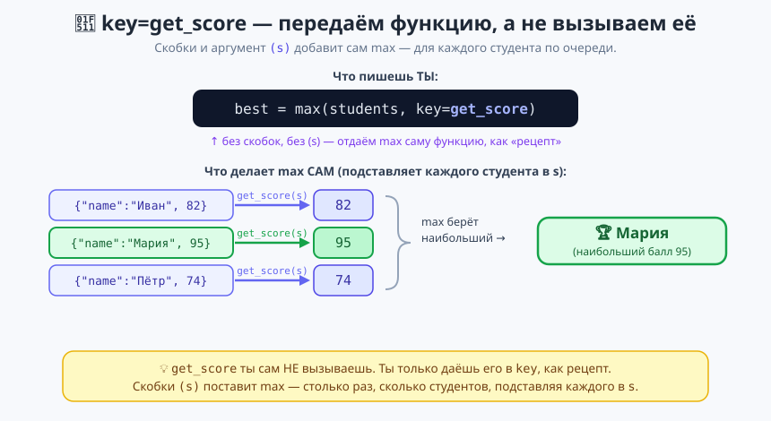

> Важно: в `key` пишем **саму функцию без скобок** (`key=len` или `key=lambda …`). Скобки поставит уже `max`/`sorted`, когда будет применять её к каждому элементу.

#### Сортировка и функции-сборщики

```python
sorted(nums)                 # новый отсортированный список (оригинал цел)
nums.sort()                  # сортирует НА МЕСТЕ, возвращает None
sorted(words, key=len)       # по длине (готовая функция len)
sorted(data, key=lambda d: d["год"], reverse=True)   # по полю, по убыванию

sum([1, 2, 3])               # 6
min(nums) / max(nums)        # наименьший / наибольший
max(students, key=lambda s: s["балл"])   # элемент с макс. признаком
all(x > 0 for x in nums)     # True, если ВСЕ подходят
any(x < 0 for x in nums)     # True, если ХОТЬ ОДИН подходит
```

> Подвохи: `nums.sort()` возвращает `None` (не присваивай его!). У пустого списка `all([])` = `True`, а `any([])` = `False`.

#### `map` и `filter` (встречаются в чужом коде)

```python
list(map(lambda x: x ** 2, nums))        # применить к КАЖДОМУ  → [1, 4, 9, ...]
list(filter(lambda x: x % 2 == 0, nums)) # оставить ПОДХОДЯЩИЕ   → [2, 4]
```
> В своём коде пиши генераторы (`[x**2 for x in nums]`) — короче и понятнее. `map`/`filter` просто узнавай.

#### `*args` и `**kwargs` — любое число аргументов

Обычная функция принимает фиксированное число аргументов. Чтобы принять **сколько угодно** — ставят звёздочку:

```python
def total(*args):        # звёздочка «собирает» все числа в кортеж args
    return sum(args)

total(1, 2, 3)           # 6
total(10, 20, 30, 40)    # 100
```

- **`*args`** собирает аргументы **без имени** в кортеж.
- **`**kwargs`** собирает аргументы **с именем** (`имя=значение`) в словарь.

Можно смешивать обычный параметр и звёздочки:
```python
def hero_card(name, **stats):     # name — обычный; stats — словарь остального
    print(f"Герой: {name}")
    for key, value in stats.items():
        print(f"  {key} — {value}")

hero_card("Ния", role="маг", level=7)
# Герой: Ния
#   role — маг
#   level — 7
```

> Имена `args`/`kwargs` — по договорённости; магию делает звёздочка. Можно `*nums`, `**options`.

**Звёздочка при ВЫЗОВЕ работает наоборот — распаковывает** готовую коллекцию в отдельные аргументы:
```python
def greet(name, age):
    print(name, age)

data = ["Иван", 15]
greet(*data)             # то же, что greet("Иван", 15)
info = {"name": "Иван", "age": 15}
greet(**info)            # то же, что greet(name="Иван", age=15)
```

> `*` в объявлении = «много значений → одна коробка». `*` в вызове = «коробка → много значений».

#### Методы строк

```python
"привет мир".split()        # ['привет', 'мир']   — по пробелам
"a,b,c".split(",")          # ['a', 'b', 'c']     — по разделителю
"-".join(["2026", "01"])    # '2026-01'           — склеить (вызывает разделитель!)
"  Привет ".strip()         # 'Привет'            — убрать пробелы по краям
"Привет".lower()            # 'привет'    .upper() → 'ПРИВЕТ'
"Я учу Python".replace("Python", "ML")   # 'Я учу ML'
"файл.py".endswith(".py")   # True        .startswith("фай") → True
"hello".count("l")          # 2
"123".isdigit()             # True        — строка из одних цифр?
```

> Запомни: разделитель **вызывает** `join`, список передаётся внутрь — `"-".join(список)`, а не наоборот.

#### f-строки — подставить значение в текст

```python
name, avg = "Иван", 4.375

f"{name}: {avg:.2f}"        # 'Иван: 4.38'   — :.2f = два знака после запятой
f"{avg * 100:.1f}%"         # '437.5%'
f"{name:<10}|"              # 'Иван      |'  — выровнять влево, ширина 10
f"Сумма: {2 + 3}"           # 'Сумма: 5'     — внутри можно выражение
```

---

### Урок 1.4 — NumPy

#### Что такое NumPy

**NumPy** — библиотека для быстрых вычислений с массивами чисел. Она — фундамент всего ML: Pandas, scikit-learn, PyTorch устроены поверх неё.

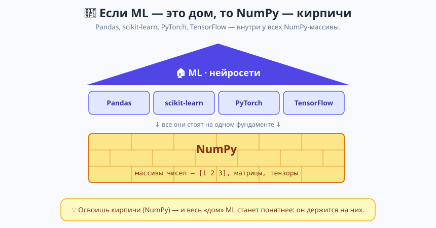

> Если ML — это дом, то NumPy — кирпичи, из которых он сложен. Сам по себе NumPy нейросети не обучает — он просто **очень быстро** считает с числами (в десятки раз быстрее обычного Python), а всё остальное построено на нём.

Подключают всегда так:
```python
import numpy as np    # np — общепринятое сокращение
```

#### 4 слова, которые надо знать

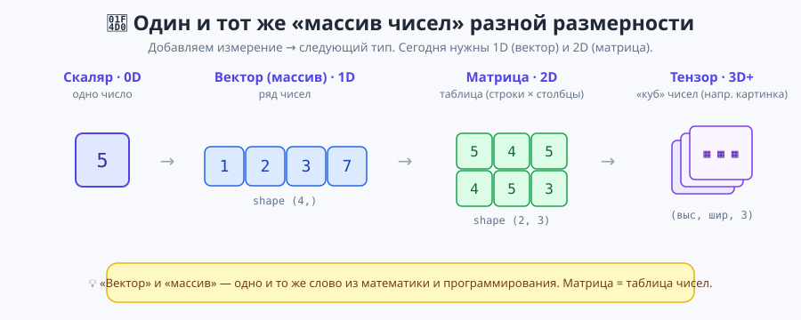

- **Скаляр** — одно число (`5`).
- **Вектор** (он же массив) — ряд чисел (`[1, 2, 3]`).
- **Матрица** — таблица чисел (строки × столбцы), как классный журнал.
- **Тензор** — «куб» и больше (например, цветная картинка). Пока хватит вектора и матрицы.

> Это один и тот же объект «массив чисел», просто разной размерности — добавили направление, получили следующий тип.

#### Создание массивов

```python
a = np.array([1, 2, 3, 4, 5])     # из обычного списка
m = np.array([[1, 2, 3],          # список списков → матрица
              [4, 5, 6]])

np.zeros(5)          # [0. 0. 0. 0. 0.]      — пять нулей
np.ones((2, 3))      # матрица 2×3 из единиц
np.full((2, 2), 7)   # матрица 2×2 из семёрок
np.arange(0, 10, 2)  # [0 2 4 6 8]           — как range (конец не входит)
np.linspace(0, 1, 5) # [0. 0.25 0.5 0.75 1.] — 5 точек от 0 до 1, концы включены
np.random.rand(3)    # 3 случайных числа от 0 до 1
```

**Свойства массива** — их проверяют постоянно:
```python
a.shape    # (5,)   — ФОРМА (сколько чего). У матрицы (строки, столбцы)
a.dtype    # int64  — тип чисел внутри
a.ndim     # 1      — сколько измерений (1 вектор, 2 матрица)
a.size     # 5      — всего чисел
```

> Сломался код в NumPy? Первым делом печатай `.shape` — 90% ошибок из-за несовпадения форм.

**Зерно случайности — `np.random.seed`:**
```python
np.random.seed(42)   # «зерно» генератора
np.random.rand(3)    # теперь ВСЕГДА выдаёт одни и те же 3 числа
```
> Компьютер «выращивает» случайные числа из стартового числа-зерна. Одинаковое зерно → одинаковые числа. Нужно, чтобы у тебя и у учителя код давал **один и тот же** результат (иначе не сравнить). 42 — просто традиция.

#### Индексы и срезы

```python
a = np.array([10, 20, 30, 40, 50])
a[0]        # 10   — первый (счёт с 0)
a[-1]       # 50   — последний
a[1:4]      # [20 30 40]        — с 1 по 4 (4 НЕ входит)
a[::-1]     # [50 40 30 20 10]  — задом наперёд
a[::2]      # [10 30 50]        — каждый второй
```

**У матрицы два индекса — через запятую: `m[строка, столбец]`.**

![Схема: индексы матрицы m[строка, столбец]; строка, столбец, ячейка](модули/01-python-и-математика/урок-04-numpy/изображения/индексация-2d.svg)

```python
m = np.array([[1, 2, 3],
              [4, 5, 6],
              [7, 8, 9]])

m[1, 2]     # 6             — строка 1, столбец 2
m[0]        # [1 2 3]       — вся строка 0
m[:, 0]     # [1 4 7]       — весь столбец 0 (: = «все строки»)
m[0:2, 1:3] # [[2 3],[5 6]] — прямоугольный кусок
```

> «:» на месте индекса значит «все по этой оси». Поэтому столбец достают так: `m[:, номер]`.

**Фильтр по условию (булева маска)** — самая полезная фишка:
```python
a = np.array([10, 20, 30, 40])
a[a > 25]              # [30 40]    — оставить те, что больше 25
a[(a > 15) & (a < 45)] # [20 30 40] — два условия: & это И, | это ИЛИ (в скобках!)
(a > 25).sum()         # 2          — сколько элементов подходит
a[a < 0] = 0           # заменить все отрицательные на 0
```

#### Векторизация — операции без цикла

Операция применяется **сразу ко всему массиву**, никакого `for`:

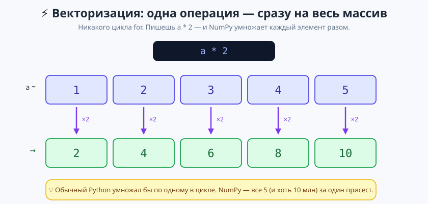

```python
a = np.array([1, 2, 3, 4])
a + 10       # [11 12 13 14]
a * 2        # [2 4 6 8]
a ** 2       # [1 4 9 16]
np.sqrt(a)   # корень из каждого    (ещё: np.abs, np.round, np.exp, np.log)

# два массива одной длины — поэлементно
prices = np.array([100, 50, 200])
qty    = np.array([2, 3, 1])
(prices * qty).sum()   # 550 — общий чек
```

> Операция создаёт **новый** массив, исходный не меняется (`b = a * 2` — `a` цел).

#### Broadcasting — операции между разными формами

NumPy умеет «растягивать» меньший массив под больший:
```python
m = np.array([[1, 2, 3], [4, 5, 6]])
row = np.array([10, 20, 30])
m + row     # [[11 22 33], [14 25 36]]  — вектор прибавился к каждой строке
```

#### Агрегации — «схлопнуть» массив в число

```python
a.sum()      # сумма
a.mean()     # среднее
a.min() / a.max()
a.std()      # стандартное отклонение («насколько числа разбросаны»)
a.argmax()   # ИНДЕКС, где максимум (не само число!)
a.argmin()   # ИНДЕКС минимума
```

**Параметр `axis` — по какому направлению считать** (у матрицы):
```python
m.sum()          # 21 — сумма всех
m.sum(axis=0)    # [5 7 9]  — вниз по столбцам (строки схлопнулись)
m.sum(axis=1)    # [6 15]   — вправо по строкам (столбцы схлопнулись)
```
> Мнемоника: `axis=0` — «вниз», остаётся строка-итог по столбцам. `axis=1` — «вправо», остаётся столбец-итог по строкам. Спроси себя: «что я хочу схлопнуть?».

#### Reshape — поменять форму

```python
a = np.arange(12)     # 12 чисел
a.reshape(3, 4)       # 3 строки по 4 (числа те же, раскладка другая)
a.reshape(2, -1)      # -1 = «посчитай сам» → (2, 6)
m.flatten()           # матрицу обратно в один ряд
```
> Число элементов до и после `reshape` должно совпадать (12 = 3×4 = 2×6). В ML картинку 28×28 часто «распрямляют» в вектор 784: `image.reshape(-1)`.

---

### Урок 1.5 — Линейная алгебра

#### Зачем это

Вся нейросеть — это умножения **векторов** и **матриц** чисел. «Вход × веса» = сложить все произведения = одно число. Звучит сложно, а на деле — умножение и сложение школьного уровня.

#### Вектор — стрелка и массив

Вектор `[3, 5]` — это и массив чисел, и стрелка из точки (0,0): «3 вправо, 5 вверх».

![Схема: вектор [3,5] как стрелка](модули/01-python-и-математика/урок-05-линейная-алгебра/изображения/вектор-стрелка.svg)

```python
a = np.array([3, 5]);  b = np.array([2, 1])

a + b        # [5 6]   — сложение поэлементно (стрелки «хвост к голове»)
a - b        # [1 4]   — вычитание тоже поэлементно
3 * a        # [9 15]  — умножение на число растягивает стрелку
```

**Длина вектора (норма)** — через теорему Пифагора: корень из суммы квадратов.

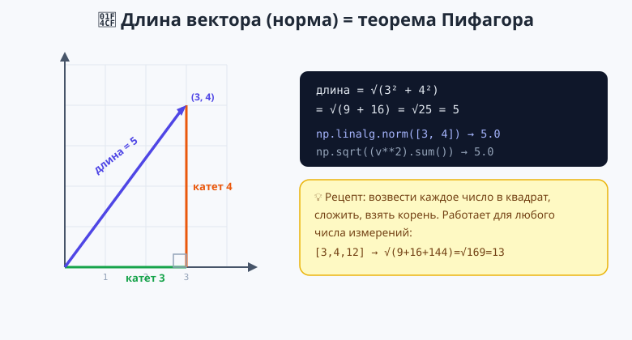

```python
np.linalg.norm([3, 4])        # 5.0        — √(3² + 4²)
np.sqrt((np.array([3,4])**2).sum())   # 5.0 — то же вручную

# расстояние между точками = длина их разности
np.linalg.norm(np.array([4, 6]) - np.array([1, 2]))   # 5.0
```

#### Скалярное произведение (dot product)

Перемножить два вектора **по парам** и сложить → **одно число**. Это и есть «вход × веса».

![Схема: скалярное произведение [1,2,3]·[4,5,6]=32](модули/01-python-и-математика/урок-05-линейная-алгебра/изображения/скалярное-произведение.svg)

```python
a = np.array([1, 2, 3]);  b = np.array([4, 5, 6])

a @ b              # 32  — 1·4 + 2·5 + 3·6 (рекомендуемый стиль)
np.dot(a, b)       # 32  — то же
(a * b).sum()      # 32  — то же вручную
```

> Векторы должны быть **одной длины**. Знак и величина говорят о «похожести направлений»: большое «+» → похожи, 0 → не связаны, «−» → противоположны.

**Косинусная похожесть** — «насколько похожи», число от −1 до 1:
```python
cos = (a @ b) / (np.linalg.norm(a) * np.linalg.norm(b))
```
Формулу **не зубрят, а выводят** из `a·b = |a|·|b|·cos`: делим обе части на `|a|·|b|` (как `3x=12 → x=4`), длины сокращаются, остаётся `cos`.

> Не путай: `a`, `b` — это **векторы**. Сверху `a @ b` — их скалярное произведение; снизу `norm(a)` — **длина** вектора. Делим на длины, чтобы убрать «размер» и оставить чистый угол. Так работают рекомендации «вам может понравиться».

#### Транспонирование

`A.T` — строки становятся столбцами: форма (2, 3) → (3, 2). Нужно, когда формы матриц «не стыкуются» для умножения.
```python
A = np.array([[1, 2, 3], [4, 5, 6]])
A.T          # [[1 4], [2 5], [3 6]]
A.T.shape    # (3, 2)
```
> `A.T` пишется **без скобок** (это атрибут, как `.shape`, а не метод). Саму `A` не меняет — отдаёт новую «набок». Нужна перевёрнутая дальше — сохрани `B = A.T`.

#### Умножение матриц — `@`

Главная операция нейросетей. Элемент результата = **скалярное произведение строки первой матрицы и столбца второй**.

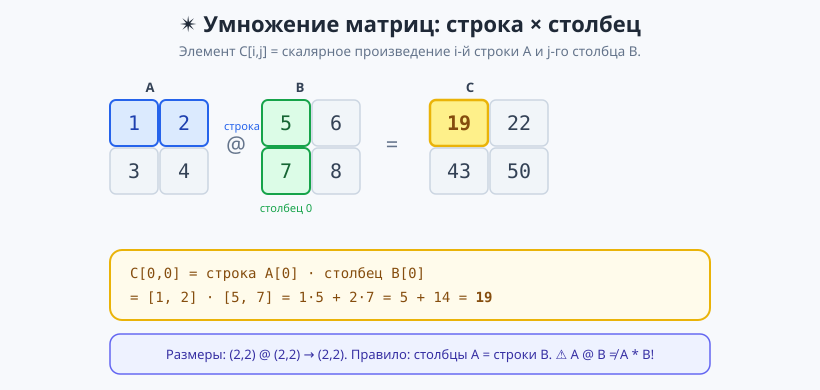

```python
A = np.array([[1, 2], [3, 4]])
B = np.array([[5, 6], [7, 8]])

A @ B        # [[19 22], [43 50]] — матричное умножение
A * B        # [[5 12], [21 32]] — ПОЭЛЕМЕНТНОЕ, это другое!
```

> **Правило размерностей:** `(m, n) @ (n, k)` → `(m, k)`. Два **средних** числа должны совпасть, два крайних — форма результата. ⚠️ `@` (матричное) ≠ `*` (поэлементное) — в ML почти всегда нужен `@`.

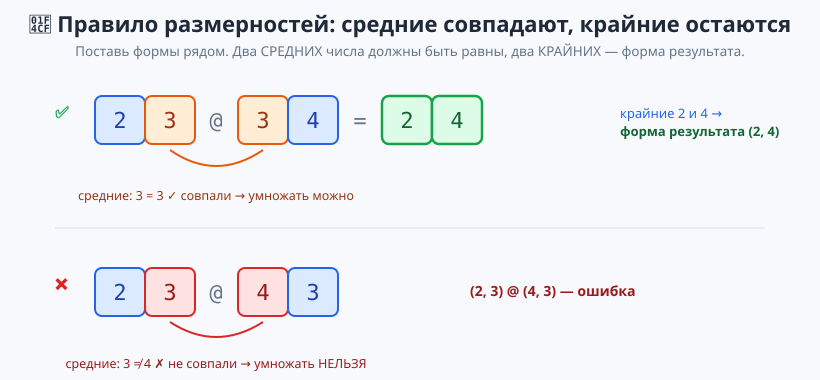

> `(3, 1)` — это **вектор-столбец** (3 числа «столбиком»). Поэтому `(2, 3) @ (3, 1) → (2, 1)` — это «матрица × вектор».

**Матрица × вектор — простейший «слой нейросети»:**
```python
W = np.array([[0.1, 0.2, 0.3],      # веса (2 нейрона, 3 входа)
              [0.4, 0.5, 0.6]])
x = np.array([1, 2, 3])             # вход

W @ x        # [1.4 3.2] — каждая строка весов · вход = ответ одного нейрона
```

**Один нейрон** = скалярное произведение входа и весов + смещение: `x @ w + b`. **Вся сеть — цепочка** таких умножений, где формы стыкуются как домино (вход 784 → 128 → 64 → 10):

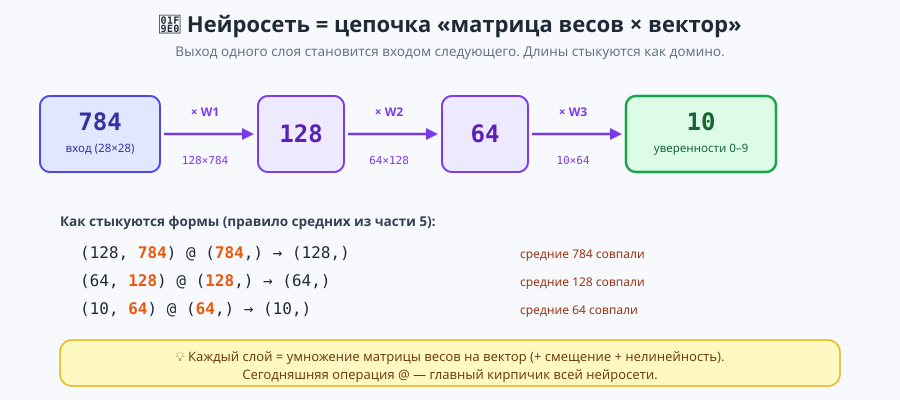

| Операция | NumPy |
|---|---|
| Длина вектора | `np.linalg.norm(v)` |
| Расстояние между точками | `np.linalg.norm(a - b)` |
| Скалярное произведение | `a @ b` |
| Косинусная похожесть | `(a @ b) / (norm(a) * norm(b))` |
| Транспонирование | `A.T` |
| Умножение матриц / слой | `A @ B`, `W @ x` |

---

### Урок 1.6 — Статистика

#### Зачем это

Статистика — как **одним-двумя числами описать целую гору данных**. «Какой класс в среднем?», «насколько разные ученики?», «связаны ли две величины?». В ML с этого начинается **любой** анализ датасета.

#### Меры центра: среднее, медиана, мода

Все три отвечают «какое число представляет всю выборку?», но по-разному.

```python
import numpy as np
grades = [4, 5, 5, 3, 4, 5, 4, 3, 4, 5]

np.mean(grades)      # 4.2  — среднее (сумма / количество)
np.median(grades)    # 4.0  — медиана (центральное в отсортированном ряду)
# мода — самое частое число:
from scipy import stats
stats.mode(grades).mode   # 4
```

- **Среднее** — хорошо для «ровных» данных без выбросов.
- **Медиана** — честнее, когда есть **выброс** (одно огромное/крошечное число).
- **Мода** — для категорий (любимый цвет, оценка 1–5).

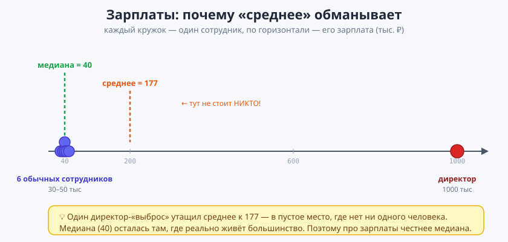

> 📌 Классика: зарплаты `[30,35,40,40,45,50,1000]`. Среднее = 177 (его утянул директор, там не стоит никто!), а медиана = 40 — там, где реально большинство.

#### Разброс: дисперсия и std

Насколько числа «разлетаются» от среднего.

```python
data = np.array([4, 5, 5, 3, 4, 5, 4, 3, 4, 5])

data.max() - data.min()   # 8    — размах (грубо)
np.var(data)              # 0.56 — дисперсия (среднее квадратов отклонений)
np.std(data)              # 0.75 — стандартное отклонение = √дисперсии
```

Как считается std по шагам: **(1)** данные → **(2)** среднее → **(3)** отклонение `x − среднее` у каждого → **(4)** в квадрат (чтобы минусы не сократились) → **(5)** усреднили = дисперсия → **(6)** корень = std.

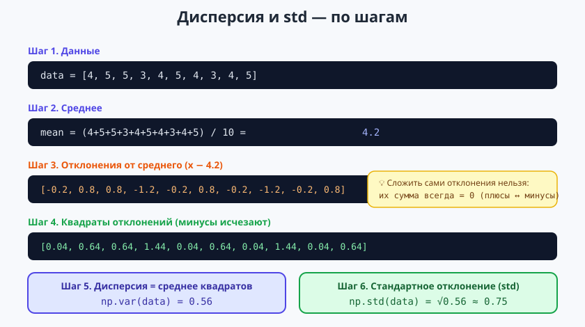

Маленькое std → числа кучкуются возле среднего; большое → разлетаются широко:

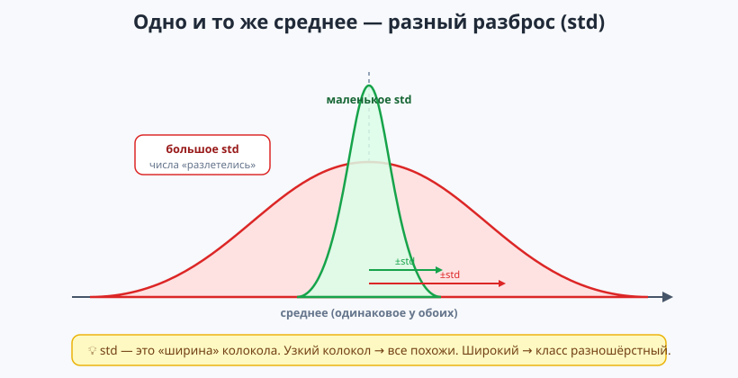

> std — это «ширина» горки. Маленькое → все похожи. Большое → разброс.

**Стандартизация (Z-score)** — привести данные к среднему 0 и std 1, чтобы признаки разного масштаба (рост и зарплата) соревновались честно:
```python
z = (data - data.mean()) / data.std()   # теперь mean≈0, std≈1
```
Здесь `x` — одно число, `mean` — среднее выборки, `std` — её разброс. После этого `z = +1` значит «на 1 std выше среднего» — хоть для роста, хоть для зарплаты.

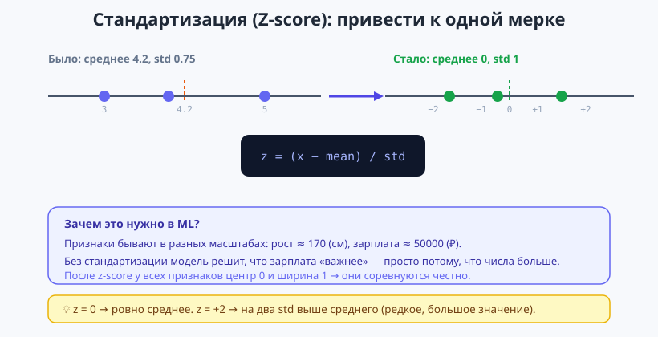

#### Распределения и matplotlib

**Гистограмма** показывает **форму** данных. Рисуют библиотекой **matplotlib**:

```python
import matplotlib.pyplot as plt

plt.hist(data, bins=20)      # столбики: bins — сколько «корзин»
plt.xlabel("Значение")       # подпись оси X (снизу)
plt.ylabel("Сколько чисел")  # подпись оси Y (слева)
plt.title("Заголовок")       # заголовок сверху
plt.show()                   # показать картинку (последней!)
```

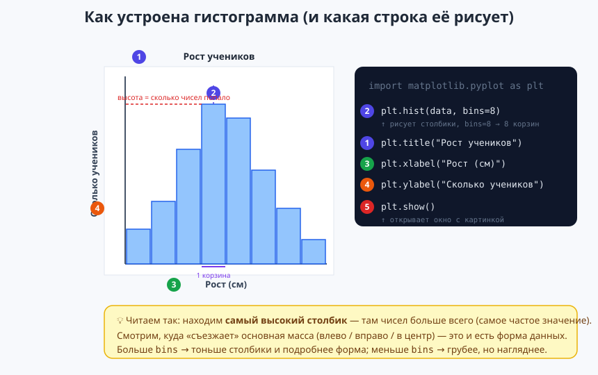

**Как читать гистограмму:** высокий столбик = сюда попало много чисел. Смотрим на общую форму — «забор», «колокол» или перекос.

**Равномерное** распределение → все столбики ≈ равны (все значения равновероятны). Пример — броски кубика:

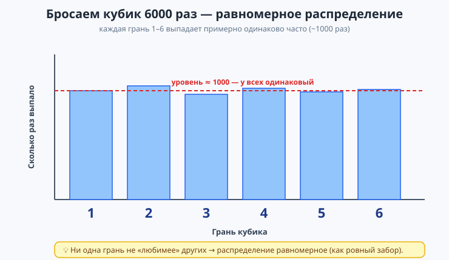

```python
rolls = np.random.randint(1, 7, 6000)   # 1..6 (7 НЕ входит!)
plt.hist(rolls, bins=6)
```

**Нормальное** распределение («колокол») → высоко в центре, низко по краям (`np.random.normal(175, 10, 1000)`):

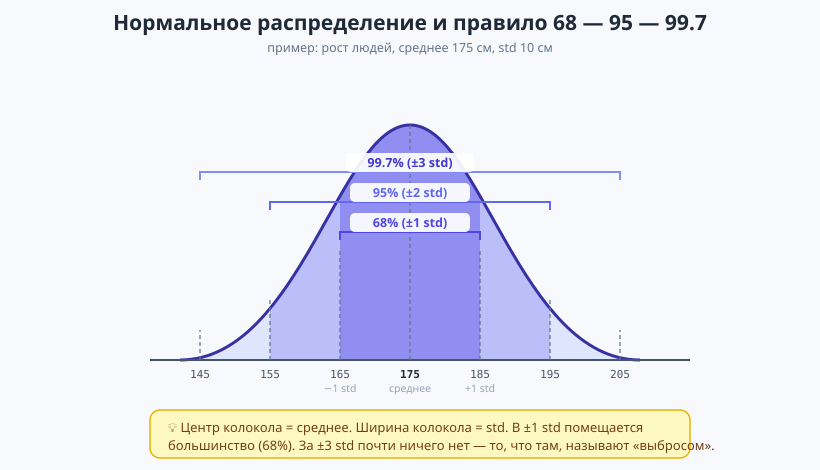

> 📌 **Правило 68 — 95 — 99.7** (для «колокола»): в ±1 std помещается 68% данных, в ±2 std — 95%, в ±3 std — 99.7%. То, что за ±3 std, — «выброс».

#### Корреляция — связь двух величин

Число от **−1 до +1**: +1 растут вместе, 0 не связаны, −1 зеркально.

```python
height = np.array([160, 165, 170, 175, 180, 185])
weight = np.array([55, 60, 65, 72, 78, 85])

np.corrcoef(height, weight)[0, 1]   # ≈ 0.99 — сильная прямая связь
```
> `np.corrcoef` возвращает матрицу 2×2 — нужное число берём как `[0, 1]`.

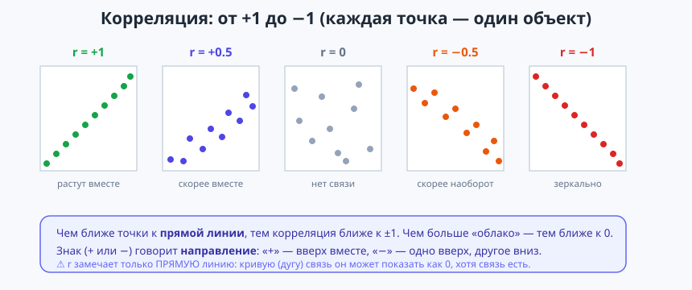

**На диаграмме рассеяния** (scatter) каждый объект — точка. Что означает число под каждой картинкой:

| Число | Точки | Значит |
|---|---|---|
| **+1** | идеальная линия ↗ вверх | растут **вместе и ровно** (товар и его цена) |
| **+0.5** | облако со склоном ↗ | «скорее вместе», но с разбросом (учёба и оценка) |
| **0** | бесформенное облако | **связи нет** (цвет глаз и оценки) |
| **−0.5** | облако со склоном ↘ | «скорее наоборот» (время в телефоне и оценки) |
| **−1** | идеальная линия ↘ вниз | одно растёт — другое **ровно** падает (потратил → осталось) |

> 🧭 **Знак** (+/−) = направление (вместе или наоборот), **величина** (ближе к 1 или к 0) = сила связи (чёткая линия или рыхлое облако).

> ⚠️ **Корреляция ≠ причина!** Продажи мороженого и утопления растут вместе (r≈0.98), но виновата **жара** — «скрытая переменная», а не мороженое. Всегда спрашивай: «а нет ли третьего фактора?».

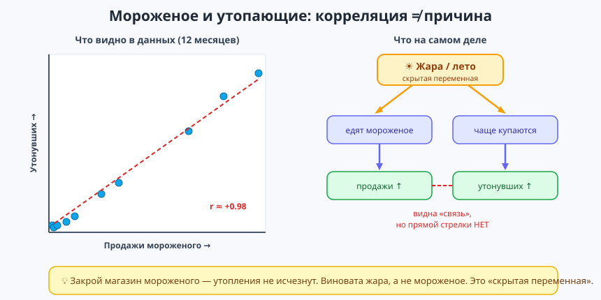

#### Частые ошибки

- `np.random.randint(1, 6, ...)` вместо `randint(1, 7, ...)` — теряется шестёрка (верхняя граница **не входит**).
- Считаешь долю по маске, но забываешь поделить: нужно `mask.sum() / len(data)` (или `mask.mean()`), а не просто `mask.sum()`.
- Путаешь `std` (разброс, ширина) и `mean` (центр) — это про разное.
- Думаешь, что раз коррелирует — значит одно вызывает другое. **Корреляция ≠ причина.**
- Забыл подключить библиотеку (`import numpy as np`, `import matplotlib.pyplot as plt`) → `NameError`.

#### 📋 Все команды урока 1.6

Полный список всего, с чем познакомились на этом уроке (`a` — массив чисел).

**Подключение библиотек**
| Команда | Что делает |
|---|---|
| `import numpy as np` | подключить NumPy (массивы и математика) |
| `import matplotlib.pyplot as plt` | подключить рисовалку графиков |
| `from scipy import stats` | подключить статистику SciPy (нужна для моды) |
| `from collections import Counter` | подключить счётчик частот |

**Меры центра**
| Команда | Что делает |
|---|---|
| `np.mean(a)` · `a.mean()` | среднее арифметическое |
| `np.median(a)` | медиана (центральное число) |
| `stats.mode(a).mode` | мода (самое частое число) |
| `stats.mode(a).count` | сколько раз встретилась мода |
| `Counter(a)` | словарь «число : сколько раз» |
| `Counter(a).most_common(1)` | самая частая пара `(значение, количество)` |
| `sum(a)` · `len(a)` | сумма чисел · сколько чисел (чистый Python) |

**Разброс**
| Команда | Что делает |
|---|---|
| `a.max()` · `a.min()` | самое большое · самое маленькое число |
| `a.max() - a.min()` | размах |
| `np.var(a)` · `a.var()` | дисперсия |
| `np.std(a)` · `a.std()` | стандартное отклонение (std) |
| `np.sqrt(x)` | квадратный корень |
| `a - a.mean()` | отклонения от среднего (broadcasting) |
| `a ** 2` | возвести каждый элемент в квадрат |
| `(a - a.mean()) / a.std()` | стандартизация (z-score) |

**Случайные числа**
| Команда | Что делает |
|---|---|
| `np.random.uniform(lo, hi, n)` | `n` дробных чисел от `lo` до `hi` (равномерно) |
| `np.random.randint(lo, hi, n)` | `n` целых чисел (верхняя граница `hi` **не входит**) |
| `np.random.normal(mean, std, n)` | `n` чисел по «колоколу» (среднее `mean`, разброс `std`) |
| `np.random.seed(0)` | зафиксировать случайность (одинаковый результат при каждом запуске) |

**Графики (matplotlib)**
| Команда | Что делает |
|---|---|
| `plt.hist(a, bins=20)` | гистограмма из `a`, `bins` — число столбиков |
| `plt.hist(a, bins=.., density=True)` | гистограмма, нормированная по площади |
| `plt.scatter(x, y)` | диаграмма рассеяния (точки) |
| `plt.xlabel("..")` · `plt.ylabel("..")` | подписи осей X и Y |
| `plt.title("..")` | заголовок графика |
| `plt.axvline(175, color='red')` | вертикальная линия (напр. на среднем) |
| `plt.show()` | показать готовый график (последней командой) |

**Связь величин**
| Команда | Что делает |
|---|---|
| `np.corrcoef(a, b)[0, 1]` | корреляция двух рядов (число от −1 до +1) |
| `(a >= lo) & (a <= hi)` | булева маска «число в диапазоне» (`True`/`False`) |
| `mask.sum()` · `mask.mean()` | сколько `True` · их доля |

---

### Урок 1.7 — Производная и градиент

#### Зачем это

Это **математика обучения** нейросетей. Производная подсказывает, **в какую сторону** и **насколько** подкрутить числа модели, чтобы она ошибалась меньше. Градиентный спуск повторяет это много раз — так ИИ «учится».

> 💬 **Вся тема одной картинкой.** Представь: ты с завязанными глазами стоишь на горке и хочешь спуститься на самое дно (дно = «модель почти не ошибается»). Ты щупаешь ногой, **куда склон идёт вниз**, и делаешь шаг туда. Потом снова щупаешь и снова шагаешь — пока не окажешься внизу.
> - «пощупать склон» = посчитать **производную / градиент**;
> - «шагнуть вниз» = сделать шаг **градиентного спуска**;
> - размер шага = **learning rate**.
>
> Вот и весь урок. Ниже — те же идеи по отдельности и с кодом.

#### Производная — скорость изменения

> **Производная** — это «спидометр функции»: насколько быстро меняется ответ, если чуть-чуть увеличить `x`. Геометрически — **наклон касательной**.

> 💬 **Простыми словами.** Это «крутизна горки» в конкретном месте. На крутом подъёме спидометр показывает много, на пологом — мало, на ровной площадке — ноль. Запись `f'(x)` («эф штрих») читается «производная функции `f`» — это и есть та самая крутизна.

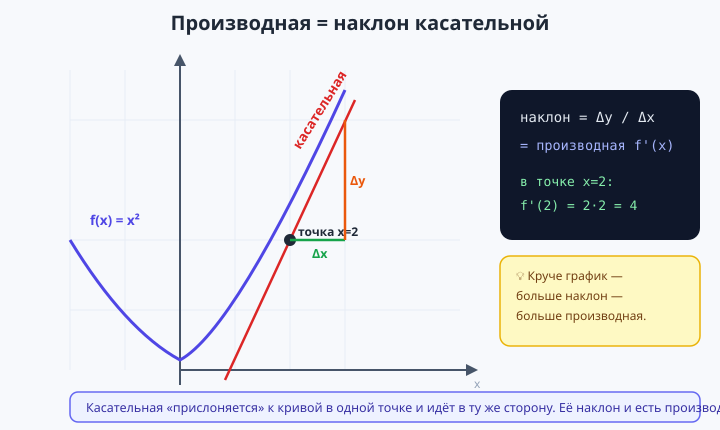

- наклон **вверх** (↗) → производная **> 0** (функция растёт);
- наклон **= 0** (ровно) → производная **0** (дно/вершина — минимум или максимум);
- наклон **вниз** (↘) → производная **< 0** (функция убывает).

> 💬 Зачем знать наклон? Он работает **как компас**: говорит, в какую сторону подкрутить число, чтобы ошибка стала меньше (идём туда, где наклон вниз).

**Правила (чтобы читать формулы):**

| Функция | Производная |
|---|---|
| `c` (число) | `0` |
| `x` | `1` |
| `x²` | `2x` |
| `xⁿ` | `n·xⁿ⁻¹` |
| `(f + g)` | `f′ + g′` |
| `(c·f)` | `c·f′` |
| `(f · g)` | `f′·g + f·g′` |

**Комбинации — для «составных» функций:**

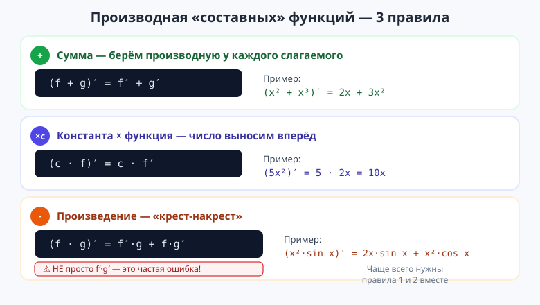

- **Сумма** — берём производную у каждого слагаемого: `(x² + x³)′ = 2x + 3x²`.
- **Константа × функция** — число выносим вперёд: `(5x²)′ = 5·2x = 10x`.
- **Произведение** — «крест-накрест»: `(x²·sin x)′ = 2x·sin x + x²·cos x`. ⚠️ Это **НЕ** просто `f′·g′` — частая ошибка!

> Наизусть учить не надо — на уроке производную считаем **численно кодом**.

#### Производная в коде (численно)

```python
def derivative(f, x, h=0.0001):
    return (f(x + h) - f(x - h)) / (2 * h)   # центральная разность

def f(x):
    return x ** 2
derivative(f, 5)      # ≈ 10  (а по формуле 2·5 = 10)
```
Идея: берём точку чуть правее и чуть левее, считаем «подъём / пробег». Работает для **любой** функции, без знания формул.

#### Градиент — производная для многих переменных

> **Градиент** — это **стрелка-подсказка «куда расти быстрее всего»** для функции нескольких переменных. Показывает и **направление**, и **крутизну**. Записывается `∇f`, это **вектор** из частных производных.

> 💬 **Простыми словами.** Если у функции несколько «ручек» (например, `w` и `b`), то производную считают **по каждой ручке отдельно** (это **частная производная** — крутим одну ручку, остальные замораживаем, как громкость и яркость у телевизора). Градиент — это **все эти наклоны, собранные в один список**: `[наклон по w, наклон по b]`. Одна стрелка-подсказка сразу для всех настроек.

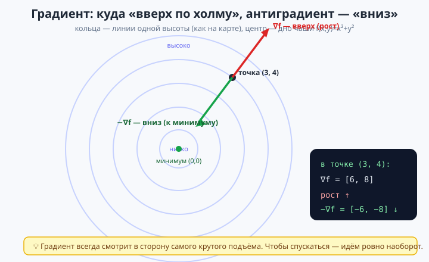

- **градиент** `∇f` → в сторону самого быстрого **роста** (вверх по холму);
- **антиградиент** `−∇f` → **вниз**, к минимуму.

> 💬 **Зачем антиградиент?** Градиент показывает «вверх, к бОльшей ошибке», а нам надо **вниз, к меньшей**. Поэтому берём градиент **с минусом** — и получаем направление «вниз». Правило: *градиент — это где верх, а нам нужен низ.*

```python
def numerical_gradient(f, point, h=0.0001):
    grad = np.zeros_like(point)           # корзинка под ответ
    for i in range(len(point)):
        p_plus, p_minus = point.copy(), point.copy()
        p_plus[i]  += h                   # двигаем ТОЛЬКО i-ю координату
        p_minus[i] -= h
        grad[i] = (f(p_plus) - f(p_minus)) / (2 * h)
    return grad

def f(p): return p[0]**2 + p[1]**2        # f(x,y) = x² + y²
numerical_gradient(f, np.array([3.0, 4.0]))   # ≈ [6, 8]
```

#### Градиентный спуск — так обучается нейросеть

> **Градиентный спуск** — способ **найти минимум вслепую**: щупаем, где склон вниз, и шагаем туда. «Дно» = наименьшая ошибка модели.

> 💬 **Простыми словами.** Тот самый «спуск с горы в тумане»: `посчитал градиент (куда вниз) → шагнул туда → повторил`. Три строчки кода — и это **буквально то, как учатся все нейросети** (только у них не 2 числа, а миллионы).

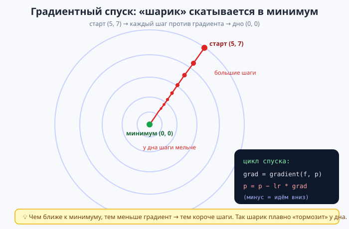

```python
point = np.array([5.0, 7.0])      # старт (числа float!)
lr = 0.1                          # learning rate — размер шага
for step in range(50):
    grad = numerical_gradient(f, point)
    point = point - lr * grad     # ШАГ ПРОТИВ градиента (минус = вниз)
# point → почти [0, 0] — скатились в минимум
```

**Learning rate (lr)** — длина шага:

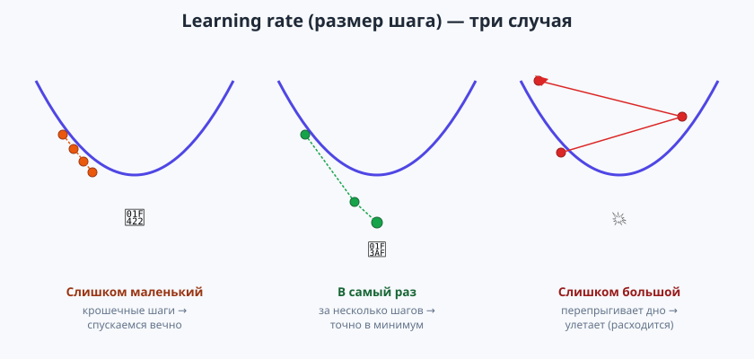

- слишком **большой** → перепрыгивает минимум, **расходится**;
- слишком **маленький** → идёт верно, но **очень медленно**;
- **в самый раз** → быстро и точно в минимум (подбирают: 0.1, 0.01, 0.001).

#### Частые ошибки

- Стартовая точка из **целых** чисел (`[5, 7]`) — обновления округлятся, спуск сломается. Нужно `[5.0, 7.0]` (float).
- Забыть **минус** в `point - lr * grad` → пойдём вверх, а не вниз.
- Внутри `numerical_gradient` менять `point` без `.copy()` — испортим исходную точку.
- Думать, что производную `x²` надо «угадать» — её можно просто **посчитать кодом**.

#### Все команды урока 1.7

| Команда | Что делает |
|---|---|
| `(f(x+h) - f(x-h)) / (2*h)` | численная производная (центральная разность) |
| `np.zeros_like(a)` | массив нулей той же формы, что `a` («корзинка») |
| `a.copy()` | независимая копия массива (чтобы не испортить оригинал) |
| `np.linspace(-5, 5, 100)` | 100 равномерных точек от −5 до 5 |
| `plt.plot(xs, ys)` | линия графика по точкам |
| `point - lr * grad` | шаг градиентного спуска (против градиента) |

---

## Модуль 2 — Работа с данными

### Урок 2.1 — Pandas: таблицы данных

> **Pandas** — библиотека для работы с **таблицами** (строки и столбцы). Это как Excel, только в коде и намного мощнее. С неё начинается **любой** анализ данных и подготовка данных для нейросети.
>
> 💬 **Простыми словами:** если NumPy — это про «массивы чисел», то Pandas — про «таблицы с названиями столбцов», как школьный журнал.

**Где пишем и откуда берём данные.** Весь код — в **Google Colab** ([colab.research.google.com](https://colab.research.google.com)), Pandas там уже установлен. Данные берём двумя способами (оба — прямо в коде, ничего не качая на компьютер):
1. создаём таблицу сами из словаря — `pd.DataFrame({...})`;
2. грузим готовый CSV по ссылке — `pd.read_csv("https://…/файл.csv")`.

```python
import pandas as pd          # стандартное сокращение — пишут везде
```

#### Два главных объекта: DataFrame и Series

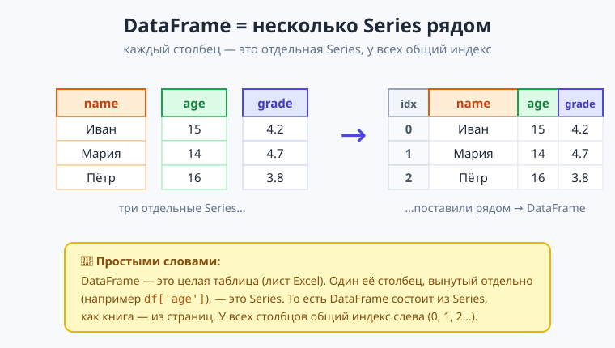

- **DataFrame** — вся таблица (лист Excel).
- **Series** — один столбец этой таблицы. Один столбец, вынутый из DataFrame (`df['age']`), — это Series.
- **index** — метка строки слева (по умолчанию 0, 1, 2…).

```python
# создаём таблицу из словаря: ключи -> столбцы, списки -> значения
df = pd.DataFrame({
    'name':  ['Иван', 'Мария', 'Пётр'],
    'age':   [15, 14, 16],
    'grade': [4.2, 4.7, 3.8],
})
```

#### Чтение и сохранение CSV

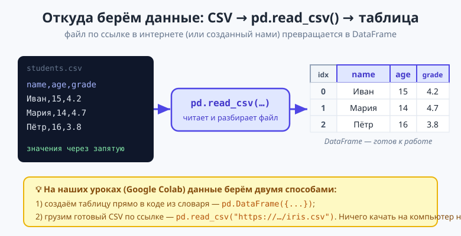

```python
df = pd.read_csv('students.csv')                 # из файла
df = pd.read_csv('https://…/iris.csv')           # прямо по ссылке из интернета
df.to_csv('output.csv', index=False)             # сохранить (index=False — без столбца номеров)
```

> **Проверенные датасеты для практики** (`pd.read_csv(URL)` загрузит их в Colab):
> - Iris (150 цветов): `https://raw.githubusercontent.com/mwaskom/seaborn-data/master/iris.csv`
> - Titanic (891 пассажир): `https://raw.githubusercontent.com/datasciencedojo/datasets/master/titanic.csv`
> - California Housing (20640 районов): `https://raw.githubusercontent.com/ageron/handson-ml2/master/datasets/housing/housing.csv`

#### Первый взгляд на таблицу

> 🎯 **Зачем:** как только загрузили новый датасет — надо понять, что внутри: сколько строк, какие столбцы, нет ли странных чисел.

| Команда | Что делает |
|---|---|
| `df.head()` / `df.tail()` | первые / последние 5 строк |
| `df.shape` | размер `(строк, столбцов)` — **без скобок!** |
| `df.columns` | имена столбцов |
| `df.dtypes` | типы столбцов (`int64`, `float64`, `object`=текст) |
| `df.info()` | сводка: столбцы, сколько непустых, типы |
| `df.describe()` | статистика по числовым столбцам (mean, std, min, max, квартили) |

#### Выбор столбцов и строк

```python
df['age']                 # один столбец (Series)
df[['name', 'age']]       # несколько столбцов — ДВОЙНЫЕ скобки (DataFrame)
df.iloc[0]                # строка по НОМЕРУ (как NumPy)
df.loc[0, 'name']         # ячейка: строка 0, столбец 'name'
```

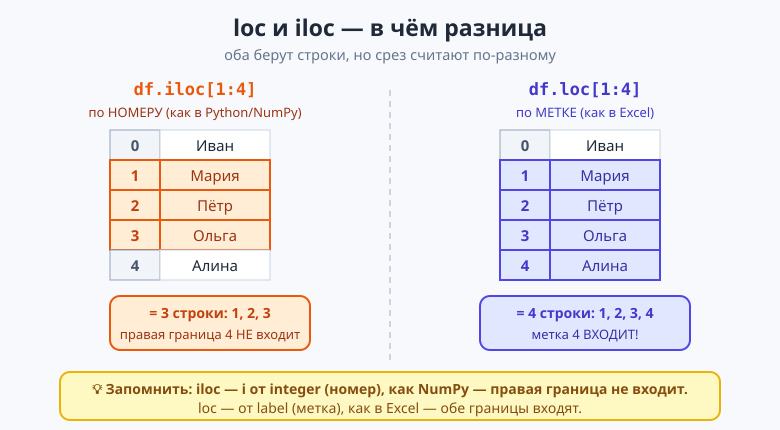

> 💬 **loc и iloc — главная путаница урока.** `iloc` — по **номеру** (i = integer), работает **как NumPy**: `iloc[1:4]` → строки 1, 2, 3 (правая граница не входит). `loc` — по **метке** (label), работает **как Excel**: `loc[1:4]` → строки 1, 2, 3, 4 (граница **входит**!).

#### Фильтрация (самое частое!)

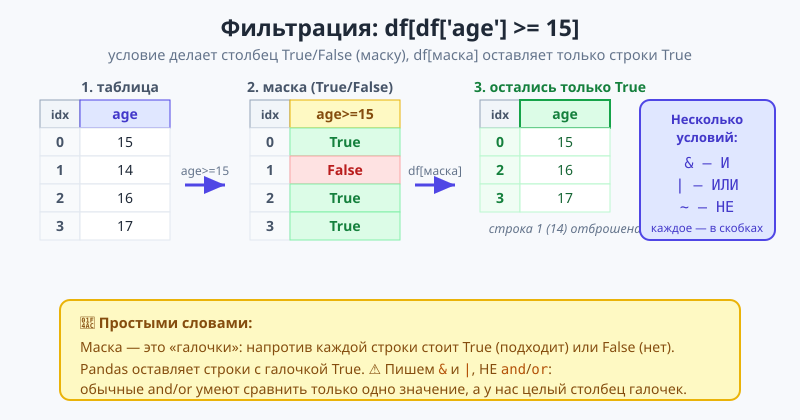

> 💬 **Как это работает.** Условие делает столбец «галочек» True/False (маску), а `df[маска]` оставляет только строки с True.

```python
df[df['age'] >= 15]                               # один критерий
df[(df['age'] >= 15) & (df['grade'] > 4.0)]       # И
df[(df['age'] < 15) | (df['grade'] > 4.5)]        # ИЛИ
df[~df['name'].isin(['Мария'])]                   # НЕ
df[df['name'].isin(['Иван', 'Пётр'])]             # значение из списка
df[df['name'].str.startswith('М')]                # методы строк через .str
```

> ⚠️ **Главная ошибка:** писать `and`/`or` вместо `&`/`|`. Обычные `and`/`or` умеют сравнить только **одно** значение, а у нас целый столбец галочек. Нужны `&` (И), `|` (ИЛИ), `~` (НЕ), и **каждое условие в скобках**.

#### Сортировка, статистика, новый столбец

```python
df.sort_values('age')                      # по возрастанию
df.sort_values('age', ascending=False)     # по убыванию
df['age'].mean()                           # среднее (ещё: .median() .std() .min() .max() .sum())
df['class'].value_counts()                 # сколько раз встречается каждое значение
df['avg'] = (df['math'] + df['phys']) / 2  # новый столбец из других столбцов
```

> 💬 `value_counts()` — это «текстовая гистограмма»: сразу видно, каких значений сколько. Например, `df['Survived'].value_counts()` на «Титанике» покажет, сколько выжило и погибло.

#### 📒 Все команды Pandas одним списком

Держи под рукой — здесь вся «кнопочная панель» Pandas с переводом на человеческий язык.

**Загрузить / сохранить данные**

| Команда | Простыми словами |
|---|---|
| `import pandas as pd` | подключить Pandas (пишем один раз в начале) |
| `pd.read_csv('file.csv')` | прочитать таблицу из файла |
| `pd.read_csv('https://…/x.csv')` | прочитать таблицу **по ссылке** из интернета |
| `pd.DataFrame({...})` | создать таблицу прямо в коде из словаря |
| `df.to_csv('out.csv', index=False)` | сохранить таблицу в файл |

**Посмотреть, что внутри**

| Команда | Простыми словами |
|---|---|
| `df.head()` / `df.tail()` | показать первые / последние 5 строк |
| `df.shape` | размер: сколько строк и столбцов (без скобок!) |
| `df.columns` | список имён столбцов |
| `df.dtypes` | какого типа каждый столбец (число/текст) |
| `df.info()` | общий отчёт: столбцы, пропуски, типы |
| `df.describe()` | статистика по числам: среднее, min, max и т.д. |

**Достать кусочек таблицы**

| Команда | Простыми словами |
|---|---|
| `df['age']` | один столбец |
| `df[['name','age']]` | несколько столбцов (двойные скобки!) |
| `df.iloc[0]` | строка по **номеру** (счёт с 0, как NumPy) |
| `df.iloc[1:3]` | строки 1–2 (правая граница **не** входит) |
| `df.loc[0]` | строка по **метке** |
| `df.loc[1:3]` | строки 1–2–3 (граница **входит**, как Excel) |
| `df.loc[0, 'name']` | одна ячейка (строка 0, столбец name) |

**Отобрать нужные строки (фильтр)**

| Команда | Простыми словами |
|---|---|
| `df[df['age'] >= 15]` | кому 15 и больше |
| `df[(df['age']>=15) & (df['math']==5)]` | И: оба условия верны (`&`, не `and`!) |
| `df[(df['a']>1) \| (df['b']>2)]` | ИЛИ: хотя бы одно (`\|`, не `or`!) |
| `df[~df['class'].isin(['9А'])]` | НЕ: наоборот (`~`, не `not`!) |
| `df[df['class'].isin(['9А','9Б'])]` | значение из списка |
| `df[df['name'].str.startswith('А')]` | имя **начинается** с 'А' |
| `df[df['name'].str.contains('и')]` | имя **содержит** 'и' |
| `df[df['name'].str.len() > 4]` | **длина** имени больше 4 |

**Упорядочить, посчитать, добавить**

| Команда | Простыми словами |
|---|---|
| `df.sort_values('age')` | отсортировать по столбцу (по возрастанию) |
| `df.sort_values('age', ascending=False)` | по убыванию |
| `df['math'].mean()` | среднее (ещё `.median() .std() .min() .max() .sum()`) |
| `df['class'].value_counts()` | сколько раз встречается каждое значение |
| `df['avg'] = (df['math']+df['phys'])/2` | добавить новый столбец из других |

#### Частые ошибки

| Ошибка | Что не так | Правильно |
|---|---|---|
| `df[df['a']>5 and df['b']>0]` | `and` не работает со столбцами | `df[(df['a']>5) & (df['b']>0)]` |
| `df.shape()` | `shape` — атрибут, без скобок | `df.shape` |
| `df.sort('age')` | такого метода нет | `df.sort_values('age')` |
| `df.avg = ...` | через точку создаётся не столбец | `df['avg'] = ...` |
| ждут от `iloc[0:5]` 6 строк | `iloc` не включает правую границу | помни: `iloc` как NumPy |

#### ➕ `groupby` — посчитать по группам (пригодится в заданиях)

> 💬 **Простыми словами:** `groupby('столбец')` раскладывает строки по «кучкам» (по классам, по полу, по виду) и считает что-то **в каждой кучке отдельно**. Читается: «сгруппировать по… и взять среднее/сумму/количество».

```python
df.groupby('class')['math'].mean()     # средняя математика В КАЖДОМ классе
df.groupby('Sex')['Age'].median()      # медиана возраста отдельно у м и ж
df.groupby('class')['math'].max()      # максимум в каждом классе (ещё .min() .sum() .count())
```

Шаблон: `df.groupby('по_чему')['что_считаем'].операция()`. Результат — тоже данные, его можно отсортировать: `… .sort_values(ascending=False)`.

---

### Урок 2.2 — Очистка данных

> **Очистка данных** — приводим «грязную» таблицу в порядок: заполняем пропуски, убираем дубликаты, чиним типы. Это ~80% работы с данными, потому что настоящие данные всегда с «дырами» и ошибками.
>
> 💬 **Простыми словами:** нейросеть не умеет работать с пустыми клетками и с числами, записанными как текст — она сломается. Поэтому сначала таблицу «моем».

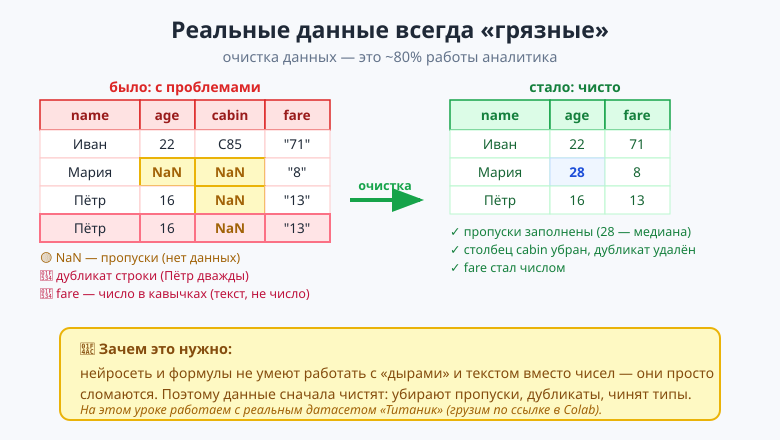

**NaN — что это.** `NaN` (Not a Number) — это **пустая клетка**, «здесь нет данных». Как незаполненная графа в анкете.

#### Шаг 1. Найти пропуски

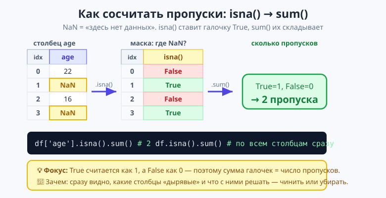

```python
df.info()              # сводка: где сколько непустых значений
df.isna().sum()        # сколько пропусков в каждом столбце
(df.isna().sum() / len(df) * 100).round(1)   # в процентах
```
💬 `isna()` ставит галочку `True` там, где пропуск; `sum()` их складывает (True=1). Получаем число дыр по каждому столбцу.

#### Шаг 2. Удалить или заполнить?

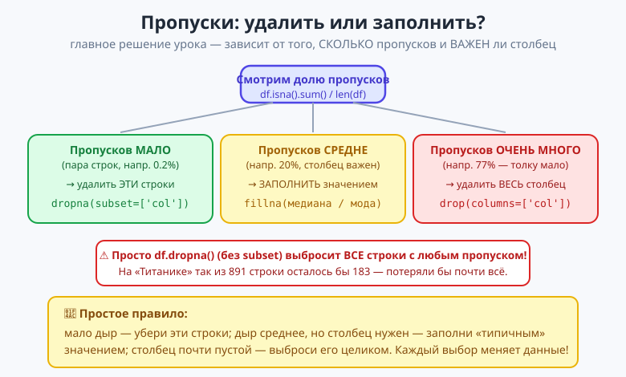

Простое правило: **мало** дыр → убери эти строки; дыр **средне**, но столбец нужен → **заполни**; столбец **почти пустой** → выброси целиком.

```python
df.dropna(subset=['Age'])      # удалить строки, где пусто в Age (пропусков мало)
df.drop(columns=['Cabin'])     # удалить весь столбец (пропусков очень много)
```
> ⚠️ Просто `df.dropna()` без `subset` выбросит **все** строки с любым пропуском — на «Титанике» из 891 осталось бы 183. Слишком жёстко.

#### Шаг 3. Чем заполнять пропуски — `fillna()`

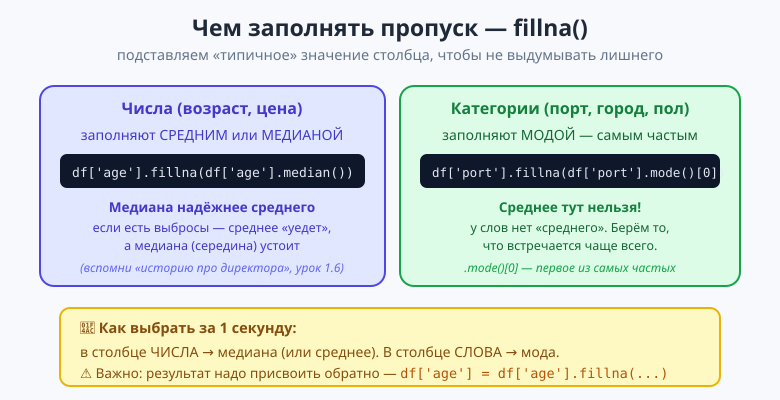

```python
df['Age'] = df['Age'].fillna(df['Age'].median())                  # числа → медиана
df['Embarked'] = df['Embarked'].fillna(df['Embarked'].mode()[0])  # слова → мода (самое частое)
```
💬 Для **чисел** берут среднее или медиану (медиана надёжнее — не боится выбросов, урок 1.6). Для **слов** — моду (у слов нет «среднего»).
> ⚠️ Обязательно присваивай результат обратно (`df['Age'] = ...`), иначе таблица не изменится.

#### Дубликаты, имена, типы

```python
df.duplicated().sum()                 # сколько строк-повторов
df = df.drop_duplicates()             # удалить повторы
df = df.rename(columns={'PassengerId': 'id'})   # переименовать столбцы
df.columns = df.columns.str.lower()   # все имена маленькими буквами
df['Age'] = df['Age'].astype(int)     # сменить тип (float/текст → целое)
```
> ⚠️ Нельзя `astype(int)`, если в столбце ещё есть NaN — сначала заполни/удали пропуски.

#### `.apply()` — своё правило для каждой строки

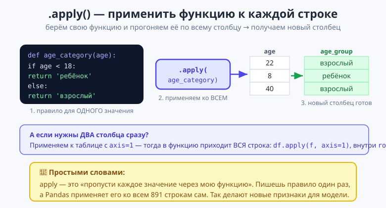

💬 `apply` берёт **твою функцию** и прогоняет её по всему столбцу. Пишешь правило один раз — Pandas применяет его ко всем строкам. Так делают **новые признаки**.

```python
def age_group(age):          # правило для одного значения
    if age < 18: return 'ребёнок'
    else: return 'взрослый'

df['age_group'] = df['Age'].apply(age_group)                 # к каждому значению столбца
df['fare_round'] = df['Fare'].apply(lambda x: round(x, 1))   # то же короткой lambda
df['has_family'] = df.apply(lambda r: r['SibSp'] + r['Parch'] > 0, axis=1)  # ко всей СТРОКЕ
```

#### 📒 Все команды очистки одним списком

| Команда | Простыми словами |
|---|---|
| `df.isna().sum()` | сколько пропусков по столбцам |
| `df.dropna(subset=['col'])` | убрать строки с дырой в столбце |
| `df.drop(columns=['col'])` | удалить весь столбец |
| `df['col'].fillna(df['col'].median())` | заполнить числа медианой |
| `df['col'].fillna(df['col'].mode()[0])` | заполнить категорию модой |
| `df.drop_duplicates()` | удалить повторяющиеся строки |
| `df.rename(columns={'A':'b'})` | переименовать столбцы |
| `df.columns = df.columns.str.lower()` | имена маленькими буквами |
| `df['col'].astype(int)` | сменить тип на целое число |
| `pd.to_datetime(df['col'])` | строку превратить в дату |
| `df['col'].apply(func)` | применить функцию к каждому значению |
| `df.apply(func, axis=1)` | применить функцию к целой строке |
| `pd.isna(x)` | правильная проверка «это пропуск?» |

#### Частые ошибки

| Ошибка | Что не так | Правильно |
|---|---|---|
| `x == NaN` | NaN не равен даже себе | `pd.isna(x)` |
| `df['Age'].fillna(...)` без `=` | результат не сохранился | `df['Age'] = df['Age'].fillna(...)` |
| `astype(int)` при наличии NaN | NaN — это float | сначала заполнить/удалить NaN |
| `df.dropna()` целиком | выбросит почти все строки | `dropna(subset=[...])` или `fillna` |

---

### Урок 2.3 — Графики

> **График** — это способ «увидеть» данные глазами. Таблица из 900 строк — стена цифр, а один график показывает закономерность за секунду: где связь, где выброс, как разбросаны значения.
>
> 💬 **Простыми словами:** рисовать данные нужно **до** обучения модели — чтобы понять, что внутри. Это первый шаг знакомства с любым датасетом.

Две библиотеки: **Matplotlib** (`import matplotlib.pyplot as plt`) — основа, рисует что угодно; **Seaborn** (`import seaborn as sns`) — красивая надстройка для статистики.

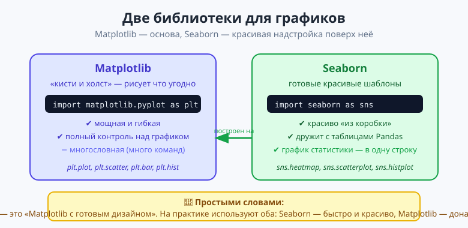

#### Правило №1: сначала выбери тип графика

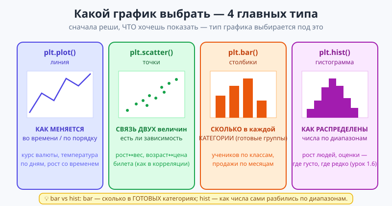

```python
plt.plot(x, y)              # ЛИНИЯ — как величина меняется (во времени/по порядку)
plt.scatter(x, y)          # ТОЧКИ — связь двух величин (как в корреляции)
plt.bar(categories, vals)  # СТОЛБИКИ — сколько в каждой категории
plt.hist(data, bins=30)    # ГИСТОГРАММА — как распределены числа
plt.show()                 # показать график
```
💬 **bar vs hist:** `bar` — сколько в **готовых** категориях; `hist` — как числа **сами** разбились по диапазонам (это «картинка [распределения](#урок-16--статистика)» из урока 1.6).

#### Правило №2: подписывай каждый график!

```python
plt.title("Заголовок")       # что это за график
plt.xlabel("ось X")          # что по горизонтали
plt.ylabel("ось Y")          # что по вертикали
plt.legend()                 # легенда (если у линий есть label=)
plt.grid()                   # сетка — легче читать значения
```
> ⚠️ График без заголовка и подписей осей — бесполезен: никто (даже ты через неделю) не поймёт, что нарисовано.

💬 **Легенда — в два шага.** Легенда это табличка «какой цвет что значит» (нужна, когда линий/цветов несколько). Шаг 1 — при рисовании каждой линии задать имя: `plt.plot(x, y, label='sin')`. Шаг 2 — один раз вызвать `plt.legend()`, он соберёт все имена. Забыл `label=` — легенда пустая; забыл `plt.legend()` — таблички нет. Нужны оба.

#### Несколько графиков рядом

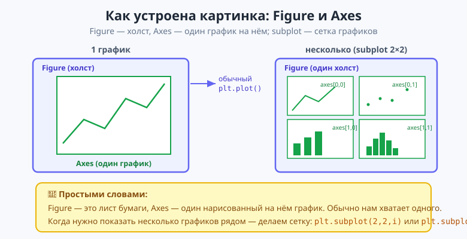

💬 **Figure** — лист бумаги (холст), **Axes** — один график на нём. Обычно хватает одного; когда нужно несколько — делаем сетку.

**Способ 1 — `plt.subplot(строки, столбцы, номер)`** (без `s`): делим холст на клетки и «переключаемся» в нужную.
```python
plt.subplot(1, 2, 1)   # холст 1 строка × 2 столбца, рисую в клетку №1 (левую)
plt.plot(x, y)
plt.subplot(1, 2, 2)   # тот же холст, клетка №2 (правая)
plt.plot(x, z)
```
💡 Три числа = «на сколько строк делим, на сколько столбцов, в какую клетку рисуем». Клетки нумеруются с 1, слева направо, сверху вниз.

**Способ 2 — `plt.subplots(строки, столбцы)`** (с `s`): создаёт всю сетку сразу, даёт «пульт» `axes`.
```python
fig, axes = plt.subplots(2, 2, figsize=(12, 8))   # сетка 2×2
axes[0, 0].hist(df['Age'], bins=30)               # к каждому — через axes[строка, столбец] (с 0, как NumPy)
axes[0, 0].set_title("Возраст")                   # ⚠️ у подграфиков методы с приставкой set_ (set_title, а не title)
plt.tight_layout()                                # убрать перекрытия подписей
```

#### Seaborn — красиво и для статистики

💬 **Главное отличие от Matplotlib:** Seaborn передают **всю таблицу** и **имена столбцов**, а он сам достаёт данные, подписывает оси и рисует легенду. Почти любой вызов выглядит одинаково:
```python
sns.ТИП(data=df, x='столбец1', y='столбец2', hue='столбец3')
# data = таблица целиком | x,y = столбцы для осей | hue = столбец, по которому РАСКРАСИТЬ (необязательный)
```

```python
# Тепловая карта корреляций — самый полезный график!
sns.heatmap(df.corr(numeric_only=True), annot=True, cmap='coolwarm', center=0)

sns.scatterplot(data=df, x='Age', y='Fare', hue='Survived')  # точки, цвет = категория
sns.regplot(data=df, x='Age', y='Fare')     # точки + линия тренда
sns.histplot(data=df, x='Age', kde=True)    # гистограмма + гладкая кривая
sns.countplot(data=df, x='Pclass')          # сколько в каждой категории (как value_counts)
```

#### Как читать тепловую карту (heatmap)

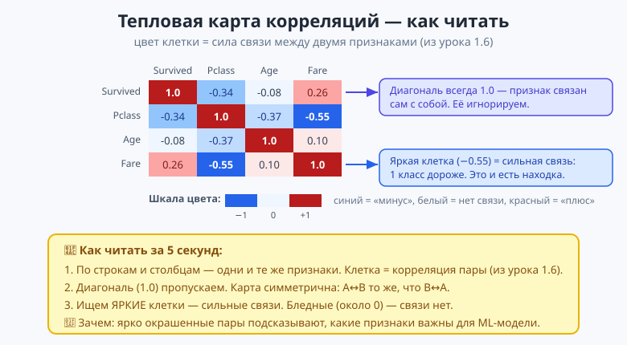

💬 По строкам и столбцам — одни и те же признаки. Клетка = [корреляция](#урок-16--статистика) пары (число от −1 до +1, урок 1.6). Диагональ всегда 1.0 (пропускаем), карта симметрична. Ищем **яркие** клетки — это сильные связи; бледные (около 0) — связи нет. 🎯 Ярко окрашенные пары подсказывают, какие признаки важны для ML-модели.

> ⚠️ **Важно:** корреляция ловит только **прямую** связь (чем больше X, тем ровно так же больше/меньше Y). Если связь **кривая** (дуга, парабола), `r` может быть близким к 0 или, наоборот, обмануть — покажет «связь есть», хотя линии нет. Поэтому рядом с heatmap всегда смотрят на `scatter` (вспомни квартет Анскомба из теории).

#### 📒 Все команды графиков одним списком

| Команда | Простыми словами |
|---|---|
| `plt.plot(x, y)` | линия: как меняется величина |
| `plt.scatter(x, y)` | точки: связь двух величин |
| `plt.bar(cat, vals)` | столбики по категориям |
| `plt.hist(data, bins=30)` | гистограмма: распределение чисел |
| `plt.title / xlabel / ylabel` | заголовок и подписи осей (обязательно!) |
| `plt.legend()` / `plt.grid()` | легенда / сетка |
| `plt.figure(figsize=(w, h))` | задать размер холста |
| `plt.savefig('f.png', dpi=150)` | сохранить в файл (до `show()`!) |
| `plt.subplot(1, 2, 1)` | клетка №1 сетки 1×2 (переключиться) |
| `plt.subplots(2, 2)` | создать всю сетку сразу (`fig, axes`) |
| `sns.heatmap(df.corr(...), annot=True)` | тепловая карта корреляций |
| `sns.scatterplot(..., hue='col')` | точки с раскраской по категории |
| `sns.regplot(...)` | точки + линия тренда |
| `sns.countplot(data=df, x='col')` | столбики «сколько каждого» (= value_counts) |
| `df['col'].plot.hist()` / `.plot.bar()` | быстрый график прямо из Pandas |

#### Частые ошибки

| Ошибка | Что не так | Правильно |
|---|---|---|
| нет `title`/подписей | график непонятен | всегда подписывай оси |
| `plt.show()` до `savefig()` | сохранится пустая картинка | сначала `savefig`, потом `show` |
| плотный scatter без `alpha` | точки сливаются в пятно | добавь `alpha=0.5` |
| у subplots `title(...)` | у подграфиков другой метод | `axes[i,j].set_title(...)` |

> 🔁 Связанные темы: [корреляция и распределение](#урок-16--статистика) (1.6), [value_counts и фильтры](#урок-21--pandas-таблицы-данных) (2.1), [dropna / fillna](#урок-22--очистка-данных) (2.2).

---

> 📌 Справочник растёт вместе с курсом: после каждого готового урока сюда добавляется новая тема.


## Модуль 3 — первые модели

Материалы ниже можно читать самостоятельно: определения, команды, примеры, схемы и результаты находятся прямо здесь. Каждый урок выполняй в отдельном ноутбуке, блоки кода — сверху вниз. Это учебные примеры для повторения темы; решений самостоятельных заданий здесь нет.

## Урок 3.1 — первая модель

### Идея: учимся на примерах

Нужно определять вид ириса по четырём размерам. **X** — таблица размеров, **y** — известные названия видов в виде меток 0/1/2. Это **классификация**: выбираем категорию. **Регрессия** будет предсказывать количество, например время поездки. **Кластеризация** ищет группы похожих объектов без заранее подписанных групп.

Модель — правило с изменяемыми числами, которые называют параметрами. В **обучении** программа подбирает числа по размерам и правильным ответам. При **предсказании** использует уже найденные числа; новые правильные ответы ей не нужны.

Представь правило цены проката: `цена = 100 × часы + 50`. Числа 100 и 50 — параметры. Если человек сообщил их заранее, программа просто считает. Если она подобрала их по примерам цен, это обучение. У классификатора Iris вместо одного количества часов — четыре размера; он вычисляет оценки видов и выбирает класс.

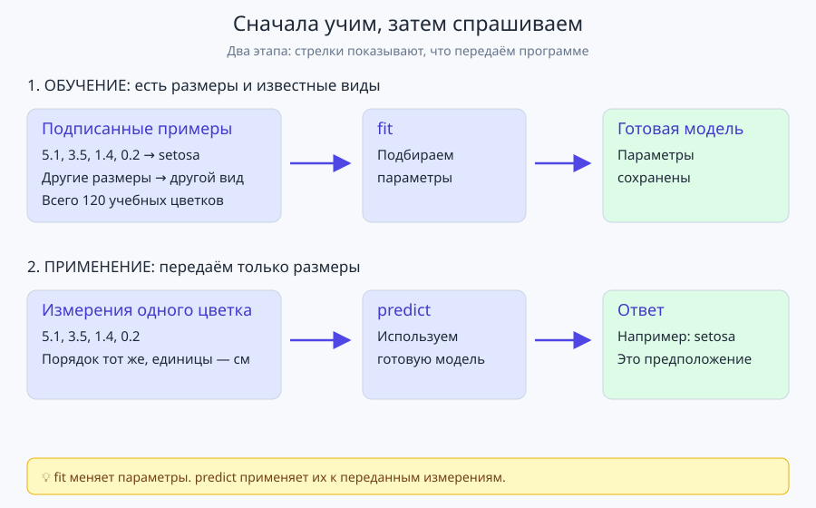

### Почему часть цветков откладываем

Из 150 цветков заранее оставим 30 для проверки. На остальных 120 модель получает и размеры, и виды. Потом передадим только размеры отложенных 30 и сравним её ответы с известными видами. Это помогает проверить работу на других цветках. Если сначала учить на всех данных, отложенные позже цветки уже будут знакомыми.

**Обобщение** — умение применить найденную связь к другим примерам. **Переобучение** — слишком сильная подстройка под учебные данные, при которой новые примеры получаются хуже. Хороший балл на тренировке не заменяет отдельной проверки.

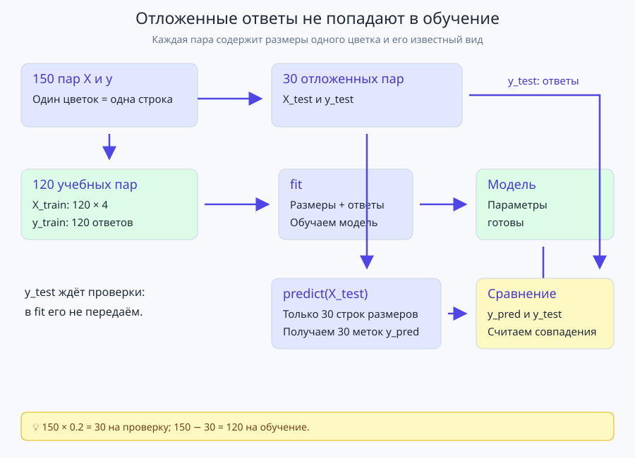

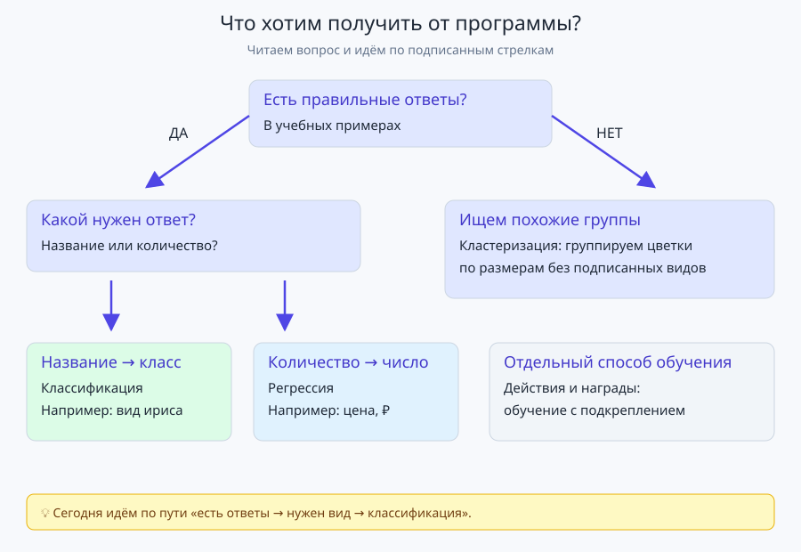

### Команды, код и результаты по шагам

Все импорты включены в первый блок ниже. Начни новый ноутбук: предыдущие определения из других разделов справочника не требуются.

### Задание 1. Готовим данные

#### 1.1. Подключаем инструменты

> 🎯 **Что делаем и зачем.** Подключим готовые инструменты: таблицы, графики, учебные данные, разделение, модель и проверку. Импорт похож на подготовку инструментов на столе: они доступны, но работа ещё не выполнена.

```python
# Таблицы и подсчёты: обращаемся к Pandas через имя pd.
import pandas as pd
# Графики: обращаемся к командам рисования через plt.
import matplotlib.pyplot as plt
# Получим встроенные размеры и виды цветков Iris.
from sklearn.datasets import load_iris
# Разделим признаки и ответы согласованно, не разрывая пары.
from sklearn.model_selection import train_test_split
# Класс модели, которая выбирает категорию (вид цветка).
from sklearn.linear_model import LogisticRegression
# Проверим долю совпадений прогнозов с известными видами.
from sklearn.metrics import accuracy_score
```

> 🧩 **Разбираем команды:**
>
> - `import pandas as pd` подключает Pandas для таблиц. `as pd` даёт короткое имя: так позже обратимся к `pd.DataFrame`.
> - `import matplotlib.pyplot as plt` подключает команды рисования из `pyplot`. Имя `plt` используем перед командами графиков.
> - `from sklearn.datasets import load_iris` берёт функцию загрузки Iris из раздела данных. `from` — откуда взять, `import` — что взять. В импорте функцию не вызываем, поэтому скобки не ставим.
> - `from sklearn.model_selection import train_test_split` берёт инструмент разделения. Он сохранит соответствие размеров и ответов при выборе строк.
> - `from sklearn.linear_model import LogisticRegression` берёт класс классификатора. Позже по этому классу создадим объект модели.
> - `from sklearn.metrics import accuracy_score` берёт функцию для подсчёта доли верных ответов. Она нужна для проверки, а не для обучения.

> 👉 **Что получили и что это значит.** Подключили все инструменты. Следующая ячейка уже сможет вызвать `load_iris()` и получить данные.

#### 1.2. Достаём измерения и названия видов

> 🎯 **Что делаем и зачем.** Откроем учебный набор и проверим, что означают его числа. Прежде чем обучать модель, нужно понять порядок размеров и связь каждого цветка с его ответом.

```python
# Загружаем контейнер с данными и поясняющими названиями.
iris = load_iris()
# Отдельно сохраняем измерения: строка на цветок, столбец на размер.
X = iris.data
# Сохраняем правильные виды в том же порядке цветков.
y = iris.target
print(iris.feature_names)
print(iris.target_names)
print("Форма X:", X.shape)
print("Форма y:", y.shape)
print("Первый цветок:", X[0])
print("Его вид:", y[0], iris.target_names[y[0]])
```

> 🧩 **Разбираем команды:**
>
> - `iris = load_iris()` вызывает функцию загрузки: круглые скобки означают «выполни». Результат сохраняется в `iris`. Это контейнер — словно коробка с подписанными отделениями.
> - `X = iris.data` берёт отделение с измерениями. Точка означает обращение к части объекта. В `X` получаем таблицу из 150 строк и четырёх столбцов.
> - `y = iris.target` берёт известные виды тех же цветков. Ответ в `y` и строка в `X` с одинаковым номером относятся к одному цветку.
> - `print(iris.feature_names)` показывает названия размеров. `print(iris.target_names)` показывает названия видов: эти команды помогают расшифровать данные, ничего не обучая.
> - Два вызова `print` с `.shape` показывают форму: у `X` — `(150, 4)`, у `y` — `(150,)`. `shape` — свойство, поэтому после него нет скобок. У каждой строки размеров есть один ответ.
> - `X[0]` берёт первую строку: индексы начинаются с нуля. `y[0]` берёт её ответ. В `iris.target_names[y[0]]` сначала получаем номер вида, затем по нему находим название.

> 👉 **Что получили и что это значит.** Получили размеры и ответы, проверили их количество. Теперь можем разделить цветки, сохранив каждую пару «размеры — вид».

**Как прочитать первую строку:**

| Позиция в строке | Измерение | Значение |
|---|---|---|
| 0 | Длина чашелистика | 5.1 см |
| 1 | Ширина чашелистика | 3.5 см |
| 2 | Длина лепестка | 1.4 см |
| 3 | Ширина лепестка | 0.2 см |

Это четыре размера **одного** цветка. Его ответ `y[0] = 0` означает setosa. В этом наборе `0` — setosa, `1` — versicolor, `2` — virginica: числа заменяют названия видов, а не измеряют их размер.

#### 1.3. Проверяем, что данные прочитаны правильно

После предыдущей ячейки в выводе есть несколько разных видов информации. Не пролистывай их: каждая часть отвечает на отдельный вопрос.

| Вывод | Как прочитать | Зачем проверили |
|---|---|---|
| `(150, 4)` | 150 цветков, четыре измерения каждого | Убедиться в размере входа |
| `(150,)` | 150 известных видов | Проверить наличие ответа для каждой строки |
| `[5.1 3.5 1.4 0.2]` | Размеры первого цветка в сантиметрах | Связать абстрактную таблицу с одним объектом |
| `0 setosa` | Номер и название вида первого цветка | Понять кодировку ответа |

В печати массива NumPy запятых между элементами может не быть. Это оформление вывода, а не слияние четырёх размеров в одно число. Номер вида тоже не добавляется к измерениям: X и y остаются отдельными переменными.

> 🤔 **Предскажи, затем проверь глазами.** Если взять первые пять строк X, сколько соответствующих ответов нужно взять из y? Пять. Если взять только два столбца X, число ответов изменится? Нет: количество цветков осталось тем же.

#### 1.4. Откладываем данные для проверки

> 🎯 **Что делаем и зачем.** Отложим 30 цветков до обучения. Это как новые задачи на контрольной: они помогут проверить, умеет ли модель работать с другими примерами. Если сначала обучить её на всех 150 цветках, выбранные после этого 30 уже будут знакомыми.

```python
# До обучения отделяем 30 цветков для проверки.
X_train, X_test, y_train, y_test = train_test_split(
    X, y,
    test_size=0.2,
    random_state=42,
    stratify=y
)
print("Обучение:", X_train.shape, y_train.shape)
print("Проверка:", X_test.shape, y_test.shape)
```

> 🧩 **Разбираем команды:**
>
> - `train_test_split(...)` делит переданные данные на учебную и тестовую части. Используем готовую функцию, чтобы согласованно разделить измерения и ответы.
> - `X, y` передаём вместе: функция выбирает одинаковые номера строк в обоих массивах. Если перемешать их отдельно, размеры получат чужие подписи.
> - `test_size=0.2` задаёт долю проверки: `150 × 0.2 = 30`. Оставшиеся `150 − 30 = 120` цветков идут на обучение.
> - `random_state=42` позволяет повторить случайное разделение при тех же данных и настройках. Число 42 не задаёт качество модели.
> - `stratify=y` просит сохранить доли видов. Из каждого вида 40 цветков пойдут в обучение и 10 — в проверку.
> - Слева четыре имени получают четыре результата **в указанном порядке**: `X_train`, `X_test`, `y_train`, `y_test`. Переносы внутри круглых скобок помогают читать один вызов на нескольких строках.
> - Последние два `print` проверяют размеры: `(120, 4)` и `(120,)` для обучения; `(30, 4)` и `(30,)` для проверки.

> 👉 **Что получили и что это значит.** Отделили 120 учебных пар от 30 проверочных. В `fit` передадим только учебную пару; тестовые ответы понадобятся после предсказания.

---

#### 1.5. Что теперь находится в памяти ноутбука

После split исходные X и y не исчезли. Функция вернула новые части, которые мы сохранили под четырьмя именами. Поэтому особенно важно выбирать правильные имена в следующей команде.

| Имя | Форма | Назначение |
|---|---|---|
| `X_train` | (120, 4) | Размеры для подбора параметров |
| `y_train` | (120,) | Известные виды этих учебных цветков |
| `X_test` | (30, 4) | Размеры для будущего предсказания |
| `y_test` | (30,) | Ответы, с которыми позже сравним прогноз |

В `fit` должна попасть первая пара. Если случайно написать X и y, модель обучится на всех 150, включая отложенные. Python не обязан предупредить об этой ошибке: размеры согласованы, но смысл проверки нарушен.

> 👉 **Что нам дал этот шаг.** У нас есть план проверки до начала обучения. С этого момента тестовые ответы не используем для настройки модели.

### Задание 2. Смотрим на учебные цветки

#### 2.1. Рисуем размеры лепестков

> 🎯 **Что делаем и зачем.** Проверим глазами, связаны ли размеры с видами. Нарисуем каждый учебный цветок точкой: длину лепестка отложим по горизонтали, ширину — по вертикали. Цвет зададим по известному виду.

```python
# Новый рисунок, чтобы не смешать его с предыдущим.
plt.figure(figsize=(8, 5))
# Для каждого вида получаем и номер, и название для легенды.
for class_id, class_name in enumerate(iris.target_names):
    # Галочки выбирают только цветки текущего известного вида.
    mask = y_train == class_id
    # Рисуем каждый выбранный учебный цветок отдельной точкой.
    plt.scatter(
        X_train[mask, 2], X_train[mask, 3],
        label=class_name, alpha=0.7
    )
plt.xlabel("Длина лепестка, см")
plt.ylabel("Ширина лепестка, см")
plt.title("Учебные цветки: размеры лепестка и известный вид")
plt.legend()
plt.grid(alpha=0.3)
# Показываем рисунок после всех подписей и настроек.
plt.show()
```

**Пример рисунка из выполненного ноутбука:**

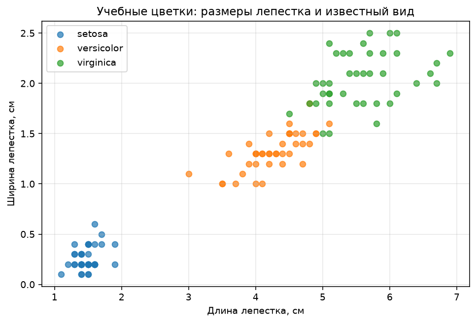

*Это результат контрольного запуска с указанными данными и настройками. Оси и вывод разобраны ниже.*

> 🧩 **Разбираем команды:**
>
> - `plt.figure(figsize=(8, 5))` создаёт отдельный рисунок размером 8 на 5 дюймов. Это размер картинки, а не измерения цветков.
> - `enumerate(iris.target_names)` выдаёт пары «номер, название». Цикл `for` сначала получает 0 и setosa, затем 1 и versicolor, затем 2 и virginica. Двоеточие и отступ показывают команды, повторяемые для каждого вида.
> - `mask = y_train == class_id` сравнивает каждый ответ с текущим номером. Двойное `==` даёт True/False, а одинарное `=` сохраняет этот массив галочек.
> - `X_train[mask, 2]` выбирает строки с True и столбец 2 — длину лепестка. `X_train[mask, 3]` выбирает ширину тех же цветков. Одинаковая маска сохраняет пары координат.
> - `plt.scatter(...)` рисует точки. Первые два аргумента — горизонтальные и вертикальные координаты; `label=class_name` подписывает группу; `alpha=0.7` делает точки немного прозрачными, чтобы видеть наложения.
> - `xlabel` и `ylabel` подписывают оси, `title` — рисунок. `legend()` показывает названия из `label`. `grid(alpha=0.3)` добавляет светлую сетку. `show()` выводит готовую картинку.

> 👉 **Что получили и что это значит.** Увидели, как расположены учебные цветки. Это помогает понять данные; модель пока не обучалась.

> ### 📊 Как читать этот график
>
> **Что на осях.** По горизонтали — длина лепестка в сантиметрах, по вертикали — ширина. Точка `(1.4, 0.2)` означает лепесток длиной 1.4 см и шириной 0.2 см.
>
> **Что мы видим.** Каждый цвет — известный вид из легенды. Setosa обычно образует отдельную область небольших лепестков, а точки двух других видов расположены ближе и частично смешиваются. Точки могут перекрываться, поэтому видимых точек может казаться меньше 120.
>
> **Какой вывод.** Размеры несут информацию о виде. Но этот рисунок показывает только два признака из четырёх и известные ответы, а не предсказания модели. По нему ещё нельзя посчитать её точность.

---

### Задание 3. Обучаем модель и получаем ответы

#### 3.1. Создаём модель и вызываем fit

> 🎯 **Что делаем и зачем.** Создадим классификатор и подберём его параметры по 120 учебным цветкам. Используем LogisticRegression: несмотря на название, этот класс выбирает категорию — в нашем случае вид ириса.

```python
# Создаём классификатор; параметры по цветкам ещё не подобраны.
model = LogisticRegression(max_iter=1000)
# Обучаем по размерам и видам 120 учебных цветков.
model.fit(X_train, y_train)
```

> 🧩 **Разбираем команды:**
>
> - `LogisticRegression(max_iter=1000)` создаёт объект по классу модели. `max_iter` ограничивает число итераций подбора параметров. Это верхний предел, а не обещание выполнить ровно тысячу шагов. Объект сохраняем в `model`.
> - `model.fit(X_train, y_train)` вызывает у объекта **метод обучения**. `fit` можно понять как «подбери подходящие параметры». Первый аргумент — измерения, второй — известные виды. Без ответов этот классификатор не сможет проверить свои учебные расчёты.
> - После `fit` подобранные параметры хранятся внутри `model`. Метод возвращает сам обученный объект. Поэтому повторное присваивание здесь не требуется, а запись объекта под ячейкой не является оценкой качества.

> 👉 **Что получили и что это значит.** Модель сохранила параметры, подобранные по учебным данным. Теперь можно запросить её ответы на отложенных цветках.

> ### ⚙️ Что происходит внутри fit
>
> **Сначала — расчёт.** У модели есть веса: числа, определяющие, как четыре размера участвуют в оценке каждого вида. Есть и добавки — смещения. По текущим числам модель вычисляет оценки трёх видов и превращает их в вероятности, сумма которых равна 1.
>
> **Затем — проверка учебного расчёта.** Например, правильный вид — setosa, а модель выделила ему только 20%. Функция потерь превращает такую неудачность ответа в число. Чем меньше вероятность правильного вида, тем больше логарифмическая потеря. Обучение учитывает весь учебный набор, а не только один цветок.
>
> **Дальше — изменение параметров.** Численный алгоритм использует градиент, чтобы подобрать более удачные веса и смещения. Помнишь модуль 1: производная помогает понять, как изменение числа влияет на ошибку? Здесь библиотека выполняет этот подбор за нас. Стандартный решатель L-BFGS сложнее простого шага градиентного спуска, но тоже использует градиент.
>
> **Наконец — остановка.** Алгоритм повторяет вычисления до выполнения критерия остановки или достижения `max_iter`. По умолчанию он также ограничивает чрезмерно большие веса — это регуляризация. Поэтому обучение не обязано дать ноль ошибок на всех учебных цветках.

Если появилось `ConvergenceWarning`, покажи предупреждение преподавателю: подбор мог остановиться раньше достижения нужного условия. Само завершение `fit` ещё не доказывает качество — проверка впереди.

#### 3.2. Как понять, что fit закончился

В последней строке ячейки стоит вызов `fit`, поэтому ноутбук может показать `LogisticRegression(max_iter=1000)`. Это короткая запись возвращённого объекта. Она не означает ни нулевую ошибку, ни 1000 выполненных итераций, ни 1000 обработанных цветков.

После успешного вызова объект model хранит обученные параметры. Если ячейка остановилась с красной ошибкой, сначала разбираемся с ней. Если показано предупреждение о сходимости, не игнорируем его: лимита могло не хватить для выполнения условия остановки.

**Почему мы ещё не знаем accuracy?** До этого момента модель подбирала параметры по учебным примерам, но мы ещё не получили её ответы на тесте и не сравнили их с истиной. Для такой проверки нужны следующие две ячейки.

#### 3.3. Просим определить виды отложенных цветков

> 🎯 **Что делаем и зачем.** Дадим обученной модели только размеры 30 отложенных цветков. Правильные виды у нас есть, но в команду предсказания они не попадут.

```python
# Получаем метки для тестовых размеров, не передавая правильные виды.
y_pred = model.predict(X_test)
print("Число предсказаний:", len(y_pred))
print("Предсказания:", y_pred)
print("Правильные ответы:", y_test)
```

> 🧩 **Разбираем команды:**
>
> - `model.predict(X_test)` вызывает **метод предсказания**. Он принимает таблицу измерений, использует сохранённые веса и выдаёт по одной метке на строку. Для LogisticRegression выбирается класс с наибольшей расчётной вероятностью. Веса при этом не меняются.
> - `y_pred = ...` сохраняет массив ответов модели отдельно от правильных ответов `y_test`.
> - `len(y_pred)` считает ответы: должно получиться 30. Первый `print` показывает это количество.
> - Два следующих `print` выводят прогнозы и правильные ответы. Сравниваем их по местам: первый с первым, второй со вторым. Показ `y_test` на экране не обучает модель.

> 👉 **Что получили и что это значит.** Получили 30 предсказаний. Следующим шагом проверим совпадения и выразим результат числом.

---

#### 3.4. Как читать два массива ответов

Вывод `y_pred` — ряд из 30 номеров видов. Вывод `y_test` — другой ряд из 30 номеров, но в том же порядке цветков. Рассмотрим короткий **выдуманный фрагмент**, чтобы понять сравнение:

| Позиция в тесте | Известный вид | Предсказанный | Результат |
|---|---|---|---|
| 0 | 1 | 1 | Совпало |
| 1 | 0 | 0 | Совпало |
| 2 | 2 | 1 | Ошибка: выбран другой вид |

Позиция 0 — первый объект именно в перемешанном test, а не обязательно первая строка исходного Iris. Отдельно сортировать один из двух массивов перед сравнением нельзя: нарушится связь объектов и ответов.

> 👉 **Что получили.** Теперь есть оба ряда для проверки. В следующем шаге сравнение сделает код, чтобы не считать тридцать пар вручную.

### Задание 4. Проверяем результат

#### 4.1. Считаем верные ответы

> 🎯 **Что делаем и зачем.** Посчитаем, сколько из 30 ответов совпало с известными видами. Затем разделим число совпадений на число проверок и сверим свой расчёт с библиотечной функцией.

```python
# True означает, что прогноз совпал с известным видом.
correct = y_pred == y_test
# Складываем True как единицы: это количество верных ответов.
correct_count = int(correct.sum())
# Количество проверок будет знаменателем доли.
test_count = len(y_test)
# Библиотечная функция считает ту же долю: верные / все.
acc = accuracy_score(y_test, y_pred)
print("Верно:", correct_count, "из", test_count)
print("Доля вручную:", correct_count / test_count)
print(f"Accuracy: {acc:.2%}")
```

> 🧩 **Разбираем команды:**
>
> - `correct = y_pred == y_test` создаёт массив True/False: True означает верный ответ. Сравнение идёт поэлементно, потому что работаем с массивами NumPy.
> - `correct.sum()` складывает галочки: True считается 1, False — 0. `int(...)` превращает сумму в обычное целое Python; результат сохраняется в `correct_count`.
> - `len(y_test)` даёт число проверенных объектов. Сохраняем его в `test_count`: это знаменатель доли.
> - `accuracy_score(y_test, y_pred)` — функция метрики accuracy. Принимает известные ответы и прогнозы, возвращает **долю совпадений** от 0 до 1. Используем её, чтобы проверить ручной расчёт.
> - Первый `print` показывает счёт словами. Второй вычисляет `correct_count / test_count`: число верных делится на все проверки.
> - В последнем `print` буква `f` позволяет вставить значение в текст, а `{acc:.2%}` выводит его процентом с двумя знаками после запятой. Оформление не меняет само число `acc`.

> 👉 **Что получили и что это значит.** Получили количество верных ответов и accuracy. Два расчёта доли должны совпасть. При контрольном запуске на scikit-learn 1.9.1 получено 29 из 30, то есть 96.67%; это результат указанного разделения, а не гарантия для других данных.

> 💬 **Простыми словами.** Если верны 29 ответов из 30, считаем `29 / 30 ≈ 0.9667`, или 96.67%. Одна ошибка на таком тесте меняет результат примерно на 3.33 процентного пункта. Даже 100% на 30 цветках не обещает безошибочную работу на любых будущих цветках.

#### Проверяем формулу на своём результате

Пусть в выводе получилось «Верно: 29 из 30». Значит, True встретилось 29 раз, а False — один раз. Ручная доля `29 / 30` и результат accuracy_score должны совпасть, потому что обе команды измеряют одно и то же.

Не путай число `0.9667` и `96.67%`: это одна доля в разных формах записи. Код форматирования меняет только показ. Если умножить acc на 100 и ещё использовать формат процентов, получится двойной перевод и неверное число.

> 🤔 **Проверка понимания:** при 24 верных из 30 доля равна 0.8, или 80%. Почему знаменатель 30? Потому что столько объектов проверено. Ни число видов 3, ни число признаков 4 в знаменатель не входят.

#### 4.2. Находим конкретные ошибки

> 🎯 **Что делаем и зачем.** Общая доля говорит, сколько ответов верно, но не показывает, где модель ошиблась. Соберём размеры и оба ответа в одну таблицу.

```python
# В таблице свяжем размеры тестового цветка и оба ответа.
results = pd.DataFrame(X_test, columns=iris.feature_names)
results["Правильный вид"] = iris.target_names[y_test]
results["Ответ модели"] = iris.target_names[y_pred]
results["Верно"] = correct
print(results.head().to_string(index=False))
# Обратная маска оставляет только несовпадения.
errors = results[~results["Верно"]]
print("Ошибочных строк:", len(errors))
print(errors.to_string(index=False))
```

> 🧩 **Разбираем команды:**
>
> - `pd.DataFrame(X_test, columns=iris.feature_names)` создаёт таблицу из тестовых размеров. `columns` задаёт названия четырёх столбцов; таблицу сохраняем в `results`.
> - `iris.target_names[y_test]` переводит номера правильных видов в названия. Присваивание `results["Правильный вид"] = ...` добавляет новый столбец. Следующая строка делает то же для прогнозов `y_pred`.
> - `results["Верно"] = correct` добавляет галочку к каждой строке. Порядок всех массивов один и тот же — они относятся к тем же тестовым цветкам.
> - `results.head().to_string(index=False)` сначала берёт первые пять строк, затем превращает их в текст без служебного индекса. `print` показывает этот текст; полная таблица не обрезается.
> - `results[~results["Верно"]]` отбирает ошибки. Внутренние скобки берут столбец галочек, `~` меняет True и False местами, внешние скобки оставляют строки с True.
> - `len(errors)` считает ошибочные строки, последний `print` показывает их. Если ошибок нет, таблица будет пустой — это допустимый результат.

> 👉 **Что получили и что это значит.** Увидели конкретные несовпадения. Их число должно равняться размеру теста минус число верных ответов. Ответы модели вручную не исправляем: иначе проверка потеряет смысл.

#### 4.3. Показываем результат столбцами

> 🎯 **Что делаем и зачем.** Построим понятный отчёт: сколько цветков определено верно и сколько неверно. Такой результат легко показать человеку, который не читает массивы Python.

```python
# Все проверки минус совпадения — число ошибок.
error_count = test_count - correct_count
# Новый рисунок, чтобы не смешать его с предыдущим.
plt.figure(figsize=(6, 4))
# Высоты столбцов — количества исходов проверки.
plt.bar(["Верно", "Ошибка"], [correct_count, error_count],
        color=["#16a34a", "#dc2626"])
plt.ylabel("Количество тестовых цветков")
plt.title("Результат проверки на отложенных данных")
plt.ylim(0, test_count)
# Показываем рисунок после всех подписей и настроек.
plt.show()
```

**Пример рисунка из выполненного ноутбука:**

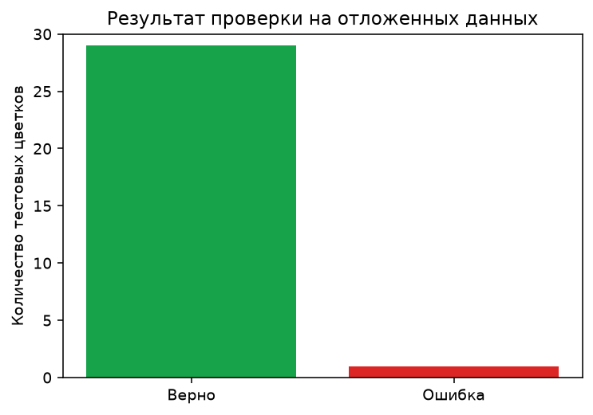

*Это результат контрольного запуска с указанными данными и настройками. Оси и вывод разобраны ниже.*

> 🧩 **Разбираем команды:**
>
> - `test_count - correct_count` находит число ошибок: все проверенные минус верные.
> - `plt.figure(figsize=(6, 4))` создаёт новый рисунок, чтобы столбцы не наложились на прежний scatter.
> - `plt.bar(...)` строит столбчатую диаграмму. Первый список задаёт подписи, второй — высоты в том же порядке. `color` задаёт зелёный и красный цвета через их коды.
> - `ylabel` поясняет единицы вертикальной оси, `title` — назначение рисунка. `ylim(0, test_count)` устанавливает границы от нуля до всех 30 проверок, чтобы высоты читались честно. `show()` выводит рисунок.

> 👉 **Что получили и что это значит.** Получили график количества совпадений и ошибок. Сумма двух высот должна равняться 30.

> ### 📊 Как читать этот график
>
> **Что на осях.** По горизонтали — два исхода: «Верно» и «Ошибка». По вертикали — количество цветков, а не проценты.
>
> **Что мы видим.** Высота зелёного столбца равна числу совпадений. Красный показывает число ошибок. Если он равен 1, это одна ошибка из 30, то есть около 3.33%, а не 1%. При нуле ошибок красный столбец не виден.
>
> **Какой вывод.** График показывает количество исходов на конкретном тесте. Какие виды перепутаны, узнаём из таблицы предыдущего шага.

---

### Задание 5. Используем обученную модель

#### 5.1. Передаём один запрос

> 🎯 **Что делаем и зачем.** Покажем, как запросить вид для одной строки измерений. Здесь берём знакомые числа первой строки Iris: это демонстрация применения команды, а не новая проверка качества.

```python
# Одна строка в таблице: четыре размера в прежнем порядке, в см.
new_flower = [[5.1, 3.5, 1.4, 0.2]]
# Показываем применение обученной модели к одному запросу.
new_prediction = model.predict(new_flower)
print("Предполагаемый вид:", iris.target_names[new_prediction[0]])
```

> 🧩 **Разбираем команды:**
>
> - `[[5.1, 3.5, 1.4, 0.2]]` — таблица из одной строки. Внутренний список содержит размеры цветка, внешний — строки таблицы. Модель ожидает двумерный вход даже для одного объекта.
> - `model.predict(new_flower)` использует обученные параметры и возвращает массив из одной метки. Обучение повторно не запускается.
> - `new_prediction[0]` достаёт единственную метку, `iris.target_names[...]` заменяет её названием, `print` показывает ответ. Сначала вычисляются выражения внутри скобок, затем внешние.

> 👉 **Что получили и что это значит.** Получили предполагаемое название вида. Для реального запроса нужны те же четыре измерения, в том же порядке и в сантиметрах. Если передать миллиметры или размеры другого предмета, модель всё равно выберет знакомый класс — это не доказывает, что предмет является ирисом.

---

### Accuracy: что означает полученное число

Accuracy — доля совпадений. Если верно 4 из 5, считаем `4 / 5 = 0.8`, или 80%. Это не вероятность отдельного прогноза и не гарантия на любые будущие цветки. На 30 объектах одна ошибка меняет результат примерно на 3.33 процентного пункта.

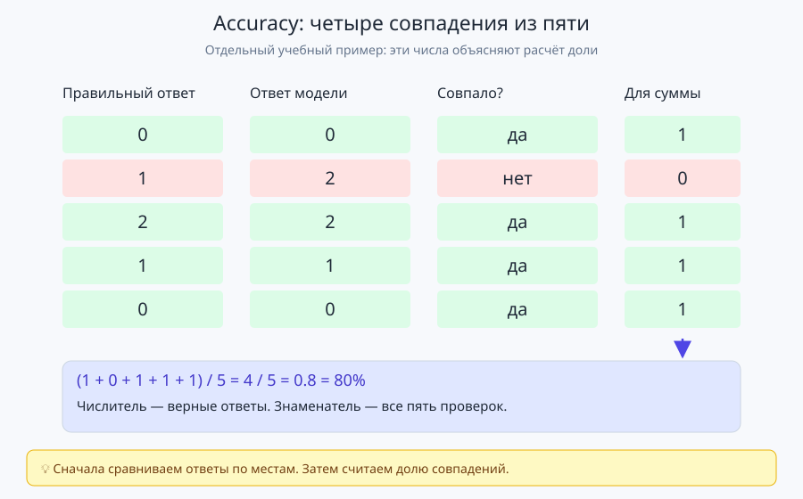

### Частые ошибки урока 3.1

| Ошибка | Почему мешает | Что проверить |
|---|---|---|
| fit на всех X и y | Test уже участвовал в обучении | Сначала split, затем fit только на train |
| Раздельное перемешивание X и y | Измерения получают чужие подписи | Делить оба массива одним вызовом |
| predict до fit | В объекте нет обученных параметров | Создание объекта не равно обучению |
| Миллиметры вместо сантиметров | Модель получает другой масштаб | Единицы и порядок столбцов |
| 100% приняли за вечную гарантию | Проверка относится к конкретным объектам | Нужны новые независимые примеры |

---

## Урок 3.2 — признаки и разделение

### Две задачи этого урока

Сначала на **выдуманных поездках** изучаем признаки и кодирование погоды. Затем возвращаемся к **Iris** и сравниваем два набора размеров для классификации видов. Время поездки пока не предсказываем: это регрессия, следующая тема.

**Признак** — известное сведение для прогноза. Расстояние — количество, погода — категория. Номер маршрута тоже категория: цифры не превращают его в измерение. Важно, будет ли признак известен в момент запроса. Фактическое время прибытия для прогноза до отправления — подсказка из будущего, то есть **утечка данных**.

### One-hot: вопросы с ответами да/нет

Погоду можно представить флажками «дождь? снег? солнце?». Так не задаём выдуманный порядок 0/1/2 между названиями. В y классификатора числовые метки имеют другой смысл — обозначают классы ответов, а не размеры в формуле входа.

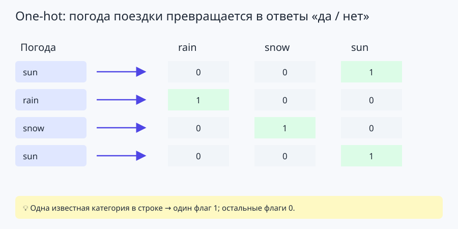

### Зачем три части

Train учит веса, val помогает выбрать признаки или настройки, test оценивает после выбора. Для 150 цветков сначала откладываем 30 (20%), затем из оставшихся 120 выделяем ещё 30: `30 / 120 = 0.25`. В итоге train/val/test содержат 90/30/30 объектов. Доли выбраны для примера, а не являются обязательными во всех задачах.

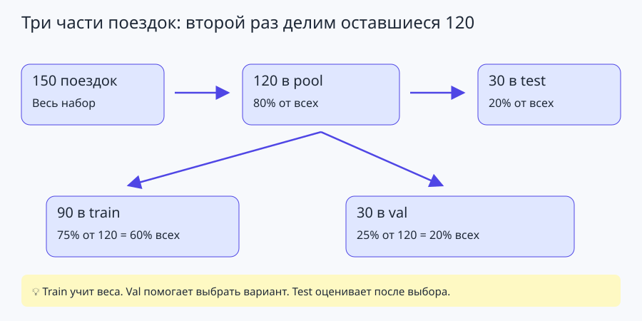

### Что делает стратификация

Она сохраняет доли видов настолько близко, насколько позволяют целые количества. В Iris исходно 50/50/50 цветков; в тесте на 30 получаем 10/10/10. Доли одинаковы — по трети — хотя количества отличаются. Это не выравнивает неравные исходные классы и не повышает точность автоматически.

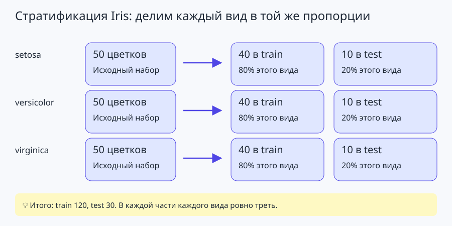

### Команды, код и результаты по шагам

Начни отдельный ноутбук для 3.2. Все нужные импорты и исходные данные находятся ниже; выполнение 3.1 перед ним не требуется.

### 1. Категории превращаются в флажки

> 🎯 **Что делаем и зачем.** Подготовим таблицу четырёх выдуманных поездок. Расстояние уже записано числом, а погода — названием. Превратим погоду в флажки, сохранив расстояние. Это подготовка признаков; время поездки сегодня не предсказываем.

```python
# Таблицы и подсчёты: обращаемся к Pandas через имя pd.
import pandas as pd
# Графики: обращаемся к командам рисования через plt.
import matplotlib.pyplot as plt
# Получим встроенные размеры и виды цветков Iris.
from sklearn.datasets import load_iris
# Разделим признаки и ответы согласованно, не разрывая пары.
from sklearn.model_selection import train_test_split
# Класс модели, которая выбирает категорию (вид цветка).
from sklearn.linear_model import LogisticRegression
# Проверим долю совпадений прогнозов с известными видами.
from sklearn.metrics import accuracy_score

trips = pd.DataFrame({
    "distance_km": [2, 5, 3, 8],
    "weather": ["sun", "rain", "snow", "sun"]
})
# Заменяем только названия погоды флажками; расстояния сохраняем.
encoded = pd.get_dummies(trips, columns=["weather"], dtype=int)
# Показываем исходную таблицу без служебных номеров строк.
print(trips.to_string(index=False))
# Показываем результат, чтобы сравнить с исходными сведениями.
print(encoded.to_string(index=False))
```

#### 1.1. Что подключают импорты

`import pandas as pd` подключает инструменты для таблиц, а `import matplotlib.pyplot as plt` — для рисунков. `pd` и `plt` — короткие имена, которыми пользуемся дальше. Импорт не создаёт таблицу и не обучает модель.

Из `sklearn` берём четыре инструмента: `load_iris` для готового набора цветков, `train_test_split` для разделения, `LogisticRegression` для классификации и `accuracy_score` для проверки. Они понадобятся после опыта с поездками.

#### 1.2. Как читается таблица поездок

`pd.DataFrame({...})` создаёт таблицу из словаря. Ключи словаря становятся названиями столбцов, списки — значениями по строкам. Два списка одинаковой длины: в каждой строке расстояние и погода **одной** поездки.

| Столбец | Что означает | Пример |
|---|---|---|
| `distance_km` | Расстояние в километрах | 2 км |
| `weather` | Погода до отправления | sun — солнце, rain — дождь, snow — снег |

Время прибытия не записываем: для прогноза до отправления оно ещё неизвестно. Числа и погоду придумали для объяснения, а не собрали из реальных поездок.

#### 1.3. Что означает список погоды

Запись `["sun", "rain", "snow", "sun"]` — список из четырёх текстовых значений. Кавычки показывают, что это слова, а не переменные Python. Английские слова выбраны как короткие обозначения:

| Значение | Перевод | К какой поездке относится в нашем списке |
|---|---|---|
| `"sun"` | Солнце, солнечная погода | К первой |
| `"rain"` | Дождь | Ко второй |
| `"snow"` | Снег | К третьей |
| `"sun"` | Солнце | К четвёртой |

Первое слово погоды связано с первым расстоянием — 2 км. Второе слово связано со вторым расстоянием — 5 км, и так далее. Повтор sun не ошибка: две разные поездки могут проходить при одинаковой погоде. Поэтому у нас четыре поездки, но только **три разных погодных категории**.

**Зачем вообще записали погоду?** Для будущей задачи времени поездки она может оказаться полезным известным признаком: дождь и снег могут менять дорожные условия. Здесь мы пока только готовим её представление, а не доказываем влияние и не прогнозируем время.

#### 1.4. Почему вызываем get_dummies

Хотим представить погодные категории числовыми флажками. Функция `pd.get_dummies` создаёт новую таблицу, сохраняя строки и остальные признаки.

- `trips` — исходная таблица, которую преобразуем.
- `columns=["weather"]` — кодируем **только** погоду. Расстояние оставляем количеством, для каждого километра отдельный флаг не нужен.
- `dtype=int` — записываем флажки целыми 0 и 1.
- `encoded = ...` — сохраняем результат отдельно. Исходная `trips` не исчезает.

Разберём три строки как одну маленькую программу: **сначала создаём числовое представление, затем показываем исходную таблицу и результат, чтобы сравнить их**.

**Первая строка — преобразование.** В `encoded = pd.get_dummies(...)` справа вызывается готовая функция Pandas. Она находит разные названия в weather и создаёт для них флаги. Затем знак `=` сохраняет возвращённую таблицу в переменную encoded. Имя encoded выбрали мы; оно означает «закодированная таблица».

Мы не пишем `trips = ...`, поэтому исходная таблица остаётся в trips. Благодаря этому можно сравнить данные до и после. Функция не обучает классификатор и не предсказывает время: она изменяет способ представления признака.

**Вторая строка — показываем, что было.** В `print(trips.to_string(index=False))` сначала выполняется метод trips.to_string: таблица превращается в текст. `index=False` просит не включать в этот текст служебные подписи строк 0, 1, 2, 3. Затем внешний print показывает готовый текст в выводе ячейки.

**Третья строка — показываем, что стало.** `print(encoded.to_string(index=False))` делает то же самое для новой таблицы. Вызовы to_string и print не меняют значения таблиц и не удаляют их настоящий индекс: управляют только показом.

> 👉 **Зачем нужны оба вывода.** Проверяем преобразование глазами: расстояния остались прежними, строки не перепутались, вместо названия погоды появились нужные флаги. Если вывести только encoded, будет труднее заметить, потеряли ли мы исходные сведения.


> 👉 **Что получили и для чего.** Четыре поездки остались четырьмя строками. Вместо `weather` появились `weather_rain`, `weather_snow`, `weather_sun`; `distance_km` сохранился. У первой поездки расстояние 2 и флажки 0, 0, 1. Мы представили известные сведения числами — теперь такую форму можно использовать как вход числовой модели.

**Проверь себя:** у второй поездки должен быть флаг дождя 1, а сумма трёх погодных флагов каждой строки — 1. Пока мы ничего не предсказывали и не считали качество.

> 💬 **Почему дальше Iris?** Время поездки — числовой ответ, для него нужна регрессия и другая проверка ошибок: это урок 3.3. Сейчас отдельно исследуем выбор признаков и три части данных на знакомой классификации Iris. Таблицу поездок в модель Iris не передаём.

---

### Промежуточная проверка: читаем таблицу поездок

После первого задания ожидаем такую числовую таблицу:

| distance_km | weather_rain | weather_snow | weather_sun |
|---|---|---|---|
| 2 | 0 | 0 | 1 |
| 5 | 1 | 0 | 0 |
| 3 | 0 | 1 | 0 |
| 8 | 0 | 0 | 1 |

Прочитай вторую строку вслух: «поездка на 5 км, дождь — да, снег — нет, солнце — нет». Прочитай четвёртую: «8 км и солнце». Одинаковая погода даёт одинаковый набор флажков, но расстояния поездок могут различаться.

**Что сохранилось:** четыре объекта и исходные расстояния. **Что изменилось:** один столбец названий заменён тремя столбцами вопросов. На выходе четыре столбца вместо двух. Это не новые поездки и не прогноз времени.

> 💡 **Если результат отличается.** True/False вместо 1/0 означает, что не задан целочисленный dtype. Если появились флажки отдельных расстояний, проверь список columns: там должен быть только weather. Если исходный столбец исчез из trips, проверь, не перезаписал ли ты исходную переменную вместо создания encoded.

### 2. Проверяем состав разделения

> 🎯 **Что делаем и зачем.** Возьмём знакомый Iris и сравним состав теста с исходным набором. Здесь пока не обучаем модель.

```python
# Загружаем контейнер с данными и поясняющими названиями.
iris = load_iris()
# Отдельно сохраняем измерения: строка на цветок, столбец на размер.
X = iris.data
# Оборачиваем метки в столбец Pandas, чтобы удобно считать доли.
y = pd.Series(iris.target, name="species")
# Сначала откладываем test; pool остаётся для будущих train и val.
X_pool, X_test, y_pool, y_test = train_test_split(
    X, y, test_size=0.2, random_state=42, stratify=y
)
# Сопоставляем доли видов по одинаковым меткам 0, 1, 2.
class_shares = pd.DataFrame({
    "Исходные": y.value_counts(normalize=True),
    "Test": y_test.value_counts(normalize=True)
}).sort_index()
# После сортировки заменяем номера видов понятными названиями.
class_shares.index = iris.target_names
print(class_shares)
# Два столбца для каждого вида: сравниваем состав, не accuracy.
class_shares.plot.bar(figsize=(8, 4), ylim=(0, 1), rot=0)
plt.ylabel("Доля цветков")
plt.title("Состав исходного набора и test")
plt.tight_layout()
# Показываем рисунок после всех подписей и настроек.
plt.show()
```

**Пример рисунка из выполненного ноутбука:**

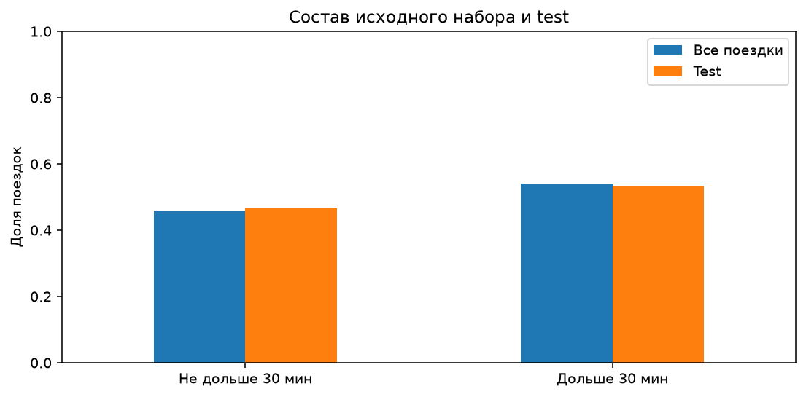

*Это результат контрольного запуска с указанными данными и настройками. Оси и вывод разобраны ниже.*

#### 🧩 Разбираем команды

`load_iris` получает контейнер; `.data` содержит четыре измерения. `pd.Series` оборачивает ответы в столбец Pandas, чтобы удобно посчитать доли. Номера строк сохраняются при разделении, но сравнение прогнозов позже выполняем в порядке полученных ответов.

`train_test_split` возвращает сначала две части X, затем две части y. `test_size=0.2` откладывает 30 цветков, `random_state=42` фиксирует случайность, `stratify=y` сохраняет состав по видам. Оставшиеся 120 называем pool: из них позже выделим train и val.

`value_counts(normalize=True)` считает долю каждого значения вместо количества. `DataFrame` ставит два столбца долей рядом, сопоставляя их по меткам видов. `sort_index()` упорядочивает метки 0, 1, 2; затем заменяем их названиями из `target_names`.

`plot.bar` рисует сгруппированные столбцы прямо из таблицы. `ylim=(0, 1)` задаёт шкалу долей, `rot=0` оставляет подписи горизонтальными. `ylabel` и `title` подписывают рисунок. `tight_layout` подбирает отступы, чтобы подписи помещались; `show` показывает результат.

#### 2.1. Раскладываем длинную цепочку на действия

В записи `pd.DataFrame({...}).sort_index()` сначала создаётся таблица, а потом у полученной таблицы вызывается метод сортировки. Это две операции, соединённые точкой. Саму переменную class_shares присваиваем уже результату обеих операций.

У Series есть **индекс** — подписи элементов. После value_counts индексом становятся найденные виды 0, 1, 2, а значениями — их доли. Это отличается от исходного y, где индексом был номер цветка. Поэтому `sort_index()` здесь сортирует **виды**, а не отдельные цветки.

Только после сортировки меняем подписи строк на названия видов. Если заменить подписи без согласования порядка, можно подписать долю одного вида названием другого. На Iris все доли одинаковы, но правило всё равно важно для других наборов.

#### 2.2. Откуда берутся доли в таблице

`y` — столбец из 150 меток вида: 0, 1, 2. `pd.Series(..., name="species")` даёт этим ответам удобную оболочку Pandas; не меняет сами виды. `value_counts()` без аргументов дал бы по 50. С `normalize=True` каждая частота делится на число ответов: `50 / 150 = 1/3`. В test считаем отдельно: `10 / 30 = 1/3`.

В `class_shares` ключи словаря «Исходные» и «Test» становятся столбцами. Метки видов 0/1/2 становятся индексом — подписями строк. Pandas соединяет доли по меткам, а не по случайному порядку частот. `sort_index()` располагает строки как 0, 1, 2; только затем заменяем эти подписи на названия видов.

**Почему это проверяем до обучения?** Хотим убедиться, что состав отложенных примеров соответствует нашему плану. На каждой строке таблицы будет примерно 0.3333 и 0.3333. Это описание данных; правильных или неправильных предсказаний пока нет.

> 👉 **Что получили и что это значит.** В каждом виде исходного набора и теста доля 1/3, около 0.3333. Отложили test и убедились, что все виды представлены.

> ### 📊 Как читать этот график
>
> **Оси:** по горизонтали — виды, по вертикали — доля от 0 до 1. Два цвета в легенде обозначают исходный набор и test.
>
> **Что видим:** для каждого вида два столбца одинаковой высоты около 0.3333. Это треть объектов, а не 33 цветка. В исходных данных это 50 из 150, в test — 10 из 30.
>
> **Вывод:** стратификация сохранила состав по видам. График не показывает точность: модель ещё не обучали.

---

### 3. Выделяем val из оставшихся данных

> 🎯 **Что делаем и зачем.** Отделим примеры для выбора признаков, не используя test. Нужно получить 90 учебных и 30 валидационных цветков.

```python
# Делим только pool: test не должен попасть обратно в обучение.
X_train, X_val, y_train, y_val = train_test_split(
    X_pool, y_pool, test_size=0.25, random_state=42, stratify=y_pool
)
print("Train:", X_train.shape, len(y_train))
print("Val:", X_val.shape, len(y_val))
print("Test:", X_test.shape, len(y_test))
```

#### 🧩 Разбираем команды

Во втором вызове передаём **pool**, а не исходные X и y: иначе новый train мог бы пересечься с test. `test_size=0.25` теперь означает долю **от 120**: 30 для val, остальные 90 для train. В имени функции по-прежнему написано test, но её результаты мы можем назвать train и val: роль задаётся тем, как их используем.

`stratify=y_pool` относится именно к текущей группе из 120 ответов. Четыре результата распаковываем в том же порядке. `shape` показывает строки и столбцы, `len` — число ответов.

#### 3.1. Проверяем расчёт, а не запоминаем 0.25

После первого разделения у нас **120** объектов в pool, а 30 в test уже лежат отдельно. Нужно выделить 30 для val: `30 / 120 = 0.25`. Если написать 0.2 второй раз, получим 24 объекта, а не нужные 30.

| Переменная | Что хранит после ячейки | Зачем сохраняем |
|---|---|---|
| `X_train`, `y_train` | 90 строк размеров и их виды | Обучить оба варианта |
| `X_val`, `y_val` | 30 строк размеров и их виды | Выбрать вариант |
| `X_test`, `y_test` | Ранее отложенные 30 объектов | Проверить после выбора |

**Как читать вывод:** `Train: (90, 4) 90` означает 90 объектов с четырьмя размерами и 90 ответов. Число 4 не уменьшилось: мы делили строки, а не столбцы. Если результат другой, сначала проверь, что второй вызов получает pool, а не весь X.

> 👉 **Что получили и что это значит.** Получили формы (90, 4), (30, 4), (30, 4). Сумма объектов 150; в train по 30 каждого вида, в val и test по 10.

---

#### 3.2. Почему второй вызов не «знает», что мы создаём val

Функция train_test_split умеет делить переданные ей объекты на две части. Назначение результата выбираем мы: в первом вызове меньшую часть назвали test, во втором — val. Само имя функции не запрещает использовать её для валидационной части.

Это похоже на разрезание колоды: нож делит текущую колоду, а подписи на двух новых стопках назначает человек. Если второй раз дать все исходные 150 карточек, отложенные test-карточки снова могут попасть в train. Если дать только pool, такой проблемы нет.

> 👉 **Зачем проверяли размеры.** Увидели 90 + 30 + 30 = 150 и согласованные пары измерений и ответов. Но одна проверка размеров не доказывает отсутствие пересечений: правильный источник второго split по-прежнему обязателен. Отдельно исследовать номера объектов можно в задании со звёздочкой.

### 4. Сравниваем два набора признаков на val

> 🎯 **Что делаем и зачем.** Обучим один и тот же тип модели двумя способами: только по чашелистикам или только по лепесткам. Выбор сделаем по val.

```python
# Два варианта входа: чашелистики (0, 1) или лепестки (2, 3).
feature_sets = {"Чашелистики": [0, 1], "Лепестки": [2, 3]}
# Сохраним каждый обученный объект, чтобы использовать после выбора.
models = {}
# Сохраним оценки на val; по test варианты не выбираем.
val_scores = {}
# По очереди выполняем одинаковый опыт для каждого набора размеров.
for name, columns in feature_sets.items():
    # Новый объект для текущего варианта: свои обучаемые параметры.
    candidate = LogisticRegression(max_iter=1000)
    # Подбираем веса только по учебным цветкам и выбранным размерам.
    candidate.fit(X_train[:, columns], y_train)
    # Применяем готовые веса к тем же столбцам в val.
    val_pred = candidate.predict(X_val[:, columns])
    # Связываем имя варианта с обученной моделью.
    models[name] = candidate
    # Считаем долю совпадений на val, чтобы сравнить варианты.
    val_scores[name] = accuracy_score(y_val, val_pred)
print(pd.Series(val_scores, name="Accuracy на val"))
# Выбираем имя с наибольшей оценкой val; при равенстве — первое.
best_name = max(val_scores, key=val_scores.get)
print("Выбран набор:", best_name)
```

#### 🧩 Разбираем команды

`feature_sets` — словарь: названия вариантов связаны со списками индексов. 0 и 1 — чашелистики, 2 и 3 — лепестки. `models` сохранит обученные объекты, `val_scores` — оценки для выбора.

`.items()` выдаёт пары «название, список столбцов». Цикл выполняет команды с отступом для каждой пары. На каждом проходе создаём **новый** объект `candidate`, чтобы варианты имели свои параметры.

`X_train[:, columns]` берёт все строки (двоеточие) и только перечисленные столбцы. `fit` подбирает веса по этим двум размерам и учебным ответам. Как в прошлом уроке, вычисляет ответы, оценивает потерю и меняет параметры; val в этот подбор не входит.

`predict` применяет найденные веса к тем же выбранным столбцам val. Нельзя учить на чашелистиках, а предсказывать по лепесткам только потому, что столбцов тоже два. Сохраняем модель по имени и долю совпадений через `accuracy_score`.

`pd.Series` показывает словарь оценок столбцом. `max(..., key=val_scores.get)` выбирает имя с максимальной оценкой, а не последнее по алфавиту. При равенстве этот код выбирает первый добавленный вариант: принимаем это правило заранее.

#### 4.1. Что именно хранится в трёх словарях

| Словарь | Ключ | Значение | Для чего нужен |
|---|---|---|---|
| feature_sets | Название варианта | Список столбцов | Подготовить правильный вход |
| models | То же название | Обученный объект | Позже применить выбранную модель |
| val_scores | То же название | Доля верных на val | Выбрать вариант |

Пустые `{}` создают словари без записей. Присваивание `models[name] = candidate` добавляет значение под текущим названием. После двух проходов в словаре две записи. Если вместо этого сохранить оба объекта под одинаковым ключом, второе значение заменит первое.

Цикл не делает модели «умнее» сам по себе. Он просто повторяет одинаковую последовательность команд для каждого списка признаков, чтобы не копировать весь код вручную.

#### 4.2. Проследим первый проход цикла

Сначала `name` получает «Чашелистики», а `columns` — `[0, 1]`. Создаём новый классификатор. Выражение `X_train[:, columns]` даёт таблицу 90 × 2: те же цветки, но только два размера чашелистика. `fit` получает эту таблицу и 90 видов. Модель подбирает веса по учебным примерам; правильные ответы val не участвуют в подборе.

Затем `predict` получает 30 × 2 размера из val и возвращает 30 меток. Сравниваем их с `y_val`. Объект сохраняем в `models["Чашелистики"]`, оценку — в `val_scores["Чашелистики"]`.

На втором проходе всё повторяется для `[2, 3]`, то есть лепестков. Новый `candidate` нужен, чтобы получилась отдельная обученная модель. Словарь `models` сохраняет оба объекта: замена имени `candidate` не уничтожает первый.

#### 4.3. Что означает результат сравнения

При контрольном запуске получены 26 верных из 30 для чашелистиков и 28 из 30 для лепестков. Это примерно 86.67% и 93.33%. Команда `max` перебирает имена вариантов, а `key=val_scores.get` указывает сравнивать связанные с ними **оценки**. В этом опыте `best_name` становится «Лепестки».

**Зачем сохранили и модель, и список столбцов?** Для нового прогноза нужно воспроизвести весь выбранный вариант. Если дать модели лепестков чашелистики, код может выполниться: столбцов тоже два. Но смысл чисел будет другим, поэтому такой прогноз не соответствует обучению.

> 👉 **Что получили и что это значит.** Выбрали набор признаков по val. Большая доля на маленьком val не доказывает превосходства на любых будущих данных; test ещё не использовали для выбора.

---

#### 4.4. Проверка перед переходом к test

До следующего задания должны быть готовы два обученных объекта, две оценки val и одно выбранное имя. Прочитай таблицу оценок и объясни, почему выбрано это имя. Тестовая оценка ещё не вычислялась.

**При равенстве** max вернёт первое встретившееся имя с максимальной оценкой. Для нашего словаря первым записаны «Чашелистики». Мы не смотрим в test, чтобы решить, как разрешить равенство: иначе test начнёт выбирать за нас.

> 🤔 **Найди ошибку в рассуждении:** «На val лучше лепестки, но давай посчитаем test у обоих и выберем красивый результат». Тогда test станет ещё одной частью для выбора. После такого выбора его оценка уже не будет отдельным итоговым экзаменом.

### 5. Проверяем выбранное решение на test

> 🎯 **Что делаем и зачем.** Зафиксируем выбор и только теперь запросим тестовую оценку. Переобучать выбранную модель в этом опыте не будем.

```python
# Достаём выбранную уже обученную модель, не создаём новую.
best_model = models[best_name]
# Достаём именно те столбцы, по которым эта модель училась.
best_columns = feature_sets[best_name]
# Применяем выбранный вариант к ранее отложенным цветкам.
test_pred = best_model.predict(X_test[:, best_columns])
# Итоговая оценка: test не участвовал в выборе.
test_acc = accuracy_score(y_test, test_pred)
print("Набор:", best_name)
print("Верно:", int((test_pred == y_test).sum()), "из", len(y_test))
print(f"Accuracy на test: {test_acc:.2%}")
```

#### 🧩 Разбираем команды

Две первые строки достают **одну и ту же выбранную конфигурацию**: объект и список столбцов. `predict` получает test с этими столбцами и возвращает 30 меток. `accuracy_score` сравнивает их с 30 известными ответами.

`==` создаёт галочки совпадений, `.sum()` считает True как единицы, `int` приводит результат к целому. `len` даёт число проверок. Формат `:.2%` показывает долю процентом с двумя знаками после запятой.

#### 5.1. Что означает финальная проверка

`models[best_name]` достаёт сохранённый обученный объект, а `feature_sets[best_name]` — его индексы признаков. В нашем опыте получаем модель лепестков и `[2, 3]`. Из test берём именно эти два столбца; правильные виды остаются отдельно в `y_test`.

Внутри `int((test_pred == y_test).sum())` действия идут изнутри наружу: сравнение создаёт галочки, сумма считает совпадения, `int` делает обычное целое число. При контрольном запуске результат — **29 из 30**, accuracy — **96.67%**. Напиши рядом собственный результат и объясни знаменатель: это все проверенные цветки, а не число признаков.

**Почему оценки val и test могут различаться?** В них находятся разные цветки. Мы выбрали вариант по одной группе, а проверили по другой. Отличие процентов само по себе не является ошибкой в коде.

> 👉 **Что получили и что это значит.** Получили результат после выбора по val. Запиши фактические числа, не ищи другое разделение ради более красивого процента. Если после просмотра test меняешь решение, для новой независимой оценки потребуются новые данные.

---

### На что обратить внимание после опыта

При указанном разделении контрольный запуск дал на val 26 из 30 для чашелистиков и 28 из 30 для лепестков. По val выбраны лепестки, после этого на test получено 29 из 30. Эти числа иллюстрируют один опыт; они не являются обязательным результатом любой модели и любых данных.

### Частые ошибки урока 3.2

| Ошибка | Что происходит | Как исправить |
|---|---|---|
| Снова разделить весь X для val | Train может пересечься с test | Второй split получает только pool |
| Взять 20% от остатка вместо 25% | Val содержит 24 объекта вместо 30 | Считать долю от текущих 120 |
| Сравнить модели по test | Финальная проверка участвует в выборе | Выбирать по val |
| Поменять порядок столбцов predict | Размеры имеют другой смысл | Сохранить выбранные columns |
| Принять долю вида за accuracy | Описание состава путается с качеством | Смотреть, что именно подсчитано |
| Делать get_dummies отдельно без согласования | В train/test могут различаться столбцы | Сохранять схему кодирования, учиться ей по train |

**Подготовка по данным:** средние и медианы заполнения вычисляем только по train. Для данных во времени или нескольких записей одного человека нужно подходящее разделение по времени/группам: один stratify не устраняет все виды утечек.
