# Нейросети и ML — Справочник

> Твоя «шпаргалка на всё» по курсу. Пропустил урок или что-то забыл — загляни сюда: по каждой теме простыми словами, главные команды, примеры и частые ошибки. Читается и сам по себе: можно догнать пропущенное.

---

## 📋 Оглавление

- [🧰 Библиотеки — как подключить и зачем](#-библиотеки--как-подключить-и-зачем)
- [📊 Графики (matplotlib) — все команды](#-графики-matplotlib--все-команды)
- [Модуль 1 — Python и математика для ML](#модуль-1--python-и-математика-для-ml)
  - [Урок 1.1 — ООП: классы и объекты](#урок-11--ооп-классы-и-объекты)
  - [Урок 1.2 — Коллекции и генераторы](#урок-12--коллекции-и-генераторы)
  - [Урок 1.3 — Функции и строки](#урок-13--функции-и-строки)
  - [Урок 1.4 — NumPy](#урок-14--numpy)
  - [Урок 1.5 — Линейная алгебра](#урок-15--линейная-алгебра)
  - [Урок 1.6 — Статистика](#урок-16--статистика)
  - [Урок 1.7 — Производная и градиент](#урок-17--производная-и-градиент)

---

## 🧰 Библиотеки — как подключить и зачем

**Библиотека** — это набор готовых инструментов (функций), которые кто-то уже написал за нас. Чтобы ими пользоваться, библиотеку надо **подключить** (импортировать) — обычно одной строкой в самом **начале** файла. Делается это командой `import`, а `as` даёт короткое имя-псевдоним, чтобы меньше печатать.

| Библиотека | Как подключить | Для чего нужна | С какого урока |
|---|---|---|---|
| **NumPy** | `import numpy as np` | Массивы чисел и быстрые вычисления над ними (векторы, матрицы, среднее, std…). Основа всего ML. | 1.4 |
| **Matplotlib** | `import matplotlib.pyplot as plt` | Рисовать графики: гистограммы, диаграммы рассеяния и т.д. | 1.6 |
| **SciPy** | `from scipy import stats` | Научные инструменты поверх NumPy; нам нужен модуль `stats` (например, для моды). | 1.6 |
| **collections** | `from collections import Counter` | **Встроенный** модуль Python (ставить не надо). `Counter` считает, сколько раз встречается каждый элемент. | 1.6 |

```python
# Типичное начало ноутбука по ML — подключаем всё, что понадобится:
import numpy as np                  # массивы и математика
import matplotlib.pyplot as plt     # графики
from scipy import stats             # статистика (мода и др.)
from collections import Counter     # подсчёт частот
```

> 💡 **Как это читать.** `import numpy as np` = «подключи библиотеку numpy и дальше зови её коротко `np`». Поэтому мы и пишем `np.mean(...)`, `plt.hist(...)` — это значит «возьми функцию `mean` из numpy», «функцию `hist` из matplotlib».
>
> ⚠️ Если забыть `import`, Python ругнётся `NameError: name 'np' is not defined`. Просто добавь строку импорта в начало.

---

## 📊 Графики (matplotlib) — все команды

Все рисунки в курсе делаются библиотекой **matplotlib** (`import matplotlib.pyplot as plt`). Команды **копятся** на будущей картинке по одной, а `plt.show()` в конце её показывает. Вот полный набор, который мы используем:

| Команда | Что делает | Пример |
|---|---|---|
| `plt.plot(xs, ys)` | рисует **линию** по точкам (соединяет их) | `plt.plot(xs, ys)` |
| `plt.hist(data, bins=20)` | **гистограмма**: столбики, `bins` — сколько «корзин» | `plt.hist(data, bins=30)` |
| `plt.scatter(x, y)` | **точки** (диаграмма рассеяния), связь двух величин | `plt.scatter(hours, grades)` |
| `plt.title("...")` | **заголовок** сверху | `plt.title("Рост")` |
| `plt.xlabel("...")` | подпись **оси X** (горизонтальной, снизу) | `plt.xlabel("Часы")` |
| `plt.ylabel("...")` | подпись **оси Y** (вертикальной, слева) | `plt.ylabel("Оценка")` |
| `plt.legend()` | показывает **легенду** — табличку «какая линия что значит». Берёт названия из `label=` у линий | `plt.legend()` |
| `plt.grid()` | рисует **сетку** (клеточки) на фоне — так удобнее считывать значения | `plt.grid()` |
| `plt.axvline(x)` | **вертикальная линия** в точке `x` (например, отметить среднее) | `plt.axvline(170, color='red')` |
| `plt.figure(figsize=(8,4))` | задать **размер** картинки (ширина, высота в дюймах) | `plt.figure(figsize=(10,4))` |
| `plt.show()` | **показать** готовую картинку (всегда последней командой) | `plt.show()` |

**Частые «добавки» внутрь команд (параметры):**

| Параметр | Что делает | Пример |
|---|---|---|
| `label="..."` | имя линии/столбиков — его потом покажет `plt.legend()` | `plt.plot(xs, ys, label="f(x)")` |
| `color="red"` | цвет | `plt.scatter(x, y, color="green")` |
| `alpha=0.5` | прозрачность (0 — невидимо, 1 — сплошное); удобно, когда рисунки наложены | `plt.hist(a, alpha=0.5)` |
| `bins=30` | число столбиков у гистограммы | `plt.hist(data, bins=30)` |
| `density=True` | гистограмма по **площади** (а не по «штукам») | `plt.hist(data, density=True)` |
| `linestyle="--"` | стиль линии (`--` пунктир) | `plt.axvline(5, linestyle="--")` |

> 🧩 Полезно рядом: **`np.linspace(-5, 5, 100)`** — создаёт 100 равномерных точек от −5 до 5. Это удобный способ получить «ось X», чтобы потом нарисовать по ней линию (`plt.plot`).

**Собираем всё вместе — типичный график:**
```python
import numpy as np
import matplotlib.pyplot as plt

xs = np.linspace(-5, 5, 100)          # точки по оси X
plt.plot(xs, xs**2, label="f = x²")   # линия + её имя для легенды
plt.plot(xs, 2*xs, label="f' = 2x")   # вторая линия
plt.title("Функция и производная")    # заголовок
plt.xlabel("x"); plt.ylabel("y")      # подписи осей
plt.legend()                          # табличка с именами линий (label=)
plt.grid()                            # сетка на фоне
plt.show()                            # показать картинку
```

> 💡 Коротко про две частые команды: **`plt.legend()`** — это «легенда», подпись-табличка, какая линия что значит (без неё по цветам не поймёшь); **`plt.grid()`** — сетка-клеточки на фоне, чтобы легче считывать числа с графика. Обе необязательны, но делают график понятнее.

---

## Модуль 1 — Python и математика для ML

---

### Урок 1.1 — ООП: классы и объекты

#### Что такое класс и объект?

**Класс** — это чертёж (или форма для печенья). Он описывает, из чего состоит вещь и что она умеет. Сам по себе класс — ещё не вещь, а только описание.

**Объект** — это конкретная вещь, сделанная по чертежу. По одному классу можно наделать сколько угодно объектов, и **каждый живёт своей жизнью**.

> Класс «Собака» — это описание «у собаки есть кличка и возраст, она умеет лаять». А объект — это уже конкретный Барсик 3 лет. Рядом может быть Рекс 5 лет — другой объект того же класса.

#### Как создать класс

```python
class Dog:
    # __init__ — «сборщик»: запускается сам, когда создаём объект
    def __init__(self, name, age):
        self.name = name     # запоминаем кличку в самом объекте
        self.age = age

    # метод — это функция, которая живёт внутри класса
    def bark(self):
        print(f"{self.name} говорит: Гав!")

# создаём объекты
barsik = Dog("Барсик", 3)
rex = Dog("Рекс", 5)

print(barsik.name)   # Барсик   — читаем атрибут
barsik.bark()        # Барсик говорит: Гав!
print(rex.age)       # 5        — у Рекса свои данные
```

- **`__init__`** — специальный метод, срабатывает сам в момент создания объекта. В нём «раскладываем» переданные данные по объекту.
- **`self`** — это «сам объект». Через `self.name` прикрепляем данные именно к этой собаке. `self` всегда пишут **первым** параметром метода.
- **Атрибут** (`self.name`) — это «переменная внутри объекта». Читают и меняют через точку: `barsik.age = 4`.

> ⚠️ Забыл `self.` — и данные не сохранятся. `self.name = name` кладёт кличку в собаку; просто `name = name` — ничего не делает.

#### Методы, которые меняют объект

Метод может не только печатать, но и **менять данные объекта**. Классический пример — счёт или банковский баланс:

```python
class BankAccount:
    def __init__(self, owner):
        self.owner = owner
        self.balance = 0            # стартовый баланс

    def deposit(self, amount):      # положить
        self.balance += amount

    def withdraw(self, amount):     # снять
        if amount <= self.balance:
            self.balance -= amount
        else:
            print("Недостаточно средств")

acc = BankAccount("Иван")
acc.deposit(1000)
acc.withdraw(300)
print(acc.balance)   # 700
```

#### `__repr__` — красиво показать объект

Если просто напечатать объект, получится непонятное `<__main__.Dog object at 0x...>`. Метод `__repr__` говорит, как объект должен выглядеть при печати:

```python
class Dog:
    def __init__(self, name):
        self.name = name
    def __repr__(self):
        return f"Dog({self.name})"

print(Dog("Барсик"))   # Dog(Барсик)
```

#### Наследование — один класс на основе другого

Если новый класс похож на старый, но с добавками — его делают **наследником**. Он получает всё от «родителя» и добавляет своё.

```python
class Animal:
    def __init__(self, name):
        self.name = name
    def breathe(self):
        print(f"{self.name} дышит")

# Bird наследует Animal (в скобках — родитель)
class Bird(Animal):
    def __init__(self, name, wingspan):
        super().__init__(name)      # позвать __init__ родителя
        self.wingspan = wingspan
    def fly(self):
        print(f"{self.name} летит, размах {self.wingspan} см")

sparrow = Bird("Воробей", 20)
sparrow.breathe()   # Воробей дышит     ← досталось от Animal
sparrow.fly()       # Воробей летит...  ← своё
```

- **`super().__init__(...)`** — «сначала пусть родитель соберёт свою часть». Без этого имя из `Animal` не запишется.
- Если у наследника метод с тем же именем, что у родителя, — вызовется **его** версия (переопределение).

#### Частые ошибки

- Забыли `self` первым параметром метода → `TypeError`.
- Используют `self.x`, которого нет в `__init__` → `AttributeError`.
- Путают `=` (присваивание) и `==` (сравнение) в условиях.

| Слово | Что значит |
|---|---|
| `class` | объявляем чертёж |
| `__init__` | сборка объекта при создании |
| `self` | сам объект |
| атрибут | переменная внутри объекта (`self.name`) |
| метод | функция внутри класса |
| наследник `class B(A)` | берёт всё от A и добавляет своё |
| `super()` | обращение к родителю |

---

### Урок 1.2 — Коллекции и генераторы

#### Списки — упорядоченные, изменяемые

```python
nums = [3, 1, 4, 1, 5]

nums[0]            # 3    — первый (счёт с 0)
nums[-1]           # 5    — последний
nums[1:4]          # [1, 4, 1]  — срез (4-й не входит)
len(nums)          # 5    — сколько элементов
nums.append(9)     # добавить в конец
nums.sort()        # отсортировать на месте
sorted(nums)       # вернуть новый отсортированный (оригинал цел)
3 in nums          # True — есть ли элемент
nums.count(1)      # сколько раз встречается 1
```

#### Словари — пары «ключ → значение»

```python
student = {"имя": "Иван", "класс": 5}

student["имя"]                  # "Иван"   — достать по ключу
student.get("телефон", "—")     # "—"      — если ключа нет, без ошибки
student["возраст"] = 15         # добавить/изменить
"имя" in student                # True     — есть ли ключ
del student["класс"]            # удалить

list(student.keys())            # все ключи
list(student.values())          # все значения
for k, v in student.items():    # пройти по парам
    print(k, v)
```

> **Правило:** не пиши `student[ключ]`, если не уверен, что ключ есть — используй `.get(ключ, запасное)`, иначе ошибка `KeyError`.

#### Множества — только уникальные

```python
unique = {1, 2, 2, 3}      # {1, 2, 3}  — повторы схлопнулись
set([5, 5, 6, 6])          # {5, 6}     — убрать дубликаты из списка

a = {1, 2, 3}; b = {3, 4, 5}
a | b   # {1,2,3,4,5}  — объединение
a & b   # {3}          — пересечение (общие)
a - b   # {1, 2}       — разность
```

#### Файлы — всегда через `with`

```python
with open("data.txt", "r", encoding="utf-8") as f:
    text = f.read()          # прочитать весь файл
    # for line in f: ...     # или построчно
# файл закроется сам, даже при ошибке
```

#### Три друга цикла: `range`, `zip`, `enumerate`

```python
list(range(5))            # [0, 1, 2, 3, 4]
list(range(2, 10, 2))     # [2, 4, 6, 8]   — от 2 до 10 шагом 2

# zip — идём по двум спискам параллельно
names = ["Иван", "Мария"]
ages  = [15, 14]
for name, age in zip(names, ages):
    print(name, age)      # Иван 15 / Мария 14

dict(zip(names, ages))    # {'Иван': 15, 'Мария': 14}  — быстрый словарь

# enumerate — даёт и номер, и значение
for i, name in enumerate(names, start=1):
    print(i, name)        # 1 Иван / 2 Мария
```

> `enumerate` избавляет от некрасивого `for i in range(len(names))`.

#### Генераторы — цикл в одну строку

Очень частый приём: «пройтись по коллекции и собрать из неё новую». Вместо цикла с `append` — одна строка.

```python
# было (3 строки):
result = []
for x in range(1, 6):
    result.append(x ** 2)

# стало (1 строка) — генератор списка:
result = [x ** 2 for x in range(1, 6)]   # [1, 4, 9, 16, 25]
```

**С фильтром** (`if` в конце — оставить не всё):
```python
[x for x in range(1, 11) if x % 2 == 0]   # [2, 4, 6, 8, 10] — только чётные
```

**С выбором значения** (тернарник в начале — включаем всегда, но что-то одно):
```python
["чёт" if x % 2 == 0 else "нечёт" for x in range(1, 5)]
# ['нечёт', 'чёт', 'нечёт', 'чёт']
```

> **Не путай!** `if` **в конце** = ФИЛЬТР (какие-то элементы выкидываем). `if…else` **в начале** = ВЫБОР значения (берём каждый, но решаем, каким он будет).

**Словарь и множество** — то же, но в фигурных скобках:
```python
{x: x ** 2 for x in range(1, 4)}            # {1: 1, 2: 4, 3: 9}  — генератор словаря
{len(w) for w in ["кот", "пёс", "мышь"]}    # {3, 4}              — генератор множества
```

> Фигурные скобки **с двоеточием** → словарь. **Без двоеточия** → множество (только уникальные). Пустые `{}` — это словарь, пустое множество — `set()`.

---

### Урок 1.3 — Функции и строки

#### `lambda` — функция в одну строку

Иногда нужна крохотная функция на один раз. Тогда вместо целого `def` пишут `lambda` — ту же функцию, только короче и без имени.

```python
# обычная функция:
def square(x):
    return x ** 2

# то же через lambda:
square = lambda x: x ** 2
print(square(5))     # 25

# несколько аргументов — через запятую:
add = lambda a, b: a + b
add(3, 4)            # 7
```

Шаблон: `lambda аргументы: что_вернуть` (слово `return` не нужно, оно подразумевается). В теле — только **одно выражение**.

**Главное применение — «ключ» сортировки/поиска.** Функциям `sorted`, `max`, `min` можно сказать: «сравнивай не сами элементы, а вот такой их признак». Этот признак и задаёт `lambda`:

```python
students = [{"имя": "Иван", "балл": 82}, {"имя": "Мария", "балл": 95}]

best = max(students, key=lambda s: s["балл"])   # {'имя': 'Мария', ...}
```

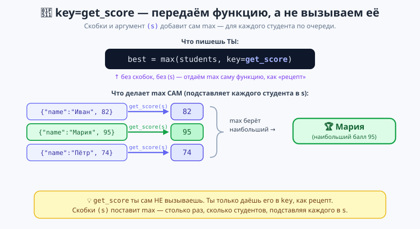

> Важно: в `key` пишем **саму функцию без скобок** (`key=len` или `key=lambda …`). Скобки поставит уже `max`/`sorted`, когда будет применять её к каждому элементу.

#### Сортировка и функции-сборщики

```python
sorted(nums)                 # новый отсортированный список (оригинал цел)
nums.sort()                  # сортирует НА МЕСТЕ, возвращает None
sorted(words, key=len)       # по длине (готовая функция len)
sorted(data, key=lambda d: d["год"], reverse=True)   # по полю, по убыванию

sum([1, 2, 3])               # 6
min(nums) / max(nums)        # наименьший / наибольший
max(students, key=lambda s: s["балл"])   # элемент с макс. признаком
all(x > 0 for x in nums)     # True, если ВСЕ подходят
any(x < 0 for x in nums)     # True, если ХОТЬ ОДИН подходит
```

> Подвохи: `nums.sort()` возвращает `None` (не присваивай его!). У пустого списка `all([])` = `True`, а `any([])` = `False`.

#### `map` и `filter` (встречаются в чужом коде)

```python
list(map(lambda x: x ** 2, nums))        # применить к КАЖДОМУ  → [1, 4, 9, ...]
list(filter(lambda x: x % 2 == 0, nums)) # оставить ПОДХОДЯЩИЕ   → [2, 4]
```
> В своём коде пиши генераторы (`[x**2 for x in nums]`) — короче и понятнее. `map`/`filter` просто узнавай.

#### `*args` и `**kwargs` — любое число аргументов

Обычная функция принимает фиксированное число аргументов. Чтобы принять **сколько угодно** — ставят звёздочку:

```python
def total(*args):        # звёздочка «собирает» все числа в кортеж args
    return sum(args)

total(1, 2, 3)           # 6
total(10, 20, 30, 40)    # 100
```

- **`*args`** собирает аргументы **без имени** в кортеж.
- **`**kwargs`** собирает аргументы **с именем** (`имя=значение`) в словарь.

Можно смешивать обычный параметр и звёздочки:
```python
def hero_card(name, **stats):     # name — обычный; stats — словарь остального
    print(f"Герой: {name}")
    for key, value in stats.items():
        print(f"  {key} — {value}")

hero_card("Ния", role="маг", level=7)
# Герой: Ния
#   role — маг
#   level — 7
```

> Имена `args`/`kwargs` — по договорённости; магию делает звёздочка. Можно `*nums`, `**options`.

**Звёздочка при ВЫЗОВЕ работает наоборот — распаковывает** готовую коллекцию в отдельные аргументы:
```python
def greet(name, age):
    print(name, age)

data = ["Иван", 15]
greet(*data)             # то же, что greet("Иван", 15)
info = {"name": "Иван", "age": 15}
greet(**info)            # то же, что greet(name="Иван", age=15)
```

> `*` в объявлении = «много значений → одна коробка». `*` в вызове = «коробка → много значений».

#### Методы строк

```python
"привет мир".split()        # ['привет', 'мир']   — по пробелам
"a,b,c".split(",")          # ['a', 'b', 'c']     — по разделителю
"-".join(["2026", "01"])    # '2026-01'           — склеить (вызывает разделитель!)
"  Привет ".strip()         # 'Привет'            — убрать пробелы по краям
"Привет".lower()            # 'привет'    .upper() → 'ПРИВЕТ'
"Я учу Python".replace("Python", "ML")   # 'Я учу ML'
"файл.py".endswith(".py")   # True        .startswith("фай") → True
"hello".count("l")          # 2
"123".isdigit()             # True        — строка из одних цифр?
```

> Запомни: разделитель **вызывает** `join`, список передаётся внутрь — `"-".join(список)`, а не наоборот.

#### f-строки — подставить значение в текст

```python
name, avg = "Иван", 4.375

f"{name}: {avg:.2f}"        # 'Иван: 4.38'   — :.2f = два знака после запятой
f"{avg * 100:.1f}%"         # '437.5%'
f"{name:<10}|"              # 'Иван      |'  — выровнять влево, ширина 10
f"Сумма: {2 + 3}"           # 'Сумма: 5'     — внутри можно выражение
```

---

### Урок 1.4 — NumPy

#### Что такое NumPy

**NumPy** — библиотека для быстрых вычислений с массивами чисел. Она — фундамент всего ML: Pandas, scikit-learn, PyTorch устроены поверх неё.

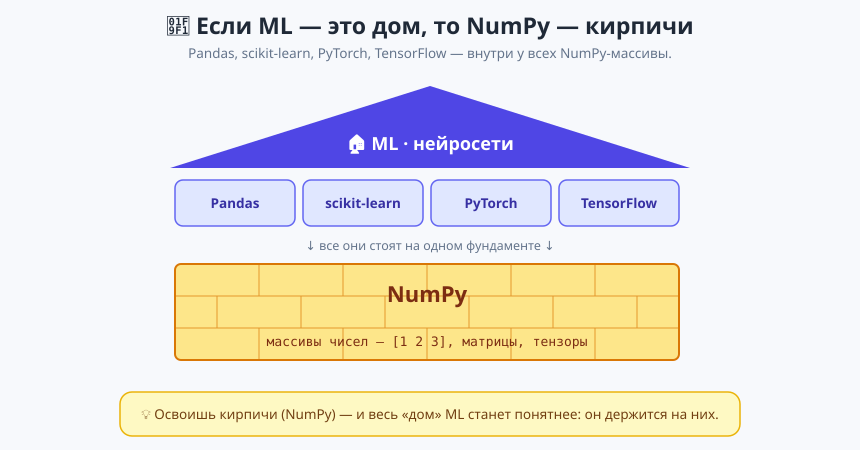

> Если ML — это дом, то NumPy — кирпичи, из которых он сложен. Сам по себе NumPy нейросети не обучает — он просто **очень быстро** считает с числами (в десятки раз быстрее обычного Python), а всё остальное построено на нём.

Подключают всегда так:
```python
import numpy as np    # np — общепринятое сокращение
```

#### 4 слова, которые надо знать

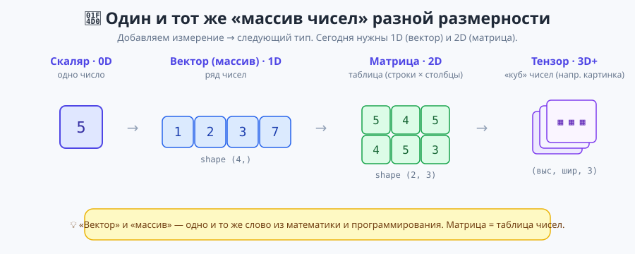

- **Скаляр** — одно число (`5`).
- **Вектор** (он же массив) — ряд чисел (`[1, 2, 3]`).
- **Матрица** — таблица чисел (строки × столбцы), как классный журнал.
- **Тензор** — «куб» и больше (например, цветная картинка). Пока хватит вектора и матрицы.

> Это один и тот же объект «массив чисел», просто разной размерности — добавили направление, получили следующий тип.

#### Создание массивов

```python
a = np.array([1, 2, 3, 4, 5])     # из обычного списка
m = np.array([[1, 2, 3],          # список списков → матрица
              [4, 5, 6]])

np.zeros(5)          # [0. 0. 0. 0. 0.]      — пять нулей
np.ones((2, 3))      # матрица 2×3 из единиц
np.full((2, 2), 7)   # матрица 2×2 из семёрок
np.arange(0, 10, 2)  # [0 2 4 6 8]           — как range (конец не входит)
np.linspace(0, 1, 5) # [0. 0.25 0.5 0.75 1.] — 5 точек от 0 до 1, концы включены
np.random.rand(3)    # 3 случайных числа от 0 до 1
```

**Свойства массива** — их проверяют постоянно:
```python
a.shape    # (5,)   — ФОРМА (сколько чего). У матрицы (строки, столбцы)
a.dtype    # int64  — тип чисел внутри
a.ndim     # 1      — сколько измерений (1 вектор, 2 матрица)
a.size     # 5      — всего чисел
```

> Сломался код в NumPy? Первым делом печатай `.shape` — 90% ошибок из-за несовпадения форм.

**Зерно случайности — `np.random.seed`:**
```python
np.random.seed(42)   # «зерно» генератора
np.random.rand(3)    # теперь ВСЕГДА выдаёт одни и те же 3 числа
```
> Компьютер «выращивает» случайные числа из стартового числа-зерна. Одинаковое зерно → одинаковые числа. Нужно, чтобы у тебя и у учителя код давал **один и тот же** результат (иначе не сравнить). 42 — просто традиция.

#### Индексы и срезы

```python
a = np.array([10, 20, 30, 40, 50])
a[0]        # 10   — первый (счёт с 0)
a[-1]       # 50   — последний
a[1:4]      # [20 30 40]        — с 1 по 4 (4 НЕ входит)
a[::-1]     # [50 40 30 20 10]  — задом наперёд
a[::2]      # [10 30 50]        — каждый второй
```

**У матрицы два индекса — через запятую: `m[строка, столбец]`.**

![Схема: индексы матрицы m[строка, столбец]; строка, столбец, ячейка](модули/01-python-и-математика/урок-04-numpy/изображения/индексация-2d.svg)

```python
m = np.array([[1, 2, 3],
              [4, 5, 6],
              [7, 8, 9]])

m[1, 2]     # 6             — строка 1, столбец 2
m[0]        # [1 2 3]       — вся строка 0
m[:, 0]     # [1 4 7]       — весь столбец 0 (: = «все строки»)
m[0:2, 1:3] # [[2 3],[5 6]] — прямоугольный кусок
```

> «:» на месте индекса значит «все по этой оси». Поэтому столбец достают так: `m[:, номер]`.

**Фильтр по условию (булева маска)** — самая полезная фишка:
```python
a = np.array([10, 20, 30, 40])
a[a > 25]              # [30 40]    — оставить те, что больше 25
a[(a > 15) & (a < 45)] # [20 30 40] — два условия: & это И, | это ИЛИ (в скобках!)
(a > 25).sum()         # 2          — сколько элементов подходит
a[a < 0] = 0           # заменить все отрицательные на 0
```

#### Векторизация — операции без цикла

Операция применяется **сразу ко всему массиву**, никакого `for`:

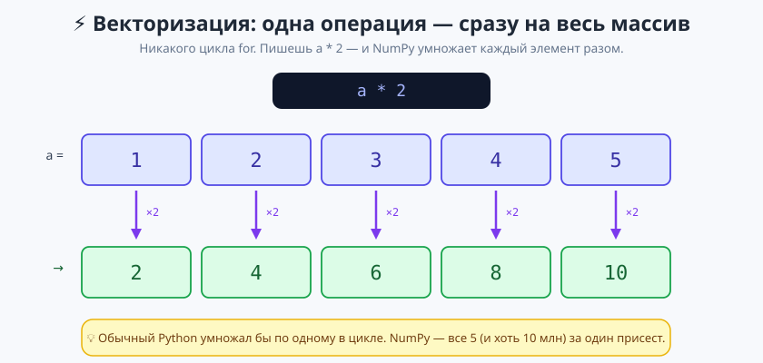

```python
a = np.array([1, 2, 3, 4])
a + 10       # [11 12 13 14]
a * 2        # [2 4 6 8]
a ** 2       # [1 4 9 16]
np.sqrt(a)   # корень из каждого    (ещё: np.abs, np.round, np.exp, np.log)

# два массива одной длины — поэлементно
prices = np.array([100, 50, 200])
qty    = np.array([2, 3, 1])
(prices * qty).sum()   # 550 — общий чек
```

> Операция создаёт **новый** массив, исходный не меняется (`b = a * 2` — `a` цел).

#### Broadcasting — операции между разными формами

NumPy умеет «растягивать» меньший массив под больший:
```python
m = np.array([[1, 2, 3], [4, 5, 6]])
row = np.array([10, 20, 30])
m + row     # [[11 22 33], [14 25 36]]  — вектор прибавился к каждой строке
```

#### Агрегации — «схлопнуть» массив в число

```python
a.sum()      # сумма
a.mean()     # среднее
a.min() / a.max()
a.std()      # стандартное отклонение («насколько числа разбросаны»)
a.argmax()   # ИНДЕКС, где максимум (не само число!)
a.argmin()   # ИНДЕКС минимума
```

**Параметр `axis` — по какому направлению считать** (у матрицы):
```python
m.sum()          # 21 — сумма всех
m.sum(axis=0)    # [5 7 9]  — вниз по столбцам (строки схлопнулись)
m.sum(axis=1)    # [6 15]   — вправо по строкам (столбцы схлопнулись)
```
> Мнемоника: `axis=0` — «вниз», остаётся строка-итог по столбцам. `axis=1` — «вправо», остаётся столбец-итог по строкам. Спроси себя: «что я хочу схлопнуть?».

#### Reshape — поменять форму

```python
a = np.arange(12)     # 12 чисел
a.reshape(3, 4)       # 3 строки по 4 (числа те же, раскладка другая)
a.reshape(2, -1)      # -1 = «посчитай сам» → (2, 6)
m.flatten()           # матрицу обратно в один ряд
```
> Число элементов до и после `reshape` должно совпадать (12 = 3×4 = 2×6). В ML картинку 28×28 часто «распрямляют» в вектор 784: `image.reshape(-1)`.

---

### Урок 1.5 — Линейная алгебра

#### Зачем это

Вся нейросеть — это умножения **векторов** и **матриц** чисел. «Вход × веса» = сложить все произведения = одно число. Звучит сложно, а на деле — умножение и сложение школьного уровня.

#### Вектор — стрелка и массив

Вектор `[3, 5]` — это и массив чисел, и стрелка из точки (0,0): «3 вправо, 5 вверх».

![Схема: вектор [3,5] как стрелка](модули/01-python-и-математика/урок-05-линейная-алгебра/изображения/вектор-стрелка.svg)

```python
a = np.array([3, 5]);  b = np.array([2, 1])

a + b        # [5 6]   — сложение поэлементно (стрелки «хвост к голове»)
a - b        # [1 4]   — вычитание тоже поэлементно
3 * a        # [9 15]  — умножение на число растягивает стрелку
```

**Длина вектора (норма)** — через теорему Пифагора: корень из суммы квадратов.

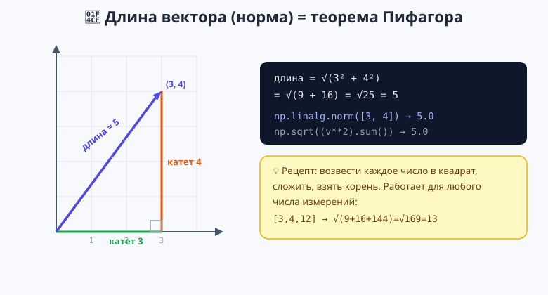

```python
np.linalg.norm([3, 4])        # 5.0        — √(3² + 4²)
np.sqrt((np.array([3,4])**2).sum())   # 5.0 — то же вручную

# расстояние между точками = длина их разности
np.linalg.norm(np.array([4, 6]) - np.array([1, 2]))   # 5.0
```

#### Скалярное произведение (dot product)

Перемножить два вектора **по парам** и сложить → **одно число**. Это и есть «вход × веса».

![Схема: скалярное произведение [1,2,3]·[4,5,6]=32](модули/01-python-и-математика/урок-05-линейная-алгебра/изображения/скалярное-произведение.svg)

```python
a = np.array([1, 2, 3]);  b = np.array([4, 5, 6])

a @ b              # 32  — 1·4 + 2·5 + 3·6 (рекомендуемый стиль)
np.dot(a, b)       # 32  — то же
(a * b).sum()      # 32  — то же вручную
```

> Векторы должны быть **одной длины**. Знак и величина говорят о «похожести направлений»: большое «+» → похожи, 0 → не связаны, «−» → противоположны.

**Косинусная похожесть** — «насколько похожи», число от −1 до 1:
```python
cos = (a @ b) / (np.linalg.norm(a) * np.linalg.norm(b))
```
Формулу **не зубрят, а выводят** из `a·b = |a|·|b|·cos`: делим обе части на `|a|·|b|` (как `3x=12 → x=4`), длины сокращаются, остаётся `cos`.

> Не путай: `a`, `b` — это **векторы**. Сверху `a @ b` — их скалярное произведение; снизу `norm(a)` — **длина** вектора. Делим на длины, чтобы убрать «размер» и оставить чистый угол. Так работают рекомендации «вам может понравиться».

#### Транспонирование

`A.T` — строки становятся столбцами: форма (2, 3) → (3, 2). Нужно, когда формы матриц «не стыкуются» для умножения.
```python
A = np.array([[1, 2, 3], [4, 5, 6]])
A.T          # [[1 4], [2 5], [3 6]]
A.T.shape    # (3, 2)
```
> `A.T` пишется **без скобок** (это атрибут, как `.shape`, а не метод). Саму `A` не меняет — отдаёт новую «набок». Нужна перевёрнутая дальше — сохрани `B = A.T`.

#### Умножение матриц — `@`

Главная операция нейросетей. Элемент результата = **скалярное произведение строки первой матрицы и столбца второй**.

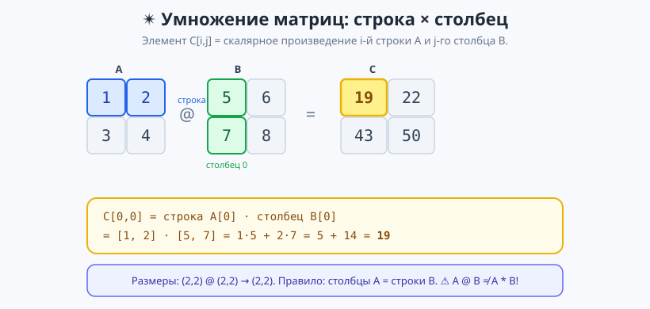

```python
A = np.array([[1, 2], [3, 4]])
B = np.array([[5, 6], [7, 8]])

A @ B        # [[19 22], [43 50]] — матричное умножение
A * B        # [[5 12], [21 32]] — ПОЭЛЕМЕНТНОЕ, это другое!
```

> **Правило размерностей:** `(m, n) @ (n, k)` → `(m, k)`. Два **средних** числа должны совпасть, два крайних — форма результата. ⚠️ `@` (матричное) ≠ `*` (поэлементное) — в ML почти всегда нужен `@`.

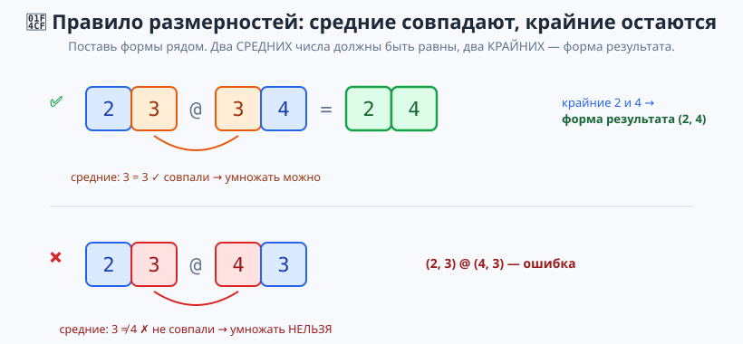

> `(3, 1)` — это **вектор-столбец** (3 числа «столбиком»). Поэтому `(2, 3) @ (3, 1) → (2, 1)` — это «матрица × вектор».

**Матрица × вектор — простейший «слой нейросети»:**
```python
W = np.array([[0.1, 0.2, 0.3],      # веса (2 нейрона, 3 входа)
              [0.4, 0.5, 0.6]])
x = np.array([1, 2, 3])             # вход

W @ x        # [1.4 3.2] — каждая строка весов · вход = ответ одного нейрона
```

**Один нейрон** = скалярное произведение входа и весов + смещение: `x @ w + b`. **Вся сеть — цепочка** таких умножений, где формы стыкуются как домино (вход 784 → 128 → 64 → 10):

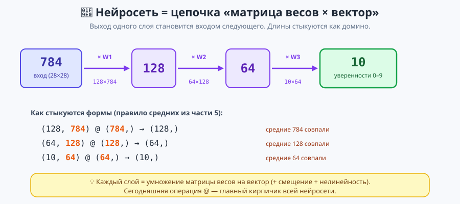

| Операция | NumPy |
|---|---|
| Длина вектора | `np.linalg.norm(v)` |
| Расстояние между точками | `np.linalg.norm(a - b)` |
| Скалярное произведение | `a @ b` |
| Косинусная похожесть | `(a @ b) / (norm(a) * norm(b))` |
| Транспонирование | `A.T` |
| Умножение матриц / слой | `A @ B`, `W @ x` |

---

### Урок 1.6 — Статистика

#### Зачем это

Статистика — как **одним-двумя числами описать целую гору данных**. «Какой класс в среднем?», «насколько разные ученики?», «связаны ли две величины?». В ML с этого начинается **любой** анализ датасета.

#### Меры центра: среднее, медиана, мода

Все три отвечают «какое число представляет всю выборку?», но по-разному.

```python
import numpy as np
grades = [4, 5, 5, 3, 4, 5, 4, 3, 4, 5]

np.mean(grades)      # 4.2  — среднее (сумма / количество)
np.median(grades)    # 4.0  — медиана (центральное в отсортированном ряду)
# мода — самое частое число:
from scipy import stats
stats.mode(grades).mode   # 4
```

- **Среднее** — хорошо для «ровных» данных без выбросов.
- **Медиана** — честнее, когда есть **выброс** (одно огромное/крошечное число).
- **Мода** — для категорий (любимый цвет, оценка 1–5).

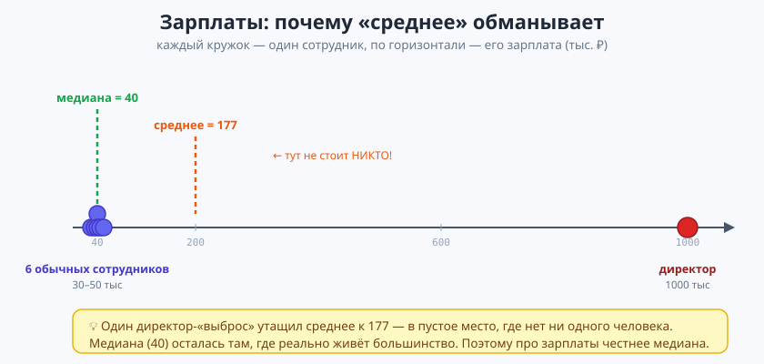

> 📌 Классика: зарплаты `[30,35,40,40,45,50,1000]`. Среднее = 177 (его утянул директор, там не стоит никто!), а медиана = 40 — там, где реально большинство.

#### Разброс: дисперсия и std

Насколько числа «разлетаются» от среднего.

```python
data = np.array([4, 5, 5, 3, 4, 5, 4, 3, 4, 5])

data.max() - data.min()   # 8    — размах (грубо)
np.var(data)              # 0.56 — дисперсия (среднее квадратов отклонений)
np.std(data)              # 0.75 — стандартное отклонение = √дисперсии
```

Как считается std по шагам: **(1)** данные → **(2)** среднее → **(3)** отклонение `x − среднее` у каждого → **(4)** в квадрат (чтобы минусы не сократились) → **(5)** усреднили = дисперсия → **(6)** корень = std.

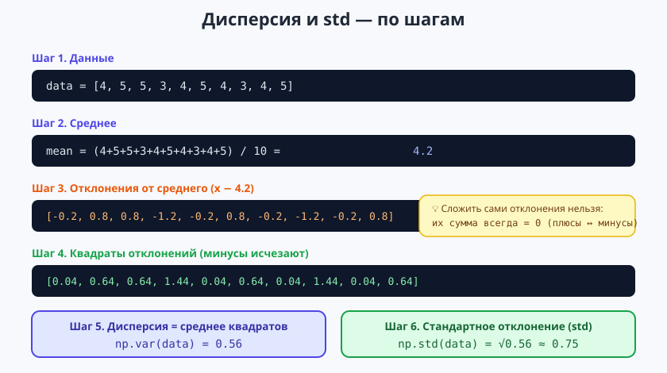

Маленькое std → числа кучкуются возле среднего; большое → разлетаются широко:

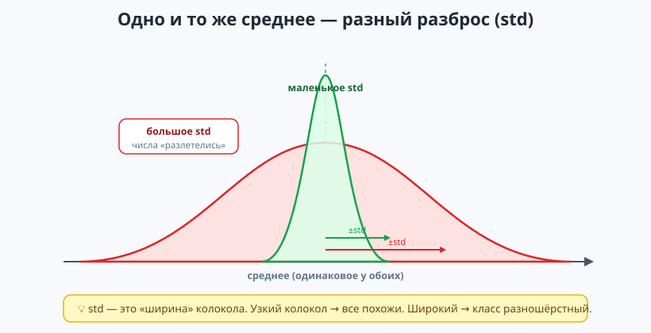

> std — это «ширина» горки. Маленькое → все похожи. Большое → разброс.

**Стандартизация (Z-score)** — привести данные к среднему 0 и std 1, чтобы признаки разного масштаба (рост и зарплата) соревновались честно:
```python
z = (data - data.mean()) / data.std()   # теперь mean≈0, std≈1
```
Здесь `x` — одно число, `mean` — среднее выборки, `std` — её разброс. После этого `z = +1` значит «на 1 std выше среднего» — хоть для роста, хоть для зарплаты.

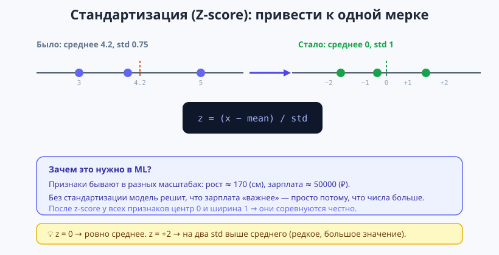

#### Распределения и matplotlib

**Гистограмма** показывает **форму** данных. Рисуют библиотекой **matplotlib**:

```python
import matplotlib.pyplot as plt

plt.hist(data, bins=20)      # столбики: bins — сколько «корзин»
plt.xlabel("Значение")       # подпись оси X (снизу)
plt.ylabel("Сколько чисел")  # подпись оси Y (слева)
plt.title("Заголовок")       # заголовок сверху
plt.show()                   # показать картинку (последней!)
```

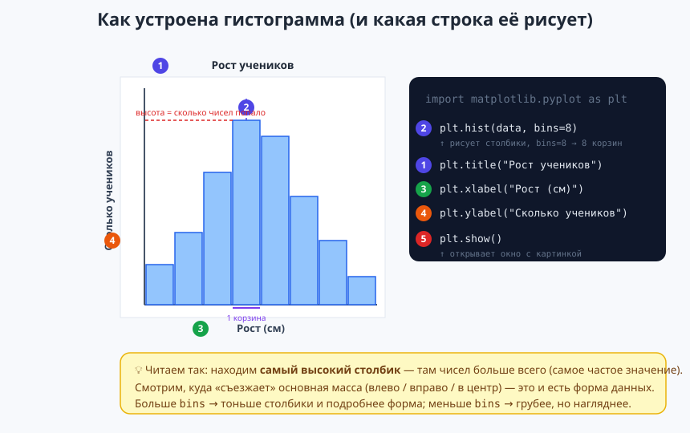

**Как читать гистограмму:** высокий столбик = сюда попало много чисел. Смотрим на общую форму — «забор», «колокол» или перекос.

**Равномерное** распределение → все столбики ≈ равны (все значения равновероятны). Пример — броски кубика:

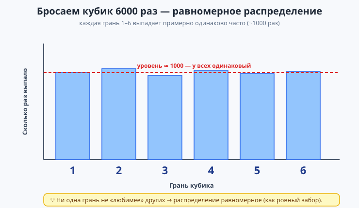

```python
rolls = np.random.randint(1, 7, 6000)   # 1..6 (7 НЕ входит!)
plt.hist(rolls, bins=6)
```

**Нормальное** распределение («колокол») → высоко в центре, низко по краям (`np.random.normal(175, 10, 1000)`):

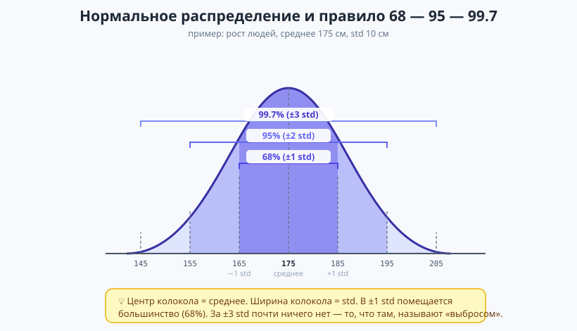

> 📌 **Правило 68 — 95 — 99.7** (для «колокола»): в ±1 std помещается 68% данных, в ±2 std — 95%, в ±3 std — 99.7%. То, что за ±3 std, — «выброс».

#### Корреляция — связь двух величин

Число от **−1 до +1**: +1 растут вместе, 0 не связаны, −1 зеркально.

```python
height = np.array([160, 165, 170, 175, 180, 185])
weight = np.array([55, 60, 65, 72, 78, 85])

np.corrcoef(height, weight)[0, 1]   # ≈ 0.99 — сильная прямая связь
```
> `np.corrcoef` возвращает матрицу 2×2 — нужное число берём как `[0, 1]`.

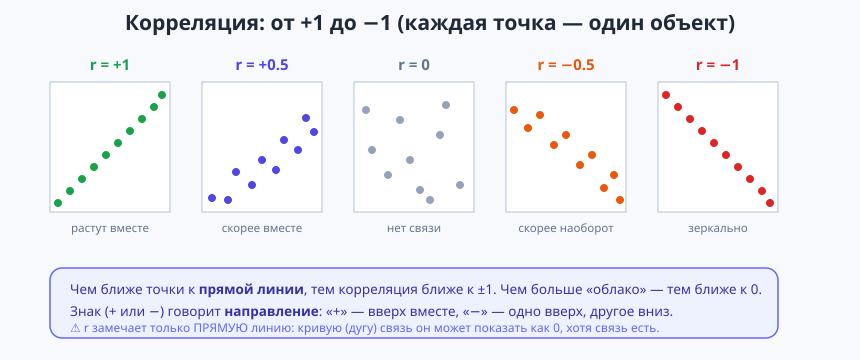

**На диаграмме рассеяния** (scatter) каждый объект — точка. Что означает число под каждой картинкой:

| Число | Точки | Значит |
|---|---|---|
| **+1** | идеальная линия ↗ вверх | растут **вместе и ровно** (товар и его цена) |
| **+0.5** | облако со склоном ↗ | «скорее вместе», но с разбросом (учёба и оценка) |
| **0** | бесформенное облако | **связи нет** (цвет глаз и оценки) |
| **−0.5** | облако со склоном ↘ | «скорее наоборот» (время в телефоне и оценки) |
| **−1** | идеальная линия ↘ вниз | одно растёт — другое **ровно** падает (потратил → осталось) |

> 🧭 **Знак** (+/−) = направление (вместе или наоборот), **величина** (ближе к 1 или к 0) = сила связи (чёткая линия или рыхлое облако).

> ⚠️ **Корреляция ≠ причина!** Продажи мороженого и утопления растут вместе (r≈0.98), но виновата **жара** — «скрытая переменная», а не мороженое. Всегда спрашивай: «а нет ли третьего фактора?».

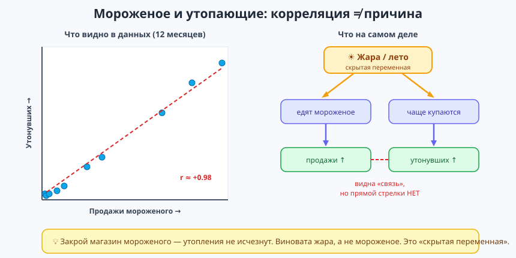

#### Частые ошибки

- `np.random.randint(1, 6, ...)` вместо `randint(1, 7, ...)` — теряется шестёрка (верхняя граница **не входит**).
- Считаешь долю по маске, но забываешь поделить: нужно `mask.sum() / len(data)` (или `mask.mean()`), а не просто `mask.sum()`.
- Путаешь `std` (разброс, ширина) и `mean` (центр) — это про разное.
- Думаешь, что раз коррелирует — значит одно вызывает другое. **Корреляция ≠ причина.**
- Забыл подключить библиотеку (`import numpy as np`, `import matplotlib.pyplot as plt`) → `NameError`.

#### 📋 Все команды урока 1.6

Полный список всего, с чем познакомились на этом уроке (`a` — массив чисел).

**Подключение библиотек**
| Команда | Что делает |
|---|---|
| `import numpy as np` | подключить NumPy (массивы и математика) |
| `import matplotlib.pyplot as plt` | подключить рисовалку графиков |
| `from scipy import stats` | подключить статистику SciPy (нужна для моды) |
| `from collections import Counter` | подключить счётчик частот |

**Меры центра**
| Команда | Что делает |
|---|---|
| `np.mean(a)` · `a.mean()` | среднее арифметическое |
| `np.median(a)` | медиана (центральное число) |
| `stats.mode(a).mode` | мода (самое частое число) |
| `stats.mode(a).count` | сколько раз встретилась мода |
| `Counter(a)` | словарь «число : сколько раз» |
| `Counter(a).most_common(1)` | самая частая пара `(значение, количество)` |
| `sum(a)` · `len(a)` | сумма чисел · сколько чисел (чистый Python) |

**Разброс**
| Команда | Что делает |
|---|---|
| `a.max()` · `a.min()` | самое большое · самое маленькое число |
| `a.max() - a.min()` | размах |
| `np.var(a)` · `a.var()` | дисперсия |
| `np.std(a)` · `a.std()` | стандартное отклонение (std) |
| `np.sqrt(x)` | квадратный корень |
| `a - a.mean()` | отклонения от среднего (broadcasting) |
| `a ** 2` | возвести каждый элемент в квадрат |
| `(a - a.mean()) / a.std()` | стандартизация (z-score) |

**Случайные числа**
| Команда | Что делает |
|---|---|
| `np.random.uniform(lo, hi, n)` | `n` дробных чисел от `lo` до `hi` (равномерно) |
| `np.random.randint(lo, hi, n)` | `n` целых чисел (верхняя граница `hi` **не входит**) |
| `np.random.normal(mean, std, n)` | `n` чисел по «колоколу» (среднее `mean`, разброс `std`) |
| `np.random.seed(0)` | зафиксировать случайность (одинаковый результат при каждом запуске) |

**Графики (matplotlib)**
| Команда | Что делает |
|---|---|
| `plt.hist(a, bins=20)` | гистограмма из `a`, `bins` — число столбиков |
| `plt.hist(a, bins=.., density=True)` | гистограмма, нормированная по площади |
| `plt.scatter(x, y)` | диаграмма рассеяния (точки) |
| `plt.xlabel("..")` · `plt.ylabel("..")` | подписи осей X и Y |
| `plt.title("..")` | заголовок графика |
| `plt.axvline(175, color='red')` | вертикальная линия (напр. на среднем) |
| `plt.show()` | показать готовый график (последней командой) |

**Связь величин**
| Команда | Что делает |
|---|---|
| `np.corrcoef(a, b)[0, 1]` | корреляция двух рядов (число от −1 до +1) |
| `(a >= lo) & (a <= hi)` | булева маска «число в диапазоне» (`True`/`False`) |
| `mask.sum()` · `mask.mean()` | сколько `True` · их доля |

---

### Урок 1.7 — Производная и градиент

#### Зачем это

Это **математика обучения** нейросетей. Производная подсказывает, **в какую сторону** и **насколько** подкрутить числа модели, чтобы она ошибалась меньше. Градиентный спуск повторяет это много раз — так ИИ «учится».

> 💬 **Вся тема одной картинкой.** Представь: ты с завязанными глазами стоишь на горке и хочешь спуститься на самое дно (дно = «модель почти не ошибается»). Ты щупаешь ногой, **куда склон идёт вниз**, и делаешь шаг туда. Потом снова щупаешь и снова шагаешь — пока не окажешься внизу.
> - «пощупать склон» = посчитать **производную / градиент**;
> - «шагнуть вниз» = сделать шаг **градиентного спуска**;
> - размер шага = **learning rate**.
>
> Вот и весь урок. Ниже — те же идеи по отдельности и с кодом.

#### Производная — скорость изменения

> **Производная** — это «спидометр функции»: насколько быстро меняется ответ, если чуть-чуть увеличить `x`. Геометрически — **наклон касательной**.

> 💬 **Простыми словами.** Это «крутизна горки» в конкретном месте. На крутом подъёме спидометр показывает много, на пологом — мало, на ровной площадке — ноль. Запись `f'(x)` («эф штрих») читается «производная функции `f`» — это и есть та самая крутизна.

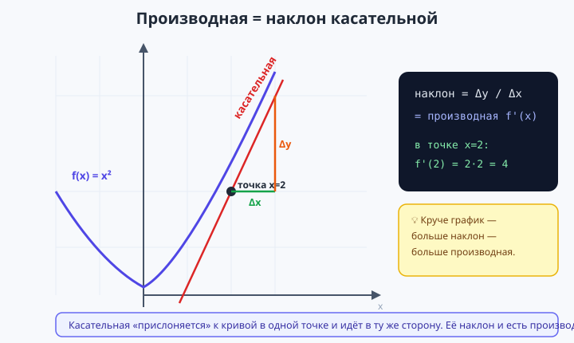

- наклон **вверх** (↗) → производная **> 0** (функция растёт);
- наклон **= 0** (ровно) → производная **0** (дно/вершина — минимум или максимум);
- наклон **вниз** (↘) → производная **< 0** (функция убывает).

> 💬 Зачем знать наклон? Он работает **как компас**: говорит, в какую сторону подкрутить число, чтобы ошибка стала меньше (идём туда, где наклон вниз).

**Правила (чтобы читать формулы):**

| Функция | Производная |
|---|---|
| `c` (число) | `0` |
| `x` | `1` |
| `x²` | `2x` |
| `xⁿ` | `n·xⁿ⁻¹` |
| `(f + g)` | `f′ + g′` |
| `(c·f)` | `c·f′` |
| `(f · g)` | `f′·g + f·g′` |

**Комбинации — для «составных» функций:**

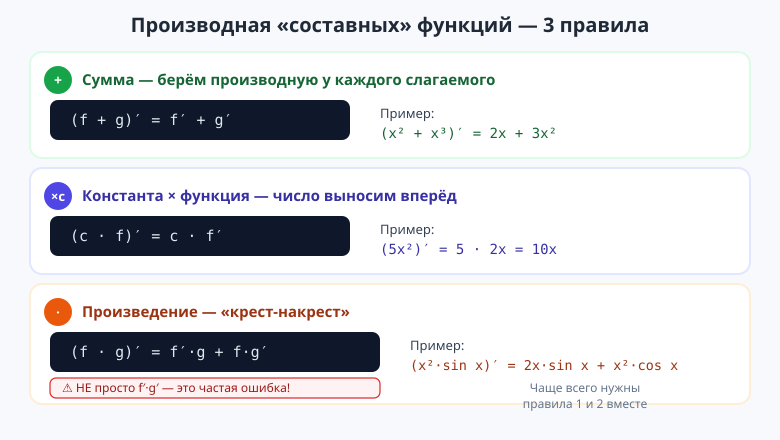

- **Сумма** — берём производную у каждого слагаемого: `(x² + x³)′ = 2x + 3x²`.
- **Константа × функция** — число выносим вперёд: `(5x²)′ = 5·2x = 10x`.
- **Произведение** — «крест-накрест»: `(x²·sin x)′ = 2x·sin x + x²·cos x`. ⚠️ Это **НЕ** просто `f′·g′` — частая ошибка!

> Наизусть учить не надо — на уроке производную считаем **численно кодом**.

#### Производная в коде (численно)

```python
def derivative(f, x, h=0.0001):
    return (f(x + h) - f(x - h)) / (2 * h)   # центральная разность

def f(x):
    return x ** 2
derivative(f, 5)      # ≈ 10  (а по формуле 2·5 = 10)
```
Идея: берём точку чуть правее и чуть левее, считаем «подъём / пробег». Работает для **любой** функции, без знания формул.

#### Градиент — производная для многих переменных

> **Градиент** — это **стрелка-подсказка «куда расти быстрее всего»** для функции нескольких переменных. Показывает и **направление**, и **крутизну**. Записывается `∇f`, это **вектор** из частных производных.

> 💬 **Простыми словами.** Если у функции несколько «ручек» (например, `w` и `b`), то производную считают **по каждой ручке отдельно** (это **частная производная** — крутим одну ручку, остальные замораживаем, как громкость и яркость у телевизора). Градиент — это **все эти наклоны, собранные в один список**: `[наклон по w, наклон по b]`. Одна стрелка-подсказка сразу для всех настроек.

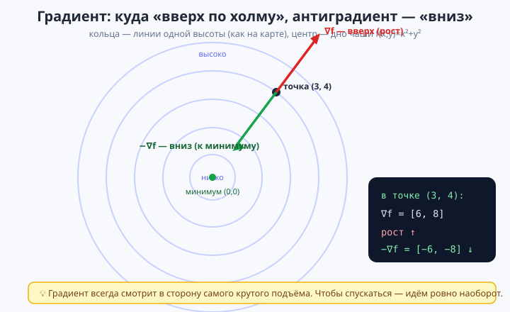

- **градиент** `∇f` → в сторону самого быстрого **роста** (вверх по холму);
- **антиградиент** `−∇f` → **вниз**, к минимуму.

> 💬 **Зачем антиградиент?** Градиент показывает «вверх, к бОльшей ошибке», а нам надо **вниз, к меньшей**. Поэтому берём градиент **с минусом** — и получаем направление «вниз». Правило: *градиент — это где верх, а нам нужен низ.*

```python
def numerical_gradient(f, point, h=0.0001):
    grad = np.zeros_like(point)           # корзинка под ответ
    for i in range(len(point)):
        p_plus, p_minus = point.copy(), point.copy()
        p_plus[i]  += h                   # двигаем ТОЛЬКО i-ю координату
        p_minus[i] -= h
        grad[i] = (f(p_plus) - f(p_minus)) / (2 * h)
    return grad

def f(p): return p[0]**2 + p[1]**2        # f(x,y) = x² + y²
numerical_gradient(f, np.array([3.0, 4.0]))   # ≈ [6, 8]
```

#### Градиентный спуск — так обучается нейросеть

> **Градиентный спуск** — способ **найти минимум вслепую**: щупаем, где склон вниз, и шагаем туда. «Дно» = наименьшая ошибка модели.

> 💬 **Простыми словами.** Тот самый «спуск с горы в тумане»: `посчитал градиент (куда вниз) → шагнул туда → повторил`. Три строчки кода — и это **буквально то, как учатся все нейросети** (только у них не 2 числа, а миллионы).

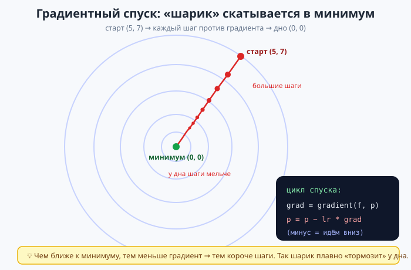

```python
point = np.array([5.0, 7.0])      # старт (числа float!)
lr = 0.1                          # learning rate — размер шага
for step in range(50):
    grad = numerical_gradient(f, point)
    point = point - lr * grad     # ШАГ ПРОТИВ градиента (минус = вниз)
# point → почти [0, 0] — скатились в минимум
```

**Learning rate (lr)** — длина шага:

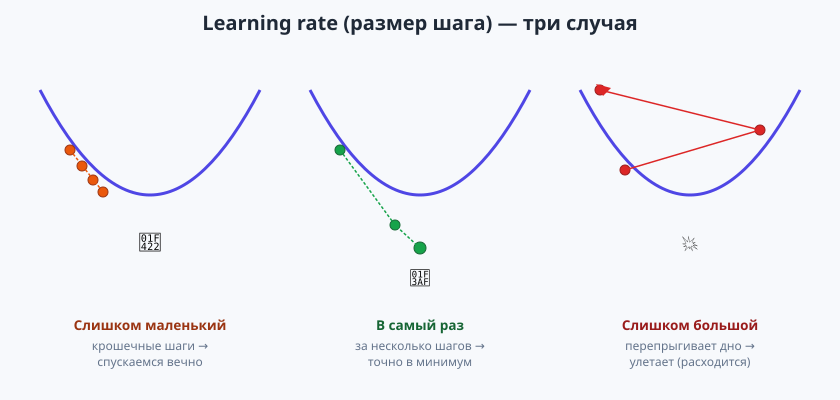

- слишком **большой** → перепрыгивает минимум, **расходится**;
- слишком **маленький** → идёт верно, но **очень медленно**;
- **в самый раз** → быстро и точно в минимум (подбирают: 0.1, 0.01, 0.001).

#### Частые ошибки

- Стартовая точка из **целых** чисел (`[5, 7]`) — обновления округлятся, спуск сломается. Нужно `[5.0, 7.0]` (float).
- Забыть **минус** в `point - lr * grad` → пойдём вверх, а не вниз.
- Внутри `numerical_gradient` менять `point` без `.copy()` — испортим исходную точку.
- Думать, что производную `x²` надо «угадать» — её можно просто **посчитать кодом**.

#### Все команды урока 1.7

| Команда | Что делает |
|---|---|
| `(f(x+h) - f(x-h)) / (2*h)` | численная производная (центральная разность) |
| `np.zeros_like(a)` | массив нулей той же формы, что `a` («корзинка») |
| `a.copy()` | независимая копия массива (чтобы не испортить оригинал) |
| `np.linspace(-5, 5, 100)` | 100 равномерных точек от −5 до 5 |
| `plt.plot(xs, ys)` | линия графика по точкам |
| `point - lr * grad` | шаг градиентного спуска (против градиента) |

---

> 📌 Справочник растёт вместе с курсом: после каждого готового урока сюда добавляется новая тема.
