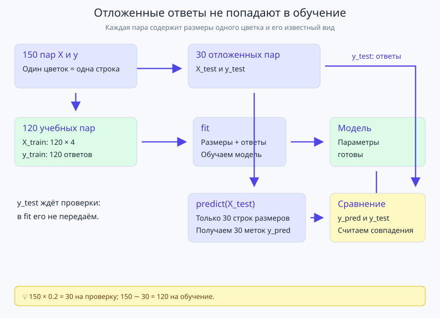
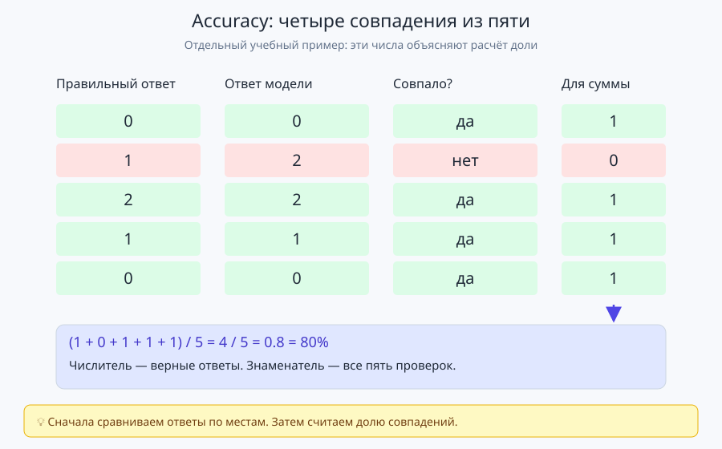

# Урок 3.1. Практика: учим программу различать ирисы

> ### 💻 Как работать с кодом урока
> Создай **один** ноутбук `lesson-3-1-first-ml.ipynb` в Jupyter или Colab. Каждый блок Python ниже — отдельная ячейка. Выполняй сверху вниз: переменные сохраняются между ячейками. Ответы словами пиши в Markdown-ячейках. Самостоятельную работу продолжай ниже заголовка `## Самостоятельная работа`. Перед сдачей выбери «Перезапустить и выполнить всё».

Сегодня работаем вместе с преподавателем.

В конце у тебя будет классификатор цветков, таблица его ответов и два графика.

Для этого достаточно CPU; видеокарта не нужна.

Iris входит в scikit-learn, отдельное скачивание датасета не требуется.


## Введение: какую программу мы соберём

Представь, что у тебя на столе цветок ириса.

Ты измерил его линейкой, но не знаешь название вида.

Сегодня мы создадим программу, которая получит **четыре размера** и предложит **один из трёх видов**.

Фотографии мы не используем: компьютер будет работать с числами.

Для обучения у нас уже есть 150 измеренных цветков с подписями.

Это похоже на карточки: с одной стороны размеры, с другой — правильное название.

Мы оставим 120 карточек для учёбы, а 30 отложим для проверки.

Программа не получит ответы отложенных карточек во время обучения.

**Что будем делать по порядку:**

1. Подключим инструменты.
2. Достанем измерения и известные виды цветков.
3. Отделим проверочные примеры.
4. Нарисуем учебные данные.
5. Обучим модель.
6. Попросим её предсказать виды отложенных цветков.
7. Сравним предсказания с известными ответами.
8. Покажем результат таблицей и графиком.

**Что будет в конце:**

- Один ноутбук со всеми шагами.
- Обученная модель.
- Количество верных ответов из 30.
- Таблица ошибок.
- Графики с подписями и выводами.
 Ты сможешь показать преподавателю не только название цветка, но и объяснить, как проверил свою программу.

Мы не требуем безошибочной работы: задача урока — научиться строить и проверять весь путь.

## 1. Сначала увидим маршрут

У нас 150 цветков и известные виды.

Откладываем 30 цветков, на остальных 120 учим программу.

Затем даём ей только размеры отложенных цветков и сравниваем ответы с известными видами.

Это классификация: нужно выбрать вид, а не вычислить размер.



Сначала пройди глазами верхнюю ветку схемы: размеры и ответы попадают в обучение вместе.

Затем нижнюю: модель получает только размеры, а ответы используются позже при проверке.

Преподаватель может сначала выполнить ячейки 1–7 и показать результат, после чего разобрать их с классом.

Второй экземпляр кода в ноутбуке не нужен.

---

## 2. Ячейка 1 — достаём инструменты

Хотим подключить функции для данных, модели и графиков. Импорт ничего не обучает: он только делает инструменты доступными.

```python
import pandas as pd
import matplotlib.pyplot as plt
from sklearn.datasets import load_iris
from sklearn.model_selection import train_test_split
from sklearn.linear_model import LogisticRegression
from sklearn.metrics import accuracy_score
```

### Разбираем каждую строку

1. `import pandas as pd`

   подключаем библиотеку Pandas.

   Это набор готовых команд для таблиц. `as pd` назначает короткое имя: дальше пишем `pd.DataFrame`, чтобы не повторять длинное название.

   Пока таблица не появилась: мы только приготовили инструмент.

2. `import matplotlib.pyplot as plt`

   подключаем команды рисования. `matplotlib` — библиотека, `pyplot` — её часть для построения рисунков, `plt` — наше сокращение.

   Эта строка сама график не рисует.

3. `from sklearn.datasets import load_iris`

   из раздела учебных данных берём функцию загрузки Iris. `from` указывает, откуда взять, `import` — что именно взять.

   Скобок после имени здесь нет: мы берём функцию, а не запускаем её.

4. `from sklearn.model_selection import train_test_split`

   берём функцию разделения.

   Она понадобится, чтобы отложить часть карточек.

   На этой строке данные ещё не делятся.

5. `from sklearn.linear_model import LogisticRegression`

   берём класс модели.

   Класс можно представить как чертёж: по нему позже создадим конкретную модель.

   Название класса начинается с заглавных букв; пишем его точно, учитывая регистр.

6. `from sklearn.metrics import accuracy_score`

   берём функцию проверки доли верных ответов.

   Она сравнивает ответы модели с известными ответами; сама модель от этого не обучается.


---

**Что получили и зачем**

все шесть инструментов доступны по именам в ноутбуке. Теперь можем загружать данные, учить модель и показывать результат.


`pandas` нужен для понятной таблицы результатов, `pd` — его короткое имя. `matplotlib.pyplot` рисует графики, `plt` — короткое имя этого набора команд.

Эти библиотеки знакомы по модулю 2.

`from ... import ...` читаем «из такого раздела возьми такой инструмент».

| Раздел библиотеки | Инструмент | Для чего нужен |
|---|---|---|
| `datasets` | `load_iris` | Загрузить Iris |
| `model_selection` | `train_test_split` | Разделить данные |
| `linear_model` | `LogisticRegression` | Создать классификатор |
| `metrics` | `accuracy_score` | Посчитать долю верных ответов |

Библиотека называется **scikit-learn**, а в импортах пишется **sklearn**.

Если появилась ошибка `ModuleNotFoundError`, попроси преподавателя установить недостающую библиотеку в окружение ноутбука.

Выполнение следующей ячейки без успешных импортов не поможет.

---

## 3. Ячейка 2 — знакомимся с данными

Хотим узнать, что именно будем давать модели. Сохраняем данные один раз, затем используем эти переменные во всех следующих ячейках.

```python
iris = load_iris()
X = iris.data
y = iris.target
print(iris.feature_names)
print(iris.target_names)
print("Форма X:", X.shape)
print("Форма y:", y.shape)
print("Первый цветок:", X[0])
print("Его вид:", y[0], iris.target_names[y[0]])
```

### Разбираем каждую строку

1. `iris = load_iris()`

   запускаем функцию: круглые скобки означают вызов.

   Знак `=` сохраняет полученный контейнер под именем `iris`.

   Контейнер похож на коробку с подписанными отделениями.

2. `X = iris.data`

   из отделения `data` берём таблицу измерений.

   Точка читается «возьми часть объекта».

   Сохраняем таблицу как `X`: её потом получит модель.

3. `y = iris.target`

   отдельно сохраняем известные виды.

   Метка в `y` и строка с тем же номером в `X` относятся к одному цветку.

   Латинская маленькая `y` отличается от большой `X`.

4. `print(iris.feature_names)`

   выводим названия признаков. `print` только показывает информацию.

   Это нужно, чтобы узнать порядок размеров и их единицы, прежде чем использовать числа.

5. `print(iris.target_names)`

   выводим словарь названий: метка 0 означает setosa, 1 — versicolor, 2 — virginica.

   Номер здесь служит ярлыком вида.

6. `print("Форма X:", X.shape)`

   сначала печатает поясняющий текст, затем форму таблицы. `.shape` — свойство, поэтому после него нет `()`. `(150, 4)` означает 150 объектов по четыре измерения.

7. `print("Форма y:", y.shape)`

   проверяет число ответов. `(150,)` — одномерный массив из 150 элементов: один ответ на каждый цветок.

8. `print("Первый цветок:", X[0])`

   квадратные скобки выбирают элемент.

   Нумерация начинается с 0, поэтому получаем первую строку: четыре размера, а не один размер.

9. `print("Его вид:", y[0], iris.target_names[y[0]])`

   сначала берём первый ответ `y[0]`, получаем 0.

   Затем подставляем его в `target_names[0]` и получаем setosa.

   Запятые разделяют части, которые печатает `print`.


---

**Что получили и зачем**

проверили, что данные состоят из 150 согласованных пар «четыре размера + вид». Теперь понимаем, что означают числа, и можем разделить примеры.


`load_iris()` возвращает контейнер: словно коробку с отделениями.

- `iris.data` — измерения цветков.
- `iris.target` — известные ответы.
- `iris.feature_names` — названия измерений.
- `iris.target_names` — названия видов.

Точка означает обращение к части объекта.

**Порядок признаков:**

| Индекс столбца | Название | Что измерили |
|---|---|---|
| 0 | `sepal length` | Длину чашелистика |
| 1 | `sepal width` | Ширину чашелистика |
| 2 | `petal length` | Длину лепестка |
| 3 | `petal width` | Ширину лепестка |

Все измерения — в **сантиметрах**. Не переставляй столбцы при предсказании нового цветка.

Форма `X` — `(150, 4)`: 150 цветков по четыре измерения.

Форма `y` — `(150,)`: 150 ответов.

Квадратные скобки `[0]` берут первый элемент, потому что нумерация начинается с нуля.

Первая строка — `[5.1, 3.5, 1.4, 0.2]`, её ответ — `0`, название — `setosa`.

В выражении `iris.target_names[y[0]]` сначала получаем метку 0, затем ищем название под номером 0.

**Как читать метки видов:**

- `0` — `setosa`.
- `1` — `versicolor`.
- `2` — `virginica`.
 Это условные названия, а не оценки. У вида 2 нет «вдвое больше вида», чем у вида 1.

**Проверь себя:** сколько предсказаний ожидаем для таблицы из семи строк? Семь: по одному для каждого объекта, независимо от количества признаков.

---

## 4. Ячейка 3 — откладываем экзаменационные карточки

### Зачем выполняем этот шаг

Наша цель — определять виды цветков, которых не было при обучении. Чтобы проверить это, нужны отдельные примеры.

Представь, что на контрольной тебе дали ровно те задачи с ответами, по которым ты готовился.

Верные ответы ещё не покажут, можешь ли ты решать новые задачи: ты мог запомнить знакомые решения.

Для проверки учитель даст другие задачи на ту же тему.

Поэтому до обучения разделим наши карточки с цветками:

- **120 карточек** с размерами и ответами покажем модели при обучении.
- **30 карточек** сохраним для проверки и не передадим в обучение.

После обучения откроем у отложенных карточек только размеры и попросим модель назвать виды. Затем сравним её ответы с известными видами этих 30 цветков.

**Почему нельзя отложить карточки после обучения?** Если сначала обучить модель на всех 150 цветках, то выбранные позже 30 уже участвовали в подборе параметров.

Проверка получится на знакомых данных.

**Почему оставляем 20%?** В этом уроке это удобный учебный выбор: большая часть примеров остаётся для обучения, меньшая — для проверки.

Доля 20% не является обязательной для всех задач.

**Что получим после следующей ячейки:** две отдельные группы измерений и две соответствующие группы ответов. Модель будет учиться по одной группе, а проверяться по другой.


Хотим оставить независимые примеры для проверки. Делим признаки и ответы одновременно, чтобы подписи не оторвались от своих цветков.

```python
X_train, X_test, y_train, y_test = train_test_split(
    X, y,
    test_size=0.2,
    random_state=42,
    stratify=y
)
print("Обучение:", X_train.shape, y_train.shape)
print("Проверка:", X_test.shape, y_test.shape)
```

### Разбираем каждую строку

1. `X_train, X_test, y_train, y_test = train_test_split(`

   вызываем функцию, а её четыре результата раскладываем в четыре имени слева.

   Порядок обязателен: учебные измерения, проверочные измерения, учебные ответы, проверочные ответы.

2. `X, y,`

   передаём исходные измерения **вместе** с ответами.

   Функция сохранит соответствие строк и подписей.

   Запятая разделяет аргументы вызова.

3. `test_size=0.2,`

   именованный аргумент: слева имя настройки, справа значение. `0.2` — двадцать сотых, то есть 20%.

   Получаем `150 × 0.2 = 30` проверочных объектов.

4. `random_state=42,`

   фиксируем случайное перемешивание для этого вызова.

   При тех же данных и настройках повторится разделение.

   Это нужно для повторения опыта, а не для повышения качества.

5. `stratify=y`

   просим сохранить доли видов по меткам `y`.

   Поскольку каждого вида 50, в тест попадёт по 10, в обучение — по 40.

6. `)`

   закрывает вызов, начатый в первой строке.

   Пока скобки открыты, команду можно переносить на несколько строк.

7. `print("Обучение:", X_train.shape, y_train.shape)`

   проверяем учебную пару: 120 строк измерений и 120 ответов.

   Четыре столбца признаков сохранились.

8. `print("Проверка:", X_test.shape, y_test.shape)`

   проверяем отложенную пару: 30 строк и 30 ответов.

   Их не будем передавать в `fit`.


---

**Что получили и зачем**

четыре согласованных массива. Отложили 30 примеров, чтобы позднее проверить ответы на объектах, которых не было при обучении.


Слева четыре переменные: сначала две части **X**, затем две части **y**.

Это распаковка результата функции.

Переносы строк внутри скобок нужны для удобства чтения, команда остаётся одной.

`test_size=0.2` — отложить 20%. Вычисляем `150 × 0.2 = 30`; останется `150 − 30 = 120`. **Остальные настройки разделения:**

- `random_state=42` — фиксирует случайное разделение при тех же данных и настройках. Это не настройка качества модели.
- `stratify=y` — сохраняет доли видов. Из каждого вида 40 цветков попадёт в обучение, 10 — в проверку.

Получим `Обучение: (120, 4) (120,)` и `Проверка: (30, 4) (30,)`.

Значит, у каждой части измерений есть столько же ответов.

Столбцов по-прежнему четыре: разделили **объекты**, а не признаки.

`train` читаем «трейн», обучение; `test` — проверка. В следующем шаге показываем график только учебных данных. Тестовые ответы сохраняем до оценки.

---

## 5. Ячейка 4 — видим, есть ли связь размеров с видом

Хотим посмотреть два измерения на плоскости. Модель позже получит все четыре. Цвет на графике берём из известного ответа, поэтому это исследование данных, а не прогноз модели.

```python
plt.figure(figsize=(8, 5))
for class_id, class_name in enumerate(iris.target_names):
    mask = y_train == class_id
    plt.scatter(
        X_train[mask, 2], X_train[mask, 3],
        label=class_name, alpha=0.7
    )
plt.xlabel("Длина лепестка, см")
plt.ylabel("Ширина лепестка, см")
plt.title("Учебные цветки: размеры лепестка и известный вид")
plt.legend()
plt.grid(alpha=0.3)
plt.show()
```

### Разбираем каждую строку

1. `plt.figure(figsize=(8, 5))`

   создаём чистый рисунок размером 8 на 5 дюймов. `figsize` получает пару чисел в круглых скобках: ширину и высоту.

   Эти числа относятся к размеру картинки, а не к цветкам.

2. `for class_id, class_name in enumerate(iris.target_names):`

   запускаем цикл по трём названиям. `enumerate` добавляет номер к названию: сначала `(0, "setosa")`.

   Номер сохраняем в `class_id`, название — в `class_name`.

   Двоеточие открывает тело цикла; строки с отступом выполняются для каждого вида.

3. `mask = y_train == class_id`

   двойное `==` сравнивает каждый учебный ответ с текущим номером вида.

   Например, при номере 0 получаем True напротив setosa.

   Одинарное `=` сохраняет этот массив галочек в `mask`.

4. `plt.scatter(`

   начинаем команду диаграммы рассеяния.

   Она ставит точку для каждой пары координат.

5. `X_train[mask, 2], X_train[mask, 3],`

   до запятой внутри скобок выбираем строки по галочкам, после неё — номер столбца.

   Индекс 2 — третий столбец, длина лепестка; индекс 3 — четвёртый, ширина.

   Одинаковая маска сохраняет правильные пары.

6. `label=class_name, alpha=0.7`

   называем эту группу для легенды и задаём прозрачность.

   При `alpha=1` точки полностью непрозрачные, при 0 исчезают.

   Значение 0.7 помогает видеть наложения.

7. `)`

   заканчивает команду `scatter`.

   На следующем проходе цикла рисуем другой вид, на том же рисунке.

8. `plt.xlabel(...)`

   подписываем горизонтальную ось: длина лепестка в сантиметрах.

   Строка без отступа находится уже после цикла.

9. `plt.ylabel(...)`

   подписываем вертикальную ось: ширина лепестка в сантиметрах.

10. `plt.title(...)`

   поясняем, что это учебные цветки с известными видами.

11. `plt.legend()`

   выводим названия групп, которые передали через `label`.

   Теперь читатель понимает цвета.

12. `plt.grid(alpha=0.3)`

   добавляем светлую сетку, чтобы легче читать координаты.

13. `plt.show()`

   показываем готовый рисунок.

   Данные и модель эта команда не меняет.


---

**Что получили и зачем**

увидели расположение учебных цветков по двум размерам. Рисунок помогает заметить группы и перекрытия; он ещё не измеряет качество модели.


**Разбираем строки.** `figure` создаёт новый рисунок, `figsize=(8, 5)` задаёт его ширину и высоту в дюймах. `enumerate` выдаёт пары «номер, название»: сначала 0 и setosa, затем 1 и versicolor, затем 2 и virginica.

Цикл рисует один вид за один проход.

`mask = y_train == class_id` сравнивает каждый ответ с текущим номером вида.

Получается массив True/False.

Например, для вида 0 отмечаются только строки setosa. `X_train[mask, 2]` берёт у отмеченных строк столбец с индексом 2 — **третий** столбец, длину лепестка. `X_train[mask, 3]` берёт ширину лепестка.

Одна и та же маска сохраняет пары измерений.

`scatter` ставит точки по этим координатам. `label` подписывает группу для легенды; `alpha=0.7` делает точки немного прозрачными, чтобы перекрытия были заметнее. `xlabel` и `ylabel` подписывают оси, `title` — весь рисунок. `legend` выводит названия групп. `grid(alpha=0.3)` добавляет ненавязчивую сетку, `show` показывает готовый рисунок.

**📊 Что видим.** Каждая точка — один учебный цветок.

Правее означает длиннее лепесток, выше — шире.

Точка `(1.4, 0.2)` означает длину 1.4 см и ширину 0.2 см.

Цвет означает известный вид; это видно в легенде.

Setosa образует область небольших лепестков, два других вида расположены ближе друг к другу.

Точки могут накладываться, поэтому визуально их может казаться меньше 120.

**Зачем строили.** Увидели, что размеры связаны с видом и могут помочь классификации. **Чего не доказали:** на рисунке нет границы модели и не показана её точность.

Два признака могут совпадать у разных видов; модель дополнительно использует ещё два.

Напиши под рисунком одно наблюдение с названиями осей, например о том, где лежат самые короткие лепестки.

---

## 6. Ячейка 5 — создаём и обучаем модель

Теперь хотим подобрать правило по учебным примерам. Это первая ячейка, где происходит обучение.

```python
model = LogisticRegression(max_iter=1000)
model.fit(X_train, y_train)
```

### Разбираемся в самой команде: что такое `fit`

`fit` — **метод объекта модели**, то есть действие, которое умеет выполнять этот объект. По-английски fit здесь можно понять как «подобрать подходящие параметры».

Общий смысл вызова:

`объект_модели.fit(учебные_признаки, учебные_ответы)`

У нас объект называется `model`.

Он создан по классу `LogisticRegression`, поэтому его метод `fit` запускает именно обучение логистической регрессии.

У другой модели метод с таким же названием может использовать другой способ обучения.

**Почему используем `fit`?** Команда создания `LogisticRegression(...)` только создаёт объект с выбранными настройками.

Она ещё не подбирает коэффициенты по нашим цветкам.

Чтобы запустить этот подбор, библиотека предоставляет метод `fit`.

**Что передаём в скобках:**

| Аргумент | Что в нём лежит | Зачем это обучению |
|---|---|---|
| `X_train` | 120 строк, в каждой четыре размера | По этим размерам модель вычисляет свои ответы |
| `y_train` | 120 известных видов в том же порядке | По этим ответам можно оценить, насколько удачны вычисления модели |

Ответ с номером 17 относится к строке измерений с номером 17. Если перемешать ответы отдельно от измерений, алгоритм будет учиться по перепутанным подписям.

### Как именно обучается наша LogisticRegression

Рассмотрим происходящее внутри `fit` по шагам. Библиотека выполняет вычисления сама, но нам важно понимать их смысл.

#### 1. У модели есть изменяемые числа — коэффициенты.

Для каждого из трёх видов модель использует четыре веса — по одному на каждое измерение — и дополнительное число, которое называют смещением.

Веса определяют, как измерения участвуют в вычислении оценки вида.

Пока обучение не выполнено, полезные значения этих чисел по нашим примерам ещё не найдены.

💬 Это похоже на настройку четырёх ручек: изменение каждой ручки меняет влияние одного размера на результат. Но ручки здесь — числа в памяти компьютера.

#### 2. По размерам цветка модель вычисляет оценку каждого вида.

Сначала правило словами: каждый размер умножаем на свой вес, складываем четыре произведения и прибавляем смещение.

Для **одного** вида это можно записать так:

`оценка = w₁ × x₁ + w₂ × x₂ + w₃ × x₃ + w₄ × x₄ + b`

Обозначения:

- `x₁, x₂, x₃, x₄` — четыре размера одного цветка.
- `w₁, w₂, w₃, w₄` — четыре веса для рассматриваемого вида.
- `b` — смещение, то есть добавка к сумме.

Покажем только арифметику на **придуманных весах**, не на коэффициентах обученной модели.

Пусть веса равны `0, 0, 2, 1`, а смещение равно `−1`.

Для размеров `[5.1, 3.5, 1.4, 0.2]` получим:

1. Умножаем размеры на веса: `0 × 5.1`, `0 × 3.5`, `2 × 1.4`, `1 × 0.2`.
2. Получаем `0`, `0`, `2.8`, `0.2`.
3. Складываем и добавляем смещение: `0 + 0 + 2.8 + 0.2 − 1 = 2`.

Число 2 здесь — **оценка одного вида**, а не метка вида 2 и не вероятность. У остальных видов свои веса и свои оценки.

#### 3. Оценки превращаются в вероятности трёх видов.

В многоклассовой логистической регрессии для этого используется преобразование **softmax**.

Оно превращает три оценки в три положительных числа, сумма которых равна 1.

Подробную формулу изучим на уроке 3.4; сейчас нам нужен смысл результата.

Например, для одного учебного цветка могли получиться такие **условные** значения:

| Вид | Вероятность по расчёту модели |
|---|---|
| setosa | 0.20, или 20% |
| versicolor | 0.50, или 50% |
| virginica | 0.30, или 30% |

Сумма `0.20 + 0.50 + 0.30 = 1`. Такие вероятности выражают расчёт модели, а не гарантию правильности.

#### 4. Известный ответ позволяет вычислить ошибку обучения.

Допустим, правильный вид этого цветка — setosa. Модель выделила ему только 20%. Значит, текущие коэффициенты пока не дают удачного ответа.

🔵 **Функция потерь** — способ выразить неудачность ответов одним числом.

Для LogisticRegression используется логарифмическая потеря: чем меньше вероятность, которую модель выделила правильному виду, тем больше потеря.

Формулу разберём позже; сейчас важно, что обучение учитывает вероятности, а не только количество угаданных меток.

Алгоритм учитывает учебные примеры вместе. Он не должен исправить ответ на одном цветке ценой произвольного ухудшения всех остальных.

#### 5. Алгоритм подбирает новые значения весов и смещений.

Он вычисляет, как изменение коэффициентов связано с изменением потери, и выбирает обновление параметров.

Это связано с производной и градиентом из модуля 1: они помогают определить направление изменения чисел.

В нашем вызове используется стандартный решатель LogisticRegression — **L-BFGS**.

Это готовый численный алгоритм поиска подходящих параметров.

Он использует информацию о градиенте; это более сложный способ, чем простой шаг градиентного спуска, который мы разбирали вручную.

По умолчанию модель также ограничивает чрезмерно большие веса.

Это называется **регуляризацией**.

Поэтому алгоритм ищет сочетание хороших ответов и умеренных весов, а не обязан добиться нулевой ошибки на всех учебных цветках.

#### 6. Вычисления повторяются до остановки.

После изменения коэффициентов алгоритм снова оценивает результат и решает, нужно ли продолжать подбор.

- Если выполнен критерий остановки, обучение завершается.
- Если достигнут предел `max_iter=1000`, подбор прекращается; при недостигнутой сходимости может появиться предупреждение.

`max_iter` ограничивает число итераций решателя. Это не число цветков, не обещание ровно тысячи повторений и не требование получить 100% верных ответов.

### Что осталось в объекте после `fit`

Подобранные коэффициенты сохраняются внутри `model`. У LogisticRegression их можно посмотреть в атрибутах:

- `model.coef_` — обученные веса.
- `model.intercept_` — обученные смещения.

Конечное подчёркивание — принятое в scikit-learn обозначение многих атрибутов, полученных при обучении. В нашем случае веса организованы по видам: три набора по четыре веса.

Сам метод `fit` возвращает обученный объект модели — тот же объект, у которого вызвали метод.

Поэтому отдельное присваивание `model = ...` для сохранения результата обучения здесь не требуется.

Если ноутбук вывел `LogisticRegression(max_iter=1000)`, он показал объект, а не точность и не все найденные веса.

---

**Что получили и зачем**

В `model` теперь сохранены числа, подобранные по 120 учебным цветкам.

Следующий метод, `predict`, использует эти числа для расчёта ответов по новым размерам.

Он не подбирает веса заново и не получает правильные тестовые ответы.

### Почему обучение ещё не доказывает качество

Уменьшение потери на учебных примерах показывает, что подбор параметров работает на этих данных.

А верно ли модель определяет виды отложенных цветков, выясним отдельно: получим предсказания и сравним их с `y_test`.


### Разбираем каждую строку

1. `model = LogisticRegression(max_iter=1000)`

   по классу создаём конкретный объект модели и сохраняем под именем `model`.

   Круглые скобки здесь создают экземпляр класса. `max_iter` — предел числа итераций подбора параметров. 1000 — запас шагов, а не 1000 цветков и не обещание точности.

   На этом этапе модель ещё не обучена.

2. `model.fit(X_train, y_train)`

   через точку вызываем метод созданного объекта.

   Первый аргумент — 120 строк размеров, второй — 120 подписанных видов.

   Модель подбирает внутренние числа, чтобы связывать размеры с видами, и хранит их внутри `model`.

   Повторно присваивать `model` не требуется.


---

**Что получили и зачем**

обученный объект, который теперь может принимать измерения и выдавать предполагаемые виды. Насколько он полезен, выясним следующим шагом, а не по самому факту завершения `fit`.


Первая строка создаёт объект класса, как в модуле 1. `model` хранит ссылку на него.

Несмотря на слово Regression в названии, этот класс решает **классификацию**. `max_iter` — верхний предел числа итераций обучения, а не число цветков.

Значение 1000 даёт алгоритму запас; он может остановиться раньше.

Вторая строка вызывает метод `fit`: модель получает 120 строк измерений и 120 правильных меток, подбирает коэффициенты и сохраняет их внутри себя.

Мы не передали ни `X_test`, ни `y_test`.

Если ноутбук показал запись `LogisticRegression(max_iter=1000)`, это представление объекта, а не оценка качества.

Если появилось предупреждение о сходимости (`ConvergenceWarning`), покажи его преподавателю: алгоритм мог не завершить подбор.

Не считай увеличение лимита гарантией хорошего качества.

Здесь все признаки измеряются в сантиметрах; более общий способ подготовки разных масштабов изучим позже.

---

## 7. Ячейка 6 — получаем ответы

Хотим применить обученные коэффициенты к 30 отложенным цветкам. Правильные ответы модели не передаём.

```python
y_pred = model.predict(X_test)
print("Число предсказаний:", len(y_pred))
print("Предсказания:", y_pred)
print("Правильные ответы:", y_test)
```

### Разбираем каждую строку

1. `y_pred = model.predict(X_test)`

   вызываем предсказание у обученного объекта.

   Передаём только размеры 30 проверочных цветков.

   Правильных ответов в аргументах нет.

   Возвращённые метки сохраняем отдельно как `y_pred`.

2. `print("Число предсказаний:", len(y_pred))`

   `len` считает элементы массива, а `print` показывает результат.

   Должно быть 30: по ответу на строку теста.

3. `print("Предсказания:", y_pred)`

   показываем метки, выбранные моделью.

   Позиции соответствуют порядку строк `X_test`.

4. `print("Правильные ответы:", y_test)`

   показываем ранее отложенные метки для сравнения.

   Вывод на экран не передаёт их в обучение.


---

**Что получили и зачем**

30 предположений модели. Теперь есть что сравнить с 30 известными ответами и можно посчитать качество.


`predict` возвращает один класс для каждой строки `X_test`. `len` проверяет длину: должно быть 30.

Два напечатанных массива читаем **попарно**: первый элемент первого массива сравниваем с первым элементом второго.

Вывод правильных ответов после предсказания не обучает модель: `print` только показывает значения.

Важно: предсказание не означает достоверное знание вида. Это ответ выбранной модели по четырём измерениям.

---

## 8. Ячейка 7 — считаем совпадения двумя способами

Хотим проверить, сколько ответов верно, и получить долю. Сначала считаем вручную средствами массива, затем сверяем с библиотекой.

```python
correct = y_pred == y_test
correct_count = int(correct.sum())
test_count = len(y_test)
acc = accuracy_score(y_test, y_pred)
print("Верно:", correct_count, "из", test_count)
print("Доля вручную:", correct_count / test_count)
print(f"Accuracy: {acc:.2%}")
```

### Разбираем каждую строку

1. `correct = y_pred == y_test`

   сравниваем ответы попарно.

   Результат — массив True/False: True означает совпадение, False — ошибку.

   Двойное равно сравнивает, одинарное сохраняет массив.

2. `correct_count = int(correct.sum())`

   `.sum()` складывает галочки: True считается 1, False — 0. `int(...)` превращает сумму в обычное целое число Python.

   Получаем количество верных ответов.

3. `test_count = len(y_test)`

   считаем все проверенные объекты.

   Это знаменатель будущей доли: в нашем тесте 30.

4. `acc = accuracy_score(y_test, y_pred)`

   библиотечная функция получает истину и прогноз и вычисляет долю совпадений.

   Число между 0 и 1 сохраняем в `acc`.

5. `print("Верно:", correct_count, "из", test_count)`

   показываем счёт понятными словами, чтобы не потерять за процентом реальные количества.

6. `print("Доля вручную:", correct_count / test_count)`

   знак `/` делит число верных на число проверок.

   Этот расчёт должен совпасть с `acc`.

7. `print(f"Accuracy: {acc:.2%}")`

   `f` разрешает вставить значение переменной в текст.

   В фигурных скобках `acc` — что показываем, `:.2%` — как показываем: проценты с двумя знаками после запятой.

   Это меняет оформление вывода, а не исходное значение.


---

**Что получили и зачем**

количество совпадений и долю верных ответов, рассчитанную двумя способами. Проверили не только модель, но и своё понимание метрики.


`==` сравнивает по элементам, `correct` содержит True/False. `sum()` считает True как единицу, поэтому получаем число совпадений. `int` переводит результат в обычное целое Python. `len(y_test)` — количество проверок. `accuracy_score` получает **правильные ответы**, затем **предсказания**, и вычисляет долю совпадений.

Формула появилась из подсчёта: **доля = верные / все**.

Например, 29 из 30 — `29 / 30 ≈ 0.9667`.

Формат `:.2%` умножает долю на 100 при показе и оставляет две цифры после запятой: `96.67%`.

Само значение `acc` остаётся долей.



Схема иллюстрирует отдельный пример 4 из 5, а не результат нашего запуска.

Запиши **свои** числа: сколько верно, сколько проверено и какая доля.

Не подгоняй результат под 100%.

Даже отсутствие ошибок означает только отсутствие ошибок на этой тестовой части.

---

## 9. Ячейка 8 — разбираем конкретные ответы

Хотим превратить два массива в таблицу и отдельно увидеть ошибки.

```python
results = pd.DataFrame(X_test, columns=iris.feature_names)
results["Правильный вид"] = iris.target_names[y_test]
results["Ответ модели"] = iris.target_names[y_pred]
results["Верно"] = correct
print(results.head().to_string(index=False))
errors = results[~results["Верно"]]
print("Ошибочных строк:", len(errors))
print(errors.to_string(index=False))
```

### Разбираем каждую строку

1. `results = pd.DataFrame(X_test, columns=iris.feature_names)`

   создаём таблицу из 30 тестовых строк. `columns` задаёт названия четырёх столбцов.

   Сохраняем таблицу в `results`, чтобы рядом с размерами разместить ответы.

2. `results["Правильный вид"] = iris.target_names[y_test]`

   справа массив номеров заменяется массивом названий.

   Слева квадратные скобки с текстом указывают столбец таблицы.

   Такого столбца ещё нет, поэтому присваивание создаёт его.

3. `results["Ответ модели"] = iris.target_names[y_pred]`

   таким же способом добавляем названия предсказанных видов.

   Важно не перепутать `y_test` и `y_pred`: это разные источники.

4. `results["Верно"] = correct`

   добавляем галочки сравнения, по одной на каждую строку.

   Все столбцы должны описывать те же цветки в том же порядке.

5. `print(results.head().to_string(index=False))`

   сначала `head()` берёт первые пять строк.

   Затем `to_string` делает текстовую таблицу, а `index=False` скрывает служебные номера строк.

   В конце `print` выводит этот текст.

   Исходная полная таблица не обрезается.

6. `errors = results[~results["Верно"]]`

   сначала берём столбец галочек, затем `~` переворачивает их: ошибочные строки становятся True.

   Внешние скобки оставляют строки с True.

   Сохраняем отдельную таблицу ошибок.

7. `print("Ошибочных строк:", len(errors))`

   считаем именно строки ошибок.

   Это число должно совпасть с общим числом тестов минус верные ответы.

8. `print(errors.to_string(index=False))`

   показываем все найденные ошибки с размерами и двумя названиями.

   Пустая таблица означает отсутствие ошибок в этой проверке.


---

**Что получили и зачем**

вместо общей доли теперь видим конкретные неверные ответы. Можно объяснить, какие виды перепутаны, и сверить количество ошибок с предыдущим расчётом.


`DataFrame` создаёт таблицу из тестовых измерений. `columns` задаёт названия четырёх столбцов.

Выражение `iris.target_names[y_test]` заменяет массив номеров массивом названий: так ответы легче читать.

Присваивание в новый столбец добавляет его к таблице. `head()` показывает первые пять строк; `to_string(index=False)` печатает таблицу без служебного номера строки.

`results["Верно"]` — логический столбец.

Знак `~` меняет True на False и наоборот, поэтому фильтр выбирает **несовпадения**.

Если таблица ошибок пустая, программа сработала: на этом тесте ошибок нет.

Если строки есть, сравни два названия в каждой.

Не исправляй ответы модели вручную — это уничтожит смысл проверки.

---

## 10. Ячейка 9 — график результата проверки

Хотим показать количество верных ответов и ошибок так, чтобы результат было легко объяснить другому человеку.

```python
error_count = test_count - correct_count
plt.figure(figsize=(6, 4))
plt.bar(["Верно", "Ошибка"], [correct_count, error_count],
        color=["#16a34a", "#dc2626"])
plt.ylabel("Количество тестовых цветков")
plt.title("Результат проверки на отложенных данных")
plt.ylim(0, test_count)
plt.show()
```

### Разбираем каждую строку

1. `error_count = test_count - correct_count`

   вычитаем верные ответы из всех проверок.

   Остаток — число ошибок.

   Каждый объект попадает ровно в одну из этих двух групп.

2. `plt.figure(figsize=(6, 4))`

   создаём отдельный рисунок размером 6 на 4 дюйма, чтобы столбцы не появились поверх предыдущего scatter.

3. `plt.bar(["Верно", "Ошибка"], [correct_count, error_count],`

   первый список содержит названия столбцов, второй — их высоты.

   Первая высота относится к первой подписи, вторая — ко второй.

4. `color=["#16a34a", "#dc2626"])`

   задаём цвета в том же порядке: зелёный для верных, красный для ошибок.

   Записи с `#` — коды цветов, не численные результаты модели.

   Закрывающая скобка завершает команду `bar`.

5. `plt.ylabel(...)`

   подписываем вертикальную ось: здесь считаем цветки, а не проценты.

6. `plt.title(...)`

   поясняем, на каких данных проведена проверка.

7. `plt.ylim(0, test_count)`

   устанавливаем нижнюю и верхнюю границы вертикальной оси.

   Нулевое начало позволяет правильно сравнивать высоты, верхняя граница равна всем 30 проверкам.

8. `plt.show()`

   показываем рисунок после всех подписей и настроек.


---

**Что получили и зачем**

наглядный отчёт «сколько верно и сколько ошибок». Сумма высот должна равняться 30. Такой рисунок легко показать тому, кто не читает массивы Python.


Из общего числа вычитаем верные ответы — остаются ошибки. `bar` строит столбцы: первый список задаёт подписи, второй — высоты в том же порядке. `color` задаёт зелёный и красный цвета. `ylim(0, test_count)` устанавливает диапазон вертикальной оси от нуля до размера теста.

Это помогает не преувеличивать разницу высот.

**📊 Как читать.** По горизонтали — два исхода проверки.

По вертикали — число объектов.

Сумма высот равна 30.

Если красный столбец имеет высоту 1, это одна ошибка, а не 1%.

Доля ошибок тогда `1 / 30`, то есть примерно 3.33%.

При нуле ошибок красный столбец не виден — его высота нулевая.

**Что получили:** картинку качества на одном конкретном тесте. Она не показывает, какие виды перепутаны: для этого вернись к таблице из предыдущего шага.

---

## 11. Ячейка 10 — свой запрос к модели

Хотим запросить прогноз для одного набора измерений. Эти числа повторяют первую строку Iris: здесь показываем форму запроса, а не проводим независимую проверку.

```python
new_flower = [[5.1, 3.5, 1.4, 0.2]]
new_prediction = model.predict(new_flower)
print("Предполагаемый вид:", iris.target_names[new_prediction[0]])
```

### Разбираем каждую строку

1. `new_flower = [[5.1, 3.5, 1.4, 0.2]]`

   внутренние скобки содержат четыре измерения одного цветка.

   Внешние создают таблицу из одной строки: именно такую форму ожидает модель.

   Порядок размеров и сантиметры сохраняем как в обучении.

2. `new_prediction = model.predict(new_flower)`

   передаём таблицу обученной модели.

   Получаем массив из одного номера вида, потому что передали один объект.

   Обучение заново не происходит.

3. `print("Предполагаемый вид:", iris.target_names[new_prediction[0]])`

   сначала `[0]` достаёт единственную метку из результата, затем `target_names` переводит номер в название. `print` выводит название с пояснением.


---

**Что получили и зачем**

показали, как пользоваться обученной моделью для отдельного запроса.

Эти числа совпадают с первой исходной строкой Iris, поэтому такой показ не является новой независимой проверкой.

Для оценки качества используем отложенный тест.


Две пары квадратных скобок означают **таблицу из одной строки**, а не просто список четырёх чисел.

Модель ожидает таблицу даже для одного объекта.

Получаем массив из одной метки, `[0]` достаёт её, а `target_names` превращает в название.

Размеры идут в том же порядке и единицах, что при обучении.

Если передать миллиметры вместо сантиметров или размеры случайного предмета, модель всё равно выберет один из знакомых классов.

Это не доказывает, что перед нами ирис.

Предсказание для такого запроса — демонстрация применения, а не дополнительное измерение accuracy.

## 12. Что сохранить и как проверить себя

Под графиками напиши три предложения: что предсказывали, на скольких цветках учились и проверялись, сколько тестовых ответов оказалось верным.

Добавь ограничение: этот результат не гарантирует качество на любых будущих данных.

| Если возникла проблема | Что проверить |
|---|---|
| `NameError` | Выполнены ли предыдущие ячейки после перезапуска? |
| Модель не обучена | Выполнен ли `fit` именно для этого объекта `model`? |
| Ожидается двумерный массив | Есть ли внешние скобки для таблицы из одного цветка? |
| Не совпадают размеры X и y | Разделялись ли они одним вызовом? |
| Четыре числа есть, но ответ странный | Совпадают ли порядок признаков и сантиметры? |

Дальше — [самостоятельные задания](homework.md). В уроке 3.2 подробнее исследуем признаки, разбиение и утечки данных.

### Контрольный запуск

При проверке на scikit-learn 1.9.1 получено 29 верных ответов из 30: accuracy 96.67%, одна ошибка.

Это результат приведённого разделения с `stratify=y`; для другого разделения число может отличаться.
