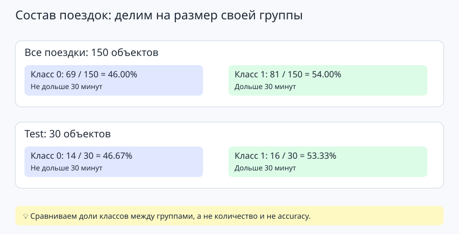

# Урок 3.2. Практика: будет ли поездка долгой?

> ### 💻 Где работаем
> Один ноутбук `lesson-3-2-features.ipynb` в Colab или Jupyter. Каждый блок — отдельная ячейка, выполняем сверху вниз. Скачай **trips.csv** из папки урока и положи рядом с ноутбуком; в Colab загрузи через панель «Файлы». Нужны pandas, matplotlib, scikit-learn. GPU не нужен.

Сегодня весь опыт — про поездки. По расстоянию, погоде и часу пик определяем, займёт ли дорога **больше 30 минут**. Это классификация с ответами 0/1. Точное число минут начнём предсказывать в теме регрессии.

| Столбец trips.csv | Смысл | Когда известен |
|---|---|---|
| distance_km | Расстояние, км | До поездки |
| weather | sun — солнце, rain — дождь, snow — снег | До поездки |
| rush_hour | 1 — час пик, 0 — обычное время | До поездки |
| duration_min | Фактическая длительность, минуты | После завершения |

Файл создан специально для урока: 150 выдуманных поездок, в длительности есть вариации. Это не реальные персональные данные. Из фактических минут получим известные ответы для обучения, но в признаки их не включим.

---

## 1. Читаем историю поездок

> 🎯 **Что делаем и зачем.** Загрузим 150 выдуманных поездок из файла trips.csv рядом с уроком. Это учебная симуляция, не реальные дорожные наблюдения. Наша цель — проверить способ обучения, а не создать надёжный навигатор.

```python
import pandas as pd  # Таблицы и обработка столбцов.
import matplotlib.pyplot as plt  # Графики результатов.
from sklearn.model_selection import train_test_split
from sklearn.linear_model import LogisticRegression
from sklearn.metrics import accuracy_score

# Положи trips.csv в папку ноутбука; в Colab загрузи его через панель «Файлы».
trips = pd.read_csv("trips.csv")
print(trips.head().to_string(index=False))
print("Размер таблицы:", trips.shape)
```

### Разбор кода

`pd.read_csv` читает строки CSV в DataFrame. Путь "trips.csv" означает файл в текущей папке ноутбука; если его нет, получим FileNotFoundError. Файл приложен к уроку, адресов сайтов и ключей не нужно.

`head()` выбирает первые пять строк для знакомства, не удаляя остальные. `to_string(index=False)` готовит текст без служебных номеров строк, внешний print показывает его. `shape` показывает (150, 4): 150 поездок, четыре столбца.

> 👉 **Что получили и для чего.** Таблица загружена. По каждой поездке записаны сведения перед отправлением и время, которое она заняла.

---

### 1.1. Читаем вывод как историю одной поездки

В первой строке файла записаны четыре значения. Прочитай их по названиям столбцов: какое расстояние было запланировано, какая погода стояла перед отправлением, был ли час пик и сколько минут поездка заняла в итоге. Одна строка — **одна завершённая поездка**, а не четыре разных события.

Мы знаем прошлые длительности, поэтому можем подготовить ответы для обучения. Но для будущей поездки длительность ещё неизвестна. Это различие между «знаем ответ в учебной истории» и «можем передать ответ при запросе» важно для всех следующих шагов.

### 1.2. Для чего нужны инструменты первой ячейки

| Инструмент | Что получаем | Где пригодится |
|---|---|---|
| `pd.read_csv` | Таблицу из файла | Прочитать прошлые поездки |
| `train_test_split` | Две согласованные группы признаков и ответов | Заранее отложить проверки |
| `LogisticRegression` | Новый объект классификатора | Обучить каждый вариант |
| `accuracy_score` | Долю совпадений двух наборов меток | Сравнить val и оценить test |
| `plt` | Команды рисования | Показать состав частей |

Строки `from ... import ...` только делают инструменты доступными. Загрузка CSV тоже не обучает модель. Пока в памяти есть **данные**, но нет обученного классификатора.

> 👉 **Промежуточный результат:** `trips.shape` должно показать `(150, 4)`. Если показано другое количество столбцов, проверь, что открыт именно файл урока. Если FileNotFoundError — сначала загрузи CSV в папку ноутбука, а не меняй команды обучения.

---

## 2. Формулируем ответ и выбираем признаки

> 🎯 **Что делаем и зачем.** Превратим известное время завершённых поездок в учебные ответы: больше ли оно 30 минут? Само фактическое время не даём модели как признак: для новой поездки оно неизвестно.

```python
# Модель будет выбирать класс: 0 — не дольше 30 минут, 1 — дольше.
y = (trips["duration_min"] > 30).astype(int)
# Для прогноза используем только сведения, известные перед отправлением.
X = trips[["distance_km", "weather", "rush_hour"]].copy()
print("Известные ответы:")
print(y.value_counts().sort_index())
```

### Разбор кода

`trips["duration_min"]` выбирает столбец фактических минут. Сравнение `> 30` выполняется для каждой строки и даёт True/False. `.astype(int)` превращает их в 1/0. Поездка ровно 30 минут относится к классу 0. В y хранятся известные ответы прошлых поездок, а не прогнозы.

Двойные скобки в выборе X передают список трёх названий и возвращают таблицу. `.copy()` создаёт отдельную копию, чтобы последующее преобразование признаков не меняло trips. `value_counts()` считает ответы каждого класса; `sort_index()` показывает сначала 0, затем 1.

> 👉 **Что получили и для чего.** Отделили вход X от ответа y. Каждой строке X соответствует ответ с тем же номером. duration_min остаётся только источником известных ответов.

---

### 2.1. Как из минут получается известный ответ

Разложим выражение `(trips["duration_min"] > 30).astype(int)` на три действия. Сначала выбираем столбец минут, затем задаём вопрос каждому значению, затем меняем логический ответ на целую метку.

| Известная длительность — отдельные примеры | Больше 30? | Метка y |
|---|---|---|
| 18 минут | False — нет | 0 |
| 30 минут | False — нет | 0 |
| 42 минуты | True — да | 1 |

Порог 30 — наше заранее выбранное условие задачи, а не число, которое модель должна найти. `.astype(int)` преобразует тип значений: True становится 1, False — 0. Он не вычисляет вероятность и не обучает модель.

### 2.2. Почему выбираем именно эти столбцы

Запись `trips[[...]]` получает **список названий**, поэтому возвращается таблица из нескольких столбцов. Одна пара скобок выбирала бы один столбец, а вложенный список перечисляет несколько. `.copy()` сохраняет отдельную рабочую таблицу признаков: можем менять представление погоды в X, не теряя исходных строк trips.

| Что хранит переменная | Пример смысла одной строки | Назначение |
|---|---|---|
| X | 8 км, снег, час пик | Сведения для вычисления ответа |
| y | 1 — фактически ехали дольше 30 минут | Истина для обучения и проверки |

Не добавляй `duration_min` к X: модель получила бы время, из которого прямо вычисляется правильный ответ. Такая «подсказка» недоступна перед реальной поездкой.

> 👉 **Что нам дал шаг:** превратили историю в пары «вход — правильный класс». В распечатке `value_counts()` слева стоят метки 0/1, справа — **количества**. В этом файле 69 поездок класса 0 и 81 класса 1, вместе 150. Эти числа описывают данные, а не успех модели.

---

## 3. Заменяем погоду флажками

> 🎯 **Что делаем и зачем.** LogisticRegression использует числовые признаки. Погода — слово, поэтому представим её вопросами «дождь? снег? солнце?», сохранив расстояние и час пик.

```python
# Список погодных категорий задан условиями учебной задачи заранее.
weather_types = ["rain", "snow", "sun"]
X["weather"] = pd.Categorical(X["weather"], categories=weather_types)
# Создаём новую таблицу: вместо weather будут три числовых флага.
encoded = pd.get_dummies(X, columns=["weather"], dtype=int)
print(X.head().to_string(index=False))  # Что было.
print(encoded.head().to_string(index=False))  # Что стало.
```

### Разбор кода

В файле sun означает солнце, rain — дождь, snow — снег. Каждая строка содержит погоду именно этой поездки; повтор слова означает одинаковую погоду у разных поездок. Это не названия переменных: кавычки обозначают текст.

`pd.Categorical` объявляет допустимый набор категорий. Здесь список задан заранее правилами задачи, а не найден просмотром будущего test. Это обеспечивает одинаковый порядок и набор флагов. В реальном проекте нужны также правила для неизвестной погоды и пропусков; этот файл содержит только три заданных значения.

`pd.get_dummies` создаёт числовую таблицу. Первый аргумент X — исходные признаки; `columns=["weather"]` указывает преобразовать только погоду; `dtype=int` задаёт целые флажки. Результат сохраняем в encoded, поэтому можно вывести X и encoded и сравнить.

Для sun флаги rain/snow/sun равны 0/0/1. Число строк не меняется. Вместо одного столбца погоды появляются три; вместе с distance_km и rush_hour получается пять признаков.

> 👉 **Что получили и для чего.** Получили X в числовом виде. Это подготовка входа, а не обучение и не предсказание. Исходные минуты не попали в encoded.

---

### 3.1. Зачем задаём список категорий

`weather_types = ["rain", "snow", "sun"]` — список трёх допустимых названий. Это не три поездки: это перечень возможных значений погоды. Для самой истории поездок weather содержит 150 значений, по одному на строку; названия многократно повторяются.

В `pd.Categorical(X["weather"], categories=weather_types)` первый аргумент — все исходные погодные значения, второй — допустимый список. Слева `X["weather"] = ...` сохраняет результат в погодном столбце X. Присваивание не меняет расстояния или ответы y.

Если встретится опечатка, например "rani", её нет в заданном перечне и получится пропуск. В нашем подготовленном файле таких значений нет. Для других данных перед кодированием понадобилась бы отдельная проверка и правило неизвестной категории.

### 3.2. Читаем результат get_dummies

Чтобы понять команду целиком, прочитай её так: **«возьми X, замени weather флажками, верни новую таблицу и назови её encoded»**.

- `columns=["weather"]` выбирает, **что преобразовать**, а не перечисляет новые названия.
- `dtype=int` задаёт тип новых флагов. Без явного целого типа можно увидеть True/False — это те же ответы да/нет в другой записи.
- `encoded = ...` сохраняет возвращённую таблицу. Без присваивания она не получила бы удобного имени для следующих шагов.

Рассмотрим **условную строку**: расстояние 5 км, дождь, час пик. До преобразования признаки выглядят так:

| distance_km | weather | rush_hour |
|---|---|---|
| 5 | rain | 1 |

После преобразования та же строка:

| distance_km | rush_hour | weather_rain | weather_snow | weather_sun |
|---|---|---|---|---|
| 5 | 1 | 1 | 0 | 0 |

Одна единица в weather_rain отвечает «дождь — да», другая в rush_hour — «час пик — да». Поэтому сумма **всех** признаков не обязана равняться 1. Единице равна сумма только трёх погодных флагов.


### 3.3. Что делают два print

В первом `print(X.head().to_string(index=False))` последовательно выполняются три действия: head берёт первые пять строк, to_string превращает их в текст без подписей индекса, print выводит текст. Во втором вызове те же действия выполняются для encoded.

Мы показываем «до» и «после», чтобы убедиться, что поездки не исчезли, расстояния сохранены и флаг стоит в нужной погоде. Настройка index=False скрывает служебные номера **только в тексте**, а не удаляет индекс таблицы.

> 👉 **Проверка после шага:** encoded содержит 150 строк и пять столбцов. Каждый вход теперь числовой, исходная погода сохранена в trips, а известные ответы отдельно лежат в y. Обучение ещё не начиналось.

---

## 4. Откладываем test и val

> 🎯 **Что делаем и зачем.** Нам нужно обучить два варианта, выбрать один по val и только потом проверить его на test. Откладываем данные до подбора весов.

```python
# Сначала test: 20% всех поездок; остаток pool будет разделён ещё раз.
X_pool, X_test, y_pool, y_test = train_test_split(
    encoded, y, test_size=0.2, random_state=42, stratify=y)
# 25% от оставшихся 120 — это 30 для val, остальные 90 для train.
X_train, X_val, y_train, y_val = train_test_split(
    X_pool, y_pool, test_size=0.25, random_state=42, stratify=y_pool)
print("Train:", X_train.shape, "ответов:", len(y_train))
print("Val:", X_val.shape, "ответов:", len(y_val))
print("Test:", X_test.shape, "ответов:", len(y_test))
```

### Разбор кода

В каждом вызове сначала передаём признаки и ответы вместе. Функция возвращает две части X, затем соответствующие две части y: порядок слева важен. `random_state=42` позволяет повторить разбиение; это не настройка качества.

`stratify=y` сохраняет доли коротких и долгих поездок настолько близко, насколько позволяют целые количества. Второй вызов получает только pool и его метки y_pool: test не должен снова попасть в обучение.

Первый размер: 150 × 0.2 = 30. Остаётся 120. Для val нужно 30 / 120 = 0.25; для train остаётся 90. Shape показывает (90, 5), (30, 5), (30, 5). Столбцов пять у каждой части: делили поездки, а не признаки.

> 👉 **Что получили и для чего.** Получили три группы с разными ролями: train подбирает веса, val выбирает вариант, test оценивает после выбора.

---

### 4.1. Прослеживаем два разделения на бумаге

Сначала 150 поездок делятся на **120 в pool** и **30 в test**. Слово pool означает оставшийся запас примеров. Потом только этот запас делим на **90 в train** и **30 в val**.

Почему второй раз 0.25? Знаменатель поменялся: теперь работаем со 120 объектами. `120 × 0.25 = 30`. Если написать 0.2 второй раз, получится 24, а не нужные 30.

### 4.2. Как читается вызов функции

`train_test_split` одновременно выбирает номера строк признаков и ответов. Поэтому входы идут парой: encoded и y либо X_pool и y_pool. Ответы не перемешиваем отдельным независимым вызовом.

| Настройка | Смысл именно в этом вызове |
|---|---|
| test_size | Доля меньшей выделяемой части от переданных строк |
| random_state | Начальное состояние случайного разбиения для повторения опыта |
| stratify | Метки той же группы, по которым сохраняем доли классов |

Имя функции содержит test, но меньшую часть второго вызова мы называем val. Функция только делит на две группы; назначение результата определяем мы.

### 4.3. Как проверить вывод

`Train: (90, 5) ответов: 90` означает: 90 поездок по пять числовых признаков и 90 подписей. Аналогично val и test содержат по 30 строк и 30 ответов. Пятёрка не уменьшается: мы делили объекты, а не столбцы.

> 👉 **Зачем это проверили:** каждая часть пригодна для своей роли, измерения и ответы согласованы по длине. Но одинаковые размеры сами по себе не доказывают отсутствие пересечений: второй split обязательно должен получать pool, а не все исходные данные.

---

## 5. Проверяем состав частей

> 🎯 **Что делаем и зачем.** Убедимся, что при выделении test примерно сохранилось соотношение коротких и долгих поездок. Для этого сначала посчитаем объекты, затем доли, а потом построим график. Модель ещё не обучаем: «долгая поездка» здесь — известный класс из истории.

### 5.1. Считаем поездки каждого класса

```python
# Сначала смотрим количества: это поможет понять происхождение долей.
print("Весь набор:")
print(y.value_counts().sort_index())
print("Тестовая часть:")
print(y_test.value_counts().sort_index())
```

`value_counts()` перебирает значения столбца и считает, сколько раз встретилась каждая метка. По умолчанию он упорядочивает результат по частоте. Нам удобнее сначала видеть класс 0, потом 1, поэтому вызываем `sort_index()` — сортировку по меткам результата.

**Вывод читается так:**

| Ответ | Во всём наборе | В test |
|---|---|---|
| 0 — не дольше 30 минут | 69 | 14 |
| 1 — дольше 30 минут | 81 | 16 |
| Всего | 150 | 30 |

Количество 14 меньше 69 — это ожидаемо: test меньше исходного набора. По одним количествам ещё неудобно понять, похож ли состав групп. Поэтому следующим шагом приводим обе группы к общей шкале — долям.

### 5.2. Переводим количества в доли

```python
# normalize=True делит частоту класса на размер соответствующей группы.
shares = pd.DataFrame({
    "Все поездки": y.value_counts(normalize=True),
    "Test": y_test.value_counts(normalize=True)
}).sort_index()
# После сортировки индекс идёт как 0, 1: подписи назначаем в том же порядке.
shares.index = ["Не дольше 30 мин", "Дольше 30 мин"]
print(shares)
```

У класса 0 исходная доля `69 / 150 = 0.46`, а тестовая `14 / 30 ≈ 0.4667`. У класса 1 соответственно `81 / 150 = 0.54` и `16 / 30 ≈ 0.5333`. Параметр `normalize=True` выполняет эти деления за нас.

`pd.DataFrame({...})` собирает два полученных столбца в одну таблицу. Ключи словаря «Все поездки» и «Test» становятся заголовками. Доли соединяются по одинаковым меткам 0 и 1. У таблицы вызываем sort_index, чтобы строки были именно в таком порядке, а затем заменяем подписи на понятные слова.

| Класс | Все поездки | Test |
|---|---|---|
| Не дольше 30 мин | 0.4600 | 0.4667 |
| Дольше 30 мин | 0.5400 | 0.5333 |

В каждой колонке сумма долей равна 1: учтены все объекты этой группы. Колонки не должны складываться между собой — у них разные основания, 150 и 30.



> 💬 **Как читать схему.** Верхняя строка — исходные 150 поездок, нижняя — 30 тестовых. Внутри каждой группы отдельно делим количество класса на её размер. Сравниваем получившиеся 46% и 46.67%, затем 54% и 53.33%. Поэтому небольшое отличие долей не означает, что split сломался: объекты нельзя разделить на дробные поездки.

### 5.3. Строим график из готовой таблицы

```python
# Каждая строка shares — класс; каждая колонка — отдельный цвет в легенде.
shares.plot.bar(figsize=(8, 4), ylim=(0, 1), rot=0)
plt.ylabel("Доля поездок")
plt.title("Состав исходного набора и test")
plt.tight_layout()  # Подбираем отступы, чтобы подписи не обрезались.
plt.show()
```

Метод `plot.bar` берёт значения прямо из shares. Строки превращаются в группы по горизонтали, а два столбца таблицы — в два цвета. `figsize=(8, 4)` задаёт размер картинки, `ylim=(0, 1)` — шкалу от отсутствия класса до всех объектов группы, `rot=0` оставляет подписи горизонтальными. `ylabel` поясняет вертикальную величину, `title` называет рисунок, а `show` показывает его после настройки.


> ### 📊 Как читать этот график
>
> **Зачем построили.** Сравнить состав большого исходного набора и меньшего test на общей шкале долей.
>
> **Что на осях.** По горизонтали — известные классы, по вертикали — доли. Синий столбец относится ко всем 150 поездкам, оранжевый — к 30 тестовым. Это указано в легенде.
>
> **Что видим.** У первого класса столбцы около 0.46 и 0.467, у второго — около 0.54 и 0.533. Высота 0.46 означает 46% группы, а не 46 минут и не 46 верных ответов.
>
> **Какой вывод.** Состав test близок к исходному. Стратификация сохранила доли с округлением до целых объектов. Этот рисунок ничего не говорит о правильности прогнозов: их ещё не получили.

> 👉 **Что получили и для чего.** Подтвердили, что оба класса присутствуют в test примерно в исходном соотношении. Теперь переходим к обучению: путать долю долгих поездок с accuracy нельзя.

**Проверь себя:** почему в столбце «Test» делим на 30, а не на 150? Потому что спрашиваем, какую часть именно тестовых поездок составляет каждый класс.

---

## 6. Сравниваем варианты по val

> 🎯 **Что делаем и зачем.** Проверим, помогают ли сведения о погоде и часе пик по сравнению с одним расстоянием. На обоих вариантах используем одни и те же поездки и один тип модели.

```python
feature_sets = {
    "Только расстояние": ["distance_km"],
    "Все признаки": list(encoded.columns)
}
models = {}  # Сохраним обученные объекты.
val_scores = {}  # Сохраним оценки для выбора.
for name, columns in feature_sets.items():
    candidate = LogisticRegression(max_iter=1000)  # Новый объект для варианта.
    candidate.fit(X_train[columns], y_train)  # Подбираем веса только на train.
    val_pred = candidate.predict(X_val[columns])  # Готовые веса применяем к val.
    models[name] = candidate
    val_scores[name] = accuracy_score(y_val, val_pred)
print(pd.Series(val_scores, name="Accuracy на val"))
# При равенстве заранее выбираем первый вариант: только расстояние.
best_name = max(val_scores, key=val_scores.get)
print("Выбрали:", best_name)
```

### Разбор кода

`feature_sets` связывает названия вариантов со списками столбцов. `list(encoded.columns)` получает все пять имён. В DataFrame запись `X_train[columns]` выбирает перечисленные столбцы по названиям, сохраняя строки.

`.items()` выдаёт пару «название, список». На первом проходе columns содержит только distance_km; на втором — все признаки. Отступы показывают тело цикла. Создаём отдельный объект candidate для каждого варианта, иначе перезаписали бы обучение одного объекта.

`fit` получает признаки train и правильные ответы. LogisticRegression вычисляет вероятности классов, сравнивает с y_train через функцию потерь и подбирает веса. На val вызываем только predict, без нового fit. accuracy_score возвращает долю совпадений с y_val.

В models сохраняем объект по имени, в val_scores — его оценку. `max(..., key=val_scores.get)` выбирает имя по связанной оценке, а не по алфавиту. При равенстве берём первый вариант, как договорились до просмотра test.

> 👉 **Что получили и для чего.** Есть две оценки val и один выбранный вариант. Дополнительные признаки не обязаны улучшить оценку на каждом небольшом наборе; записываем то, что получили.

---

### 6.1. Что означает один вариант

Вариант «Только расстояние» получает таблицу из одного столбца. «Все признаки» — из пяти. Мы не удаляем строки и не меняем правильные ответы: обе модели учатся на одних 90 поездках и сравниваются на одних 30 поездках val. Поэтому различие результатов можно связать с разным набором сведений, а не с разными проверочными задачами.

| Словарь | Что хранится под именем варианта | Зачем сохраняем |
|---|---|---|
| feature_sets | Список названий входных столбцов | Подготовить тот же вход для fit и predict |
| models | Обученный объект | После выбора не создавать новую необученную модель |
| val_scores | Число accuracy | Сравнить результаты на val |

### 6.2. Проследим первый проход цикла

`.items()` выдаёт сначала пару «Только расстояние» и список `["distance_km"]`. Имя попадает в name, список — в columns. Выражение `X_train[columns]` выбирает один столбец, оставляя 90 строк. `candidate.fit(...)` получает эту таблицу и 90 правильных меток.

Модель вычисляет оценки по текущим весам, получает вероятности, оценивает потерю по известным меткам и подбирает более подходящие параметры. Численные вычисления выполняет библиотека. `max_iter=1000` — предел итераций, не количество поездок и не обещание точности.

Теперь `candidate.predict(X_val[columns])` применяет уже готовые веса к 30 поездкам val. Правильных ответов в predict нет. Для этой модели тоже берём **только расстояние**, потому что так она обучалась. accuracy_score затем сравнивает прогнозы с y_val и возвращает долю совпадений.

При втором проходе создаётся новый объект, на этот раз с пятью входами. Предыдущий объект не исчезает: ссылка на него уже лежит в models под первым именем.

### 6.3. Почему max выбирает нужное имя

В контрольном запуске оценки равны 25/30 и 26/30. Значение `key=val_scores.get` просит max для каждого имени взять связанную оценку: сравнивать 0.8333 и 0.8667, а не слова по алфавиту. Поэтому выбирается «Все признаки». Параметру key передаётся **сама функция get**, без скобок: max будет вызывать её для перебираемых имён.

> 👉 **Что нам дал шаг:** мы приняли решение по val, ещё не вычисляя итоговый test. Если оценки равны, действует заранее выбранное правило — первый вариант. Нельзя посмотреть test и затем придумать более выгодное правило равенства.

---

## 7. Проверяем выбранную модель

> 🎯 **Что делаем и зачем.** После выбора один раз получим оценку на ранее отложенном test. Нельзя менять победителя ради его тестового результата.

```python
best_model = models[best_name]  # Достаём уже обученный объект.
best_columns = feature_sets[best_name]  # Его набор входных признаков.
test_pred = best_model.predict(X_test[best_columns])
report = pd.DataFrame({
    "Правильный ответ": y_test.to_numpy(),
    "Прогноз": test_pred
})
report["Верно"] = report["Правильный ответ"] == report["Прогноз"]
print(report.head().to_string(index=False))
print("Ошибки:")
print(report[~report["Верно"]].to_string(index=False))
print(f"Accuracy на test: {accuracy_score(y_test, test_pred):.2%}")
```

### Разбор кода

Два первых обращения к словарям достают объект и нужные столбцы. Модель видит именно те признаки, по которым училась. predict возвращает 30 меток 0/1, правильные ответы ему не передаются.

`to_numpy()` берёт значения y_test в текущем порядке без индекса Pandas, чтобы при создании отчёта они сопоставились с прогнозами по позициям. `==` создаёт галочки совпадений, `~` переворачивает маску и оставляет ошибки. `:.2%` переводит долю в процент только для показа.

> 👉 **Что получили и для чего.** Оценили долю верных ответов на 30 поездках. Ответ 1 означает «по расчёту модели будет дольше 30 минут», а не точное число минут. На искусственных поездках получаем учебный результат, не гарантию для дороги.

### 7.1. Зачем извлекаем и объект, и столбцы

В `best_model = models[best_name]` достаём сохранённый объект, чьи веса уже подобраны. В `best_columns = feature_sets[best_name]` получаем его входную схему. Создать здесь новый LogisticRegression вместо извлечения — ошибка: новый объект ещё не обучен.

В `best_model.predict(X_test[best_columns])` модель получает 30 строк только нужных признаков. Результат test_pred — 30 меток, по одной на поездку. Саму длительность и правильный класс она не получает.

### 7.2. Как строится отчёт

В y_test остались исходные индексы строк, потому что split выбирал поездки из исходной таблицы. Массив test_pred имеет только последовательность ответов. `to_numpy()` берёт значения y_test в том же порядке и без подписей индекса. Теперь DataFrame создаёт две согласованные колонки по позициям: первая истина к первому прогнозу, вторая ко второму.

Сравнение двух столбцов создаёт report["Верно"]. Знак `~` в фильтре меняет галочки на противоположные и оставляет несовпадения. Пустой отчёт ошибок допустим: значит, на этом наборе всё совпало.

### 7.3. Читаем итог без преувеличений

При контрольном запуске на test совпали **28 ответов из 30**. Делим `28 / 30 ≈ 0.9333` и получаем 93.33%. Две ошибки — это две поездки, для которых перепутали стороны порога 30 минут. Мы пока не измеряли, на сколько минут ошиблись: задача даёт класс, а не число минут.

Тестовая доля может отличаться от val, ведь это другие поездки. Это не повод заменять победителя после просмотра test: тогда финальная проверка начнёт участвовать в выборе.

> 👉 **Что сохраним:** выбранное имя, набор его признаков, две оценки val и одну оценку test. К результату допишем ограничение: это искусственные поездки одного учебного набора, а не доказательство качества на настоящих дорогах.

---

## Что сохранить

Выведи две оценки val и одну итоговую test. Подпиши, какие сведения использовала выбранная модель и что означает ответ 1. Не перебирай random_state ради лучшей цифры. Дальше — самостоятельная работа в этом же ноутбуке под заголовком `## Самостоятельная работа`.


> Контрольный запуск поездок (scikit-learn 1.9.1): val 25/30 для расстояния, 26/30 для всех признаков; выбран вариант со всеми признаками, test 28/30 (93.33%). Это результат искусственного учебного набора, не гарантия дорожного прогноза.
