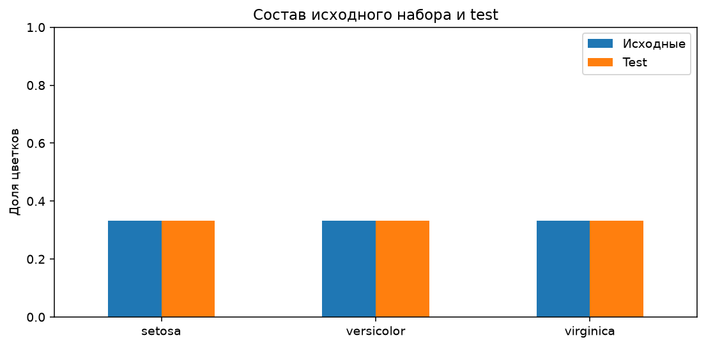

# Урок 3.2. Практика: признаки, категории и три части данных

> ### 💻 Как работать с кодом урока
> Один ноутбук **`lesson-3-2-features.ipynb`**, один блок кода — одна ячейка. Выполняй сверху вниз. Самостоятельные задания — в этом же ноутбуке под заголовком `## Самостоятельная работа`. Перед сдачей перезапусти и выполни всё. Нужны pandas, matplotlib и scikit-learn; GPU и загрузка внешних файлов не требуются.

На прошлом уроке работали с Iris. Сегодня добавим к знакомому пути выбор признаков: сначала разберём погоду в таблице поездок, затем оставим test нетронутым и сравним два набора размеров на val. Получим числовую таблицу категорий, график долей и проверенное решение. Эти задачи не требуют обещанного роста точности.

---

## 1. Категории превращаются в флажки

> 🎯 **Что делаем и зачем.** Подготовим таблицу четырёх выдуманных поездок. Расстояние уже записано числом, а погода — названием. Превратим погоду в флажки, сохранив расстояние. Это подготовка признаков; время поездки сегодня не предсказываем.

```python
# Таблицы и подсчёты: обращаемся к Pandas через имя pd.
import pandas as pd
# Графики: обращаемся к командам рисования через plt.
import matplotlib.pyplot as plt
# Получим встроенные размеры и виды цветков Iris.
from sklearn.datasets import load_iris
# Разделим признаки и ответы согласованно, не разрывая пары.
from sklearn.model_selection import train_test_split
# Класс модели, которая выбирает категорию (вид цветка).
from sklearn.linear_model import LogisticRegression
# Проверим долю совпадений прогнозов с известными видами.
from sklearn.metrics import accuracy_score

trips = pd.DataFrame({
    "distance_km": [2, 5, 3, 8],
    "weather": ["sun", "rain", "snow", "sun"]
})
# Заменяем только названия погоды флажками; расстояния сохраняем.
encoded = pd.get_dummies(trips, columns=["weather"], dtype=int)
# Показываем исходную таблицу без служебных номеров строк.
print(trips.to_string(index=False))
# Показываем результат, чтобы сравнить с исходными сведениями.
print(encoded.to_string(index=False))
```

### 1.1. Что подключают импорты

`import pandas as pd` подключает инструменты для таблиц, а `import matplotlib.pyplot as plt` — для рисунков. `pd` и `plt` — короткие имена, которыми пользуемся дальше. Импорт не создаёт таблицу и не обучает модель.

Из `sklearn` берём четыре инструмента: `load_iris` для готового набора цветков, `train_test_split` для разделения, `LogisticRegression` для классификации и `accuracy_score` для проверки. Они понадобятся после опыта с поездками.

### 1.2. Как читается таблица поездок

`pd.DataFrame({...})` создаёт таблицу из словаря. Ключи словаря становятся названиями столбцов, списки — значениями по строкам. Два списка одинаковой длины: в каждой строке расстояние и погода **одной** поездки.

| Столбец | Что означает | Пример |
|---|---|---|
| `distance_km` | Расстояние в километрах | 2 км |
| `weather` | Погода до отправления | sun — солнце, rain — дождь, snow — снег |

Время прибытия не записываем: для прогноза до отправления оно ещё неизвестно. Числа и погоду придумали для объяснения, а не собрали из реальных поездок.

### 1.3. Что означает список погоды

Запись `["sun", "rain", "snow", "sun"]` — список из четырёх текстовых значений. Кавычки показывают, что это слова, а не переменные Python. Английские слова выбраны как короткие обозначения:

| Значение | Перевод | К какой поездке относится в нашем списке |
|---|---|---|
| `"sun"` | Солнце, солнечная погода | К первой |
| `"rain"` | Дождь | Ко второй |
| `"snow"` | Снег | К третьей |
| `"sun"` | Солнце | К четвёртой |

Первое слово погоды связано с первым расстоянием — 2 км. Второе слово связано со вторым расстоянием — 5 км, и так далее. Повтор sun не ошибка: две разные поездки могут проходить при одинаковой погоде. Поэтому у нас четыре поездки, но только **три разных погодных категории**.

**Зачем вообще записали погоду?** Для будущей задачи времени поездки она может оказаться полезным известным признаком: дождь и снег могут менять дорожные условия. Здесь мы пока только готовим её представление, а не доказываем влияние и не прогнозируем время.

### 1.4. Почему вызываем get_dummies

Хотим представить погодные категории числовыми флажками. Функция `pd.get_dummies` создаёт новую таблицу, сохраняя строки и остальные признаки.

- `trips` — исходная таблица, которую преобразуем.
- `columns=["weather"]` — кодируем **только** погоду. Расстояние оставляем количеством, для каждого километра отдельный флаг не нужен.
- `dtype=int` — записываем флажки целыми 0 и 1.
- `encoded = ...` — сохраняем результат отдельно. Исходная `trips` не исчезает.

Разберём три строки как одну маленькую программу: **сначала создаём числовое представление, затем показываем исходную таблицу и результат, чтобы сравнить их**.

**Первая строка — преобразование.** В `encoded = pd.get_dummies(...)` справа вызывается готовая функция Pandas. Она находит разные названия в weather и создаёт для них флаги. Затем знак `=` сохраняет возвращённую таблицу в переменную encoded. Имя encoded выбрали мы; оно означает «закодированная таблица».

Мы не пишем `trips = ...`, поэтому исходная таблица остаётся в trips. Благодаря этому можно сравнить данные до и после. Функция не обучает классификатор и не предсказывает время: она изменяет способ представления признака.

**Вторая строка — показываем, что было.** В `print(trips.to_string(index=False))` сначала выполняется метод trips.to_string: таблица превращается в текст. `index=False` просит не включать в этот текст служебные подписи строк 0, 1, 2, 3. Затем внешний print показывает готовый текст в выводе ячейки.

**Третья строка — показываем, что стало.** `print(encoded.to_string(index=False))` делает то же самое для новой таблицы. Вызовы to_string и print не меняют значения таблиц и не удаляют их настоящий индекс: управляют только показом.

> 👉 **Зачем нужны оба вывода.** Проверяем преобразование глазами: расстояния остались прежними, строки не перепутались, вместо названия погоды появились нужные флаги. Если вывести только encoded, будет труднее заметить, потеряли ли мы исходные сведения.


> 👉 **Что получили и для чего.** Четыре поездки остались четырьмя строками. Вместо `weather` появились `weather_rain`, `weather_snow`, `weather_sun`; `distance_km` сохранился. У первой поездки расстояние 2 и флажки 0, 0, 1. Мы представили известные сведения числами — теперь такую форму можно использовать как вход числовой модели.

**Проверь себя:** у второй поездки должен быть флаг дождя 1, а сумма трёх погодных флагов каждой строки — 1. Пока мы ничего не предсказывали и не считали качество.

> 💬 **Почему дальше Iris?** Время поездки — числовой ответ, для него нужна регрессия и другая проверка ошибок: это урок 3.3. Сейчас отдельно исследуем выбор признаков и три части данных на знакомой классификации Iris. Таблицу поездок в модель Iris не передаём.

---

## Промежуточная проверка: читаем таблицу поездок

После первого задания ожидаем такую числовую таблицу:

| distance_km | weather_rain | weather_snow | weather_sun |
|---|---|---|---|
| 2 | 0 | 0 | 1 |
| 5 | 1 | 0 | 0 |
| 3 | 0 | 1 | 0 |
| 8 | 0 | 0 | 1 |

Прочитай вторую строку вслух: «поездка на 5 км, дождь — да, снег — нет, солнце — нет». Прочитай четвёртую: «8 км и солнце». Одинаковая погода даёт одинаковый набор флажков, но расстояния поездок могут различаться.

**Что сохранилось:** четыре объекта и исходные расстояния. **Что изменилось:** один столбец названий заменён тремя столбцами вопросов. На выходе четыре столбца вместо двух. Это не новые поездки и не прогноз времени.

> 💡 **Если результат отличается.** True/False вместо 1/0 означает, что не задан целочисленный dtype. Если появились флажки отдельных расстояний, проверь список columns: там должен быть только weather. Если исходный столбец исчез из trips, проверь, не перезаписал ли ты исходную переменную вместо создания encoded.

## 2. Проверяем состав разделения

> 🎯 **Что делаем и зачем.** Возьмём знакомый Iris и сравним состав теста с исходным набором. Здесь пока не обучаем модель.

```python
# Загружаем контейнер с данными и поясняющими названиями.
iris = load_iris()
# Отдельно сохраняем измерения: строка на цветок, столбец на размер.
X = iris.data
# Оборачиваем метки в столбец Pandas, чтобы удобно считать доли.
y = pd.Series(iris.target, name="species")
# Сначала откладываем test; pool остаётся для будущих train и val.
X_pool, X_test, y_pool, y_test = train_test_split(
    X, y, test_size=0.2, random_state=42, stratify=y
)
# Сопоставляем доли видов по одинаковым меткам 0, 1, 2.
class_shares = pd.DataFrame({
    "Исходные": y.value_counts(normalize=True),
    "Test": y_test.value_counts(normalize=True)
}).sort_index()
# После сортировки заменяем номера видов понятными названиями.
class_shares.index = iris.target_names
print(class_shares)
# Два столбца для каждого вида: сравниваем состав, не accuracy.
class_shares.plot.bar(figsize=(8, 4), ylim=(0, 1), rot=0)
plt.ylabel("Доля цветков")
plt.title("Состав исходного набора и test")
plt.tight_layout()
# Показываем рисунок после всех подписей и настроек.
plt.show()
```

**Пример рисунка из выполненного ноутбука:**



*Это результат контрольного запуска с указанными данными и настройками. Оси и вывод разобраны ниже.*

### 🧩 Разбираем команды

`load_iris` получает контейнер; `.data` содержит четыре измерения. `pd.Series` оборачивает ответы в столбец Pandas, чтобы удобно посчитать доли. Номера строк сохраняются при разделении, но сравнение прогнозов позже выполняем в порядке полученных ответов.

`train_test_split` возвращает сначала две части X, затем две части y. `test_size=0.2` откладывает 30 цветков, `random_state=42` фиксирует случайность, `stratify=y` сохраняет состав по видам. Оставшиеся 120 называем pool: из них позже выделим train и val.

`value_counts(normalize=True)` считает долю каждого значения вместо количества. `DataFrame` ставит два столбца долей рядом, сопоставляя их по меткам видов. `sort_index()` упорядочивает метки 0, 1, 2; затем заменяем их названиями из `target_names`.

`plot.bar` рисует сгруппированные столбцы прямо из таблицы. `ylim=(0, 1)` задаёт шкалу долей, `rot=0` оставляет подписи горизонтальными. `ylabel` и `title` подписывают рисунок. `tight_layout` подбирает отступы, чтобы подписи помещались; `show` показывает результат.

### 2.1. Раскладываем длинную цепочку на действия

В записи `pd.DataFrame({...}).sort_index()` сначала создаётся таблица, а потом у полученной таблицы вызывается метод сортировки. Это две операции, соединённые точкой. Саму переменную class_shares присваиваем уже результату обеих операций.

У Series есть **индекс** — подписи элементов. После value_counts индексом становятся найденные виды 0, 1, 2, а значениями — их доли. Это отличается от исходного y, где индексом был номер цветка. Поэтому `sort_index()` здесь сортирует **виды**, а не отдельные цветки.

Только после сортировки меняем подписи строк на названия видов. Если заменить подписи без согласования порядка, можно подписать долю одного вида названием другого. На Iris все доли одинаковы, но правило всё равно важно для других наборов.

### 2.2. Откуда берутся доли в таблице

`y` — столбец из 150 меток вида: 0, 1, 2. `pd.Series(..., name="species")` даёт этим ответам удобную оболочку Pandas; не меняет сами виды. `value_counts()` без аргументов дал бы по 50. С `normalize=True` каждая частота делится на число ответов: `50 / 150 = 1/3`. В test считаем отдельно: `10 / 30 = 1/3`.

В `class_shares` ключи словаря «Исходные» и «Test» становятся столбцами. Метки видов 0/1/2 становятся индексом — подписями строк. Pandas соединяет доли по меткам, а не по случайному порядку частот. `sort_index()` располагает строки как 0, 1, 2; только затем заменяем эти подписи на названия видов.

**Почему это проверяем до обучения?** Хотим убедиться, что состав отложенных примеров соответствует нашему плану. На каждой строке таблицы будет примерно 0.3333 и 0.3333. Это описание данных; правильных или неправильных предсказаний пока нет.

> 👉 **Что получили и что это значит.** В каждом виде исходного набора и теста доля 1/3, около 0.3333. Отложили test и убедились, что все виды представлены.

> ### 📊 Как читать этот график
>
> **Оси:** по горизонтали — виды, по вертикали — доля от 0 до 1. Два цвета в легенде обозначают исходный набор и test.
>
> **Что видим:** для каждого вида два столбца одинаковой высоты около 0.3333. Это треть объектов, а не 33 цветка. В исходных данных это 50 из 150, в test — 10 из 30.
>
> **Вывод:** стратификация сохранила состав по видам. График не показывает точность: модель ещё не обучали.

---

## 3. Выделяем val из оставшихся данных

> 🎯 **Что делаем и зачем.** Отделим примеры для выбора признаков, не используя test. Нужно получить 90 учебных и 30 валидационных цветков.

```python
# Делим только pool: test не должен попасть обратно в обучение.
X_train, X_val, y_train, y_val = train_test_split(
    X_pool, y_pool, test_size=0.25, random_state=42, stratify=y_pool
)
print("Train:", X_train.shape, len(y_train))
print("Val:", X_val.shape, len(y_val))
print("Test:", X_test.shape, len(y_test))
```

### 🧩 Разбираем команды

Во втором вызове передаём **pool**, а не исходные X и y: иначе новый train мог бы пересечься с test. `test_size=0.25` теперь означает долю **от 120**: 30 для val, остальные 90 для train. В имени функции по-прежнему написано test, но её результаты мы можем назвать train и val: роль задаётся тем, как их используем.

`stratify=y_pool` относится именно к текущей группе из 120 ответов. Четыре результата распаковываем в том же порядке. `shape` показывает строки и столбцы, `len` — число ответов.

### 3.1. Проверяем расчёт, а не запоминаем 0.25

После первого разделения у нас **120** объектов в pool, а 30 в test уже лежат отдельно. Нужно выделить 30 для val: `30 / 120 = 0.25`. Если написать 0.2 второй раз, получим 24 объекта, а не нужные 30.

| Переменная | Что хранит после ячейки | Зачем сохраняем |
|---|---|---|
| `X_train`, `y_train` | 90 строк размеров и их виды | Обучить оба варианта |
| `X_val`, `y_val` | 30 строк размеров и их виды | Выбрать вариант |
| `X_test`, `y_test` | Ранее отложенные 30 объектов | Проверить после выбора |

**Как читать вывод:** `Train: (90, 4) 90` означает 90 объектов с четырьмя размерами и 90 ответов. Число 4 не уменьшилось: мы делили строки, а не столбцы. Если результат другой, сначала проверь, что второй вызов получает pool, а не весь X.

> 👉 **Что получили и что это значит.** Получили формы (90, 4), (30, 4), (30, 4). Сумма объектов 150; в train по 30 каждого вида, в val и test по 10.

---

### 3.2. Почему второй вызов не «знает», что мы создаём val

Функция train_test_split умеет делить переданные ей объекты на две части. Назначение результата выбираем мы: в первом вызове меньшую часть назвали test, во втором — val. Само имя функции не запрещает использовать её для валидационной части.

Это похоже на разрезание колоды: нож делит текущую колоду, а подписи на двух новых стопках назначает человек. Если второй раз дать все исходные 150 карточек, отложенные test-карточки снова могут попасть в train. Если дать только pool, такой проблемы нет.

> 👉 **Зачем проверяли размеры.** Увидели 90 + 30 + 30 = 150 и согласованные пары измерений и ответов. Но одна проверка размеров не доказывает отсутствие пересечений: правильный источник второго split по-прежнему обязателен. Отдельно исследовать номера объектов можно в задании со звёздочкой.

## 4. Сравниваем два набора признаков на val

> 🎯 **Что делаем и зачем.** Обучим один и тот же тип модели двумя способами: только по чашелистикам или только по лепесткам. Выбор сделаем по val.

```python
# Два варианта входа: чашелистики (0, 1) или лепестки (2, 3).
feature_sets = {"Чашелистики": [0, 1], "Лепестки": [2, 3]}
# Сохраним каждый обученный объект, чтобы использовать после выбора.
models = {}
# Сохраним оценки на val; по test варианты не выбираем.
val_scores = {}
# По очереди выполняем одинаковый опыт для каждого набора размеров.
for name, columns in feature_sets.items():
    # Новый объект для текущего варианта: свои обучаемые параметры.
    candidate = LogisticRegression(max_iter=1000)
    # Подбираем веса только по учебным цветкам и выбранным размерам.
    candidate.fit(X_train[:, columns], y_train)
    # Применяем готовые веса к тем же столбцам в val.
    val_pred = candidate.predict(X_val[:, columns])
    # Связываем имя варианта с обученной моделью.
    models[name] = candidate
    # Считаем долю совпадений на val, чтобы сравнить варианты.
    val_scores[name] = accuracy_score(y_val, val_pred)
print(pd.Series(val_scores, name="Accuracy на val"))
# Выбираем имя с наибольшей оценкой val; при равенстве — первое.
best_name = max(val_scores, key=val_scores.get)
print("Выбран набор:", best_name)
```

### 🧩 Разбираем команды

`feature_sets` — словарь: названия вариантов связаны со списками индексов. 0 и 1 — чашелистики, 2 и 3 — лепестки. `models` сохранит обученные объекты, `val_scores` — оценки для выбора.

`.items()` выдаёт пары «название, список столбцов». Цикл выполняет команды с отступом для каждой пары. На каждом проходе создаём **новый** объект `candidate`, чтобы варианты имели свои параметры.

`X_train[:, columns]` берёт все строки (двоеточие) и только перечисленные столбцы. `fit` подбирает веса по этим двум размерам и учебным ответам. Как в прошлом уроке, вычисляет ответы, оценивает потерю и меняет параметры; val в этот подбор не входит.

`predict` применяет найденные веса к тем же выбранным столбцам val. Нельзя учить на чашелистиках, а предсказывать по лепесткам только потому, что столбцов тоже два. Сохраняем модель по имени и долю совпадений через `accuracy_score`.

`pd.Series` показывает словарь оценок столбцом. `max(..., key=val_scores.get)` выбирает имя с максимальной оценкой, а не последнее по алфавиту. При равенстве этот код выбирает первый добавленный вариант: принимаем это правило заранее.

### 4.1. Что именно хранится в трёх словарях

| Словарь | Ключ | Значение | Для чего нужен |
|---|---|---|---|
| feature_sets | Название варианта | Список столбцов | Подготовить правильный вход |
| models | То же название | Обученный объект | Позже применить выбранную модель |
| val_scores | То же название | Доля верных на val | Выбрать вариант |

Пустые `{}` создают словари без записей. Присваивание `models[name] = candidate` добавляет значение под текущим названием. После двух проходов в словаре две записи. Если вместо этого сохранить оба объекта под одинаковым ключом, второе значение заменит первое.

Цикл не делает модели «умнее» сам по себе. Он просто повторяет одинаковую последовательность команд для каждого списка признаков, чтобы не копировать весь код вручную.

### 4.2. Проследим первый проход цикла

Сначала `name` получает «Чашелистики», а `columns` — `[0, 1]`. Создаём новый классификатор. Выражение `X_train[:, columns]` даёт таблицу 90 × 2: те же цветки, но только два размера чашелистика. `fit` получает эту таблицу и 90 видов. Модель подбирает веса по учебным примерам; правильные ответы val не участвуют в подборе.

Затем `predict` получает 30 × 2 размера из val и возвращает 30 меток. Сравниваем их с `y_val`. Объект сохраняем в `models["Чашелистики"]`, оценку — в `val_scores["Чашелистики"]`.

На втором проходе всё повторяется для `[2, 3]`, то есть лепестков. Новый `candidate` нужен, чтобы получилась отдельная обученная модель. Словарь `models` сохраняет оба объекта: замена имени `candidate` не уничтожает первый.

### 4.3. Что означает результат сравнения

При контрольном запуске получены 26 верных из 30 для чашелистиков и 28 из 30 для лепестков. Это примерно 86.67% и 93.33%. Команда `max` перебирает имена вариантов, а `key=val_scores.get` указывает сравнивать связанные с ними **оценки**. В этом опыте `best_name` становится «Лепестки».

**Зачем сохранили и модель, и список столбцов?** Для нового прогноза нужно воспроизвести весь выбранный вариант. Если дать модели лепестков чашелистики, код может выполниться: столбцов тоже два. Но смысл чисел будет другим, поэтому такой прогноз не соответствует обучению.

> 👉 **Что получили и что это значит.** Выбрали набор признаков по val. Большая доля на маленьком val не доказывает превосходства на любых будущих данных; test ещё не использовали для выбора.

---

### 4.4. Проверка перед переходом к test

До следующего задания должны быть готовы два обученных объекта, две оценки val и одно выбранное имя. Прочитай таблицу оценок и объясни, почему выбрано это имя. Тестовая оценка ещё не вычислялась.

**При равенстве** max вернёт первое встретившееся имя с максимальной оценкой. Для нашего словаря первым записаны «Чашелистики». Мы не смотрим в test, чтобы решить, как разрешить равенство: иначе test начнёт выбирать за нас.

> 🤔 **Найди ошибку в рассуждении:** «На val лучше лепестки, но давай посчитаем test у обоих и выберем красивый результат». Тогда test станет ещё одной частью для выбора. После такого выбора его оценка уже не будет отдельным итоговым экзаменом.

## 5. Проверяем выбранное решение на test

> 🎯 **Что делаем и зачем.** Зафиксируем выбор и только теперь запросим тестовую оценку. Переобучать выбранную модель в этом опыте не будем.

```python
# Достаём выбранную уже обученную модель, не создаём новую.
best_model = models[best_name]
# Достаём именно те столбцы, по которым эта модель училась.
best_columns = feature_sets[best_name]
# Применяем выбранный вариант к ранее отложенным цветкам.
test_pred = best_model.predict(X_test[:, best_columns])
# Итоговая оценка: test не участвовал в выборе.
test_acc = accuracy_score(y_test, test_pred)
print("Набор:", best_name)
print("Верно:", int((test_pred == y_test).sum()), "из", len(y_test))
print(f"Accuracy на test: {test_acc:.2%}")
```

### 🧩 Разбираем команды

Две первые строки достают **одну и ту же выбранную конфигурацию**: объект и список столбцов. `predict` получает test с этими столбцами и возвращает 30 меток. `accuracy_score` сравнивает их с 30 известными ответами.

`==` создаёт галочки совпадений, `.sum()` считает True как единицы, `int` приводит результат к целому. `len` даёт число проверок. Формат `:.2%` показывает долю процентом с двумя знаками после запятой.

### 5.1. Что означает финальная проверка

`models[best_name]` достаёт сохранённый обученный объект, а `feature_sets[best_name]` — его индексы признаков. В нашем опыте получаем модель лепестков и `[2, 3]`. Из test берём именно эти два столбца; правильные виды остаются отдельно в `y_test`.

Внутри `int((test_pred == y_test).sum())` действия идут изнутри наружу: сравнение создаёт галочки, сумма считает совпадения, `int` делает обычное целое число. При контрольном запуске результат — **29 из 30**, accuracy — **96.67%**. Напиши рядом собственный результат и объясни знаменатель: это все проверенные цветки, а не число признаков.

**Почему оценки val и test могут различаться?** В них находятся разные цветки. Мы выбрали вариант по одной группе, а проверили по другой. Отличие процентов само по себе не является ошибкой в коде.

> 👉 **Что получили и что это значит.** Получили результат после выбора по val. Запиши фактические числа, не ищи другое разделение ради более красивого процента. Если после просмотра test меняешь решение, для новой независимой оценки потребуются новые данные.

---

## Что показать преподавателю

Объясни строку one-hot, подписи графика и расчёт `30 / 120 = 0.25`. Покажи оценки val и отдельную оценку test. Скажи, какие данные использовались для каждого решения. Затем переходи к [самостоятельной работе](homework.md).

## Контрольный запуск для преподавателя

Проверено на scikit-learn 1.9.1. На val: чашелистики — 26 из 30 (86.67%), лепестки — 28 из 30 (93.33%). Выбран вариант «Лепестки». На test — 29 из 30 (96.67%). Это числа указанного опыта, а не обязательные пороги для учеников.
