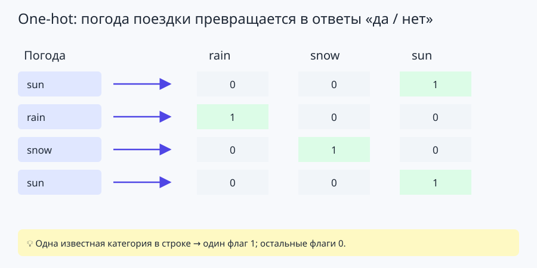

# Урок 3.2. Практика: будет ли поездка долгой?

> ### 💻 Где работаем
> Один ноутбук `lesson-3-2-features.ipynb` в Colab или Jupyter. Каждый блок — отдельная ячейка, выполняем сверху вниз. Скачай **trips.csv** из папки урока и положи рядом с ноутбуком; в Colab загрузи через панель «Файлы». Нужны pandas, matplotlib, scikit-learn. GPU не нужен.

Сегодня весь опыт — про поездки. По расстоянию, погоде и часу пик определяем, займёт ли дорога **больше 30 минут**. Это классификация с ответами 0/1. Точное число минут начнём предсказывать в теме регрессии.

| Столбец trips.csv | Смысл | Когда известен |
|---|---|---|
| distance_km | Расстояние, км | До поездки |
| weather | sun — солнце, rain — дождь, snow — снег | До поездки |
| rush_hour | 1 — час пик, 0 — обычное время | До поездки |
| duration_min | Фактическая длительность, минуты | После завершения |

Файл создан специально для урока: 150 выдуманных поездок, в длительности есть вариации. Это не реальные персональные данные. Из фактических минут получим известные ответы для обучения, но в признаки их не включим.

---

## 1. Читаем историю поездок

> 🎯 **Что делаем и зачем.** Загрузим 150 выдуманных поездок из файла trips.csv рядом с уроком. Это учебная симуляция, не реальные дорожные наблюдения. Наша цель — проверить способ обучения, а не создать надёжный навигатор.

```python
import pandas as pd  # Таблицы и обработка столбцов.
import matplotlib.pyplot as plt  # Графики результатов.
from sklearn.model_selection import train_test_split
from sklearn.linear_model import LogisticRegression
from sklearn.metrics import accuracy_score

# Положи trips.csv в папку ноутбука; в Colab загрузи его через панель «Файлы».
trips = pd.read_csv("trips.csv")
print(trips.head().to_string(index=False))
print("Размер таблицы:", trips.shape)
```

### Разбор кода

`pd.read_csv` читает строки CSV в DataFrame. Путь "trips.csv" означает файл в текущей папке ноутбука; если его нет, получим FileNotFoundError. Файл приложен к уроку, адресов сайтов и ключей не нужно.

`head()` выбирает первые пять строк для знакомства, не удаляя остальные. `to_string(index=False)` готовит текст без служебных номеров строк, внешний print показывает его. `shape` показывает (150, 4): 150 поездок, четыре столбца.

> 👉 **Что получили и для чего.** Таблица загружена. По каждой поездке записаны сведения перед отправлением и время, которое она заняла.

---

## 2. Формулируем ответ и выбираем признаки

> 🎯 **Что делаем и зачем.** Превратим известное время завершённых поездок в учебные ответы: больше ли оно 30 минут? Само фактическое время не даём модели как признак: для новой поездки оно неизвестно.

```python
# Модель будет выбирать класс: 0 — не дольше 30 минут, 1 — дольше.
y = (trips["duration_min"] > 30).astype(int)
# Для прогноза используем только сведения, известные перед отправлением.
X = trips[["distance_km", "weather", "rush_hour"]].copy()
print("Известные ответы:")
print(y.value_counts().sort_index())
```

### Разбор кода

`trips["duration_min"]` выбирает столбец фактических минут. Сравнение `> 30` выполняется для каждой строки и даёт True/False. `.astype(int)` превращает их в 1/0. Поездка ровно 30 минут относится к классу 0. В y хранятся известные ответы прошлых поездок, а не прогнозы.

Двойные скобки в выборе X передают список трёх названий и возвращают таблицу. `.copy()` создаёт отдельную копию, чтобы последующее преобразование признаков не меняло trips. `value_counts()` считает ответы каждого класса; `sort_index()` показывает сначала 0, затем 1.

> 👉 **Что получили и для чего.** Отделили вход X от ответа y. Каждой строке X соответствует ответ с тем же номером. duration_min остаётся только источником известных ответов.

---

## 3. Заменяем погоду флажками

> 🎯 **Что делаем и зачем.** LogisticRegression использует числовые признаки. Погода — слово, поэтому представим её вопросами «дождь? снег? солнце?», сохранив расстояние и час пик.

```python
# Список погодных категорий задан условиями учебной задачи заранее.
weather_types = ["rain", "snow", "sun"]
X["weather"] = pd.Categorical(X["weather"], categories=weather_types)
# Создаём новую таблицу: вместо weather будут три числовых флага.
encoded = pd.get_dummies(X, columns=["weather"], dtype=int)
print(X.head().to_string(index=False))  # Что было.
print(encoded.head().to_string(index=False))  # Что стало.
```

### Разбор кода

В файле sun означает солнце, rain — дождь, snow — снег. Каждая строка содержит погоду именно этой поездки; повтор слова означает одинаковую погоду у разных поездок. Это не названия переменных: кавычки обозначают текст.

`pd.Categorical` объявляет допустимый набор категорий. Здесь список задан заранее правилами задачи, а не найден просмотром будущего test. Это обеспечивает одинаковый порядок и набор флагов. В реальном проекте нужны также правила для неизвестной погоды и пропусков; этот файл содержит только три заданных значения.

`pd.get_dummies` создаёт числовую таблицу. Первый аргумент X — исходные признаки; `columns=["weather"]` указывает преобразовать только погоду; `dtype=int` задаёт целые флажки. Результат сохраняем в encoded, поэтому можно вывести X и encoded и сравнить.

Для sun флаги rain/snow/sun равны 0/0/1. Число строк не меняется. Вместо одного столбца погоды появляются три; вместе с distance_km и rush_hour получается пять признаков.

> 👉 **Что получили и для чего.** Получили X в числовом виде. Это подготовка входа, а не обучение и не предсказание. Исходные минуты не попали в encoded.

---

## 4. Откладываем test и val

> 🎯 **Что делаем и зачем.** Нам нужно обучить два варианта, выбрать один по val и только потом проверить его на test. Откладываем данные до подбора весов.

```python
# Сначала test: 20% всех поездок; остаток pool будет разделён ещё раз.
X_pool, X_test, y_pool, y_test = train_test_split(
    encoded, y, test_size=0.2, random_state=42, stratify=y)
# 25% от оставшихся 120 — это 30 для val, остальные 90 для train.
X_train, X_val, y_train, y_val = train_test_split(
    X_pool, y_pool, test_size=0.25, random_state=42, stratify=y_pool)
print("Train:", X_train.shape, "ответов:", len(y_train))
print("Val:", X_val.shape, "ответов:", len(y_val))
print("Test:", X_test.shape, "ответов:", len(y_test))
```

### Разбор кода

В каждом вызове сначала передаём признаки и ответы вместе. Функция возвращает две части X, затем соответствующие две части y: порядок слева важен. `random_state=42` позволяет повторить разбиение; это не настройка качества.

`stratify=y` сохраняет доли коротких и долгих поездок настолько близко, насколько позволяют целые количества. Второй вызов получает только pool и его метки y_pool: test не должен снова попасть в обучение.

Первый размер: 150 × 0.2 = 30. Остаётся 120. Для val нужно 30 / 120 = 0.25; для train остаётся 90. Shape показывает (90, 5), (30, 5), (30, 5). Столбцов пять у каждой части: делили поездки, а не признаки.

> 👉 **Что получили и для чего.** Получили три группы с разными ролями: train подбирает веса, val выбирает вариант, test оценивает после выбора.

---

## 5. Проверяем состав частей

> 🎯 **Что делаем и зачем.** Сравним долю каждого ответа в исходных данных и test. Это проверка состава, а не точности модели.

```python
shares = pd.DataFrame({
    "Все поездки": y.value_counts(normalize=True),
    "Test": y_test.value_counts(normalize=True)
}).sort_index()
shares.index = ["Не дольше 30 мин", "Дольше 30 мин"]
print(shares)
# Из таблицы строим два столбца для каждого класса.
shares.plot.bar(figsize=(8, 4), ylim=(0, 1), rot=0)
plt.ylabel("Доля поездок")
plt.title("Состав исходного набора и test")
plt.tight_layout()
plt.show()
```


### Разбор кода

`normalize=True` меняет количества в value_counts на доли: частота класса делится на число ответов. DataFrame сопоставляет два столбца по меткам 0/1. После sort_index метки идут 0, затем 1; заменяем их понятными подписями в этом же порядке.

`plot.bar` строит сгруппированные столбцы из таблицы. `ylim=(0, 1)` задаёт шкалу долей, `rot=0` оставляет названия горизонтальными. ylabel подписывает ось, title — рисунок, tight_layout подбирает отступы, show показывает готовую картинку.

> 👉 **Что получили и для чего.** Доли соответствующих классов близки. Точного равенства может не быть из-за округления числа объектов; модель ещё не обучалась.

---

## 6. Сравниваем варианты по val

> 🎯 **Что делаем и зачем.** Проверим, помогают ли сведения о погоде и часе пик по сравнению с одним расстоянием. На обоих вариантах используем одни и те же поездки и один тип модели.

```python
feature_sets = {
    "Только расстояние": ["distance_km"],
    "Все признаки": list(encoded.columns)
}
models = {}  # Сохраним обученные объекты.
val_scores = {}  # Сохраним оценки для выбора.
for name, columns in feature_sets.items():
    candidate = LogisticRegression(max_iter=1000)  # Новый объект для варианта.
    candidate.fit(X_train[columns], y_train)  # Подбираем веса только на train.
    val_pred = candidate.predict(X_val[columns])  # Готовые веса применяем к val.
    models[name] = candidate
    val_scores[name] = accuracy_score(y_val, val_pred)
print(pd.Series(val_scores, name="Accuracy на val"))
# При равенстве заранее выбираем первый вариант: только расстояние.
best_name = max(val_scores, key=val_scores.get)
print("Выбрали:", best_name)
```

### Разбор кода

`feature_sets` связывает названия вариантов со списками столбцов. `list(encoded.columns)` получает все пять имён. В DataFrame запись `X_train[columns]` выбирает перечисленные столбцы по названиям, сохраняя строки.

`.items()` выдаёт пару «название, список». На первом проходе columns содержит только distance_km; на втором — все признаки. Отступы показывают тело цикла. Создаём отдельный объект candidate для каждого варианта, иначе перезаписали бы обучение одного объекта.

`fit` получает признаки train и правильные ответы. LogisticRegression вычисляет вероятности классов, сравнивает с y_train через функцию потерь и подбирает веса. На val вызываем только predict, без нового fit. accuracy_score возвращает долю совпадений с y_val.

В models сохраняем объект по имени, в val_scores — его оценку. `max(..., key=val_scores.get)` выбирает имя по связанной оценке, а не по алфавиту. При равенстве берём первый вариант, как договорились до просмотра test.

> 👉 **Что получили и для чего.** Есть две оценки val и один выбранный вариант. Дополнительные признаки не обязаны улучшить оценку на каждом небольшом наборе; записываем то, что получили.

---

## 7. Проверяем выбранную модель

> 🎯 **Что делаем и зачем.** После выбора один раз получим оценку на ранее отложенном test. Нельзя менять победителя ради его тестового результата.

```python
best_model = models[best_name]  # Достаём уже обученный объект.
best_columns = feature_sets[best_name]  # Его набор входных признаков.
test_pred = best_model.predict(X_test[best_columns])
report = pd.DataFrame({
    "Правильный ответ": y_test.to_numpy(),
    "Прогноз": test_pred
})
report["Верно"] = report["Правильный ответ"] == report["Прогноз"]
print(report.head().to_string(index=False))
print("Ошибки:")
print(report[~report["Верно"]].to_string(index=False))
print(f"Accuracy на test: {accuracy_score(y_test, test_pred):.2%}")
```

### Разбор кода

Два первых обращения к словарям достают объект и нужные столбцы. Модель видит именно те признаки, по которым училась. predict возвращает 30 меток 0/1, правильные ответы ему не передаются.

`to_numpy()` берёт значения y_test в текущем порядке без индекса Pandas, чтобы при создании отчёта они сопоставились с прогнозами по позициям. `==` создаёт галочки совпадений, `~` переворачивает маску и оставляет ошибки. `:.2%` переводит долю в процент только для показа.

> 👉 **Что получили и для чего.** Оценили долю верных ответов на 30 поездках. Ответ 1 означает «по расчёту модели будет дольше 30 минут», а не точное число минут. На искусственных поездках получаем учебный результат, не гарантию для дороги.

## Как читать график состава

По горизонтали — два класса поездок, по вертикали — их доли от 0 до 1. Цвета в легенде обозначают весь набор и test. Высота 0.6 означала бы 60% поездок данной группы, а не 60 минут. Близкие высоты говорят о сохранении состава, а не о хороших прогнозах: на этапе рисунка модель ещё не обучена.

## Что сохранить

Выведи две оценки val и одну итоговую test. Подпиши, какие сведения использовала выбранная модель и что означает ответ 1. Не перебирай random_state ради лучшей цифры. Дальше — самостоятельная работа в этом же ноутбуке под заголовком `## Самостоятельная работа`.



> Контрольный запуск поездок (scikit-learn 1.9.1): val 25/30 для расстояния, 26/30 для всех признаков; выбран вариант со всеми признаками, test 28/30 (93.33%). Это результат искусственного учебного набора, не гарантия дорожного прогноза.
