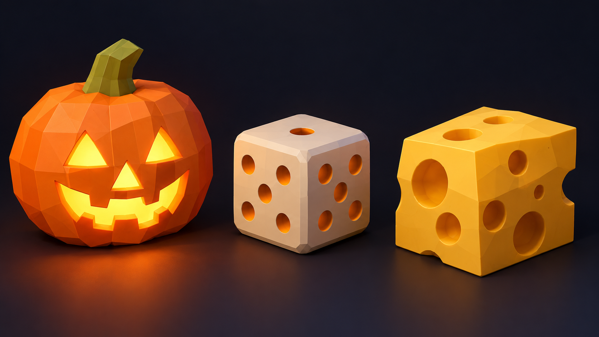
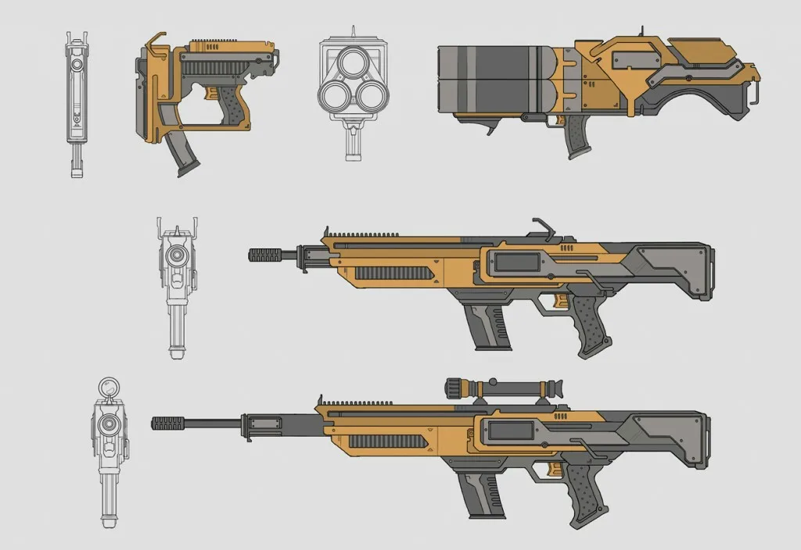

# Самостоятельная работа — Урок 7: Тыква-фонарь 🎃

> 🧑‍🎓 Делаешь сам(а), применяя Boolean. Учитель помогает, если застрял.

## Задание

На уроке мы вырезали кнопки, экран и решётку в аркадном автомате. Теперь — весёлое применение Boolean: вырежи **тыкву-фонарь** (Jack-o'-lantern) со светящимся лицом. Внутри поставим светящийся шар (Emission из урока 4) — и лицо «загорится» сквозь прорези.

> 💡 Тыква пригодится для сезонной сцены — поставь её рядом с другими предметами окружения.

*Варианты булевых вырезов: светящаяся тыква-фонарь, кубик с выемками-точками, сырный блок с дырками. Выбери свой.*

**Из чего состоит:**
- Тело — сфера, сплюснутая (`S → Z`), с дольками (Loop Cut + сжать петли)
- Глаза, нос, рот — резаки-фигуры (треугольники, полумесяцы) → **Boolean Difference**
- Внутри — светящаяся сфера (**Emission**) → лицо светится через прорези
- Стебель — короткий цилиндр/конус сверху

---

## Как собрать — по шагам

### Шаг 1 — Тело тыквы

1. `Shift + A → Mesh → UV Sphere` → `ПКМ → Shade Smooth`.
2. `S → Z → 0.8` — слегка приплюсни (тыквы пухлые, не идеальные шары).
3. `Ctrl + A → Scale` — **применяем масштаб** (обязательно до Boolean!).

   ✅ *Должно получиться:* пухлая приплюснутая сфера — заготовка тыквы.

### Шаг 2 — Дольки (по желанию, но красиво)

1. `Tab` → Edit Mode → `Ctrl + R` → наведи вертикально → прокрути колесо до 6–8 петель по кругу → клик → ПКМ.
2. Включи **Proportional Editing** (`O`), выдели вертикальные петли через одну и чуть вдави внутрь (`S` поменьше) — появятся рёбра-дольки.
3. `Tab` → назад.

   ✅ *Должно получиться:* бока тыквы с мягкими вертикальными дольками.

### Шаг 3 — Резаки для лица

1. Глаза-треугольники: `Shift + A → Mesh → Cube`, поверни `R → 45`, сплющи — выйдет «ромб/треугольник».
2. Нос — поменьше, рот — вытянутый куб (можно с зубчиками: вырежи в нём пару прорезей тем же Boolean).
3. Протолкни каждый резак **сквозь переднюю стенку** тыквы (должен торчать внутрь и наружу).

   ✅ *Должно получиться:* фигуры-резаки торчат из «лица» тыквы.

### Шаг 4 — Вырезаем лицо (Boolean)

1. Выдели **тыкву**, последним — нет: для Bool Tool выдели сначала резак, потом с `Shift` тыкву → `Ctrl + Numpad −`.
2. Или модификатором: выдели тыкву → Boolean → Difference → Object = резак. Повтори для каждого элемента лица.
3. Спрячь/удали резаки (`H`).

   ✅ *Должно получиться:* на тыкве прорезаны глаза, нос и рот. 🎃

### Шаг 5 — Внутренний свет (Emission — вспоминаем урок 4)

1. `Shift + A → Mesh → UV Sphere` → `S` поменьше → спрячь **внутрь** тыквы.
2. Материал → Surface **Emission** → тёплый оранжевый → **Strength 4–5**.
3. **Render Properties → Bloom ✅** (EEVEE).

   ✅ *Должно получиться:* в режиме `Z → Rendered` лицо **светится** сквозь прорези. 🔥

### Шаг 6 — Стебель и рендер

1. Сверху — короткий `Cylinder`/`Cone` (стебель), дай зелёно-коричневый материал.
2. `F12` → рендер, сохрани (**Image → Save As**).

---

## Требования

- [ ] Минимум **3 выреза** через **Boolean Difference** (глаза, нос, рот)
- [ ] Хотя бы раз использован **Bool Tool** (горячие клавиши)
- [ ] Соблюдено правило `Ctrl + A → Scale` **до** Boolean
- [ ] Результат **без артефактов** (правила из лайфхака: `Shift+N`, `M By Distance`)
- [ ] Внутри — **светящийся** элемент (Emission), лицо светится
- [ ] Рендер (`F12`)

---

## Подсказки

- Дольки тыквы: Loop Cut по вертикали + Proportional Editing (`O`) или сжать петли внутрь.
- Резаки-лицо: маленькие кубы/призмы, протолкни **насквозь** переднюю стенку.
- Глаза-треугольники: куб → `R 45` → сплющить.
- Чёрные грани после Boolean? → Edit Mode → `A` → `Shift + N`.
- Мусор/дыры по краю реза? → `M → By Distance`.
- Резак «не режет»? Проверь: он протыкает стенку насквозь и имеет объём (не плоскость).
- Вдруг после вырезания **вся тыква куда-то делась** вместе с резаком? Спокойно — так бывает: обычно резак оказался больше тыквы и «съел» её целиком, или случайно выбралась операция «оставить общее». Жми `Ctrl + Z`, чтобы вернуть, сделай резак поменьше (чтобы он торчал сквозь стенку, а не накрывал всю тыкву) и выделяй сначала резак, а потом саму тыкву. Если объект не исчез, а просто спрятался — покажи его `Alt + H`.

---

## 🎯 А попробуй (по желанию)

- 🎲 **Игральный кубик:** куб + 21 маленькая сфера-резак → Boolean Difference (выемки-точки). Расставь точки как на настоящем кубике (1–6 на гранях).
- 🧀 **Сырный блок:** брусок + несколько сфер-резаков разного размера → Difference (дырки как в мультяшном сыре).
- 💍 **Кольцо/бублик:** цилиндр − цилиндр поменьше = труба; или Torus.
- ✨ **Фаска на вырезе:** добавь резаку **Bevel** ДО Boolean — край отверстия станет скошенным, «дорогим» (приём из лайфхака).

---

## 🔫 Ещё задание: своё оружие по референсу (box-modeling)

Хочешь задачу посерьёзнее? Сделай **своё оружие** — пистолет или автомат (бластер) — тем же способом, что и на уроке: обводим картинку-референс кубом. Это настоящий приём геймдев-художников: любой low-poly пистолет — это всего ~500 граней.

1. Поставь картинку-референс **сбоку**: `Shift + A → Image → Reference` (вид `Numpad 3`), убавь ей **Opacity**, включи **Show → In Front**.
2. `Shift + A → Mesh → Cube`, в Edit Mode включи просвечивание (`Alt + Z`) и двигай **точки** по контуру: корпус, рукоять, ствол.
3. Где нужен изгиб (рукоять, спусковая скоба, магазин автомата) — добавляй **Loop Cut** (`Ctrl + R`) и двигай новые точки по форме.
4. Придай толщину (`S → Y` в объёме) — плоский силуэт станет объёмным.
5. Детали — **Carver** (`Shift + Ctrl + X`): прорезь прицела, дуло (Circle), пазы профильной кистью (`B`).
6. По желанию — **светящиеся** вставки (Emission + Bloom), как у бластера.

> 💡 Автомат длиннее пистолета — начни с вытянутого бруска и добавь снизу магазин и рукоять отдельными «обтянутыми» кубами, потом объедини (`Ctrl + J`).

*Варианты оружия для обводки: пистолет и автоматы в видах сбоку и спереди. Выбери любой, поставь вид сбоку в сцену и обтягивай кубом.*

---

## Что сдать

`.blend` + рендер. На выбор: **тыква-фонарь** или **своё оружие по референсу** (а лучше и то, и другое).
