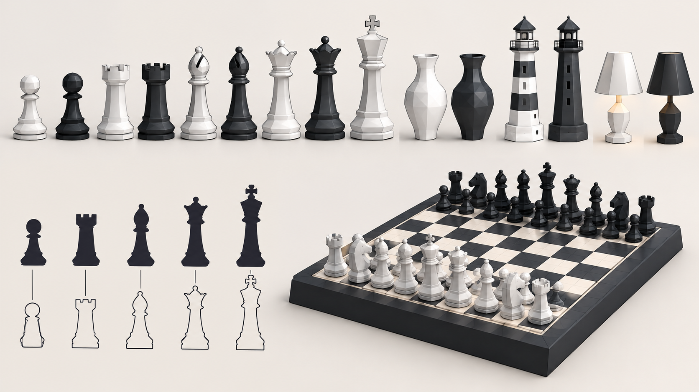
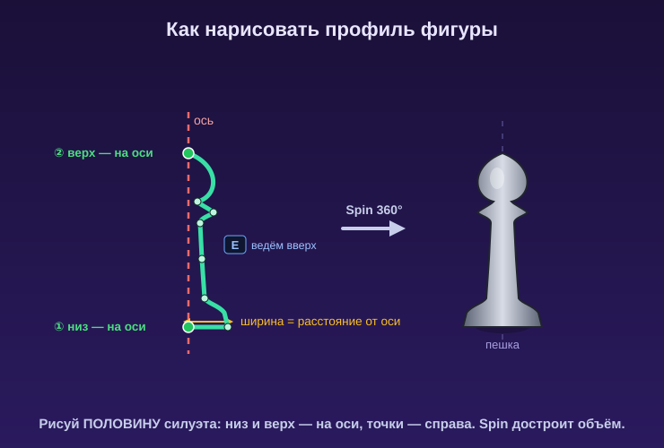

# Самостоятельная работа — Урок 8: Шахматные фигуры ♟️

> 🧑‍🎓 Делаешь сам(а), применяя Spin и Screw. Учитель помогает, если застрял.

## Задание

На уроке мы собрали уголок зельевара (котёл, бутылочка, спираль дыма). Теперь — изящная классика тел вращения: вылепи **набор шахматных фигур** (или посуду / настольную лампу / маяк).

> 💡 Шахматы — идеальная тренировка профиля: каждая фигура это свой силуэт, вращённый вокруг оси.

*Сверху — готовые фигуры (и вазы/маяки/лампы). Снизу — их **силуэты-профили**: именно половину такого силуэта ты и рисуешь, а Spin достроит объём.*

**Шахматные фигуры (сделай хотя бы 3 разные):**
- Пешка — простой профиль с шариком
- Ладья — цилиндр с зубцами наверху (Boolean или вырезы)
- Слон — вытянутый профиль с «шапочкой»
- Ферзь / король — высокие профили с короной/крестом
- Конь — исключение (не тело вращения, лепится отдельно)

---

## Требования

- [ ] Минимум **3 фигуры**, сделанные через **Spin** или **Screw**
- [ ] Каждая фигура — **свой профиль** (силуэты разные!)
- [ ] Профиль построен сбоку от оси (фигура не схлопнулась)
- [ ] Где нужно — **Solidify** (толщина) или другие приёмы (зубцы ладьи)
- [ ] Использован хотя бы один лайфхак (сфера из дуги — навершие)
- [ ] Два материала (чёрные и белые фигуры) + рендер (`F12`)

---

## 🎨 Как правильно нарисовать профиль фигуры — по шагам

Главное в этой практике — **аккуратный силуэт**. Вот как рисовать его чисто:

*Рисуем только половину силуэта: первая точка — внизу на оси, ведём точки вверх (ширина = расстояние от оси), последняя точка — вверху на оси. Spin достроит объём.*

1. `Shift + C` — 3D-курсор в центр (через него пройдёт ось), `Numpad 1` — вид спереди.
2. Добавь `Plane`, в Edit Mode оставь **одну** вершину (три удали: `X → Vertices`).
3. **Начинай снизу.** Поставь первую точку **ровно на оси** (x = 0) — это центр донышка. Тогда дно фигуры закроется без дырки.
4. Веди силуэт **снизу вверх** через `E`: наружу — где фигура шире (пузо, основание), ближе к оси — где уже (талия, шейка). **Расстояние точки от оси = толщина фигуры в этом месте.**
5. **Последнюю** точку (макушку) снова поставь **на ось** (x = 0) — тогда верх тоже закроется.
6. Плавные места (округлое пузо) — ставь **побольше точек** и чуть сдвигай их, чтобы линия изгибалась мягко. Острые переходы (кольца, уступы) — точки близко друг к другу.

> ✅ **Проверь профиль:** это **одна** линия от низа к верху, оба конца — на оси, точки — справа от оси. Тогда Spin/Screw дадут красивую фигуру без дырок и «винта».

> 💡 **Срисовывай с силуэта.** Смотри на нижний ряд картинки-референса — это и есть профили.

### 🩹 Если фигура не получается — быстрая проверка

Самые частые затыки и как их мигом починить (подробнее — в теории, Часть 2–3):

| Что вижу | Почему | Что нажать |
|----------|--------|-----------|
| После Spin — плоская **«тарелка»** | ось взялась «от вида» (это не та ось) | открой **`F9`** → **Axis: X 0, Y 0, Z 1** (ось — вертикальная Z) |
| Фигура **схлопнулась** в линию | профиль нарисован **на самой оси** | рисуй профиль **справа** от оси (на расстоянии = толщина) |
| Фигура **кривая/косая** | 3D-курсор не в центре | `Shift + C`, повтори Spin; в `F9` Center 0,0,0 |
| Screw: **перекрутило в спираль** | параметр **Screw ≠ 0** | в модификаторе **Screw = 0 m**, **Iterations = 1** |
| Screw: получилось **слишком широко** | профиль далеко от центра | `Shift+C` → `Object → Set Origin → Origin to 3D Cursor`; рисуй ближе к оси |
| Тёмные/чёрные грани | нормали смотрят внутрь | Edit Mode → `A` → `Shift + N` |
| Щель/шов на фигуре | двойные точки на стыке | `A` → `M → By Distance` |

> ✅ **Правило «с первого раза»:** `Shift + C` (центр) → `Numpad 1` (вид спереди) → рисуй **справа от оси**, одной линией снизу вверх → в Spin поставь **Axis Z**. Тогда выйдет красивая фигура, а не тарелка.

> 💡 **Не любишь ставить точки?** Нарисуй профиль **кривой Безье** (как в уроке 6) — ручками гнуть проще; потом `Object → Convert → Mesh` и крути Spin/Screw.

### 📷 Как загрузить фото-референс прямо в Blender (чтобы обводить)

Удобно положить картинку-силуэт в сцену и обводить её точками:

1. Встань в вид спереди: `Numpad 1`.
2. `Shift + A → Image → **Reference**` (или **Background**) → выбери файл с силуэтом.
3. Картинка появится в сцене. Передвинь/масштабируй её (`G`, `S`), чтобы её ось совпала с осью Z.
4. *(по желанию)* в её настройках (вкладка **Object Data** у картинки) уменьши **Opacity** — станет полупрозрачной, удобнее обводить.
5. Теперь рисуй профиль точками **прямо поверх** силуэта — `E` по контуру половины фигуры.

> 📥 **Готовые силуэты для обводки** (чистые картинки на прозрачном фоне, в папке `изображения/силуэты-референсы/`):
> - шахматы: `фигура-пешка.png`, `фигура-ладья.png`, `фигура-слон.png`, `фигура-ферзь.png`, `фигура-король.png`;
> - другие тела вращения: `силуэт-ваза.png`, `силуэт-маяк.png`, `силуэт-лампа.png`.
>
> Загрузи любой в Blender (`Shift+A → Image → Reference`), поставь по центру и обводи **половину** силуэта. У каждого по центру — пунктирная линия-ось, по ней ставь первую/последнюю точку. *(У короля крестик наверху и у маяка верхушку-конус можно сделать отдельно.)*

> 💡 Чтобы картинка-референс не загораживала работу — её можно временно скрыть (`H`) и снова показать (`Alt + H`).

---

## Подсказки

- 3D-курсор в центр (`Shift + C`) перед каждым Spin, работай из вида спереди (`Numpad 1`).
- После Spin почисти: `A → M → By Distance` (убрать шов) и `A → Shift + N` (нормали) — как в теории.
- Фигура «бумажная»? Добавь **Solidify** (толщина).
- Навершие-шарик (у короля, ферзя) — лайфхак «сфера из дуги».
- Зубцы ладьи — маленькие кубы-резаки по кругу (радиальный Array + Boolean из уроков 3 и 7).
- Ставь фигуры ровно в ряд на доску через **Align Objects** (урок 2) — не на глаз.
- Сделал одну фигуру удачно? Меняй только **профиль** — приём тот же.

---

## 🎯 А попробуй (по желанию)

- 🏺 **Ваза или кубок** — тот же приём, профиль поизящнее (узкая талия, широкое горло).
- 🏮 **Маяк** — высокий конус-профиль + полоски (разные материалы по кольцам).
- 💡 **Настольная лампа** — основание (Spin) + плафон (Spin) + витая ножка (Screw-спираль).
- 🫗 **Налей «воду/зелье»** внутрь вазы: сплющенный цилиндр-диск с полупрозрачным голубым материалом (Alpha Blend) — как делали в теории.

---

## Что сдать

`.blend` + рендер (несколько фигур на «доске»).
