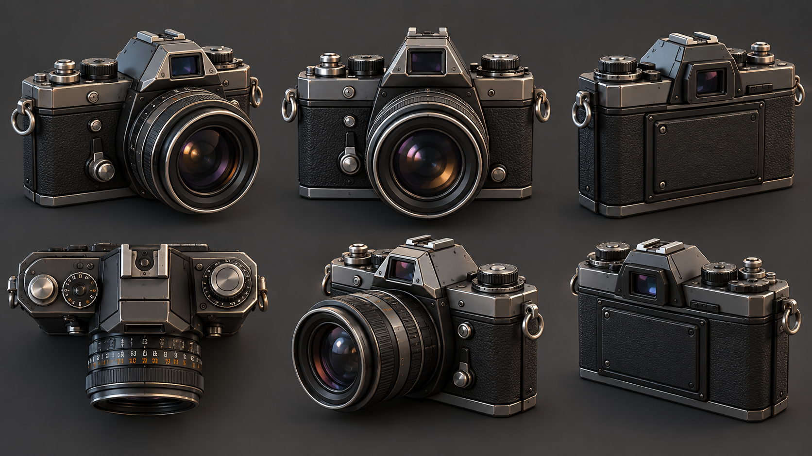
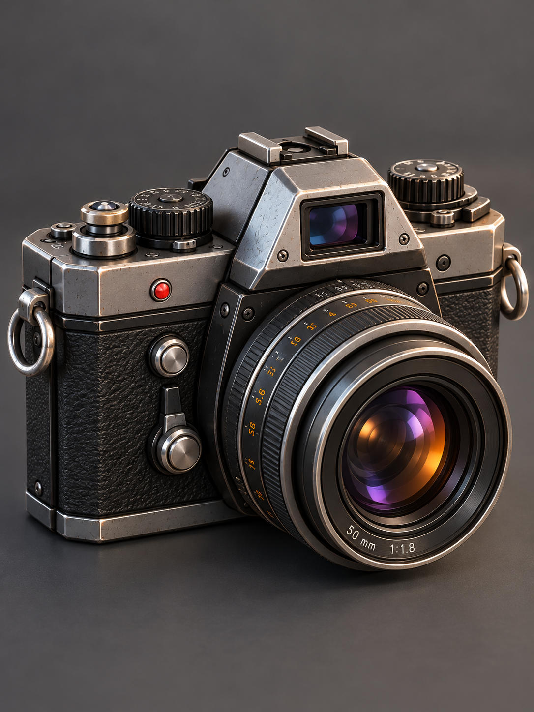

# Самостоятельная работа — Урок 9: Ретро-фотоаппарат 📷

> 🧑‍🎓 Делаешь сам(а), применяя Bridge, Knife и Loop Tools. Учитель помогает, если застрял.

## Задание

На уроке мы собрали голову ретро-робота. Теперь те же приёмы — на другом предмете: сделай **старый плёночный фотоаппарат**. У него есть всё, что мы изучили: круглый объектив, швы корпуса, ушки для ремешка и россыпь кнопок.

> 💡 Фотоаппарат — идеальная тренировка: **объектив** = круг (Loop Tools Circle), **корпус** = панельные швы (Knife), **ушки ремешка** = переходы (Bridge), **кнопки и колёсики** = greebles.

*Обрати внимание на части: прямоугольный корпус с расшивкой, круглый объектив-«бочонок» спереди, видоискатель сверху, два ушка для ремешка по бокам, кнопка спуска и колёсики перемотки.*

**Что собрать (минимум — корпус + объектив + 2 детали):**
- 📦 **Корпус** — скруглённый `Cube`, расшивка панелей ножом
- 🔵 **Объектив** — круглое отверстие спереди (Boolean) → Circle → «бочонок» цилиндра
- 🔗 **Ушки ремешка** — маленькие колечки по бокам через **Bridge**
- 🔘 **Кнопка спуска, колёсико, видоискатель, вспышка** — greebles

---

## Требования

- [ ] Использован **Bridge Edge Loops** (ушко ремешка / труба объектива / видоискатель)
- [ ] Применён **Loop Tools → Circle** (ровный круглый объектив)
- [ ] Нарезана расшивка корпуса **Knife** (с зажатым `C` — ровные линии)
- [ ] Выделение петель через `Alt + ЛКМ` (а не по ребру)
- [ ] Добавлены мелкие детали — **greebles** (кнопка, колёсико, надпись)
- [ ] Симметричные детали (два ушка) сделаны через **Mirror**, а не вручную дважды
- [ ] Чистая топология (квады), без артефактов: `M → By Distance` + `Shift + N`
- [ ] Материалы + рендер (`F12`)

---

## 🎬 Как собрать правильно — по шагам

Главное в hard-surface модели — **правильный порядок**: сначала форма, потом швы, потом отверстия и детали. Если лепить всё вперемешку, топология «поедет».

1. **Болванка корпуса.** `Cube` → задай пропорции фотоаппарата (широкий, плоский) → скругли рёбра **Bevel** (`Ctrl + B`, пара сегментов). Сделай `Ctrl + A → Scale` (применить масштаб).
2. **Расшивка (Knife).** `K` → проведи швы: отдели верхнюю крышку, переднюю панель. Зажимай `C` — линии ровные, заверши `Enter`. Выдели шов (`Alt + ЛКМ`) и чуть вдави (`G`) — стык виден.
3. **Объектив (Boolean + Circle).** Цилиндром вырежи круглое отверстие спереди (Boolean, урок 7). Край кривой? Выдели петлю (`Alt + ЛКМ`) → `LoopTools → Circle` — идеальный круг. Вставь «бочонок» объектива — цилиндр, выступающий вперёд.
4. **Ушки ремешка (Bridge).** На боку — маленькое отверстие + колечко рядом снаружи → выдели оба (`Alt+ЛКМ`, второе с `Shift`) → `Bridge Edge Loops`. Второе ушко — через **Mirror** (урок 3).
5. **Greebles.** Кнопка спуска (цилиндр сверху), колёсико перемотки, окошко видоискателя, вспышка. Одинаковые мелочи выравнивай **Align Objects** (урок 2).
6. **Уборка.** `A` → `M → By Distance`, затем `A` → `Shift + N`. Материалы (чёрный корпус, стекло объектива) + `F12`.

> ✅ **Проверь на каждом шаге:** форма — чистые квады; шов — ровная линия (не зигзаг); объектив — идеальный круг после Circle; ушко — аккуратный переход без скрутки.

> 💡 **Правильный порядок = чистая модель.** Форма → швы → отверстия → детали → уборка. Не вырезай отверстия до того, как закончил форму, иначе Boolean наделает мусора.

### 🩹 Если не получается — быстрая проверка

Самые частые затыки и как их мигом починить (подробнее — в теории, Часть 4.5):

| Что вижу | Почему | Что нажать |
|----------|--------|-----------|
| **Bridge** ничего не сделал / ошибка | выделено не два кольца краёв | `Alt+ЛКМ` по каждому краю (второй с `Shift`) |
| Bridge скрутил «восьмёркой» | кольца сдвинуты по фазе | в `F9` поставь **Twist = 1** |
| **Нож** режет криво | не включил привязку | нажми `A` (угол) или ось `X`/`Y`/`Z` |
| Нож прорезал только перёд | не нажал `C` | во время реза нажми `C` (Cut Through — насквозь) |
| Нож: точка исчезает, рез пропадает | жал `ПКМ` («Стоп») | ставь `ЛКМ` ≥2 точек → `Enter`; убрать точку — `Ctrl+Z` |
| После реза вылез **треугольник** | рез пришёл в угол-вершину | режь **от края до края**; убрать — `X → Dissolve Edges`; для прямых — `Ctrl+R` |
| **Circle** раскидал вершины | выделена не петля | выдели именно петлю края (`Alt+ЛКМ`) |
| Объектив — кривой эллипс | так бывает после Boolean | петля → `LoopTools → Circle` |
| Два ушка разной формы | лепил вручную дважды | сделай одно → **Mirror** (урок 3) |
| Тёмные/чёрные грани | нормали внутрь | `A` → `Shift + N` |
| Щель/шов, двойные точки | не слиты вершины | `A` → `M → By Distance` |
| **Loop Tools** нет в меню | аддон выключен | `Preferences → Add-ons → Loop Tools` ✅ |

> ✅ **Правило «чисто с первого раза»:** стремись к квадам → выделяй петли `Alt+ЛКМ` → после Boolean край чини `Circle` → в конце `M By Distance` + `Shift + N`.

---

## Подсказки

- Ушко/видоискатель/труба объектива: два кольца (`Alt+ЛКМ`, второе с `Shift`) → `Edge → Bridge Edge Loops`.
- Симметричные детали (два ушка) — делай одно и вешай **Mirror** (урок 3), не лепи дважды.
- Кривой край после Boolean → петля → **Loop Tools → Circle**.
- Кнопки/заклёпки размножай быстро через **`Shift+R`** (Repeat Last): `Shift+D` → **сразу** `X 0.1` (ряд) или `R 30` (кольцо, Pivot=3D Cursor) → `Enter` → жми `Shift+R`. ⚠️ **Без `Esc` между дублированием и сдвигом** — иначе `Shift+R` будет только двигать одну деталь (разбор — теория, Шаг 6).
- Стекло объектива — материал «простое стекло» (Alpha Blend, урок 4); корпус — тёмный матовый.
- Красный огонёк записи/вспышка — маленькая сфера с **Emission** + Bloom (урок 4).

---

## 🎯 А попробуй (по желанию)

- 🛸 **Дрон** вместо фотоаппарата — корпус + 4 круглых отверстия под винты (Circle) + камера-линза снизу.
- 🤿 **Батискаф/подлодка** — круглые иллюминаторы (Circle), перископ-трубка (Bridge), заклёпки по корпусу (greebles), швы-пластины (Knife).
- ☕ **Техно-кружка** — ручка через **Bridge Edge Loops** (классика!), поясок ножом, круглая крышка (Circle).
- 🧵 **Расшей корпус целиком** — нарежь панели по всей модели и чуть вдави швы: техника станет «настоящей».
- 🌀 **GStretch** — нарисуй карандашом линию, и вершины петли лягут точно по ней (`LoopTools → GStretch`).

---

## Пример готовой работы

*Вот к чему можно стремиться: круглый объектив (Circle), расшивка корпуса (Knife), ушки ремешка (Bridge), кнопка/колёсико и красный огонёк (greebles + Emission). Свой вариант может быть проще — главное применить приёмы.*

---

## Что сдать

`.blend` + рендер (твой фотоаппарат с объективом, ушками и деталями).

> 📷 **[Картинки-референсы фотоаппаратов и техники →](изображения-практика.md#ref)**
