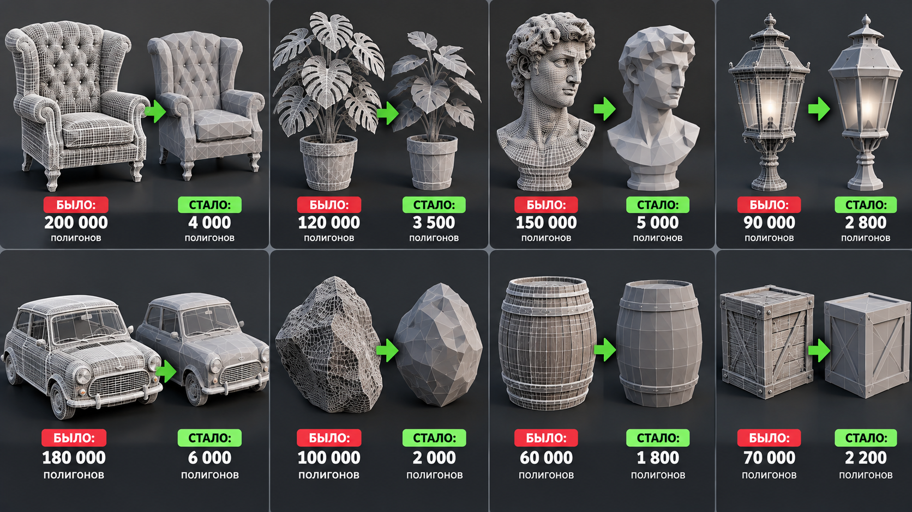
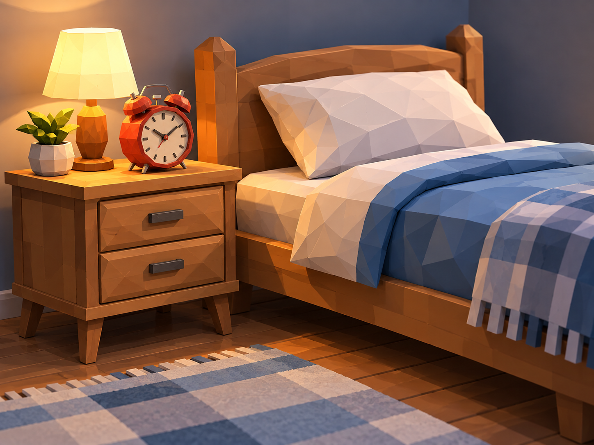
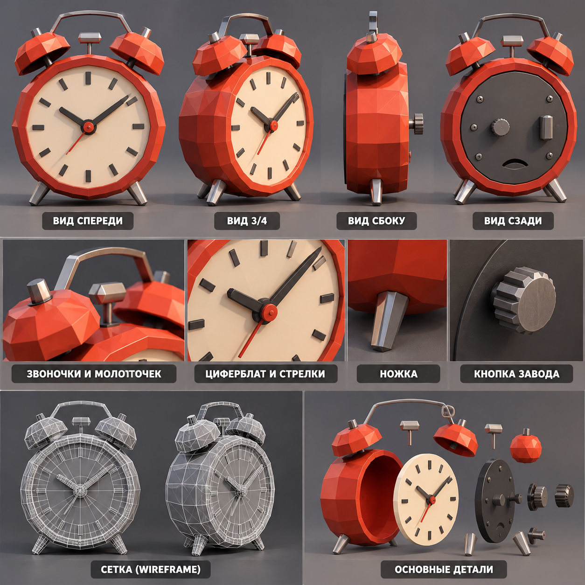

# Самостоятельная работа — Урок 10: Оптимизация 🎮 + мастер-проект 🛰️

На этом уроке — **два задания**. Первое — короткое (оптимизация), второе — большой пошаговый проект, где ты применяешь приёмы всего курса.

---

## Задание 1 — Облегчи тяжёлую модель 🔻

Реальная задача из геймдева: **возьми тяжёлую модель и облегчи её** для игры, сохранив вид.

**Откуда взять тяжёлую модель:**
- Скачай бесплатную с **Poly Haven / Sketchfab** (см. [где-скачать](../../справочники/где-скачать.md))
- Или включи аддон **BlenderKit** и возьми оттуда
- Или сделай сам: сфера/тор с высоким Subdivision, плотный объект

**Что оптимизировать:** мебель, растение, техника, статуя, реквизит — что угодно, кроме астероида (его делали на уроке).

*У каждой модели слева — тяжёлый оригинал (плотная сетка), справа — облегчённая (силуэт тот же). Это и есть твоя задача.*

### Требования (задание 1)

- [ ] Записан **исходный** счётчик полигонов (**Statistics**) — «было»
- [ ] Применён **Decimate** (Collapse или Planar) — модель легче
- [ ] Если модель «грязная» (дыры/дубли) — использован **Weld** или **Remesh**
- [ ] Записан **финальный** счётчик — «стало» (во сколько раз легче)
- [ ] Форма/силуэт **сохранены** (модель узнаётся)
- [ ] Материал назначен + рендер (`F12`)

### 🩹 Если не получается — быстрая проверка

| Что вижу | Почему | Что сделать |
|----------|--------|-------------|
| Форма «поплыла» | Ratio слишком низкий | подними **Ratio** назад |
| После Decimate дыры | грязная сетка (дубли) | сначала **Weld** / **Remesh**, потом Decimate |
| Остались треугольники-каша | так работает Collapse | это норм для финала; нужна чистая сетка — **Remesh** |
| Текстура съехала | Decimate после UV | делай Decimate **до** UV или режим **Planar** |
| Острые углы сгладились | Collapse срезал | режим **Planar** / Remesh **Sharp** / меньше упрощай |
| Не вижу число полигонов | Statistics выключен | **Overlays → Statistics** |

---

## Задание 2 — Мастер-проект: уголок спальни ⏰🛏️

Большой проект, собирающий приёмы всего курса. Соберём **маленькую сцену-уголок**: **будильник** стоит на **тумбочке** рядом с **кроватью**. Будильник — главная, детальная модель; тумбочка и кровать — попроще (но тоже по шагам). Так ты и навыки повторишь, и получишь цельную сцену.

*Вот к чему идём: уютный уголок — кровать с подушкой, тумбочка с ящиками и будильник на ней. Твой вариант может быть проще.*

### Часть А — Ретро-будильник (главная модель)

> ⏰ Будильник — это: **круглый корпус** + **циферблат** со стрелками + **деления по кругу** + **два колокольчика** сверху + **молоточек** + **две ножки** + **кнопка завода**. Делаем по порядку.

*Референс для моделирования: виды спереди/сбоку/сзади, крупно детали и из каких частей собран будильник.*

### Шаги (делай по очереди)

1. **Корпус** — `Cylinder`, положи «на бок» (экраном к себе), скругли рёбра **Bevel** (`Ctrl+B`). *(уроки 1–2)*
2. **Циферблат** — на передней грани `I` (Inset) → `E` чуть вглубь (углубление под циферблат). Край неровный? **Loop Tools → Circle**. Дай циферблату светлый материал с лёгким **Emission** (чуть светится). *(уроки 9, 4)*
3. **Деления по кругу** (как сделать циферблат ровным по кругу) — сделай одну тонкую риску (маленький брусок) у **верхнего** края циферблата, затем размножь по кругу:
   - Поставь 3D-курсор **в центр циферблата** (наведись на центр → `Shift + S → Cursor to Selected`).
   - В шапке смени **Pivot Point → 3D Cursor** (чтобы вращение шло вокруг центра).
   - Встань **прямо напротив** циферблата (`Numpad 1` — вид спереди).
   - Выдели риску → `Shift + D` → **сразу** нажми `R` → набери `30` → `Enter`. ⚠️ **Без `Esc`!** (дублирование и поворот — одним действием; 360 ÷ 12 = 30°).
   - Жми **`Shift + R`** ещё 10 раз → 12 делений ровно по кругу.
   - Верни **Pivot Point → Median Point**. *(урок 9; тот же приём, что для болтов)*
4. **Стрелки** — два тонких длинных бруска из центра (часовая короче, минутная длиннее). *(урок 1)*
5. **Два колокольчика сверху** — полусфера: `Circle`/полудугу → **Spin** (или возьми `UV Sphere` и удали низ). Сделай **один**, второй — через **Mirror** (симметрично). *(уроки 8, 3)*
6. **Молоточек между колокольчиками** — тонкая ножка (**кривая** Безье + Bevel Depth, или цилиндр) + шарик на конце. *(урок 6)*
7. **Две ножки снизу** — маленькие шарики/цилиндры; одну сделал — вторую **Mirror**. *(урок 3)*
8. **Кнопка завода сзади сверху** — цилиндр; по краю корпуса — пара **болтиков** через `Shift+R`. *(урок 9)*
9. **Уборка топологии** — `A → M → By Distance`, затем `A → Shift + N`. *(урок 9)*
10. **Оптимизация** — повесь **Decimate**, запиши вес «было → стало». *(урок 10)*

### Часть Б — Тумбочка (простая)

Небольшая тумбочка, на которую поставим будильник. Делается из куба за пару минут.

1. **Корпус** — `Cube`, растяни в прямоугольную тумбочку (`S` по осям). Скругли рёбра лёгким **Bevel**. *(уроки 1–2)*
2. **Ящики** — на передней грани `I` (Inset) → раздели на 2 ящика (ещё `I` или `Ctrl+R`) → каждую рамку чуть **вдави** (`E` внутрь или `Alt+S`). *(урок 9)*
3. **Ручки** — маленький цилиндр/шарик на каждый ящик. Сделай один — остальные `Shift+R` (ровно друг под другом). *(урок 9)*
4. **Ножки** — 4 коротких бруска по углам снизу: сделай **одну**, остальные через **Mirror** по X и по Y (или радиальный Array). *(урок 3)*

   ✅ *Должно получиться:* аккуратная тумбочка с ящиками и ножками.

### Часть В — Кровать с подушкой (простая)

> 💡 Главный приём «мягкости» тут — **Bevel/Subdivision**: острый куб превращается в мягкий матрас/подушку.

1. **Каркас** — `Cube`, растяни в прямоугольник-основание кровати (низкий и широкий). *(урок 1)*
2. **Матрас** — ещё один `Cube` сверху каркаса, сплющи. Чтобы стал «мягким»: сильный **Bevel** (`Ctrl+B`, покрути колесо для 2–3 сегментов) ИЛИ модификатор **Subdivision** + чуть сжать — углы скруглятся. *(урок 1)*
3. **Изголовье (спинка)** — вертикальный `Cube` у «головы» кровати, скругли **Bevel**. *(урок 1)*
4. **Подушка** — маленький `Cube` → сильный **Bevel** + лёгкий **Subdivision** = пухлая подушка. Хочешь «вмятинку» — `Ctrl+R` петля поперёк и чуть поджать центр. *(уроки 1, 9)*
5. **Ножки** — 4 бруска по углам: одна + **Mirror** по X и Y. *(урок 3)*

   ✅ *Должно получиться:* простая кровать с пухлыми матрасом и подушкой.

### Часть Г — Собираем сцену и рендерим

1. Поставь **тумбочку** рядом с **кроватью**, **будильник** — на тумбочку. Выравнивай через **Snap**/3D-курсор (урок 2), а не на глаз.
2. Положи всё на плоскость-«пол», добавь лампу (или Sun).
3. Назначь материалы (дерево тумбочки/кровати, ткань матраса/подушки, металл будильника).
4. **Оптимизируй** всю сцену (Decimate на тяжёлых объектах), следи за **Statistics**.
5. `F12` — финальный рендер уголка спальни.

   ✅ *Должно получиться:* уютный уголок: кровать, тумбочка и будильник на ней.

### Требования (задание 2)

- [ ] Собраны **три объекта**: будильник (детально) + тумбочка + кровать с подушкой
- [ ] У будильника есть все части (корпус, циферблат+стрелки, деления, 2 колокольчика, молоточек, ножки, кнопка)
- [ ] Применены (отметь): **Bevel**, **Inset/Loop Tools Circle**, **Spin**, **Mirror**, **Shift+R** (деления/болты/ручки), **кривая**, **Emission**, **Subdivision** (мягкая подушка/матрас)
- [ ] Детали в сцене **выровнены** (Snap/3D-курсор/Align), не на глаз
- [ ] Чистая топология: `A → M → By Distance` + `A → Shift + N`
- [ ] Сцена **оптимизирована** (Decimate) — записан вес «было → стало»
- [ ] Материалы + рендер всей сцены (`F12`)

> 💡 **Порядок работы:** сначала форма и детали каждого объекта, потом уборка топологии, и **в самом конце** — оптимизация. Не оптимизируй то, что ещё будешь редактировать.

> 🧹 **Застряла топология?** Полный разбор ремонта (Boolean-край, дубли, нормали, треугольники) — в справочнике [Чистка меша](../../справочники/глубокое-погружение/чистка-меша.md).

### Не хочешь будильник? Выбери другой конкретный проект (те же приёмы):

- ☎️ **Дисковый телефон:** база (Bevel) + круглый диск с дырочками (Boolean + радиальный Array) + трубка (Spin/кривая) + витой провод (кривая) + кнопки (Shift+R).
- 🤿 **Батискаф:** корпус-капсула (Spin) + круглые иллюминаторы (Boolean + Loop Tools Circle) + перископ-трубка (Bridge) + винт (радиальный Array) + заклёпки (Shift+R).
- ☕ **Кофемашина:** корпус (Bevel + Knife-швы) + круглый экранчик (Boolean+Circle, Emission) + кнопки сеткой (Array/Shift+R) + трубки (кривые) + чашка (Spin).

---

## 🎯 А попробуй (по желанию)

- 🪨 **LOD-набор** — сделай один астероид в трёх версиях: детальный, средний, грубый (разный Ratio). Поставь в ряд — это и есть «уровни детализации».
- 🧊 **Remesh Blocks** — прогони свою модель через Remesh в режиме **Blocks** → «майнкрафт»-версия.
- 🏞️ **Мини-сцена** — собери спутник + пояс астероидов с урока в одну сцену, следи, чтобы Statistics не улетел.
- 🔁 **Семейка** — размножь свою модель с вариациями (масштаб/поворот/Seed), как делали с камнями.

---

## Что сдать

`.blend` + рендеры обоих заданий + подписи: задание 1 — «было N → стало M полигонов»; задание 2 — какие **приёмы курса** применил (списком) и вес «было → стало».

> 📷 **[Картинки-референсы →](изображения-практика.md#ref)**
