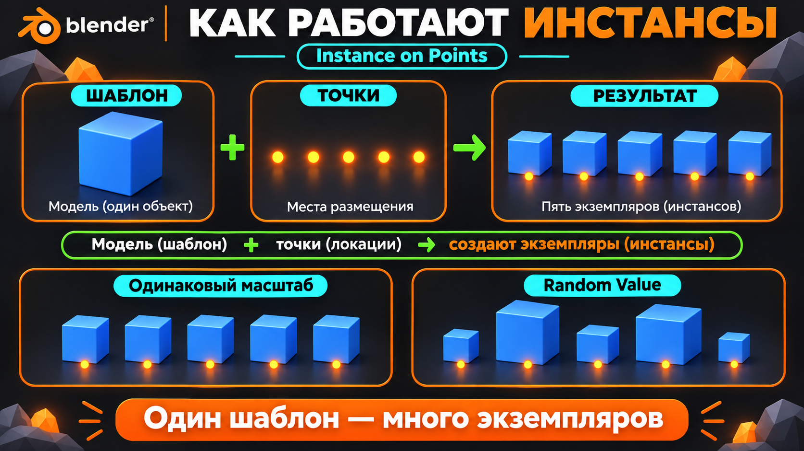

# Лайфхак урока 11 — меняем шаблон, сохраняем генератор

> Один раз собери точки и инстансы — затем меняй модель в Object Info. Камни превращаются в траву без новой схемы.

## Попробуй на своей площадке

1. Сохрани копию проекта с камнями.
2. Сделай пучок травы из трёх узких треугольников, объедини части Ctrl+J. Поставь Origin у основания.
3. Примени Rotation & Scale. Назови модель Grass_Module.
4. В Object Info выбери Grass_Module, режим Original, включи As Instance.
5. Оставь провод Geometry → Instance у Instance on Points. Провода точек не меняй.
6. Уменьши Density для первой проверки, затем подбери размер через Scale у Instance on Points.

✅ На прежней поверхности вместо камней появилась трава. Если исходный камень тоже изменился, проверь, что редактируешь правильный объект.

## Почему это работает

Distribute Points on Faces отвечает за места. Object Info — за модель. Instance on Points соединяет эти две ветки. Меняя одну ветку, можно сохранить другую.

## Шпаргалка

| Нужно | Где менять |
|---|---|
| Другая модель | Object Info → Object |
| Больше растений | Distribute Points on Faces → Density |
| Другой разброс | Seed |
| Разные размеры | Random Value Float → Scale |
| Вернуть землю | Земля и Instances → Join Geometry |

💡 Сначала проверь один параметр, затем меняй следующий. Для вертикальной травы не подключай Rotation от поверхности без необходимости.

## А попробуй

Замени кубы в ряду на самостоятельно сделанные фонари. Сохрани Origin в основании и подбери шаг по ширине модели.

[Точная схема и теория](theory.md) · [Практика — поезд](практика.md)
