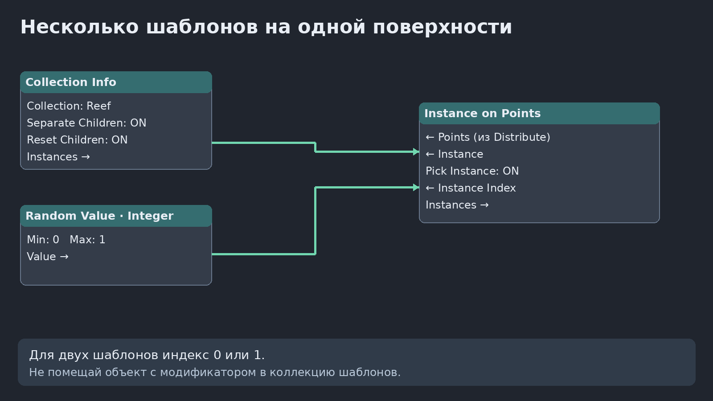
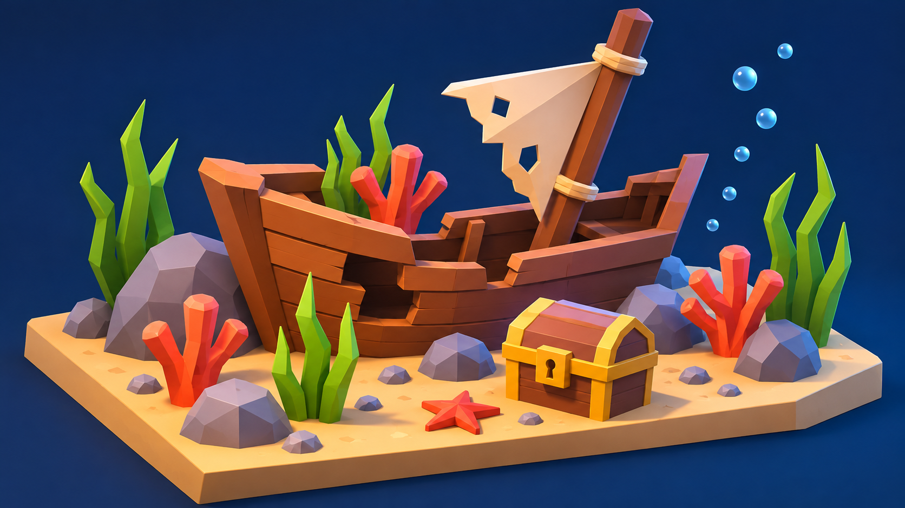

# Самостоятельная работа — Урок 11: Подводный мир

Сегодня ты создашь маленькую сцену для приключенческой игры: на песчаном дне лежит обломок корабля, рядом спрятан сундук, а вокруг выросли кораллы и водоросли. Игрок должен сразу заметить корабль и сокровища. Поэтому сначала построим главные объекты, а потом заполним свободные места окружением. Не нужно моделировать целый океан: достаточно небольшой диорамы, которую можно рассмотреть с одного ракурса.

## Задание 1 — Морское дно (разминка, 10–15 минут)

Сделай плоскость 8×6 и два шаблона: коралл из трёх вытянутых конусов и водоросль из узких конусов или вытянутых мешей. Каждый шаблон объедини через Ctrl+J, материалы назначь до объединения. В Edit Mode подними геометрию так, чтобы основание совпадало с Origin. Примени Scale. Унеси шаблоны за кадр.

Собери Distribute Points on Faces → Instance on Points. Сначала используй один Object Info, затем второй вид добавь отдельной веткой или через Collection Info (см. [теорию, часть 4.3](theory.md)). Оставь землю через Join Geometry. Density начни с 0.5, Scale 0.7–1.3, Rotation только Z. Подбери Seed.

## Задание 2 — Мастер-проект: затонувший корабль (35–50 минут)

*Это ориентир по композиции. Не нужно повторять все доски и детали: достаточно узнаваемого обломка корабля.*

### Часть А — Корабль

Начни с основания сцены: куб, размеры через N → Item → Dimensions 8 × 6 × 0.25, Location Z = −0.125. Верх окажется на Z=0. Примени Scale, в Edit Mode выдели рёбра и сделай небольшой Bevel (Ctrl+B, 1–2 сегмента). Назначь песочный материал. Так у сцены появится аккуратный край, как у макета. Плоскости генерации позже положим на верхнюю поверхность.

1. Из куба сделай вытянутый корпус (примерно 3×1.2×0.7). В Edit Mode выдели верхнюю грань, Inset (`I`) и Extrude (`E`) внутрь — получится углубление. Не выдавливай насквозь.
2. Сделай нос из отдельного клиновидного меша или сдвинь вершины корпуса. Добавь 2–3 доски из кубов, одну наклони. Мачта — тонкий цилиндр, наклонённый на 15–25 градусов. Парус по желанию — плоскость с изменёнными вершинами.
3. Назначь два оттенка дерева. Поставь корабль немного сбоку, чтобы осталось место для сундука.

### Часть Б — Сундук

1. Куб 0.8×0.5×0.45 — основание. Второй куб с Bevel — крышка.
2. Две тонкие полосы из кубов — металлические накладки. Маленький куб спереди — замок.
3. Материалы: тёмное дерево и жёлтый металл. Поставь сундук перед кораблём.

### Часть В — Процедурное окружение

Окружение должно помогать композиции, а не закрывать её. Посмотри на референс: высокие растения стоят сзади и по краям, низкие кораллы и камни — ближе к зрителю. Между сундуком и кораблём оставлено свободное пространство.

#### Шаг 1 — Подготовь шаблоны

- **Коралл:** Shift+A → Mesh → Cylinder, F9 → Vertices 6. В Edit Mode уменьши радиус до 0.08, высоту примерно до 0.5, подними основание до Z=0. Добавь в том же Edit Mode ещё два цилиндра, сделай их короче и наклони R Y 25 и R Y −25. Сдвинь так, чтобы ветки начинались от центрального ствола. Можно сделать концы чуть шире через выбор верхней грани и S. Назначь кораллово-красный материал.
- **Водоросль:** добавь Plane в Edit Mode, поверни R X 90, уменьши ширину по X до 0.15, высоту по Z до 0.6. Подними нижний край на уровень Origin. Добавь 2 горизонтальных разреза Ctrl+R, сдвинь верхние вершины в сторону, сузь верхний край. Для толщины добавь Solidify (Thickness 0.025). Сделай ещё два листа рядом в том же меше, разной высоты. Назначь зелёный материал. Если сложно, используй пучок конусов из части 4.1 теории.
- **Камень:** Ico Sphere, Subdivisions 1–2, Randomize в Edit Mode, Shade Flat. Сделай его высотой около 0.3, подними нижнюю часть к Origin. Серый или серо-синий материал.

Назови объекты Coral, Kelp, Rock. Примени Scale у каждого и унеси шаблоны за кадр. Проверь, что оранжевая точка Origin находится у основания растения, а не посередине.

#### Шаг 2 — Разметь места, где будут расти растения

Перейди на вид сверху (Numpad 7). Добавь Plane, в Edit Mode сделай прямоугольник 1.5×3, выйди в Object Mode и поставь слева от корабля, на Z=0.01. Назови Reef_Left. Создай вторую площадку справа (Shift+D), третью — за кораблём, если осталось место. Не клади площадку под сундук. Именно эти поверхности будут определять границы разброса. Основное песчаное основание не трогаем.

#### Шаг 3 — Заполни площадки

1. На Reef_Left открой Geometry Nodes → New. Соедини Group Input → Distribute Points on Faces → Instance on Points → Group Output. Object Info с Coral подключи к Instance. Если используешь готовую группу из разминки, сделай её отдельной копией перед изменениями.
2. Начни с Density 1, Random Value Float 0.7–1.3 → Scale, Random Value Vector (0,0,0)–(0,0,6.283) → Rotation. Площадку не подключай к Join Geometry: песок уже существует отдельно. Это тот же приём, что со звёздным небом.
3. На второй площадке используй Kelp вместо Coral. Для смеси можно применить Collection Info из части 4.3: Separate Children, Reset Children, Pick Instance, Random Integer 0–1. Если пока трудно, две отдельные площадки вполне подходят.
4. Добавь камни отдельной небольшой площадкой или вручную поставь 4–6 крупных камней у краёв. Маленькие камешки можно рассеять с Density 2 и Scale 0.4–1.2. Измени Seed, пока не получится удачная композиция.

**Проверка:** включи вид камеры. Если коралл вырос сквозь корабль, не удаляй инстанс вручную — сдвинь или уменьши площадку, либо измени Seed. Если растений слишком много, уменьши Density. Если они слишком высокие, уменьши Max у Random Value Scale. Это и есть управление окружением через правила.

#### Шаг 4 — Пузырьки (по желанию)

Вспомни звёздное небо. Сделай маленькую UV Sphere радиусом 0.04, светло-голубой материал, Roughness 0.2. Создай узкую вертикальную Plane: R X 90, затем в Edit Mode растяни до ширины 0.5 и высоты 2. Поставь рядом с кораблём, нижний край около песка. Используй ту же схему, что для звёзд, но Density 5–10 и Random Scale 0.5–1.5. Плоскость не выводи. Получится небольшая цепочка пузырьков. Прозрачный материал и анимация не обязательны.

### Часть Г — Камера, свет и рендер

1. В World Properties → Surface → Color выбери тёмно-синий цвет. Это фон, а не настоящая вода. Не подключай космическую панораму из прошлого урока: она здесь не нужна.
2. Поверни вид так, чтобы одновременно были видны передняя и боковая стороны корабля, сундук и песчаная площадка. Выдели камеру, Ctrl+Alt+Numpad 0 выровняет её по текущему виду (на Mac при необходимости используй View → Align View → Align Active Camera to View). В Camera Data выбери Orthographic, подбери Scale около 10–12. В кадре должны быть все края основания.
3. Добавь Area Light, подними на 5–7 единиц, поставь спереди и сбоку, поверни к сцене. В Object Data начни с Power 700–1000 W, Size 5. Добавь второй Area с противоположной стороны, Power 300–500 W, голубой цвет. Значения примерные: проверь Rendered и настрой яркость. Тёплый основной свет покажет дерево и песок, холодный боковой подчеркнёт подводную атмосферу.
4. Output Properties: 1920×1080, 100%. Render Properties: Eevee. Нажми F12. Проверь, что сундук не потерялся в тени, растения не закрывают корпус, а края основания не обрезаны. Image → Save As, сохрани PNG. Сохрани и .blend через Ctrl+Shift+S.

## Требования

- [ ] Узнаваемый корабль и сундук, самостоятельная композиция.
- [ ] Два вида процедурно распределённых объектов; Distribute Points on Faces и Instance on Points.
- [ ] Random Value на Scale и Rotation; выбран Seed.
- [ ] Растения не закрывают главный объект; плотность разумная.
- [ ] Материалы, камера, свет, сохранённый .blend и PNG-рендер.

## Если не получается

| Симптом | Что проверить |
|---|---|
| Кораллы лежат | Rotation X/Y = 0, Origin у основания |
| Дно исчезло | Join Geometry либо отдельное дно |
| Все растения одного вида | Separate Children, Pick Instance, индекс 0–1 |
| Шаблоны видны в кадре | Перемести за кадр, Object Info Original |
| Сцена тормозит | Уменьши Density, используй простые меши |

## Дополнительное задание

Сделай пузырьки из маленьких сфер, рассеянных на отдельной вертикальной плоскости. Убери саму плоскость из результата. Или добавь рыбок вручную. Не обязательно для основной работы.

## Что сдать

Файл `подводный-мир.blend`, рендер `подводный-мир.png` и скриншот нод-схемы. На защите объясни, какой нод отвечает за расположение, какой за форму, и что меняется при изменении Seed.

[Промпты и референсы](изображения-практика.md) · [К теории](theory.md)
