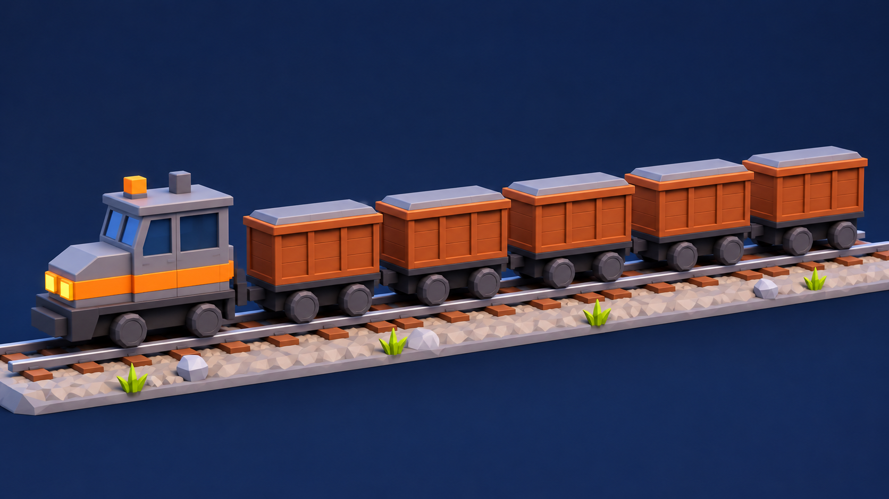
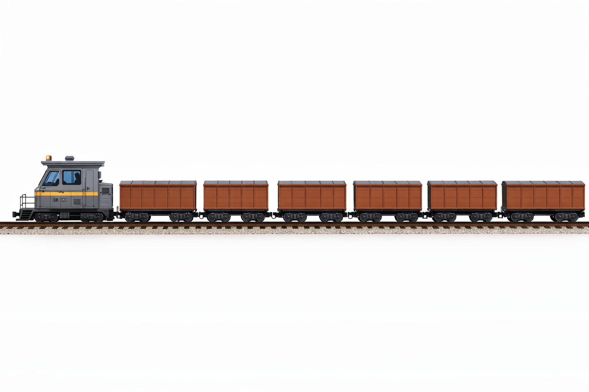
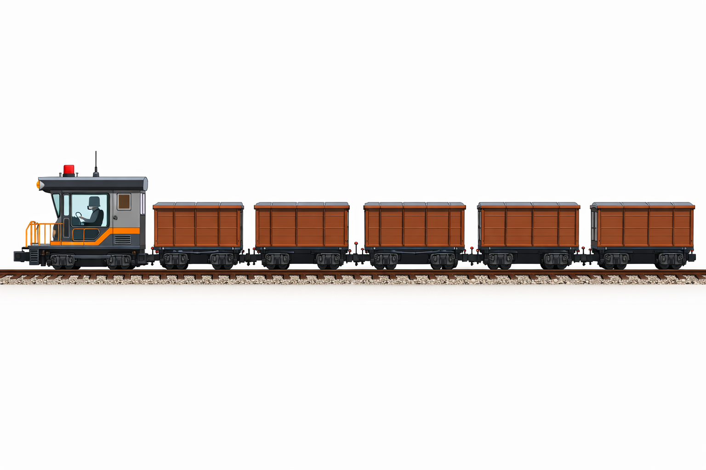
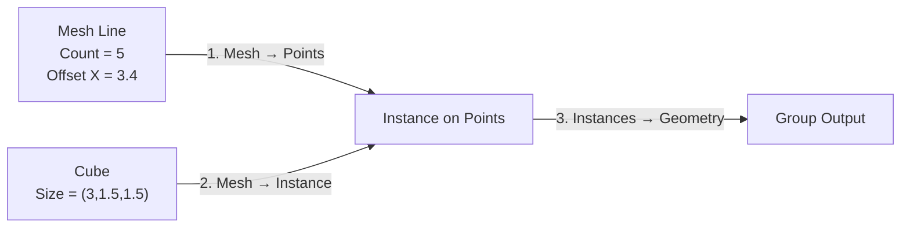
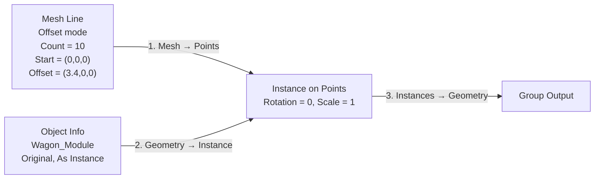

# Самостоятельная работа — Урок 11. Мини-проект «Грузовой поезд»

**Цель:** научиться создавать целую цепочку одинаковых сложных моделей из одной заготовки. Не копируем вагоны через Shift+D: делаем один вагон, а остальные создаёт Geometry Nodes. В конце можно менять длину состава одной цифрой.

Вспомни ряд кубиков из части 5 теории. Там мы задали форму куба и места, на которых он появится. Сейчас вместо куба поставим вагон. Сначала проверим, что ноды работают, и только потом будем добавлять колёса, кабину и рельсы. Так легче найти ошибку: если простой ряд уже работает, значит проблема в модели, а не в схеме.

> 📚 **Забыл, как работают ноды?** Открой [справочник Geometry Nodes](../../справочники/geometry-nodes.md): [таблица нодов](../../справочники/geometry-nodes.md#nodes), [учебные схемы](../../справочники/geometry-nodes.md#examples) и [поиск ошибок](../../справочники/geometry-nodes.md#errors). Держи её рядом во время практики.

*Так выглядит расширенная работа: один локомотив, пять повторяющихся вагонов, два рельса и шпалы. В учебном файле проверяем 10 и 50 вагонов, а для кадра возвращаем 5. Это художественный референс, не скриншот готового .blend.*

На референсах один локомотив и несколько вагонов. Обрати внимание: кузов, колёса и сцепки повторяются. Именно эти детали удобно собрать в один модуль. Локомотив отличается от вагонов, поэтому оставим его отдельным объектом. Вагонов на картинках меньше десяти; у тебя их количество должно меняться через ноды. Мелкие металлические детали повторять не обязательно.

## Задание 1 — проверяем состав из кубиков (5–7 минут)

1. Создай новый файл `11-поезд.blend`. Удали стандартный куб, верни курсор в начало координат (`Shift+S → Cursor to World Origin`), добавь Plane. Назови объект `Train_Generator` (`F2`).
2. Открой Geometry Nodes, нажми New. Удали провод Group Input → Group Output, но сами ноды оставь.
3. В редакторе `F3 → Mesh Line`. Выбери Offset, Count = 5, Start Location = (0, 0, 0), Offset = (3.4, 0, 0).
4. Через F3 добавь Cube. Size = (3, 1.5, 1.5); Vertices X/Y/Z = 2. Это пока только условный кузов.
5. Добавь Instance on Points. Подключи три провода по схеме. Не перепутай Points (куда) и Instance (что).

| № | Откуда: выход справа | Куда: вход слева |
|---|---|---|
| 1 | **Mesh Line** — `Mesh` | **Instance on Points** — `Points` |
| 2 | **Cube** — `Mesh` | **Instance on Points** — `Instance` |
| 3 | **Instance on Points** — `Instances` | **Group Output** — `Geometry` |

**Проверка:** пять прямоугольных кубов стоят вдоль X. Каждый имеет длину 3 м, расстояние между центрами 3.4 м. Зазор равен 0.4 м. Установи Count = 10: получишь десять кузовов. Offset X = 2 заставит их пересекаться. Верни 3.4. Если ряд идёт вверх, проверь, что Offset Z = 0.

## Задание 2 — строим один настоящий вагон (15–25 минут)

Создай все детали около мирового нуля. В таблице указаны размеры (Dimensions), а не Scale. В Object Mode выдели куб, нажми N → Item и введи Dimensions, затем Location. После изменения размеров применяй `Ctrl+A → Scale`. Для цилиндров отдельно применяй Rotation & Scale после поворота. Ось X — длина поезда, Y — ширина, Z — высота. Верх рельсов будет на Z = 0.

| Деталь | Dimensions X, Y, Z (м) | Location X, Y, Z (м) |
|---|---|---|
| Рама | 3, 1.6, 0.22 | 0, 0, 0.49 |
| Грузовой кузов | 2.8, 1.45, 1.05 | 0, 0, 1.125 |
| Верхняя кромка | 2.9, 1.52, 0.10 | 0, 0, 1.70 |
| Сцепка слева | 0.40, 0.25, 0.15 | −1.50, 0, 0.45 |
| Сцепка справа | 0.40, 0.25, 0.15 | 1.50, 0, 0.45 |

### Шаг 1. Рама и кузов

Создай раму из куба, затем кузов из второго куба. Нижняя грань кузова находится на Z = 0.60, ровно над рамой. Сделай грузовой кузов коричневым. Для открытого вагона вместо сплошного куба можно сделать дно и четыре стенки из тонких кубов; для первого варианта достаточно закрытого кузова. Добавь две тонкие горизонтальные полосы по бокам или несколько вертикальных рёбер из кубов. Не делай каждую доску отдельно, пока не проверил повторение.

### Шаг 2. Колёса

1. `Shift+A → Mesh → Cylinder`. Сразу нажми F9 и установи Vertices = 12 или 16, Radius = 0.30, Depth = 0.16.
2. По умолчанию цилиндр направлен вдоль Z. Поверни `R X 90`, чтобы ось колеса была вдоль Y. Примени Rotation & Scale.
3. В N → Item установи Location = (−0.95, −0.70, 0.30). Нижняя точка колеса будет на Z = 0.
4. `Shift+D → Y → 1.4 → Enter` — колесо на другой стороне. Выдели оба колеса, `Shift+D → X → 1.9 → Enter` — вторая ось.
5. Назначь тёмно-серый материал. Для осей можно добавить два тонких цилиндра вдоль Y. Не делай сотни болтов: их почти не видно в общем кадре.

**Проверка:** вид спереди (`Numpad 1`) показывает два колеса по длине; вид сбоку (`Numpad 3`) — ширину. Все четыре колеса касаются уровня Z = 0, а рама находится над ними.

### Шаг 3. Материалы и общий Origin

Выдели кузов, открой Shading → New. В Principled BSDF задай Base Color коричневый, Roughness около 0.65; для рамы и колёс создай тёмно-серый материал, Metallic около 0.4. Достаточно двух-трёх материалов. Если одинаковые детали уже имеют нужный материал, используй существующий из списка.

Выдели только детали вагона, последней — раму (`Shift` + ЛКМ), нажми Ctrl+J. Назови результат `Wagon_Module`. Если у частей отдельные неприменённые модификаторы, сначала реши, нужны ли они: Ctrl+J сохраняет модификаторы активного объекта, а не всех деталей. Установи курсор в мировой ноль и Object → Set Origin → Origin to 3D Cursor. Origin теперь на уровне рельсов посередине вагона. Примени Rotation & Scale. Перемести шаблон в сторону по Y, например Y = −12; не удаляй его.

Почему так? Instance on Points поставит Origin заготовки на каждую точку. Если он находится в середине кузова, колёса окажутся под путём. Если модель направлена вдоль Y, вагоны будут стоять поперёк ряда.

## Задание 3 — заменяем кубики на настоящие вагоны (5–10 минут)

Вернись к `Train_Generator`. Нод Cube пока отключи, но не удаляй, чтобы легко вернуться к проверке. Добавь через F3 **Object Info**, выбери `Wagon_Module`, Transform Space = Original, включи As Instance. Протяни выход Geometry к входу Instance, заменив провод от Cube.

| № | Откуда: выход справа | Куда: вход слева |
|---|---|---|
| 1 | **Mesh Line** — `Mesh` | **Instance on Points** — `Points` |
| 2 | **Object Info** — `Geometry` | **Instance on Points** — `Instance` |
| 3 | **Instance on Points** — `Instances` | **Group Output** — `Geometry` |

**Проверка:** вместо пяти кубов появилось пять вагонов, а при Count = 10 — десять. Шаблон при изменении числа не перемещается. Измени его кузов в Edit Mode: все вагоны обновятся. В Outliner останутся генератор и исходный шаблон, не десять новых объектов.

| Опыт | Значение | Результат |
|---|---|---|
| Count | 1 | Один вагон |
| Count | 10 | Десять вагонов, локомотив не считается |
| Count | 50 | Длинный состав; приблизь отдельный вагон или отдали вид |
| Offset X | 4.0 | Сцепки разойдутся, хотя форма вагонов прежняя |
| Scale у Instance on Points | (1, 1, 0.8) | Все вагоны станут ниже, колёса тоже деформируются; верни (1,1,1) |

При 10 вагонах центры идут от X = 0 до X = 30.6. При 50 — до X = 166.6. Не увеличивай Scale поезда, чтобы изменить число вагонов: для этого существует Count. Не применяй модификатор.

## Задание 4 — локомотив и железная дорога (15–25 минут, расширение)

### Локомотив

Состав движется в сторону отрицательного X. Сделай локомотив длиной около 3 м: рама из куба (3, 1.6, 0.22), кузов (2.8, 1.4, 0.65), кабина (1.25, 1.35, 1.3), крыша чуть шире кабины. Моделируй сначала в отдельном месте, затем поставь центр локомотива на X = −3.4. Колёса можно сделать как у вагона. Добавь два синих окна из тонких кубов и жёлтую полосу на кузове. Для окна не обязательно делать отверстие: в простом варианте достаточно плоской тёмно-синей детали. Сцепка с первым вагоном должна находиться около X = −1.7. Локомотив — один отдельный объект, не подключай его как шаблон к Instance on Points.

### Рельсы и шпалы

Для итогового кадра оставь 5–6 вагонов, чтобы их можно было рассмотреть. Если Count = 10, путь должен покрывать примерно от X = −5.1 до 32.3. Для проверки 50 вагонов не обязательно строить весь ландшафт.

1. Создай один куб-шпалу Dimensions (0.24, 2.0, 0.14), верх на Z = −0.08. Например центр Z = −0.15. Шпалы поперёк пути, то есть вдоль Y.
2. Добавь Array (Modifiers → Add Modifier → Generate → Array). Выключи Relative Offset, включи Constant Offset X = 0.50, Y = Z = 0; Count подбери по длине пути. Можно вместо Array повторить известную схему Mesh Line → Instance on Points: Count = 76, Start = (−5.5,0,0), Offset = (0.5,0,0), шаблон шпалы с Origin на Z = 0 и геометрией ниже него.
3. Два рельса — длинные тонкие кубы шириной 0.10 и высотой 0.08 м, Y = ±0.70, верх на Z = 0. Для десяти вагонов Length X = 38, Location X = 13.5, Z = −0.04. Подстрой длину после выбора числа вагонов.
4. Основание насыпи — сплюснутый куб под шпалами, серо-песочный материал. По краям можно добавить несколько гранёных камней и траву из части 7 теории. Не распределяй камни поверх рельсов: используй отдельные узкие полосы земли слева и справа.

### Камера и окружение

Выбери чистый фон и простой участок дороги. Для композиции достаточно щебня, двух-трёх камней и пары пучков травы. В Shading настрой тёмно-синие или серые материалы, коричневые вагоны и светлые акценты. В Layout поверни вид немного сверху, установи камеру через Ctrl+Alt+Numpad 0 (или View → Align View → Align Active Camera to View). В Camera Properties выбери Orthographic, подстрой Orthographic Scale, пока локомотив и все вагоны помещаются в кадре. Для длинного состава выбери 1600 × 900 или 1920 × 800. Добавь Area Light сверху и сбоку, размер 5–8 м, мощность начни с 1500 W, затем подстрой по Rendered. Второй свет сделай слабее. EEVEE, F12, Image → Save As. Исходный шаблон держи за пределами камеры; не удаляй и не исключай его коллекцию из View Layer, иначе ссылки могут перестать работать.

## Что должно получиться

- [ ] Один вагон-шаблон с кузовом и четырьмя колёсами.
- [ ] Mesh Line + Object Info + Instance on Points, без ручных копий вагонов.
- [ ] Count = 10 и проверка Count = 50, затем разумное число для кадра.
- [ ] Вагоны стоят вдоль X, не пересекаются, колёса на одном уровне.
- [ ] Расширение: локомотив, рельсы, простой фон и материалы.

**Сдать:** `11-поезд.blend` с неприменённым модификатором и два скриншота, на которых видны разные значения Count. Для расширенной версии — итоговый PNG. Если времени мало, достаточно работающего ряда и одного аккуратного вагона.

## А попробуй

Сделай второй тип вагона — цистерну из цилиндра, повернутого вдоль X. Оставь ту же раму и колёса. Через Collection Info (часть 9.1 теории) подключи несколько шаблонов, Pick Instance и Random Value Integer. Все модули должны иметь одинаковую длину и Origin на рельсах; иначе появятся пересечения. Если хочешь строго чередовать вагоны, оставь эту задачу на урок 12: там будем изучать вычисления и индекс.

**Дополнительный мастер-проект:** [Подводный мир с затонувшим кораблём](практика-подводный-мир.md) — если хочется потренироваться с произвольным распределением растений и камней.

[К теории](theory.md) · [Следующий урок](../урок-12/theory.md)
