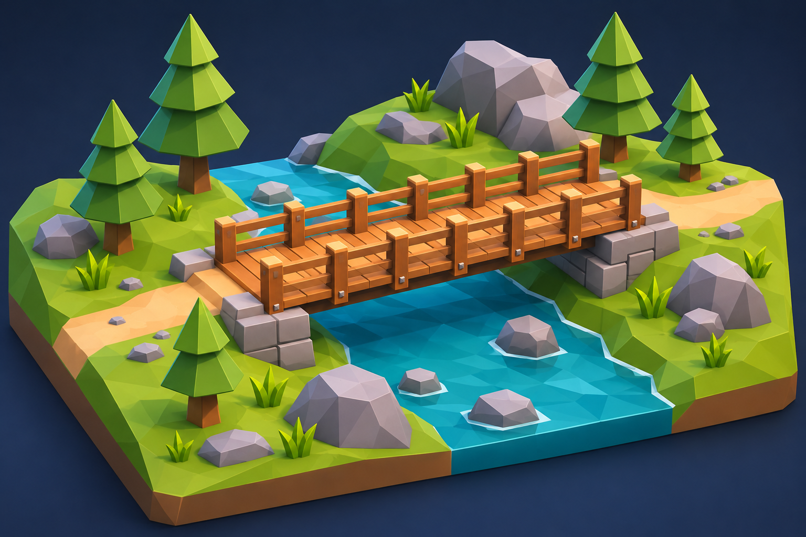
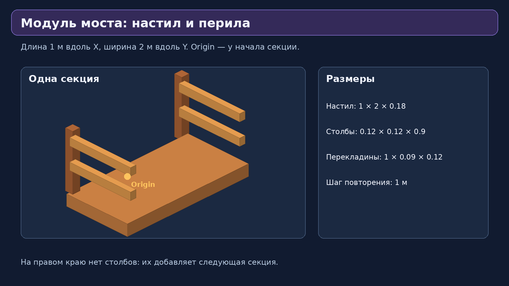
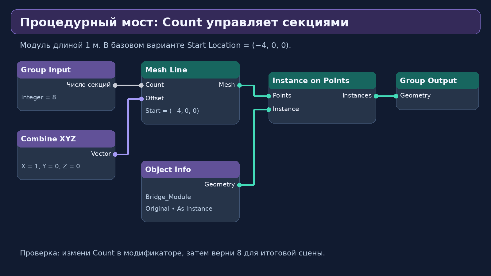
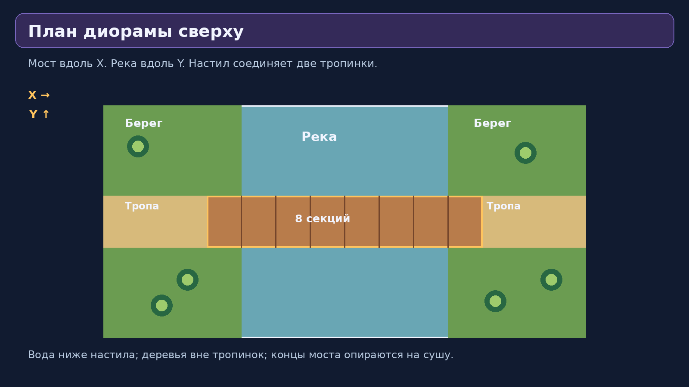
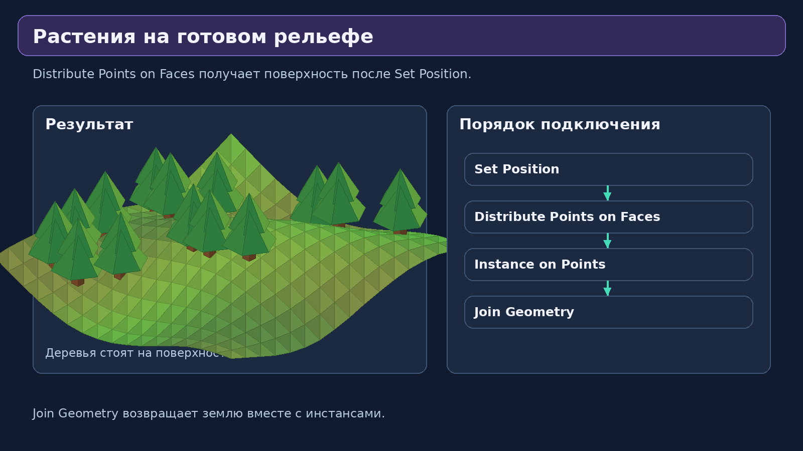

# Самостоятельная работа — Урок 12: Мост через горную реку

**Задача:** создать небольшую low-poly диораму, в которой деревянный мост строится из повторяющихся секций через Geometry Nodes. Ты сам выбираешь форму берегов, цвет воды, материалы и расположение деревьев.

Посмотри на референс. Мост — главный объект, он соединяет два берега. Река проходит под ним, тропинки продолжают настил с двух сторон. Камни, деревья и трава помогают понять масштаб. Не обязательно повторять все мелочи: важно, чтобы конструкция работала процедурно и окружение было аккуратным.

## Задание 1. Построй одну секцию моста

Создай новый файл `мост.blend`. В нашем примере мост идёт по X, река — по Y. Одна секция занимает 1 м по X, ширина моста 2 м по Y. Все размеры ниже можно изменить, но не забывай согласовать шаг и длину секции.

1. Добавь куб для настила. Dimensions (1, 2, 0.18), Location (0.5, 0, 0.09). Примени Scale. Верхняя поверхность будет на Z = 0.18. Для большей детализации вместо одного куба можно использовать три доски шириной по X около 0.32 м, разложенные от X = 0 до 1.
2. Добавь столбик перил: куб (0.12, 0.12, 0.9), Location (0, 0.9, 0.63). Скопируй его на другую сторону: Shift+D → Y → -1.8.
3. Для перекладины создай куб (1, 0.09, 0.12), Location (0.5, 0.9, 0.9). Скопируй на другую сторону. Можно добавить вторую перекладину ниже, на Z = 0.55. Не ставь столбы на X = 1: их добавит следующая секция.
4. Назначь настилу и перилам два близких оттенка дерева. Для аккуратных рёбер используй Bevel с маленьким Amount 0.015 и Segments 1.
5. Объедини все части Ctrl+J. Назови `Bridge_Module`. Shift+S → Cursor to World Origin, затем Object → Set Origin → Origin to 3D Cursor. Убедись, что Origin у левого края настила, на его нижней плоскости. Примени Rotation & Scale, если они не нулевые/единичные.
6. Перемести шаблон в сторону, например на Y = -12. Не удаляй его. Для финального рендера можно отключить видимость исходного шаблона в рендере через Outliner (значок камеры), проверив, что инстансы остались.

**Подсказка:** если не хочется долго моделировать перила, начни с настила и двух столбов. Добавляй перекладины только после того, как заработает повторение. Если части имеют разные материалы, Ctrl+J их сохранит.

## Задание 2. Сделай мост процедурным

1. Создай Plane `Bridge_Generator`, открой Geometry Nodes → New. Удали связь Group Input → Group Output.
2. Добавь Mesh Line (Offset mode), Count = 8, Start Location = (−4, 0, 0), Offset = (1, 0, 0). Для начала мост займёт X от −4 до +4.
3. Добавь Combine XYZ: X = 1, Y = 0, Z = 0. Соедини Vector → Mesh Line Offset.
4. Mesh Line Mesh → Instance on Points Points; Object Info (`Bridge_Module`, Original, As Instance) Geometry → Instance on Points Instance; Instances → Group Output Geometry.
5. Выведи Count в Group Input. Назови параметр «Число секций», Integer, Default 8, Min 3, Max 20. Проверь в Modifier Properties, что при изменении 8 на 5 и 10 мост перестраивается.

**Подсказка для сильных учеников:** чтобы мост всегда оставался по центру, вычисли его начальную координату X = −Count × шаг / 2. Добавь Math Multiply (Count × 1), второй Math Multiply (результат × −0.5), Combine XYZ (X от вычисления, Y = Z = 0). Подключи в Start Location. При Count 8 старт будет −4, при Count 12 — −6. Правый край настила будет на +4 или +6. Если шаг меняется, длину модуля тоже нужно изменить. В базовом варианте держим шаг = 1.

Последний ряд столбов можно добавить отдельно. Для моста с фиксированным стартом X = −4 конечный столб стоит на X = −4 + Count × 1. При центрировании X = Count × 1 / 2. Для дополнительной процедурности сделай пару конечных столбов отдельным объектом, подай его Object Info в Transform Geometry (Translation через Combine XYZ с вычисленным X), затем объедини с мостом через Join Geometry. Если используешь Object Info As Instance, Transform Geometry переместит инстанс целиком. Можно также оставить завершающую секцию как дополнительную ручную деталь, но при проверке Count её придётся передвинуть.

## Задание 3. Оформи окружение — два берега и река

Для начала оставь Count = 8. Мост лежит от X = −4 до +4, настил начинается на Z = 0. Создадим два берега с промежутком примерно от X = −3 до +3. Таким образом концы моста будут опираться на сушу. При проверке других значений Count временно меняй только мост; для итогового кадра верни 8 или подстрой берега.

### 3.1. Простая основа

- Левый берег: куб Dimensions (4, 10, 0.8), Location (−5, 0, −0.4). Правый — копия на X = +5. Верхняя поверхность на Z = 0.
- Вода: куб Dimensions (6.1, 10, 0.25), Location (0, 0, −0.45). Верх воды Z = −0.325, ниже настила.
- Сделай фаску по краям берегов через Ctrl+A Scale и Bevel (Amount 0.1, Segments 1). Назначь берегам коричневый материал; поверх них положи зелёные плоскости или процедурные поверхности.

### 3.2. Холмы на берегах

Используй схему из части 4 теории. Создай отдельный генератор с Grid Size X = 4, Size Y = 10, Vertices X = 13, Vertices Y = 31. Подключи Position → Noise Texture Vector, Fac → Math Subtract 0.5 → Math Multiply 0.35 → Combine XYZ Z → Set Position Offset. Grid Mesh → Set Position Geometry → Triangulate → Set Material → Output. Зелёный материал назначь через Set Material.

Расположи первый генератор на X = −5, Z = 0.15; второй сделай копией на X = +5. Если хочешь разные холмы, сделай копию группы (кнопка числа пользователей рядом с именем группы) и измени Noise Scale. У одинаковой группы локальный рисунок будет повторяться. Проверь край: верх земли должен быть рядом с настилом, не поднимай холмы слишком высоко. Для первого проекта можно оставить берега плоскими, а холмы добавить отдельными Ico Sphere, сплюснутыми по Z.

### 3.3. Тропинки и опоры

Тропинки помогают понять, куда ведёт мост. Добавь по узкой бежевой плоскости или тонкому кубу от каждого конца моста к краю диорамы (вдоль X, ширина по Y 1.5–2 м). Подними их чуть над поверхностью. Если рельеф пробивается сквозь тропинку, уменьши высоту холмов рядом, вручную подстрой тропу или оставь ровные площадки у моста.

Для опор поставь по два или три серых куба под концами моста на X около −3.5 и +3.5. Они должны доходить от уровня воды до нижней части настила. Не ставь высокую опору посередине без причины: оставь реку видимой.

### 3.4. Вода

Выбери материал голубого или бирюзового цвета, Roughness 0.25–0.45. Не обязательно делать прозрачность: цвет и блик уже показывают воду. Для гранёных волн можно добавить поверх куба отдельный Grid 6 × 10 с 15 × 25 вершинами, Noise Scale 2, Multiply 0.08, Triangulate, материал Water. Поверхность слегка выше куба, но ниже настила. Не распределяй деревья по воде. Несколько плоских бело-голубых полос вокруг камней могут изображать пену.

## Задание 4. Растения и камни

1. Создай дерево из цилиндра и двух-трёх конусов. Origin внизу, масштаб применён. Сделай один камень из Ico Sphere (Subdivisions 2), слегка измени форму в Edit Mode и сплюсни по Z. Назначь материалы.
2. На одном берегу в группе рельефа после Set Position (или Set Material) ответвись в Distribute Points on Faces. Density 0.12–0.2 для деревьев. Схема: поверхность → Distribute → Instance on Points; Object Info дерева → Instance; Random Value Float 0.7–1.2 → Scale; Join Geometry объединяет землю и инстансы.
3. Для камней сделай вторую ветку с отдельным Distribute и Object Info. Density 0.3–0.5, Scale 0.35–0.8. Подключи её результат к тому же Join Geometry.
4. Следи, чтобы растения не перекрывали тропинку. Самый простой способ — создать отдельную небольшую плоскость на свободном участке берега, распределить растения по ней и не подключать саму плоскость к Output. Для холмистой поверхности используй отдельный участок с таким же рельефом или вручную размести деревья около тропы. Продвинутый вариант: Separate XYZ от Position → Math Absolute для Y → Compare Greater Than (1.2) → Selection у Distribute Points on Faces. Это исключит полосу |Y| ≤ 1.2 вдоль дороги.

Не превращай берег в сплошной лес. Оставь около моста свободное место. Несколько крупных камней у воды, 4–6 ёлок и небольшие кусты уже сделают сцену живой. Точки распределяются заново при изменении рельефа, поэтому финальную композицию проверь после всех изменений.

## Задание 5. Камера, свет и рендер

1. Выбери ракурс немного сверху, чтобы были видны настил и вода под ним. Numpad 7 покажет сцену сверху; поверни вид средней кнопкой мыши. Добавь камеру, затем Ctrl+Alt+Numpad 0 совместит её с текущим видом. На клавиатуре без Numpad используй View → Align View → Align Active Camera to View. Установи Camera Type Orthographic, Orthographic Scale примерно 17–20; подстрой до появления всей основы в кадре.
2. В World Properties сделай фон тёмно-синим или серо-синим. Добавь Area Light выше и сбоку: Location (−4, −6, 8), Power около 1200 W, Size 5. Поверни свет к центру. Второй Area с другой стороны, Power около 500 W, смягчит тени. Это стартовые числа: яркость зависит от сцены и экспозиции.
3. Для рендера выбери Eevee, разрешение 1600 × 1200 (4:3), 100%. В Material Preview проверь цвета, затем переключись на Rendered для проверки реального освещения. Если сцена слишком тёмная, проверь направление источников и мощность, а не просто меняй все материалы на белые.
4. Нажми F12. В окне Render → Image → Save As сохрани `мост-рендер.png`. Сохрани .blend через Ctrl+S. Если есть лишние шаблоны в кадре, исключи их из рендера и убедись, что процедурные копии не пропали.

## Что должно получиться

- [ ] Мост собран из одной секции через Mesh Line и Instance on Points.
- [ ] Использован Combine XYZ или Math.
- [ ] Число секций доступно в Modifier Properties, изменение числа перестраивает мост.
- [ ] Есть два берега, река и хотя бы два вида деталей окружения.
- [ ] Мост стоит над водой, настил соединяет тропинки, растения не растут на воде.
- [ ] Назначены материалы, настроены камера и освещение, сохранён рендер.

**Для сдачи:** файл `.blend`, итоговый PNG и второй скриншот или рендер, на котором видно изменение числа секций. Не применяй Geometry Nodes перед сдачей: учителю нужно проверить работу параметра.

**Минимальный вариант:** мост, два простых берега, вода, несколько вручную поставленных камней. **Расширенный вариант:** процедурный рельеф, распределение деревьев, центрирование моста, автоматические конечные столбы. Основной проект можно начать в конце урока, завершить на самостоятельной практике или дома.

[Вернуться к уроку](theory.md)
