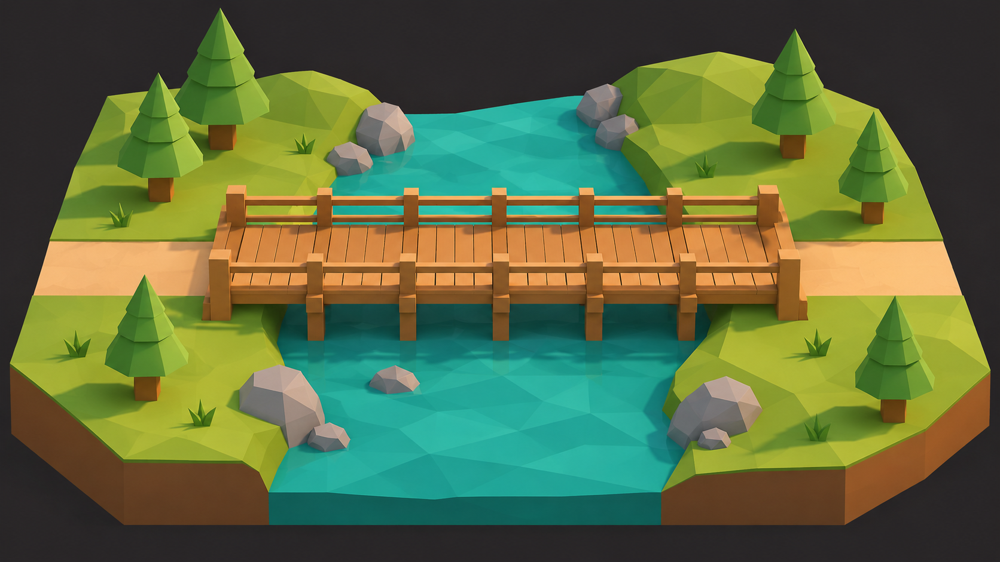
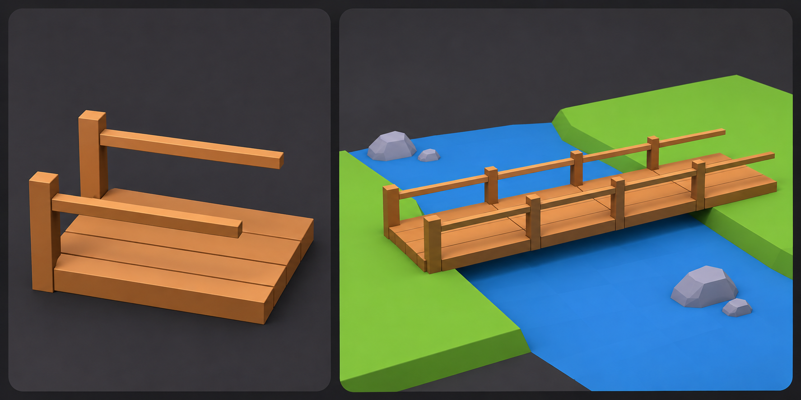
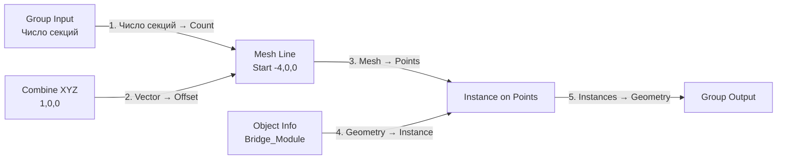
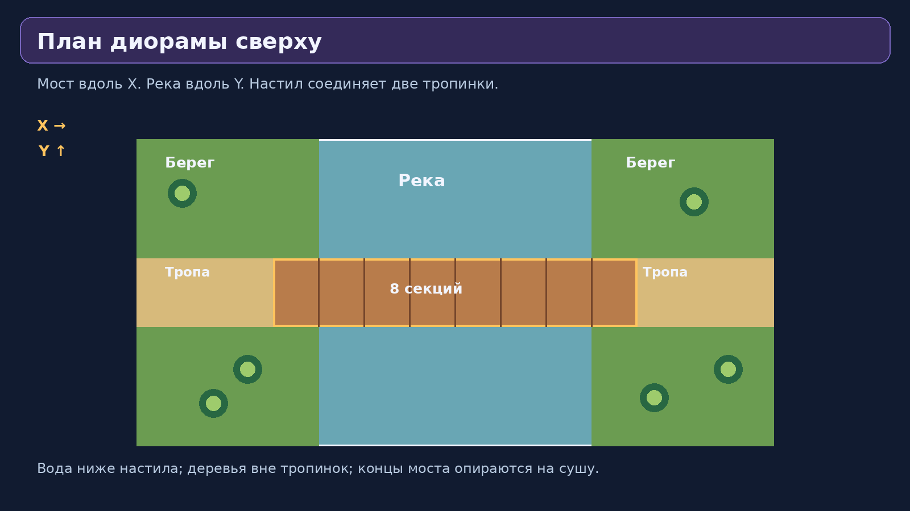
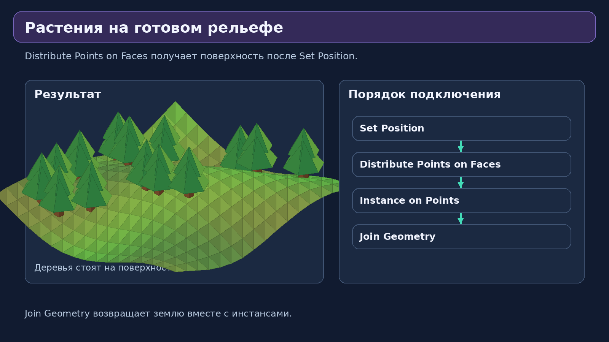
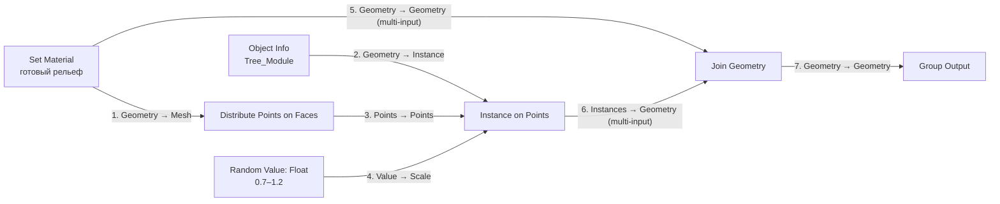
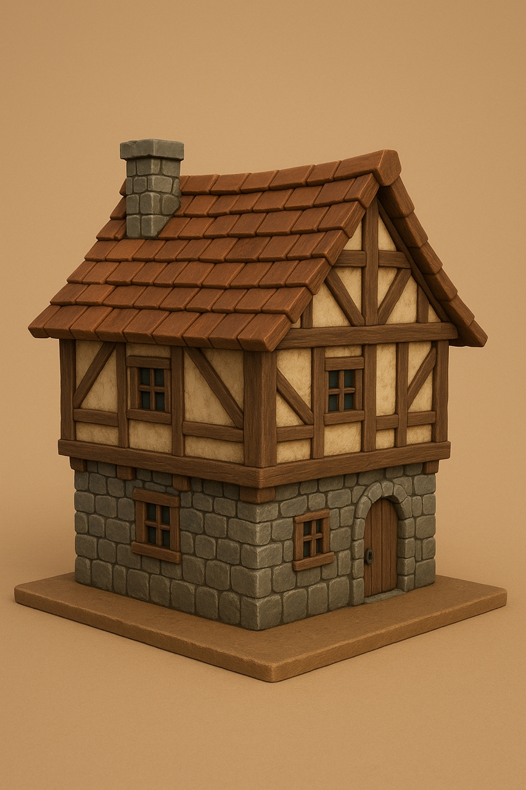
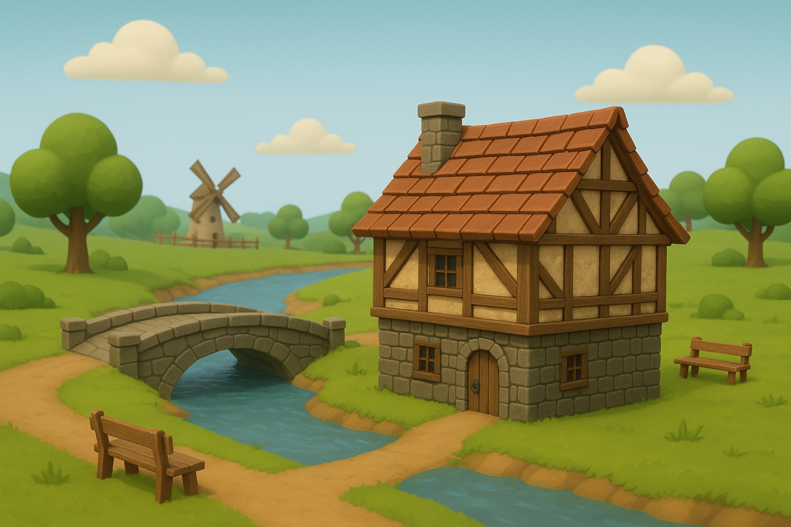

# Самостоятельная работа — Урок 12: Мост через горную реку

**Задача:** создать небольшую low-poly диораму, в которой деревянный мост строится из повторяющихся секций через Geometry Nodes. Ты сам выбираешь форму берегов, цвет воды, материалы и расположение деревьев.

Посмотри на референс. Мост — главный объект, он соединяет два берега. Река проходит под ним, тропинки продолжают настил с двух сторон. Камни, деревья и трава помогают понять масштаб. Не обязательно повторять все мелочи: важно, чтобы конструкция работала процедурно и окружение было аккуратным.

*Это художественный ориентир, а не скриншот готового файла Blender. Число секций и размеры бери из задания; оформление выбирай своё.*

## План работы

Сначала собери одну секцию и проверь повторение. Затем построй берега, добавь материалы и только после этого занимайся деталями. Практика рассчитана на отдельную самостоятельную работу: не нужно успевать всю диораму в конце теории.

| Уровень | Что сделать |
|---|---|
| База | Процедурный мост, параметр количества, два плоских берега, вода, камни |
| Основной | Перила, тропинки, деревья, материалы, свет и камера |
| Дополнительно | Рельеф нодами, растения на поверхности, центрирование и конечные столбы |

## Задание 1. Построй одну секцию моста

Создай новый файл `мост.blend`. В нашем примере мост идёт по X, река — по Y. Одна секция занимает 1 м по X, ширина моста 2 м по Y. Все размеры ниже можно изменить, но не забывай согласовать шаг и длину секции.

1. Добавь куб для настила. Dimensions (1, 2, 0.18), Location (0.5, 0, 0.09). Примени Scale. Верхняя поверхность будет на Z = 0.18. Для большей детализации вместо одного куба можно использовать три доски шириной по X около 0.32 м, разложенные от X = 0 до 1.
2. Добавь столбик перил: куб (0.12, 0.12, 0.9), Location (0, 0.9, 0.63). Скопируй его на другую сторону: Shift+D → Y → -1.8.
3. Для перекладины создай куб (1, 0.09, 0.12), Location (0.5, 0.9, 0.9). Скопируй на другую сторону. Можно добавить вторую перекладину ниже, на Z = 0.55. Не ставь столбы на X = 1: их добавит следующая секция.
4. В Shading → New создай материалы: Principled BSDF Base Color — два близких оттенка дерева, Roughness 0.6. Назначь настилу и перилам разные оттенки. Для аккуратных рёбер используй Bevel с маленьким Amount 0.015 и Segments 1.
5. Объедини все части Ctrl+J. Назови `Bridge_Module`. Shift+S → Cursor to World Origin, затем Object → Set Origin → Origin to 3D Cursor. Убедись, что Origin у левого края настила, на его нижней плоскости. Примени Rotation & Scale, если они не нулевые/единичные.
6. Перемести шаблон в сторону, например на Y = -12. Не удаляй его. Для финального рендера можно отключить видимость исходного шаблона в рендере через Outliner (значок камеры), проверив, что инстансы остались.

*Слева — принцип модуля, справа — повторение до добавления конечных столбов. Иллюстрация не задаёт размеры: используй значения из шагов выше.*

**Подсказка:** если не хочется долго моделировать перила, начни с настила и двух столбов. Добавляй перекладины только после того, как заработает повторение. Если части имеют разные материалы, Ctrl+J их сохранит.

✅ **Контрольная точка:** одна секция занимает X от 0 до 1; Origin находится в начале секции. Сохрани файл.

## Задание 2. Сделай мост процедурным

1. Создай Plane `Bridge_Generator`, открой Geometry Nodes → New. Удали связь Group Input → Group Output.
2. Добавь Mesh Line (Offset mode), Count = 8, Start Location = (−4, 0, 0), Offset = (1, 0, 0). Для начала мост займёт X от −4 до +4.
3. Добавь Combine XYZ: X = 1, Y = 0, Z = 0. Соедини Vector → Mesh Line Offset.
4. Mesh Line Mesh → Instance on Points Points; Object Info (`Bridge_Module`, Original, As Instance) Geometry → Instance on Points Instance; Instances → Group Output Geometry.
5. Выведи Count в Group Input. Назови параметр «Число секций», Integer, Default 8, Min 1, Max 20. Проверь в Modifier Properties, что при изменении 8 на 5 и 10 мост перестраивается.

| № | Откуда: выход справа | Куда: вход слева |
|---|---|---|
| 1 | **Group Input** — `Число секций` | **Mesh Line** — `Count` |
| 2 | **Combine XYZ** — `Vector` | **Mesh Line** — `Offset` |
| 3 | **Mesh Line** — `Mesh` | **Instance on Points** — `Points` |
| 4 | **Object Info** — `Geometry` | **Instance on Points** — `Instance` |
| 5 | **Instance on Points** — `Instances` | **Group Output** — `Geometry` |

**Подсказка для сильных учеников:** чтобы мост всегда оставался по центру, вычисли его начальную координату X = −Count × шаг / 2. Добавь Math Multiply (Count × 1), второй Math Multiply (результат × −0.5), Combine XYZ (X от вычисления, Y = Z = 0). Подключи в Start Location. При Count 8 старт будет −4, при Count 12 — −6. Правый край настила будет на +4 или +6. Если шаг меняется, длину модуля тоже нужно изменить. В базовом варианте держим шаг = 1.

Последний ряд столбов можно добавить отдельно. Для моста с фиксированным стартом X = −4 конечный столб стоит на X = −4 + Count × 1. При центрировании X = Count × 1 / 2. Для дополнительной процедурности сделай пару конечных столбов отдельным объектом, подай его Object Info в Transform Geometry (Translation через Combine XYZ с вычисленным X), затем объедини с мостом через Join Geometry. Если используешь Object Info As Instance, Transform Geometry переместит инстанс целиком. Можно также оставить завершающую секцию как дополнительную ручную деталь, но при проверке Count её придётся передвинуть.

**Проверка перед окружением:** сначала Count = 1, потом 8. Если секции накладываются, проверь Origin у левого края и длину X = 1. При Count = 8 левая грань настила на −4, правая на +4. Последний столб появляется только после отдельной ветки или ручной установки. Не переходи к берегам до этой проверки.

> Вспомни [урок 2, выравнивание](../../модуль-01-основы/урок-02/theory.md): N → Item, Snap, 3D Cursor. Все секции должны иметь одинаковую длину, а начало координат — в одной и той же точке. Как и у вагонов из урока 11, шаг задаём точно.

## Задание 3. Оформи окружение — два берега и река

Для начала оставь Count = 8. Мост лежит от X = −4 до +4, настил начинается на Z = 0. Создадим два берега с промежутком примерно от X = −3 до +3. Таким образом концы моста будут опираться на сушу. При проверке других значений Count временно меняй только мост; для итогового кадра верни 8 или подстрой берега.

### 3.1. Простая основа

- Левый берег: куб Dimensions (4, 10, 0.8), Location (−5, 0, −0.4). Правый — копия на X = +5. Верхняя поверхность на Z = 0.
- Вода: куб Dimensions (6.1, 10, 0.25), Location (0, 0, −0.45). Верх воды Z = −0.325, ниже настила.
- Сделай фаску по краям берегов через Ctrl+A Scale и Bevel (Amount 0.1, Segments 1). Назначь берегам коричневый материал; поверх них положи зелёные плоскости или процедурные поверхности.

### 3.2. Холмы на берегах

Используй схему из части 4 теории. Создай отдельный генератор с Grid Size X = 4, Size Y = 10, Vertices X = 13, Vertices Y = 31. Подключи Position → Noise Texture Vector, Fac → Math Subtract 0.5 → Math Multiply 0.35 → Combine XYZ Z → Set Position Offset. Grid Mesh → Set Position Geometry → Triangulate → Set Material → Output. Зелёный материал назначь через Set Material.

Расположи первый генератор на X = −5, Z = 0.15; второй сделай копией на X = +5. Если хочешь разные холмы, сделай копию группы (кнопка числа пользователей рядом с именем группы) и измени Noise Scale. У одинаковой группы локальный рисунок будет повторяться. Проверь край: верх земли должен быть рядом с настилом, не поднимай холмы слишком высоко. Для первого проекта можно оставить берега плоскими, а холмы добавить отдельными Ico Sphere, сплюснутыми по Z.

### 3.3. Тропинки и опоры

Тропинки помогают понять, куда ведёт мост. Добавь по узкой бежевой плоскости или тонкому кубу от каждого конца моста к краю диорамы (вдоль X, ширина по Y 1.5–2 м). Подними их чуть над поверхностью. Если рельеф пробивается сквозь тропинку, уменьши высоту холмов рядом, вручную подстрой тропу или оставь ровные площадки у моста.

Для опор поставь по два или три серых куба под концами моста на X около −3.5 и +3.5. Они должны доходить от уровня воды до нижней части настила. Не ставь высокую опору посередине без причины: оставь реку видимой.

### 3.4. Вода

В Shading → New создай Water: Principled BSDF Base Color голубой или бирюзовый, Roughness 0.25–0.45. Не обязательно делать прозрачность: цвет и блик уже показывают воду. Для гранёных волн можно добавить поверх куба отдельный Grid 6 × 10 с 15 × 25 вершинами, Noise Scale 2, Multiply 0.08, Triangulate, материал Water. Поверхность слегка выше куба, но ниже настила. Не распределяй деревья по воде. Несколько плоских бело-голубых полос вокруг камней могут изображать пену.

✅ **Контрольная точка:** оба конца моста опираются на берега, вода ниже настила, тропинки продолжают мост.

## Задание 4. Растения и камни

1. Создай дерево из цилиндра и двух-трёх конусов. Origin внизу, масштаб применён. Сделай один камень из Ico Sphere (Subdivisions 2), слегка измени форму в Edit Mode и сплюсни по Z. Назначь материалы.
2. На одном берегу в группе рельефа после Set Position (или Set Material) ответвись в Distribute Points on Faces. Density 0.12–0.2 для деревьев. Схема: поверхность → Distribute → Instance on Points; Object Info дерева → Instance; Random Value Float 0.7–1.2 → Scale; Join Geometry объединяет землю и инстансы.
3. Для камней сделай вторую ветку с отдельным Distribute и Object Info. Density 0.3–0.5, Scale 0.35–0.8. Подключи её результат к тому же Join Geometry.
4. Следи, чтобы растения не перекрывали тропинку. Самый простой способ — создать отдельную небольшую плоскость на свободном участке берега, распределить растения по ней и не подключать саму плоскость к Output. Для холмистой поверхности используй отдельный участок с таким же рельефом или вручную размести деревья около тропы. Продвинутый вариант: Separate XYZ от Position → Math Absolute для Y → Compare Greater Than (1.2) → Selection у Distribute Points on Faces. Это исключит полосу |Y| ≤ 1.2 вдоль дороги.

Не превращай берег в сплошной лес. Оставь около моста свободное место. Несколько крупных камней у воды, 4–6 ёлок и небольшие кусты уже сделают сцену живой. Точки распределяются заново при изменении рельефа, поэтому финальную композицию проверь после всех изменений.

### Проверяем две ветки распределения

| № | Откуда: выход справа | Куда: вход слева |
|---|---|---|
| 1 | **Set Material** — `Geometry` | **Distribute Points on Faces** — `Mesh` |
| 2 | **Object Info** — `Geometry` | **Instance on Points** — `Instance` |
| 3 | **Distribute Points on Faces** — `Points` | **Instance on Points** — `Points` |
| 4 | **Random Value: Float** — `Value` | **Instance on Points** — `Scale` |
| 5 | **Set Material** — `Geometry` | **Join Geometry** — `Geometry (multi-input)` |
| 6 | **Instance on Points** — `Instances` | **Join Geometry** — `Geometry (multi-input)` |
| 7 | **Join Geometry** — `Geometry` | **Group Output** — `Geometry` |

Для камней сделай аналогичную независимую ветку и подключи её Instances к тому же Join Geometry. Если деревья оказались на воде, проверь, что вход Mesh получает только один берег. Если исчезла земля — проверь оба входных провода Join Geometry. Уменьши Density до 0.1, если сцена тормозит. Начни с нескольких деревьев вручную: процедурная ветка окружения — расширение после рабочего моста.

## Задание 5. Камера, свет и рендер

1. Выбери ракурс немного сверху, чтобы были видны настил и вода под ним. Numpad 7 покажет сцену сверху; поверни вид средней кнопкой мыши. Добавь камеру, затем Ctrl+Alt+Numpad 0 совместит её с текущим видом. На клавиатуре без Numpad используй View → Align View → Align Active Camera to View. Установи Camera Type Orthographic, Orthographic Scale примерно 17–20; подстрой до появления всей основы в кадре.
2. В Shading переключи Shader Editor с Object на World, в ноде Background задай тёмно-синий или серо-синий Color, Strength около 0.3–0.6. Добавь Area Light выше и сбоку: Location (−4, −6, 8), Power около 1200 W, Size 5. Поверни свет к центру. Второй Area с другой стороны, Power около 500 W, смягчит тени. Это стартовые числа: яркость зависит от сцены и экспозиции.
3. Для рендера выбери Eevee, разрешение 1600 × 1200 (4:3), 100%. В Material Preview проверь цвета, затем переключись на Rendered для проверки реального освещения. Если сцена слишком тёмная, проверь направление источников и мощность, а не просто меняй все материалы на белые.
4. Нажми F12. В окне Render → Image → Save As сохрани `мост-рендер.png`. Сохрани .blend через Ctrl+S. Если есть лишние шаблоны в кадре, исключи их из рендера и убедись, что процедурные копии не пропали.

## 💡 Подсказки: если что-то не получилось

| Симптом | Что проверить |
|---|---|
| Секции перекрываются | Длина модуля X = 1, Offset X = 1; Scale применён |
| Мост сместился вслед за шаблоном | В Object Info выбран Original; Origin модуля в начале |
| Нет столбов на дальнем конце | Добавь отдельную пару конечных столбов, как в задании 2 |
| После изменения Count мост не достаёт до берега | Верни 8 для финальной сцены или подстрой берега |
| Земля исчезла при добавлении деревьев | Подключи землю и Instances к Join Geometry отдельными проводами |
| На рендере видна заготовка | Убери исходный шаблон из кадра и проверь видимость экземпляров |

## Что должно получиться

- [ ] Мост собран из одной секции через Mesh Line и Instance on Points.
- [ ] Использован Combine XYZ или Math.
- [ ] Число секций доступно в Modifier Properties, изменение числа перестраивает мост.
- [ ] Есть два берега, река и хотя бы два вида деталей окружения.
- [ ] Мост стоит над водой, настил соединяет тропинки, растения не растут на воде.
- [ ] Назначены материалы, настроены камера и освещение, сохранён рендер.

**Для сдачи:** файл `.blend`, итоговый PNG и второй скриншот или рендер, на котором видно изменение числа секций. Не применяй Geometry Nodes перед сдачей: учителю нужно проверить работу параметра.

**Минимальный вариант:** мост, два простых берега, вода, несколько вручную поставленных камней. **Расширенный вариант:** процедурный рельеф, распределение деревьев, центрирование моста, автоматические конечные столбы. Основной проект можно начать в конце урока, завершить на самостоятельной практике или дома.

## Дополнительное задание для тех, кто закончил раньше — «Средневековое окружение»

Ты уже собрал мост, по которому можно перейти реку. Теперь представь, что он ведёт к небольшой средневековой деревне. На одном берегу стоит двухэтажный дом с каменным первым этажом и деревянным вторым. Рядом есть тропинка, скамейка и деревья. Вдали видна мельница. Попробуй превратить нашу учебную площадку в законченный игровой уголок.

**Это дополнительное задание, а не обязательная часть практики.** Сначала покажи преподавателю работающий мост и сохрани `мост.blend`. Если основные требования выполнены, сохрани копию через **File → Save As → `средневековое-окружение.blend`**. Так ты сможешь экспериментировать, не испортив первую работу.

### Референсы: что мы будем моделировать

*На первом изображении удобно рассмотреть устройство дома: каменное основание, деревянные балки, треугольные фронтоны, крышу из черепицы, окна, дверь и трубу. Это ориентир по форме, а не требование копировать каждую черепицу.*

*На втором изображении дом стоит рядом с речкой и каменным мостом. Здесь важнее всего расположение крупных объектов: дом — главный акцент, мост связывает берега, дорожки ведут к двери, деревья обрамляют сцену, а мельница находится далеко на заднем плане.*

**Не нужно начинать сцену заново.** Используй мост, реку и берега из основной практики. Референс показывает каменный арочный мост, однако заменять свой деревянный процедурный мост необязательно: мы уже изучили его конструкцию, и важно сохранить работающий генератор. Каменную облицовку или арку можно сделать только при наличии времени.

### Выбери объём работы

| Уровень | Что должно появиться | Когда выбирать |
|---|---|---|
| Быстрый | Небольшой дом с двухскатной крышей, дверью и двумя окнами; тропинка от моста | Если осталось 15–20 минут |
| Основной | Дом с деревянным каркасом, черепицей, каменным низом, дорожка, скамейка, деревья | Если основная практика уже полностью закончена |
| Продвинутый | Вся деревенская сцена плюс повторение черепицы или досок через Geometry Nodes, дальняя мельница | Если хорошо освоил Mesh Line, Grid и Instance on Points |

### Шаг 1. Подготовь место под дом

На референсе дом расположен сбоку от реки: он не стоит на мосту и не закрывает обзор воды. У нас мост проходит вдоль оси X. Поэтому дом можно разместить дальше от него по оси Y, на правом берегу.

1. Сохрани отдельную копию проекта. В Outliner создай коллекцию `Medieval_House` — в ней будут находиться все детали дома.
2. Пока оставь процедурный мост с `Число секций = 8`. Не применяй к нему Geometry Nodes: в конце мы ещё проверим изменение длины.
3. Добавь на правом берегу ровную площадку — тонкий куб коричневого цвета. Она нужна, чтобы основание дома не утонуло в холмах. Если грунт неровный, слегка уменьши высоту рельефа под площадкой.
4. Расположи дом так, чтобы дверь была обращена к тропинке и к мосту.

**Стартовые параметры площадки** (пример; при необходимости подстрой под свои берега):

| Объект | Размеры (X, Y, Z) | Положение (X, Y, Z) |
|---|---|---|
| `House_Pad` | (3.8, 3.8, 0.15) | (5, 2.5, 0.08) |
| `House_Base` — каменный низ | (3.2, 2.8, 1.5) | (5, 2.5, 0.9) |
| `House_Upper` — светлая часть дома | (3.2, 2.8, 1.6) | (5, 2.5, 2.45) |

Эти значения рассчитаны для плоского участка с поверхностью примерно на `Z = 0`. Если в твоём проекте рельеф выше, передвинь **все части дома вместе**, а не каждую по отдельности.

**Проверка:** дом не зависает над землёй, не пересекает мост, между дверью и мостом осталось место для дорожки.

### Шаг 2. Построй стены и деревянный каркас

У дома на изображении два хорошо различимых этажа. Нижний выглядит тяжёлым и каменным, верхний — светлым, с наружными деревянными балками. Мы можем добиться такого эффекта без сложных текстур: достаточно кубов и разных материалов.

1. Добавь два куба с размерами из таблицы выше. Нижнему назначь серо-коричневый материал, верхнему — тёплый светло-бежевый.
2. Добавь четыре угловые стойки вокруг верхнего этажа. Для каждой используй тонкий вытянутый куб. Размести их точно по углам, а не на глаз: открой боковую панель `N → Item` и меняй `Location`.
3. Добавь горизонтальные балки по верхнему и нижнему краю светлого этажа. Их можно копировать `Shift+D` и перемещать по нужной оси.
4. На передней и боковой стене сделай по две диагональные подпорки. Поверни вытянутый куб вокруг оси, пересекая пространство между вертикальными балками. Это характерная деталь фахверкового дома.

**Параметры основных элементов каркаса:**

| Деталь | Размеры | Материал | Подсказка |
|---|---|---|---|
| Угловая стойка | (0.16, 0.16, 1.65) | Тёмное дерево | 4 штуки по углам верхнего этажа |
| Горизонтальная балка на передней стене | (3.2, 0.16, 0.16) | Тёмное дерево | Под верхним этажом и под крышей |
| Балка на боковой стене | (0.16, 2.8, 0.16) | Тёмное дерево | Скопируй для противоположной стороны |
| Диагональная распорка | (0.12, 0.12, 1.0–1.5) | Тёмное дерево | Длину и угол подбери по месту |

**Вспомни урок 2:** выравнивай балки через координаты, привязку и 3D-курсор. Поворачивай их в **Object Mode**, а затем при необходимости применяй `Ctrl+A → Rotation & Scale`. Для аккуратного вида добавь маленькую фаску `Bevel`: `Amount = 0.025`, `Segments = 1`.

**Проверка:** уже без крыши различимы каменный низ и деревянный каркас верхнего этажа. Если дом выглядит как обычная коробка, добавь диагональные балки — они сразу меняют силуэт.

### Шаг 3. Сделай двухскатную крышу

Самая заметная часть референса — высокая крыша с двумя скатами. Создай её без сложного моделирования: из двух вытянутых тонких кубов, повернутых навстречу друг другу.

1. В отдельной коллекции `Roof` создай один куб и растяни его в широкую тонкую пластину.
2. Поверни пластину вокруг оси **X**, чтобы появился наклон. Скопируй её и поверни в противоположную сторону.
3. Передвигай скаты, пока их верхние края не встретятся над центром дома, образуя конёк. Край крыши должен немного выступать за стены.
4. Добавь длинную балку по коньку. Если у тебя осталась минутка, создай одну плоскую черепицу и сделай 3–5 копий по скату.

**Стартовые параметры крыши:**

| Параметр | Значение |
|---|---|
| Размер одного ската (X, Y, Z) | (3.8, 2.15, 0.16) |
| Поворот первого ската по X | +40° |
| Поворот второго ската по X | −40° |
| Материал | Терракотовый / коричнево-красный |
| Bevel, Amount | 0.02 |
| Bevel, Segments | 1 |

**Важно:** расположение скатов зависит от выбранной высоты конька. Числа из таблицы — начальные размеры, а не готовые координаты. Расположи оба ската зеркально, а затем проверь дом спереди (`Numpad 1`) и сбоку (`Numpad 3`). Если крыша получилась в форме буквы V, поменяй направления наклона или положение скатов.

**Проверка:** крыша образует перевёрнутую букву V; скаты не проваливаются в стены и не висят отдельно.

### Шаг 4. Добавь дверь, окна и дымоход

Здесь не обязательно делать настоящие отверстия в стенах. Для дополнительного задания достаточно накладных деталей: так результат получается быстрее, а сама модель остаётся лёгкой.

| Деталь | Примерные размеры | Как сделать |
|---|---|---|
| Дверь | 0.8 × 0.08 × 1.2 м | Тонкий коричневый куб поверх каменной стены |
| Оконная рама | 0.7 × 0.08 × 0.7 м | Четыре тонкие планки по краям тёмного квадрата |
| Переплёт окна | Толщина 0.05 м | Две перекрещенные планки |
| Дымоход | 0.5 × 0.5 × 1.3 м | Куб рядом с коньком крыши |
| Навес над дверью | На 0.1–0.2 м шире двери | Тонкий вытянутый куб |

1. Поставь дверь на видимой стороне нижнего этажа и добавь маленькую ручку-сферу.
2. Создай одно окно, затем скопируй остальные. Попробуй сохранить одинаковую ширину рам.
3. Поставь дымоход так, чтобы он выходил над крышей, а не стоял отдельно сбоку.
4. Посмотри на дом с того же угла, что и на первом референсе. Главные детали должны читаться даже издалека.

### Шаг 5. Преврати берега в средневековую деревню

Теперь переключись со второго референса на первый — общий вид окружения. Не нужно создавать абсолютно всё. Начни с деталей, которые связывают дом, мост и реку.

**Обязательная последовательность для основного уровня:**

1. **Тропинка.** Проведи дорожку от конца моста к двери дома. Для ровного участка достаточно нескольких тонких бежевых кубов; для изгибающейся дорожки используй отдельные плоские сегменты, расположенные один за другим. Не закрывай ей речку.
2. **Скамейка.** Сделай сиденье из куба, две ножки и простую спинку. Скопируй готовую скамейку на другой берег, если она хорошо вписывается в сцену.
3. **Деревья и кусты.** Перенеси несколько готовых low-poly деревьев из основной практики; можно заменить хвойные на лиственные с кроной из Ico Sphere. Не ставь высокие деревья прямо перед дверью.
4. **Камни у реки.** Поставь 4–8 камней разного размера вдоль берега. Можно использовать распределение через Geometry Nodes из урока 11.
5. **Дальний план.** Если осталось время, добавь небольшую мельницу из цилиндра, конусной крыши и четырёх тонких лопастей. Мельница должна быть заметно меньше дома в кадре.

**Стартовые параметры окружения:**

| Элемент | Значения | Что проверить |
|---|---|---|
| Ширина тропинки | 1.2–1.6 м | Не шире самого моста |
| Высота скамейки | 0.45–0.7 м | Она меньше двери |
| Размер кроны дерева | 0.8–1.6 м | Деревья не скрывают дом |
| Масштаб камней | 0.3–0.9 | Есть маленькие и крупные |
| Размер мельницы | Примерно 40–60% высоты дома | Она остаётся фоновым объектом |

**Подсказка:** если растительность распределяется нодами, используй отдельные площадки по сторонам дорожки. Тогда деревья не появятся посреди тропинки и реки. Подключение веток с растениями к `Join Geometry` мы уже разбирали в основной практике.

### Шаг 6. Дополнительный вызов с Geometry Nodes — повторяющаяся черепица

Этот шаг для тех, кому уже уверенно даются Mesh Line и Instance on Points. Черепица на референсе собрана из повторяющихся плиток, а значит, её удобно создавать автоматически.

1. Создай **одну** черепицу — слегка скошенный куб. Назови его `Roof_Tile`. Проверь, что размер по X совпадает с шагом повторения в ряду.
2. Поставь Origin черепицы в удобную точку и примени масштаб (`Ctrl+A → Scale`). В Edit Mode проверь, что сама геометрия расположена относительно Origin правильно.
3. Создай отдельный объект-генератор и открой Geometry Nodes. В нодах `Mesh Line` задай количество плиток и шаг. Через `Object Info` выбери `Roof_Tile`.
4. Подключи полученные точки к `Instance on Points`, а черепицу — к входу `Instance`. Результат направь в `Group Output`.
5. Поверни готовый ряд так же, как скат крыши. Скопируй ряд несколько раз по поверхности ската или, если уверенно работаешь с Grid, сделай двухмерную сетку точек.

**Параметры первого ряда (попробуй, затем подстрой под крышу):**

| Нод | Параметр | Значение |
|---|---|---|
| Mesh Line | Mode | Offset |
| Mesh Line | Count | 9 |
| Mesh Line | Start Location | (0, 0, 0) |
| Mesh Line | Offset | (0.4, 0, 0) |
| Object Info | Object | Roof_Tile |
| Object Info | Transform Space | Original |
| Object Info | As Instance | Включено |
| Instance on Points | Scale | (1, 1, 1) |

**Соединения:**

| Из какого выхода | В какой вход |
|---|---|
| Mesh Line → `Mesh` | Instance on Points → `Points` |
| Object Info → `Geometry` | Instance on Points → `Instance` |
| Instance on Points → `Instances` | Group Output → `Geometry` |

**Проверка:** поменяй `Count` с 9 на 6 и обратно. Если количество плиток меняется, генератор работает. Если все плитки собрались в одну кучу, проверь `Offset` и Origin исходной черепицы.

### Шаг 7. Настрой материалы, камеру и освещение

Для быстрого результата не создавай сложные PBR-текстуры: в этом задании достаточно простых материалов, чётких форм и удачного освещения.

**Материалы (в Shading → New, Principled BSDF):**

| Материал | Base Color, ориентир | Metallic | Roughness |
|---|---|---|---|
| Каменные стены | `#777467` | 0 | 0.9 |
| Светлая штукатурка | `#D7C29E` | 0 | 0.85 |
| Деревянный каркас | `#67432A` | 0 | 0.75 |
| Черепица | `#A65B35` | 0 | 0.8 |
| Дорожка | `#B99462` | 0 | 0.9 |
| Река | `#5DADB9` | 0 | 0.35 |

**Камера и рендер:**

| Настройка | Начальное значение |
|---|---|
| Camera Type | Orthographic |
| Orthographic Scale | 18–22; подстрой, чтобы всё поместилось |
| Render Engine | EEVEE |
| Resolution | 1600 × 1200 (4:3) |
| Area Light Power | 1200 W, корректируй под сцену |
| Area Light Size | 5 м |
| World Strength | 0.4–0.6 |

Проверь кадр с трёхчетвертного ракурса немного сверху. Дом должен стать главным акцентом, но мост и речка должны оставаться видимыми. Если дом перекрывает мост, измени положение камеры или разверни сцену; не уменьшай все модели подряд.

### Что показать преподавателю

- [ ] Основной процедурный мост продолжает менять длину через параметр `Число секций`.
- [ ] Дом состоит из различимых частей: каменный низ, верхний этаж, крыша, дверь и окна.
- [ ] От моста к дому ведёт дорожка.
- [ ] В сцене есть не меньше двух дополнительных объектов окружения (камни, деревья, скамейка, мельница).
- [ ] Сохранена отдельная версия `.blend` и итоговый рендер `средневековое-окружение.png`.
- [ ] Если сделана черепица через Geometry Nodes, при изменении Count количество плиток меняется.

**Если осталось совсем мало времени:** достаточно сделать дом из двух кубов с крышей, дверь, два окна и дорожку. Уже будет понятно, как мост связывает объекты в одну сцену. Детали по референсу можно закончить дома.

---

## А попробуй

Возьми поезд из урока 11, добавь параметр «Вагоны» через Group Input и два типа вагонов. В Collection Info включи Separate Children и Reset Children, Pick Instance в Instance on Points. Подай Index → Math Modulo (второй вход 2) → Instance Index. При двух шаблонах получатся индексы 0,1,0,1…; вагоны будут чередоваться. Сохрани одинаковый Origin и шаг. Это отдельный опыт, не обязательная часть моста.

[Вернуться к уроку](theory.md)
