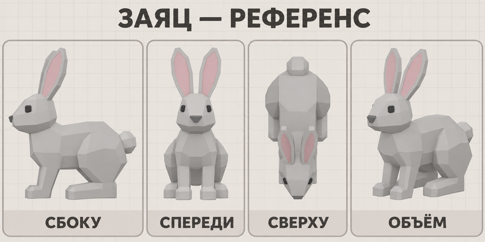
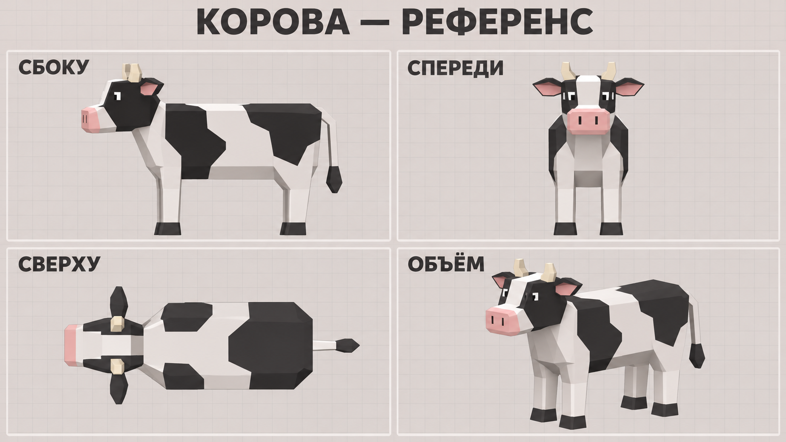
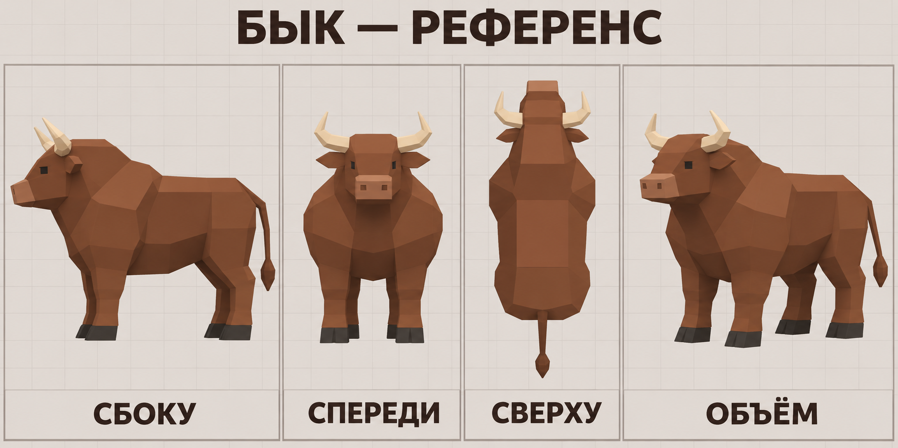

# Самостоятельная работа — low-poly животные

**Задание:** выбери **минимум одного** животного с референсов ниже — зайца, корову или быка — и смоделируй его в Blender. Сделай узнаваемую форму, назначь материалы и сохрани рендер. Если справился с одним, можешь сделать остальных.

Используй бокс-моделинг: простая заготовка, Mirror, разрезы и Extrude. Цвет, мелкие детали и оформление можно менять. Главное — сохранить характерные пропорции выбранного животного.

---

## 1. Выбери референс и скачай картинку

### 🐇 Заяц

**Что сделать:** компактное тело, небольшую голову, четыре лапы, длинные уши и короткий хвост. Задние лапы крупнее передних.

📥 [Открыть и скачать референс зайца](изображения/практика-заяц-референс.png)

---

### 🐄 Корова

**Что сделать:** вытянутое тело, четыре ноги с копытами, широкую морду, уши, небольшие рога и хвост. Добавь белый и тёмный материалы для пятен.

📥 [Открыть и скачать референс коровы](изображения/практика-корова-референс.png)

---

### 🐂 Бык

**Что сделать:** массивный корпус, широкие плечи, толстую шею, четыре крепкие ноги, широкую голову, парные рога, уши и хвост.

📥 [Открыть и скачать референс быка](изображения/практика-бык-референс.png)

> **Как скачать:** открой картинку по ссылке. На GitHub нажми Download raw file, если есть эта кнопка, либо открой само изображение и выбери ПКМ → «Сохранить изображение как…». Сохрани PNG рядом со своим .blend. Это картинки-ориентиры, не готовые 3D-модели.

### Как пользоваться видами

- **Сбоку:** сравни длину тела, высоту ног, размер головы. Дальние ноги могут перекрываться — у животного всё равно четыре ноги.
- **Спереди:** проверь ширину корпуса, расстояние между ногами, симметрию ушей и рогов.
- **Сверху:** посмотри, где корпус широкий, а где сужается.
- **В объёме:** выбери похожий ракурс для проверки готовой формы.

Референсы стилизованы: не нужно обводить каждую грань или повторять точное число полигонов. Строй свою аккуратную модель по крупным формам.

---

## 2. Подготовь симметричную заготовку

1. Создай новый файл. Сразу сохрани `заяц.blend`, `корова.blend` или `бык.blend`.
2. Добавь Cube в центре сцены: Shift+S → Cursor to World Origin, затем Shift+A → Mesh → Cube. Работай с нулевыми Location/Rotation и Scale (1,1,1).
3. Договорись об осях: ширина X, длина Y, высота Z, морда смотрит в −Y.
4. Tab → Edit Mode. Ctrl+R сделай один центральный разрез в плоскости X = 0. ЛКМ → ПКМ оставляет его посередине.
5. Numpad 1, режим вершин 1, Alt+A. Включи X-Ray (Alt+Z). Рамкой B выдели крайние вершины X < 0; центральные оставь.
6. X → Vertices. Выключи X-Ray. Получилась половина куба с открытым срезом, который не нужно зашивать.
7. Object Mode → Modifiers → Mirror, только X. Включи Merge и Clipping.

✅ **Проверка:** редактируешь половину, видишь целый симметричный куб. Если отражение наложилось на целый куб, вернись и удали лишнюю половину.

---

## 3. Сделай корпус, голову и ноги

### Корпус

1. В Edit Mode выдели половину A, O выключен. Поставь Pivot → 3D Cursor, курсор в начале координат. Так масштабирование не отодвинет шов от центра.
2. Через S → X/Y/Z подбери ширину, длину и высоту тела по референсу. G → Z подними меш над землёй, оставив место для ног.
3. Верни Pivot → Median Point. Ctrl+R добавь две петли поперёк длины Y: спереди и сзади будут участки для ног, посередине — живот.
4. Проверь сбоку Numpad 3 и спереди Numpad 1. Не добавляй глаза, пока корпус не похож на выбранное животное.

### Голова

1. Режим граней 3, Alt+A. Выдели переднюю торцевую грань половины тела.
2. E → Y → отрицательное расстояние вытянет шею/голову вперёд. Для коровы и быка можно сделать два Extrude: короткая шея, затем голова.
3. После каждого Extrude меняй размер торца по отдельной оси и немного поднимай или опускай его. Не сужай всю половину обычным S без проверки центрального шва.
4. Проверь профиль. У зайца голова компактная, у коровы морда выступает, у быка голова и шея широкие.

### Ноги

1. Ctrl+Numpad 7 — вид снизу. Выбери одну переднюю нижнюю грань тела, не головы.
2. I сделай меньшую грань с рамкой. Boundary должен быть включён: у центрального шва тоже нужен отступ.
3. E → Z → отрицательное расстояние вытяни ногу вниз. Mirror добавит парную ногу.
4. Повтори на задней нижней грани. Средний участок днища не выдавливай.
5. Подошвы поставь на один уровень. Перед точными перемещениями выключи O.

✅ **Проверка:** четыре ноги, между ними видны промежутки; тело не превратилось в коробку со сплошной стенкой снизу.

---

## 4. Подсказки для выбранного животного

### 🐇 Если делаешь зайца

| Нужно получить | Что сделать |
|---|---|
| Крупная задняя часть | Выдели задние вершины корпуса, немного подними по Z; O с небольшим радиусом смягчит переход |
| Большие задние лапы | Нижнюю грань задней лапы вытяни ещё одним сегментом и сдвинь вперёд по −Y, получив стопу |
| Длинное ухо | Отдельный Cube сузь по X/Y, вытягивай вверх по Z; добавь петлю и немного наклони верх |
| Второе ухо | Shift+D → ПКМ; поставь противоположный X при тех же Y/Z |
| Короткий хвост | Ico Sphere Subdivisions 1, уменьшить, поставить сзади на +Y |

Начни со стоящего на четырёх лапах зайца. Сложную сидячую позу можно попробовать после готовой базовой формы.

### 🐄 Если делаешь корову

| Нужно получить | Что сделать |
|---|---|
| Длинный корпус | Меняй длину по Y отдельно от ширины X |
| Широкая морда | Сделай короткое дополнительное Extrude головы; проверь ширину спереди |
| Копыта | Внизу ноги добавь короткий Extrude и назначь тёмный материал этим граням |
| Уши и небольшие рога | Уши из сплюснутых кубов; рога из Cone на 6–8 вершин, парные детали по ±X |
| Пятна | Два слота материала: белый и тёмный; выдели грани в Edit Mode и нажми Assign у нужного слота |
| Хвост | Узкий цилиндр или цепочка Extrude; на конце маленькая тёмная Ico Sphere |

Не обязательно делать вымя, складки кожи или сложные изгибы хвоста. Сначала корпус, морда, четыре ноги и цветовые пятна.

### 🐂 Если делаешь быка

| Нужно получить | Что сделать |
|---|---|
| Мощные плечи | Увеличь переднюю часть корпуса по ширине; следи, чтобы шов оставался на X = 0 |
| Толстая шея | Не сужай переход между телом и головой слишком сильно |
| Крепкие ноги | Оставь более широкие основания после Inset, но сохрани промежуток у шва |
| Рога | Начни с коротких Cone на 6–8 вершин, разверни наружу и вверх; второй поставь симметрично |
| Выразительная морда | Широкий передний торец, тёмные небольшие глаза; ноздри необязательны |

Бык должен отличаться от коровы не только цветом: сравни плечи, шею и толщину ног.

> 💡 **Проверь силуэт:** временно скрой глаза и мелкие детали. Узнаётся выбранный зверь? Если нет, исправь тело, голову, ноги или уши, прежде чем добавлять декор. [Подробный приём](лайфхак.md).

---

## 5. Цвет, свет и готовая картинка

1. Выдели тело → Shading → Shader Editor (Object) → New. На Principled BSDF поставь Base Color, Metallic 0, Roughness около 0.8. Соединение BSDF → Material Output Surface оставь.
2. Глазам назначь тёмный материал с Roughness около 0.25. Для второго глаза выбери готовый материал из списка.
3. Для остальных деталей используй подходящие материалы: уши, рога, копыта, пятна. В Material Preview проверь цвета.
4. Добавь Plane под подошвами и простой материал. Окружение необязательно: зверь должен оставаться главным объектом.
5. Добавь Area Light выше и сбоку: начни с Power 800 W, Size 4. Поверни к животному, проверь Rendered, подстрой яркость.
6. Поверни вид в три четверти. Ctrl+Alt+Numpad 0 совместит активную камеру с видом; без Numpad — View → Align View → Align Active Camera to View. Если камеры нет, сначала Shift+A → Camera.
7. Camera → Type Orthographic, подстрой Scale, чтобы целиком помещались уши, рога, ноги и хвост.
8. EEVEE, разрешение 1280×960. Ctrl+S, затем F12. В окне рендера Image → Save As → PNG. После изменений ещё раз сохрани .blend.

✅ **Проверка:** животное целиком в кадре, ноги стоят на земле, глаза и уши не висят отдельно. Mirror на теле оставь неприменённым.

---

## Если что-то не получилось

| Проблема | Подсказка |
|---|---|
| Отражение появилось не там | Проверь Origin на центральной плоскости и единственную ось X в Mirror |
| Шов разошёлся | Центральные вершины X = 0, Merge и Clipping включены |
| Ноги срослись | Inset с Boundary перед Extrude, отступ от X = 0 |
| Двигается всё тело | Выключи O либо уменьши радиус влияния |
| Получились лишние грани после E | Ctrl+Z отменяет Extrude; ПКМ отменяет только перенос |
| Грани тёмные | Edit Mode → A → Shift+N; проверь дубли и внутренние грани |
| На F12 темно | Material Preview и свет сцены отличаются: проверь лампу в Rendered |

📚 Открытые справочники: [выделение](../../справочники/глубокое-погружение/выделение.md), [точность](../../справочники/глубокое-погружение/точность.md), [чистка меша](../../справочники/глубокое-погружение/чистка-меша.md).

## Что сдать

- [ ] **Минимум одно животное** с референсов: заяц, корова или бык.
- [ ] .blend с рабочим Mirror на теле.
- [ ] Итоговый PNG с материалами, светом и камерой.
- [ ] Скриншот Edit Mode с сеткой и настройками Mirror.
- [ ] Узнаваемые тело и голова, четыре ноги, характерные детали выбранного зверя.

Назови файлы по животному, например `заяц.blend` и `заяц.png`. Если сделал несколько, сохрани каждую работу отдельно или собери всех животных в общую сцену. Умение объяснить свою форму и инструменты важнее количества деталей.

[Лайфхак проверки силуэта](лайфхак.md) · [Все справочники](../../справочники/README.md)
