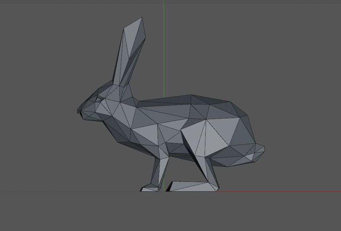
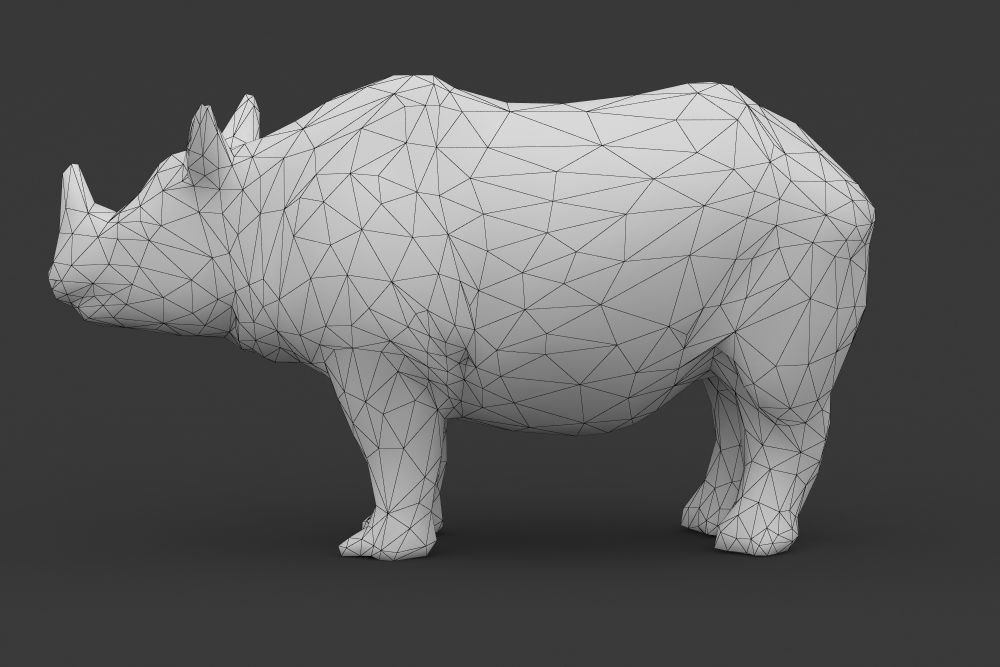

# Самостоятельная работа — low-poly заяц или носорог

> На занятии мы делали капибару. Теперь создай **другое животное с нуля**: зайца или носорога. Примени Mirror, Extrude и работу с пропорциями.

---

## Референсы из старого курса

*Референс преподавателя: длинные уши, высокая задняя часть, большие задние лапы. Можно сделать четвероногого стоящего зайца; позу с картинки повторять необязательно.*

*Референс преподавателя: массивное тело, толстые ноги, широкая морда, рог. Картинка сложнее базового задания: не нужно повторять все треугольники, складки и детализацию.*

Обе картинки показывают форму и сетку, а не обязательную плотность модели. Строй понятные квады, как в [теории](theory.md). Животное пригодится для общей сцены фермы или зоопарка; подготовку к анимации будем делать отдельно.

---

## Выбери уровень

| Уровень | Что выполнить |
|---|---|
| База | Симметричное тело, голова, четыре лапы, характерные уши или рог, цвет |
| Основной | Глаза, подставка, материалы, свет, камера, рендер |
| Дополнительно | Более выразительные пропорции, хвост, пятна, окружение |

## Задание 1 — спланируй форму

1. Сохрани `13-заяц.blend` или `13-носорог.blend`.
2. Назови три признака выбранного животного. Сравни длину тела с головой и ногами.
3. Выбери оси: ширина X, длина Y, голова в −Y. Не меняй их в середине работы.
4. Подготовь половину куба: центральный разрез X = 0, X-Ray, удалить вершины X < 0. Добавь Mirror X, Merge, Clipping — подробности в части 2 теории.

✅ **Контрольная точка:** видишь целую форму, редактируешь половину; по центру нет закрывающей грани или щели.

---

## Задание 2 — тело, голова и лапы

1. Растяни меш в Edit Mode. Для старта можно взять размеры тела капибары из теории, но затем обязательно изменить пропорции под своего зверя.
2. Добавь две петли поперёк длины Y. Передняя и задняя нижние грани будут основаниями лап.
3. Из переднего торца вытяни голову через E по −Y. Носорог: морда широкая и тяжёлая. Заяц: голова компактнее, сужается к носу.
4. Для каждой лапы сначала сделай Inset нижней грани, затем Extrude вниз. Отступ от центра оставляет промежуток между зеркальными лапами.
5. Подстрой подошвы на одну высоту: при необходимости выдели их нижние вершины и S → Z → 0, затем G → Z до нужного уровня. Не выравнивай всё тело!
6. Поправь спину с O и небольшим радиусом. После выключи O.

✅ **Контрольная точка:** четыре лапы различимы спереди и сбоку; зверь узнаваем ещё без глаз.

### Подсказка — заяц

- Сделай заднюю часть тела выше и объёмнее передней. Выделяй задние вершины, а не масштабируй всего зверя.
- Задние лапы длиннее передних. Нижнюю грань лапы можно выдавить ещё одним сегментом и подвинуть вперёд по −Y для стопы.
- Ухо проще начать отдельным кубом: сузить, вытянуть по Z, добавить одну петлю и наклонить верх. Сделай второе симметричное ухо.
- Короткий хвост — маленькая Ico Sphere. Сначала силуэт, потом хвост и глаза.

### Подсказка — носорог

- Тело тяжёлое, ноги короткие и толстые. Не делай ноги тонкими палочками.
- Для основного рога добавь Cone с 6–8 вершинами и небольшим Radius 1. Размести на верхней передней части морды. Для наклона поверни весь конус в Object Mode.
- Маленькие уши можно сделать из сплюснутых кубов или Ico Sphere. Второй рог — необязательный.
- Рог может быть отдельной деталью: он один по центру, его не нужно удваивать Mirror.

> 💡 Повтори [лайфхак проверки силуэта](лайфхак.md): скрой мелкие детали, сравни профиль с референсом. Исправь одну крупную пропорцию.

---

## Задание 3 — материалы и оформление

1. Shading → Shader Editor → New. На Principled BSDF задай Base Color: светло-серый/песочный для зайца, серый для носорога. Roughness 0.8–0.9, Metallic 0.
2. Для глаз создай отдельный тёмный материал с Roughness около 0.25. Материалы не заменяют форму: силуэт должен читаться и без них.
3. Добавь простую подставку. Для зайца достаточно двух камней и пучка травы; для носорога — песочная площадка и несколько камней. Окружение не должно перекрывать лапы.
4. ПКМ → Shade Flat. Mirror оставь живым. Модель должна быть лёгкой, без большого Subdivision.

✅ **Контрольная точка:** нет зависших деталей, глаза сидят на голове, лапы касаются подставки.

---

## Задание 4 — камера и рендер

1. Поверни вид в три четверти. Совмести камеру через Ctrl+Alt+Numpad 0 или View → Align View → Align Active Camera to View.
2. Выбери Orthographic, подстрой Scale до попадания всего зверя в кадр.
3. Area Light сверху и сбоку: начни с 800 W, Size 4. Направь на зверя и проверь в Rendered. Если одна сторона слишком тёмная, добавь второй более слабый свет.
4. EEVEE, разрешение 1280×960, F12. Image → Save As. Сохрани .blend отдельно через Ctrl+S.

---

## 💡 Подсказки: если не получилось

| Симптом | Что проверить |
|---|---|
| Животное раздвоилось | В Mirror только X; Origin на центральной плоскости |
| По центру дырка | Центральные вершины на X = 0, Merge и Clipping включены |
| Лапы срослись | Inset перед Extrude, между лапами есть отступ от X = 0 |
| Двигается половина тела | Выключить O или уменьшить радиус |
| Грани стали тёмными | На меше Edit Mode → A → Shift+N; проверить дубли и лишние внутренние грани |
| Зверь похож на капибару | Изменить корпус, голову и лапы, затем характерные детали |

📚 [Выделение и работа с петлями](../../справочники/глубокое-погружение/выделение.md) · [Чистка меша](../../справочники/глубокое-погружение/чистка-меша.md).

## Что сдать

- [ ] .blend с неприменённым Mirror на теле.
- [ ] Итоговый PNG с выбранным животным.
- [ ] Скриншот Edit Mode с сеткой и настройками Mirror.
- [ ] Тело, голова и четыре лапы; минимум одна характерная деталь.
- [ ] Короткое объяснение: что сделал Extrude, что достроил Mirror и где использовал O.

**Главное:** узнаваемый силуэт, рабочая симметрия и аккуратная сетка. Сложность референса и число полигонов повторять не нужно. Практика — отдельная самостоятельная работа, а не вторая законченная модель за оставшиеся минуты теории.

## А попробуй

Сделай небольшое семейство: копию животного уменьши и измени пропорции головы и тела. Сначала создай отдельную копию объекта, а не меняй исходную работу. Позднее можно расселить семейство по сцене через Geometry Nodes.

[К теории](theory.md) · [Лайфхак](лайфхак.md)
