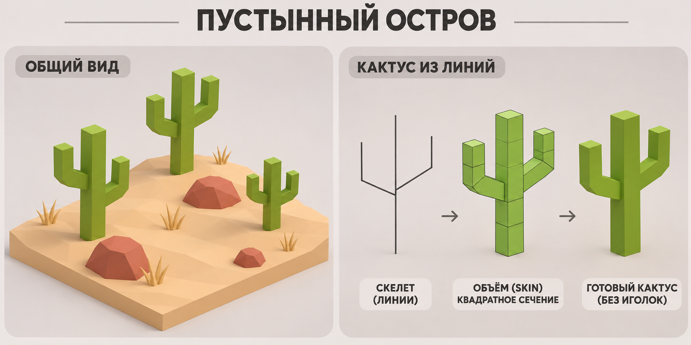
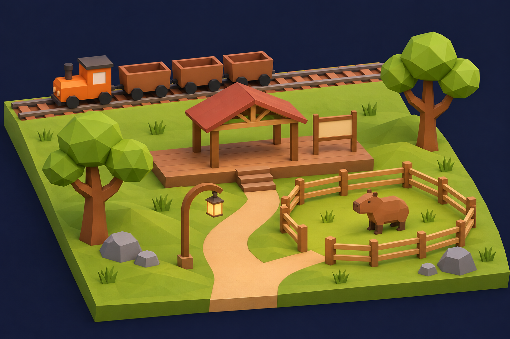

# Самостоятельная работа — пустынный остров и лесная станция

В этой работе два проекта. Сохраняй каждый в отдельный .blend: у них разное окружение, состав объектов и композиция.

---

## Задание 1 — пустынный остров с кактусами

**Задание:** создай одну небольшую low-poly диораму: песчаные холмы, минимум один ветвистый кактус через Skin, камни и сухая трава. Для основной версии сделай три разных кактуса. Это самостоятельный проект: на занятии мы создавали деревья, теперь меняем рисунок каркаса и характер окружения.

📥 [Открыть и скачать референс](изображения/практика-пустыня-референс.png). Открой PNG и выбери «Сохранить изображение как…»; на GitHub также можно скачать raw-файл. Это ориентир, а не готовая 3D-модель. Пропорции, расположение и цвета выбирай сам.

---

## 1. Песчаные дюны

1. Сохрани файл `пустынный-остров.blend`. Удали стандартный куб. Курсор в начале: Shift+S → Cursor to World Origin.
2. Добавь Plane, назови `Sand`. S → 4, затем в Object Mode Ctrl+A → Scale. Получилась площадка 8×8.
3. Tab → A → ПКМ → Subdivide. Сразу F9 → Number of Cuts = 20. Получится 21×21 квадратов.
4. Object Mode → Modifiers → Displace → New в поле Texture. Назови текстуру `Sand_Clouds`.
5. В Texture Properties выбери эту текстуру, Type Clouds, Size начни с 2.0, Depth 1, Soft. Это текстура модификатора, не нод материала.
6. В Displace поставь Coordinates Local, Direction Z, Space Local, Strength 0.4, Midlevel 0.5.
7. Проверь холмы сбоку. Если слишком острые — уменьши Strength и увеличь Size текстуры. Shade Flat сохранит гранёное затенение. Triangulate после Displace — дополнительный вариант.

✅ **Проверка:** песок неровный, но без высоких игл; изменение Strength меняет высоту. Displace оставь неприменённым.

---

## 2. Один кактус из линий

### Ствол

1. Object Mode, курсор в начале. Добавь Plane `Cactus`.
2. Tab → режим вершин 1 → A → M → At Center. Осталась одна вершина.
3. Numpad 1, O выключен. E → Z → 1, ещё E → Z → 1, ещё E → Z → 0.7. После каждого действия Enter. Верхушка на Z = 2.7.

### Боковые отростки

1. Alt+A. Выдели вершину ствола на Z = 1.
2. E → X → −0.6 → Enter. Затем E → Z → 0.8 → Enter. Получился отросток, загнутый вверх.
3. Alt+A. Выбери вершину ствола Z = 2.
4. E → X → 0.6, затем E → Z → 0.5. Второй отросток выше первого.
5. Проверь, что обе ветки соединены со стволом, а не просто стоят рядом. Не добавляй отдельный объект для каждой линии.

### Объём и толщина

1. Object Mode → Modifiers → Skin. Ветки стали объёмными.
2. Edit Mode → A → Ctrl+A → 0.3 → Enter: уменьши радиусы относительно начальных. Если уже менял толщину, подбирай по виду.
3. Выдели нижнюю вершину и нажми Mark Root в Skin. При необходимости Ctrl+A немного утолсти основание.
4. Концы отростков сделай чуть тоньше: выделяй по одному, Ctrl+A → 0.8. Не делай их острыми иглами.
5. Object Mode → Shade Flat. Skin оставь живым, не применяй.

✅ **Проверка:** один каркас с двумя поднятыми отростками. В основании нет отдельной сферы; цель — увидеть, как рёбра превращаются в форму.

---

## 3. Расставь растения и детали

1. Перемести кактус в свободную часть площадки через G → X/Y. Сбоку G → Z опусти основание немного в песок.
2. Shift+D сделай копию. В Edit Mode измени длину одного отростка или его высоту. Object Mode S меняет общий размер; подстрой высоту основания после масштаба.
3. Для основной версии сделай три кактуса разных размеров. Не закрывай один другим полностью в кадре.
4. Камень: Ico Sphere, F9 Subdivisions 1, Edit Mode S по отдельным осям. Создай минимум два камня, различающихся пропорциями и поворотом.
5. Сухая трава: Plane в Edit Mode → A → M At Center; E вверх, E вбок — короткая ломаная. Её можно обтянуть Skin с очень маленьким радиусом либо сделать пучок из нескольких узких треугольников. Сложные колючки кактуса не нужны.
6. Если добавляешь объёмный край диорамы, используй отдельную песчаную подставку ниже поверхности, проверь стык. Это дополнение после работающих дюн.

💡 [Лайфхак — разные растения из одного каркаса](лайфхак.md). Распределение Geometry Nodes необязательно: для нескольких предметов достаточно ручного размещения.

---

## 4. Материалы и изображение

1. Кактусу в Shading → Shader Editor (Object) → New создай зелёный материал. Principled BSDF: Metallic 0, Roughness 0.8. BSDF → Material Output Surface.
2. Песку создай светлый тёплый материал, камням — красно-коричневый, траве — сухой жёлтый. Текстура Clouds управляет высотой, а не цветом.
3. Material Preview показывает цвета, Rendered — свет сцены. Добавь Area Light выше и сбоку, Power начни с 1200 W, Size 5; поверни на площадку и подстрой.
4. Добавь камеру. Выбери ракурс сверху-сбоку и Ctrl+Alt+Numpad 0; без Numpad — View → Align View → Align Active Camera to View.
5. Camera Type Orthographic, Scale около 13; вся площадка и отростки должны войти в кадр.
6. EEVEE, 1280×960. Ctrl+S сохраняет модель; F12 создаёт изображение; Image → Save As сохраняет PNG. Сохрани оба файла.

---

## 💡 Если что-то не получилось

| Проблема | Что сделать |
|---|---|
| Ветка переместилась вместо новой | E создаёт продолжение, G двигает старую точку |
| Skin слишком толстый | Edit Mode → выделить вершины → Ctrl+A, множитель меньше 1 |
| Ctrl+A показывает Apply | Переключиться из Object Mode в Edit Mode |
| Дюны только по углам | Добавить сетку Subdivide до Displace |
| Песок плоский | Проверить Clouds, выбранную текстуру, Strength и видимость модификатора |
| Кактус висит | Проверить сбоку высоту корня, подвинуть весь объект по Z |
| Рельеф изменился, растения ушли под землю | Повторно подстроить высоту растений после изменения дюн |

## Уровни и сдача

- **Минимум:** дюны Displace, один кактус Skin, два камня, материалы и сохранённый .blend.
- **Основной:** три разных кактуса, камни, сухая трава, свет, камера и PNG.
- **Дополнительно:** декоративная подставка, больше видов растений или небольшое семейство животных из прошлой работы.

Сдай `.blend`, PNG и скриншот каркаса кактуса в Edit Mode. Покажи, что Skin и Displace остались рабочими. Объясни, где меняется толщина растения, а где высота холмов.

---

## Задание 2 — лесная станция

**Задача:** создай маленькую станцию у лесной поляны. Рядом проходит короткий поезд, на платформе стоит навес, от входа ведёт тропинка, за оградой находится животное. Деревья, камни и трава связывают всё в одну сцену.

📥 [Открыть и скачать рендер](изображения/практика-лесная-станция.png). Сохрани PNG рядом с проектом. Это ориентир состава и расположения объектов; цвета, животное и форму навеса выбирай сам. Точные размеры и число модулей задавай в своей модели.

### 1. Распланируй площадку

Сохрани `лесная-станция.blend`. Сначала разложи крупные формы без деталей: землю, линию железной дороги, платформу и поляну. Оставь вокруг поезда и животного достаточно места. Железная дорога проходит у дальнего края, а животное располагается за отдельным ограждением, в стороне от пути.

| Что сделать | Знакомый инструмент | Что должно работать |
|---|---|---|
| Неровная земля | Subdivide + Displace | Высота меняется через Strength |
| Деревья | Рёбра, Extrude, Skin | Толщина через Ctrl+A в Edit Mode |
| Поезд и секции забора | Geometry Nodes | Count меняет количество |
| Навес и платформа | Кубы, Extrude, Bevel, точные координаты | Столбы стоят ровно, крыша опирается на них |
| Животное | Mirror, бокс-моделинг, материалы | Узнаваемый силуэт и четыре лапы |
| Арка у тропы | Кривая с Bevel Depth | Цельная изогнутая стойка |
| Камни и трава | Ico Sphere, изменение формы, копии | Разные силуэты, контакт с землёй |

✅ **Проверка:** уже по простым коробкам понятно, где станция, дорога и поляна. Не начинай с фонаря и мелких деталей.

### 2. Земля и ровная полоса пути

- Для земли возьми Plane размером примерно 12×10. В Object Mode примени Scale. Edit Mode → A → Subdivide, F9 → 20 разрезов.
- Добавь Displace, New → Texture Properties → Clouds. Coordinates Local, Direction Z, Midlevel 0.5, Strength начни с 0.3. Size Clouds около 2: нужны мягкие холмы, а не острые горы.
- Рельсы положи на отдельное ровное основание — длинный тонкий куб вдоль X. Подними его так, чтобы холмы не пересекали путь. Не пытайся изогнуть весь поезд по случайным неровностям.
- Для платформы добавь куб рядом с путём. Через N → Item задай размеры и высоту, затем Ctrl+A → Scale. Маленький Bevel с Segments 1 смягчит края.

**Проверка сбоку:** платформа и колёса не висят, земля не проходит сквозь настил, рельсы параллельны.

### 3. Поезд: один вагон и ряд экземпляров

Можно использовать **свой** вагон из сохранённой работы или смоделировать новый. Чтобы перенести объект: File → Append → выбери .blend → Object → нужный объект → Append. Если вагон состоял из нескольких объектов, перенеси весь набор или заранее объедини его копию.

1. Подготовь вагон-модуль: кузов из куба, рама, четыре цилиндра-колеса. Объедини части Ctrl+J, назови `Wagon_Module`. Сохрани материалы частей.
2. Длина кузова вдоль X около 3, шаг экземпляров 3.4. Origin поставь по центру вагона на уровне контакта колёс с рельсами. Для этого поставь 3D-курсор в нужное место и Object → Set Origin → Origin to 3D Cursor.
3. Отодвинь шаблон за пределы кадра. Создай отдельный Plane `Train`, Geometry Nodes → New. Убери начальный провод Group Input → Group Output.
4. Добавь Mesh Line: Offset, Count 3, Offset (3.4,0,0). Добавь Object Info с Wagon_Module, Original, As Instance и Instance on Points.

| Откуда: выход | Куда: вход |
|---|---|
| Mesh Line — Mesh | Instance on Points — Points |
| Object Info — Geometry | Instance on Points — Instance |
| Instance on Points — Instances | Group Output — Geometry |

5. Измени Count с 3 на 4: появился ещё один вагон с тем же шагом. Для итогового кадра верни 3. Рельсы должны покрывать длину состава.
6. Локомотив сделай отдельным объектом перед рядом: рама, колёса, корпус, кабина и труба из простых форм. Он не должен повторяться как вагон.
7. Рельсы — два длинных тонких куба; шпалы — один поперечный куб и Array по X с подходящим шагом. Следи за осями модуля и длиной всего пути.

📚 [Открытый справочник Geometry Nodes](../../справочники/geometry-nodes.md#examples) — схемы ряда, Object Info и поиск ошибок.

### 4. Навес, вывеска и входная арка

**Навес:** сделай четыре столба из кубов. В N → Item поставь их по углам платформы с одинаковым Z. Крышу собери из двух тонких наклонённых кубов. Не ставь её «примерно рядом»: нижние края должны опираться на столбы. Добавь сиденье из длинного куба и двух опор.

**Вывеска:** небольшой плоский куб на стойке. Отверстие в декоративной панели можно сделать Boolean Difference кубом-резаком: сначала примени Scale, затем выбери резак в модификаторе и проверь сквозной вырез. Спрячь резак из рендера после проверки результата. Текст на вывеске необязателен.

**Арка у тропы:** Shift+A → Curve → Bezier. В Edit Mode перемести контрольные точки и их ручки, получи плавный изгиб. В Curve Data Properties → Geometry → Bevel → Depth около 0.04–0.08. Это придаёт кривой толщину. Высоту и ширину подбери так, чтобы арка не перекрывала главные объекты в кадре. Маленький фонарь можно собрать из цилиндра и шара.

✅ **Проверка:** крыша не висит отдельно, столбы одинаковой высоты, арка выглядит цельной, платформа доступна со стороны тропинки.

### 5. Животное и ограда поляны

- Возьми собственного зайца, корову, быка или капибару. Перенеси через Append; для животного из нескольких объектов удобнее выбирать его коллекцию в разделе Collection.
- При перемещении выделяй тело, глаза, уши и остальные части вместе. После масштаба проверь, что лапы касаются земли. Не добавляй новое животное поверх прежнего, если кажется, что мелкие детали потерялись.
- Сделай секцию ограды: один столб слева и две горизонтальные доски вправо. Длина секции по X = 1, Origin в начале. Объедини части. Ряд создаётся той же схемой, что и вагоны: Mesh Line Offset X = 1, Object Info с секцией.
- Последний столб добавь отдельно у дальнего конца. Оставь проход к поляне, а ограду расположи между животным и железной дорогой. Вход и тропинка должны быть видны.

Чтобы менять длину ограды из модификатора, соедини выход Integer у Group Input с Mesh Line Count. Назови параметр «Секции», Min 1. Проверь изменение числа, затем верни подходящее для поляны значение.

### 6. Лес, камни и тропинка

1. Создай одно дерево через каркас и Skin. Кроны — отдельные Ico Sphere. Скопируй весь набор два раза, меняй силуэт веток и размеры крон. После правок переставляй кроны к концам ветвей.
2. Размести деревья по краям поляны, не перед мордой животного или локомотивом. Корни чуть входят в землю.
3. Добавь несколько камней из Ico Sphere, измени пропорции по осям. Для разных вариантов используй разные масштаб и поворот.
4. Тропинку сделай цепочкой тонких песочных кубов. Подстрой каждый участок по высоте рельефа. На поверхности холма одна длинная плоскость часто пересекается с землёй.
5. Для травы достаточно нескольких пучков около камней и ограды. Если используешь Geometry Nodes, распределяй по готовой поверхности после Displace, а не по исходной плоской земле. Не заселяй травой железную дорогу и платформу.

### 7. Объедини сцену цветом и светом

Выбери ограниченную палитру: зелёная земля, коричневое дерево, серые камни, один яркий цвет поезда. Создавай материалы через Shading → New и Principled BSDF. Один готовый материал можно назначить нескольким объектам из списка материалов.

Поставь камеру сверху-сбоку, Type Orthographic. В кадре должны читаться три части: поезд, станция и поляна. Если сцена перегружена, сначала переставь крупные объекты; добавление ещё одного дерева не исправит композицию.

Area Light сверху и сбоку, Size 5–7, Power подбери в Rendered. EEVEE, 1600×1200. Сохрани `лесная-станция.blend`, затем F12 → Image → Save As → `лесная-станция.png`.

### Перед сдачей

- [ ] Есть станция с навесом, поезд с повторяющимися вагонами и поляна с животным.
- [ ] Рельеф создан Displace, хотя бы одно растение — Skin.
- [ ] Count действительно меняет число вагонов или секций ограды.
- [ ] Детали не висят, колёса стоят на рельсах, животное отделено от пути.
- [ ] Материалы, свет и камера настроены; есть .blend и PNG.

Добавь скриншот рабочей схемы ряда и каркаса растения. Сохрани модификаторы управляемыми, чтобы можно было показать изменение высоты холмов, толщины ветки и количества экземпляров.

[Открытые справочники](../../справочники/README.md) · [Лайфхак](лайфхак.md)
