# Geometry Nodes — справочник для детей

> Blender 4.1. Открой эту страницу, если забыл, какой нод нужен, куда вести провод или почему ничего не видно. Здесь можно вспомнить инструменты, найти нужный нод и собрать небольшой пример.

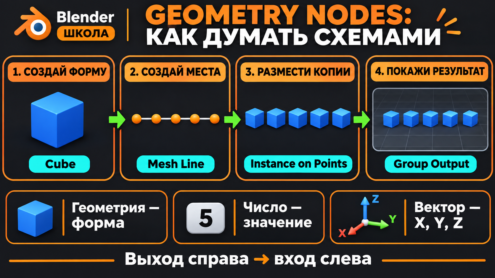

*Инфографика объясняет идею ряда. Cube и Mesh Line — две независимые ветки, обе подключаются к Instance on Points. Точные провода показаны в примере 10.*

## Содержание

- [Как начать и работать в редакторе](#editor)
- [Что передают провода](#data)
- [Таблица нодов](#nodes)
- [Примеры со схемами](#examples)
- [Как найти ошибку](#errors)

<a id="editor"></a>
## Как начать и работать в редакторе

1. Выдели объект в Object Mode, например Plane. Сохрани файл.
2. Перейди в рабочее пространство Geometry Nodes и нажми **New**. Появится группа и модификатор на выбранном объекте.
3. Вначале Group Input Geometry → Group Output Geometry показывает исходную Plane. Для нового куба отключи этот провод и подключи Cube Mesh → Group Output Geometry.
4. Добавляй ноды через **F3**, вводя английское название. Слева у карточки — входы, справа — выходы. Тащи провод от выхода к нужному входу.
5. Сначала собери геометрическую цепочку до Group Output, затем добавляй числа и управление. После каждого изменения проверяй результат в 3D Viewport.
6. Сохраняй **Ctrl+S**. Для самостоятельной группы на другом объекте нажми New; общая группа может менять несколько объектов сразу. Не нажимай Apply у модификатора, пока нужны настройки нодов.

| Действие | Как сделать |
|---|---|
| Добавить нод | F3 → название |
| Переместить нод | Выделить → G |
| Приблизить / переместить вид | Колесо / зажатая средняя кнопка |
| Показать всю схему | Home или View → Frame All |
| Удалить нод | Выделить → X |
| Убрать провод | Потянуть входной конец провода в пустое место |
| Собрать ноды в рамку | Выделить несколько → Ctrl+J; это Frame, не Join Geometry |
| Проверить количество элементов | Открыть Spreadsheet, выбрать нужный объект и компонент, например Instances |

<a id="data"></a>
## Что передают провода

**Объект** — контейнер в сцене; **меш** — вершины, рёбра и грани; **геометрия** может содержать меш, точки, кривые и экземпляры. **Инстанс** хранит ссылку на форму и своё преобразование. Он не обязан появляться отдельной строкой в Outliner.

| Данные | Как узнать / что означают |
|---|---|
| Geometry | Зелёный сокет; форма или набор геометрических компонентов |
| Float / Integer | Число: размер, количество, индекс; тип проверяй по подписи и подсказке сокета |
| Vector | XYZ: смещение, направление или масштаб; обычно фиолетовый сокет |
| Boolean | Да/нет; например маска Selection |
| Rotation | Данные поворота; для углового вектора используй Euler to Rotation |

**Поле** — правило, которое вычисляется для каждого элемента. Например, Index даёт 0,1,2… на экземплярах, а Random Value — разные размеры. Ромбовидные сокеты помогают узнать поля. Само поле не создаёт ни кубов, ни точек: оно должно использоваться нодом, работающим с геометрией.

**Selection** выбирает элементы для действия, а не выделяет их мышью в сцене. **Домен** определяет, что считаем элементом: вершины, грани или экземпляры. Один и тот же Index в разных доменах относится к разным вещам.

<a id="nodes"></a>
## Таблица нодов

Нажми на название для объяснения и мини-опыта. Duplicate Index — выход Duplicate Elements, а не отдельный нод.


### Вход, выход и создание формы

| Нод | Зачем нужен |
|---|---|
| [Group Input](#group-input) | Передаёт исходную геометрию и настройки группы |
| [Group Output](#group-output) | Передаёт итоговую геометрию в сцену |
| [Cube](#cube) | Создаёт меш куба или прямоугольного блока |
| [Transform Geometry](#transform) | Перемещает, вращает и масштабирует входную геометрию |
| [Join Geometry](#join) | Собирает несколько геометрических веток |
| [Mesh Line](#mesh-line) | Создаёт ряд вершин, соединённых рёбрами |

---

### Размещение и управление экземплярами

| Нод | Зачем нужен |
|---|---|
| [Instance on Points](#instance) | Размещает экземпляр модели на каждой точке |
| [Geometry to Instance](#geometry-instance) | Упаковывает геометрию в экземпляры |
| [Duplicate Elements](#duplicate) | Дублирует элементы выбранного домена |
| [Translate Instances](#translate) | Сдвигает экземпляры |
| [Combine XYZ](#combine) | Собирает три числа в вектор |

---

### Числа, масштаб, случайность и выбор

| Нод | Зачем нужен |
|---|---|
| [Math](#math) | Вычисляет число |
| [Scale Instances](#scale-instances) | Меняет размер экземпляров |
| [Random Value](#random) | Даёт псевдослучайные значения в заданном диапазоне |
| [Rotate Instances](#rotate) | Поворачивает экземпляры |
| [Index](#index) | Выдаёт порядковый номер элемента |
| [Compare](#compare) | Проверяет условие и выдаёт да/нет |

---

### Меш, поверхность и внешние шаблоны

| Нод | Зачем нужен |
|---|---|
| [Set Position](#set-position) | Меняет положение вершин или точек |
| [Scale Elements](#scale-elements) | Масштабирует элементы меша |
| [Distribute Points on Faces](#distribute) | Создаёт точки на поверхности меша |
| [Object Info](#object-info) | Берёт геометрию другого объекта |
| [Euler to Rotation](#euler) | Преобразует углы XYZ в данные поворота |
| [Collection Info](#collection) | Берёт шаблоны из коллекции |

---

<a id="group-input"></a>
### Group Input

**🎯 Для чего:** передаёт исходную геометрию и настройки группы.

**⚙️ Как работает:** Входная дверь: Geometry — меш объекта до этого модификатора. Выходы с числами передают значения из модификатора. Если вместо него подключить Cube, исходная Plane не попадёт в результат.

> **Попробуй:** Geometry → Transform Geometry Geometry. Для готового ряда геометрический выход Group Input может не использоваться.

---

<a id="group-output"></a>
### Group Output

**🎯 Для чего:** передаёт итоговую геометрию в сцену.

**⚙️ Как работает:** Выходная дверь: вход Geometry принимает результат группы. Ноды, не связанные с итоговым выходом, не участвуют в видимом результате этой ветки.

> **Попробуй:** Подключи Cube Mesh → Geometry. Отключи провод: созданный куб исчезнет.

---

<a id="cube"></a>
### Cube

**🎯 Для чего:** создаёт меш куба или прямоугольного блока.

**⚙️ Как работает:** Size задаёт размеры по XYZ; Vertices X/Y/Z — число вершин вдоль каждой оси, а не число отдельных кубов. Выход Mesh содержит созданную сетку.

> **Попробуй:** Size (2,1,1) делает длинный блок. Vertices 2/2/2 — самый простой куб.

---

<a id="transform"></a>
### Transform Geometry

**🎯 Для чего:** перемещает, вращает и масштабирует входную геометрию.

**⚙️ Как работает:** Geometry принимает форму. Translation задаёт смещение, Rotation — поворот, Scale — множители размера. Geometry справа передаёт изменённую форму. Это изменение результата нодов, а не Location объекта в Object Mode.

> **Попробуй:** Cube Mesh → Geometry; Translation Z = 2 поднимет куб. Scale (1,1,2) удвоит высоту.

---

<a id="join"></a>
### Join Geometry

**🎯 Для чего:** собирает несколько геометрических веток.

**⚙️ Как работает:** Во вход Geometry можно подать несколько проводов. Выход Geometry содержит все переданные части. Нод не сваривает вершины и не делает Boolean Union.

> **Попробуй:** Подай исходную землю и Instances камней в один Join, затем его Geometry — в Output.

---

<a id="mesh-line"></a>
### Mesh Line

**🎯 Для чего:** создаёт ряд вершин, соединённых рёбрами.

**⚙️ Как работает:** В режиме Offset Count — количество точек, Start Location — начало, Offset — шаг к следующей точке. Выход Mesh можно подать в Points: Instance on Points использует его вершины.

> **Попробуй:** Count 5, Offset (3,0,0): точки X = 0,3,6,9,12. Пять точек, четыре промежутка.

---

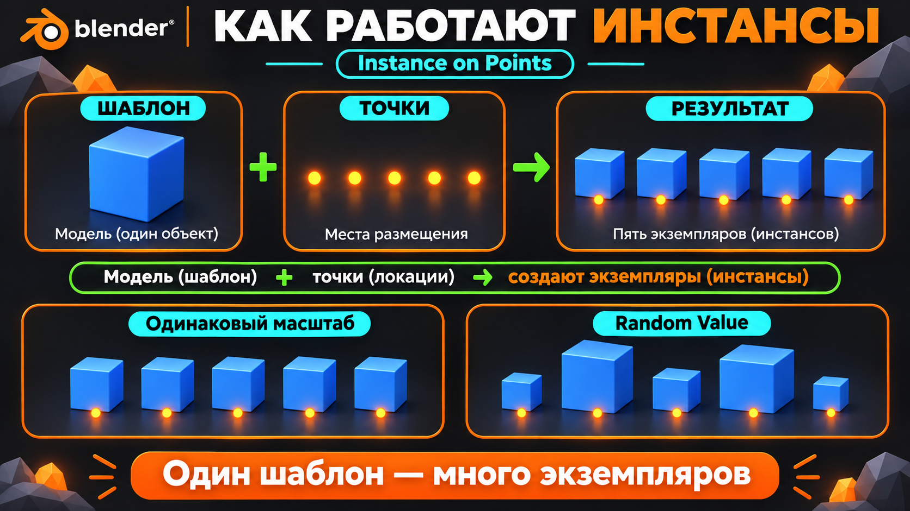

*Модель задаёт форму, точки — места. Random Value может менять размер каждого экземпляра.*

---

<a id="instance"></a>
### Instance on Points

**🎯 Для чего:** размещает экземпляр модели на каждой точке.

**⚙️ Как работает:** Points принимает места, Instance — форму. Scale и Rotation управляют экземплярами. Выход Instances — экземпляры, а не отдельные объекты в Outliner. Pick Instance выбирает один элемент из списка шаблонов по Instance Index.

> **Попробуй:** Mesh Line Mesh → Points; Cube Mesh → Instance; Instances → Group Output Geometry.

---

<a id="geometry-instance"></a>
### Geometry to Instance

**🎯 Для чего:** упаковывает геометрию в экземпляры.

**⚙️ Как работает:** Вход Geometry превращает переданную геометрию в инстанс, выход Instances. В опыте с одним Cube получаем один целый экземпляр для дальнейшего дублирования. Несколько подключённых геометрий могут стать отдельными экземплярами.

> **Попробуй:** Cube Mesh → Geometry, Instances → Duplicate Elements Geometry. Это подготовка к домену Instance.

---

<a id="duplicate"></a>
### Duplicate Elements

**🎯 Для чего:** дублирует элементы выбранного домена.

**⚙️ Как работает:** Geometry — исходная геометрия; Selection — что копировать; Amount — число копий выбранного элемента. Домен Instance копирует экземпляры, Face — грани. Geometry выдаёт результат; Duplicate Index — номер копии внутри набора дубликатов. Копии появляются на одном месте.

> **Попробуй:** Geometry to Instance Instances → Geometry; Instance, Amount 5. Пока копии не разнесены, глазами можно видеть один куб.

---

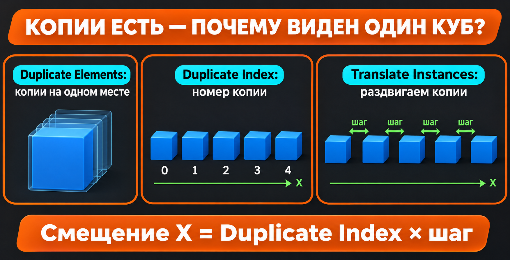

*Полупрозрачные контуры условны: копии сначала совпадают. Duplicate Index сам не двигает геометрию — его нужно передать через вектор в Translation. Шаг измеряется между началами координат.*

---

<a id="translate"></a>
### Translate Instances

**🎯 Для чего:** сдвигает экземпляры.

**⚙️ Как работает:** Instances принимает экземпляры; Translation задаёт смещение каждого. Selection ограничивает действие. Local Space включает локальные оси экземпляра. Выход Instances сохраняет структуру экземпляров.

> **Попробуй:** Duplicate Index → Combine XYZ X; Vector → Translation. Local Space выключен: копии расходятся вдоль X генератора.

---

<a id="combine"></a>
### Combine XYZ

**🎯 Для чего:** собирает три числа в вектор.

**⚙️ Как работает:** Входы X/Y/Z — компоненты, выход Vector — одна тройка. Вектор может обозначать направление, смещение или масштаб: смысл зависит от входа получателя.

> **Попробуй:** X = 3, Y = Z = 0 → Mesh Line Offset даёт шаг 3 вдоль X.

---

<a id="math"></a>
### Math

**🎯 Для чего:** вычисляет число.

**⚙️ Как работает:** Режим Multiply умножает, Add складывает, Subtract вычитает, Divide делит. Выход Value передаёт результат. У Subtract и Divide важен порядок верхнего и нижнего входа.

> **Попробуй:** Duplicate Index → первый Value у Multiply, второй 3. Получим 0,3,6,9…; затем Value → Combine XYZ X.

---

<a id="scale-instances"></a>
### Scale Instances

**🎯 Для чего:** меняет размер экземпляров.

**⚙️ Как работает:** Instances — экземпляры, Scale — множители XYZ, Selection — выбор. При Pivot Point (0,0,0) и Local Space On каждый экземпляр удобно масштабировать относительно своего локального начала.

> **Попробуй:** Scale (1,1,2) удваивает высоту. Если модель растёт вниз, проверь Origin шаблона: он должен быть у основания.

---

<a id="random"></a>
### Random Value

**🎯 Для чего:** даёт псевдослучайные значения в заданном диапазоне.

**⚙️ Как работает:** Выбери тип Float, Integer или Vector. Min и Max задают диапазон, Seed — другой вариант. ID позволяет задать идентификатор для вычисления. Значение вычисляется для элементов в контексте получателя; один нод может дать разные числа разным экземплярам.

> **Попробуй:** Float 0.6…1.4 → Scale даёт равномерный масштаб XYZ. Для выбора из двух шаблонов: Integer 0…1 → Instance Index.

---

<a id="rotate"></a>
### Rotate Instances

**🎯 Для чего:** поворачивает экземпляры.

**⚙️ Как работает:** Instances — экземпляры, Rotation — поворот, Selection — выбор. Pivot Point и Local Space определяют центр и пространство поворота. Для поворота каждого вокруг своего начала оставь локальный Pivot 0 и Local Space On.

> **Попробуй:** Rotation Z = 30° повернёт каждый экземпляр. Для случайного направления вокруг Z используй цепочку Random → Combine XYZ → Euler to Rotation.

---

<a id="index"></a>
### Index

**🎯 Для чего:** выдаёт порядковый номер элемента.

**⚙️ Как работает:** Нумерация начинается с нуля. Выход Index — поле: номера зависят от того, где оно вычисляется. В Selection у Scale Instances это номера экземпляров, в Set Position — вершин. Изменение порядка элементов может изменить номера.

> **Попробуй:** Третий экземпляр имеет Index 2. Index и Duplicate Index отличаются: второй считает копии одного дублируемого элемента.

---

<a id="compare"></a>
### Compare

**🎯 Для чего:** проверяет условие и выдаёт да/нет.

**⚙️ Как работает:** Выбери тип Integer и операцию Equal для целочисленных индексов. A и B сравниваются; Result — Boolean. Его можно подать в Selection.

> **Попробуй:** Index → A, B = 2; Result → Scale Instances Selection. Изменится только третий экземпляр.

---

<a id="set-position"></a>
### Set Position

**🎯 Для чего:** меняет положение вершин или точек.

**⚙️ Как работает:** Geometry — исходная геометрия, Selection — выбор. Position задаёт положение, Offset добавляет смещение к нему. Если Position не подключён, сохраняется исходное положение плюс Offset. Выход Geometry — изменённый меш.

> **Попробуй:** После Duplicate Elements Face подай вычисленный вектор в Offset, чтобы разнести грани. Для целых инстансов используй Translate Instances.

---

<a id="scale-elements"></a>
### Scale Elements

**🎯 Для чего:** масштабирует элементы меша.

**⚙️ Как работает:** Geometry — меш, Selection — выбор. Домен Face и режим Uniform позволяют менять размер граней. Scale — множитель. Нод предназначен для элементов меша; экземпляры меняют через Scale Instances.

> **Попробуй:** На трёх разнесённых квадратах поставь Face, Uniform, Scale 0.5. Площадки станут меньше.

---

<a id="distribute"></a>
### Distribute Points on Faces

**🎯 Для чего:** создаёт точки на поверхности меша.

**⚙️ Как работает:** Mesh — поверхность. Random распределяет по Density (точек на единицу площади), Seed меняет раскладку. Poisson Disk позволяет ограничить близость точек через Distance Min. Points — места; Rotation помогает ориентировать экземпляры по поверхности.

> **Попробуй:** Plane 10×10, Density 0.15: ожидается около 15 точек, точное число случайно. Саму землю нод не передаёт в Points — верни её отдельной веткой Join.

---

<a id="object-info"></a>
### Object Info

**🎯 Для чего:** берёт геометрию другого объекта.

**⚙️ Как работает:** Object выбирает шаблон; выход Geometry передаёт его форму. As Instance сохраняет её как экземпляр. Original удобно для шаблона, который отодвинули в сторону: его перенос в сцене не должен стать лишним смещением копий. Origin определяет точку размещения.

> **Попробуй:** Выбери Rock, Original, As Instance; Geometry → Instance on Points Instance. Не выбирай сам объект-генератор: получится зависимость от самого себя.

---

<a id="euler"></a>
### Euler to Rotation

**🎯 Для чего:** преобразует углы xyz в данные поворота.

**⚙️ Как работает:** Вход Euler получает тройку углов, выход Rotation — поворот. Векторные числа углов задаются в радианах: 2π ≈ 6.283 — полный оборот. В полях углов интерфейс может показывать градусы.

> **Попробуй:** Random Float 0…6.283 → Combine XYZ Z → Euler; Rotation → Instance on Points Rotation.

---

<a id="collection"></a>
### Collection Info

**🎯 Для чего:** берёт шаблоны из коллекции.

**⚙️ Как работает:** Collection выбирает набор. Separate Children разделяет дочерние объекты на экземпляры, Reset Children сбрасывает их трансформации внутри результата. Выход Instances подключают к Instance on Points Instance.

> **Попробуй:** Два камня в отдельной коллекции; Separate Children и Reset Children On. Pick Instance On; Integer 0…1 → Instance Index. Начала координат шаблонов подготовь одинаково.

---

<a id="examples"></a>
## Примеры со схемами

- [1. Читаем первую схему](#example-1)
- [2. Выводим куб вместо плоскости](#example-2)
- [3. Добавляем Transform Geometry](#example-3)
- [4. Мини-опыт — меняем исходную плоскость, а не создаём новый куб](#example-4)
- [5. Объединяем две ветки](#example-5)
- [6. Сдвигаем только второй куб](#example-6)
- [7. Ещё один способ — две копии из одного Cube](#example-7)
- [8. Мини-проект «Башня из трёх кубов»](#example-8)
- [9. Создаём места для копий через Mesh Line](#example-9)
- [10. Ставим куб на каждую точку](#example-10)
- [11. Geometry to Instance: превращаем меш в один экземпляр](#example-11)
- [12. Duplicate Elements: создаём пять кубов](#example-12)
- [13. Сначала пробуем обычное перемещение](#example-13)
- [14. Раздвигаем кубы с помощью Combine XYZ](#example-14)
- [15. Меняем расстояние между дубликатами (дополнительно)](#example-15)
- [16. Меняем размер каждого экземпляра через Scale Instances](#example-16)
- [17. У каждого куба свой размер (Random Value)](#example-17)
- [18. Поворачиваем копии](#example-18)
- [19. Изменяем только третий куб (для тех, кто успел)](#example-19)
- [20. Дополнительный опыт — дублируем грани, а не целую модель](#example-20)
- [21. Уменьшаем отдельные грани через Scale Elements](#example-21)
- [22. Шаг 2. Создаём точки на поверхности](#example-22)
- [23. Шаг 3. Ставим камень на каждую точку](#example-23)
- [24. Шаг 4. Возвращаем землю через Join Geometry](#example-24)
- [25. Шаг 6. Добавляем случайный поворот](#example-25)
- [26. Шаг 2. Делаем одну звезду-заготовку](#example-26)
- [27. Шаг 3. Создаём область звёзд](#example-27)
- [28. Шаг 5. Создаём тёмный World нодами](#example-28)
- [29. Collection Info — распределяем разные объекты](#example-29)

На каждой стрелке: **номер провода. выход справа → вход слева**. Номер не означает порядок вычисления. Названия A/B у карточек отличают два одинаковых нода. Схемы показывают небольшие рабочие примеры; иллюстрации помогают вспомнить принцип. Подключай именно названные сокеты.


---

## 🧊 Первые формы и преобразования

<a id="example-1"></a>
### 🧊 Пример 1 — Читаем первую схему

> ⚙️ **Настройки:** Group Input  — исходная Plane; Group Output  — результат в сцене.

**Схема соединений**

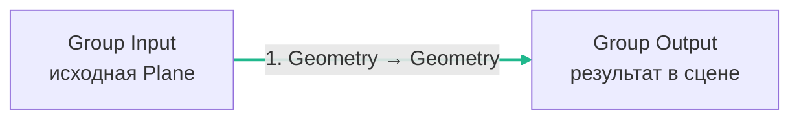

> ✅ **Должно получиться:** Видна исходная Plane. Без провода на выходе результата нет.

[↑ К списку примеров](#examples)

---

<a id="example-2"></a>
### 🧊 Пример 2 — Выводим куб вместо плоскости

> ⚙️ **Настройки:** Cube  — Size = (2, 2, 2) — Vertices X/Y/Z = 2.

**Схема соединений**

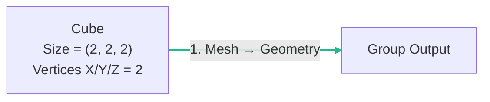

> ✅ **Должно получиться:** Вместо Plane виден куб из нодов.

[↑ К списку примеров](#examples)

---

<a id="example-3"></a>
### 🧊 Пример 3 — Добавляем Transform Geometry

> ⚙️ **Настройки:** Cube  — Size = (2, 2, 2); Transform Geometry  — Translation = (0, 0, 0) — Rotation = (0°, 0°, 0°) — Scale = (1, 1, 1).

**Схема соединений**

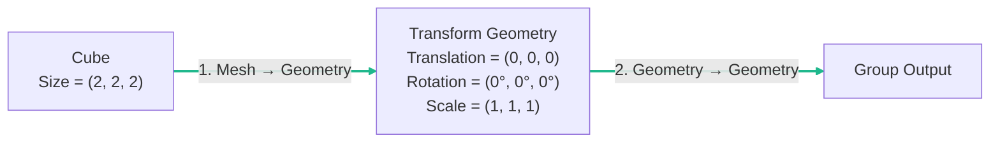

> ✅ **Должно получиться:** Трансформация меняет только подключённую форму.

[↑ К списку примеров](#examples)

---

<a id="example-4"></a>
### 🧊 Пример 4 — Мини-опыт — меняем исходную плоскость, а не создаём новый куб

> ⚙️ **Настройки:** Group Input  — исходный Mesh: Plane; Transform Geometry  — Translation Z = 2 — Scale X = 2.

**Схема соединений**

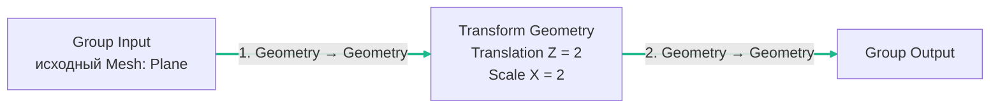

> ✅ **Должно получиться:** Меняется исходная Plane, потому что источник — Group Input.

[↑ К списку примеров](#examples)

---

## 🧩 Несколько веток и башня

<a id="example-5"></a>
### 🧩 Пример 5 — Объединяем две ветки

> ⚙️ **Настройки:** Cube A  — Size = (2, 2, 2); Cube B  — Size = (1.5, 1.5, 1.5); Join Geometry  — принимает два провода.

**Схема соединений**

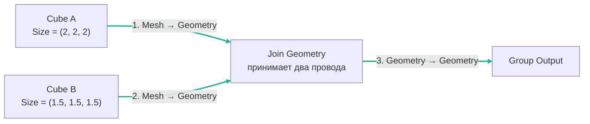

> ✅ **Должно получиться:** В результате обе ветки; без смещения кубы могут перекрываться.

[↑ К списку примеров](#examples)

---

<a id="example-6"></a>
### 🧩 Пример 6 — Сдвигаем только второй куб

> ⚙️ **Настройки:** Cube A  — Size = (2, 2, 2); Cube B  — Size = (1.5, 1.5, 1.5); Transform Geometry B  — Translation X = 3.

**Схема соединений**

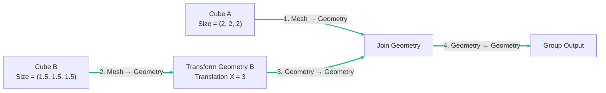

> ✅ **Должно получиться:** Второй куб стоит отдельно от первого.

[↑ К списку примеров](#examples)

---

<a id="example-7"></a>
### 🧩 Пример 7 — Ещё один способ — две копии из одного Cube

> ⚙️ **Настройки:** Cube A  — Size = (2, 2, 2); Transform Geometry B  — Translation X = 3; Join Geometry  — один источник, две ветки.

**Схема соединений**

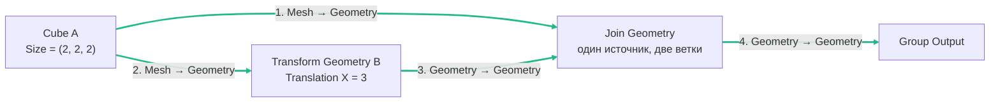

> ✅ **Должно получиться:** Один источник используется в двух ветках.

[↑ К списку примеров](#examples)

---

<a id="example-8"></a>
### 🧩 Пример 8 — Мини-проект «Башня из трёх кубов»

> ⚙️ **Настройки:** Cube A  — Size = 2; Transform Geometry A  — Z = 1; Cube B  — Size = 1.5; Transform Geometry B  — Z = 2.75; Cube C  — Size = 1; Transform Geometry C  — Z = 4; Join Geometry  — три входящих провода.

**Схема соединений**

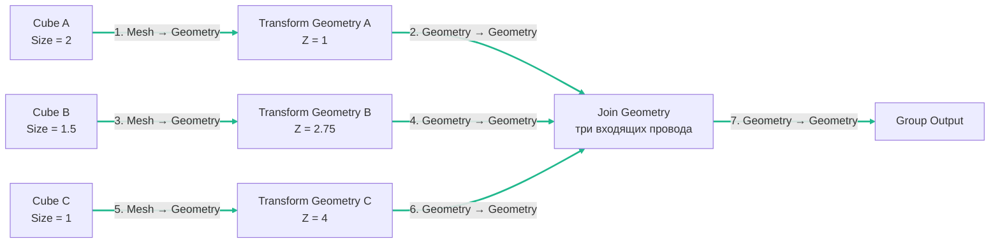

> ✅ **Должно получиться:** Кубы стоят друг на друге; нижняя грань башни на Z = 0.

[↑ К списку примеров](#examples)

---

## 📍 Точки и экземпляры

<a id="example-9"></a>
### 📍 Пример 9 — Создаём места для копий через Mesh Line

> ⚙️ **Настройки:** Mesh Line  — Offset mode — Count = 5 — Start = (0, 0, 0) — Offset = (3, 0, 0).

**Схема соединений**

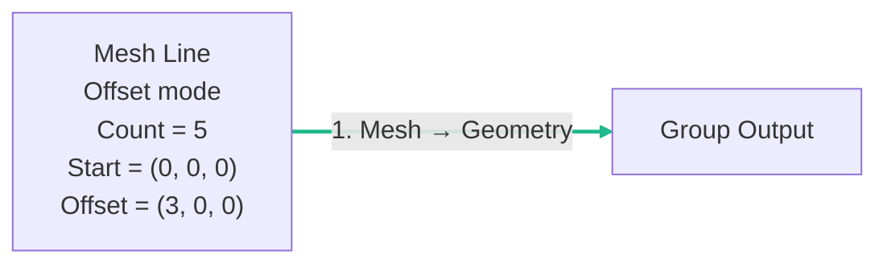

> ✅ **Должно получиться:** Виден ряд вершин и рёбер; объёмных кубов пока нет.

[↑ К списку примеров](#examples)

---

<a id="example-10"></a>
### 📍 Пример 10 — Ставим куб на каждую точку

> ⚙️ **Настройки:** Mesh Line  — Count = 5 — Offset X = 3; Cube  — Size = (2, 2, 2); Instance on Points  — Points = места — Instance = форма.

**Схема соединений**

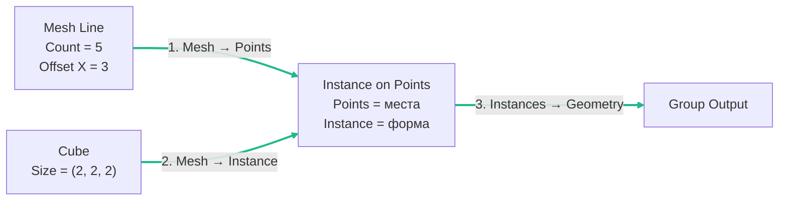

> ✅ **Должно получиться:** На пяти точках появились пять кубов.

[↑ К списку примеров](#examples)

---

## 🔁 Дублирование и управление копиями

<a id="example-11"></a>
### 🔁 Пример 11 — Geometry to Instance: превращаем меш в один экземпляр

> ⚙️ **Настройки:** Cube  — Size = 0.6; Geometry to Instance  — один целый инстанс.

**Схема соединений**

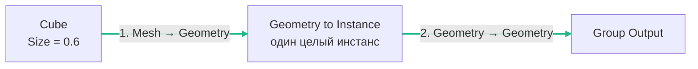

> ✅ **Должно получиться:** В Spreadsheet на компоненте Instances есть один экземпляр куба.

[↑ К списку примеров](#examples)

---

<a id="example-12"></a>
### 🔁 Пример 12 — Duplicate Elements: создаём пять кубов

> ⚙️ **Настройки:** Cube  — Size = 0.6; Duplicate Elements  — Domain: Instance — Amount = 5.

**Схема соединений**

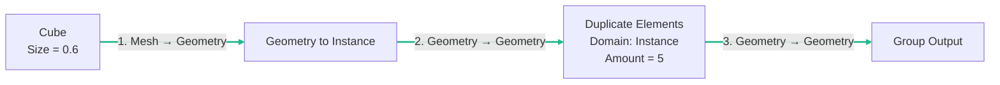

> ✅ **Должно получиться:** Есть пять экземпляров на одном месте; Amount — общее число копий выбранного элемента, а не пять плюс оригинал.

[↑ К списку примеров](#examples)

---

<a id="example-13"></a>
### 🔁 Пример 13 — Сначала пробуем обычное перемещение

> ⚙️ **Настройки:** Cube  — Size = 0.6; Duplicate Elements  — Instance, Amount = 5; Translate Instances  — Translation X = 3.

**Схема соединений**

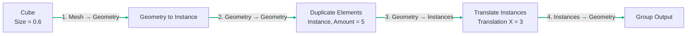

> ✅ **Должно получиться:** Все пять копий сместились одинаково и всё ещё перекрываются. Постоянный вектор не разносит их.

[↑ К списку примеров](#examples)

---

<a id="example-14"></a>
### 🔁 Пример 14 — Раздвигаем кубы с помощью Combine XYZ

> ⚙️ **Настройки:** Cube  — Size = 0.6; Duplicate Elements  — Instance, Amount = 5; Combine XYZ  — Y = 0, Z = 0; Translate Instances  — Local Space: Off.

**Схема соединений**

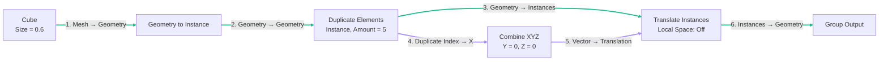

> ✅ **Должно получиться:** Копии расположились по X = 0,1,2,3,4. Duplicate Index задаёт разное смещение каждой.

[↑ К списку примеров](#examples)

---

<a id="example-15"></a>
### 🔁 Пример 15 — Меняем расстояние между дубликатами (дополнительно)

> ⚙️ **Настройки:** Cube  — Size = 2; Duplicate Elements  — Instance, Amount = 5; Math: Multiply  — второй Value = 3; Combine XYZ  — Y = 0, Z = 0.

**Схема соединений**

```mermaid
flowchart LR
    C["Cube <br/>Size = 2"]
    G["Geometry to Instance"]
    D["Duplicate Elements <br/>Instance, Amount = 5"]
    M["Math: Multiply <br/>второй Value = 3"]
    V["Combine XYZ <br/>Y = 0, Z = 0"]
    T["Translate Instances"]
    O["Group Output"]
    C -->|"1. Mesh → Geometry"| G
    G -->|"2. Geometry → Geometry"| D
    D -->|"3. Geometry → Instances"| T
    D -->|"4. Duplicate Index → Value (верхний)"| M
    M -->|"5. Value → X"| V
    V -->|"6. Vector → Translation"| T
    T -->|"7. Instances → Geometry"| O
    linkStyle 0,1,2,6 stroke:#20b88d,stroke-width:2.5px
    linkStyle 3,4,5 stroke:#a78bfa,stroke-width:2.5px
```

> ✅ **Должно получиться:** Копии стоят по X = 0,3,6,9,12: Multiply умножил номер на шаг 3.

[↑ К списку примеров](#examples)

---

<a id="example-16"></a>
### 🔁 Пример 16 — Меняем размер каждого экземпляра через Scale Instances

> ⚙️ **Настройки:** Mesh Line  — Count = 5, Offset X = 3; Cube  — Size = 2; Scale Instances  — Scale = (0.5, 0.5, 0.5) — Local Space: On.

**Схема соединений**

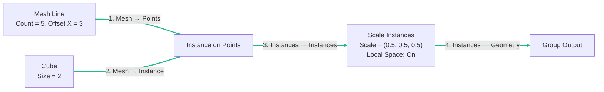

> ✅ **Должно получиться:** Каждый куб уменьшился относительно собственного начала; места экземпляров остались прежними.

[↑ К списку примеров](#examples)

---

<a id="example-17"></a>
### 🔁 Пример 17 — У каждого куба свой размер (Random Value)

> ⚙️ **Настройки:** Mesh Line  — Count = 5, Offset X = 3; Cube  — Size = 2; Random Value  — Float, Min = 0.5, Max = 1.2; Scale Instances  — Local Space: On.

**Схема соединений**

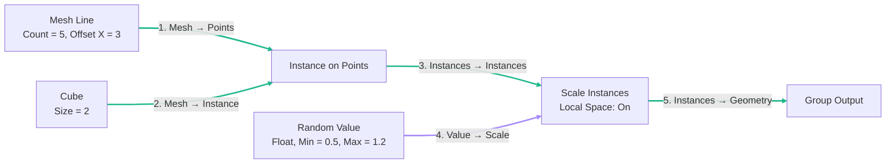

> ✅ **Должно получиться:** Кубы имеют разные размеры в диапазоне 0.5…1.2. Измени Seed и сравни.

[↑ К списку примеров](#examples)

---

<a id="example-18"></a>
### 🔁 Пример 18 — Поворачиваем копии

> ⚙️ **Настройки:** Mesh Line  — Count = 5, Offset X = 3; Cube  — Size = 2; Random Value  — Float, 0.5…1.2; Scale Instances  — Local Space: On; Rotate Instances  — Rotation Z = 30° — Local Space: On.

**Схема соединений**

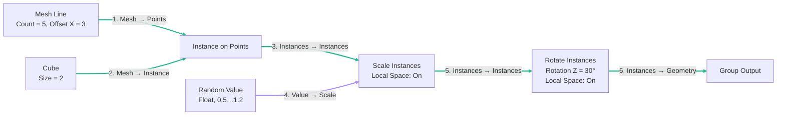

> ✅ **Должно получиться:** Каждый куб повёрнут вокруг своей оси Z на 30°, места экземпляров сохранены.

[↑ К списку примеров](#examples)

---

<a id="example-19"></a>
### 🔁 Пример 19 — Изменяем только третий куб (для тех, кто успел)

> ⚙️ **Настройки:** Mesh Line  — Count = 5; Cube  — Size = 2; Index  — номера 0…4; Compare  — Integer, Equal — B = 2; Scale Instances  — Scale = (1, 1, 2) — Local Space: On.

**Схема соединений**

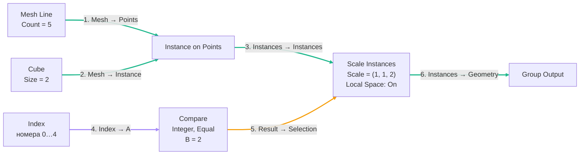

> ✅ **Должно получиться:** Только третий куб стал вдвое выше. Его Index равен 2.

[↑ К списку примеров](#examples)

---

## 🔷 Работа с гранями меша

<a id="example-20"></a>
### 🔷 Пример 20 — Дополнительный опыт — дублируем грани, а не целую модель

> ⚙️ **Настройки:** Group Input  — Plane, 1 грань; Duplicate Elements  — Face, Amount = 3; Math: Multiply  — второй Value = 3; Combine XYZ  — Y = 0, Z = 0; Set Position  — Offset: смещение вершин.

**Схема соединений**

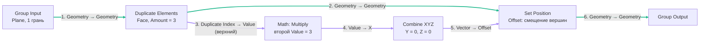

> ✅ **Должно получиться:** Из одной грани получились три отдельных квадрата. Offset раздвигает их по X.

[↑ К списку примеров](#examples)

---

<a id="example-21"></a>
### 🔷 Пример 21 — Уменьшаем отдельные грани через Scale Elements

> ⚙️ **Настройки:** Set Position  — три отдельных квадрата; Scale Elements  — Face, Uniform — Scale = 0.5.

**Схема соединений**

```mermaid
flowchart LR
    S["Set Position <br/>три отдельных квадрата"]
    E["Scale Elements <br/>Face, Uniform<br/>Scale = 0.5"]
    O["Group Output"]
    S -->|"1. Geometry → Mesh"| E
    E -->|"2. Mesh → Geometry"| O
    linkStyle 0,1 stroke:#20b88d,stroke-width:2.5px
```

> ✅ **Должно получиться:** Разнесённые квадраты уменьшились вдвое. Scale Elements работает с гранями, а не с инстансами.

[↑ К списку примеров](#examples)

---

## 🌿 Камни и окружение

<a id="example-22"></a>
### 🌿 Пример 22 — Шаг 2. Создаём точки на поверхности

> ⚙️ **Настройки:** Group Input  — Plane 10 × 10; Distribute Points on Faces  — Random, Density = 0.15.

**Схема соединений**

```mermaid
flowchart LR
    I["Group Input <br/>Plane 10 × 10"]
    D["Distribute Points on Faces <br/>Random, Density = 0.15"]
    O["Group Output"]
    I -->|"1. Geometry → Mesh"| D
    D -->|"2. Points → Geometry"| O
    linkStyle 0,1 stroke:#20b88d,stroke-width:2.5px
```

> ✅ **Должно получиться:** Видны точки на поверхности; самой земли в этой ветке нет.

[↑ К списку примеров](#examples)

---

<a id="example-23"></a>
### 🌿 Пример 23 — Шаг 3. Ставим камень на каждую точку

> ⚙️ **Настройки:** Group Input  — Plane; Distribute Points on Faces  — Density = 0.15; Object Info  — Object = Rock — Original, As Instance.

**Схема соединений**

```mermaid
flowchart LR
    I["Group Input <br/>Plane"]
    D["Distribute Points on Faces <br/>Density = 0.15"]
    R["Object Info <br/>Object = Rock<br/>Original, As Instance"]
    P["Instance on Points"]
    O["Group Output"]
    I -->|"1. Geometry → Mesh"| D
    D -->|"2. Points → Points"| P
    R -->|"3. Geometry → Instance"| P
    P -->|"4. Instances → Geometry"| O
    linkStyle 0,1,2,3 stroke:#20b88d,stroke-width:2.5px
```

> ✅ **Должно получиться:** На точках появились камни; форма берётся из отдельного объекта Rock.

[↑ К списку примеров](#examples)

---

<a id="example-24"></a>
### 🌿 Пример 24 — Шаг 4. Возвращаем землю через Join Geometry

> ⚙️ **Настройки:** Group Input  — исходная земля; Object Info  — Rock, Original; Join Geometry  — земля + камни.

**Схема соединений**

```mermaid
flowchart LR
    I["Group Input <br/>исходная земля"]
    D["Distribute Points on Faces"]
    R["Object Info <br/>Rock, Original"]
    P["Instance on Points"]
    J["Join Geometry <br/>земля + камни"]
    O["Group Output"]
    I -->|"1. Geometry → Mesh"| D
    D -->|"2. Points → Points"| P
    R -->|"3. Geometry → Instance"| P
    I -->|"4. Geometry → Geometry"| J
    P -->|"5. Instances → Geometry"| J
    J -->|"6. Geometry → Geometry"| O
    linkStyle 0,1,2,3,4,5 stroke:#20b88d,stroke-width:2.5px
```

> ✅ **Должно получиться:** В сцене одновременно видны земля и камни.

[↑ К списку примеров](#examples)

---

<a id="example-25"></a>
### 🌿 Пример 25 — Шаг 6. Добавляем случайный поворот

> ⚙️ **Настройки:** Group Input  — земля; Distribute Points on Faces  — Random; Object Info  — Rock; Random Value: размер  — Float, Min = 0.6, Max = 1.4; Random Value: угол  — Float, Min = 0, Max = 6.283; Combine XYZ  — X = 0, Y = 0.

**Схема соединений**

```mermaid
flowchart LR
    I["Group Input <br/>земля"]
    D["Distribute Points on Faces <br/>Random"]
    R["Object Info <br/>Rock"]
    RS["Random Value: размер <br/>Float, Min = 0.6, Max = 1.4"]
    RR["Random Value: угол <br/>Float, Min = 0, Max = 6.283"]
    V["Combine XYZ <br/>X = 0, Y = 0"]
    E["Euler to Rotation"]
    P["Instance on Points"]
    J["Join Geometry"]
    O["Group Output"]
    I -->|"1. Geometry → Mesh"| D
    D -->|"2. Points → Points"| P
    R -->|"3. Geometry → Instance"| P
    RS -->|"4. Value → Scale"| P
    RR -->|"5. Value → Z"| V
    V -->|"6. Vector → Euler"| E
    E -->|"7. Rotation → Rotation"| P
    I -->|"8. Geometry → Geometry"| J
    P -->|"9. Instances → Geometry"| J
    J -->|"10. Geometry → Geometry"| O
    linkStyle 0,1,2,7,8,9 stroke:#20b88d,stroke-width:2.5px
    linkStyle 3,4,5,6 stroke:#a78bfa,stroke-width:2.5px
```

> ✅ **Должно получиться:** У камней разные размеры и направления вокруг Z; проверь диапазон угла 0…6.283.

[↑ К списку примеров](#examples)

---

## ✨ Звёзды и оформление сцены

<a id="example-26"></a>
### ✨ Пример 26 — Шаг 2. Делаем одну звезду-заготовку

> 💡 **Где собрать:** Shader Editor, а не Geometry Nodes. Эта схема нужна для оформления звёзд.

> ⚙️ **Настройки:** Emission  — Color: бело-голубой — Strength = 3.

**Схема соединений**

```mermaid
flowchart LR
    E["Emission <br/>Color: бело-голубой<br/>Strength = 3"]
    O["Material Output"]
    E -->|"1. Emission → Surface"| O
    linkStyle 0 stroke:#20b88d,stroke-width:2.5px
```

> ✅ **Должно получиться:** Материал звезды использует Emission. Свечение ореолом требует отдельной настройки рендера.

[↑ К списку примеров](#examples)

---

<a id="example-27"></a>
### ✨ Пример 27 — Шаг 3. Создаём область звёзд

> ⚙️ **Настройки:** Group Input  — Plane 12 × 8; Distribute Points on Faces  — Random, Density = 3; Object Info  — Star, Original, As Instance; Random Value  — Float, 0.3…1.5.

**Схема соединений**

```mermaid
flowchart LR
    I["Group Input <br/>Plane 12 × 8"]
    D["Distribute Points on Faces <br/>Random, Density = 3"]
    S["Object Info <br/>Star, Original, As Instance"]
    R["Random Value <br/>Float, 0.3…1.5"]
    P["Instance on Points"]
    O["Group Output"]
    I -->|"1. Geometry → Mesh"| D
    D -->|"2. Points → Points"| P
    S -->|"3. Geometry → Instance"| P
    R -->|"4. Value → Scale"| P
    P -->|"5. Instances → Geometry"| O
    linkStyle 0,1,2,4 stroke:#20b88d,stroke-width:2.5px
    linkStyle 3 stroke:#a78bfa,stroke-width:2.5px
```

> ✅ **Должно получиться:** Вместо камней размещаются маленькие звёзды; плоскость-распределитель не добавляется в результат.

[↑ К списку примеров](#examples)

---

<a id="example-28"></a>
### ✨ Пример 28 — Шаг 5. Создаём тёмный World нодами

> 💡 **Где собрать:** Shader Editor, а не Geometry Nodes. Эта схема нужна для оформления звёзд.

> ⚙️ **Настройки:** Background  — тёмно-синий, Strength = 1.

**Схема соединений**

```mermaid
flowchart LR
    B["Background <br/>тёмно-синий, Strength = 1"]
    O["World Output"]
    B -->|"1. Background → Surface"| O
    linkStyle 0 stroke:#20b88d,stroke-width:2.5px
```

> ✅ **Должно получиться:** Цвет World задаёт Background. Эта схема не создаёт геометрию звёзд.

[↑ К списку примеров](#examples)

---

## 🗂️ Несколько шаблонов из коллекции

<a id="example-29"></a>
### 🗂️ Пример 29 — Collection Info — распределяем разные объекты

> ⚙️ **Настройки:** Group Input  — земля; Collection Info  — Rocks_Templates — Separate Children / Reset Children: On; Random Value  — Integer, Min = 0, Max = 1; Instance on Points  — Pick Instance: On.

**Схема соединений**

```mermaid
flowchart LR
    I["Group Input <br/>земля"]
    D["Distribute Points on Faces"]
    C["Collection Info <br/>Rocks_Templates<br/>Separate Children / Reset Children: On"]
    R["Random Value <br/>Integer, Min = 0, Max = 1"]
    P["Instance on Points <br/>Pick Instance: On"]
    J["Join Geometry"]
    O["Group Output"]
    I -->|"1. Geometry → Mesh"| D
    D -->|"2. Points → Points"| P
    C -->|"3. Instances → Instance"| P
    R -->|"4. Value → Instance Index"| P
    I -->|"5. Geometry → Geometry"| J
    P -->|"6. Instances → Geometry"| J
    J -->|"7. Geometry → Geometry"| O
    linkStyle 0,1,2,4,5,6 stroke:#20b88d,stroke-width:2.5px
    linkStyle 3 stroke:#a78bfa,stroke-width:2.5px
```

> ✅ **Должно получиться:** На точках встречаются два камня из коллекции. Для двух шаблонов индексы 0 и 1, Pick Instance включён.

[↑ К списку примеров](#examples)

---

### Варианты знакомой схемы

| Пример | Что оставить | Что изменить | Результат |
|---|---|---|---|
| Размеры и деления куба | Cube → Output | Size; отдельно Vertices X/Y/Z | Габариты; затем плотность сетки. Не количество кубов |
| Трава | Распределение точек → экземпляры → Join | Object Info: пучок травы, Origin снизу | Те же места, новая форма |
| Звёзды у астероидов | Распределение маленьких светящихся моделей | Область распределения и ракурс | Звёздный фон; астероиды остаются отдельными объектами |
| Свободная площадка | Ветка камней | Не распределять по участку под главным объектом; для начала отдельный меш окружения | Центр сцены остаётся свободным |
| Выбор из коллекции | Collection Info → Instance on Points Instance | Separate Children, Reset Children, Pick Instance; Integer 0…1 | На точках два варианта камня |

**Три способа повторения:** Join Geometry собирает подготовленные ветки; Mesh Line + Instance on Points задаёт регулярные места; Duplicate Elements копирует элементы на месте, после чего их нужно разнести. Эти способы решают разные задачи.

<a id="errors"></a>
## Как найти ошибку

| Что видишь | Что проверить |
|---|---|
| Ничего | Правильный объект, модификатор включён, геометрия подключена к Group Output |
| Вместо куба Plane | Остался провод Group Input → Output |
| Одна копия вместо пяти | Instances в Spreadsheet; копии могут совпадать |
| Ряд идёт вверх | Mesh Line Offset X, а не Z |
| Есть камни, нет земли | Два провода в Join: земля и Instances |
| Разные ширина и высота вместо равномерного размера | Для одинакового масштаба XYZ используй Float; Vector даёт отдельные компоненты |
| Камень сдвинут от точки | Origin шаблона, Object Info Original и трансформации модели |
| Выбран четвёртый вместо третьего | Нумерация Index начинается с 0 |
| Повороты слишком большие | В числовой цепочке радианы: полный оборот 6.283 |
| Всё тормозит | Уменьши Count/Density и сложность шаблона; начни с десятков экземпляров |

Проверяй по одной ветке. Для меша временно подключи промежуточную геометрию к Output, затем верни итоговый провод. Для экземпляров посмотри компонент Instances в Spreadsheet. Не удаляй всю схему из-за одного неверного входа.

## Где потренироваться

[Практика урока 11 — грузовой поезд](../модуль-02-моделирование/урок-11/практика.md). Если забыл начало, найди Cube, Mesh Line и Instance on Points; для собственной модели — Object Info. 

[К справочникам](README.md) · [Подробный урок 11](../модуль-02-моделирование/урок-11/theory.md)

## Официальные пояснения Blender 4.1

Поведение копий и их нумерации описано в [Duplicate Elements](https://docs.blender.org/manual/en/4.1/modeling/geometry_nodes/geometry/operations/duplicate_elements.html). Упаковка геометрии — в [Geometry to Instance](https://docs.blender.org/manual/en/4.1/modeling/geometry_nodes/geometry/geometry_to_instance.html). Эти страницы на английском пригодятся для дополнительной проверки параметров.
