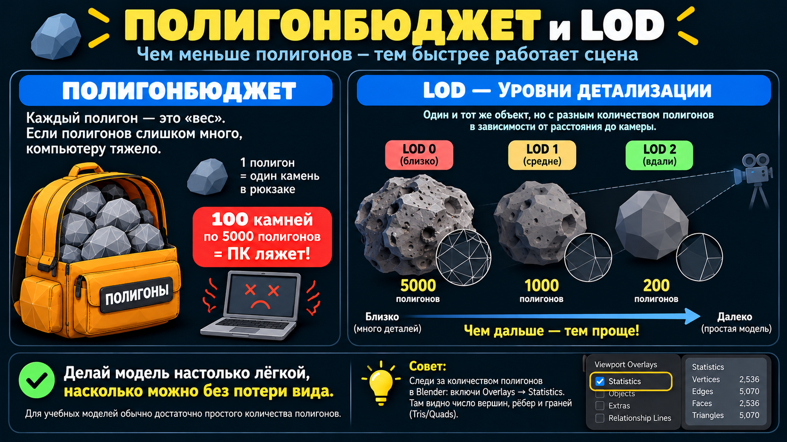
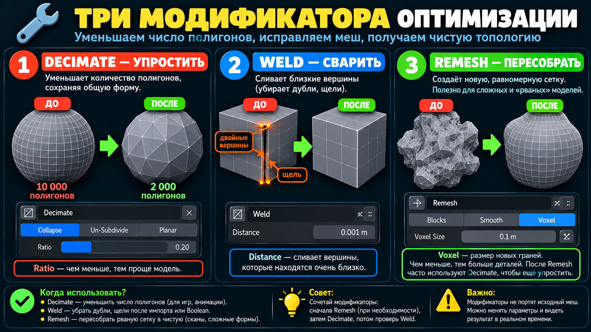
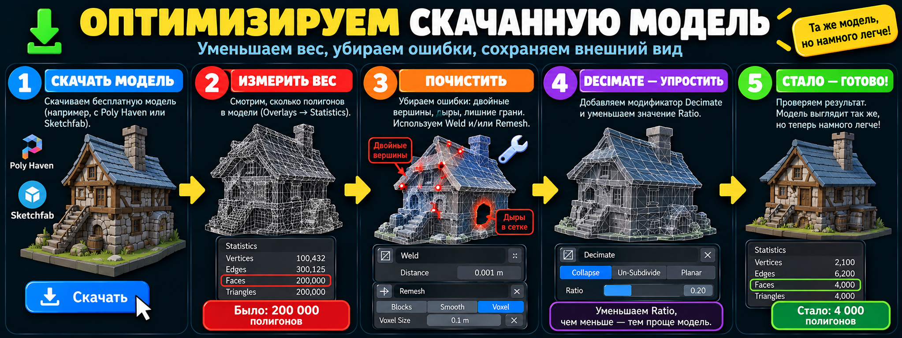
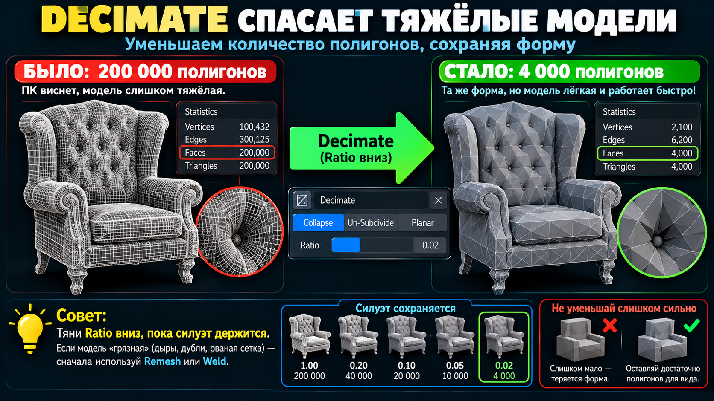

# 📚 Глубокое погружение — Оптимизация модели (low-poly, вес сцены)

> Как сделать модель **лёгкой**, чтобы сцена не тормозила на слабом ПК, в игре или при рендере анимации — и при этом сохранить внешний вид. Это иллюстрированное пособие к уроку 10; инфографики — наши, из урока.

---

## 1. Зачем: полигонбюджет и LOD

Каждая грань нагружает видеокарту **в каждом кадре**. Одна модель на 5000 полигонов — не проблема; сотня таких — уже полмиллиона граней, и ПК «ложится». **Полигонбюджет** — сколько полигонов ты можешь себе позволить в сцене, чтобы она «летала». Правило: модель делают **настолько лёгкой, насколько можно без потери вида**.

**LOD (Levels of Detail)** — вблизи камеры объект детальный, вдали — упрощённый (игрок не разглядит). Так работают все игры.

> 🔎 **Где смотреть вес:** `Overlays → Statistics` — покажет Tris / Faces / Verts. Держи в поле зрения при любой оптимизации.

---

## 2. Три модификатора оптимизации

| Модификатор | Что делает | Ключевой параметр | Когда |
|-------------|-----------|-------------------|-------|
| **Decimate** | уменьшает число полигонов, сохраняя форму | **Ratio** (доля оставшихся, 0–1) | главный инструмент облегчения |
| **Weld** | сваривает близкие вершины (убирает дубли/щели) | **Distance** | после Boolean, импорта, зеркал |
| **Remesh** | пересобирает рваную сетку в равномерную | **Voxel Size** (мельче = детальнее) | «убитая» топология, сканы, скульпт |

**Decimate — режимы:** **Collapse** (универсальный, Ratio), **Un-Subdivide** (отмотать Subdivision), **Planar** (убрать лишнее на плоскостях — для коробок/зданий).

> 💡 **Связка Remesh → Decimate:** Remesh чинит топологию, но даёт много полигонов → после него вешают Decimate. Спасает даже совсем сломанные модели.

> ⚠️ **Decimate (Collapse) делает треугольники** и «грязноватую» топологию — это нормально для финальных/фоновых моделей, но делай его **в самом конце**, если собираешься ещё редактировать/анимировать.

---

## 3. Оптимизируем СКАЧАННУЮ модель (главный рабочий сценарий)

1. **Скачать** — Poly Haven (CC0, без регистрации) / Sketchfab (фильтр Downloadable+Free, нужен аккаунт) / аддон BlenderKit. Импорт: `.blend` → Append; `.fbx`/`.obj`/`.gltf` → `File → Import`.
2. **Измерить вес** — `Overlays → Statistics`, записать Tris («было»).
3. **Почистить** — дубли/щели → **Weld** (или `M → By Distance`); рваная топология → **Remesh** (Voxel).
4. **Облегчить** — **Decimate** (Collapse), Ratio вниз, пока силуэт держится → **Apply**.
5. **Проверить** — силуэт узнаётся, записать «стало». Цель: «200 000 → 4 000».

> ⚠️ **Текстурированная модель:** после сильного Decimate UV/текстура может «поехать» — делай Decimate до UV либо не упрощай слишком агрессивно (подробнее о текстурах — модуль 3).

---

## 4. Лайфхак: low-poly из high-poly

- **Тяни Ratio вниз, пока силуэт держится** — как только форма «плывёт», чуть верни назад.
- **Не упрощай слишком сильно** — лучше оставить запас полигонов, чем потерять форму.
- **Профи-путь:** сделать low-poly + запечь **Normal Map** с high-poly → лёгкая модель «притворяется» детальной (разбор — модули 3 и 5).

---

## 5. Шпаргалка

| Хочу | Делаю |
|------|-------|
| Облегчить модель | **Decimate** → Ratio вниз |
| Починить + облегчить | **Remesh** → **Decimate** |
| Убрать дубли/щели | **Weld** (или `M → By Distance`) |
| Упростить плоские части (коробки) | Decimate режим **Planar** |
| Лёгкая, но детальная | Decimate + запечь **Normal Map** |
| Следить за весом | **Overlays → Statistics** |

> ⚠️ **Золотое правило:** *сначала почини (Weld/Remesh) → потом облегчи (Decimate) → следи за Statistics → упрощай, пока силуэт держится.*

---

🔙 [К серии «Глубокое погружение»](README.md) · [Чистка меша](чистка-меша.md) · [Топология](топология.md)
