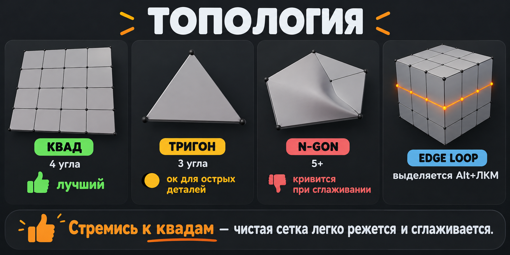
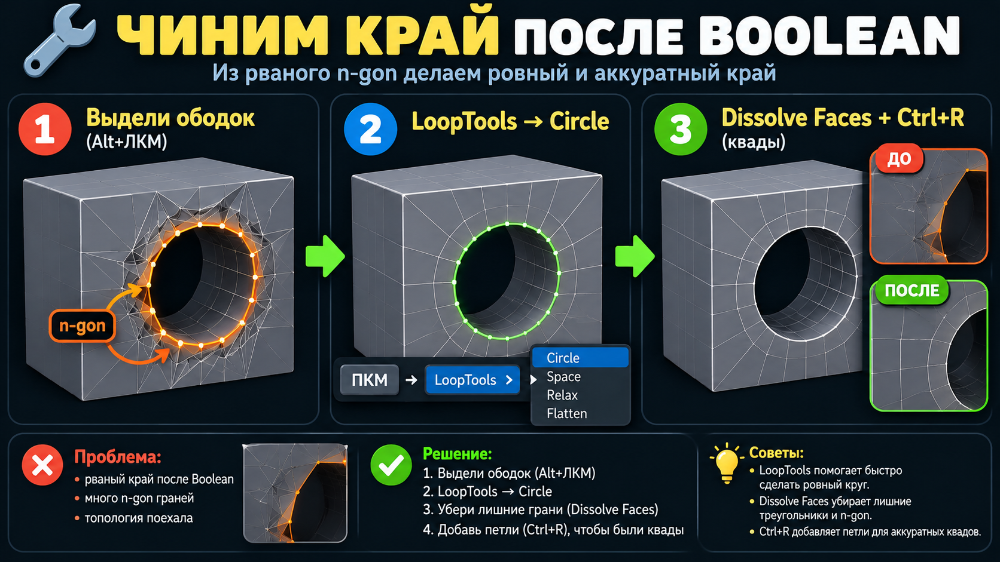
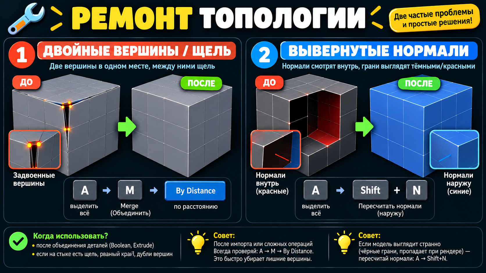
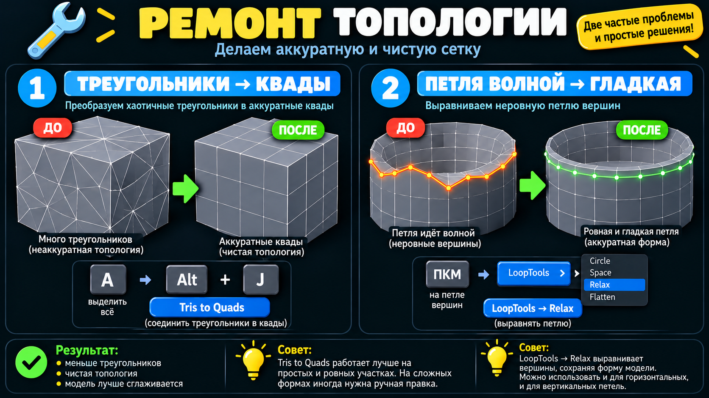
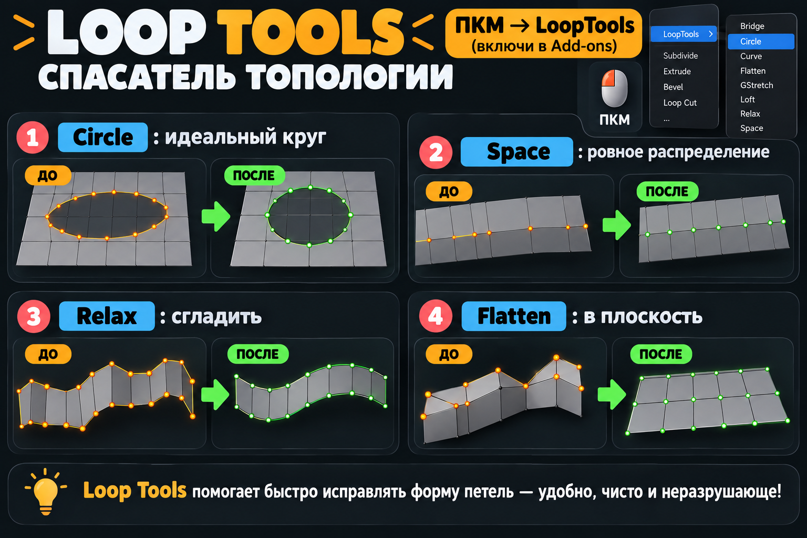
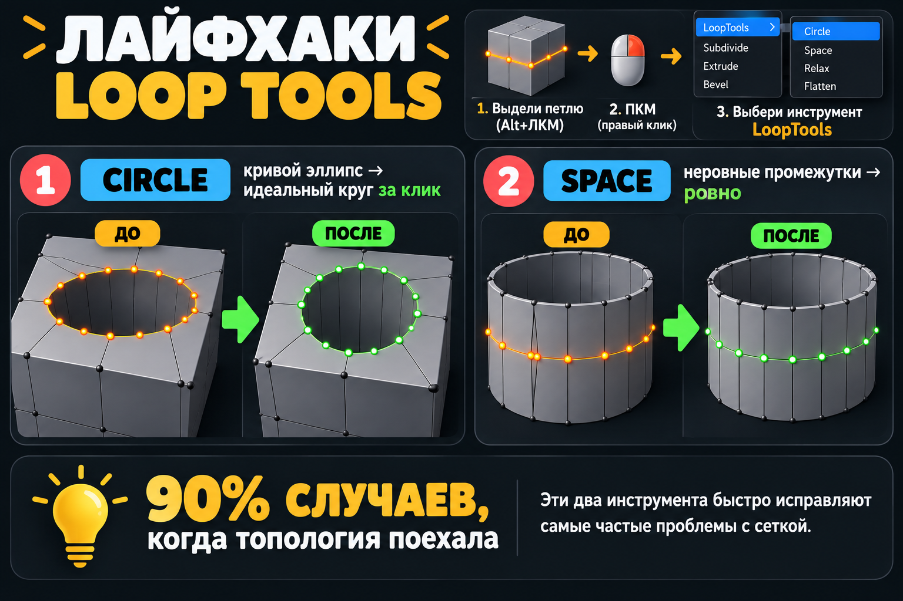

# 📚 Глубокое погружение — Чистка и «здоровье» меша

> Перед текстурированием, риггингом, Boolean, экспортом или печатью модель должна быть **«здоровой»**: без дублей, дыр, вывернутых нормалей и мусора. Грязный меш = непредсказуемые баги. Здесь — как проверить и вылечить.

---

## 🔧 Ремонт топологии по ситуациям — иллюстрированное пособие

> Самое частое, с чем сталкиваешься после Boolean (урок 7) и ручной лепки (урок 9). Ниже — конкретные поломки и как каждую вылечить **по шагам**. Все приёмы — в **Edit Mode**. Полезно включить оверлеи: **Overlays → Statistics** (число tris/quads) и **Face Orientation** (синее — нормаль наружу, красное — вывернута).

### Напоминание: какая сетка «хорошая»

*Стремись к **квадам** (4 угла). Тригоны — только для острых деталей, n-gon'ы при сглаживании «вздуваются». Петля рёбер выделяется `Alt+ЛКМ`.*

---

### Ситуация 1 — рваный край и n-gon'ы после Boolean

1. Режим рёбер (`2`) → `Alt + ЛКМ` по ободку отверстия (выделить петлю).
2. `ПКМ → LoopTools → Circle` (в `F9` включи **Flatten**) — край стал ровным кругом.
3. Остались большие кривые грани-n-gon'ы рядом? Режим граней (`3`) → выдели → `X → Dissolve Faces` → при нужде протяни петлю `Ctrl + R` для аккуратных квадов.

---

### Ситуация 2 — двойные вершины / щель на стыке

1. `A` (выделить всё).
2. `M → By Distance` — Blender слепит вершины, стоящие в одной точке (снизу: «Removed N vertices»).
3. Щель осталась — увеличь **Merge Distance** в `F9`.

### Ситуация 3 — чёрные / вывернутые грани (свет «внутрь»)

1. `A` (всё) → `Shift + N` (Recalculate Normals Outside).
2. Пара осталась вывернутой? Выдели грани → `Alt + N → Flip`.
3. Проверка: оверлей **Face Orientation** — снаружи всё синее.

---

### Ситуация 4 — лишние треугольники, где нужны квады

1. `A` (всё) → `Alt + J` (**Tris to Quads**) — пары треугольников сольются в квады.
2. Наоборот, нужен триангуляр (экспорт в игру)? `Ctrl + T` (Triangulate).

> 💡 **Треугольник после ножа** (частый случай): он появляется, когда рез приходит **в угол-вершину** грани, а не идёт насквозь от края до края. Лечение: выдели лишнее диагональное ребро → `X → Dissolve Edges`, или пару треугольников → `Alt + J`. Для прямых параллельных линий лучше сразу `Ctrl + R` (Loop Cut) — он не плодит треугольники.

### Ситуация 5 — петля «гуляет» волной

1. Режим рёбер (`2`) → `Alt + ЛКМ` выдели кривую петлю.
2. `ПКМ → LoopTools → Relax` (можно 2–3 раза) — петля разгладится, сохранив форму.
3. Нужно сгладить участок вершин — `ПКМ → Smooth Vertices`.

---

### Ситуация 6 — «полюс» (много рёбер в одной точке)

Полюс (5–6 рёбер в вершине) не страшен сам по себе, но при сглаживании даёт складку. **Убери его из гладких мест** (лоб, щека, капот) в уголки, где не видно. Лишнее ребро, ведущее в полюс, растворяй: выдели ребро → `X → Dissolve Edges` (грани останутся).

---

### 🛟 Loop Tools — быстрый «ремонтный набор»

| Проблема | Инструмент (`ПКМ → LoopTools`) |
|----------|--------------------------------|
| Отверстие — кривой эллипс | **Circle** |
| Неравные промежутки на петле | **Space** |
| Петля «волной» | **Relax** |
| Вершины не в одной плоскости | **Flatten** |

> 💡 **Главный порядок «уборки» в конце любой модели:** `A` → `M By Distance` (слить двойные) → `A` → `Shift + N` (нормали) → `Alt + J` (три в квады) → кривые отверстия добить `LoopTools → Circle`. Четыре действия — и сетка чистая.

> 🔗 Эти ситуации разобраны и в [уроке 9 (Часть 4.6)](../../модуль-02-моделирование/урок-09/theory.md). Общая теория — в [Топология](топология.md).

---

## 1. Дубли вершин (самая частая беда)

После экструдов, зеркал, копий часто появляются **наложенные вершины** (две в одной точке). Симптомы: швы не сглаживаются, «рвётся» при SubSurf, дыры в затенении.

- **Лечение:** выдели всё (`A`) → `M → By Distance` (Merge by Distance, бывш. «Remove Doubles»). В `F9` — порог. Blender сообщит, сколько слил.

> 💡 Делай это привычкой после ручного моделинга и Boolean.

---

## 2. Non-manifold (неправильная геометрия)

**Manifold** — «правильный» меш, который мог бы существовать в реальности (каждое ребро между ровно 2 гранями, нет дыр и внутренних стенок). **Non-manifold** — ошибки:
- ребро у **1 грани** (дыра/открытый край),
- ребро у **3+ граней** (склейка),
- внутренние грани, «нулевые» рёбра.

**Найти:** Edit Mode → `Select → All by Trait → Non Manifold` (или `Shift+Ctrl+Alt+M`). Подсветится проблемное.

> ⚠️ Non-manifold ломает Boolean, 3D-печать и некоторые модификаторы. Для **закрытых** моделей (которые должны быть «сплошными») non-manifold — сигнал к починке. Для **открытых** плоскостей (лист, плащ) открытый край — это норма.

---

## 3. N-gon и треугольники — найти и убрать

- **Найти:** `Select → All by Trait → Faces by Sides` → выбери «Greater Than 4» (n-gon) или «Equal To 3» (трисы).
- **Зачем чистить:** n-gon/трисы плохи на кривых и под SubSurf/деформацией (см. [Топология](топология.md)).
- **Починить:** Grid Fill, добивка рёбрами (`J`), `Alt+J` (Tris→Quads).

---

## 4. Мусор: висящая геометрия и внутренние грани

| Что | Найти | Убрать |
|-----|-------|--------|
| **Loose** (точки/рёбра без граней) | `Select → All by Trait → Loose Geometry` | `X → Vertices` |
| **Interior Faces** (грани внутри объёма) | `Select → All by Trait → Interior Faces` | `X → Faces` |
| **Нулевые/вырожденные** грани | Merge by Distance | сливаются |

---

## 5. Delete vs Dissolve (повтор — важно)

- **Delete (`X`)** — убирает геометрию **с дырой**.
- **Dissolve (`Ctrl+X`)** — убирает элемент, **сохраняя поверхность** (упростить топологию).

Чистя лишние рёбра/петли — **Dissolve**, иначе наделаешь дыр.

---

## 6. Нормали (коротко — подробно в отдельном гайде)

- Вывернутые грани (тёмные пятна): `A` → `Shift+N` (Recalculate Outside).
- Проверка: Overlays → Face Orientation (красное = вывернуто).
- Подробно — [Нормали и сглаживание](нормали-сглаживание.md).

---

## 7. Инструменты диагностики

| Инструмент | Где | Показывает |
|-----------|-----|-----------|
| **Statistics** | Overlays → Statistics | число вершин/граней/трисов (следить за бюджетом) |
| **Face Orientation** | Overlays | вывернутые нормали (красное) |
| **Mesh Analysis** | Edit → N-панель → Mesh Analysis | толщину, навесы, пересечения, искажения (для печати) |
| **Select Non Manifold** | Select → All by Trait | проблемные края |

---

## 8. ✅ Чек-лист «здоровый меш» (перед текстурой/ригом/экспортом)

- [ ] **Merge by Distance** сделан (нет дублей)
- [ ] Нет **non-manifold** (для закрытых моделей)
- [ ] Нормали наружу (`Shift+N`, Face Orientation — синее)
- [ ] Нет лишних **n-gon/трисов** на деформируемых/гладких местах
- [ ] Убран **мусор** (Loose, Interior Faces)
- [ ] **Трансформации применены** (`Ctrl+A → All Transforms`)
- [ ] Имена/коллекции в порядке (Outliner)

---

## 9. Мини-практика

1. Сдублируй часть меша на месте (`Shift+D` → `Esc`) → `M → By Distance` → посмотри, сколько слил.
2. Найди non-manifold на «дырявой» модели (`Shift+Ctrl+Alt+M`).
3. Найди все n-gon (`Faces by Sides → Greater Than 4`) и переведи в квады.
4. Удали «висячие» точки (Loose Geometry).
5. Пройди по чек-листу на своей модели из прошлого урока.

> 💡 **Главная мысль:** «здоровый» меш — это привычка, а не разовая уборка. Перед каждым важным шагом (текстуры, риг, Boolean, экспорт) прогони чек-лист — и не будет загадочных багов «почему не работает».

---

🔙 [К серии «Глубокое погружение»](README.md) · [Топология](топология.md) · [Нормали и сглаживание](нормали-сглаживание.md)
