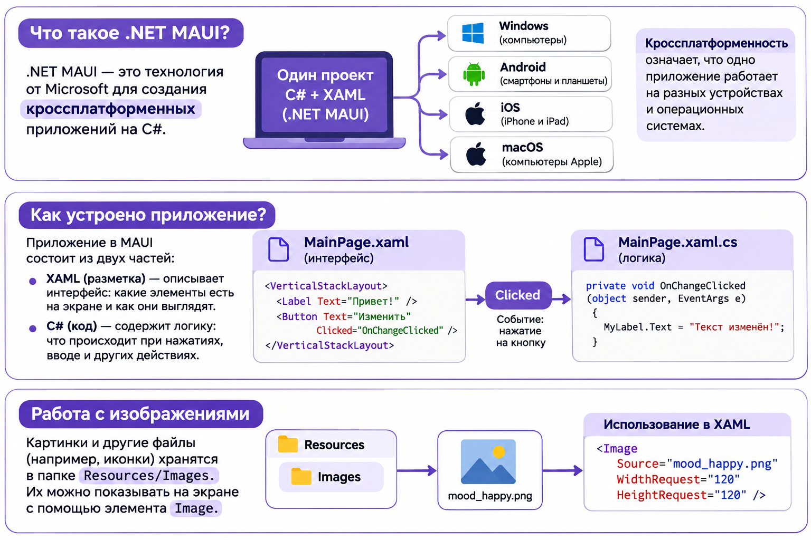
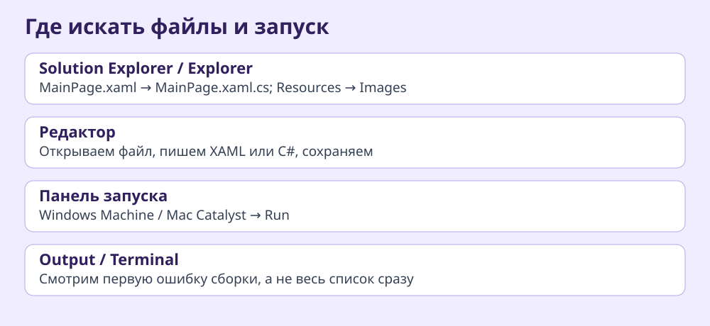
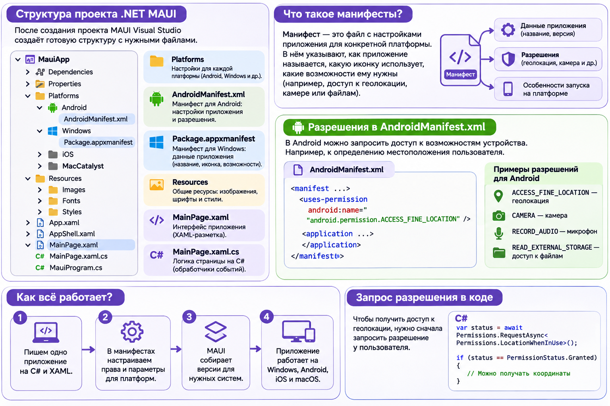
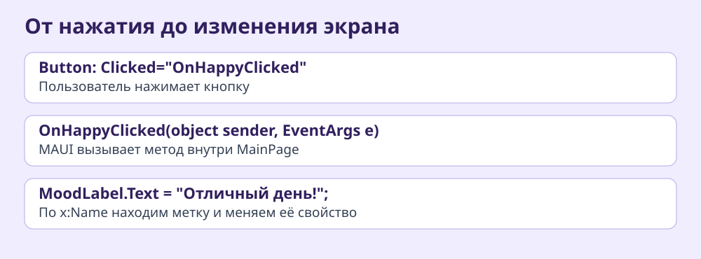

# Урок 1. Знакомство с .NET MAUI — «Моё настроение»

До этого мы писали программы, которые выводили результат в консоль. Представь, что нужно сделать приложение для телефона: человек не должен вводить команды в чёрное окно, он хочет нажимать кнопки, видеть картинки и выбирать нужные действия. Для этого нам понадобится графический интерфейс.

## Что такое .NET MAUI

.NET MAUI (Multi-platform App UI) — технология .NET для создания приложений с графическим интерфейсом. Мы продолжаем писать логику на C#, но внешний вид будем описывать на XAML. Можно сделать калькулятор, дневник, каталог книг, приложение для тренировок или небольшую игру с кнопками.

Кроссплатформенность означает, что значительную часть кода можно использовать на нескольких операционных системах. Например, один метод расчёта стоимости билета работает и на Windows, и на Android. MAUI создаёт отдельную сборку для каждой платформы; это не один универсальный exe. На Mac запускаем Mac Catalyst, на школьном ПК — Windows. Для iOS нужны инструменты Apple, для Android — Android SDK. Внешний вид некоторых элементов может отличаться.



На схеме показана общая идея. В примере с MyLabel на схеме для обращения из C# необходимо добавить метке `x:Name="MyLabel"`.

## Создаём первый проект и проверяем среду

### Windows: Visual Studio

1. Открой Visual Studio Installer. У установленной Visual Studio нажми Modify и проверь рабочую нагрузку .NET Multi-platform App UI development. Если её нет, попроси преподавателя установить компоненты.
2. В Visual Studio выбери Create a new project. В поиске введи MAUI и выбери именно .NET MAUI App, не Blazor Hybrid и не Class Library.
3. Назови проект `MoodApp`. В Location укажи `C:\Projects` (или другую доступную локальную папку). Не создавай первый тест на сетевом диске. Нажми Next, выбери доступную версию платформы и Create.
4. В верхней панели выбери Windows Machine. Нажми зелёную кнопку запуска или F5. Дождись появления стандартного приложения и нажми кнопку счётчика. Если число меняется, среда работает.
5. Если запуск не удался, не переписывай MainPage. Открой View → Output, выбери Build и найди первую ошибку. Error List показывает список ошибок, но многие из них могут быть следствием одной первой ошибки.

На школьных компьютерах с VS 2022 используем установленную совместимую версию MAUI 8/9 как временный вариант; для .NET 10 нужна Visual Studio 2026. MAUI 8/9 уже не поддерживаются. Не копируй чужой csproj с Mac. Если шаблон не запускается, преподаватель проверяет `dotnet --list-sdks`, `dotnet workload list`, Developer Mode Windows и Build → Configuration Manager (Build и Deploy для Windows, если доступен). Ошибки отсутствующих AndroidManifest.xml или Package.appxmanifest проверяем на новом локальном проекте; не создаём пустые манифесты вручную. Подробности — в [справочнике среды](../../справочники/среда-VisualStudio-и-VSCode.md).

### Mac: VS Code

Открой папку проекта в VS Code. Установленные .NET SDK, MAUI workload и Xcode должны быть совместимы. В терминале можно создать проект `dotnet new maui -n MoodApp`, затем `cd MoodApp`. Выбери Mac Catalyst в расширении .NET MAUI и запусти отладку. Для проекта .NET 10 также можно выполнить `dotnet build -t:Run -f net10.0-maccatalyst`. Для другой версии используй соответствующий TargetFramework из csproj. Сначала проверь шаблон, затем меняй код.

## Где что находится в редакторе



В Visual Studio справа обычно находится Solution Explorer (View → Solution Explorer), в VS Code слева Explorer. Раскрой проект, найди MainPage.xaml и вложенный MainPage.xaml.cs. Центральная область — редактор; сверху выбирается устройство запуска; внизу Output/Terminal показывает сборку. Остановить отладку в Visual Studio можно Shift+F5. После изменения разметки сохрани файл Ctrl+S (на Mac Cmd+S); если Hot Reload не обновил экран, останови и запусти заново.

| Файл | Назначение |
|---|---|
| MainPage.xaml | Разметка экрана |
| MainPage.xaml.cs | Логика экрана |
| AppShell.xaml | Начальная страница и навигация |
| MauiProgram.cs | Настройка приложения |
| Resources/Images | Изображения |
| Platforms | Файлы конкретных платформ |

App.xaml хранит общие ресурсы, App.xaml.cs запускает приложение, Resources/Styles содержит общие цвета и стили. Platforms содержит код и настройки конкретных ОС; сегодня познакомимся с манифестами. MainPage.xaml и MainPage.xaml.cs — две части одного partial-класса. Значение x:Class должно совпадать с namespace и именем класса.

## Манифесты приложения и разрешения

В папке Platforms находятся настройки отдельных операционных систем. Представь приложение погоды: чтобы показать прогноз для твоего города, оно может запросить местоположение. Операционная система должна знать, какие возможности нужны приложению. Для этого используются манифесты и другие файлы настроек платформы.



| Платформа | Файл | Назначение |
|---|---|---|
| Android | `Platforms/Android/AndroidManifest.xml` | Компоненты, разрешения и настройки |
| Windows | `Platforms/Windows/Package.appxmanifest` | Данные пакета и возможности приложения |
| iOS | `Platforms/iOS/Info.plist` | Настройки и объяснения причин доступа |
| Mac Catalyst | `Platforms/MacCatalyst/Info.plist`, `Entitlements.plist` | Настройки и права приложения |

Название и версия приложения в MAUI часто задаются в файле `.csproj` и переносятся в платформенные настройки при сборке. Манифесты не следует удалять: именно отсутствие AndroidManifest.xml и Package.appxmanifest встречалось при запуске проектов в классе. Если файлы отсутствуют, проверь новый проект на локальном диске по инструкции выше, а не создавай пустые файлы вручную.

### Разрешения Android

Открой `Platforms/Android/AndroidManifest.xml`. Внутри корневого тега `manifest` можно увидеть объявления `uses-permission`. Например:

```xml
<uses-permission android:name="android.permission.INTERNET" />
```

Для приложения, которому нужна геолокация, объявляют следующие разрешения (внутри `manifest`, но вне `application`):

```xml
<uses-permission android:name="android.permission.ACCESS_COARSE_LOCATION" />
<uses-permission android:name="android.permission.ACCESS_FINE_LOCATION" />
```

| Разрешение | Для чего нужно |
|---|---|
| INTERNET | Доступ к сети |
| ACCESS_COARSE_LOCATION | Приблизительное местоположение |
| ACCESS_FINE_LOCATION | Точное местоположение |
| CAMERA | Использование камеры |
| RECORD_AUDIO | Запись звука |
| POST_NOTIFICATIONS | Уведомления на Android 13 и новее |

Объявление разрешения не означает, что пользователь уже согласился. Интернет обычно не требует отдельного диалога, а доступ к геолокации, камере и микрофону необходимо запрашивать во время работы приложения. Пользователь может отказать или предоставить только приблизительное местоположение.

### Как приложение запрашивает доступ

Позже мы научимся писать асинхронные методы. Пока посмотрим на пример для запроса местоположения из открытой страницы:

```csharp
private async void OnLocationClicked(object sender, EventArgs e)
{
    PermissionStatus status = await Permissions.RequestAsync<Permissions.LocationWhenInUse>();
    if (status == PermissionStatus.Granted)
    {
        // Можно перейти к получению местоположения.
    }
    else
    {
        // Объясняем, почему функция недоступна.
    }
}
```

Этот пример только запрашивает разрешение, а не получает координаты. Для других платформ также нужны соответствующие настройки; например, на iOS в Info.plist указывают причину доступа к местоположению. На схеме приведён сокращённый пример Android; для современной геолокации используй оба разрешения из текста выше. READ_EXTERNAL_STORAGE на схеме относится к старым версиям Android и не является универсальным способом доступа к файлам сегодня.

**Мини-задание.** Найди оба манифеста в своём проекте. Посмотри, какие разрешения уже объявлены в AndroidManifest.xml. В Windows открой Package.appxmanifest и найди Capabilities, если доступен графический редактор. Обсуди, какие разрешения нужны приложению для фотографирования достопримечательностей и отметки их на карте. Ничего добавлять в проект «Моё настроение» не нужно: его кнопки и встроенные картинки не требуют дополнительных разрешений.

## 2. Как устроен XAML
Тег обозначает элемент, атрибут — его свойство. `<Label Text="Привет" />` — короткая запись тега без вложенного содержимого. Контейнер открывается и закрывается отдельными тегами. У ContentPage один корневой визуальный элемент; внутри контейнера может быть много элементов.

```xml
<VerticalStackLayout Padding="24" Spacing="14">
    <Label Text="Привет" />
    <Button Text="Начать" />
</VerticalStackLayout>
```
`Padding` — отступ внутри контейнера, `Spacing` — расстояние между детьми. `ScrollView` позволяет прокрутить содержимое на маленьком экране. Сегодня используем только вертикальную раскладку; подробно контейнеры изучим на следующем уроке.

## 3. Label — текст на экране
```xml
<Label x:Name="MoodLabel" Text="Как проходит твой день?"
       FontSize="24" TextColor="#26334A" HorizontalTextAlignment="Center" />
```
| Свойство | Что делает | Пример |
|---|---|---|
| Text | Содержимое | Привет |
| FontSize | Размер текста | 24 |
| FontAttributes | Начертание | Bold, Italic |
| TextColor | Цвет | #26334A |
| HorizontalTextAlignment | Положение текста внутри метки | Center |
| HorizontalOptions | Положение самой метки | Center |
| IsVisible | Видимость | False |

`x:Name` даёт элементу имя, по которому обращаемся к нему из C#. Имена уникальны, латиницей, без пробелов. После `InitializeComponent()` элементы доступны в коде.

```csharp
MoodLabel.Text = "Отличный день!";
MoodLabel.FontSize = 28;
MoodLabel.TextColor = Colors.DarkBlue;
```
В XAML число записываем в кавычках, в C# числовое свойство получает число без кавычек. Цвет в C# — объект Color, а не строка: `Color.FromArgb("#26334A")`.

## 4. Button — действие пользователя
```xml
<Button Text="Радостное" BackgroundColor="#FFD66B"
        TextColor="#26334A" CornerRadius="16" Clicked="OnHappyClicked" />
```
`Text` — надпись, `BackgroundColor` — фон, `CornerRadius` — скругление, `IsEnabled` — можно ли нажать. `Clicked` — событие, а не текст или цвет. Имя обработчика должно совпадать с методом в C#.

```csharp
private void OnHappyClicked(object sender, EventArgs e)
{
    MoodLabel.Text = "Отличный день!";
}
```
`private` — метод доступен внутри класса; `void` — не возвращает результат; `sender` — объект, вызвавший событие; `e` — данные события. Пока эти параметры не используем, но сигнатуру сохраняем. Метод пишем внутри класса MainPage, не внутри конструктора. `InitializeComponent()` создаёт элементы из разметки и связывает события.

## 5. Image — изображение
Скопируй [три картинки](материалы/Resources/Images/) в Resources/Images проекта. Имена файлов — маленькими латинскими буквами, без пробелов; действие сборки MauiImage.
```xml
<Image x:Name="MoodImage" Source="mood_happy.png"
       HeightRequest="180" Aspect="AspectFit" />
```
`Source` — источник, `HeightRequest` — желаемая высота, `AspectFit` — картинка целиком с сохранением пропорций, `AspectFill` — заполнение области с возможной обрезкой. В коде: `MoodImage.Source = "mood_sad.png";`. После добавления ресурса пересобери проект.

## Цвета и первое знакомство со стилями

В XAML можно написать `TextColor="Red"` или `TextColor="#26334A"`. HEX состоит из трёх пар RR GG BB: красный, зелёный, синий. `#FF0000` — красный, `#00FF00` — зелёный. В C# цвет задаём `Colors.Red`, `Color.FromArgb("#26334A")` или `Color.FromRgb(38, 51, 74)`. Последний способ принимает три числа от 0 до 255. Попробуй поменять только одну составляющую и посмотреть результат.

Если у трёх кнопок одинаковый размер и скругление, можно описать оформление один раз. Вставь этот блок непосредственно внутри ContentPage, перед ScrollView:

```xml
<ContentPage.Resources>
    <Style x:Key="MoodButtonStyle" TargetType="Button">
        <Setter Property="CornerRadius" Value="16" />
        <Setter Property="FontSize" Value="18" />
    </Style>
</ContentPage.Resources>
```

Применение: `<Button Text="Радостное" Style="{StaticResource MoodButtonStyle}" />`. x:Key — имя ресурса, TargetType — тип элемента, Setter — одно свойство. Это необязательный эксперимент после основного проекта. Общие стили всего приложения можно хранить в Resources/Styles/Styles.xaml, цвета — в Colors.xaml. Не удаляй ресурсы шаблона.

## События: почему методы отличаются



Событие — уведомление о действии. Обработчик — метод, который запускается при этом действии. Для Button.Clicked используем EventArgs, для Entry.TextChanged — TextChangedEventArgs, для Slider.ValueChanged — ValueChangedEventArgs. У Picker.SelectedIndexChanged используется EventArgs. Нельзя привязать произвольную функцию с неподходящими параметрами. Если нужен метод с собственными параметрами, вызови его из обработчика. В Visual Studio можно набрать Clicked в XAML и воспользоваться подсказкой IntelliSense для создания обработчика; если подсказки нет, напиши метод вручную. Имя чувствительно к регистру. `x:Name` не требуется для самого события, но нужен, если обращаемся к элементу по имени.

## Собираем приложение вместе


### Шаг 1. Подготовка картинок и страницы

Скопируй файлы из [Resources/Images](материалы/Resources/Images/) в одноимённую папку своего проекта. В Visual Studio при необходимости Add → Existing Item. Проверь Build Action = MauiImage. Не вставляй абсолютный путь к файлу в Source. Сохрани исходный x:Class и пространства имён в открывающем теге ContentPage. Удали старое содержимое страницы (ScrollView с роботом и счётчиком), но не сам ContentPage. Вставь внутрь следующий блок:

```xml
<ScrollView>
    <VerticalStackLayout Padding="24" Spacing="14">
        <Label Text="Моё настроение" FontSize="30" FontAttributes="Bold" />
        <Image x:Name="MoodImage" Source="mood_happy.png" HeightRequest="180" Aspect="AspectFit" />
        <Label x:Name="MoodLabel" Text="Как проходит день?" FontSize="24" HorizontalTextAlignment="Center" />
        <Label x:Name="AdviceLabel" Text="Выбери настроение" HorizontalTextAlignment="Center" />
    </VerticalStackLayout>
</ScrollView>
```

В MainPage.xaml.cs оставь конструктор с InitializeComponent(), удали старый OnCounterClicked, поскольку CounterBtn больше нет. Запусти. На экране должны быть четыре элемента, пока без кнопок. Если изображение отсутствует, проверь имя и пересобери проект.

### Шаг 2. Первое действие

Перед закрывающим тегом VerticalStackLayout добавь `<Button Text="Радостное" Clicked="OnHappyClicked" />`. Внутри класса MainPage, после конструктора, напиши:

```csharp
private void OnHappyClicked(object sender, EventArgs e)
{
    MoodLabel.Text = "Отличный день!";
    AdviceLabel.Text = "Поделись хорошим настроением.";
    MoodImage.Source = "mood_happy.png";
    BackgroundColor = Color.FromArgb("#FFF4D6");
}
```

Запусти и нажми кнопку. Изменились две надписи и фон. Если компилятор не видит Color, добавь `using Microsoft.Maui.Graphics;` в начало файла. Если не видит MoodLabel, проверь x:Name и x:Class.

### Шаг 3. Остальные кнопки

Добавь ещё две кнопки рядом с первой (внутри того же контейнера):

```xml
<Button Text="Спокойное" Clicked="OnCalmClicked" />
<Button Text="Грустное" Clicked="OnSadClicked" />
```

Создай два метода с такой же сигнатурой, как у OnHappyClicked. В первом меняй текст на «Спокойный день», совет на «Найди время для любимого дела», картинку на mood_calm.png и фон на #E2F7F5. Во втором — «Бывает и так», «Можно отдохнуть или поговорить с близкими», mood_sad.png, #EFEAFF. Проверь переходы в обе стороны.

### Шаг 4. Убираем повторение

Во всех трёх методах меняются одни и те же свойства. Создай общий метод внутри класса, но вне других методов:

```csharp
private void SetMood(string title, string advice, string image, Color color)
{
    MoodLabel.Text = title;
    AdviceLabel.Text = advice;
    MoodImage.Source = image;
    BackgroundColor = color;
}
```

Теперь замени тело OnHappyClicked на `SetMood("Отличный день!", "Поделись хорошим настроением.", "mood_happy.png", Color.FromArgb("#FFF4D6"));`. Аналогично передай четыре значения для остальных настроений. Порядок аргументов важен. Сам Clicked по-прежнему связан с OnHappyClicked, а не с SetMood.

### Шаг 5. Дополнение: случайный выбор

Добавь кнопку с Clicked="OnRandomClicked". В обработчике получи `int choice = Random.Shared.Next(3);` — это 0, 1 или 2. Через if/else вызови нужный обработчик, передав sender и e, либо SetMood с нужными аргументами. Проверь несколько нажатий. Повтор одного настроения допустим.

## Готовый код для сверки

Сначала попробуй собрать по шагам, затем сравни с [MainPage.xaml](материалы/MainPage.xaml) и [MainPage.xaml.cs](материалы/MainPage.xaml.cs). Не заменяй namespace своего проекта чужим. После проверки переходи к [практике](практика.md).
