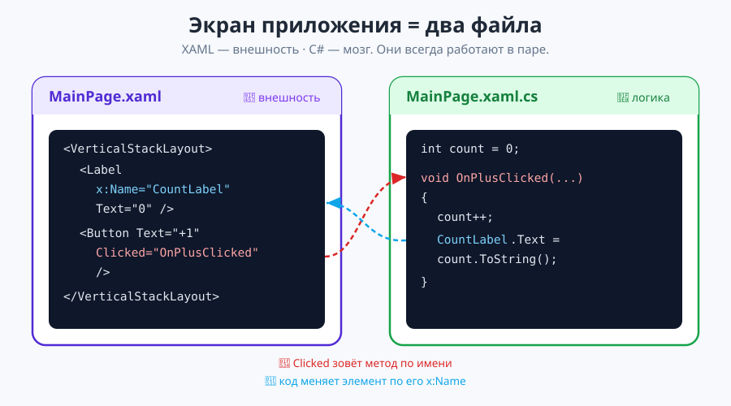
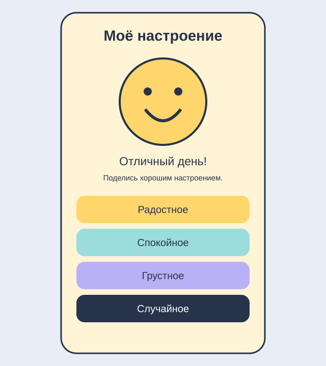

# Урок 1 (Блок 2). Введение в MAUI — «Моё настроение»

**Блок 2 · Урок 1 | 90 минут**

Сегодня научимся создавать экран приложения, выводить текст и картинки, обрабатывать нажатия и менять свойства элементов из C#. В конце соберём приложение, которое реагирует на выбор настроения.



## 1. От консоли к приложению
В консоли `Console.WriteLine` выводил текст, а программа выполнялась последовательно. В MAUI экран остаётся открытым и ждёт действий пользователя. Когда человек нажимает кнопку, вызывается метод — обработчик события. MAUI позволяет использовать общий код на Windows, Android, iOS и Mac Catalyst; для каждой платформы нужны свои инструменты сборки.

| Файл | Назначение |
|---|---|
| MainPage.xaml | Разметка экрана |
| MainPage.xaml.cs | Логика экрана |
| AppShell.xaml | Начальная страница и навигация |
| MauiProgram.cs | Настройка приложения |
| Resources/Images | Изображения |
| Platforms | Файлы конкретных платформ |

Создай проект `MoodApp` по [инструкции запуска](материалы/README-проект.md). Сначала запусти стандартный шаблон. Если он не работает, обратись к преподавателю: пока не меняй код.

## 2. Как устроен XAML
Тег обозначает элемент, атрибут — его свойство. `<Label Text="Привет" />` — короткая запись тега без вложенного содержимого. Контейнер открывается и закрывается отдельными тегами. У ContentPage один корневой визуальный элемент; внутри контейнера может быть много элементов.

```xml
<VerticalStackLayout Padding="24" Spacing="14">
    <Label Text="Привет" />
    <Button Text="Начать" />
</VerticalStackLayout>
```
`Padding` — отступ внутри контейнера, `Spacing` — расстояние между детьми. `ScrollView` позволяет прокрутить содержимое на маленьком экране. Сегодня используем только вертикальную раскладку; подробно контейнеры изучим на следующем уроке.

## 3. Label — текст на экране
```xml
<Label x:Name="MoodLabel" Text="Как проходит твой день?"
       FontSize="24" TextColor="#26334A" HorizontalTextAlignment="Center" />
```
| Свойство | Что делает | Пример |
|---|---|---|
| Text | Содержимое | Привет |
| FontSize | Размер текста | 24 |
| FontAttributes | Начертание | Bold, Italic |
| TextColor | Цвет | #26334A |
| HorizontalTextAlignment | Положение текста внутри метки | Center |
| HorizontalOptions | Положение самой метки | Center |
| IsVisible | Видимость | False |

`x:Name` даёт элементу имя, по которому обращаемся к нему из C#. Имена уникальны, латиницей, без пробелов. После `InitializeComponent()` элементы доступны в коде.

```csharp
MoodLabel.Text = "Отличный день!";
MoodLabel.FontSize = 28;
MoodLabel.TextColor = Colors.DarkBlue;
```
В XAML число записываем в кавычках, в C# числовое свойство получает число без кавычек. Цвет в C# — объект Color, а не строка: `Color.FromArgb("#26334A")`.

## 4. Button — действие пользователя
```xml
<Button Text="Радостное" BackgroundColor="#FFD66B"
        TextColor="#26334A" CornerRadius="16" Clicked="OnHappyClicked" />
```
`Text` — надпись, `BackgroundColor` — фон, `CornerRadius` — скругление, `IsEnabled` — можно ли нажать. `Clicked` — событие, а не текст или цвет. Имя обработчика должно совпадать с методом в C#.

```csharp
private void OnHappyClicked(object sender, EventArgs e)
{
    MoodLabel.Text = "Отличный день!";
}
```
`private` — метод доступен внутри класса; `void` — не возвращает результат; `sender` — объект, вызвавший событие; `e` — данные события. Пока эти параметры не используем, но сигнатуру сохраняем. Метод пишем внутри класса MainPage, не внутри конструктора. `InitializeComponent()` создаёт элементы из разметки и связывает события.

## 5. Image — изображение
Скопируй [три картинки](материалы/Resources/Images/) в Resources/Images проекта. Имена файлов — маленькими латинскими буквами, без пробелов; действие сборки MauiImage.
```xml
<Image x:Name="MoodImage" Source="mood_happy.png"
       HeightRequest="180" Aspect="AspectFit" />
```
`Source` — источник, `HeightRequest` — желаемая высота, `AspectFit` — картинка целиком с сохранением пропорций, `AspectFill` — заполнение области с возможной обрезкой. В коде: `MoodImage.Source = "mood_sad.png";`. После добавления ресурса пересобери проект.

## 6. Собираем приложение вместе


### Шаг 1. Разметка
Открой MainPage.xaml. Сохрани xmlns и x:Class своего проекта. Замени содержимое страницы на ScrollView с VerticalStackLayout. Добавь заголовок, картинку и две метки. Используй имена MoodImage, MoodLabel и AdviceLabel. Запусти: пока виден статичный экран.

### Шаг 2. Первая кнопка
Добавь кнопку «Радостное» с Clicked="OnHappyClicked". В MainPage.xaml.cs оставь конструктор с InitializeComponent, удали старый OnCounterClicked (если он есть) и добавь обработчик из раздела 4. Запусти: заголовок меняется. Добавь изменение картинки и фона страницы.

### Шаг 3. Остальные настроения
Добавь кнопки «Спокойное» и «Грустное» с обработчиками OnCalmClicked и OnSadClicked. Для каждой меняй заголовок, совет, картинку и фон. Проверь все три кнопки.

### Шаг 4. Убираем повторение
В блоке 1 мы изучали методы с параметрами. Вынесем четыре одинаковых действия в один метод:
```csharp
private void SetMood(string title, string advice, string image, Color color)
{
    MoodLabel.Text = title;
    AdviceLabel.Text = advice;
    MoodImage.Source = image;
    BackgroundColor = color;
}
```
Теперь обработчик вызывает `SetMood("Отличный день!", "Поделись хорошим настроением.", "mood_happy.png", Color.FromArgb("#FFF4D6"));`. Параметры передаются в том же порядке, в котором объявлены. Перепиши остальные обработчики по образцу.

### Шаг 5. Дополнение для быстрых учеников
Кнопка «Случайное» вызывает OnRandomClicked. `Random.Shared.Next(3)` возвращает 0, 1 или 2. Через if/else выбери один из трёх обработчиков. Повторное выпадение одного настроения допустимо. Это необязательное дополнение.

Полные файлы: [XAML](материалы/MainPage.xaml), [C#](материалы/MainPage.xaml.cs).

## 7. Проверка
Нажми каждую кнопку: меняются обе метки, изображение и фон. Уменьши окно: содержимое прокручивается. Проверь, что текст читается. Затем переходи к [практике](практика.md): там другие приложения, а не копия настроения.
