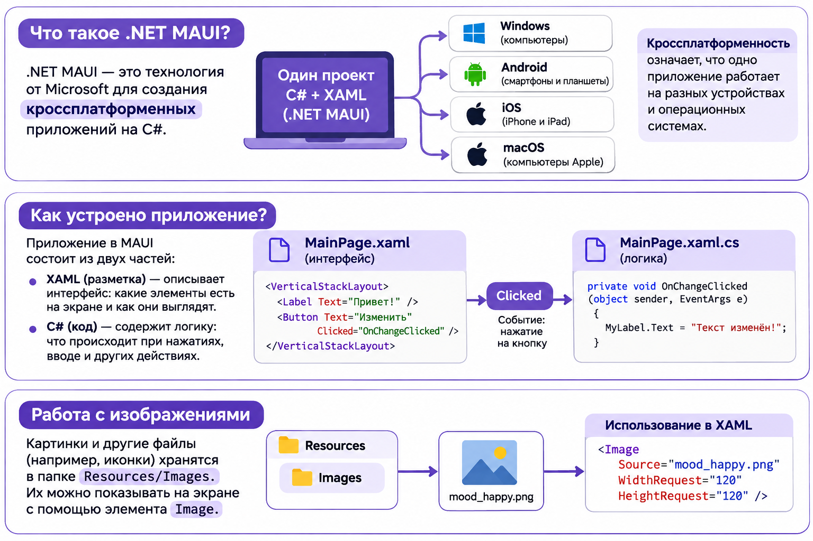
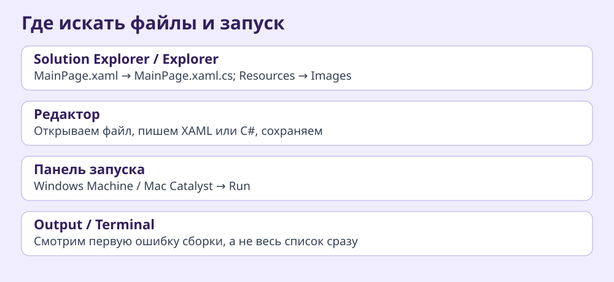
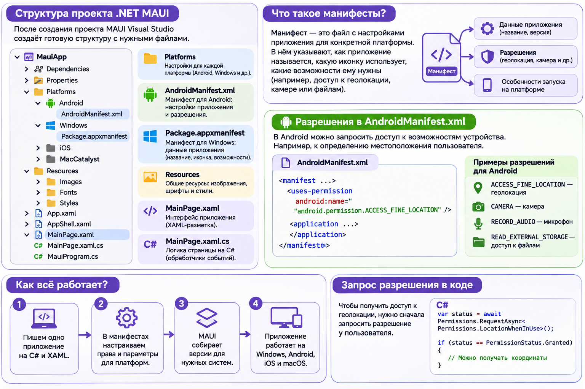
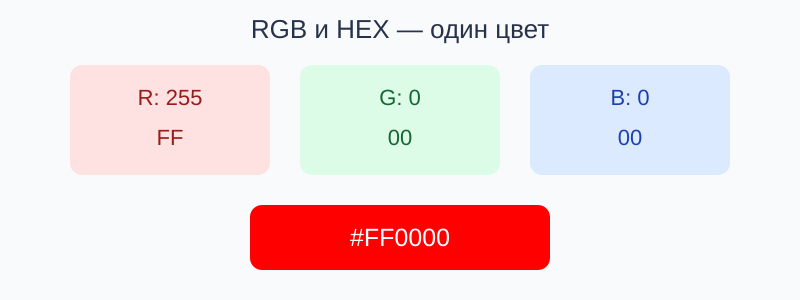
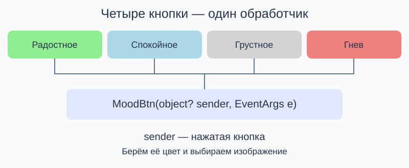

# Урок 1. Знакомство с .NET MAUI — «Моё настроение»

До этого мы писали программы, которые выводили результат в консоль. Представь, что нужно сделать приложение для телефона: человек не должен вводить команды в чёрное окно, он хочет нажимать кнопки, видеть картинки и выбирать нужные действия. Для этого нам понадобится графический интерфейс.

## Что такое .NET MAUI

.NET MAUI (Multi-platform App UI) — технология .NET для создания приложений с графическим интерфейсом. Мы продолжаем писать логику на C#, но внешний вид будем описывать на XAML. Можно сделать калькулятор, дневник, каталог книг, приложение для тренировок или небольшую игру с кнопками.

Кроссплатформенность означает, что значительную часть кода можно использовать на нескольких операционных системах. Например, один метод расчёта стоимости билета работает и на Windows, и на Android. MAUI создаёт отдельную сборку для каждой платформы; это не один универсальный exe. На Mac запускаем Mac Catalyst, на школьном ПК — Windows. Для iOS нужны инструменты Apple, для Android — Android SDK. Внешний вид некоторых элементов может отличаться.



На схеме показана общая идея. В примере с MyLabel на схеме для обращения из C# необходимо добавить метке `x:Name="MyLabel"`.

## Создаём первый проект и проверяем среду

### Windows: Visual Studio

1. Открой Visual Studio Installer. У установленной Visual Studio нажми Modify и проверь рабочую нагрузку .NET Multi-platform App UI development. Если её нет, попроси преподавателя установить компоненты.
2. В Visual Studio выбери Create a new project. В поиске введи MAUI и выбери именно .NET MAUI App, не Blazor Hybrid и не Class Library.
3. Назови проект `MoodApp`. В Location укажи `C:\Projects` (или другую доступную локальную папку). Не создавай первый тест на сетевом диске. Нажми Next, выбери доступную версию платформы и Create.
4. В верхней панели выбери Windows Machine. Нажми зелёную кнопку запуска или F5. Дождись появления стандартного приложения и нажми кнопку счётчика. Если число меняется, среда работает.
5. Если запуск не удался, не переписывай MainPage. Открой View → Output, выбери Build и найди первую ошибку. Error List показывает список ошибок, но многие из них могут быть следствием одной первой ошибки.

На школьных компьютерах с VS 2022 используем установленную совместимую версию MAUI 8/9 как временный вариант; для .NET 10 нужна Visual Studio 2026. MAUI 8/9 уже не поддерживаются. Не копируй чужой csproj с Mac. Если шаблон не запускается, преподаватель проверяет `dotnet --list-sdks`, `dotnet workload list`, Developer Mode Windows и Build → Configuration Manager (Build и Deploy для Windows, если доступен). Ошибки отсутствующих AndroidManifest.xml или Package.appxmanifest проверяем на новом локальном проекте; не создаём пустые манифесты вручную. Подробности — в [справочнике среды](../../справочники/среда-VisualStudio-и-VSCode.md).

### Mac: VS Code

Открой папку проекта в VS Code. Установленные .NET SDK, MAUI workload и Xcode должны быть совместимы. В терминале можно создать проект `dotnet new maui -n MoodApp`, затем `cd MoodApp`. Выбери Mac Catalyst в расширении .NET MAUI и запусти отладку. Для проекта .NET 10 также можно выполнить `dotnet build -t:Run -f net10.0-maccatalyst`. Для другой версии используй соответствующий TargetFramework из csproj. Сначала проверь шаблон, затем меняй код.

### Как собирать и запускать проект после изменений

Когда мы меняем XAML или C#, меняются исходные файлы, а не уже запущенное приложение. Сборка превращает исходники в готовое приложение. Поэтому сначала сохраняем файлы, затем собираем проект и запускаем новую версию.

**Windows:** останови приложение (Shift+F5), сохрани файлы (Ctrl+S), нажми F5. Visual Studio сама соберёт и развернёт проект. Если изменения не появились, выбери Build → Rebuild Solution, затем F5. Если появилась DEP0840 после включения режима разработчика, преподаватель проверяет установку Windows App Runtime по [справочнику среды](../../справочники/среда-VisualStudio-и-VSCode.md).

**Mac:** открой Terminal в VS Code (Terminal → New Terminal). Проверь, что находишься в папке с файлом `.csproj` (`pwd`, `ls`). Сохрани файлы Cmd+S и закрой старое окно приложения Cmd+Q.

| Команда | Для чего нужна |
|---|---|
| `dotnet restore` | Восстановить зависимости NuGet; не собирает приложение |
| `dotnet build -f net10.0-maccatalyst` | Собрать приложение для Mac |
| `dotnet run -f net10.0-maccatalyst` | Попытаться собрать и запустить проект через CLI; для MAUI предпочтительна команда Run ниже |
| `dotnet build -t:Run -f net10.0-maccatalyst` | Собрать и запустить MAUI на Mac |
| `dotnet build -t:Rebuild -f net10.0-maccatalyst` | Полностью пересобрать приложение |
| `open bin/Debug/net10.0-maccatalyst/maccatalyst-arm64/MoodApp.app` | Открыть готовое приложение на Mac с Apple Silicon |

Обычный запуск после правок:

```bash
dotnet build -t:Run -f net10.0-maccatalyst
```

Если хочешь отдельно проверить сборку и затем открыть приложение:

```bash
dotnet build -f net10.0-maccatalyst
open bin/Debug/net10.0-maccatalyst/maccatalyst-arm64/MoodApp.app
```

Если проект называется Pr1, путь заканчивается на `Pr1.app`:

```bash
open bin/Debug/net10.0-maccatalyst/maccatalyst-arm64/Pr1.app
```

Команда `open` не пересобирает код. Если имя или архитектура отличаются, найди фактический путь командой `find bin -name '*.app' -type d`. На Intel папка обычно `maccatalyst-x64`.

Если обычная сборка не помогла, выполни полную пересборку:

```bash
dotnet build -t:Rebuild -f net10.0-maccatalyst
dotnet build -t:Run -f net10.0-maccatalyst
```

При проблемах со служебными файлами можно закрыть приложение и из папки проекта выполнить:

```bash
rm -rf bin obj
dotnet restore
dotnet build -f net10.0-maccatalyst
```

Удаляем только `bin` и `obj`, не исходники. Если сборка завершилась успешно, запускаем приложение. Если появилась ошибка `codesign` с текстом `resource fork, Finder information, or similar detritus not allowed`, это проблема подписывания, а не нашего обработчика кнопок. Смотри отдельную инструкцию в справочнике среды; повторять очистку бесконечно не нужно.

## Где что находится в редакторе



В Visual Studio справа обычно находится Solution Explorer (View → Solution Explorer), в VS Code слева Explorer. Раскрой проект, найди MainPage.xaml и вложенный MainPage.xaml.cs. Центральная область — редактор; сверху выбирается устройство запуска; внизу Output/Terminal показывает сборку. Остановить отладку в Visual Studio можно Shift+F5. После изменения разметки сохрани файл Ctrl+S (на Mac Cmd+S); если Hot Reload не обновил экран, останови и запусти заново.

| Файл | Назначение |
|---|---|
| MainPage.xaml | Разметка экрана |
| MainPage.xaml.cs | Логика экрана |
| AppShell.xaml | Начальная страница и навигация |
| MauiProgram.cs | Настройка приложения |
| Resources/Images | Изображения |
| Platforms | Файлы конкретных платформ |

App.xaml хранит общие ресурсы, App.xaml.cs запускает приложение, Resources/Styles содержит общие цвета и стили. Platforms содержит код и настройки конкретных ОС; сегодня познакомимся с манифестами. MainPage.xaml и MainPage.xaml.cs — две части одного partial-класса. Значение x:Class должно совпадать с namespace и именем класса.

## Манифесты приложения и разрешения

В папке Platforms находятся настройки отдельных операционных систем. Представь приложение погоды: чтобы показать прогноз для твоего города, оно может запросить местоположение. Операционная система должна знать, какие возможности нужны приложению. Для этого используются манифесты и другие файлы настроек платформы.



| Платформа | Файл | Назначение |
|---|---|---|
| Android | `Platforms/Android/AndroidManifest.xml` | Компоненты, разрешения и настройки |
| Windows | `Platforms/Windows/Package.appxmanifest` | Данные пакета и возможности приложения |
| iOS | `Platforms/iOS/Info.plist` | Настройки и объяснения причин доступа |
| Mac Catalyst | `Platforms/MacCatalyst/Info.plist`, `Entitlements.plist` | Настройки и права приложения |

Название и версия приложения в MAUI часто задаются в файле `.csproj` и переносятся в платформенные настройки при сборке. Манифесты не следует удалять: именно отсутствие AndroidManifest.xml и Package.appxmanifest встречалось при запуске проектов в классе. Если файлы отсутствуют, проверь новый проект на локальном диске по инструкции выше, а не создавай пустые файлы вручную.

### Разрешения Android

Открой `Platforms/Android/AndroidManifest.xml`. Внутри корневого тега `manifest` можно увидеть объявления `uses-permission`. Например:

```xml
<uses-permission android:name="android.permission.INTERNET" />
```

Для приложения, которому нужна геолокация, объявляют следующие разрешения (внутри `manifest`, но вне `application`):

```xml
<uses-permission android:name="android.permission.ACCESS_COARSE_LOCATION" />
<uses-permission android:name="android.permission.ACCESS_FINE_LOCATION" />
```

| Разрешение | Для чего нужно |
|---|---|
| INTERNET | Доступ к сети |
| ACCESS_COARSE_LOCATION | Приблизительное местоположение |
| ACCESS_FINE_LOCATION | Точное местоположение |
| CAMERA | Использование камеры |
| RECORD_AUDIO | Запись звука |
| POST_NOTIFICATIONS | Уведомления на Android 13 и новее |

Объявление разрешения не означает, что пользователь уже согласился. Интернет обычно не требует отдельного диалога, а доступ к геолокации, камере и микрофону необходимо запрашивать во время работы приложения. Пользователь может отказать или предоставить только приблизительное местоположение.

### Как приложение запрашивает доступ

Позже мы научимся писать асинхронные методы. Пока посмотрим на пример для запроса местоположения из открытой страницы:

```csharp
private async void OnLocationClicked(object? sender, EventArgs e)
{
    PermissionStatus status = await Permissions.RequestAsync<Permissions.LocationWhenInUse>();
    if (status == PermissionStatus.Granted)
    {
        // Можно перейти к получению местоположения.
    }
    else
    {
        // Объясняем, почему функция недоступна.
    }
}
```

Этот пример только запрашивает разрешение, а не получает координаты. Для других платформ также нужны соответствующие настройки; например, на iOS в Info.plist указывают причину доступа к местоположению. На схеме приведён сокращённый пример Android; для современной геолокации используй оба разрешения из текста выше. READ_EXTERNAL_STORAGE на схеме относится к старым версиям Android и не является универсальным способом доступа к файлам сегодня.

**Мини-задание.** Найди оба манифеста в своём проекте. Посмотри, какие разрешения уже объявлены в AndroidManifest.xml. В Windows открой Package.appxmanifest и найди Capabilities, если доступен графический редактор. Обсуди, какие разрешения нужны приложению для фотографирования достопримечательностей и отметки их на карте. Ничего добавлять в проект «Моё настроение» не нужно: его кнопки и встроенные картинки не требуют дополнительных разрешений.

## 2. Как устроен XAML
Тег обозначает элемент, атрибут — его свойство. `<Label Text="Привет" />` — короткая запись тега без вложенного содержимого. Контейнер открывается и закрывается отдельными тегами. У ContentPage один корневой визуальный элемент; внутри контейнера может быть много элементов.

```xml
<VerticalStackLayout Padding="24" Spacing="14">
    <Label Text="Привет" />
    <Button Text="Начать" />
</VerticalStackLayout>
```
`Padding` — отступ внутри контейнера, `Spacing` — расстояние между детьми. `ScrollView` позволяет прокрутить содержимое на маленьком экране. Сегодня используем только вертикальную раскладку; подробно контейнеры изучим на следующем уроке.

## 3. Label — текст на экране
```xml
<Label x:Name="MoodLabel" Text="Как проходит твой день?"
       FontSize="24" TextColor="#26334A" HorizontalTextAlignment="Center" />
```
| Свойство | Что делает | Пример |
|---|---|---|
| Text | Содержимое | Привет |
| FontSize | Размер текста | 24 |
| FontAttributes | Начертание | Bold, Italic |
| TextColor | Цвет | #26334A |
| HorizontalTextAlignment | Положение текста внутри метки | Center |
| HorizontalOptions | Положение самой метки | Center |
| IsVisible | Видимость | False |

`x:Name` даёт элементу имя, по которому обращаемся к нему из C#. Имена уникальны, латиницей, без пробелов. После `InitializeComponent()` элементы доступны в коде.

```csharp
MoodLabel.Text = "Отличный день!";
MoodLabel.FontSize = 28;
MoodLabel.TextColor = Colors.DarkBlue;
```
В XAML число записываем в кавычках, в C# числовое свойство получает число без кавычек. Цвет в C# — объект Color, а не строка: `Color.FromArgb("#26334A")`.

## 4. Button — действие пользователя
```xml
<Button Text="Радостное" BackgroundColor="#FFD66B"
        TextColor="#26334A" CornerRadius="16" Clicked="OnHappyClicked" />
```
`Text` — надпись, `BackgroundColor` — фон, `CornerRadius` — скругление, `IsEnabled` — можно ли нажать. `Clicked` — событие, а не текст или цвет. Имя обработчика должно совпадать с методом в C#.

```csharp
private void OnHappyClicked(object? sender, EventArgs e)
{
    MoodLabel.Text = "Отличный день!";
}
```
`private` — метод доступен внутри класса; `void` — не возвращает результат; `object? sender` — объект, вызвавший событие (например, кнопка); `EventArgs e` — данные события. Знак `?` означает, что ссылка может быть `null`. Это не означает, что параметр можно пропустить. Пока эти параметры не используем, но сохраняем сигнатуру обработчика. Обычный метод, например SetMood, может принимать собственные параметры. Метод пишем внутри класса MainPage, не внутри конструктора. `InitializeComponent()` создаёт элементы из разметки и связывает события.

## 5. Image — изображение
Скопируй [четыре картинки](материалы/Resources/Images/) в Resources/Images проекта. Имена файлов — маленькими латинскими буквами, без пробелов; действие сборки MauiImage.
```xml
<Image x:Name="MoodImage" Source="mood_happy.png"
       HeightRequest="180" Aspect="AspectFit" />
```
`Source` — источник, `HeightRequest` — желаемая высота, `AspectFit` — картинка целиком с сохранением пропорций, `AspectFill` — заполнение области с возможной обрезкой. В коде: `MoodImage.Source = "mood_sad.png";`. После добавления ресурса пересобери проект.

## Цвета в MAUI

Цвет — это не просто украшение. В нашем приложении он помогает сразу понять, какое настроение выбрано. У каждого элемента есть свои свойства: `BackgroundColor` отвечает за фон, `TextColor` — за цвет текста. У страницы тоже есть BackgroundColor.

### Готовые цвета

В XAML пишем `BackgroundColor="LightGreen"`, а в C# — `BackgroundColor = Colors.LightGreen;`. Имена цветов пишутся на английском. Попробуй поменять LightGreen на LightBlue и запустить приложение.

### RGB — три числа

Экран смешивает красный (Red), зелёный (Green) и синий (Blue). Каждая составляющая принимает целое число от 0 до 255. Ноль означает отсутствие этой составляющей, 255 — максимальную яркость.

```csharp
BackgroundColor = Color.FromRgb(255, 0, 0);
```

Разберём выражение по частям. `Color` — тип цвета в MAUI. `FromRgb` — статический метод этого типа: мы вызываем его через имя класса, не создавая объект через `new`. В круглых скобках передаём три аргумента в порядке красный, зелёный, синий. Метод возвращает значение типа `Color`.

```csharp
Color myColor = Color.FromRgb(255, 0, 0);
BackgroundColor = myColor;
```

Первая строка создаёт переменную `myColor` и сохраняет в неё красный цвет. Вторая присваивает этот цвет фону страницы. Можно объединить строки, как в примере выше. Если написать только `Color.FromRgb(255, 0, 0);`, результат метода не будет использован и фон не изменится.

Например, `Color.FromRgb(255, 128, 0)` создаёт оранжевый оттенок: красного много, зелёного примерно половина, синего нет. Это не проценты, а значения каналов от 0 до 255.

| RGB | Результат |
|---|---|
| 255, 0, 0 | Красный |
| 0, 255, 0 | Зелёный |
| 0, 0, 255 | Синий |
| 255, 255, 0 | Жёлтый |
| 255, 255, 255 | Белый |
| 0, 0, 0 | Чёрный |

### HEX — цвет из графического редактора

В редакторе изображений можно скопировать код оттенка, например `#FF0000`. Первые два символа обозначают красный, следующие два — зелёный, последние два — синий. В шестнадцатеричной записи используются цифры 0–9 и буквы A–F. FF — это 255 в шестнадцатеричной системе, 00 — ноль.

```csharp
BackgroundColor = Color.FromArgb("#FF0000");
```

`FromArgb` принимает строку, поэтому код заключён в кавычки. В нашем шестизначном формате `#RRGGBB` прозрачность не задана: цвет полностью непрозрачный. В восьмизначном формате `#AARRGGBB` первые два символа задают альфа-канал (прозрачность). Например, `#80FF0000` — красный с примерно половинной непрозрачностью.

```csharp
Color myColor = Color.FromArgb("#FF0000");
BackgroundColor = myColor;
```

Оба метода возвращают один и тот же тип `Color`, хотя принимают разные аргументы: `FromRgb` — три числа, `FromArgb` в нашем примере — строку.



Все три строки ниже дают красный фон. Проверяй их по одной, иначе последняя перезапишет предыдущую.

```csharp
BackgroundColor = Colors.Red;
BackgroundColor = Color.FromRgb(255, 0, 0);
BackgroundColor = Color.FromArgb("#FF0000");
```

В XAML достаточно написать `BackgroundColor="#FF0000"`. В C# можно сохранить цвет в переменную: `Color myColor = Color.FromArgb("#90EE90");`, затем `BackgroundColor = myColor;`. Тип Color находится в Microsoft.Maui.Graphics (обычно доступен через глобальные using шаблона).

**Попробуй:** создай голубой оттенок из RGB, затем подбери свой оттенок в графическом редакторе и используй его HEX-код. Сравни результат.

В коде преподавателя можно встретить такие строки:

```csharp
//Color.FromRgb(255, 0, 0);
//Color.FromArgb("#FF0000");
```

Два символа `//` начинают комментарий. Компилятор игнорирует всё до конца строки. Эти записи служат напоминанием о способах создания цвета, но ничего не меняют. Чтобы проверить каждый способ, убери комментарий и присвой результат свойству:

```csharp
BackgroundColor = Color.FromRgb(255, 0, 0);
// BackgroundColor = Color.FromArgb("#FF0000");
```

Проверь сначала первую строку, затем закомментируй её и раскомментируй вторую. В обоих случаях фон будет красным. После эксперимента вернёмся к цвету нажатой кнопки.

### Первое знакомство со стилями

У четырёх кнопок одинаковые FontSize и CornerRadius. Позже мы вынесем общие свойства в Style; сегодня оставим их прямо в разметке, чтобы было видно, как устроена каждая кнопка. Общие стили шаблона находятся в Resources/Styles.

## События: object? sender, EventArgs e

Когда пользователь нажимает кнопку, MAUI вызывает метод, имя которого записано в Clicked. Мы не вызываем его вручную. Все четыре кнопки могут вызвать один метод.

```csharp
private void MoodBtn(object? sender, EventArgs e)
{
}
```

| Часть | Значение |
|---|---|
| private | Метод доступен внутри класса |
| void | Не возвращает результат |
| object? sender | Объект, вызвавший событие; может быть null |
| EventArgs e | Данные события; для Clicked дополнительные данные обычно не нужны |

`object` — общий тип объектов. Компилятор не знает, что sender является кнопкой, поэтому `sender.BackgroundColor` не сработает. Знак `?` означает, что ссылка может отсутствовать, а не что параметр можно пропустить. EventArgs — класс данных события; в следующих уроках у других событий появятся более специальные типы аргументов. Обычные методы могут иметь любые подходящие параметры.



### Приведение типа: Button button = (Button)sender;

Вспомним переменные из первого модуля. `int number = 5;` создаёт переменную для числа. Аналогично можно создать переменную для объекта интерфейса. Например, `Button button = HappyBtn;` сохраняет ссылку на уже существующую кнопку HappyBtn.

Но в обработчике мы заранее не знаем, какая из четырёх кнопок нажата. MAUI передаёт её в `sender`, объявленный как `object?`. Чтобы получить доступ к свойствам кнопки, нужно привести объект к типу Button:

```csharp
Button button = (Button)sender;
```

| Часть строки | Что означает |
|---|---|
| `Button` | Тип новой переменной: кнопка MAUI |
| `button` | Имя локальной переменной |
| `=` | Присваивание ссылки |
| `(Button)` | Явное приведение типа: рассматриваем объект как кнопку |
| `sender` | Объект, который вызвал событие |

Мы не создаём новую кнопку: переменная ссылается на ту, которую нажал пользователь. Если нажали CalmBtn, `button` и CalmBtn указывают на один объект. Можно прочитать `button.Text`, изменить `button.TextColor` или получить `button.BackgroundColor`.

У явного приведения есть условие: объект действительно должен быть кнопкой. Если передать другой тип, возникнет InvalidCastException; если sender равен null, ссылка останется null и обращение к свойствам вызовет ошибку. Компилятор также может предупредить о nullable. Поэтому в нашем проекте перед приведением проверяем объект:

```csharp
private void MoodBtn(object? sender, EventArgs e)
{
    if (sender is not Button)
    {
        return;
    }

    Button button = (Button)sender;
    BackgroundColor = button.BackgroundColor;
}
```

`is not Button` проверяет, что объект не является кнопкой (в том числе если он null). `return` завершает метод. После проверки мы знаем, что sender — кнопка, и можем выполнить именно то приведение, которое разобрали выше.

Есть и более короткая запись, объединяющая проверку и создание переменной: `if (sender is Button button) { ... }`. Она тоже правильная, но сегодня оставим явное приведение, чтобы было видно, откуда появляется переменная.

`button.BackgroundColor` — цвет нажатой кнопки. `BackgroundColor` без имени объекта — цвет текущей страницы MainPage (то же самое, что `this.BackgroundColor`). Поэтому присваивание копирует цвет кнопки в фон страницы, не изменяя саму кнопку.

**Проверка:** если нажать SadBtn, какое значение будет у `button.Text`? Какой цвет получит страница? Ответ: «Грустное», LightGray.

## Собираем приложение вместе

### Шаг 1. Подготовка изображений

В папке [материалы/Resources/Images](материалы/Resources/Images/) есть четыре стартовых PNG. Скопируй их в Resources/Images своего проекта. Имена: mood_happy.png, mood_calm.png, mood_sad.png, mood_angry.png. Используй строчные латинские буквы и подчёркивания. Действие сборки — MauiImage. В Source указываем только имя файла, не путь Resources/Images.

### Шаг 2. Создаём экран

В MainPage.xaml оставь корневой ContentPage с правильным x:Class. Замени содержимое страницы на ScrollView с VerticalStackLayout. Добавь заголовок, Image с именем MoodImage и Label с именем MoodLabel. Начальный фон — LightGreen, начальная картинка — mood_happy.png. Полная разметка приведена ниже. ScrollView позволит прокручивать экран, если все кнопки не помещаются.

### Шаг 3. Добавляем четыре кнопки

Начни с одной кнопки:

```xml
<Button Text="Радостное" x:Name="HappyBtn"
        BackgroundColor="LightGreen" TextColor="#26334A"
        FontSize="18" CornerRadius="10" Clicked="MoodBtn"
        BorderColor="White" BorderWidth="1" />
```

Text — надпись, x:Name — имя для обращения из C#, FontSize — размер текста, CornerRadius — скругление, BorderWidth — толщина рамки. Добавь ещё три кнопки по таблице. У всех Clicked="MoodBtn".

| Text | x:Name | BackgroundColor |
|---|---|---|
| Радостное | HappyBtn | LightGreen |
| Спокойное | CalmBtn | LightBlue |
| Грустное | SadBtn | LightGray |
| Гнев | AngryBtn | LightCoral |

### Шаг 4. Меняем фон

Открой MainPage.xaml.cs. Оставь конструктор MainPage с вызовом InitializeComponent(). Удали старый обработчик счётчика, если его больше нет в XAML. После конструктора, но внутри класса, напиши метод:

```csharp
private void MoodBtn(object? sender, EventArgs e)
{
    if (sender is not Button)
    {
        return;
    }

    Button button = (Button)sender;
    BackgroundColor = button.BackgroundColor;
}
```

Сначала проверяем тип, затем сохраняем нажатую кнопку в переменную. Последняя строка берёт её цвет и устанавливает его странице. Все четыре кнопки вызывают один метод, потому что у всех в XAML указано `Clicked="MoodBtn"`.

Для эксперимента временно замени последнюю строку на `BackgroundColor = Color.FromRgb(255, 0, 0);`. Сохрани, пересобери и нажми любую кнопку — фон всегда красный. Затем попробуй `BackgroundColor = Color.FromArgb("#FF0000");`. Результат тот же. Верни `BackgroundColor = button.BackgroundColor;`, чтобы каждая кнопка задавала собственный цвет.

Сохрани оба файла. На Windows останови отладку и нажми F5; на Mac закрой окно и выполни `dotnet build -t:Run -f net10.0-maccatalyst`. Нажми все четыре кнопки. Если фон меняется, переходим к картинкам.

### Шаг 5. Меняем изображение

После строки изменения фона добавь `MoodLabel.Text = button.Text;`. Так надпись будет совпадать с выбранным настроением.

Затем добавь первое условие:

```csharp
if (button == HappyBtn)
{
    MoodImage.Source = "mood_happy.png";
}
```

Здесь сравниваем ссылки на кнопки. Если нажали HappyBtn, условие истинно и свойство Source получает имя нужной картинки. Для остальных кнопок добавь `else if` по таблице ниже. Все условия находятся внутри MoodBtn, после приведения типа, а не внутри конструктора.

Можно было сравнить `button.Text == "Радостное"`, но не `"Happy"`: надпись у нас русская. Сравнение по имени кнопки удобнее, потому что при изменении надписи код продолжит работать. Свойство изображения называется `Source`, не `Sourse`.

Сохрани, пересобери и проверь каждое настроение. Если фон меняется, а рисунок нет, проверь имя файла, папку Resources/Images и действие сборки MauiImage.

## Готовый код для сверки

Проект в примере называется MoodApp. Если твой проект Pr1 или имеет другое имя, сохрани его namespace и x:Class. Остальные файлы шаблона не меняй.

### MainPage.xaml — внешний вид

```xml
<ContentPage xmlns="http://schemas.microsoft.com/dotnet/2021/maui"
             xmlns:x="http://schemas.microsoft.com/winfx/2009/xaml"
             x:Class="MoodApp.MainPage"
             BackgroundColor="LightGreen">
    <ScrollView>
        <VerticalStackLayout Padding="24" Spacing="14">
            <Label Text="Моё настроение" FontSize="30" FontAttributes="Bold"
                   TextColor="#26334A" HorizontalTextAlignment="Center" />
            <Image x:Name="MoodImage" Source="mood_happy.png"
                   HeightRequest="180" Aspect="AspectFit" />
            <Label x:Name="MoodLabel" Text="Радостное" FontSize="24"
                   TextColor="#26334A" HorizontalTextAlignment="Center" />
            <Button Text="Радостное" x:Name="HappyBtn"
                    BackgroundColor="LightGreen" TextColor="#26334A"
                    FontSize="18" CornerRadius="10" Clicked="MoodBtn"
                    BorderColor="White" BorderWidth="1" />
            <Button Text="Спокойное" x:Name="CalmBtn"
                    BackgroundColor="LightBlue" TextColor="#26334A"
                    FontSize="18" CornerRadius="10" Clicked="MoodBtn"
                    BorderColor="White" BorderWidth="1" />
            <Button Text="Грустное" x:Name="SadBtn"
                    BackgroundColor="LightGray" TextColor="#26334A"
                    FontSize="18" CornerRadius="10" Clicked="MoodBtn"
                    BorderColor="White" BorderWidth="1" />
            <Button Text="Гнев" x:Name="AngryBtn"
                    BackgroundColor="LightCoral" TextColor="#26334A"
                    FontSize="18" CornerRadius="10" Clicked="MoodBtn"
                    BorderColor="White" BorderWidth="1" />
        </VerticalStackLayout>
    </ScrollView>
</ContentPage>
```

### MainPage.xaml.cs — логика

```csharp
using System;
using Microsoft.Maui.Controls;

namespace MoodApp;

public partial class MainPage : ContentPage
{
    public MainPage()
    {
        InitializeComponent();
    }

    private void MoodBtn(object? sender, EventArgs e)
    {
        if (sender is not Button)
        {
            return;
        }

        // Приводим объект события к типу Button.
        Button button = (Button)sender;

        // Меняем фон страницы и надпись.
        BackgroundColor = button.BackgroundColor;
        MoodLabel.Text = button.Text;

        // Выбираем картинку по нажатой кнопке.
        if (button == HappyBtn)
        {
            MoodImage.Source = "mood_happy.png";
        }
        else if (button == CalmBtn)
        {
            MoodImage.Source = "mood_calm.png";
        }
        else if (button == SadBtn)
        {
            MoodImage.Source = "mood_sad.png";
        }
        else if (button == AngryBtn)
        {
            MoodImage.Source = "mood_angry.png";
        }
    }
}
```

### Проверяем приложение

| Кнопка | Фон | Изображение |
|---|---|---|
| Радостное | LightGreen | mood_happy.png |
| Спокойное | LightBlue | mood_calm.png |
| Грустное | LightGray | mood_sad.png |
| Гнев | LightCoral | mood_angry.png |

Сохрани оба файла. На Windows останови старый запуск и нажми F5. На Mac закрой приложение через Cmd+Q, затем из папки проекта выполни:

```bash
dotnet build -t:Run -f net10.0-maccatalyst
```

Если изменения не появились, выполни `dotnet build -t:Rebuild -f net10.0-maccatalyst`, затем снова запусти. Можно также собрать отдельно командой `dotnet build -f net10.0-maccatalyst` и открыть готовый MoodApp.app командой `open bin/Debug/net10.0-maccatalyst/maccatalyst-arm64/MoodApp.app` (на Apple Silicon). Если проект называется Pr1, замени MoodApp.app на Pr1.app. Помни: open не собирает проект. При проблемах см. [справочник среды](../../справочники/среда-VisualStudio-и-VSCode.md).

### Дополнительное творческое задание: нарисуй свои эмоции

1. В графическом редакторе создай холст 512 × 512 пикселей с прозрачным фоном.
2. Нарисуй одного персонажа в четырёх состояниях: радость, спокойствие, грусть и гнев. Сохрани одинаковый размер и положение персонажа, меняй глаза, брови и рот.
3. Экспортируй четыре PNG с именами из таблицы. Замени стартовые картинки в Resources/Images. Не добавляй вторые файлы с теми же именами.
4. Пересобери приложение. Нажми каждую кнопку и проверь, что твой рисунок появляется целиком, а фон соответствует настроению.
5. По желанию подбери собственные цвета кнопок в редакторе и запиши HEX-коды в XAML. Фон страницы автоматически примет новые цвета — C# менять не нужно.

Исходники: [MainPage.xaml](материалы/MainPage.xaml), [MainPage.xaml.cs](материалы/MainPage.xaml.cs). Далее — [практика](практика.md).
