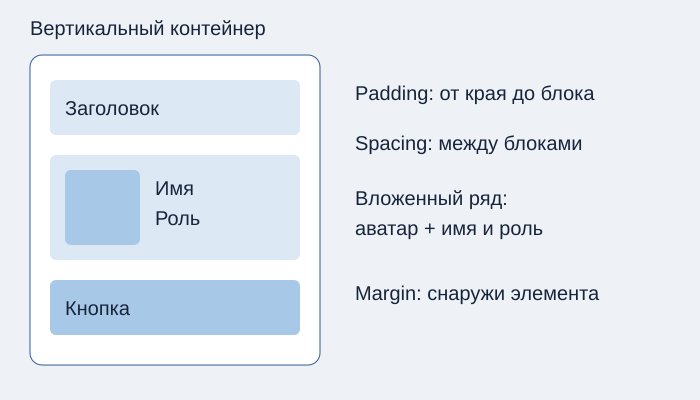

# Урок 2. Макеты и карточка игрового персонажа

В прошлом уроке мы меняли текст и картинку из C#. Сегодня научимся размещать элементы на странице так, чтобы приложение выглядело как настоящий интерфейс. Сделаем карточку следопыта Лиры: портрет, имя, уровень, навыки и переключатель компактного оформления.

## 1. Контейнеры

У ContentPage один основной элемент содержимого. Если нужно разместить несколько элементов, используем контейнер. VerticalStackLayout располагает их сверху вниз, HorizontalStackLayout — слева направо. Порядок тегов определяет порядок элементов.

```xml
<VerticalStackLayout Spacing="12" Padding="20">
    <Label Text="Гильдия" />
    <Button Text="Открыть" />
</VerticalStackLayout>
```



| Свойство | Назначение | Пример в C# |
|---|---|---|
| Spacing | Расстояние между соседними элементами | `Panel.Spacing = 12;` |
| Padding | Внутренний отступ контейнера | `Panel.Padding = new Thickness(20);` |
| Margin | Внешний отступ элемента | `Panel.Margin = new Thickness(8);` |
| HorizontalOptions | Положение по горизонтали | `Panel.HorizontalOptions = LayoutOptions.Center;` |
| VerticalOptions | Положение по вертикали | `Panel.VerticalOptions = LayoutOptions.Start;` |
| BackgroundColor | Цвет фона | `Panel.BackgroundColor = Colors.White;` |
| IsVisible | Показывать ли контейнер | `Panel.IsVisible = false;` |

Для примеров C# контейнеру нужно дать `x:Name="Panel"`. Thickness задаёт отступы: одно число для всех сторон, два — горизонталь и вертикаль, четыре — слева, сверху, справа, снизу. Размеры задаются в логических единицах, не в физических пикселях.

Попробуй: сделай три метки, поменяй Spacing с 4 на 24. Затем верни 4 и увеличь Padding. Объясни разницу.

## 2. Горизонтальный ряд и вложенность

```xml
<HorizontalStackLayout Spacing="12">
    <Image Source="hero.png" WidthRequest="84" HeightRequest="84" />
    <VerticalStackLayout VerticalOptions="Center" Spacing="4">
        <Label Text="Лира" FontSize="24" />
        <Label Text="Следопыт" />
    </VerticalStackLayout>
</HorizontalStackLayout>
```

Внешний контейнер содержит два элемента: картинку и вертикальный контейнер. Поэтому имя и роль находятся справа от картинки, друг под другом. HorizontalStackLayout не переносит элементы на следующую строку. Не помещай в него слишком широкие элементы.

Start, Center, End и Fill задают положение в доступном пространстве. В вертикальном стеке удобно выравнивать элементы по горизонтали, в горизонтальном — по вертикали. В направлении самого стека свободного места может не быть: Fill не распределяет его между детьми. Для равных колонок позже изучим Grid. HorizontalTextAlignment выравнивает текст внутри Label, а HorizontalOptions — сам Label.

Попробуй: добавь третью строку под ролью. Затем поменяй VerticalOptions у вложенного стека на Start.

## 3. Border и ScrollView

Border рисует рамку вокруг одного элемента. Если внутри несколько элементов, вложи контейнер.

```xml
<Border Stroke="#CBD5E1" StrokeThickness="2" Padding="16" BackgroundColor="White">
    <Border.StrokeShape>
        <RoundRectangle CornerRadius="20" />
    </Border.StrokeShape>
    <VerticalStackLayout Spacing="8">
        <Label Text="Уровень 7" TextColor="Black" />
        <Label Text="Следопыт" TextColor="Black" />
    </VerticalStackLayout>
</Border>
```

Stroke — цвет рамки, StrokeThickness — толщина, CornerRadius — скругление, Padding — расстояние от рамки до содержимого. В C# можно написать `HeroBorder.StrokeThickness = 3;` или `HeroBorder.Padding = new Thickness(8);`. Имя HeroBorder задаём в XAML. Border не является стеком и не принимает несколько отдельных дочерних элементов.

ScrollView позволяет прокручивать длинную страницу. У него один дочерний элемент; обычно это VerticalStackLayout. Не задавай всему содержимому фиксированную высоту.

## 4. Создаём проект HeroCard

Windows: File → New → Project → .NET MAUI App. Имя HeroCard, локальная папка C:\Projects. Выбери Windows Machine и запусти шаблон. На Mac: `dotnet new maui -n HeroCard`, открой папку в VS Code; для .NET 10 команда запуска `dotnet build -t:Run -f net10.0-maccatalyst`. Если шаблон не запускается, сначала проверь [справочник среды](../../справочники/среда-VisualStudio-и-VSCode.md).

Скопируй [портрет](материалы/Resources/Images/hero.png) в Resources/Images. В MainPage.xaml оставь корневой ContentPage с исходными xmlns и x:Class. Внутри создай ScrollView, затем вертикальный стек с Padding 24 и Spacing 16. Добавь заголовок. Проверь запуск.

### Шаг 1. Карточка

Добавь Border с именем HeroBorder и внутренний VerticalStackLayout с именем HeroLayout. Внутри собери шапку из раздела 2. Под ней добавь горизонтальный ряд с двумя Label: «Уровень:» и «7». Добавь Label с именем StatusLabel и текстом «Готова к походу».

### Шаг 2. Скрытая информация

Внутрь HeroLayout после статуса добавь:

```xml
<VerticalStackLayout x:Name="DetailsPanel" IsVisible="False" Spacing="6">
    <Label Text="Оружие: лук" TextColor="Black" />
    <Label Text="Навык: разведка" TextColor="Black" />
</VerticalStackLayout>
<Button x:Name="DetailsButton" Text="Показать навыки" Clicked="OnDetailsClicked" />
```

В MainPage.xaml.cs внутри класса после конструктора добавь метод:

```csharp
private void OnDetailsClicked(object sender, EventArgs e)
{
    DetailsPanel.IsVisible = !DetailsPanel.IsVisible;
    DetailsButton.Text = DetailsPanel.IsVisible ? "Скрыть навыки" : "Показать навыки";
}
```

Оператор ! меняет true на false и наоборот. Скрытый контейнер не занимает место. Проверь два последовательных нажатия.

### Шаг 3. Оформление из C#

После Border, но внутри внешнего стека добавь кнопку с Clicked="OnThemeClicked". В классе объяви поле `bool compact = false;`. Добавь два метода:

```csharp
private void OnThemeClicked(object sender, EventArgs e)
{
    compact = !compact;
    ApplyLayout(compact);
}

private void ApplyLayout(bool small)
{
    HeroLayout.Spacing = small ? 6 : 14;
    HeroBorder.Padding = new Thickness(small ? 8 : 16);
    HeroBorder.BackgroundColor = small ? Color.FromArgb("#E0F2FE") : Colors.White;
    StatusLabel.Text = small ? "Компактный режим" : "Готова к походу";
}
```

Метод получает логическое значение и меняет сразу несколько свойств. Переменная compact хранит текущий режим между нажатиями. Убедись, что повторное нажатие возвращает исходный вид.

[Полная разметка](материалы/MainPage.xaml) · [Полный C#](материалы/MainPage.xaml.cs)

## 5. Проверка

- Портрет и имя находятся в одном ряду; имя и роль — друг под другом.
- Навыки скрыты при запуске и открываются кнопкой.
- Компактный режим уменьшает отступы и возвращается обратно.
- При уменьшении окна длинная страница прокручивается.

Если имя элемента не найдено, проверь x:Name и namespace. Если Border сообщает о нескольких дочерних элементах, оберни их в стек. Если картинка не появилась, проверь Resources/Images и имя hero.png. Если ряд выходит за экран, уменьши размеры или используй вертикальный стек.

Далее: [самостоятельная практика](практика.md).
