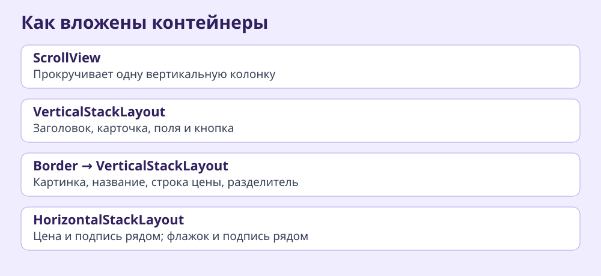

# Урок 2. Конструктор космического корабля

В прошлом уроке кнопки меняли готовые значения. Теперь пользователь сам вводит название, выбирает тип корабля и оборудование. Интерфейс должен реагировать сразу, без отдельной кнопки расчёта. Мы научимся размещать элементы в карточках и обрабатывать события ввода.

## Что получится к концу урока


*Ориентир внешнего вида приложения при первом запуске. Картинка создана по итоговой XAML-разметке и использует изображение разведчика из ресурсов урока. На Windows и Mac оформление стандартных элементов может немного отличаться.*

Представь, что мы открыли мастерскую космических кораблей. Покупатель выбирает модель, придумывает название и решает, нужен ли защитный щит. Ему не приходится нажимать «Рассчитать» после каждого изменения: карточка сама показывает актуальную информацию. Именно такой интерфейс мы сегодня создадим.

| Модель | Базовая цена | Изображение |
|---|---:|---|
| Разведчик | 1000 | ship_scout.png |
| Грузовой | 1500 | ship_cargo.png |
| Истребитель | 2000 | ship_fighter.png |

Щит добавляет 300 к стоимости любой модели. Название не влияет на цену. При сбросе возвращаем разведчика без щита и пустое поле названия.

## Контейнеры и отступы



VerticalStackLayout располагает элементы сверху вниз, HorizontalStackLayout — слева направо. Вложенность позволяет сделать строку внутри колонки. Например:

```xml
<VerticalStackLayout Padding="20" Spacing="12">
    <Label Text="Корабль" />
    <HorizontalStackLayout Spacing="8">
        <Label Text="Цена:" />
        <Label Text="1000" />
    </HorizontalStackLayout>
</VerticalStackLayout>
```

Padding — расстояние от края контейнера до содержимого; Margin — отступ снаружи элемента; Spacing — промежуток между соседними элементами. `Padding="10,20"` означает 10 слева и справа, 20 сверху и снизу; четыре числа идут слева, сверху, справа, снизу. В C# `Panel.Padding = new Thickness(10,20);`. HorizontalOptions и VerticalOptions управляют положением самого элемента (Start, Center, End, Fill), а HorizontalTextAlignment — текстом внутри Label. Горизонтальный стек не переносит элементы автоматически; длинные строки могут не поместиться. Для сложной сетки позже изучим Grid.


### VerticalStackLayout

| Свойство | Тип / назначение | XAML | C# |
|---|---|---|---|
| Padding | Thickness — внутренний отступ | `Padding="20"` | `Panel.Padding = new Thickness(20);` |
| Spacing | double — расстояние между элементами | `Spacing="12"` | `Panel.Spacing = 12;` |
| Margin | Thickness — внешний отступ | `Margin="10"` | `Panel.Margin = new Thickness(10);` |
| HorizontalOptions | LayoutOptions — положение по горизонтали | `HorizontalOptions="Fill"` | `Panel.HorizontalOptions = LayoutOptions.Fill;` |
| Children | Коллекция дочерних элементов | Вложенные теги | `Panel.Children.Add(new Label { Text = "Привет" });` |


### HorizontalStackLayout

| Свойство | Тип / назначение | XAML | C# |
|---|---|---|---|
| Spacing | double — промежуток в строке | `Spacing="8"` | `Row.Spacing = 8;` |
| Padding | Thickness — внутренний отступ | `Padding="8,4"` | `Row.Padding = new Thickness(8, 4);` |
| VerticalOptions | LayoutOptions — положение по вертикали | `VerticalOptions="Center"` | `Row.VerticalOptions = LayoutOptions.Center;` |
| BackgroundColor | Color — фон строки | `BackgroundColor="LightBlue"` | `Row.BackgroundColor = Colors.LightBlue;` |
| Children | Коллекция элементов | Вложенные теги | `Row.Children.Add(new Label { Text = "Цена" });` |

В примерах C# имена Panel и Row должны быть заданы через x:Name. Это не встроенные переменные. В горизонтальном стеке HorizontalOptions дочернего элемента не распределяет свободное место как Grid. Попробуй поместить две метки в вертикальный стек, затем замени его на горизонтальный и сравни результат.

## Border, ScrollView и BoxView

Border рисует рамку вокруг одного дочернего элемента. Чтобы положить внутрь несколько элементов, сначала добавь контейнер:

```xml
<Border Stroke="#A6BDE0" StrokeThickness="2" Padding="16" BackgroundColor="White">
    <Border.StrokeShape><RoundRectangle CornerRadius="18" /></Border.StrokeShape>
    <VerticalStackLayout Spacing="10">
        <Label Text="Карточка" />
        <BoxView HeightRequest="2" Color="#A6BDE0" />
        <Label Text="Характеристики" />
    </VerticalStackLayout>
</Border>
```

Stroke — цвет рамки, StrokeThickness — толщина, StrokeShape — форма. BoxView — цветной прямоугольник; здесь высота 2 делает его разделителем. ScrollView содержит один элемент, обычно вертикальный стек, и позволяет прокрутить длинный экран. Не задавай фиксированную высоту всей страницы. Попробуй изменить Padding на 30, затем вернуть 16; сравни результат.


### Border

| Свойство | Тип / назначение | XAML | C# |
|---|---|---|---|
| Stroke | Brush — кисть рамки | `Stroke="#A6BDE0"` | `Card.Stroke = new SolidColorBrush(Colors.Blue);` |
| StrokeThickness | double — толщина | `StrokeThickness="2"` | `Card.StrokeThickness = 2;` |
| StrokeShape | IShape — форма | `<RoundRectangle CornerRadius="18" />` внутри Border.StrokeShape | `Card.StrokeShape = new Microsoft.Maui.Controls.Shapes.RoundRectangle { CornerRadius = new CornerRadius(18) };` |
| Padding | Thickness — отступ внутри рамки | `Padding="16"` | `Card.Padding = new Thickness(16);` |
| BackgroundColor | Color — фон | `BackgroundColor="White"` | `Card.BackgroundColor = Colors.White;` |
| Content | View — один дочерний элемент | Вложенный VerticalStackLayout | `Card.Content = new Label { Text = "Карточка" };` |


### RoundRectangle — форма рамки

| Свойство | Тип / назначение | XAML | C# |
|---|---|---|---|
| CornerRadius | CornerRadius — радиусы углов | `CornerRadius="18"` | `new Microsoft.Maui.Controls.Shapes.RoundRectangle { CornerRadius = new CornerRadius(18) }` |


### ScrollView

| Свойство | Тип / назначение | XAML | C# |
|---|---|---|---|
| Orientation | ScrollOrientation — направление | `Orientation="Vertical"` | `Scroller.Orientation = ScrollOrientation.Vertical;` |
| VerticalScrollBarVisibility | ScrollBarVisibility — полоса прокрутки | `VerticalScrollBarVisibility="Always"` | `Scroller.VerticalScrollBarVisibility = ScrollBarVisibility.Always;` |
| HorizontalScrollBarVisibility | ScrollBarVisibility — горизонтальная полоса | `HorizontalScrollBarVisibility="Never"` | `Scroller.HorizontalScrollBarVisibility = ScrollBarVisibility.Never;` |
| Content | View — один элемент | Вложенный стек | `Scroller.Content = new VerticalStackLayout();` |


### BoxView

| Свойство | Тип / назначение | XAML | C# |
|---|---|---|---|
| Color | Color — цвет прямоугольника | `Color="#A6BDE0"` | `Line.Color = Colors.Blue;` |
| HeightRequest | double — желаемая высота | `HeightRequest="2"` | `Line.HeightRequest = 2;` |
| WidthRequest | double — желаемая ширина | `WidthRequest="100"` | `Line.WidthRequest = 100;` |
| CornerRadius | CornerRadius — скругление | `CornerRadius="4"` | `Line.CornerRadius = new CornerRadius(4);` |

Card, Scroller и Line — примеры имён через x:Name. Не нужно добавлять все свойства сразу. Для разделителя достаточно цвета и высоты; ширину определит контейнер. ScrollView по умолчанию прокручивается вертикально. Не вкладывай вертикальный ScrollView в другой вертикальный ScrollView без необходимости.

## Entry — ввод одной строки

```xml
<Entry x:Name="NameEntry" Placeholder="Название" MaxLength="24" TextChanged="OnNameChanged" />
```

Text — введённая строка, Placeholder — подсказка до ввода, MaxLength — ограничение длины, Keyboard — вид клавиатуры (Text, Numeric, Email), IsPassword — скрытие символов. Keyboard="Numeric" не гарантирует, что строка является числом. Text может быть null; для безопасного чтения используем `NameEntry.Text ?? ""`. Trim удаляет пробелы по краям.

```csharp
private void OnNameChanged(object? sender, TextChangedEventArgs e)
{
    ShipTitle.Text = e.NewTextValue ?? "";
}
```

TextChanged срабатывает при изменении текста, даже если его меняет программа. e.NewTextValue — новое значение, e.OldTextValue — старое. Completed возникает при завершении ввода с клавиатуры. Чтобы очистить поле, напиши `NameEntry.Text = "";`.


### Свойства Entry

| Свойство | Тип / назначение | XAML | C# |
|---|---|---|---|
| Text | string — введённый текст | `Text="Орион"` | `NameEntry.Text = "Орион";` |
| Placeholder | string — подсказка | `Placeholder="Название"` | `NameEntry.Placeholder = "Название";` |
| PlaceholderColor | Color — цвет подсказки | `PlaceholderColor="Gray"` | `NameEntry.PlaceholderColor = Colors.Gray;` |
| MaxLength | int — предел длины | `MaxLength="24"` | `NameEntry.MaxLength = 24;` |
| Keyboard | Keyboard — тип клавиатуры | `Keyboard="Numeric"` | `NameEntry.Keyboard = Keyboard.Numeric;` |
| IsPassword | bool — скрывать символы | `IsPassword="True"` | `NameEntry.IsPassword = true;` |
| IsReadOnly | bool — запрет редактирования | `IsReadOnly="True"` | `NameEntry.IsReadOnly = true;` |
| TextColor | Color — цвет текста | `TextColor="Black"` | `NameEntry.TextColor = Colors.Black;` |
| FontSize | double — размер текста | `FontSize="18"` | `NameEntry.FontSize = 18;` |

События Entry:

| Событие | Аргументы | Когда вызывается |
|---|---|---|
| TextChanged | TextChangedEventArgs | При изменении текста |
| Completed | EventArgs | При завершении ввода с клавиатуры |

Попробуй MaxLength="5": введи шесть букв. Затем верни 24. Подсказка Placeholder не является введённым текстом.

## Picker — выбор одного варианта

```xml
<Picker x:Name="TypePicker" Title="Выбери тип" SelectedIndexChanged="OnTypeChanged">
    <Picker.Items>
        <x:String>Разведчик</x:String>
        <x:String>Грузовой</x:String>
        <x:String>Истребитель</x:String>
    </Picker.Items>
</Picker>
```

Title — подсказка, Items — список, SelectedIndex — индекс выбранного элемента (0, 1, 2; -1 означает, что выбора нет), SelectedItem — выбранный объект. Можно назначить `TypePicker.SelectedIndex = 0;` после InitializeComponent. Обработчик использует EventArgs:

```csharp
private void OnTypeChanged(object? sender, EventArgs e)
{
    if (TypePicker.SelectedIndex == 1)
        ShipImage.Source = "ship_cargo.png";
}
```


### Свойства Picker

| Свойство | Тип / назначение | XAML | C# |
|---|---|---|---|
| Title | string — подсказка до выбора | `Title="Выбери тип"` | `TypePicker.Title = "Выбери тип";` |
| Items | IList<string> — строки списка | `<Picker.Items>` с x:String | `TypePicker.Items.Add("Разведчик");` |
| ItemsSource | IList — источник списка | `ItemsSource="{Binding ShipTypes}"` | `TypePicker.ItemsSource = new List<string> { "Разведчик", "Грузовой" };` |
| SelectedIndex | int — индекс, -1 без выбора | `SelectedIndex="0"` | `TypePicker.SelectedIndex = 0;` |
| SelectedItem | object — выбранный объект | Не задаём в этом проекте | `var item = TypePicker.SelectedItem;` |
| TextColor | Color — цвет выбранного текста | `TextColor="Black"` | `TypePicker.TextColor = Colors.Black;` |
| TitleColor | Color — цвет подсказки | `TitleColor="Gray"` | `TypePicker.TitleColor = Colors.Gray;` |

Items и ItemsSource — альтернативные способы заполнения. В нашем проекте используем Items в XAML; ItemsSource с Binding приведён только для знакомства, привязки изучим позже. Для примера List<string> нужен System.Collections.Generic (обычно уже доступен через implicit usings).

| Событие | Аргументы | Когда вызывается |
|---|---|---|
| SelectedIndexChanged | EventArgs | При изменении выбранного индекса |

Индекс — номер позиции, а не цена. Первый элемент имеет индекс 0. При смене порядка вариантов нужно проверить условия в C#.

## CheckBox — независимый флажок

```xml
<HorizontalStackLayout Spacing="8">
    <CheckBox x:Name="ShieldCheck" CheckedChanged="OnShieldChanged" />
    <Label Text="Щит (+300)" VerticalOptions="Center" />
</HorizontalStackLayout>
```

IsChecked — bool, Color — цвет флажка. CheckedChanged получает CheckedChangedEventArgs; e.Value — новое состояние. `ShieldCheck.IsChecked = false;` снимает отметку. В отличие от Picker, несколько отдельных флажков могут быть включены одновременно.


### Свойства CheckBox

| Свойство | Тип / назначение | XAML | C# |
|---|---|---|---|
| IsChecked | bool — состояние | `IsChecked="False"` | `ShieldCheck.IsChecked = false;` |
| Color | Color — цвет отметки | `Color="#285B9C"` | `ShieldCheck.Color = Colors.Blue;` |
| IsEnabled | bool — доступность | `IsEnabled="True"` | `ShieldCheck.IsEnabled = true;` |
| IsVisible | bool — видимость | `IsVisible="True"` | `ShieldCheck.IsVisible = true;` |
| VerticalOptions | LayoutOptions — положение | `VerticalOptions="Center"` | `ShieldCheck.VerticalOptions = LayoutOptions.Center;` |

| Событие | Аргументы | Когда вызывается |
|---|---|---|
| CheckedChanged | CheckedChangedEventArgs | При установке или снятии отметки |

```csharp
private void OnShieldChanged(object? sender, CheckedChangedEventArgs e)
{
    InfoLabel.Text = e.Value ? "Со щитом" : "Без щита";
}
```

CheckBox не имеет свойства Text для подписи. Поэтому рядом ставим Label. Изменение IsChecked из программы тоже вызывает событие, если значение действительно изменилось.

## Повторяем знакомые элементы

| Элемент | Свойство | Назначение | Пример XAML |
|---|---|---|---|
| ContentPage | BackgroundColor | Фон страницы | `BackgroundColor="#EAF2FF"` |
| Label | Text | Надпись | `Text="Стоимость:"` |
| Label | FontSize | Размер | `FontSize="24"` |
| Label | FontAttributes | Начертание | `FontAttributes="Bold"` |
| Image | Source | Имя ресурса | `Source="ship_scout.png"` |
| Image | Aspect | Масштабирование | `Aspect="AspectFit"` |
| Image | HeightRequest | Желаемая высота | `HeightRequest="150"` |
| Button | Text | Надпись | `Text="Сбросить настройки"` |
| Button | Clicked | Событие нажатия | `Clicked="OnResetClicked"` |

## Как создавать методы и обработчики событий

В C# функции внутри класса называются методами. В первом уроке мы создали общий обработчик MoodBtn. Сегодня события разных элементов имеют разные типы аргументов, но все могут вызывать один обычный метод.

### Обычный метод

```csharp
private void UpdateShip()
{
    PriceLabel.Text = "1000";
}
```

private — доступ внутри класса; void — метод ничего не возвращает; UpdateShip — имя; круглые скобки — параметры. Пустые скобки означают, что параметры не нужны. Фигурные скобки содержат действия. Метод размещаем внутри MainPage, но вне конструктора и других методов. Чтобы выполнить его, пишем `UpdateShip();`.

Метод может принимать значения и возвращать результат:

```csharp
private int CalculatePrice(int basePrice, bool hasShield)
{
    if (hasShield)
        return basePrice + 300;
    return basePrice;
}
```

Вызов внутри другого метода: `int price = CalculatePrice(1500, true);`. Результат — 1800. Здесь int перед именем означает возвращаемый тип, basePrice и hasShield — параметры, а 1500 и true — аргументы вызова. Этот пример для тренировки; в итоговом проекте расчёт оставим в UpdateShip, чтобы не усложнять код.

| Тип параметра | Что передаём | Пример |
|---|---|---|
| string | Текст | `string name` |
| int | Целое число | `int price` |
| bool | Да или нет | `bool hasShield` |
| Color | Цвет | `Color color` |
| Button | Ссылку на кнопку | `Button button` |

### Обработчик события

```csharp
private void OnNameChanged(object? sender, TextChangedEventArgs e)
{
    ShipTitle.Text = e.NewTextValue ?? "";
}
```

В XAML у Entry пишем `TextChanged="OnNameChanged"`. MAUI сам вызывает метод. Первый параметр — объект, вызвавший событие. Второй — данные события. Имена sender и e привычны, но именно типы и возвращаемый void определяют подходящую сигнатуру.

| Элемент | Событие | Сигнатура | Данные |
|---|---|---|---|
| Button | Clicked | `object? sender, EventArgs e` | Нажатая кнопка в sender |
| Entry | TextChanged | `object? sender, TextChangedEventArgs e` | e.OldTextValue, e.NewTextValue |
| Entry | Completed | `object? sender, EventArgs e` | Поле в sender |
| Picker | SelectedIndexChanged | `object? sender, EventArgs e` | Индекс читаем из Picker |
| CheckBox | CheckedChanged | `object? sender, CheckedChangedEventArgs e` | e.Value — bool |

EventArgs для Clicked и SelectedIndexChanged не содержит Text или SelectedIndex. Нужное свойство читаем у элемента. Как в первом уроке, sender имеет общий тип object? и может быть null. Если нужен конкретный элемент, проверяем тип и приводим его:

```csharp
private void OnTypeChanged(object? sender, EventArgs e)
{
    if (sender is not Picker)
        return;
    Picker picker = (Picker)sender;
    InfoLabel.Text = picker.SelectedItem?.ToString() ?? "Нет выбора";
}
```

Для одного известного Picker проще использовать TypePicker напрямую. В итоговом проекте обработчики только вызывают UpdateShip, который читает все элементы по именам. Не передавай произвольные параметры в метод, указанный в Clicked или TextChanged: сигнатуру задаёт событие. Свои параметры можно использовать в обычных методах, вызываемых из обработчика.

## Собираем приложение вместе

### Шаг 1. Создаём проект и готовим ресурсы

Создай .NET MAUI App с именем ShipApp в локальной папке. На Windows выбери Windows Machine и нажми F5. На Mac открой папку с csproj в VS Code. Сначала запусти стандартный шаблон по [первому уроку](../урок-01-введение-maui-счётчик/урок.md). Скопируй три ship_*.png из [материалов](материалы/Resources/Images/) в Resources/Images. Действие сборки — MauiImage. Не копируй чужой csproj.

В MainPage.xaml сохрани корневой ContentPage и его x:Class. Удали старый интерфейс счётчика. В MainPage.xaml.cs оставь namespace, класс и конструктор с InitializeComponent(); удали старый OnCounterClicked. Если проект называется иначе, сохрани своё имя пространства имён в обоих файлах.

### Шаг 2. Создаём каркас страницы

Внутри ContentPage вставь:

```xml
<ScrollView>
    <VerticalStackLayout Padding="20" Spacing="16">
        <Label Text="Конструктор корабля" FontSize="28"
               FontAttributes="Bold" TextColor="#18304D" />
    </VerticalStackLayout>
</ScrollView>
```

У ContentPage установи BackgroundColor="#EAF2FF". Внешний стек — колонка всего экрана. Все следующие элементы добавляем внутрь него, после заголовка. ScrollView нужен, чтобы на маленьком экране можно было добраться до нижней кнопки. Запусти и проверь заголовок.

### Шаг 3. Создаём карточку корабля

После заголовка, но до закрывающего тега внешнего стека, вставь:

```xml
<Border Stroke="#A6BDE0" StrokeThickness="2" Padding="16" BackgroundColor="White">
                <Border.StrokeShape>
                    <RoundRectangle CornerRadius="18" />
                </Border.StrokeShape>
                <VerticalStackLayout Spacing="10">
                    <Image x:Name="ShipImage" Source="ship_scout.png" HeightRequest="150" Aspect="AspectFit" />
                    <Label x:Name="ShipTitle" Text="Без названия" FontSize="24" TextColor="#18304D" />
                    <HorizontalStackLayout Spacing="12">
                        <Label Text="Стоимость:" TextColor="#18304D" />
                        <Label x:Name="PriceLabel" Text="1000" TextColor="#18304D" FontAttributes="Bold" />
                    </HorizontalStackLayout>
                    <BoxView HeightRequest="2" Color="#A6BDE0" />
                    <Label x:Name="InfoLabel" Text="Разведчик" TextColor="#18304D" />
                </VerticalStackLayout>
            </Border>
```

Border содержит один внутренний стек. Внутри него картинка, название, горизонтальная строка цены, разделитель и описание. ShipImage, ShipTitle, PriceLabel и InfoLabel — имена элементов, к которым будем обращаться из C#. Не путай два стека: внешний содержит весь экран, внутренний — только карточку. Запусти: видны разведчик, цена 1000 и название «Без названия».

### Шаг 4. Добавляем настройки

После закрывающего Border, внутри внешнего стека, добавь следующий блок. Пока не запускай проект: сначала создадим методы, указанные в событиях.

```xml
<Label Text="Название" TextColor="#18304D" />
            <Entry x:Name="NameEntry" Placeholder="Например, Орион" MaxLength="24" TextChanged="OnNameChanged" TextColor="#18304D" BackgroundColor="White" PlaceholderColor="#52657D" />
            <Label Text="Тип корабля" TextColor="#18304D" />
            <Picker x:Name="TypePicker" Title="Выбери тип" SelectedIndexChanged="OnTypeChanged" TextColor="#18304D" BackgroundColor="White" TitleColor="#52657D">
                <Picker.Items>
                    <x:String>Разведчик</x:String>
                    <x:String>Грузовой</x:String>
                    <x:String>Истребитель</x:String>
                </Picker.Items>
            </Picker>
            <HorizontalStackLayout Spacing="8">
                <CheckBox x:Name="ShieldCheck" CheckedChanged="OnShieldChanged" Color="#285B9C" />
                <Label Text="Щит (+300)" VerticalOptions="Center" TextColor="#18304D" />
            </HorizontalStackLayout>
            <Button Text="Сбросить настройки" Clicked="OnResetClicked" />
```

Entry принимает название, Picker содержит три модели в порядке индексов 0, 1, 2. CheckBox и его подпись находятся в одной строке. Кнопка сброса стоит внизу. Все четыре события требуют методов в MainPage.xaml.cs.

### Шаг 5. Проверяем события отдельно

После конструктора, внутри класса MainPage, добавь временные обработчики:

```csharp
private void OnNameChanged(object? sender, TextChangedEventArgs e)
{
    ShipTitle.Text = e.NewTextValue ?? "";
}

private void OnTypeChanged(object? sender, EventArgs e)
{
    InfoLabel.Text = TypePicker.SelectedItem?.ToString() ?? "Нет выбора";
}

private void OnShieldChanged(object? sender, CheckedChangedEventArgs e)
{
    InfoLabel.Text = e.Value ? "Со щитом" : "Без щита";
}

private void OnResetClicked(object? sender, EventArgs e)
{
    NameEntry.Text = "";
    TypePicker.SelectedIndex = 0;
    ShieldCheck.IsChecked = false;
}
```

Это промежуточный эксперимент, не окончательная логика. Если событие возникает при загрузке XAML, обращение к ещё не созданному элементу может вызвать ошибку. Поэтому перед запуском добавь поле `private bool ready = false;` внутри класса, перед конструктором, и в начале каждого из четырёх временных обработчиков напиши `if (!ready) return;`. В конструкторе после InitializeComponent установи TypePicker.SelectedIndex = 0, затем ready = true. Теперь запусти: введи «Орион», выбери грузовой, включи щит. Пока меняются только надписи, цена и картинка остаются прежними. Это нормально: дальше добавим расчёт.

### Шаг 6. Создаём общий метод UpdateShip

Нам нужно обновлять всю карточку при любом изменении. Не будем копировать одинаковые условия в три обработчика. Создадим один метод без параметров, потому что он может прочитать значения элементов по x:Name.

Начни с проверки готовности и названия:

```csharp
private void UpdateShip()
{
    if (!ready)
        return;

    string name = (NameEntry.Text ?? "").Trim();
    if (name.Length == 0)
        name = "Без названия";
    ShipTitle.Text = name;
}
```

?? заменяет null пустой строкой, Trim убирает пробелы по краям. Если пользователь ввёл только пробелы, показываем «Без названия». Замени содержимое OnNameChanged на `UpdateShip();`. Не создавай второй метод с тем же именем.

### Шаг 7. Выбираем модель и цену

Внутри UpdateShip после присваивания ShipTitle.Text добавь:

```csharp
int index = TypePicker.SelectedIndex;
int price = 1000;
string type = "Разведчик";
string image = "ship_scout.png";

if (index == 1)
{
    price = 1500;
    type = "Грузовой";
    image = "ship_cargo.png";
}
else if (index == 2)
{
    price = 2000;
    type = "Истребитель";
    image = "ship_fighter.png";
}
```

Начальные значения соответствуют разведчику. Индекс 1 меняет сразу три переменные, индекс 2 — тоже. При индексе 0 или -1 остаются начальные значения. В конце метода добавь `ShipImage.Source = image;` и `PriceLabel.Text = price.ToString();`. ToString превращает число в строку, потому что Text у Label имеет тип string. Замени содержимое OnTypeChanged на `UpdateShip();`. Проверь три модели.

### Шаг 8. Добавляем щит

Перед строками обновления ShipImage и PriceLabel вставь:

```csharp
if (ShieldCheck.IsChecked)
{
    price += 300;
    InfoLabel.Text = type + " · со щитом";
}
else
{
    InfoLabel.Text = type + " · без щита";
}
```

IsChecked уже имеет тип bool, поэтому сравнение с true не обязательно. Цена каждый раз начинается с базовой стоимости. Мы не читаем старый текст PriceLabel и не прибавляем к нему 300: иначе при повторном вводе названия цена могла бы расти. Замени содержимое OnShieldChanged на `UpdateShip();`. Проверь грузовой со щитом — 1800, без щита — 1500.

### Шаг 9. Настраиваем запуск и сброс

Конструктор должен сначала создать интерфейс, затем установить начальный индекс, разрешить обновление и вызвать UpdateShip:

```csharp
public MainPage()
{
    InitializeComponent();
    TypePicker.SelectedIndex = 0;
    ready = true;
    UpdateShip();
}
```

Поле ready хранит состояние готовности страницы. До InitializeComponent и начальной настройки оно false. События могут возникать при изменении свойств из кода, поэтому UpdateShip проверяет ready. После настройки вызываем метод вручную, чтобы карточка сразу была правильной.

В OnResetClicked оставь три присваивания из шага 5 и добавь UpdateShip() в конце. Даже если значения уже были начальными и события не возникли, карточка обновится. В итоговом обработчике сброса отдельная проверка ready не нужна: кнопка доступна после создания страницы.

## Полный итоговый код для сверки

Ниже оба файла целиком. Не вставляй их внутрь существующего класса или ContentPage: при сверке заменяй соответствующее содержимое файла. Namespace и x:Class должны соответствовать твоему проекту.

### MainPage.xaml

```xml
<?xml version="1.0" encoding="utf-8" ?>
<ContentPage xmlns="http://schemas.microsoft.com/dotnet/2021/maui" xmlns:x="http://schemas.microsoft.com/winfx/2009/xaml" x:Class="ShipApp.MainPage" BackgroundColor="#EAF2FF">
    <ScrollView>
        <VerticalStackLayout Padding="20" Spacing="16">
            <Label Text="Конструктор корабля" FontSize="28" FontAttributes="Bold" TextColor="#18304D" />
            <Border Stroke="#A6BDE0" StrokeThickness="2" Padding="16" BackgroundColor="White">
                <Border.StrokeShape>
                    <RoundRectangle CornerRadius="18" />
                </Border.StrokeShape>
                <VerticalStackLayout Spacing="10">
                    <Image x:Name="ShipImage" Source="ship_scout.png" HeightRequest="150" Aspect="AspectFit" />
                    <Label x:Name="ShipTitle" Text="Без названия" FontSize="24" TextColor="#18304D" />
                    <HorizontalStackLayout Spacing="12">
                        <Label Text="Стоимость:" TextColor="#18304D" />
                        <Label x:Name="PriceLabel" Text="1000" TextColor="#18304D" FontAttributes="Bold" />
                    </HorizontalStackLayout>
                    <BoxView HeightRequest="2" Color="#A6BDE0" />
                    <Label x:Name="InfoLabel" Text="Разведчик" TextColor="#18304D" />
                </VerticalStackLayout>
            </Border>
            <Label Text="Название" TextColor="#18304D" />
            <Entry x:Name="NameEntry" Placeholder="Например, Орион" MaxLength="24" TextChanged="OnNameChanged" TextColor="#18304D" BackgroundColor="White" PlaceholderColor="#52657D" />
            <Label Text="Тип корабля" TextColor="#18304D" />
            <Picker x:Name="TypePicker" Title="Выбери тип" SelectedIndexChanged="OnTypeChanged" TextColor="#18304D" BackgroundColor="White" TitleColor="#52657D">
                <Picker.Items>
                    <x:String>Разведчик</x:String>
                    <x:String>Грузовой</x:String>
                    <x:String>Истребитель</x:String>
                </Picker.Items>
            </Picker>
            <HorizontalStackLayout Spacing="8">
                <CheckBox x:Name="ShieldCheck" CheckedChanged="OnShieldChanged" Color="#285B9C" />
                <Label Text="Щит (+300)" VerticalOptions="Center" TextColor="#18304D" />
            </HorizontalStackLayout>
            <Button Text="Сбросить настройки" Clicked="OnResetClicked" />
        </VerticalStackLayout>
    </ScrollView>
</ContentPage>
```

### MainPage.xaml.cs

```csharp
using System;
using Microsoft.Maui.Controls;

namespace ShipApp;

public partial class MainPage : ContentPage
{
    private bool ready = false;

    public MainPage()
    {
        InitializeComponent();
        TypePicker.SelectedIndex = 0;
        ready = true;
        UpdateShip();
    }

    private void UpdateShip()
    {
        if (!ready)
            return;

        string name = (NameEntry.Text ?? "").Trim();
        if (name.Length == 0)
            name = "Без названия";
        ShipTitle.Text = name;

        int index = TypePicker.SelectedIndex;
        int price = 1000;
        string type = "Разведчик";
        string image = "ship_scout.png";

        if (index == 1)
        {
            price = 1500;
            type = "Грузовой";
            image = "ship_cargo.png";
        }
        else if (index == 2)
        {
            price = 2000;
            type = "Истребитель";
            image = "ship_fighter.png";
        }

        if (ShieldCheck.IsChecked)
        {
            price += 300;
            InfoLabel.Text = type + " · со щитом";
        }
        else
        {
            InfoLabel.Text = type + " · без щита";
        }

        ShipImage.Source = image;
        PriceLabel.Text = price.ToString();
    }

    private void OnNameChanged(object? sender, TextChangedEventArgs e)
    {
        UpdateShip();
    }

    private void OnTypeChanged(object? sender, EventArgs e)
    {
        UpdateShip();
    }

    private void OnShieldChanged(object? sender, CheckedChangedEventArgs e)
    {
        UpdateShip();
    }

    private void OnResetClicked(object? sender, EventArgs e)
    {
        NameEntry.Text = "";
        TypePicker.SelectedIndex = 0;
        ShieldCheck.IsChecked = false;
        UpdateShip();
    }
}
```

## Сборка и проверка проекта

Сохрани оба файла. На Windows останови старую отладку Shift+F5, выбери Windows Machine и нажми F5. Если изменения не появились, Build → Rebuild Solution, затем F5. На Mac закрой старое приложение Cmd+Q и открой терминал в папке с csproj.

| Команда (.NET 10, Mac) | Назначение |
|---|---|
| `dotnet restore` | Восстановить зависимости |
| `dotnet build -f net10.0-maccatalyst` | Собрать проект |
| `dotnet run -f net10.0-maccatalyst` | Запустить через Run, если поддерживается конфигурацией |
| `dotnet build -t:Run -f net10.0-maccatalyst` | Собрать и запустить Mac Catalyst |
| `dotnet build -t:Rebuild -f net10.0-maccatalyst` | Полностью пересобрать |
| `open bin/Debug/net10.0-maccatalyst/maccatalyst-arm64/ShipApp.app` | Открыть готовую сборку на Apple Silicon |

После изменения XAML, C# или картинок используй сборку с Run либо сначала build, затем open. Open не компилирует код. Если проект называется Pr1, замени ShipApp.app на Pr1.app; на Intel или при другой версии SDK путь может отличаться. При необходимости найди пакет командой `find bin -name "*.app" -type d`. Если сборка не прошла, сначала исправь первую ошибку в терминале, не запускай старый пакет. Подробнее — [справочник среды](../../справочники/среда-VisualStudio-и-VSCode.md).

| Действие | Ожидаемый результат |
|---|---|
| Первый запуск | Разведчик, 1000, Без названия, без щита |
| Ввести Орион | Заголовок Орион, цена не меняется |
| Ввести только пробелы | Без названия |
| Выбрать грузовой | Грузовой, 1500, новая картинка |
| Включить щит | 1800, со щитом |
| Изменить название при включённом щите | Цена остаётся 1800 |
| Выбрать истребитель со щитом | 2300, картинка истребителя |
| Снять щит | 2000 |
| Сбросить | Разведчик, 1000, пустое поле, Без названия |

Если картинка не видна, проверь имя файла, папку Resources/Images и пересборку. Если метод не найден, сравни имя в XAML и C#. Если цена неверна, проверь начальное значение price и место прибавления 300. Если приложение падает при открытии, проверь ready и порядок InitializeComponent.

## Дополнительное творческое задание

Нарисуй три собственных корабля в одинаковом стиле. Используй PNG с прозрачным фоном, например 512 × 512, и замени три ship_*.png, сохранив имена. Пересобери приложение. Затем попробуй добавить второй независимый CheckBox «Ускоритель (+500)»: создай имя, обработчик CheckedChanged, вызови UpdateShip и добавь отдельное условие расчёта. Не забудь снять новый флажок при сбросе.

Готовые файлы: [XAML](материалы/MainPage.xaml), [C#](материалы/MainPage.xaml.cs). Теперь переходи к [практике](практика.md).
