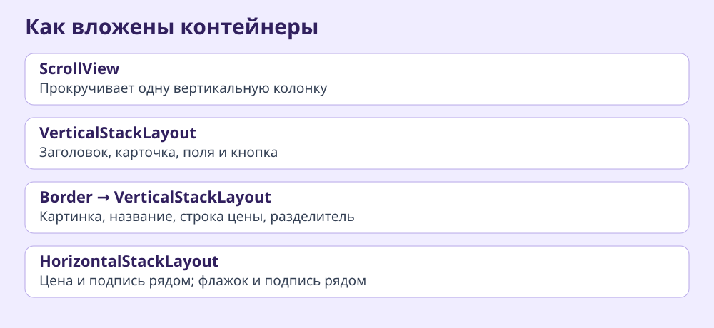
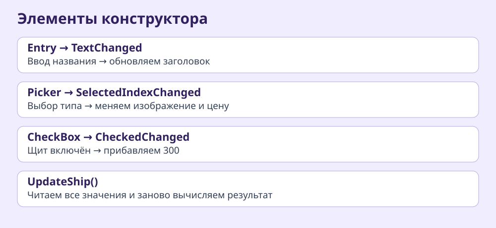

# Урок 2. Конструктор космического корабля

В прошлом уроке кнопки меняли готовые значения. Теперь пользователь сам вводит название, выбирает тип корабля и оборудование. Интерфейс должен реагировать сразу, без отдельной кнопки расчёта. Мы научимся размещать элементы в карточках и обрабатывать события ввода.

## Контейнеры и отступы



VerticalStackLayout располагает элементы сверху вниз, HorizontalStackLayout — слева направо. Вложенность позволяет сделать строку внутри колонки. Например:

```xml
<VerticalStackLayout Padding="20" Spacing="12">
    <Label Text="Корабль" />
    <HorizontalStackLayout Spacing="8">
        <Label Text="Цена:" />
        <Label Text="1000" />
    </HorizontalStackLayout>
</VerticalStackLayout>
```

Padding — расстояние от края контейнера до содержимого; Margin — отступ снаружи элемента; Spacing — промежуток между соседними элементами. `Padding="10,20"` означает 10 слева и справа, 20 сверху и снизу; четыре числа идут слева, сверху, справа, снизу. В C# `Panel.Padding = new Thickness(10,20);`. HorizontalOptions и VerticalOptions управляют положением самого элемента (Start, Center, End, Fill), а HorizontalTextAlignment — текстом внутри Label. Горизонтальный стек не переносит элементы автоматически; длинные строки могут не поместиться. Для сложной сетки позже изучим Grid.

## Border, ScrollView и BoxView

Border рисует рамку вокруг одного дочернего элемента. Чтобы положить внутрь несколько элементов, сначала добавь контейнер:

```xml
<Border Stroke="#A6BDE0" StrokeThickness="2" Padding="16" BackgroundColor="White">
    <Border.StrokeShape><RoundRectangle CornerRadius="18" /></Border.StrokeShape>
    <VerticalStackLayout Spacing="10">
        <Label Text="Карточка" />
        <BoxView HeightRequest="2" Color="#A6BDE0" />
        <Label Text="Характеристики" />
    </VerticalStackLayout>
</Border>
```

Stroke — цвет рамки, StrokeThickness — толщина, StrokeShape — форма. BoxView — цветной прямоугольник; здесь высота 2 делает его разделителем. ScrollView содержит один элемент, обычно вертикальный стек, и позволяет прокрутить длинный экран. Не задавай фиксированную высоту всей страницы. Попробуй изменить Padding на 30, затем вернуть 16; сравни результат.

## Entry — ввод одной строки

```xml
<Entry x:Name="NameEntry" Placeholder="Название" MaxLength="24" TextChanged="OnNameChanged" />
```

Text — введённая строка, Placeholder — подсказка до ввода, MaxLength — ограничение длины, Keyboard — вид клавиатуры (Text, Numeric, Email), IsPassword — скрытие символов. Keyboard="Numeric" не гарантирует, что строка является числом. Text может быть null; для безопасного чтения используем `NameEntry.Text ?? ""`. Trim удаляет пробелы по краям.

```csharp
private void OnNameChanged(object sender, TextChangedEventArgs e)
{
    ShipTitle.Text = e.NewTextValue ?? "";
}
```

TextChanged срабатывает при изменении текста, даже если его меняет программа. e.NewTextValue — новое значение, e.OldTextValue — старое. Completed возникает при завершении ввода с клавиатуры. Чтобы очистить поле, напиши `NameEntry.Text = "";`.

## Picker — выбор одного варианта

```xml
<Picker x:Name="TypePicker" Title="Выбери тип" SelectedIndexChanged="OnTypeChanged">
    <Picker.Items>
        <x:String>Разведчик</x:String>
        <x:String>Грузовой</x:String>
        <x:String>Истребитель</x:String>
    </Picker.Items>
</Picker>
```

Title — подсказка, Items — список, SelectedIndex — индекс выбранного элемента (0, 1, 2; -1 означает, что выбора нет), SelectedItem — выбранный объект. Можно назначить `TypePicker.SelectedIndex = 0;` после InitializeComponent. Обработчик использует EventArgs:

```csharp
private void OnTypeChanged(object sender, EventArgs e)
{
    if (TypePicker.SelectedIndex == 1)
        ShipImage.Source = "ship_cargo.png";
}
```

## CheckBox — независимый флажок

```xml
<HorizontalStackLayout Spacing="8">
    <CheckBox x:Name="ShieldCheck" CheckedChanged="OnShieldChanged" />
    <Label Text="Щит (+300)" VerticalOptions="Center" />
</HorizontalStackLayout>
```

IsChecked — bool, Color — цвет флажка. CheckedChanged получает CheckedChangedEventArgs; e.Value — новое состояние. `ShieldCheck.IsChecked = false;` снимает отметку. В отличие от Picker, несколько отдельных флажков могут быть включены одновременно.



## Собираем приложение

### 1. Создай проект и подготовь ресурсы

Создай ShipApp в локальной папке по правилам [первого урока](../урок-01-введение-maui-счётчик/урок.md). Запусти шаблон. Скопируй три PNG из [папки материалов](материалы/Resources/Images/) в Resources/Images. В MainPage.xaml сохрани открывающий тег и x:Class, удали старое содержимое. В C# удали старый обработчик счётчика, оставь конструктор.

### 2. Собери карточку

Вставь внутрь ContentPage ScrollView, в него VerticalStackLayout с Padding="20" и Spacing="16". Добавь заголовок. Затем вставь Border из примера выше, но вместо демонстрационных меток добавь Image с x:Name="ShipImage", Source="ship_scout.png", HeightRequest="150"; Label с x:Name="ShipTitle"; строку цены из двух Label, второй назови PriceLabel; BoxView и Label InfoLabel. Сверь расположение с [готовой разметкой](материалы/MainPage.xaml). Запусти: карточка должна прокручиваться при уменьшении окна.

### 3. Добавь поле названия

После Border, внутри внешнего стека, добавь Label «Название» и Entry из теории. Создай OnNameChanged внутри MainPage. Для первой проверки используй пример из теории. Введи «Орион» — заголовок должен измениться. Затем добавь проверку пустой строки: `string name = (NameEntry.Text ?? "").Trim();` и `ShipTitle.Text = name.Length == 0 ? "Без названия" : name;`.

### 4. Выбор типа

Под Entry добавь Picker из теории. Создай OnTypeChanged. Разведчик стоит 1000, грузовой 1500, истребитель 2000. Через if/else выбирай цену и имя файла. Присвой `PriceLabel.Text = price.ToString();` и `ShipImage.Source = image;`. В конструкторе после InitializeComponent назначь SelectedIndex = 0. Если индекс -1, используй разведчика как начальный вариант. Проверь все три выбора.

### 5. Добавь щит и общий расчёт

Под Picker вставь строку CheckBox из теории. Если флажок включён, цена увеличивается на 300. Не прибавляй 300 к старому тексту цены: при каждом событии вычисляй стоимость заново от базовой цены. Перенеси логику выбора типа, названия и щита в общий метод UpdateShip. Все три обработчика вызывают его. Полный метод есть в [MainPage.xaml.cs](материалы/MainPage.xaml.cs). Обрати внимание на поле ready: события могут возникнуть при создании XAML, пока не все элементы готовы. Поэтому до завершения InitializeComponent и начальной настройки метод сразу выходит.

### 6. Сброс и проверка

Добавь кнопку Clicked="OnResetClicked". В методе очисти NameEntry.Text, установи TypePicker.SelectedIndex = 0, ShieldCheck.IsChecked = false и вызови UpdateShip(). Проверь: грузовой со щитом стоит 1800; снятие щита возвращает 1500; смена на истребитель даёт 2000; сброс возвращает 1000 и «Без названия». Если цена растёт при каждом нажатии, проверь, что расчёт начинается с базового значения.

Готовые файлы: [XAML](материалы/MainPage.xaml), [C#](материалы/MainPage.xaml.cs). Теперь переходи к [практике](практика.md).
