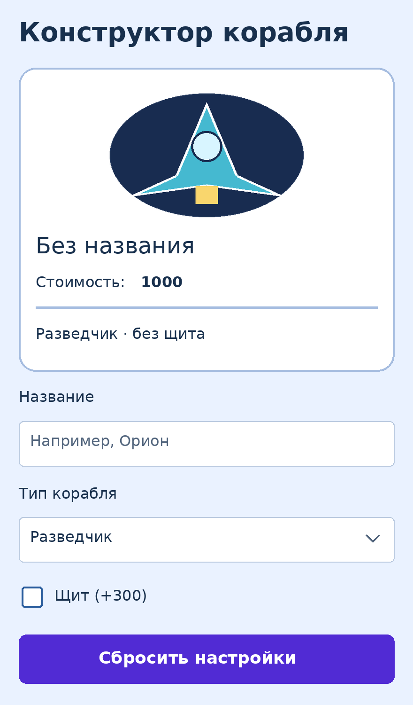
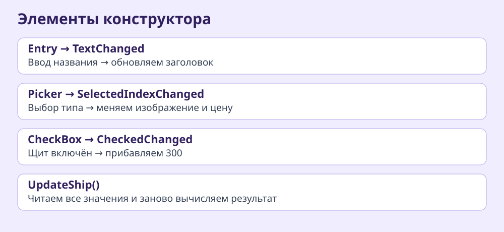

# Урок 2. Конструктор космического корабля

В прошлом уроке кнопки меняли готовые значения. Теперь пользователь сам вводит название, выбирает тип корабля и оборудование. Интерфейс должен реагировать сразу, без отдельной кнопки расчёта. Мы научимся размещать элементы в карточках и обрабатывать события ввода.

## Что получится к концу урока



*Ориентир внешнего вида приложения при первом запуске. Картинка создана по итоговой XAML-разметке и использует изображение разведчика из ресурсов урока. На Windows и Mac оформление стандартных элементов может немного отличаться.*

Представь, что мы открыли мастерскую космических кораблей. Покупатель выбирает модель, придумывает название и решает, нужен ли защитный щит. Ему не приходится нажимать «Рассчитать» после каждого изменения: карточка сама показывает актуальную информацию. Именно такой интерфейс мы сегодня создадим.

| Модель | Базовая цена | Изображение |
|---|---:|---|
| Разведчик | 1000 | ship_scout.png |
| Грузовой | 1500 | ship_cargo.png |
| Истребитель | 2000 | ship_fighter.png |

Щит добавляет 300 к стоимости любой модели. Название не влияет на цену. При сбросе возвращаем разведчика без щита и пустое поле названия.

## 1. Контейнеры: как расположить элементы на экране

> **Определение. Контейнер (layout)** — элемент интерфейса, внутри которого размещаются другие элементы. Контейнер определяет, где окажутся его дочерние элементы и какие расстояния будут между ними.

В первом уроке мы добавляли кнопки и подписи. Теперь попробуем представить экран как несколько вложенных коробок. Одна большая коробка содержит весь экран, а внутри неё располагается карточка с рисунком и настройками корабля.


**Сравним два контейнера:**

| Контейнер | Как располагает дочерние элементы | Когда использовать |
|---|---|---|
| `VerticalStackLayout` | Сверху вниз | Формы, страницы с несколькими блоками |
| `HorizontalStackLayout` | Слева направо | Строка цены, флажок с подписью |

```xml
<VerticalStackLayout Padding="20" Spacing="12">
    <Label Text="Корабль" />
    <HorizontalStackLayout Spacing="8">
        <Label Text="Цена:" />
        <Label Text="1000" />
    </HorizontalStackLayout>
</VerticalStackLayout>
```

> **Запомни: `Padding`, `Margin` и `Spacing` — разные вещи.**
>
> - `Padding` — расстояние **от внутреннего края контейнера до его содержимого**.
> - `Margin` — расстояние **снаружи элемента**, до соседних объектов.
> - `Spacing` — расстояние **между соседними элементами одного StackLayout**.

Например, `Padding="10,20"` задаёт по 10 единиц слева и справа и по 20 сверху и снизу. Если указаны четыре числа, порядок такой: **слева, сверху, справа, снизу**. В C# тот же отступ можно записать как `new Thickness(10, 20)`.

**Проверка.** Измени `Spacing` с 12 на 30. Подписи отдалятся друг от друга, но расстояние от края контейнера до первой подписи останется прежним. Теперь измени `Padding` — изменится уже расстояние от края.

**Важное ограничение:** горизонтальный стек не переносит длинные элементы на следующую строку. Для более сложных таблиц позже изучим `Grid`.

### VerticalStackLayout — вертикальная колонка

> **Определение.** `VerticalStackLayout` — контейнер, который размещает элементы один под другим в порядке их записи в XAML.

```xml
<VerticalStackLayout x:Name="Panel" Padding="16" Spacing="10">
    <Label Text="Название корабля" />
    <Entry Placeholder="Введи название" />
</VerticalStackLayout>
```

**Таблица новых свойств**

| Свойство | Тип / назначение | XAML | C# |
|---|---|---|---|
| Padding | Thickness — внутренний отступ | `Padding="20"` | `Panel.Padding = new Thickness(20);` |
| Spacing | double — расстояние между элементами | `Spacing="12"` | `Panel.Spacing = 12;` |
| Margin | Thickness — внешний отступ | `Margin="10"` | `Panel.Margin = new Thickness(10);` |
| HorizontalOptions | LayoutOptions — положение самого контейнера | `HorizontalOptions="Fill"` | `Panel.HorizontalOptions = LayoutOptions.Fill;` |
| Children | Коллекция вложенных элементов | Теги внутри контейнера | `Panel.Children.Add(new Label { Text = "Привет" });` |

**Что проверить:** добавь вторую подпись и убедись, что она появилась ниже поля ввода. Имя `Panel` в примере — это `x:Name`, а не встроенная переменная.

### HorizontalStackLayout — горизонтальная строка

> **Определение.** `HorizontalStackLayout` — контейнер, который размещает дочерние элементы в одну строку слева направо.

```xml
<HorizontalStackLayout x:Name="Row" Spacing="12">
    <Label Text="Стоимость:" />
    <Label Text="1000" FontAttributes="Bold" />
</HorizontalStackLayout>
```

**Таблица новых свойств**

| Свойство | Тип / назначение | XAML | C# |
|---|---|---|---|
| Spacing | double — промежуток в строке | `Spacing="8"` | `Row.Spacing = 8;` |
| Padding | Thickness — внутренний отступ | `Padding="8,4"` | `Row.Padding = new Thickness(8, 4);` |
| VerticalOptions | LayoutOptions — положение контейнера | `VerticalOptions="Center"` | `Row.VerticalOptions = LayoutOptions.Center;` |
| BackgroundColor | Color — цвет фона строки | `BackgroundColor="LightBlue"` | `Row.BackgroundColor = Colors.LightBlue;` |
| Children | Коллекция дочерних элементов | Вложенные теги | `Row.Children.Add(new Label { Text = "Цена" });` |

**Попробуй:** поменяй `HorizontalStackLayout` на `VerticalStackLayout` и посмотри, где окажется цена. Затем верни горизонтальное расположение. Для обращения из C# у контейнера должно быть имя `x:Name="Row"`.

## 2. Оформление: Border, RoundRectangle, ScrollView, BoxView

У страницы есть не только текст и кнопки. Иногда нужно отделить важную информацию рамкой, сделать длинную страницу прокручиваемой или провести цветную линию. Для этого существуют специальные элементы.

> **`Border`** — рамка с фоном, внутри которой можно разместить **один** дочерний элемент. Если нужно несколько элементов, положи внутрь `Border` контейнер.
>
> **`RoundRectangle`** — форма прямоугольника со скруглёнными углами, которую можно использовать для границы `Border`.
>
> **`ScrollView`** — область, содержимое которой можно прокручивать, если оно не помещается на экране.
>
> **`BoxView`** — простой цветной прямоугольник, например разделительная линия.

```xml
<Border Stroke="#A6BDE0" StrokeThickness="2"
        Padding="16" BackgroundColor="White">
    <Border.StrokeShape>
        <RoundRectangle CornerRadius="18" />
    </Border.StrokeShape>
    <VerticalStackLayout Spacing="10">
        <Label Text="Карточка" />
        <BoxView HeightRequest="2" Color="#A6BDE0" />
        <Label Text="Характеристики" />
    </VerticalStackLayout>
</Border>
```

**Разбираем по порядку:** `Stroke` задаёт цвет границы, `StrokeThickness` — толщину, `StrokeShape` — форму; `Padding` отодвигает содержимое от границы. Внутренний `VerticalStackLayout` нужен потому, что у `Border` только один прямой дочерний элемент. В нём уже могут быть три элемента.

**Мини-опыт:** измени `CornerRadius` с 18 на 0, а `StrokeThickness` с 2 на 6. Затем верни значения. Найди, какое свойство отвечает за каждый результат.

### Border — рамка карточки

> **Определение.** `Border` выделяет содержимое рамкой; прямым дочерним элементом может быть только один объект, например `VerticalStackLayout`.

**Свойства Border**

| Свойство | Тип / назначение | XAML | C# |
|---|---|---|---|
| Stroke | Brush — кисть рамки | `Stroke="#A6BDE0"` | `Card.Stroke = new SolidColorBrush(Colors.Blue);` |
| StrokeThickness | double — толщина | `StrokeThickness="2"` | `Card.StrokeThickness = 2;` |
| StrokeShape | IShape — форма | `<RoundRectangle CornerRadius="18" />` внутри Border.StrokeShape | `Card.StrokeShape = new Microsoft.Maui.Controls.Shapes.RoundRectangle { CornerRadius = new CornerRadius(18) };` |
| Padding | Thickness — отступ внутри рамки | `Padding="16"` | `Card.Padding = new Thickness(16);` |
| BackgroundColor | Color — фон | `BackgroundColor="White"` | `Card.BackgroundColor = Colors.White;` |
| Content | View — один дочерний элемент | Вложенный VerticalStackLayout | `Card.Content = new Label { Text = "Карточка" };` |


### RoundRectangle — скруглённая форма

> **Определение.** `RoundRectangle` задаёт форму прямоугольника со скруглёнными углами. В этом уроке используем его внутри `Border.StrokeShape`.

**Свойства RoundRectangle**

| Свойство | Тип / назначение | XAML | C# |
|---|---|---|---|
| CornerRadius | CornerRadius — радиусы углов | `CornerRadius="18"` | `new Microsoft.Maui.Controls.Shapes.RoundRectangle { CornerRadius = new CornerRadius(18) }` |


### ScrollView — прокручиваемая область

> **Определение.** `ScrollView` позволяет прокручивать длинный экран. Он содержит один дочерний элемент, поэтому внутрь обычно помещают `VerticalStackLayout`.

```xml
<ScrollView Orientation="Vertical">
    <VerticalStackLayout Spacing="12">
        <Label Text="Верх страницы" />
        <Label Text="Низ страницы" />
    </VerticalStackLayout>
</ScrollView>
```

**Свойства ScrollView**

| Свойство | Тип / назначение | XAML | C# |
|---|---|---|---|
| Orientation | ScrollOrientation — направление | `Orientation="Vertical"` | `Scroller.Orientation = ScrollOrientation.Vertical;` |
| VerticalScrollBarVisibility | ScrollBarVisibility — полоса прокрутки | `VerticalScrollBarVisibility="Always"` | `Scroller.VerticalScrollBarVisibility = ScrollBarVisibility.Always;` |
| HorizontalScrollBarVisibility | ScrollBarVisibility — горизонтальная полоса | `HorizontalScrollBarVisibility="Never"` | `Scroller.HorizontalScrollBarVisibility = ScrollBarVisibility.Never;` |
| Content | View — один элемент | Вложенный стек | `Scroller.Content = new VerticalStackLayout();` |


### BoxView — цветная фигура

> **Определение.** `BoxView` рисует прямоугольник без текста. В нашем проекте это тонкая линия между ценой и характеристиками.

```xml
<BoxView Color="#A6BDE0" HeightRequest="2" />
```

**Свойства BoxView**

| Свойство | Тип / назначение | XAML | C# |
|---|---|---|---|
| Color | Color — цвет прямоугольника | `Color="#A6BDE0"` | `Line.Color = Colors.Blue;` |
| HeightRequest | double — желаемая высота | `HeightRequest="2"` | `Line.HeightRequest = 2;` |
| WidthRequest | double — желаемая ширина | `WidthRequest="100"` | `Line.WidthRequest = 100;` |
| CornerRadius | CornerRadius — скругление | `CornerRadius="4"` | `Line.CornerRadius = new CornerRadius(4);` |

Card, Scroller и Line — примеры имён через x:Name. Не нужно добавлять все свойства сразу. Для разделителя достаточно цвета и высоты; ширину определит контейнер. ScrollView по умолчанию прокручивается вертикально. Не вкладывай вертикальный ScrollView в другой вертикальный ScrollView без необходимости.

## 3. Entry — текстовое поле

> **Определение.** `Entry` — элемент, в который пользователь вводит **одну строку текста**. Например, имя корабля. Для нескольких строк позже будем использовать `Editor`.

```xml
<Entry x:Name="NameEntry"
       Placeholder="Например, Орион"
       MaxLength="24"
       TextChanged="OnNameChanged"
       Completed="OnNameCompleted" />
```

Здесь `x:Name` позволяет обращаться к полю из C#, `Placeholder` показывает подсказку, а `MaxLength` ограничивает длину. **Подсказка не является введённым текстом**: пока ученик ничего не напечатал, `NameEntry.Text` может быть `null`.

**Чтение текста:**

```csharp
string name = NameEntry.Text ?? "";
string cleanName = name.Trim();
```

`?? ""` подставляет пустую строку, если значение `null`; `Trim()` удаляет пробелы в начале и конце. `Keyboard="Numeric"` меняет клавиатуру на поддерживаемых устройствах, но не гарантирует, что введены только цифры.

### Событие TextChanged — реагируем на каждый ввод

> **Определение.** `TextChanged` срабатывает при изменении содержимого `Entry`: при вводе, удалении символов и при изменении `Text` программой.

**Связь в XAML:** `TextChanged="OnNameChanged"`.

```csharp
private void OnNameChanged(object? sender, TextChangedEventArgs e)
{
    string oldText = e.OldTextValue ?? "";
    string newText = e.NewTextValue ?? "";
    ShipTitle.Text = newText.Length == 0 ? "Без названия" : newText;
}
```

| Выражение | Что получаем |
|---|---|
| `e.OldTextValue` | Текст **до** изменения |
| `e.NewTextValue` | Текст **после** изменения |
| `NameEntry.Text` | Текущее содержимое конкретного поля |

**Проверка:** введи «О», затем «р». Заголовок должен меняться после каждого символа. Переменная `oldText` показана для изучения; в этом примере она не используется дальше.

### Событие Completed — узнаём введённый текст после завершения

> **Определение.** `Completed` возникает, когда пользователь завершает ввод с помощью действия подтверждения на клавиатуре (обычно Enter/Done). Это не то же самое, что `TextChanged`.

**В XAML у того же поля:** `Completed="OnNameCompleted"`.

```csharp
private void OnNameCompleted(object? sender, EventArgs e)
{
    if (sender is Entry entry)
    {
        string enteredText = (entry.Text ?? "").Trim();
        InfoLabel.Text = "Введено: " + enteredText;
    }
}
```

**Что здесь происходит по шагам:**

1. Пользователь вводит «Орион» и нажимает Enter/Done.
2. MAUI вызывает `OnNameCompleted` и передаёт поле ввода через `sender`.
3. `sender is Entry entry` проверяет, что событие пришло от поля ввода, и создаёт переменную `entry`.
4. `entry.Text` возвращает введённый текст. Мы удаляем лишние пробелы и выводим результат в `InfoLabel`.

**Другой вариант**, если поле известно заранее: `string enteredText = NameEntry.Text ?? "";`. У `EventArgs e` нет свойства `NewTextValue`; для `Completed` текст читают **из Entry**, а не из `e`.

**Важно:** примеры `TextChanged` и `Completed` — самостоятельные упражнения. В итоговом приложении `InfoLabel` занят описанием модели и щита, поэтому пример `Completed` не нужно добавлять в итоговый код без отдельной метки для результата.

### Таблица свойств Entry

| Свойство | Тип / назначение | XAML | C# |
|---|---|---|---|
| Text | string — введённый текст | `Text="Орион"` | `NameEntry.Text = "Орион";` |
| Placeholder | string — подсказка | `Placeholder="Название"` | `NameEntry.Placeholder = "Название";` |
| PlaceholderColor | Color — цвет подсказки | `PlaceholderColor="Gray"` | `NameEntry.PlaceholderColor = Colors.Gray;` |
| MaxLength | int — предел длины | `MaxLength="24"` | `NameEntry.MaxLength = 24;` |
| Keyboard | Keyboard — вид клавиатуры | `Keyboard="Numeric"` | `NameEntry.Keyboard = Keyboard.Numeric;` |
| IsPassword | bool — скрывать символы | `IsPassword="True"` | `NameEntry.IsPassword = true;` |
| IsReadOnly | bool — запретить правку | `IsReadOnly="True"` | `NameEntry.IsReadOnly = true;` |
| TextColor | Color — цвет текста | `TextColor="Black"` | `NameEntry.TextColor = Colors.Black;` |
| FontSize | double — размер | `FontSize="18"` | `NameEntry.FontSize = 18;` |

| Событие | Аргументы метода | Когда вызывается |
|---|---|---|
| `TextChanged` | `object? sender, TextChangedEventArgs e` | Текст изменился |
| `Completed` | `object? sender, EventArgs e` | Пользователь подтвердил ввод клавиатурой |

**Задание:** установи `MaxLength="5"`, попробуй ввести шесть букв и объясни результат. Затем верни 24.

## 4. Picker — выпадающий список

> **Определение.** `Picker` — элемент интерфейса, в котором пользователь может выбрать **один вариант из заранее подготовленного списка**. Например, тип космического корабля.

### Шаг 1. Создаём список в XAML

```xml
<Picker x:Name="TypePicker"
        Title="Выбери тип корабля"
        SelectedIndexChanged="OnTypeChanged">
    <Picker.Items>
        <x:String>Разведчик</x:String>
        <x:String>Грузовой</x:String>
        <x:String>Истребитель</x:String>
    </Picker.Items>
</Picker>
```

`<Picker.Items>` — коллекция строк, а `<x:String>` — отдельная строка в этой коллекции. Здесь три варианта. При нажатии на `Picker` пользователь увидит список и выберет один вариант. На разных платформах окно выбора выглядит по-разному.

**Разница между `Title` и выбранным элементом:** `Title` — подсказка, пока ничего не выбрано; это не первый вариант списка. После выбора `Picker` показывает название выбранного элемента.

### Шаг 2. Разбираемся с индексами

> **Определение. Индекс** — номер позиции элемента в списке. В C# отсчёт начинается с **нуля**, а не с единицы.

| `SelectedIndex` | Какой пункт выбран | `SelectedItem` |
|---:|---|---|
| `-1` | Ничего не выбрано | `null` |
| `0` | Первый | Разведчик |
| `1` | Второй | Грузовой |
| `2` | Третий | Истребитель |

**Получаем выбранный индекс:**

```csharp
int index = TypePicker.SelectedIndex;
```

**Получаем выбранный текст:**

```csharp
string selectedName = TypePicker.SelectedItem?.ToString() ?? "Ничего не выбрано";
```

`?.` вызывает `ToString()` только при наличии объекта. `??` задаёт запасную надпись, если выбор ещё не сделан.

### Шаг 3. Подключаем событие выбора

> **Определение.** `SelectedIndexChanged` — событие, которое возникает при изменении выбранного пункта. Его подключают атрибутом `SelectedIndexChanged="ИмяМетода"`.

```csharp
private void OnTypeChanged(object? sender, EventArgs e)
{
    if (sender is Picker picker)
    {
        int index = picker.SelectedIndex;
        string name = picker.SelectedItem?.ToString() ?? "Нет выбора";
        InfoLabel.Text = $"Выбрано: {name} (индекс {index})";
    }
}
```

**Разбор:**

1. `sender` — именно тот `Picker`, в котором изменился выбор.
2. `sender is Picker picker` проверяет тип и даёт переменную `picker`.
3. `picker.SelectedIndex` сообщает номер позиции.
4. `picker.SelectedItem` возвращает выбранный объект, в нашем случае строку.
5. `InfoLabel.Text` выводит результат.

В отличие от `TextChanged`, второй параметр здесь — обычный `EventArgs`, поэтому `e.SelectedIndex` написать нельзя. Выбор читаем **из самого Picker**.

### Шаг 4. Выбираем вариант программой

```csharp
TypePicker.SelectedIndex = 0; // Первый вариант — разведчик
```

Эту строку можно поместить в конструктор после `InitializeComponent()`. Программное изменение выбранного индекса также может вызвать `SelectedIndexChanged`. Поэтому в итоговом проекте предусмотрена проверка `ready`.

**Другой способ наполнения списка — из C#:**

```csharp
TypePicker.Items.Add("Спасательный");
```

Эта команда добавит четвёртый пункт в конец списка. `ItemsSource` позволяет связать `Picker` с коллекцией данных; подробные привязки мы изучим позже. **В одном примере выбирай один способ заполнения**: `Items` или `ItemsSource`.

**Мини-практика:** добавь «Спасательный», выбери его, проверь индекс. Затем удали пункт, чтобы итоговый проект снова имел три модели. В итоговом приложении `InfoLabel` используется для характеристик корабля, поэтому временный пример обработчика заменим вызовом `UpdateShip()`.

### Таблица свойств Picker

| Свойство | Тип / назначение | XAML | C# |
|---|---|---|---|
| Title | string — подсказка | `Title="Выбери тип"` | `TypePicker.Title = "Выбери тип";` |
| Items | IList<string> — строки списка | `<Picker.Items>` | `TypePicker.Items.Add("Разведчик");` |
| ItemsSource | IList — коллекция вариантов | `ItemsSource="{Binding ShipTypes}"` | `TypePicker.ItemsSource = new List<string> { "Разведчик", "Грузовой" };` |
| SelectedIndex | int — индекс, `-1` без выбора | `SelectedIndex="0"` | `TypePicker.SelectedIndex = 0;` |
| SelectedItem | object? — выбранный объект | В уроке не задаём | `var item = TypePicker.SelectedItem;` |
| TextColor | Color — цвет выбранного текста | `TextColor="Black"` | `TypePicker.TextColor = Colors.Black;` |
| TitleColor | Color — цвет подсказки | `TitleColor="Gray"` | `TypePicker.TitleColor = Colors.Gray;` |

| Событие | Аргументы | Что читаем |
|---|---|---|
| `SelectedIndexChanged` | `object? sender, EventArgs e` | `picker.SelectedIndex`, `picker.SelectedItem` |

**Запомни:** индекс — это позиция, а не цена корабля. Если переставить пункты местами, условия по индексам в C# тоже нужно проверить.

## 5. CheckBox — флажок с двумя состояниями

> **Определение.** `CheckBox` — элемент, который можно **включить или выключить**. Он хранит логическое значение `bool`: `true` — отметка стоит, `false` — отметки нет.

Для корабля это удобно: защитный щит либо установлен, либо нет. Если понадобится несколько видов оборудования, мы добавим несколько независимых флажков.

### Шаг 1. Создаём флажок и подпись

```xml
<HorizontalStackLayout Spacing="8">
    <CheckBox x:Name="ShieldCheck"
              IsChecked="False"
              Color="#285B9C"
              CheckedChanged="OnShieldChanged" />
    <Label Text="Щит (+300)" VerticalOptions="Center" />
</HorizontalStackLayout>
```

**Обрати внимание:** у `CheckBox` нет свойства `Text`, поэтому текст «Щит (+300)» мы показываем в отдельном `Label`. `HorizontalStackLayout` располагает их рядом.

### Шаг 2. Узнаём состояние флажка

```csharp
bool hasShield = ShieldCheck.IsChecked;
```

| Значение | Что видит пользователь | Что делаем в программе |
|---|---|---|
| `true` | Галочка стоит | Прибавляем 300 к цене |
| `false` | Галочки нет | Оставляем базовую цену |

**Простое условие:**

```csharp
if (ShieldCheck.IsChecked)
{
    InfoLabel.Text = "Щит установлен";
}
else
{
    InfoLabel.Text = "Щита нет";
}
```

`IsChecked` уже содержит `true` или `false`, поэтому писать `== true` необязательно.

### Шаг 3. Подключаем CheckedChanged

> **Определение.** `CheckedChanged` — событие, которое возникает при изменении состояния флажка. В отличие от `Picker`, оно передаёт новое значение непосредственно через `e.Value`.

```csharp
private void OnShieldChanged(object? sender, CheckedChangedEventArgs e)
{
    bool isOn = e.Value;

    if (isOn)
    {
        InfoLabel.Text = "Щит включён";
    }
    else
    {
        InfoLabel.Text = "Щит выключен";
    }
}
```

**Разбираем параметры:** `sender` — флажок, который изменили; `e` — объект с данными события; `e.Value` — новое логическое значение. Здесь `e.Value` удобно использовать, если нужно узнать, **что только что произошло**.

**Альтернативный способ через `sender`:**

```csharp
private void OnShieldChanged(object? sender, CheckedChangedEventArgs e)
{
    if (sender is CheckBox checkBox)
    {
        InfoLabel.Text = checkBox.IsChecked ? "Включён" : "Выключен";
    }
}
```

В этом примере `sender is CheckBox checkBox` получает именно изменённый флажок. Это особенно полезно, если несколько флажков используют один обработчик.

### Шаг 4. Управляем флажком из кода

```csharp
ShieldCheck.IsChecked = true;  // Поставить галочку
ShieldCheck.IsChecked = false; // Убрать галочку
```

Программное изменение состояния тоже вызывает `CheckedChanged`, если значение действительно изменилось. В итоговом проекте это важно при нажатии кнопки «Сбросить настройки».

### Шаг 5. Несколько независимых флажков

```xml
<CheckBox x:Name="ShieldCheck" CheckedChanged="OnEquipmentChanged" />
<CheckBox x:Name="EngineCheck" CheckedChanged="OnEquipmentChanged" />
```

```csharp
private void OnEquipmentChanged(object? sender, CheckedChangedEventArgs e)
{
    if (sender == ShieldCheck)
        InfoLabel.Text = "Изменён щит";
    else if (sender == EngineCheck)
        InfoLabel.Text = "Изменён двигатель";
}
```

Это **отдельный тренировочный пример**, а не замена итогового проекта: для него нужно создать `EngineCheck` и переименовать обработчик первого флажка в XAML. В основном проекте оставляем `OnShieldChanged`, а обновление цены выполняет общий метод `UpdateShip()`.



### Таблица свойств CheckBox

| Свойство | Тип / назначение | XAML | C# |
|---|---|---|---|
| IsChecked | bool — установлен ли флажок | `IsChecked="False"` | `ShieldCheck.IsChecked = false;` |
| Color | Color — цвет отметки | `Color="#285B9C"` | `ShieldCheck.Color = Colors.Blue;` |
| IsEnabled | bool — можно ли нажимать | `IsEnabled="True"` | `ShieldCheck.IsEnabled = true;` |
| IsVisible | bool — показывать ли | `IsVisible="True"` | `ShieldCheck.IsVisible = true;` |
| VerticalOptions | LayoutOptions — выравнивание | `VerticalOptions="Center"` | `ShieldCheck.VerticalOptions = LayoutOptions.Center;` |

| Событие | Аргументы | Что читаем |
|---|---|---|
| `CheckedChanged` | `object? sender, CheckedChangedEventArgs e` | `e.Value` или `checkBox.IsChecked` |

**Сравни с Picker:** `Picker` выбирает **один из нескольких** вариантов, а `CheckBox` отвечает на вопрос **«да или нет?»**. Если два флажка независимы, пользователь может включить оба.

## Повторяем знакомые элементы

| Элемент | Свойство | Назначение | Пример XAML |
|---|---|---|---|
| ContentPage | BackgroundColor | Фон страницы | `BackgroundColor="#EAF2FF"` |
| Label | Text | Надпись | `Text="Стоимость:"` |
| Label | FontSize | Размер | `FontSize="24"` |
| Label | FontAttributes | Начертание | `FontAttributes="Bold"` |
| Image | Source | Имя ресурса | `Source="ship_scout.png"` |
| Image | Aspect | Масштабирование | `Aspect="AspectFit"` |
| Image | HeightRequest | Желаемая высота | `HeightRequest="150"` |
| Button | Text | Надпись | `Text="Сбросить настройки"` |
| Button | Clicked | Событие нажатия | `Clicked="OnResetClicked"` |

## 6. Методы: как создать функцию и связать её с интерфейсом

> **Определение. Метод** — именованный участок кода внутри класса. Мы можем вызывать его по имени, передавать ему значения и, при необходимости, получать результат.

В C# функции внутри класса обычно называют **методами**. У метода есть имя, возвращаемый тип, круглые скобки с параметрами и тело в фигурных скобках.

### Пример 1. Метод без параметров

```csharp
private void UpdateShip()
{
    PriceLabel.Text = "1000";
}
```

| Часть | Значение |
|---|---|
| `private` | Метод доступен внутри класса |
| `void` | Метод не возвращает значение |
| `UpdateShip` | Имя метода |
| `()` | Параметров нет |
| `{ ... }` | Команды, выполняемые при вызове |

**Вызов:** `UpdateShip();`. Без круглых скобок это не вызов метода.

### Пример 2. Метод с параметрами

```csharp
private void ShowShip(string name, int price)
{
    ShipTitle.Text = name;
    PriceLabel.Text = price.ToString();
}
```

Вызов: `ShowShip("Орион", 1500);`. `name` и `price` — **параметры** в определении метода. Строка «Орион» и число 1500 — **аргументы**, переданные при вызове. Их порядок и типы должны соответствовать параметрам.

### Пример 3. Метод возвращает результат

```csharp
private int CalculatePrice(int basePrice, bool hasShield)
{
    if (hasShield)
        return basePrice + 300;

    return basePrice;
}
```

```csharp
int result = CalculatePrice(1500, true);
PriceLabel.Text = result.ToString();
```

Здесь `int` перед именем означает, что метод возвращает целое число. `return` завершает метод и передаёт результат. В примере результат равен 1800.

**Таблица типов параметров**

| Тип | Для каких данных | Пример |
|---|---|---|
| `string` | Название | `string name` |
| `int` | Цена или количество | `int price` |
| `bool` | Есть щит или нет | `bool hasShield` |
| `Color` | Цвет | `Color color` |
| `Button` | Ссылка на кнопку | `Button button` |
| `Picker` | Ссылка на список | `Picker picker` |

> **Важно:** обычному методу мы сами выбираем параметры. Но у обработчика события параметры определены самим событием MAUI.

### Пример 4. Обработчик события

```xml
<Entry x:Name="NameEntry" TextChanged="OnNameChanged" />
```

```csharp
private void OnNameChanged(object? sender, TextChangedEventArgs e)
{
    ShipTitle.Text = e.NewTextValue ?? "";
}
```

Когда пользователь изменяет текст, MAUI сам вызывает обработчик. Мы **не пишем** `OnNameChanged(...)` в XAML — указываем только имя `OnNameChanged`.

**Что такое `sender`?** Объект, от которого пришло событие. В примере это `Entry`. **Что такое `e`?** Дополнительные данные: для `TextChanged` это старый и новый текст. Знак `?` в `object?` разрешает значение `null`.

### Сводная таблица событий и рабочих примеров

| Элемент | Событие в XAML | Сигнатура обработчика | Как узнать результат |
|---|---|---|---|
| Button | `Clicked="OnResetClicked"` | `object? sender, EventArgs e` | `sender is Button button`, затем `button.Text` |
| Entry | `TextChanged="OnNameChanged"` | `object? sender, TextChangedEventArgs e` | `e.NewTextValue` |
| Entry | `Completed="OnNameCompleted"` | `object? sender, EventArgs e` | `((Entry)sender).Text` после проверки типа |
| Picker | `SelectedIndexChanged="OnTypeChanged"` | `object? sender, EventArgs e` | `picker.SelectedIndex`, `picker.SelectedItem` |
| CheckBox | `CheckedChanged="OnShieldChanged"` | `object? sender, CheckedChangedEventArgs e` | `e.Value` |

Для **каждого** события выше есть отдельный полноценный пример в разделе соответствующего элемента. Для кнопки приведём дополнительный пример:

```xml
<Button Text="Проверить" Clicked="OnCheckClicked" />
```

```csharp
private void OnCheckClicked(object? sender, EventArgs e)
{
    if (sender is Button button)
        InfoLabel.Text = "Нажата кнопка: " + button.Text;
}
```

У `EventArgs e` в `Clicked` нет свойства `Text`: текст читаем из самой кнопки. Этот пример предназначен для отдельной проверки; в итоговом приложении у кнопки сброса будет `OnResetClicked`.

### Как связать несколько событий с одним методом

У каждого события остаётся **свой обработчик**, но все обработчики могут вызвать один обычный метод:

```csharp
private void OnNameChanged(object? sender, TextChangedEventArgs e)
{
    UpdateShip();
}

private void OnTypeChanged(object? sender, EventArgs e)
{
    UpdateShip();
}

private void OnShieldChanged(object? sender, CheckedChangedEventArgs e)
{
    UpdateShip();
}
```

Это избавляет от повторения расчёта цены в трёх местах. В `UpdateShip()` мы читаем актуальные значения `NameEntry.Text`, `TypePicker.SelectedIndex` и `ShieldCheck.IsChecked`.

**Проверь понимание:** почему нельзя написать `OnShieldChanged(object? sender, EventArgs e)` и обратиться к `e.Value`? Потому что `Value` есть у `CheckedChangedEventArgs`, но отсутствует у обычного `EventArgs`.

## 7. Собираем приложение вместе: от пустого экрана до конструктора

> **Порядок работы:** сначала создаём разметку, затем проверяем отдельные события, после этого объединяем обновление карточки в один метод. После каждого законченного этапа сверяем вид экрана и поведение элементов.


### Шаг 1. Создаём проект и готовим ресурсы

Создай .NET MAUI App с именем ShipApp в локальной папке. На Windows выбери Windows Machine и нажми F5. На Mac открой папку с csproj в VS Code. Сначала запусти стандартный шаблон по [первому уроку](../урок-01-введение-maui-счётчик/урок.md). Скопируй три ship_*.png из [материалов](материалы/Resources/Images/) в Resources/Images. Действие сборки — MauiImage. Не копируй чужой csproj.

В MainPage.xaml сохрани корневой ContentPage и его x:Class. Удали старый интерфейс счётчика. В MainPage.xaml.cs оставь namespace, класс и конструктор с InitializeComponent(); удали старый OnCounterClicked. Если проект называется иначе, сохрани своё имя пространства имён в обоих файлах.

### Шаг 2. Создаём каркас страницы

Внутри ContentPage вставь:

```xml
<ScrollView>
    <VerticalStackLayout Padding="20" Spacing="16">
        <Label Text="Конструктор корабля" FontSize="28"
               FontAttributes="Bold" TextColor="#18304D" />
    </VerticalStackLayout>
</ScrollView>
```

У ContentPage установи BackgroundColor="#EAF2FF". Внешний стек — колонка всего экрана. Все следующие элементы добавляем внутрь него, после заголовка. ScrollView нужен, чтобы на маленьком экране можно было добраться до нижней кнопки. Запусти и проверь заголовок.

### Шаг 3. Создаём карточку корабля

После заголовка, но до закрывающего тега внешнего стека, вставь:

```xml
<Border Stroke="#A6BDE0" StrokeThickness="2" Padding="16" BackgroundColor="White">
                <Border.StrokeShape>
                    <RoundRectangle CornerRadius="18" />
                </Border.StrokeShape>
                <VerticalStackLayout Spacing="10">
                    <Image x:Name="ShipImage" Source="ship_scout.png" HeightRequest="150" Aspect="AspectFit" />
                    <Label x:Name="ShipTitle" Text="Без названия" FontSize="24" TextColor="#18304D" />
                    <HorizontalStackLayout Spacing="12">
                        <Label Text="Стоимость:" TextColor="#18304D" />
                        <Label x:Name="PriceLabel" Text="1000" TextColor="#18304D" FontAttributes="Bold" />
                    </HorizontalStackLayout>
                    <BoxView HeightRequest="2" Color="#A6BDE0" />
                    <Label x:Name="InfoLabel" Text="Разведчик" TextColor="#18304D" />
                </VerticalStackLayout>
            </Border>
```

Border содержит один внутренний стек. Внутри него картинка, название, горизонтальная строка цены, разделитель и описание. ShipImage, ShipTitle, PriceLabel и InfoLabel — имена элементов, к которым будем обращаться из C#. Не путай два стека: внешний содержит весь экран, внутренний — только карточку. Запусти: видны разведчик, цена 1000 и название «Без названия».

### Шаг 4. Добавляем настройки: поле, список и флажок

После закрывающего Border, внутри внешнего стека, добавь следующий блок. Пока не запускай проект: сначала создадим методы, указанные в событиях.

```xml
<Label Text="Название" TextColor="#18304D" />
            <Entry x:Name="NameEntry" Placeholder="Например, Орион" MaxLength="24" TextChanged="OnNameChanged" TextColor="#18304D" BackgroundColor="White" PlaceholderColor="#52657D" />
            <Label Text="Тип корабля" TextColor="#18304D" />
            <Picker x:Name="TypePicker" Title="Выбери тип" SelectedIndexChanged="OnTypeChanged" TextColor="#18304D" BackgroundColor="White" TitleColor="#52657D">
                <Picker.Items>
                    <x:String>Разведчик</x:String>
                    <x:String>Грузовой</x:String>
                    <x:String>Истребитель</x:String>
                </Picker.Items>
            </Picker>
            <HorizontalStackLayout Spacing="8">
                <CheckBox x:Name="ShieldCheck" CheckedChanged="OnShieldChanged" Color="#285B9C" />
                <Label Text="Щит (+300)" VerticalOptions="Center" TextColor="#18304D" />
            </HorizontalStackLayout>
            <Button Text="Сбросить настройки" Clicked="OnResetClicked" />
```

Entry принимает название, Picker содержит три модели в порядке индексов 0, 1, 2. CheckBox и его подпись находятся в одной строке. Кнопка сброса стоит внизу. Все четыре события требуют методов в MainPage.xaml.cs.

### Шаг 5. Проверяем каждое событие до общего расчёта

После конструктора, внутри класса MainPage, добавь временные обработчики:

```csharp
private void OnNameChanged(object? sender, TextChangedEventArgs e)
{
    ShipTitle.Text = e.NewTextValue ?? "";
}

private void OnTypeChanged(object? sender, EventArgs e)
{
    InfoLabel.Text = TypePicker.SelectedItem?.ToString() ?? "Нет выбора";
}

private void OnShieldChanged(object? sender, CheckedChangedEventArgs e)
{
    InfoLabel.Text = e.Value ? "Со щитом" : "Без щита";
}

private void OnResetClicked(object? sender, EventArgs e)
{
    NameEntry.Text = "";
    TypePicker.SelectedIndex = 0;
    ShieldCheck.IsChecked = false;
}
```

**Это тренировочный этап, а не окончательная логика.** Если событие возникает при загрузке XAML, обращение к ещё не созданному элементу может вызвать ошибку. Поэтому перед запуском добавь поле `private bool ready = false;` внутри класса, перед конструктором, и в начале каждого из четырёх временных обработчиков напиши `if (!ready) return;`. В конструкторе после InitializeComponent установи TypePicker.SelectedIndex = 0, затем ready = true. Теперь запусти: введи «Орион», выбери грузовой, включи щит. Пока меняются только надписи, цена и картинка остаются прежними. Это нормально: дальше добавим расчёт.

### Шаг 6. Создаём общий метод UpdateShip

Нам нужно обновлять всю карточку при любом изменении. Не будем копировать одинаковые условия в три обработчика. Создадим один метод без параметров, потому что он может прочитать значения элементов по x:Name.

Начни с проверки готовности и названия:

```csharp
private void UpdateShip()
{
    if (!ready)
        return;

    string name = (NameEntry.Text ?? "").Trim();
    if (name.Length == 0)
        name = "Без названия";
    ShipTitle.Text = name;
}
```

?? заменяет null пустой строкой, Trim убирает пробелы по краям. Если пользователь ввёл только пробелы, показываем «Без названия». Замени содержимое OnNameChanged на `UpdateShip();`. Не создавай второй метод с тем же именем.

### Шаг 7. Выбираем модель и цену

Внутри UpdateShip после присваивания ShipTitle.Text добавь:

```csharp
int index = TypePicker.SelectedIndex;
int price = 1000;
string type = "Разведчик";
string image = "ship_scout.png";

if (index == 1)
{
    price = 1500;
    type = "Грузовой";
    image = "ship_cargo.png";
}
else if (index == 2)
{
    price = 2000;
    type = "Истребитель";
    image = "ship_fighter.png";
}
```

Начальные значения соответствуют разведчику. Индекс 1 меняет сразу три переменные, индекс 2 — тоже. При индексе 0 или -1 остаются начальные значения. В конце метода добавь `ShipImage.Source = image;` и `PriceLabel.Text = price.ToString();`. ToString превращает число в строку, потому что Text у Label имеет тип string. Замени содержимое OnTypeChanged на `UpdateShip();`. Проверь три модели.

### Шаг 8. Добавляем щит

Перед строками обновления ShipImage и PriceLabel вставь:

```csharp
if (ShieldCheck.IsChecked)
{
    price += 300;
    InfoLabel.Text = type + " · со щитом";
}
else
{
    InfoLabel.Text = type + " · без щита";
}
```

IsChecked уже имеет тип bool, поэтому сравнение с true не обязательно. Цена каждый раз начинается с базовой стоимости. Мы не читаем старый текст PriceLabel и не прибавляем к нему 300: иначе при повторном вводе названия цена могла бы расти. Замени содержимое OnShieldChanged на `UpdateShip();`. Проверь грузовой со щитом — 1800, без щита — 1500.

### Шаг 9. Настраиваем запуск и сброс

Конструктор должен сначала создать интерфейс, затем установить начальный индекс, разрешить обновление и вызвать UpdateShip:

```csharp
public MainPage()
{
    InitializeComponent();
    TypePicker.SelectedIndex = 0;
    ready = true;
    UpdateShip();
}
```

Поле ready хранит состояние готовности страницы. До InitializeComponent и начальной настройки оно false. События могут возникать при изменении свойств из кода, поэтому UpdateShip проверяет ready. После настройки вызываем метод вручную, чтобы карточка сразу была правильной.

В OnResetClicked оставь три присваивания из шага 5 и добавь UpdateShip() в конце. Даже если значения уже были начальными и события не возникли, карточка обновится. В итоговом обработчике сброса отдельная проверка ready не нужна: кнопка доступна после создания страницы.

### Как работает итоговый проект целиком

Перед тем как смотреть готовые файлы, проследим путь одного действия. Допустим, пользователь выбрал **грузовой корабль** и поставил флажок щита.

1. `Picker` меняет `SelectedIndex` на `1` и вызывает `OnTypeChanged`.
2. Обработчик вызывает обычный метод `UpdateShip()`.
3. `UpdateShip()` читает название, индекс выбранной модели и состояние флажка.
4. При индексе `1` базовая цена становится **1500**, изображение — `ship_cargo.png`.
5. Если `ShieldCheck.IsChecked` равно `true`, к цене добавляется **300**.
6. В `PriceLabel` появляется **1800**, в `InfoLabel` — «Грузовой · со щитом», а `ShipImage` показывает грузовой корабль.

**Почему цена не увеличивается бесконечно?** При каждом вызове `UpdateShip()` переменная `price` заново получает базовую стоимость. Мы не прибавляем 300 к старому тексту `PriceLabel`.

**Почему есть поле `ready`?** Некоторые события возникают даже тогда, когда значения элементов меняет сама программа. Во время создания страницы не все элементы могут быть готовы. Пока `ready == false`, `UpdateShip()` ничего не делает. После `InitializeComponent()` и установки первого пункта списка включаем `ready` и один раз обновляем карточку.

**Почему обработчики такие короткие?** Они лишь сообщают, что что-то изменилось. Вся логика находится в одном месте — методе `UpdateShip()`. Так легче исправлять ошибки и добавлять оборудование.

## Полный итоговый код для сверки

Ниже оба файла целиком. Не вставляй их внутрь существующего класса или ContentPage: при сверке заменяй соответствующее содержимое файла. Namespace и x:Class должны соответствовать твоему проекту.

### MainPage.xaml

```xml
<?xml version="1.0" encoding="utf-8" ?>
<ContentPage xmlns="http://schemas.microsoft.com/dotnet/2021/maui" xmlns:x="http://schemas.microsoft.com/winfx/2009/xaml" x:Class="ShipApp.MainPage" BackgroundColor="#EAF2FF">
    <ScrollView>
        <VerticalStackLayout Padding="20" Spacing="16">
            <Label Text="Конструктор корабля" FontSize="28" FontAttributes="Bold" TextColor="#18304D" />
            <Border Stroke="#A6BDE0" StrokeThickness="2" Padding="16" BackgroundColor="White">
                <Border.StrokeShape>
                    <RoundRectangle CornerRadius="18" />
                </Border.StrokeShape>
                <VerticalStackLayout Spacing="10">
                    <Image x:Name="ShipImage" Source="ship_scout.png" HeightRequest="150" Aspect="AspectFit" />
                    <Label x:Name="ShipTitle" Text="Без названия" FontSize="24" TextColor="#18304D" />
                    <HorizontalStackLayout Spacing="12">
                        <Label Text="Стоимость:" TextColor="#18304D" />
                        <Label x:Name="PriceLabel" Text="1000" TextColor="#18304D" FontAttributes="Bold" />
                    </HorizontalStackLayout>
                    <BoxView HeightRequest="2" Color="#A6BDE0" />
                    <Label x:Name="InfoLabel" Text="Разведчик" TextColor="#18304D" />
                </VerticalStackLayout>
            </Border>
            <Label Text="Название" TextColor="#18304D" />
            <Entry x:Name="NameEntry" Placeholder="Например, Орион" MaxLength="24" TextChanged="OnNameChanged" TextColor="#18304D" BackgroundColor="White" PlaceholderColor="#52657D" />
            <Label Text="Тип корабля" TextColor="#18304D" />
            <Picker x:Name="TypePicker" Title="Выбери тип" SelectedIndexChanged="OnTypeChanged" TextColor="#18304D" BackgroundColor="White" TitleColor="#52657D">
                <Picker.Items>
                    <x:String>Разведчик</x:String>
                    <x:String>Грузовой</x:String>
                    <x:String>Истребитель</x:String>
                </Picker.Items>
            </Picker>
            <HorizontalStackLayout Spacing="8">
                <CheckBox x:Name="ShieldCheck" CheckedChanged="OnShieldChanged" Color="#285B9C" />
                <Label Text="Щит (+300)" VerticalOptions="Center" TextColor="#18304D" />
            </HorizontalStackLayout>
            <Button Text="Сбросить настройки" Clicked="OnResetClicked" />
        </VerticalStackLayout>
    </ScrollView>
</ContentPage>
```

### MainPage.xaml.cs

```csharp
using System;
using Microsoft.Maui.Controls;

namespace ShipApp;

public partial class MainPage : ContentPage
{
    private bool ready = false;

    public MainPage()
    {
        InitializeComponent();
        TypePicker.SelectedIndex = 0;
        ready = true;
        UpdateShip();
    }

    private void UpdateShip()
    {
        if (!ready)
            return;

        string name = (NameEntry.Text ?? "").Trim();
        if (name.Length == 0)
            name = "Без названия";
        ShipTitle.Text = name;

        int index = TypePicker.SelectedIndex;
        int price = 1000;
        string type = "Разведчик";
        string image = "ship_scout.png";

        if (index == 1)
        {
            price = 1500;
            type = "Грузовой";
            image = "ship_cargo.png";
        }
        else if (index == 2)
        {
            price = 2000;
            type = "Истребитель";
            image = "ship_fighter.png";
        }

        if (ShieldCheck.IsChecked)
        {
            price += 300;
            InfoLabel.Text = type + " · со щитом";
        }
        else
        {
            InfoLabel.Text = type + " · без щита";
        }

        ShipImage.Source = image;
        PriceLabel.Text = price.ToString();
    }

    private void OnNameChanged(object? sender, TextChangedEventArgs e)
    {
        UpdateShip();
    }

    private void OnTypeChanged(object? sender, EventArgs e)
    {
        UpdateShip();
    }

    private void OnShieldChanged(object? sender, CheckedChangedEventArgs e)
    {
        UpdateShip();
    }

    private void OnResetClicked(object? sender, EventArgs e)
    {
        NameEntry.Text = "";
        TypePicker.SelectedIndex = 0;
        ShieldCheck.IsChecked = false;
        UpdateShip();
    }
}
```

## Сборка и проверка проекта

Сохрани оба файла. На Windows останови старую отладку Shift+F5, выбери Windows Machine и нажми F5. Если изменения не появились, Build → Rebuild Solution, затем F5. На Mac закрой старое приложение Cmd+Q и открой терминал в папке с csproj.

| Команда (.NET 10, Mac) | Назначение |
|---|---|
| `dotnet restore` | Восстановить зависимости |
| `dotnet build -f net10.0-maccatalyst` | Собрать проект |
| `dotnet run -f net10.0-maccatalyst` | Запустить через Run, если поддерживается конфигурацией |
| `dotnet build -t:Run -f net10.0-maccatalyst` | Собрать и запустить Mac Catalyst |
| `dotnet build -t:Rebuild -f net10.0-maccatalyst` | Полностью пересобрать |
| `open bin/Debug/net10.0-maccatalyst/maccatalyst-arm64/ShipApp.app` | Открыть готовую сборку на Apple Silicon |

После изменения XAML, C# или картинок используй сборку с Run либо сначала build, затем open. Open не компилирует код. Если проект называется Pr1, замени ShipApp.app на Pr1.app; на Intel или при другой версии SDK путь может отличаться. При необходимости найди пакет командой `find bin -name "*.app" -type d`. Если сборка не прошла, сначала исправь первую ошибку в терминале, не запускай старый пакет. Подробнее — [справочник среды](../../справочники/среда-VisualStudio-и-VSCode.md).

| Действие | Ожидаемый результат |
|---|---|
| Первый запуск | Разведчик, 1000, Без названия, без щита |
| Ввести Орион | Заголовок Орион, цена не меняется |
| Ввести только пробелы | Без названия |
| Выбрать грузовой | Грузовой, 1500, новая картинка |
| Включить щит | 1800, со щитом |
| Изменить название при включённом щите | Цена остаётся 1800 |
| Выбрать истребитель со щитом | 2300, картинка истребителя |
| Снять щит | 2000 |
| Сбросить | Разведчик, 1000, пустое поле, Без названия |

Если картинка не видна, проверь имя файла, папку Resources/Images и пересборку. Если метод не найден, сравни имя в XAML и C#. Если цена неверна, проверь начальное значение price и место прибавления 300. Если приложение падает при открытии, проверь ready и порядок InitializeComponent.

## Дополнительное творческое задание

Нарисуй три собственных корабля в одинаковом стиле. Используй PNG с прозрачным фоном, например 512 × 512, и замени три ship_*.png, сохранив имена. Пересобери приложение. Затем попробуй добавить второй независимый CheckBox «Ускоритель (+500)»: создай имя, обработчик CheckedChanged, вызови UpdateShip и добавь отдельное условие расчёта. Не забудь снять новый флажок при сбросе.

Готовые файлы: [XAML](материалы/MainPage.xaml), [C#](материалы/MainPage.xaml.cs). Теперь переходи к [практике](практика.md).
