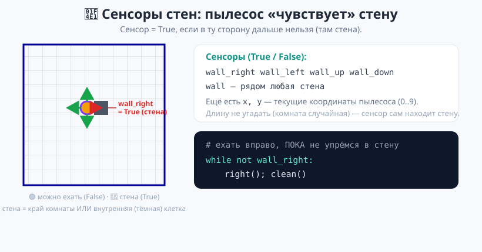
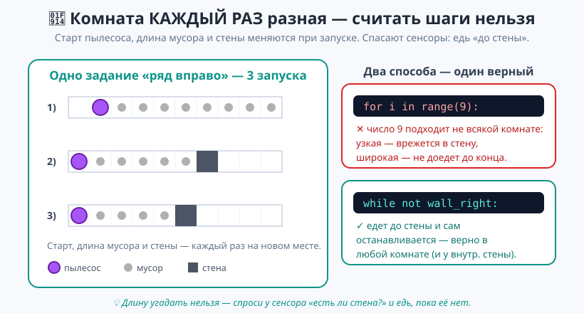
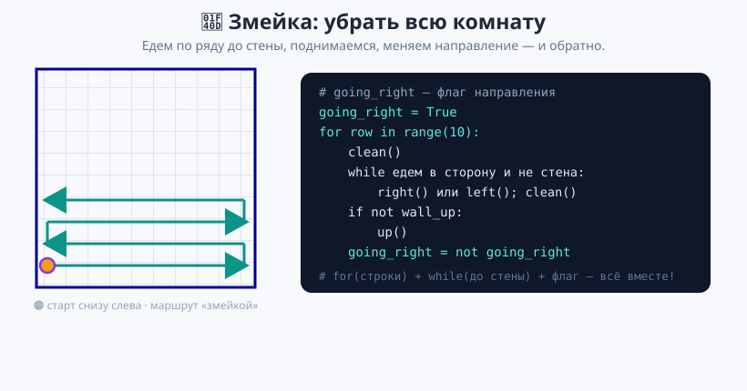

# Урок 5 — 🏆 «Умный пылесос»: большой практикум (16 заданий) 🐢🧹

**Модуль 3 · Циклы · Урок 5 из 6 (практикум) | 2 ак.ч. (1,5 часа)**

> ⬅️ Предыдущий: [Урок 4 «Вложенные циклы»](../урок-04-вложенные-циклы/урок.md) · [Все уроки модуля](../README.md) · [План курса](../../ПЛАН-КУРСА.md) · Следующий: [Урок 6 «Интересные программы»](../урок-06-интересные-программы/урок.md) ➡️

> 🔁 В начале — [разминка/повтор](повторение.md) (5 мин).
> 📌 Быстро вспомнить — [итого.md](итого.md) (шпаргалка).
> 👨‍🏫 Сценарий с хронометражом — в [преподавателю.md](преподавателю.md).
> 🖼 Что показать на проекторе — в [изображения.md](изображения.md).
> 🆘 Разбор с нуля — [самоучитель.md](самоучитель.md).
> 🧰 Трюки и частые ошибки — в [лайфхак.md](лайфхак.md).
> 🎮 **Весь урок — игра:** 16 заданий пылесосу в [`материалы/пылесос_практикум.py`](материалы/пылесос_практикум.py).

> 🧭 **Как читать урок.** Это **большой практикум** — почти без новой теории. Мы соберём вместе **всё**, что выучили про циклы: `for` (когда знаем число повторов), `while` (когда едем «до стены»), **вложенные циклы** (когда заливаем область), `break`/`continue`. Пылесос получит **сенсоры стен** — и научится ездить в комнате, не считая клетки. 16 заданий растут в сложности: от простого ряда до заливки всей комнаты «змейкой».

---

## 🎮 Что мы сделаем сегодня

**Практикум:** в файле [`пылесос_практикум.py`](материалы/пылесос_практикум.py) — **16 заданий**. В каждом мусор расставлен по-своему; ты меняешь `TASK` и пишешь **алгоритм**, чтобы собрать весь мусор. Когда чисто — окно пишет «ЧИСТО!».

> ⚠️ **Комната КАЖДЫЙ РАЗ РАЗНАЯ.** Запусти программу несколько раз подряд — пылесос стартует со случайного места, мусор тянется до стены на **разное** расстояние, а кое-где стоят **тёмные внутренние стены**. Поэтому «посчитать шаги заранее» (`for i in range(9)`) больше не работает — на другом запуске пылесос врежется в стену или не доедет. Правильный алгоритм собирает мусор **при любом раскладе** — для этого и нужны сенсоры.

**Главные навыки урока (всё вместе):** `while` + **сенсоры стен** (едем «до стены», расстояние каждый раз разное) · `for` (фиксированное число повторов, напр. 10 строк комнаты) · вложенные циклы (области) · `break`/`continue` · выбор «какой цикл взять».

> 💡 **Главная мысль урока:** **под каждую задачу — свой цикл.** Едешь «пока не упрёшься в стену», а длина случайная → `while` + сенсор. Число повторов фиксировано (например, 10 строк комнаты) → `for`. Заливаешь область → вложенный цикл. Практикум учит **выбирать** инструмент.

---

## Часть 1 — Команды и новое: сенсоры стен (10 минут)

Команды движения те же, что и раньше:

```
right()  left()  up()  down()    # переехать на клетку
clean()                          # убрать мусор в текущей клетке
```

**Новое — сенсоры стен.** Пылесос «чувствует», есть ли рядом стена. Это переменные-флаги `True`/`False`, которые можно читать в условии `while`:

```
wall_right  — справа стена (дальше вправо нельзя)
wall_left   — слева стена
wall_up      — сверху стена
wall_down    — снизу стена
wall         — рядом ЛЮБАЯ стена
x, y         — текущие координаты пылесоса (0..9)
```



> 💡 **Зачем сенсоры?** Комната пылесоса **каждый запуск разная**: старт, длина мусора и внутренние стены меняются. Посчитать шаги заранее (`range(9)`) нельзя — на другом запуске это число уже неверное. Тогда едем, **пока** сенсор не скажет «стена»: `while not wall_right:`. Пылесос сам остановится у стены — считать клетки не нужно, алгоритм работает в комнате любой ширины.

> ⚠️ **Выедешь за стену — пылесос покраснеет и остановится.** Это сигнал, что в алгоритме лишний шаг. Едешь «до стены» — бери `while not сенсор`, и пылесос сам остановится вовремя.

---

## Часть 2 — `for` или `while`? Выбираем инструмент (12 минут)

Главный вопрос практикума — **какой цикл взять**.



**Едешь «до стены» (длина случайная) → `while` + сенсор:**
```python
# вправо, ПОКА не упрёмся в стену — не важно, 5 клеток до неё или 9
while not wall_right:
    right()
    clean()
```

**Число повторов фиксировано (не зависит от комнаты) → `for`:**
```python
# в комнате ВСЕГДА 10 строк — это число не меняется
for row in range(10):
    ...
```

- 👀 Вариант с `while` работает в комнате **любой** ширины и останавливается сам. Вариант с `for` берём только тогда, когда число повторов **точно известно и постоянно** (например, 10 строк комнаты) — а вот горизонтальные расстояния теперь случайные, их считать нельзя.

> 💡 **Как выбрать за 1 секунду.** Спроси: «Это расстояние до стены?» Да → `while not сенсор:` (пусть пылесос сам упрётся). «Это фиксированное число, которое не зависит от комнаты (10 строк)?» → `for range(...)`.

> 💡 **Убрать весь ряд, где стоишь.** Сначала доедь до левой стены, потом иди вправо до правой, убирая:
> ```python
> while not wall_left:      # к левому краю
>     left()
> clean()
> while not wall_right:     # и обратно вправо, убирая
>     right()
>     clean()
> ```

> ✍️ **Мини-задание 1 (3 мин):** открой `пылесос_практикум.py`, поставь `TASK = 1` и убери ряд мусора одним `while not wall_right`. Запусти **два-три раза** — убедись, что комната меняется, а твой алгоритм собирает мусор каждый раз.

---

## Часть 3 — Змейка: убрать всю комнату (14 минут)

Самое сложное — убрать **всю комнату**. Это соединение трёх приёмов: `for` (по строкам), `while` (по строке до стены) и **флаг направления** — чтобы идти то вправо, то влево («змейкой»).

```python
going_right = True
for row in range(10):                 # 10 строк
    clean()
    # едем по строке до стены в нужную сторону
    while (going_right and not wall_right) or (not going_right and not wall_left):
        right() if going_right else left()
        clean()
    if not wall_up:                   # поднимаемся на следующую строку
        up()
    going_right = not going_right     # меняем направление
```



- 👀 Строка убирается вправо, поднимаемся, следующую — влево, снова поднимаемся. Так пылесос обходит **все 100 клеток**, ни разу не выехав за стену. Здесь `for` + `while` + флаг работают вместе — вершина модуля!

> 💡 **Флаг `going_right`** хранит направление. `going_right = not going_right` переключает его после каждой строки — как выключатель.

> 🧩 **Для 5–7 классов:** достаточно заданий 1–8 (ряды и столбцы «до стены», диагональ, буква Г). Змейка и узоры (11, 14–16) — 🎓 для тех, кто хочет вызов.

---

## Часть 4 — 16 заданий 🏆

Все задания — в [`материалы/пылесос_практикум.py`](материалы/пылесос_практикум.py). Меняй `TASK` от 1 до 16. Полный список с подсказками — в **[практика.md](практика.md)**. Кратко по группам:

| Задания | Тема | Какой цикл |
|---------|------|-----------|
| 1–4 | ряды и столбцы «до стены» (во все стороны) | `while` + сенсор |
| 5–8 | доехать и убрать угол, ряд от края до края, диагональ, буква Г | `while` + сенсор |
| 9–12 | периметр, два ряда змейкой, вся комната, буква L | `while` / змейка |
| 13 | 🎓 комната с внутренней перегородкой | `while` + сенсор |
| 14–16 | 🎓 шахматка, чётные столбцы, ромб | змейка + `continue` + `x, y` |

> 💡 **Шахматка и ромб (задания 14, 16)** — убираем только нужные клетки. Читаем координаты `x, y` и пропускаем лишние через `continue`:
> ```python
> if (x + y) % 2 != 0:
>     continue          # пропускаем «белую» клетку
> ```

> 📄 Файл — **стартер**: пример решения задания 1 лежит в комментарии. Раскомментируй, запусти, потом решай остальные.

---

## 🐞 Разбор частых ошибок

| Симптом | Что случилось | Как починить |
|---------|---------------|--------------|
| пылесос покраснел (за стеной) | посчитал шаги `range(N)` в случайной комнате | едешь «до стены» — бери `while not сенсор` |
| «Осталось мусора: N» | обошёл не все клетки | проверь маршрут/границы |
| `while` крутится вечно | забыл двигаться внутри (`right()`) | в теле `while` обязательно движение |
| змейка сбилась | не переключил `going_right` | `going_right = not going_right` в конце строки |
| убрал лишние клетки | нет условия | добавь `if ...: continue` |

> ⚠️ **Главное правило `while`:** в теле обязательно должно быть движение к стене — иначе сенсор никогда не станет True и цикл зациклится.

---

## 🏁 Итог урока (5 минут)

Ты собрал **все циклы** в одном практикуме:

- ✅ `while` + **сенсоры стен** — когда едешь «до стены» (длина случайная, считать нельзя).
- ✅ `for` — когда число повторов **фиксировано** (например, 10 строк комнаты).
- ✅ Вложенные циклы + флаг — залить **область** и всю комнату «змейкой».
- ✅ `continue` + координаты `x, y` — убрать только нужные клетки (шахматка, ромб).
- ✅ Главное умение — **выбрать** правильный цикл под задачу.

> 🏆 Главное: **под каждую задачу — свой цикл; сенсоры позволяют не считать клетки.** Быстро повторить — в [итого.md](итого.md).

> 🎤 **Блиц:** когда берут `for`, а когда `while`? что такое `wall_right`? как убрать ряд неизвестной длины? как убрать всю комнату? зачем флаг `going_right`? как пропустить «белые» клетки в шахматке?

### 🎮 Викторина-закрепление
Открой **[викторина.html](викторина.html)** — 18 вопросов + смешные и «на подумать».

➡️ **Все 16 заданий с подсказками** — **[практика.md](практика.md)**.
🆘 **Разбор с нуля** — [самоучитель.md](самоучитель.md). 🧰 **Трюки** — [лайфхак.md](лайфхак.md). 📌 **Шпаргалка** — [итого.md](итого.md).

---

## 🔗 Навигация и материалы

⬅️ **Предыдущий:** [Урок 4 «Вложенные циклы»](../урок-04-вложенные-циклы/урок.md) · [Все уроки модуля](../README.md) · [План курса](../../ПЛАН-КУРСА.md) · **Следующий:** [Урок 6 «Интересные программы»](../урок-06-интересные-программы/урок.md) ➡️

**🧰 Инструменты:** [Python](https://www.python.org/downloads/) · среда: [PyCharm Community](https://www.jetbrains.com/pycharm/download/) или [VS Code](https://code.visualstudio.com/).
**📄 Готовый код:** 🐢 [`пылесос_практикум.py`](материалы/пылесос_практикум.py) (16 заданий, проверен).
**⚙️ Учителю:** сценарий и решения — в [преподавателю.md](преподавателю.md).
