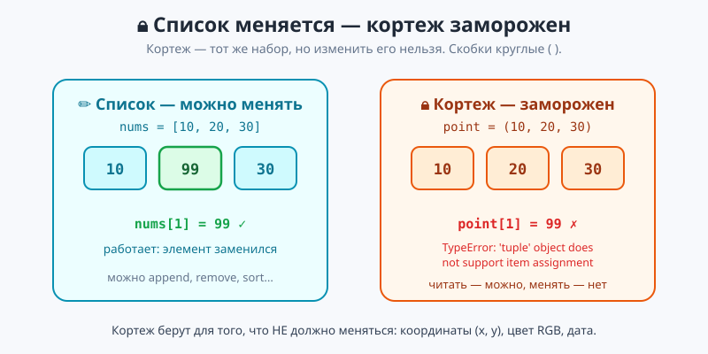
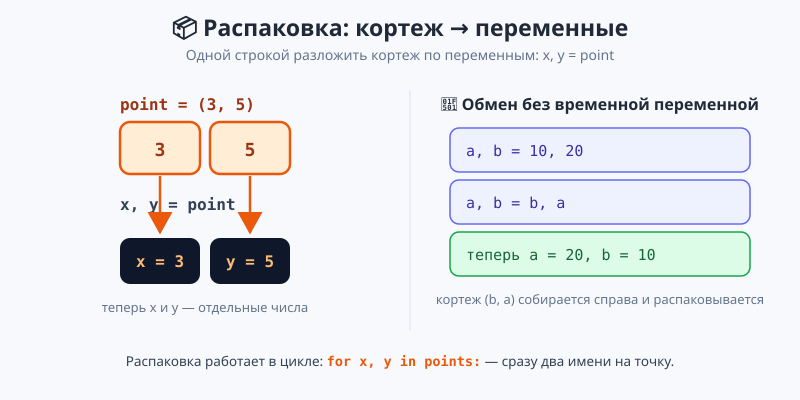
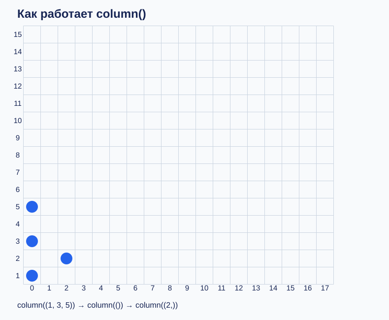
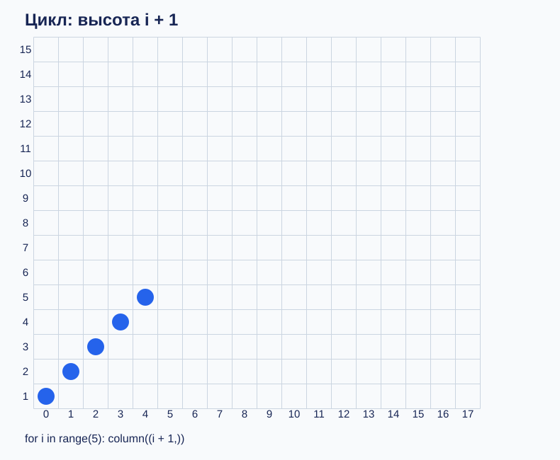

# Что показать на проекторе — урок 4 «Кортежи»

Все схемы SVG открываются в браузере. Они лежат в папке `изображения` и встроены в теорию и практику.

## 1. Кортеж и список

Показать при объяснении неизменяемости. Спросить, что произойдёт при присваивании по индексу.

## 2. Распаковка

Показать при разборе `x, y = point` и обмена переменных.

## 3. Столбцы

Показать перед практикой: три вызова, средний пустой. Обсудить, почему третья точка находится в столбце 2.

## 4. Цикл

Показать перед заданием 5: высота растёт на единицу за каждый шаг.

## 5. Референсы практики

13 файлов `задание-01.svg` — `задание-13.svg` соответствуют номерам TASK. Сетки построены по точным координатам старых образцов, поэтому подходят для проверки результата. Все ссылки находятся в [практике](практика.md).
