# Практика · Урок 4 «Кортежи»

**Темы:** кортеж `(a, b)`, индексы и `len`, неизменяемость, распаковка `x, y = point`, кортеж из одного элемента `(7,)`, обмен `a, b = b, a`, список кортежей, `divmod`. Плюс повторяем условия, циклы, `random`, срезы, арифметику.

>  **Как работать:** решай по порядку и запускай после каждой задачи. Уровни:  разминка (создать, прочитать, распаковать) ·  мини-программы (координаты, оценки, время) ·  со звёздочкой. После них —  **практикум «Рисуем по клеткам»**. В каждой задаче сказано, **что сделать** и **что получится**. Подсказка — наводка на идею, не готовый код, и она есть не у каждой задачи.
>
>  Помни: кортеж обычно записывают в круглых скобках и **менять его элементы нельзя**. Точку удобно раскладывать распаковкой `x, y = point`. Чтобы «сдвинуть» точку, собирают **новый** кортеж, а не меняют старый.

---

## Уровень 1 — разминка (создать, прочитать, распаковать)

**1. Точка.** Создай кортеж `point = (4, 7)` — координаты точки. Выведи отдельно x (первое число) и y (второе) по индексу, а затем длину кортежа.

**2. Кортеж заморожен.** Возьми тот же `point` и попробуй записать `point[0] = 0`. Запусти и прочитай, какую ошибку выдаёт Python, — так ты убедишься, что кортеж менять нельзя.
>  Это ожидаемая ошибка `TypeError` — в ней весь смысл кортежа.

**3. Распаковка.** Разложи кортеж `(4, 7)` в две отдельные переменные `x` и `y` одной строкой, потом выведи `x` и `y`.
>  Слева два имени, справа кортеж: `x, y = ...`.

**4. Обмен.** Даны `a = 5` и `b = 9`. Поменяй их значения местами в одну строку через кортеж и выведи `a` и `b` после обмена.

**5. Кортеж из одного.** Создай кортеж, в котором ровно ОДИН элемент — число 7. Выведи его `type`, чтобы проверить, что это кортеж, а не просто число.
>  Одна маленькая деталь превращает `(7)` в кортеж.

**6. Список точек.** Заведи список из трёх точек-кортежей `[(0, 0), (2, 5), (4, 1)]`. Выведи каждую точку с новой строки, пройдя список циклом.

**7. Анкета.** Дан кортеж `("Аня", 12, "Москва")`. Распакуй его в три переменные `name`, `age`, `city` и выведи фразу: `Аня, 12 лет, из города Москва`.

**8. Яркий или тёмный цвет.** Дан цвет как кортеж RGB, например `color = (30, 40, 50)`. Распакуй его в `r, g, b` и определи: если сумма трёх чисел меньше 300 — `Тёмный цвет`, иначе — `Яркий цвет`.

---

## Уровень 2 — мини-программы

**9. Точка в четверти.** Спроси у пользователя координаты точки x и y (два `input`, числа). Сложи их в кортеж и определи, в первой ли она четверти: если `x > 0` и `y > 0` — `Первая четверть`, иначе — `Не в первой четверти`.
>  Точка в первой четверти, когда **оба** числа положительны (`and`).

**10. Список учеников.** Дан список пар `[("Аня", 5), ("Боря", 3), ("Вера", 4), ("Глеб", 2)]` (имя, оценка). Выведи всех в виде `Аня — 5`, а затем отдельно — имена только тех, у кого оценка 4 и выше.
>  Распаковывай пару прямо в цикле: `for name, mark in students`.

**11. Погода по дням.** Дан список `[("Пн", 12), ("Вт", 15), ("Ср", 9), ("Чт", 11), ("Пт", 14)]` (день, температура). Найди и выведи самый тёплый и самый холодный день (с названием дня).
>  Идёшь по списку и запоминаешь день с наибольшей и наименьшей температурой — как поиск рекордсмена.

**12. Победитель матча.** Дан список результатов `[("Иван", 5), ("Мария", 7), ("Кирилл", 4)]` (имя, очки). Найди победителя — у кого больше всех очков — и выведи его имя и счёт.

**13. Расстояние между точками.** *(на подумать)* Даны две точки `p1 = (0, 0)` и `p2 = (3, 4)`. Распакуй обе и посчитай расстояние между ними по формуле `√((x2−x1)² + (y2−y1)²)`. Должно получиться `5.0`.
>  Квадратный корень — это возведение в степень `** 0.5`.

**14. Сколько это времени.** Спроси у пользователя число секунд (например, `200`). С помощью готовой функции `divmod` разложи его на минуты и секунды и выведи: `200 сек = 3 мин 20 сек`.
>  `divmod(секунды, 60)` вернёт пару `(минуты, остаток)` — распакуй её в две переменные.

**15. Случайная точка.** *(вспоминаем random)* Компьютер ставит случайную точку: x и y — случайные числа от −5 до 5. Собери её в кортеж, выведи и определи четверть (первая, вторая, третья, четвёртая) или что она на оси.
>  Координаты бери через `random.randint(-5, 5)`; четверть определяй лестницей `if/elif` по знакам x и y.

**16. Середина отрезка.** *(на подумать)* Даны две точки-кортежа. Найди середину отрезка между ними — точку со средним x и средним y — и выведи её как кортеж. Для `(0, 0)` и `(4, 6)` → `(2.0, 3.0)`.
>  Распакуй обе точки; средний x — это полусумма иксов, так же для y.

**17. Путь по клеткам.** *(на подумать)* Даны две точки на сетке. Посчитай «манхэттенское» расстояние — сколько клеток пройти, если двигаться только по горизонтали и вертикали (сумма модулей разностей по x и по y). Для `(1, 1)` и `(4, 3)` → `5`.
>  Это `abs(x2 - x1) + abs(y2 - y1)` — модуль убирает знак (функция `abs` из Модуля 1).

**18. Часы из минут.** Спроси число минут (например, `200`) и с помощью `divmod` переведи его в часы и минуты: `200 мин = 3 ч 20 мин`.
>  Тот же приём, что в задаче 14, только делим на 60 минут в часе.

---

## Уровень 3 — со звёздочкой

**19. Центр точек.** Дан список точек. Найди «среднюю» точку: средний x и средний y (сумма всех x делить на количество, так же для y). Выведи центр как кортеж.

**20. Угадай координату.** *(вспоминаем random)* Компьютер загадывает случайную точку `(x, y)`, где x и y — числа от 1 до 3. Пользователь пытается угадать обе координаты (два `input`). Угадал обе — `Победа!`, иначе подскажи правильный ответ.
>  Сравнить сразу две координаты удобно как кортежи: `if (gx, gy) == (tx, ty)`.

**21. Самая дальняя точка.** Дан список точек. Найди ту, что дальше всех от начала координат `(0, 0)`, и выведи её.
>  Сравнивать удобно по `x*x + y*y` — чем больше, тем дальше (корень можно не считать).

**22. Тёмные цвета.** Дан список цветов-кортежей `[(30,30,30), (250,200,10), (10,20,30)]`. Собери в новый список только «тёмные» — те, где сумма трёх чисел меньше 300.
>  В цикле удобно распаковать сразу `for r, g, b in colors`.

**23. Сдвинуть все точки.** Дан список точек. Собери **новый** список, в котором каждая точка сдвинута на +2 по x и +1 по y (старый список не меняем — кортеж пересобираем).

**24. Найди отличие.** *(финал)* Даны два кортежа одинаковой длины, например `(1, 2, 3, 4)` и `(1, 9, 3, 8)`. Пройди их и выведи индексы, на которых значения различаются (здесь — 1 и 3).
>  Иди по позициям через `range(len(...))` и сравнивай элементы на одинаковом индексе.

---

## Практикум «Рисуем по клеткам» (13 заданий)

Открой [рисуем_по_клеткам.py](материалы/рисуем_по_клеткам.py). Это готовое поле, как в практикуме с пылесосом. Установи номер `TASK`, напиши алгоритм в отмеченном блоке и запусти файл целиком. После каждого запуска поле очищается. Сравни результат со схемой и сообщением проверки внизу окна.

Столбцы нумеруются от 0 до 17 слева направо, высоты — от 1 до 15 снизу вверх. Каждый вызов `column()` рисует точки в текущем столбце и переходит к следующему. `column(())` пропускает столбец; `(0,)` тоже допустим для совместимости со старым шаблоном. Для одной точки нужна запятая: `column((5,))`. Не передавай список или просто число.

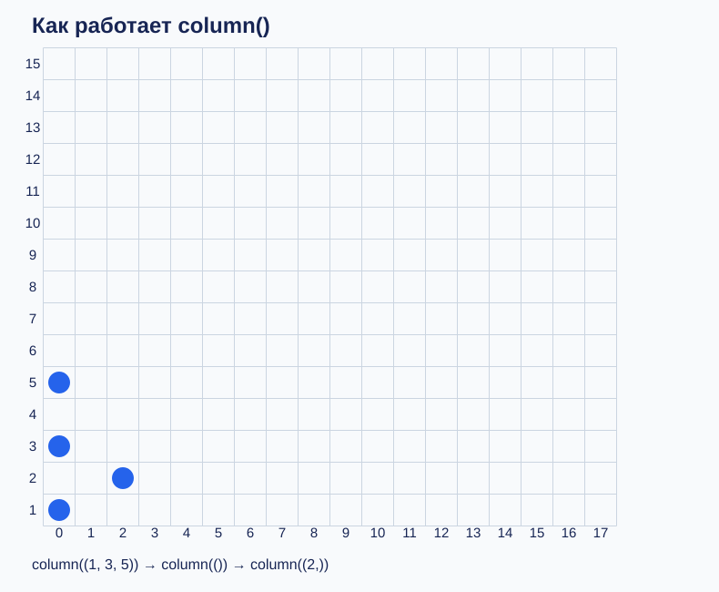

На уроке обязательно реши 1–5, затем выбери 6–10 по темпу. Задания 11–13 — резерв и самостоятельная работа. Перед следующим заданием удали предыдущий алгоритм и поменяй `TASK`.

### Задание 1. Вертикаль

Поставь три точки в столбце 0 на высотах 5, 6, 7.

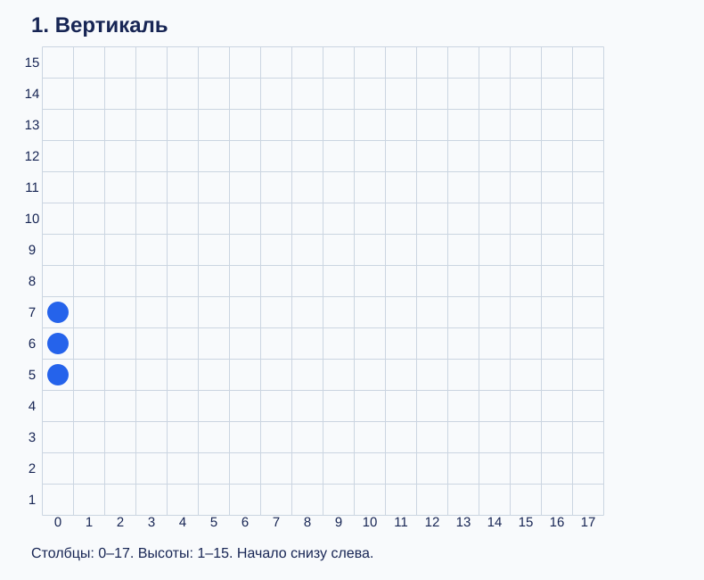

Подсказка

Один вызов, три числа.

### Задание 2. Пропуск

В столбце 0 отметь 3 и 5, столбец 1 оставь пустым, в столбце 2 отметь 4.

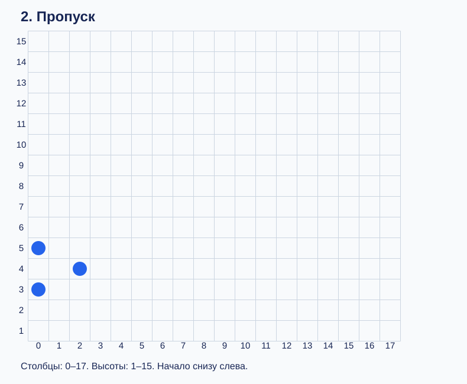

Подсказка

Пустой кортеж () пропускает столбец.

### Задание 3. Горизонталь

Десять точек на высоте 5, начиная со столбца 0. Используй for.

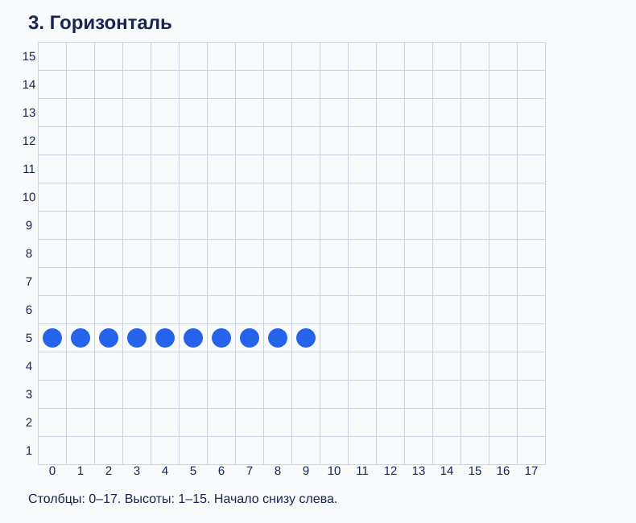

Подсказка

Высота постоянна.

### Задание 4. Две линии

Десять столбцов с точками на высотах 5 и 7. Используй while.

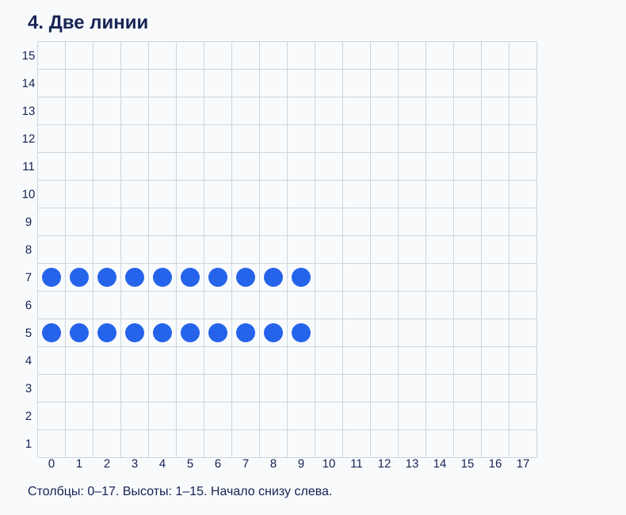

Подсказка

Счётчик от 0 до 9.

### Задание 5. Подъём

Диагональ из 10 точек: от (0, 1) до (9, 10).

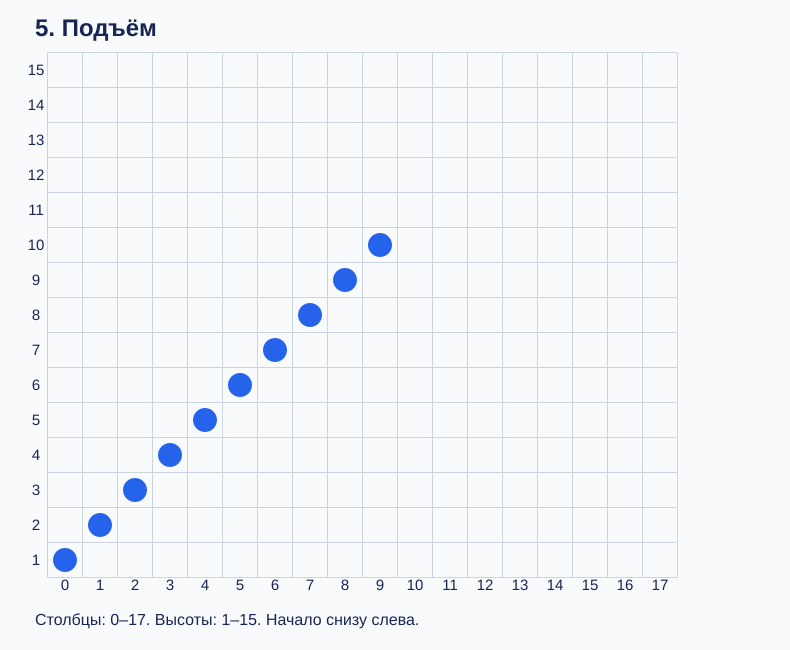

Подсказка

Высота на единицу больше номера столбца.

### Задание 6. Подъём с основанием

В каждом из 10 столбцов точка на высоте 1 и восходящая диагональ.

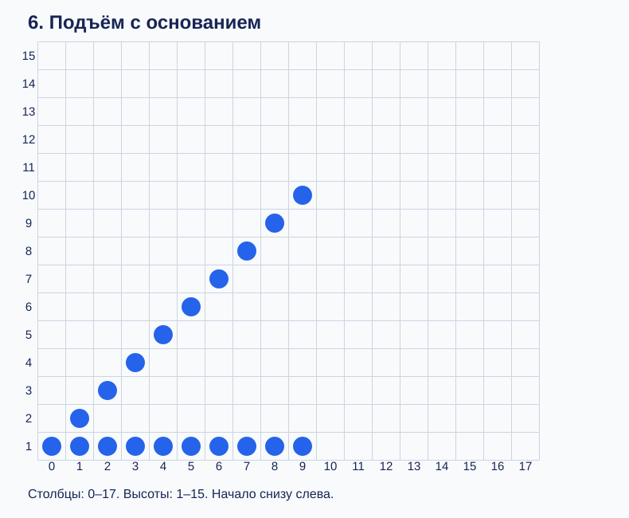

Подсказка

В первом столбце обе точки совпадают.

### Задание 7. Спуск с основанием

Десять столбцов: основание на высоте 1 и диагональ от 10 до 1.

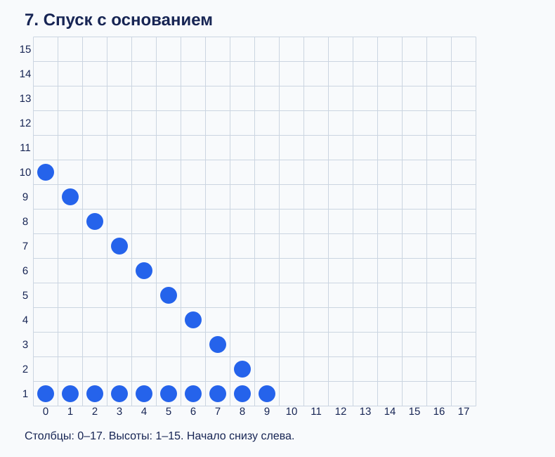

Подсказка

Высота уменьшается на 1.

### Задание 8. Крест

Две диагонали в 10 столбцах: одна растёт от 1 до 10, другая падает от 10 до 1.

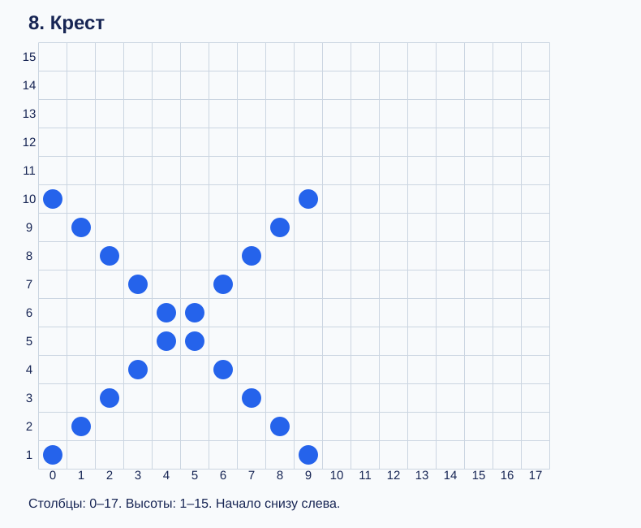

Подсказка

Две формулы в одном кортеже.

### Задание 9. Угол

В столбце 0 точка на высоте 5. В следующих четырёх столбцах две ветви расходятся до высот 1 и 9.

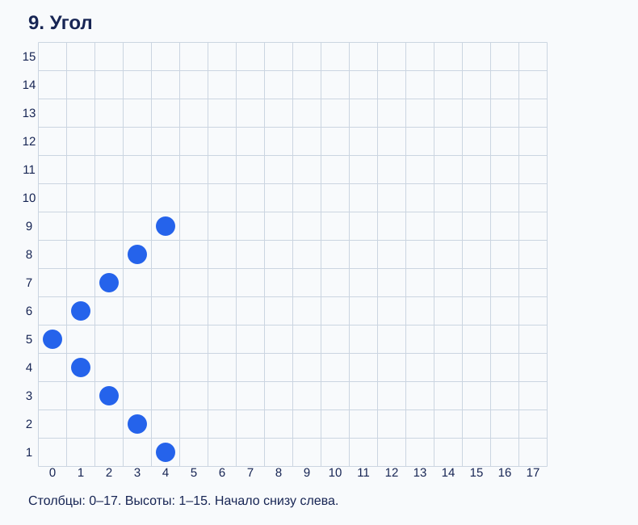

Подсказка

Прибавляй и вычитай номер столбца.

### Задание 10. Стрелка

Повтори угол из задания 9, добавь горизонталь на высоте 5 от столбца 0 до 10.

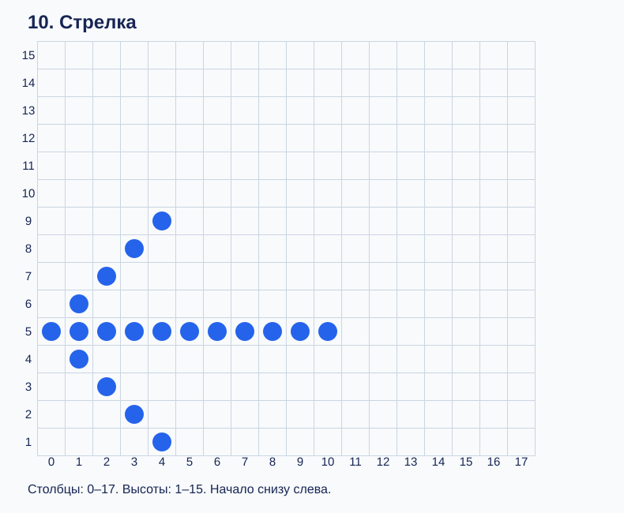

Подсказка

Сначала наконечник, затем шесть столбцов хвоста.

### Задание 11. Зигзаг

Десять столбцов: высоты 4, 5, 4, 5 и так далее.

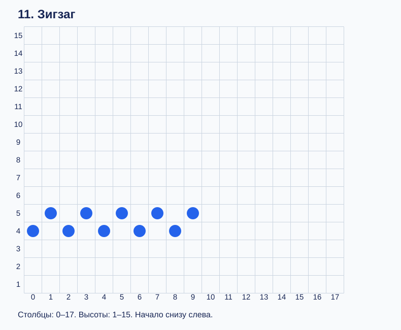

Подсказка

Проверяй остаток i % 2.

### Задание 12. Волна

17 столбцов. Начни с высоты 5, поднимись до 7, спустись до 3 и повторяй.

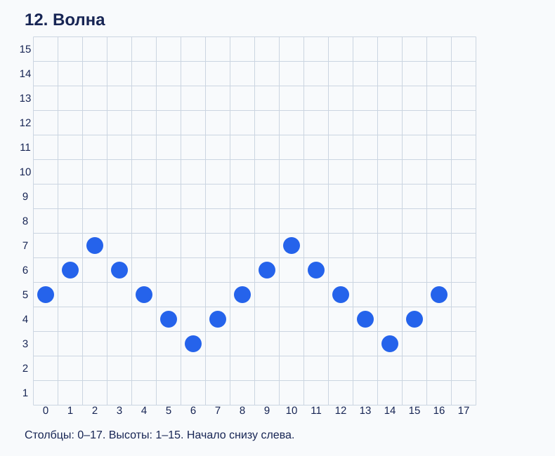

Подсказка

Храни высоту и направление отдельно; меняй направление на границах.

### Задание 13. Рыбка

Нарисуй контур рыбки по схеме: ромб от (0,7) до (12,7), глаз (3,7), хвост до столбца 14.

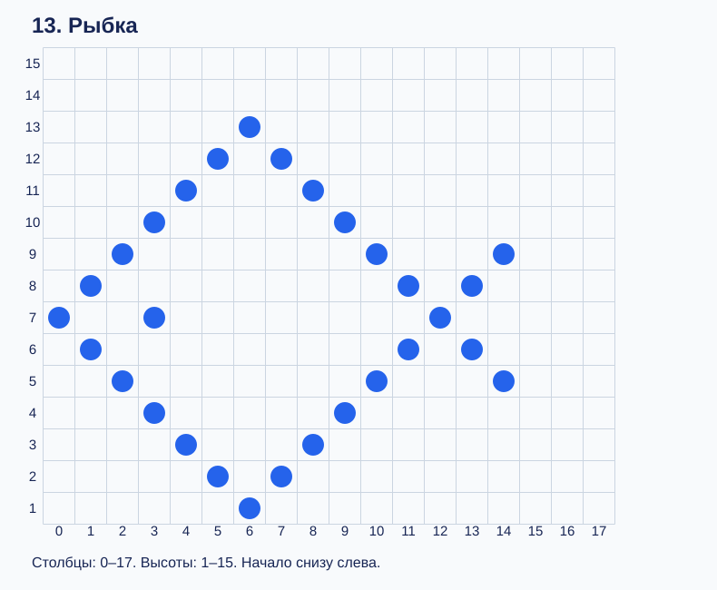

Подсказка

До столбца 6 высоты расходятся, затем сходятся; после 12 снова расходятся.

## Итоговая работа

Задание 13 — рыбка. Используй цикл и условия, а не 15 отдельных вызовов. Проверь, что глаз на месте, контур замкнут и нет лишних точек. Дополнительно придумай свой рисунок на бумаге и запиши его как список кортежей. Для своего рисунка проверка штатного задания не предназначена.
