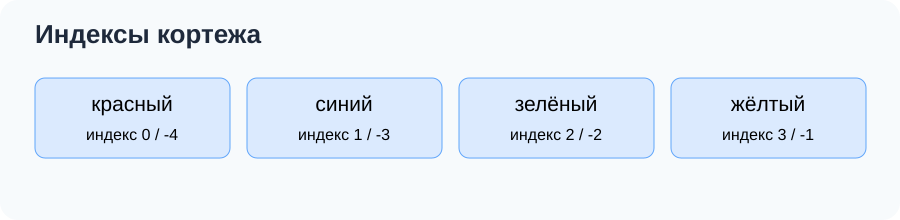
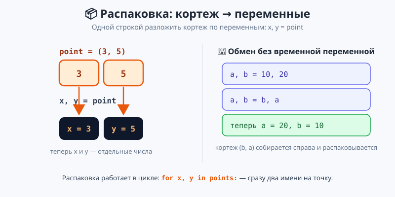

# Самоучитель урока 4 «Кортежи» 🆘

> Пропустил урок или разбираешься сам? Всё с нуля: краткая тема → задание. Первые 5 — **с пошаговым разбором**, дальше — **с мини-подсказками**.
> Нужен редактор и файл `проба.py`. Опирается на списки (Уроки 1–3).

---

## Что нужно знать за 2 минуты

Кортеж — «замороженный» список в **круглых** скобках:
```python
point = (3, 5)      # кортеж
point[0]            # 3   — читать можно
len(point)          # 2
point[0] = 9        #  TypeError — менять НЕЛЬЗЯ
```
Распаковка — разложить по переменным: `x, y = point`. Обмен: `a, b = b, a`.
Функция может вернуть несколько значений — это кортеж: `return a, b`.
Кортеж берут для того, что не меняется: координаты, цвет, дата.

---

## Часть A — задания с пошаговым разбором

### Задание 1. Создать кортеж
**Тема:** кортеж `( )`.

**Разбор по шагам:**
1. Заведи кортеж: `point = (3, 5)`.
2. Прочитай элементы:
```python
point = (3, 5)
print(point[0], point[1])   # 3 5
print(len(point))           # 2
```

 Кортеж читается как список (индекс, len).

---

### Задание 2. Неизменяемость
**Тема:** менять нельзя.

**Разбор по шагам:**
1. Попробуй изменить:
```python
point = (3, 5)
point[0] = 99   # TypeError!
```
2. Прочитай ошибку: `'tuple' object does not support item assignment`.

 Кортеж заморожен — в этом его смысл.

---

### Задание 3. Распаковка
**Тема:** `x, y = point`.

**Разбор по шагам:**
1. Разложи кортеж по переменным:
```python
point = (3, 5)
x, y = point
print(x, y)     # 3 5
```
2. Слева столько же имён, сколько элементов в кортеже.

 Удобнее, чем `point[0]`, `point[1]`.

---

### Задание 4. Обмен местами
**Тема:** `a, b = b, a`.

**Разбор по шагам:**
1. Поменяй два значения без временной переменной:
```python
a, b = 10, 20
a, b = b, a
print(a, b)     # 20 10
```

 Справа собирается кортеж `(b, a)` и распаковывается.

---

### Задание 5. Распаковка в цикле
**Тема:** `for x, y in points`.

**Разбор по шагам:**
1. Пройди список точек:
```python
points = [(0, 0), (3, 4), (6, 0)]
for x, y in points:
    print(f"x={x}, y={y}")
```
2. Каждый кортеж сразу раскладывается в `x, y`.

 Не нужно `point[0]`, `point[1]`.

---

## Часть B — задания с мини-подсказками

### Задание 6. Цвет
Заведи кортеж-цвет `(255, 128, 0)`, выведи среднее число.
>  `color[1]`.

### Задание 7. Кортеж из одного
Создай кортеж из одного числа. Проверь `type`.
>  `(7,)` — с запятой.

### Задание 8. Люди
`[("Аня", 12), ("Боря", 13)]` → выведи `Имя — возраст` распаковкой.
>  `for name, age in people:`.

### Задание 9. Пара от divmod
Вызови готовую `divmod(20, 6)`, выведи результат (это кортеж) и распакуй его в `q, r`.
>  Результат `divmod` — готовый кортеж; распакуй как в задании 3.

### Задание 10. Проверь формулу
Для `divmod(20, 6)` (получишь `q, r`) выведи, что `q * 6 + r` действительно равно 20.
>  Собери проверку из `q` и `r`.

### Задание 11. Срез кортежа
Из кортежа `(0,1,2,3,4)` возьми первые три.
>  `tpl[:3]` — срез работает и с кортежем.

### Задание 12. Сумма координат
Список точек — посчитай сумму всех x.
>  `for x, y in points: total += x`.

### Задание 13.  Отражение
Из точки `(x, y)` собери новую `(y, x)`.
>  `x, y = p`; `(y, x)`.

### Задание 14.  Расстояние
Расстояние между двумя точками.
>  `((x2-x1)**2 + (y2-y1)**2) ** 0.5`.

### Задание 15. Рисуем по клеткам
Открой [рисуем_по_клеткам.py](материалы/рисуем_по_клеткам.py). Выполни задания 1, 2 и 5 из [практики](практика.md). Сначала попробуй один вызов `column((5, 6, 7))`, затем используй пустой кортеж для пропуска и цикл для диагонали.

---

## Проверь себя

Уверенно делаешь 6–12 — тему понял. 13–15 (/) — если хочешь глубже.

Дальше: **[практика.md](практика.md)** (24 задачи и 13 графических заданий) и **[викторина.html](викторина.html)**. Шпаргалка — [итого.md](итого.md).

## Дополнительное закрепление: читаем кортежи и распаковываем пары

1. Создай `days = ("пн", "вт", "ср", "чт", "пт", "сб", "вс")`. Выведи последний день, первые пять дней и каждый второй день. Подсказка: отрицательный индекс и срезы.
2. Объясни, почему `(5)` — число, а `(5,)` — кортеж. Проверь через `type()`.
3. Для `scores = (10, 20, 30, 20, 50)` найди количество значений `20` и индекс числа `30`. Подсказка: `count()` и `index()`.
4. Дан список `products = [("яблоко", 50), ("груша", 70), ("банан", 60)]`. Перебери пары через `for name, price in products` и напечатай товары дороже 55.
5. В кортеже `(("Маша", 18), ("Дима", 25), ("Оля", 21))` найди участника с наибольшим результатом. Вспомни переменную для хранения лучшего результата.

Все эти примеры подробно разобраны в `урок.md` (части 1А–3А) и доступны в запускаемом файле `материалы/дополнительные_примеры.py`.


## Дополнительное объяснение и примеры

## Подробная теория: кортежи на понятных примерах

### 1. Почему кортеж — не просто список в других скобках

Представим, что программа хранит координаты точки на карте. Это два числа, которые вместе описывают одну точку. Их удобно передавать как единое значение. В списке мы можем заменить элемент, добавить третий или удалить первый. В кортеже набор элементов фиксирован: Python не разрешает присваивать новое значение по индексу, добавлять и удалять элементы. При этом **переменную** можно связать с другим кортежем — это не изменение старого объекта.

```python
point = (4, 7)
print(point)       # (4, 7)
print(type(point)) # <class 'tuple'>
point = (5, 7)     # можно: переменная теперь указывает на другой кортеж
# point[0] = 5    # нельзя: TypeError
```

Сравним три записи. Попросите учеников до запуска назвать тип каждой переменной.

```python
a = [10, 20]     # list
b = (10, 20)     # tuple
c = 10, 20       # tuple: важны запятые, не скобки
print(type(a), type(b), type(c))
```

### 2. Пустой кортеж и кортеж из одного элемента

```python
empty = ()
number = (8)     # это int: обычные скобки вокруг числа
single = (8,)    # это tuple: запятая создаёт кортеж
print(type(number), type(single))
print(len(empty), len(single))  # 0 1
```

**Проверка:** почему `(8)` и `(8,)` ведут себя по-разному? Запятая отделяет элементы последовательности; для одного элемента она необходима.

### 3. Индексы, отрицательные индексы и срезы

Кортеж, как и список, нумеруется с нуля. Отрицательные индексы отсчитываются справа налево. Срез создаёт **новый** кортеж, не изменяя исходный.



```python
colors = ("красный", "синий", "зелёный", "жёлтый")
print(colors[0])       # красный
print(colors[-1])      # жёлтый
print(colors[1:3])     # ('синий', 'зелёный')
print(colors[::-1])    # обратный порядок
print(len(colors))     # 4
```

Предложите ученикам самостоятельно предсказать `colors[:2]`, `colors[2:]` и `colors[-2]`, а затем проверить.

### 4. Перебор кортежа: значения и индексы

```python
scores = (5, 4, 5, 3)
for score in scores:
    print("Оценка:", score)

for index in range(len(scores)):
    print("Номер:", index, "Оценка:", scores[index])

for index, score in enumerate(scores, start=1):
    print(f"Урок {index}: {score}")
```

В первом цикле `score` последовательно принимает значения `5`, `4`, `5`, `3`. Во втором `index` — число от 0 до 3, поэтому мы обращаемся к элементу по индексу. В третьем `enumerate` сразу даёт номер и значение; `start=1` меняет только отображаемый номер, не сам кортеж.

### 5. Распаковка: одна последовательность — несколько переменных



```python
point = (12, 8)
x, y = point
print("X:", x)  # 12
print("Y:", y)  # 8

rgb = (255, 120, 40)
red, green, blue = rgb
print(red, green, blue)
```

Количество переменных при обычной распаковке должно совпадать с количеством элементов. Для остатка можно использовать `*`:

```python
first, *middle, last = (10, 20, 30, 40)
print(first)   # 10
print(middle)  # [20, 30] — именно список
print(last)    # 40
```

### 6. Возврат нескольких значений из функции

```python
def min_max(numbers):
    return min(numbers), max(numbers)

result = min_max((7, 2, 9, 4))
print(result)  # (2, 9)
smallest, largest = result
print("Разница:", largest - smallest)  # 7
```

Запись `return min(...), max(...)` возвращает кортеж. Это удобно, когда функция должна сообщить несколько связанных результатов.

### 7. Операции и методы

| Запись | Назначение | Результат |
|---|---|---|
| `(1, 2) + (3,)` | объединение | `(1, 2, 3)` |
| `(5,) * 3` | повторение | `(5, 5, 5)` |
| `3 in (1, 3, 5)` | поиск элемента | `True` |
| `(2, 2, 4).count(2)` | количество совпадений | `2` |
| `(2, 4, 6).index(4)` | индекс первого совпадения | `1` |
| `sum((2, 4, 6))` | сумма чисел | `12` |
| `max((2, 4, 6))` | наибольшее | `6` |

```python
numbers = (2, 2, 4, 6)
print(numbers.count(2))  # 2
print(numbers.index(4))  # 2
print(4 in numbers)      # True
```

### 8. Важная тонкость: внутри кортежа может быть изменяемый список

```python
record = ("Аня", [5, 4])
record[1].append(5)
print(record)  # ('Аня', [5, 4, 5])
# record[1] = [3]  # TypeError: сам элемент кортежа заменить нельзя
```

Неизменяемость кортежа означает, что нельзя заменить **ссылку на элемент**, но если элемент — список, его содержимое может меняться. Это дополнительный пример для подготовленных учеников.

### 9. Где кортежи действительно нужны

Координаты `(x, y)`, цвет `(r, g, b)`, диапазон `(минимум, максимум)`, пара `(имя, балл)`, фиксированная запись о товаре — примеры связанных данных. Для постоянно пополняемого списка покупок лучше подходит список; для хранения данных по именованным ключам — словарь (следующий урок).

### 10. Разбор типичных ошибок

```python
# 1. Ошибка индекса: в кортеже из трёх элементов нет индекса 3
point = (1, 2, 3)
# print(point[3])

# 2. Ошибка распаковки: переменных меньше, чем значений
# x, y = (1, 2, 3)

# 3. Нельзя использовать append, как у списка
# point.append(4)

# 4. Изменение через преобразование — создаём новый кортеж
items = ("меч", "щит")
temp = list(items)
temp.append("ключ")
items = tuple(temp)
print(items)
```

**Мини-проверка:** пусть ученики объяснят каждую закомментированную ошибку, затем самостоятельно создадут кортеж из трёх оценок, найдут среднее значение и распакуют три координаты RGB.
