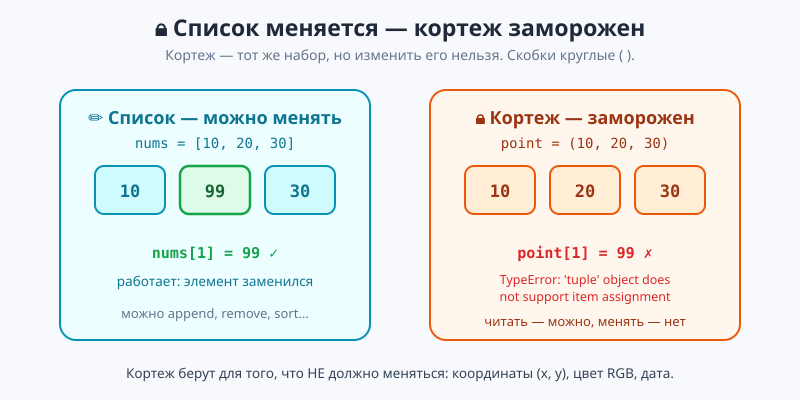
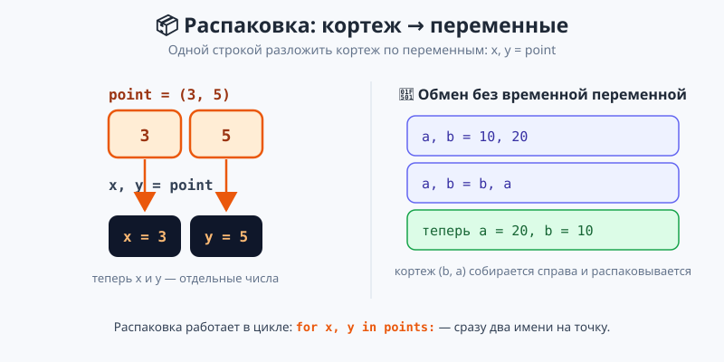
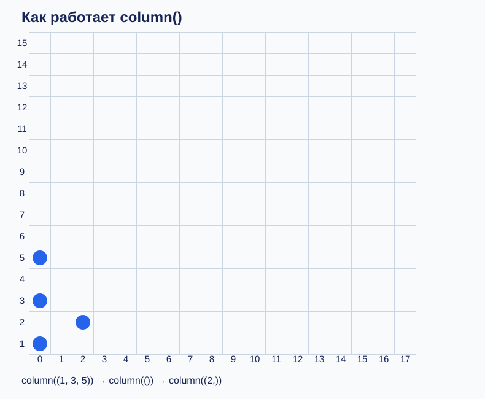
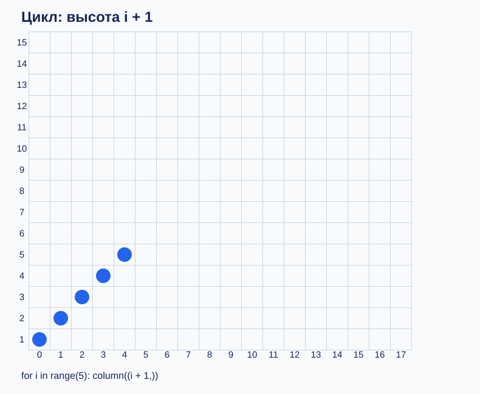

# Урок 4 — «Координаты и константы»: кортежи `(x, y)`, неизменяемость, распаковка 

**Модуль 4 · Коллекции · Урок 4 из 7 | 2 ак.ч. (1,5 часа)**

> ⬅ Предыдущий: [Урок 3 «Срезы»](../урок-03-срезы/урок.md) · [Все уроки модуля](../README.md) · [План курса](../../ПЛАН-КУРСА.md) · Следующий: Урок 5 «Словари: Телефонная книга» 

>  В начале — [разминка/повтор](повторение.md) (5 мин).
>  Быстро вспомнить материал урока — [итого.md](итого.md) (шпаргалка).
>  Сценарий с хронометражом — в [преподавателю.md](преподавателю.md).
>  Что показать на проекторе — в [изображения.md](изображения.md).
> 🆘 **Пропустил урок или хочешь закрепить?** Открой [самоучитель.md](самоучитель.md) — теория + задания с подсказками.
>  Трюки и частые ошибки — в [лайфхак.md](лайфхак.md).
>  В конце — **turtle-практикум «Рисуем по клеткам»** (13 заданий).

>  **Как читать урок.** Список — гибкий: добавляй, удаляй, меняй. Но иногда набор данных **не должен меняться**: координаты точки `(x, y)`, цвет `(255, 128, 0)`, дата `(2026, 8, 15)`. Для такого есть **кортеж** (`tuple`) — «замороженный» список в круглых скобках. Его нельзя случайно испортить, зато удобно **распаковывать** по переменным (`x, y = point`) и хранить как пару/тройку. Сегодня разберём кортежи и нарисуем узоры по столбцам.

---

## Что мы сделаем сегодня и что получим

**Задача:** научиться хранить фиксированные наборы (точки, цвета) кортежами, раскладывать их по переменным — и рисовать узоры по столбцам.

**В итоге получатся** `кортежи_демо.py` и `координаты.py`:

```
Кортеж: (3, 5)
Изменить нельзя: 'tuple' object does not support item assignment
Распаковка: x = 3 , y = 5
После обмена: a = 20 , b = 10
Точки треугольника: (0,0) (3,4) (6,0)
```

**Главные навыки урока:** кортеж `(...)` · индекс и `len` · **неизменяемость** · **распаковка** `x, y = point` · обмен `a, b = b, a` · распаковка в цикле `for x, y in points` · готовая функция отдаёт пару (`divmod`) ·  «Рисуем по клеткам».

>  **Главная мысль урока:** **кортеж — неизменяемая последовательность.** Круглые скобки вместо квадратных. Берут его для того, что должно оставаться постоянным: координаты `(x, y)`, цвет RGB, дата.

---

## Часть 0 — Разминка: список можно испортить (5 минут)

Список удобен, но его **легко изменить по ошибке**:

```python
point = [3, 5]      # координата как список
point[0] = 999      # упс — случайно сдвинули точку
```

А координата точки, цвет или дата меняться **не должны**. Хочется «заморозить» набор. Для этого — **кортеж**.

---

## Часть 1 — Кортеж: замороженный список (15 минут)

**Кортеж** записывают в **круглых** скобках. Всё остальное — как у списка (индекс, `len`, перебор), кроме одного: **менять нельзя**.

```python
point = (3, 5)         # кортеж из двух чисел
print(point[0])        # 3 — по индексу, как в списке
print(len(point))      # 2
```

**Неизменяемость** — главное свойство:

```python
point[0] = 99          #  TypeError: 'tuple' object does not support item assignment
```



>  **Список `[ ]` — квадратные скобки, кортеж `( )` — круглые.** Список меняется (`append`, `sort`, `lst[0]=...`), кортеж — нет. Читать кортеж (индекс, срез, `in`, перебор) можно, а изменять — нельзя.

>  **Кортеж из одного элемента — с запятой!** `(5)` — это просто число 5 в скобках. Кортеж из одного элемента — `(5,)` (с запятой). Мелочь, но легко забыть.

>  **Мини-задание 1 (2 мин):** заведи кортеж `color = (255, 128, 0)`. Выведи первый и последний элемент и длину. Попробуй `color[0] = 0` — увидишь ошибку.
> <details><summary> подсказка</summary><code>color[0]</code>, <code>color[-1]</code>, <code>len(color)</code>; присваивание даст TypeError.</details>

---

### Дополнительные операции

```python
levels = (2, 4, 6, 4)
print(levels[-1])       # 4
print(levels[1:3])      # (4, 6)
print(6 in levels)      # True
print(levels.count(4)) # 2
print(levels.index(6)) # 2
print((1, 2) + (3,))   # (1, 2, 3)
print((1, 2) * 2)      # (1, 2, 1, 2)
print(tuple([1, 2]))   # (1, 2)
```

Сложение и умножение создают новый кортеж. У кортежа нет `append`, `remove` или `sort`. `sorted(levels)` вернёт новый список. Пустой кортеж — `()`, а `1, 2` без скобок тоже образует кортеж. Именно запятая создаёт кортеж из одного элемента.

Кортеж неизменяем: нельзя заменить его элементы. Но переменной можно присвоить другой кортеж. Если внутри кортежа лежит список, содержимое этого списка по-прежнему можно менять. Это не делает сам кортеж изменяемым.

## Часть 2 — Распаковка: разложить по переменным (12 минут)

Главное удобство кортежа — **распаковка**: одной строкой разложить его по переменным.

```python
point = (3, 5)
x, y = point           # x = 3, y = 5
print(x, y)
```



**Обмен значениями без временной переменной** — тоже распаковка кортежа:

```python
a, b = 10, 20
a, b = b, a            # теперь a = 20, b = 10
```

-  Справа собирается кортеж `(b, a)`, слева он распаковывается в `a, b`. Классический трюк «поменять местами».

**Распаковка прямо в цикле** — очень удобно для списка кортежей:

```python
points = [(0, 0), (3, 4), (6, 0)]
for x, y in points:    # каждый кортеж сразу разложен в x, y
    print(f"x={x}, y={y}")
```

>  **`for x, y in points` — читай «для каждой точки (x, y)».** Не нужно писать `point[0]`, `point[1]` — Python сам раскладывает пару в два имени. Так удобно ходить по координатам.

>  **Мини-задание 2 (3 мин):** дан список `people = [("Аня", 12), ("Боря", 13)]`. Выведи через распаковку `for name, age in people:` строки вида `Аня — 12 лет`.
> <details><summary> подсказка</summary><code>for name, age in people: print(f"{name} — {age} лет")</code>.</details>

---

## Часть 3 — Зачем кортеж: координаты, цвета, готовые пары (8 минут)

Где кортежи особенно удобны:

**Координаты и цвета — постоянные наборы:**
```python
start = (0, 0)             # точка на карте
ORANGE = (234, 88, 12)     # цвет RGB — не меняется
```
Точку или цвет незачем править по одному числу — их берут целиком. Кортеж это подчёркивает: набор постоянный.

**Некоторые готовые функции тоже отдают сразу пару — кортеж.** Например, встроенная `divmod` считает **частное и остаток** одним вызовом:
```python
result = divmod(17, 5)     # result = (3, 2) — это кортеж
print(result)              # (3, 2)

q, r = divmod(17, 5)       # сразу распаковываем пару в две переменные
print(q, r)                # 3 2   (17 = 3 * 5 + 2)
```

-  `divmod` вернул пару `(частное, остаток)` — кортеж, а `q, r = ...` его распаковал. Так одна команда «отдаёт сразу две вещи».

>  **Мини-задание 3 (2 мин):** вызови `divmod(23, 4)`, распакуй результат в переменные `q` и `r` и выведи строку `23 = q*4 + r`.
> <details><summary> подсказка</summary>Результат <code>divmod</code> — это готовый кортеж; распаковка — как в Части 2.</details>

Полный разбор — в [`материалы/кортежи_демо.py`](материалы/кортежи_демо.py); проект с координатами и цветами — [`материалы/координаты.py`](материалы/координаты.py).

---

## Часть 4 — Практикум: рисуем по клеткам (45 минут)

Открой [рисуем_по_клеткам.py](материалы/рисуем_по_клеткам.py). Это локальный шаблон на `turtle`: поле и проверка уже готовы, как в заданиях с пылесосом. Запусти файл в PyCharm или VS Code. Откроется отдельное окно с сеткой.

### Как читать поле

Слева направо идут столбцы 0–17, снизу вверх — высоты 1–15. Мы не передаём координату x: программа сама помнит текущий столбец. В начале это 0. Кортеж хранит номера высот, на которых нужно поставить точки.

```python
column((1, 3, 5))  # столбец 0
column(())         # столбец 1 пропускаем
column((2,))       # столбец 2
```



Разберём двойные скобки: внешние — вызов функции, внутренние — кортеж. В `column((2,))` запятая обязательна. Пустой кортеж `()` не содержит высот, но переход вправо всё равно происходит. Старый вариант `column((0,))` также работает: ноль не рисуется.

### Рисуем с помощью цикла

Если нужно пять столбцов с точкой на высоте 3, нет смысла повторять команду пять раз:

```python
for i in range(5):
    column((3,))
```

А теперь пусть высота меняется. На первом шаге i равно 0, поэтому высота 1; на втором — 2. Кортеж создаётся заново на каждой итерации.

```python
for i in range(5):
    column((i + 1,))
```



### Как выполнять задания

1. Установи `TASK = 1` и найди блок «ТВОЙ АЛГОРИТМ».
2. По схеме задания выпиши высоты первого столбца и передай их в `column`.
3. Запусти файл. Внизу появится число недостающих и лишних точек либо сообщение об успехе.
4. Для следующего задания поменяй TASK и замени свой алгоритм. Не меняй техническую часть.

Все 13 схем и задания находятся в [практика.md](практика.md). Начни с 1–5; затем переходи к диагоналям и волне. Если окно не открывается, проверь `python -m tkinter` (на Windows можно `py -m tkinter`). Не называй свой файл `turtle.py`.

## Разбор частых ошибок

| Симптом | Что случилось | Как починить |
|---------|---------------|--------------|
| `TypeError: ... item assignment` | пытался изменить кортеж | кортеж менять нельзя; собери новый |
| `(5)` оказалось числом | кортеж из 1 элемента без запятой | пиши `(5,)` |
| `ValueError: too many values to unpack` | переменных меньше, чем в кортеже | слева столько же имён, сколько элементов |
| рисунок смещён | лишний вызов column | проверь число вызовов и пустые столбцы |
| перепутал скобки | список в круглых / кортеж в квадратных | список `[ ]`, кортеж `( )` |

>  **Главное правило:** кортеж не меняют — из него берут (индекс, распаковка) и на его основе **создают новое**.

---

## Итог урока (5 минут)

Кортеж — надёжный «замороженный» набор:

-  **Кортеж `(...)`** — как список, но **менять нельзя** (круглые скобки).
-  Читать можно: индекс, `len`, срез, `in`, перебор.
-  **Распаковка** `x, y = point`; обмен `a, b = b, a`; в цикле `for x, y in points`.
-  Готовая функция может отдать сразу пару — кортеж (`q, r = divmod(17, 5)`).
-  Берут для констант: координаты, цвет RGB, дата.
-   «Рисуем по клеткам»: кортеж высот задаёт точки одного столбца; цикл строит узор.

>  Главное: **кортеж — неизменяемый набор; его распаковывают (`x, y = point`) и на его основе создают новый.** Быстро повторить — в [итого.md](итого.md).

>  **Блиц:** чем кортеж отличается от списка? какие скобки у кортежа? что такое распаковка? как поменять `a` и `b` местами? что вернёт `divmod(17, 5)`? почему координаты удобно хранить кортежем?

### Викторина-закрепление
Открой **[викторина.html](викторина.html)** — 18 вопросов + смешные и «на подумать».

 **Практика урока** — **[практика.md](практика.md)**: задачи в 3 уровнях +  turtle.
🆘 **Пропустил / хочешь ещё?** — [самоучитель.md](самоучитель.md) (теория + 15–20 заданий).
 **Трюки и ошибки** — [лайфхак.md](лайфхак.md).  **Шпаргалка** — [итого.md](итого.md).

---

## Навигация и материалы

⬅ **Предыдущий:** [Урок 3 «Срезы»](../урок-03-срезы/урок.md) · [Все уроки модуля](../README.md) · [План курса](../../ПЛАН-КУРСА.md) · **Следующий:** Урок 5 «Словари: Телефонная книга» 

** Инструменты:** [Python](https://www.python.org/downloads/) · среда: [PyCharm Community](https://www.jetbrains.com/pycharm/download/) или [VS Code](https://code.visualstudio.com/).
** Готовый код:** [`кортежи_демо.py`](материалы/кортежи_демо.py) · [`координаты.py`](материалы/координаты.py) ·  [`рисуем_по_клеткам.py`](материалы/рисуем_по_клеткам.py) .
** Учителю:** сценарий и частые ошибки — в [преподавателю.md](преподавателю.md).
