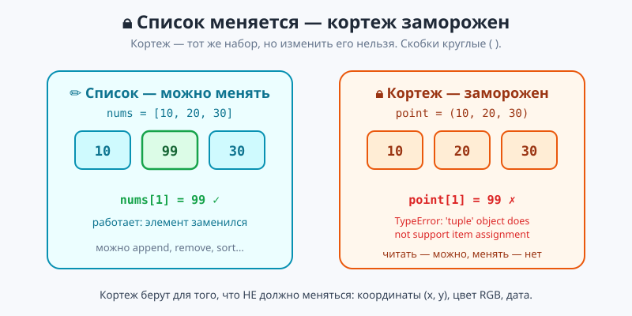
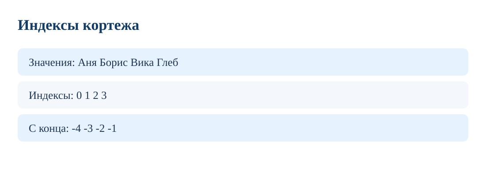
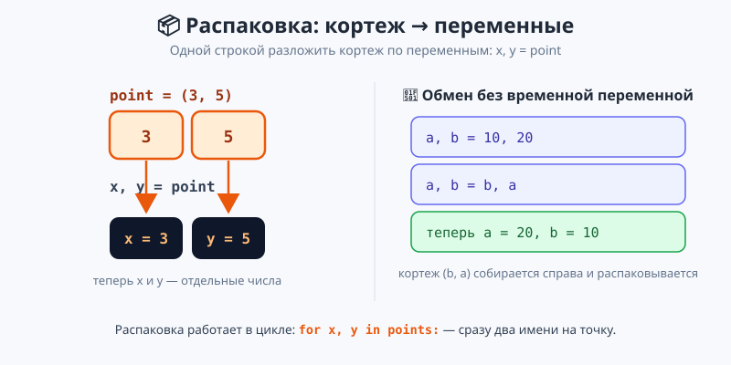
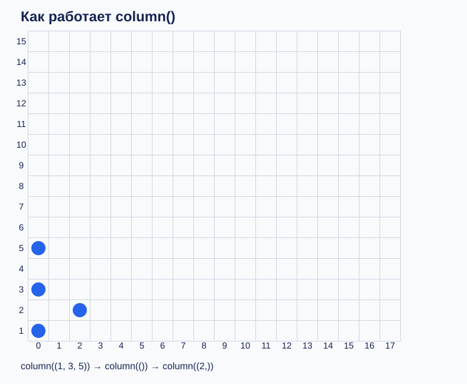
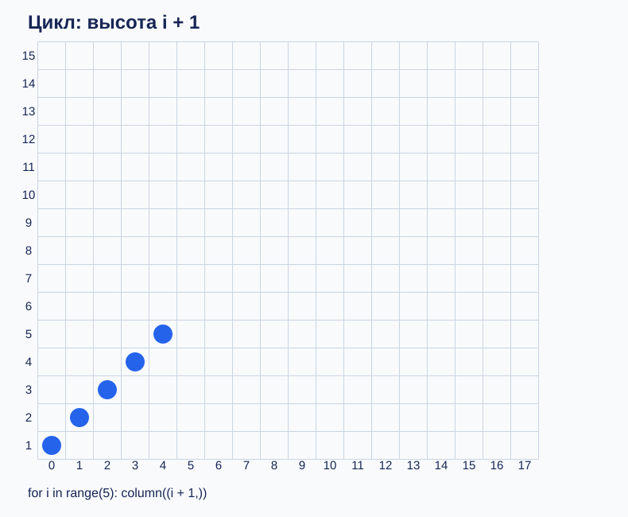

# Урок 4 — «Координаты и константы»: кортежи `(x, y)`

**Модуль 4 · Коллекции · Урок 4 из 7 | 2 ак.ч. (1,5 часа)**

> Предыдущий: [Урок 3 «Срезы»](../урок-03-срезы/урок.md) · [Все уроки модуля](../README.md) · Следующий: [Урок 5 «Словари»](../урок-05-словари/урок.md)

> Перед началом — [повторение](повторение.md). Для самостоятельной работы — [самоучитель](самоучитель.md). Преподавателю — [сценарий](преподавателю.md). Дополнительные примеры — [лайфхак](лайфхак.md). Краткие правила — [итого](итого.md). Схемы — [изображения](изображения.md).

Сегодня будем хранить координаты, цвета и другие небольшие наборы связанных данных. В конце занятия используем кортежи в графическом практикуме «Рисуем по клеткам». Все программы запускаются локально в PyCharm или VS Code.

## Что мы сделаем сегодня и что получим (3 минуты)

В прошлых уроках мы работали со списками: добавляли элементы, удаляли их и меняли местами. Но представим, что в игре нужно хранить положение героя: `x = 4`, `y = 7`. Эти два числа относятся к одной точке. Можно объединить их в одну запись `(4, 7)`. Это **кортеж**.

К концу занятия ученик сможет создать кортеж, обратиться к элементам по индексу, сделать срез, перебрать элементы, распаковать координаты и передать кортеж функции. Итоговый файл — `материалы/рисуем_по_клеткам.py`: ученик указывает кортеж высот, программа рисует точки в очередном столбце.

## Часть 0 — Разминка: когда список неудобен (5 минут)

Предложите ребятам представить координаты персонажа. Сначала используем список:

```python
position = [4, 7]
print(position)
position[0] = 100
print(position)
```
Получим `[4, 7]`, а затем `[100, 7]`. Изменение сработало. Иногда это полезно, но координаты конкретной точки, дату рождения или цвет, выбранный для оформления, мы хотим передавать как готовую запись. Здесь пригодится кортеж. **Важно:** кортеж не делает переменную навсегда постоянной: он запрещает изменять элементы самого объекта.

## Часть 1 — Создаём кортеж и отличаем его от списка (12 минут)

Кортеж (`tuple`) — упорядоченная последовательность элементов. В отличие от списка, элементы самого кортежа нельзя заменить, добавить или удалить. В нём можно хранить числа, строки и другие объекты. Порядок сохраняется, одинаковые значения разрешены.


### Список и кортеж рядом

```python
colors_list = ["red", "green", "blue"]
colors_tuple = ("red", "green", "blue")
print(type(colors_list))
print(type(colors_tuple))
```

**Результат:**

```text
<class 'list'>
<class 'tuple'>
```

Квадратные скобки создают список, а запись значений через запятые — кортеж. Круглые скобки обычно делают запись понятнее.

**Проверь себя.** Создай кортеж из трёх любимых игр и выведи его тип.

### Кортеж без скобок

```python
point = 4, 7
print(point)
print(type(point))
```

**Результат:**

```text
(4, 7)
<class 'tuple'>
```

Python ориентируется прежде всего на **запятые**. Поэтому `4, 7` — тоже кортеж. Но для читаемости курса используем `(4, 7)`.

### Пустой кортеж и один элемент

```python
empty = ()
one = (5,)
not_tuple = (5)
print(len(empty))
print(type(one))
print(type(not_tuple))
```

**Результат:**

```text
0
<class 'tuple'>
<class 'int'>
```

В `(5,)` запятая обязательна. Запись `(5)` — просто число в скобках. Это одна из самых частых ошибок начинающих.
**Обсудим:** зачем нужен кортеж из одного элемента? Например, функция `column((5,))` получает именно последовательность высот, даже если точка только одна.



## Часть 2 — Индексы, отрицательные индексы и срезы (12 минут)

У кортежа, как и у списка, индексация начинается с нуля. Отрицательный индекс отсчитывает элементы справа налево. По индексу получаем **один элемент**, а срезом — **новый кортеж**.


### Читаем координаты и элементы

```python
player = ("Маша", 12, 85, "лучник")
print(player[0])
print(player[2])
print(player[-1])
print(len(player))
```

**Результат:**

```text
Маша
85
лучник
4
```

`player[0]` — имя; `player[2]` — очки; `player[-1]` — последний элемент. `len()` возвращает количество элементов.

**Проверь себя.** Что выведет `player[-2]`?

### Срезы кортежа

```python
scores = (10, 20, 30, 40, 50, 60)
print(scores[:3])
print(scores[-2:])
print(scores[1:5:2])
print(scores[::-1])
```

**Результат:**

```text
(10, 20, 30)
(50, 60)
(20, 40)
(60, 50, 40, 30, 20, 10)
```

Правила те же, что в уроке 3: `start` включается, `stop` не включается, `step` задаёт шаг. Срез не меняет исходный кортеж.

**Проверь себя.** Получить из `scores` кортеж `(30, 40, 50)`.


**Ошибка для обсуждения:** `player[4]` вызовет `IndexError`, потому что допустимы индексы от `0` до `3`.

## Часть 3 — Неизменяемость: что разрешено, а что нет (10 минут)

Кортеж можно читать, перебирать, сравнивать, использовать в вычислениях. Но изменить его отдельный элемент нельзя.


### Проверяем запрет на изменение

```python
point = (3, 8)
# point[0] = 10  # Если убрать #, возникнет TypeError
new_point = (10, point[1])
print(point)
print(new_point)
```

**Результат:**

```text
(3, 8)
(10, 8)
```

Мы не исправили старую точку, а создали **новую**. Именно так обычно обновляют координаты, если выбрали кортеж для их хранения.

### Преобразуем список в кортеж и обратно

```python
items = ["меч", "щит", "лук"]
fixed_items = tuple(items)
print(fixed_items)
copy_items = list(fixed_items)
copy_items.append("зелье")
print(copy_items)
```

**Результат:**

```text
('меч', 'щит', 'лук')
['меч', 'щит', 'лук', 'зелье']
```

`tuple()` создаёт кортеж из последовательности, `list()` — список. Если нужно изменить набор, часто удобнее сначала получить список.
**Тонкость для сильных учеников.** Если внутри кортежа лежит список, содержимое вложенного списка можно менять: `data = ([1, 2], "готово"); data[0].append(3)`. Сам кортеж по-прежнему хранит ссылку на тот же список. Неизменяемость кортежа не означает глубокую неизменяемость всего, что внутри.

## Часть 4 — Перебираем кортеж в цикле (10 минут)

В цикле `for` можно получить сами элементы или их индексы. Покажите сначала простой перебор, затем задачу с накоплением результата.


### Каждый элемент по очереди

```python
levels = (2, 5, 3)
for level in levels:
    print("Уровень:", level)
```

**Результат:**

```text
Уровень: 2
Уровень: 5
Уровень: 3
```

Первая итерация: `level = 2`; вторая: `level = 5`; третья: `level = 3`. После последнего элемента цикл заканчивается.

### Считаем сумму и среднее

```python
scores = (8, 10, 7, 9)
total = 0
for score in scores:
    total += score
print("Сумма:", total)
print("Среднее:", total / len(scores))
```

**Результат:**

```text
Сумма: 34
Среднее: 8.5
```

На каждом шаге добавляем очередное число к `total`. Делить на количество элементов нужно после завершения цикла.

**Проверь себя.** Измени оценки так, чтобы среднее было 9.

### Нужны и индекс, и значение

```python
names = ("Аня", "Борис", "Вика")
for index, name in enumerate(names, start=1):
    print(index, name)
```

**Результат:**

```text
1 Аня
2 Борис
3 Вика
```

`enumerate()` выдаёт пары: порядковый номер и элемент. Две переменные сразу принимают их значения. Здесь `start=1` нужен только для красивой нумерации, индексы самого кортежа всё равно начинаются с нуля.
Можно перебрать индексы и через `range(len(names))`, но `enumerate()` обычно проще, когда одновременно нужны позиция и элемент.

## Часть 5 — Распаковка: координаты, цвет, данные игрока (10 минут)

Распаковка позволяет присвоить элементы кортежа нескольким переменным одной строкой. Число переменных должно соответствовать числу значений, если не используется звёздочка `*`.


### Разбираем точку на x и y

```python
point = (6, 9)
x, y = point
print("X:", x)
print("Y:", y)
```

**Результат:**

```text
X: 6
Y: 9
```

Справа находится один кортеж из двух элементов. Слева две переменные. Python присваивает `6` переменной `x`, а `9` — переменной `y`.

**Проверь себя.** Как изменятся значения `x` и `y`, если выполнить `x, y = y, x`? Ниже разберём этот приём отдельно.

### Распаковка в цикле

```python
points = ((1, 2), (3, 5), (7, 4))
for x, y in points:
    print(f"Точка: x={x}, y={y}")
```

**Результат:**

```text
Точка: x=1, y=2
Точка: x=3, y=5
Точка: x=7, y=4
```

Внешний кортеж содержит три точки. На каждой итерации берём одну внутреннюю пару и сразу раскладываем её на `x` и `y`. Это пригодится в графических проектах.

### Оценки учеников: `enumerate()` и распаковка вместе

Представим, что мы храним оценки трёх учеников по математике, русскому языку и программированию. У каждого ученика три оценки, поэтому удобно объединить их в кортеж. Получится список кортежей:

```python
grades = [(3, 4, 4), (3, 3, 5), (5, 4, 5)]

for number, my_grades in enumerate(grades):
    m, r, p = my_grades
    print(f"Ученик[{number + 1}] имеет оценки:\n"
          f"m={m} r={r} p={p}")
```

**Результат:**

```text
Ученик[1] имеет оценки:
m=3 r=4 p=4
Ученик[2] имеет оценки:
m=3 r=3 p=5
Ученик[3] имеет оценки:
m=5 r=4 p=5
```

Разберём программу по шагам.

1. `grades` — список, внутри которого лежат три кортежа. Каждый кортеж содержит оценки одного ученика в порядке: математика (`m`), русский язык (`r`), программирование (`p`).
2. `enumerate(grades)` на каждой итерации возвращает **номер элемента и сам элемент**. По умолчанию нумерация начинается с нуля.
3. `number, my_grades` распаковывает эту пару: в `number` попадает индекс ученика, а в `my_grades` — его кортеж оценок.
4. `m, r, p = my_grades` выполняет вторую распаковку: три оценки распределяются по трём переменным.
5. `number + 1` нужен, чтобы показать привычные номера учеников 1, 2, 3. Символ `\n` переносит вывод на следующую строку.

| Итерация | `number` | `my_grades` | `m` | `r` | `p` |
|---|---:|---|---:|---:|---:|
| 1 | 0 | `(3, 4, 4)` | 3 | 4 | 4 |
| 2 | 1 | `(3, 3, 5)` | 3 | 3 | 5 |
| 3 | 2 | `(5, 4, 5)` | 5 | 4 | 5 |

**Обратите внимание:** здесь внешняя коллекция — список, а оценки каждого ученика — кортеж. Это допустимо: список может хранить кортежи. Если оценки планируется менять, вместо внутренних кортежей можно использовать списки.

**Проверь себя.** Добавь четвёртого ученика с оценками `(5, 5, 4)`. Затем попробуй заменить `enumerate(grades)` на `enumerate(grades, start=1)` и убрать `+ 1` из вывода. Результат нумерации должен остаться прежним.

### Меняем значения переменных местами

Это ещё один пример распаковки. Справа Python сначала формирует пару значений, затем распределяет их по переменным слева:

```python
a = 10
b = 20
a, b = b, a
print(a, b)  # 20 10
```


### Распаковка со звёздочкой

```python
record = ("Аня", 5, 4, 5, 5)
name, *grades = record
print(name)
print(grades)
```

**Результат:**

```text
Аня
[5, 4, 5, 5]
```

Звёздочка собирает оставшиеся элементы **в список**. Это дополнительный приём; главное для урока — обычная распаковка пар.


**Типичная ошибка:** `x, y = (1, 2, 3)` выдаст `ValueError`: три значения нельзя распаковать ровно в две переменные.

## Часть 6 — Операции и методы кортежа (8 минут)

Кортежи можно объединять оператором `+`, повторять оператором `*`, проверять наличие значения через `in`. У кортежа только два собственных метода для поиска: `count()` и `index()`.


### Объединение и повторение

```python
a = (1, 2)
b = (3, 4)
print(a + b)
print((0,) * 3)
print(3 in a)
```

**Результат:**

```text
(1, 2, 3, 4)
(0, 0, 0)
False
```

Сложение и умножение создают новые кортежи, исходные `a` и `b` не меняются.

### Сколько раз встречается число и где оно впервые

```python
numbers = (4, 2, 4, 7, 4)
print(numbers.count(4))
print(numbers.index(7))
```

**Результат:**

```text
3
3
```

`count(4)` подсчитывает вхождения четвёрки. `index(7)` возвращает индекс первого совпадения. Если элемента нет, `index()` вызовет `ValueError`: перед поиском можно проверить `7 in numbers`.
| Команда | Что делает | Пример |
|---|---|---|
| `len(t)` | Количество элементов | `len((1, 2))` → `2` |
| `x in t` | Проверка наличия | `2 in (1, 2)` → `True` |
| `t.count(x)` | Число совпадений | `(1, 1, 2).count(1)` → `2` |
| `t.index(x)` | Индекс первого совпадения | `(4, 5).index(5)` → `1` |
| `tuple(data)` | Создаёт кортеж | `tuple([1, 2])` → `(1, 2)` |

Сравнение кортежей происходит слева направо: `(2, 1) > (1, 100)`, потому что уже первые элементы `2` и `1` различаются. Это не сравнение сумм.

### Сортируем значения, не изменяя кортеж

 Метод `.sort()` у кортежа отсутствует, поскольку кортеж нельзя изменить. Функция `sorted()` создаёт **новый список**, не изменяя исходный кортеж:

```python
scores = (8, 3, 5)
ordered = sorted(scores)
print(ordered)       # [3, 5, 8]
print(scores)        # (8, 3, 5)
print(tuple(ordered))  # (3, 5, 8)
```

Обратите внимание: `tuple(ordered)` создаёт новый кортеж из списка. Это полезно, если после сортировки нам снова нужна неизменяемая последовательность.


## Часть 7 — Кортежи в функциях и небольших проектах (8 минут)

### Функция возвращает две координаты

```python
def move_right(point):
    x, y = point
    return (x + 1, y)

hero = (4, 6)
hero = move_right(hero)
print(hero)
```

**Результат:**

```text
(5, 6)
```

Функция получает одну точку, распаковывает координаты и возвращает новый кортеж. Присваивание `hero = ...` заменяет значение переменной новым объектом.

### Цвет пикселя

```python
pixel = (255, 128, 0)
red, green, blue = pixel
print(f"R={red}, G={green}, B={blue}")
```

**Результат:**

```text
R=255, G=128, B=0
```

Три числа всегда относятся к одному цвету. Кортеж удобно передавать целиком, не перепутав порядок каналов.
**Мини-проект «Маршрут героя».** Задайте `route = ((1, 1), (2, 1), (2, 2), (3, 2))`. Переберите маршрут и выведите каждую точку с номером шага. Затем найдите точку с максимальным `x`. Обсудите, почему здесь удобно хранить каждую координату отдельной парой.

### Готовая функция `divmod()`: частное и остаток одним действием

Иногда функция возвращает не одно число, а сразу несколько связанных результатов. Мы уже умеем хранить такие данные в кортеже и распаковывать их в отдельные переменные. Посмотрим на встроенную функцию Python `divmod()`.

При делении 17 на 5 получаются 3 целые пятёрки и остаток 2. Раньше мы могли найти эти числа двумя операциями:

```python
number = 17
divisor = 5
whole = number // divisor
remainder = number % divisor
print(whole, remainder)  # 3 2
```

Функция `divmod(a, b)` делает обе операции сразу и возвращает **кортеж из двух элементов**: `(частное, остаток)`.

```python
result = divmod(17, 5)
print(result)        # (3, 2)
print(type(result))  # <class 'tuple'>
print(result[0])     # 3 — целая часть
print(result[1])     # 2 — остаток
```

Разберём выполнение: Python делит 17 на 5, получает целую часть 3 и остаток 2, затем упаковывает оба результата в один кортеж `(3, 2)`. Поэтому результат можно читать по индексам. Но чаще удобнее сразу **распаковать** кортеж:

```python
whole, remainder = divmod(17, 5)
print("Целых частей:", whole)
print("Остаток:", remainder)
```

Результат:

```text
Целых частей: 3
Остаток: 2
```

Слева стоят две переменные, потому что функция возвращает ровно два элемента. Первый попадает в `whole`, второй — в `remainder`. Если написать только `whole = divmod(17, 5)`, переменная будет содержать **весь кортеж**, а не одно частное.

**Практический пример — перевод минут в часы и минуты.** Допустим, продолжительность фильма 137 минут. В одном часе 60 минут:

```python
minutes = 137
hours, rest_minutes = divmod(minutes, 60)
print(f"Продолжительность: {hours} ч {rest_minutes} мин")
# Продолжительность: 2 ч 17 мин
```

**Проверка результата:** `2 * 60 + 17 == 137`. Такая проверка помогает понять, что остаток рассчитан верно.

**Небольшое задание.** В игре собрано 23 монеты, каждые 4 монеты можно обменять на одну звезду. С помощью `divmod(23, 4)` узнай, сколько звёзд получит игрок и сколько монет останется. Ожидаемый ответ: 5 звёзд и 3 монеты.

Не забывайте: второй аргумент `divmod()` не должен быть нулём, иначе возникнет `ZeroDivisionError`.

## Часть 8 — Практикум «Рисуем по клеткам» (основная практика)

Откройте `материалы/рисуем_по_клеткам.py` в PyCharm или VS Code и запустите. В программе уже подготовлено поле. Ученики меняют только участок своего алгоритма. Функция `column()` принимает **кортеж номеров строк** и рисует точки в следующем столбце.

```python
column((5, 6, 7))  # три точки в первом столбце
column((0,))     # пропускаем следующий столбец
column((4,))     # одна точка в третьем столбце
```
**Почему `(4,)`, а не `(4)`?** Во втором случае передаётся число, а функция ожидает кортеж. Этот пример связывает правило из части 1 с реальной задачей.



Теперь создадим диагональ: ```python
for i in range(10):
    column((i + 1,))
```
На первой итерации `i = 0`, значит рисуем строку 1; затем строку 2 и так далее. Десять вызовов создадут десять столбцов. Для двух линий в одном столбце передаём пару высот: `column((5, 7))`.



**Порядок выполнения:** сначала задания 1–3 из [практики](практика.md), затем 4–8 с циклами. Задания 9–13 — для закрепления и более подготовленных учеников. Проверяйте не только итоговый рисунок, но и то, что ребёнок понимает, как меняются значения в цикле. [Решения](практика-решения.md) доступны преподавателю.

## Разбор частых ошибок

| Ошибка | Почему происходит | Как исправить |
|---|---|---|
| `(5)` вместо `(5,)` | Создано число, а не кортеж | Поставить запятую |
| `point[2]` у пары | Есть только индексы 0 и 1 | Проверить `len(point)` |
| `point[0] = 10` | Кортеж неизменяем | Создать новый кортеж |
| `x, y = (1, 2, 3)` | Количество переменных не совпадает | Использовать три переменные или `*` |
| `tuple.append(5)` | У кортежа нет `append()` | Создать новый кортеж или использовать список |
| `column([1, 2])` | Практикум ожидает кортеж | Передать `(1, 2)` |

Для каждого случая предложите сначала предсказать ошибку, а затем проверить код. Не нужно заучивать текст исключений: важнее понимать причину.

## Итог урока (5 минут)

Кортеж объединяет связанные данные в определённом порядке и защищает саму последовательность от изменения. Мы научились читать элементы по индексам, делать срезы, перебирать значения, распаковывать пары и передавать их функциям. **Контрольные вопросы:** почему `(8,)` — кортеж, а `(8)` — число? Чем отличается `point[0]` от `point[:1]`? Что получат `x` и `y` при `x, y = (3, 9)`? Когда вместо кортежа лучше взять список?

Откройте [итого.md](итого.md) для краткого повторения и [викторину](викторина.html) для закрепления. Домашняя работа — закончить задания графического практикума и придумать свой рисунок с использованием `column()`.
