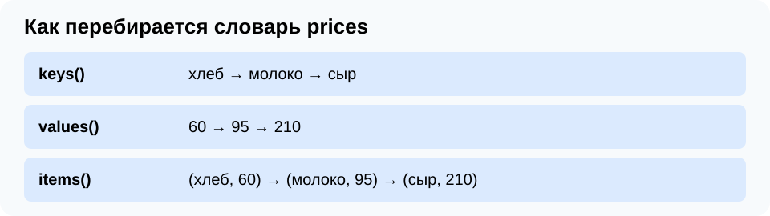

# Самоучитель урока 5 «Словари» 🆘

> Пропустил урок или разбираешься сам? Всё с нуля: краткая тема → задание. Первые 5 — **с пошаговым разбором**, дальше — **с мини-подсказками**.
> Нужен редактор и файл `проба.py`. Опирается на списки и циклы (Модули 3–4).

---

## 📖 Что нужно знать за 2 минуты

Словарь — коллекция пар **ключ → значение** в **фигурных** скобках:
```python
book = {"Аня": "555-01", "Боря": "555-02"}
book["Аня"]           # "555-01"  — достаём по ключу
book["Кот"]           # ❌ KeyError — такого ключа нет
book.get("Кот", "нет")# "нет"     — безопасно, не падает
book["Гена"] = "555-04"  # добавить пару (или заменить, если ключ был)
del book["Боря"]      # удалить пару
"Аня" in book         # True — есть ли ключ
len(book)             # сколько пар
```
Перебор идёт **по ключам**: `for name in book: print(name, book[name])`.

---

## Часть A — задания с пошаговым разбором

### Задание 1. Создать словарь
**Тема:** `{ключ: значение}`.

**Разбор по шагам:**
1. Заведи словарь имя → возраст:
```python
ages = {"Аня": 12, "Боря": 13}
print(ages["Боря"])     # 13
print(len(ages))        # 2
```
2. Слева от `:` — ключ, справа — значение. Достаём по ключу в `[ ]`.

✅ Словарь пишут в фигурных скобках, доступ — по ключу.

---

### Задание 2. Нет ключа — ошибка
**Тема:** `KeyError`.

**Разбор по шагам:**
1. Обратись к несуществующему ключу:
```python
ages = {"Аня": 12}
print(ages["Кот"])   # KeyError: 'Кот'
```
2. Прочитай ошибку: такого ключа в словаре нет.

✅ К незнакомому ключу через `[ ]` обращаться нельзя — уронит программу.

---

### Задание 3. Безопасный доступ `.get()`
**Тема:** `.get(key, запасное)`.

**Разбор по шагам:**
1. Достань значение безопасно:
```python
ages = {"Аня": 12}
print(ages.get("Аня"))          # 12
print(ages.get("Кот"))          # None
print(ages.get("Кот", 0))       # 0 — запасное значение
```

✅ `.get()` не падает: вернёт `None` или то, что дашь вторым аргументом.

---

### Задание 4. Добавить и изменить
**Тема:** `d[key] = value`.

**Разбор по шагам:**
1. Добавь и замени:
```python
book = {"Аня": "555-01"}
book["Боря"] = "555-02"     # ключа не было -> добавили
book["Аня"] = "555-99"      # ключ был -> заменили
print(book)
```
2. Одна и та же запись и добавляет, и меняет.

✅ Ключ уникален: повтор ключа заменит старое значение.

---

### Задание 5. Перебор словаря
**Тема:** `for key in d`.

**Разбор по шагам:**
1. Пройди словарь по ключам:
```python
book = {"Аня": "555-01", "Боря": "555-02"}
for name in book:
    print(f"{name}: {book[name]}")
```
2. `name` пробегает ключи, значение достаём `book[name]`.

✅ Так печатают всю телефонную книгу.

---

## Часть B — задания с мини-подсказками

### Задание 6. Столицы
Создай словарь страна → столица (3 пары), выведи столицу одной страны.
> 💡 `capitals["Франция"]`.

### Задание 7. Удаление
Из инвентаря `{"меч": 1, "зелье": 5}` удали `"меч"`.
> 💡 `del inventory["меч"]`.

### Задание 8. Проверка ключа
Проверь через `in`, есть ли в книге контакт «Аня».
> 💡 `"Аня" in book` даёт `True/False`.

### Задание 9. Сумма значений
Для `prices = {"хлеб": 40, "молоко": 70}` посчитай общую стоимость.
> 💡 `sum(prices.values())`.

### Задание 10. keys и values
Выведи отдельно все ключи и все значения словаря.
> 💡 `list(d.keys())`, `list(d.values())`.

### Задание 11. Перевод слова
Мини-словарь `{"cat": "кот", "dog": "пёс"}` — переведи слово через `.get`, для неизвестного выведи `"нет"`.
> 💡 `en_ru.get(word, "нет")`.

### Задание 12. Инвентарь-счётчик
Из списка `["монета","зелье","монета"]` собери словарь предмет → количество.
> 💡 `inv[x] = inv.get(x, 0) + 1`.

### Задание 13. 🎓 Самый дорогой
Для словаря цен найди товар с самой высокой ценой (пройди ключи, запоминай рекорд).
> 💡 Переменные «лучшее имя» и «лучшая цена», обновляй в цикле.

### Задание 14. 🎓 Вложенный словарь
`heroes = {"Маг": {"hp": 70}}` — выведи здоровье Мага.
> 💡 Два шага: `heroes["Маг"]["hp"]`.

### Задание 15. 🎓 Кортеж-ключ
Словарь `{(0,0): "старт", (2,3): "клад"}` — выведи, что в клетке (2, 3).
> 💡 Ключ — кортеж: `field[(2, 3)]`.

---

## ✅ Проверь себя

Уверенно делаешь 6–12 — тему понял. 13–15 (🎓) — если хочешь глубже.

Дальше: **[практика.md](практика.md)** (21 задача) и **[викторина.html](викторина.html)**. Шпаргалка — [итого.md](итого.md).


## Дополнительное объяснение и примеры

## Подробная теория: словари и перебор данных

### 1. Как устроен словарь

В списке значение ищут по порядковому номеру, а в словаре — по ключу. Например, в телефонной книге имя является ключом, а телефон — значением. Ключ должен быть хешируемым; строки, числа и кортежи с хешируемыми элементами подходят, а списки — нет. Каждый ключ уникален: повторное присваивание заменяет значение.

```python
phones = {"Аня": "555-01", "Боря": "555-02"}
print(phones["Аня"])           # 555-01
phones["Вера"] = "555-03"    # добавили
phones["Аня"] = "555-10"     # изменили
print(phones)
```

### 2. Доступ по ключу и безопасный get()

```python
scores = {"Аня": 5, "Боря": 4}
print(scores["Аня"])             # 5
print(scores.get("Вера"))        # None
print(scores.get("Вера", 0))     # 0
print("Вера" in scores)          # False
```

Если обратиться к `scores["Вера"]`, Python выдаст `KeyError`. `get()` позволяет заранее выбрать значение для отсутствующего ключа. Оператор `in` проверяет **ключи**, а не значения.

### 3. Три способа перебора — главное отличие



```python
prices = {"хлеб": 60, "молоко": 95, "сыр": 210}

for key in prices:
    print(key)
# хлеб, молоко, сыр — ключи

for key in prices.keys():
    print(key, prices[key])
# хлеб 60; молоко 95; сыр 210

for value in prices.values():
    print(value)
# 60, 95, 210 — только значения

for key, value in prices.items():
    print(f"{key}: {value} руб.")
# хлеб: 60 руб.; молоко: 95 руб.; сыр: 210 руб.
```

**Как работает цикл:** в `for key in prices` переменная `key` получает по очереди строку `"хлеб"`, затем `"молоко"`, затем `"сыр"`. `prices.keys()` явно возвращает представление ключей; обычный перебор словаря делает то же самое. В `for value in prices.values()` переменная получает числа `60`, `95`, `210`. Метод `items()` выдаёт пары `(ключ, значение)`, и запись `key, value` распаковывает каждую пару в две переменные.

`keys()`, `values()` и `items()` возвращают специальные *представления* (`dict_keys`, `dict_values`, `dict_items`), а не готовые списки. При необходимости список можно получить через `list(prices.keys())`.

### 4. Пример с values(): считаем сумму и среднее

```python
scores = {"Аня": 5, "Боря": 4, "Вера": 3}
total = 0
for score in scores.values():
    total += score
print("Сумма:", total)  # 12
print("Среднее:", total / len(scores))  # 4.0
```

На первой итерации `total` становится 5, на второй 9, на третьей 12. Это полезнее простого вывода: значения действительно участвуют в вычислении. Для пустого словаря деление на `len(scores)` нужно предварительно проверять.

### 5. Пример с items(): выбираем самый дорогой товар

```python
prices = {"хлеб": 60, "молоко": 95, "сыр": 210}
most_expensive = ""
highest_price = -1
for name, price in prices.items():
    if price > highest_price:
        highest_price = price
        most_expensive = name
print(most_expensive, highest_price)  # сыр 210
```

Сначала переменные получают `"хлеб"` и `60`, потом `"молоко"` и `95`, затем `"сыр"` и `210`. Условие сравнивает цены, а имя сохраняется вместе с новым максимумом.

### 6. Перебор с условием

```python
stock = {"яблоки": 7, "бананы": 0, "груши": 3}
for product, quantity in stock.items():
    if quantity > 0:
        print(product, "есть в наличии")
    else:
        print(product, "закончились")
```

Обсудите, почему здесь удобнее `items()`, а не `values()`: нужно вывести и название, и количество.

### 7. Вложенный цикл: значением является список

```python
cities = {
    "Россия": ["Москва", "Казань"],
    "Япония": ["Токио", "Осака"]
}
for country, city_list in cities.items():
    print("Страна:", country)
    for city in city_list:
        print(" -", city)
```

Внешний цикл выбирает страну и соответствующий список городов. Внутренний проходит по городам **текущей** страны. Здесь важно показать отступы и спросить, сколько раз выполнится внешний цикл (2), а сколько раз команда вывода города (4).

### 8. Вложенный словарь

```python
school = {
    "7А": {"students": 25, "teacher": "Мария Ивановна"},
    "7Б": {"students": 23, "teacher": "Игорь Петров"}
}
print(school["7А"]["teacher"])
for class_name, info in school.items():
    print(class_name, info["students"])
```

Первый ключ выбирает класс, второй — поле внутри его карточки. В цикле `info` становится вложенным словарём.

### 9. Удаление и обновление

| Команда | Что делает | Пример |
|---|---|---|
| `d[key] = value` | добавить или изменить | `d["Аня"] = 5` |
| `d.get(key, default)` | получить без KeyError | `d.get("Боря", 0)` |
| `d.update(other)` | добавить или обновить пары | `d.update({"Вера": 4})` |
| `d.pop(key, default)` | удалить ключ и вернуть значение | `d.pop("Аня", None)` |
| `d.popitem()` | удалить и вернуть последнюю добавленную пару | `d.popitem()` |
| `del d[key]` | удалить по ключу | `del d["Аня"]` |
| `d.clear()` | очистить | `d.clear()` |
| `d.copy()` | поверхностно скопировать | `new = d.copy()` |
| `d.setdefault(key, default)` | получить или добавить | `d.setdefault("Аня", 0)` |

```python
inventory = {"монета": 4, "ключ": 1}
removed = inventory.pop("ключ", 0)
print(removed)    # 1
print(inventory)  # {'монета': 4}
```

`pop()` принимает ключ; запись `cities.pop()["Canada"]` из старой теории ошибочна, потому что без аргумента `pop()` не вызывается. Правильно: `canada = cities.pop("Canada")`.

### 10. Практический алгоритм: подсчёт букв

```python
text = "мама мыла раму"
frequency = {}
for letter in text:
    if letter != " ":
        frequency[letter] = frequency.get(letter, 0) + 1
for letter, count in frequency.items():
    print(letter, count)
```

На каждой итерации цикл получает очередную букву. `get(letter, 0)` возвращает прежний счётчик или ноль, если буква встретилась впервые. Затем прибавляется единица. Во втором цикле `items()` помогает вывести готовую таблицу частот.

### 11. Как собрать словарь из двух списков

```python
names = ["Аня", "Боря", "Вера"]
points = [12, 18, 15]
results = dict(zip(names, points))
print(results)  # {'Аня': 12, 'Боря': 18, 'Вера': 15}
```

`zip()` соединяет элементы с одинаковыми позициями в пары, а `dict()` превращает эти пары в словарь. Если списки разной длины, обычный `zip()` остановится на коротком.

### 12. Самопроверка перед практикой

Предскажите вывод `for x in d`, `for x in d.values()` и `for a, b in d.items()` для `d = {"a": 2, "b": 4}`. Объясните, почему `"a" in d` истинно, а `2 in d` ложно. Затем напишите цикл, который печатает только товары дороже 100 рублей.
