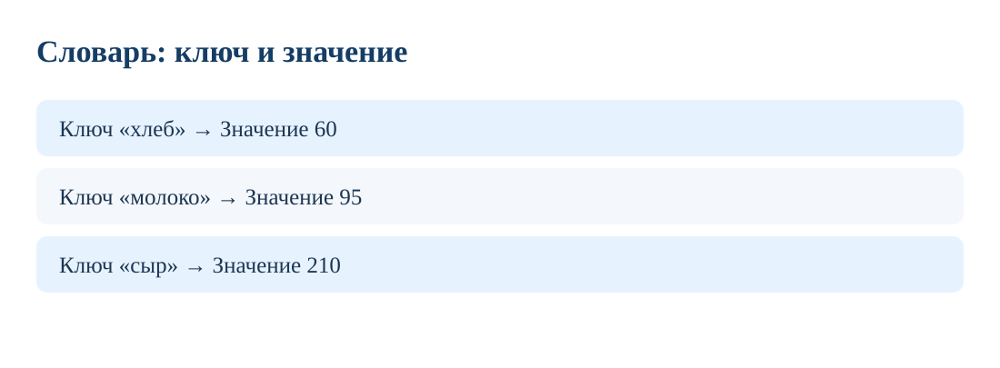
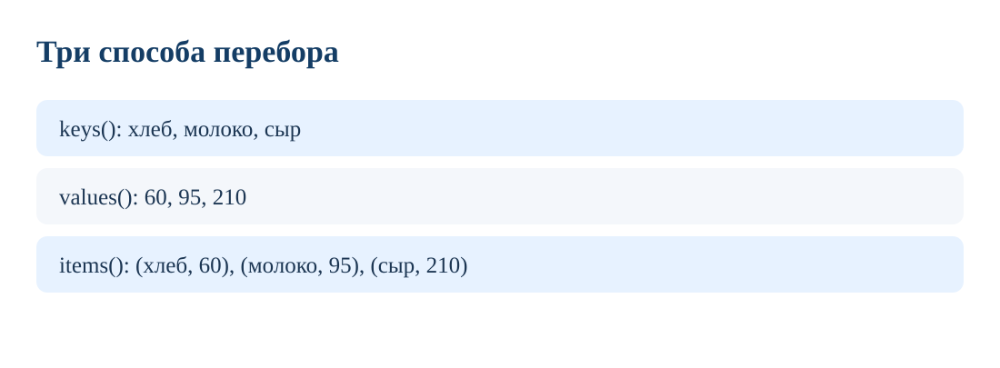

# Урок 5 — «Телефонная книга и инвентарь»: словари `{ключ: значение}`

**Модуль 4 · Коллекции · Урок 5 из 7 | 2 ак.ч. (1,5 часа)**

> Предыдущий: [Урок 4 «Кортежи»](../урок-04-кортежи/урок.md) · [Все уроки модуля](../README.md) · Следующий урок — по плану модуля.

> Перед уроком — [повторение](повторение.md). Для пропустивших занятие — [самоучитель](самоучитель.md). Учителю — [сценарий](преподавателю.md). Краткое повторение — [итого](итого.md). Дополнительные приёмы — [лайфхак](лайфхак.md). Иллюстрации — [изображения](изображения.md).

В предыдущих уроках мы обращались к элементам коллекций по их позиции. Сегодня научимся искать информацию по **ключу**: например, получать цену по названию товара или телефон по имени человека.

## Что мы сделаем сегодня и что получим (3 минуты)

Мы создадим телефонную книгу и инвентарь, научимся безопасно получать значения, менять данные и перебирать словарь тремя способами. Особое внимание уделим `keys()`, `values()` и `items()`: они похожи по написанию, но дают разные данные. В конце создадим игру «Города»: выберем страну, загрузим её города из словаря и научим компьютер отвечать на последнюю букву.

## Часть 0 — Разминка: поиск по имени (5 минут)

Представим два списка:

```python
names = ["Аня", "Борис", "Вика"]
phones = ["111", "222", "333"]
```
Чтобы узнать номер Вики, надо найти индекс её имени, затем взять элемент из второго списка с таким же индексом. Если случайно изменить порядок только одного списка, номера перепутаются. Удобнее хранить пары: **имя → телефон**. Именно для этого служит словарь.

## Часть 1 — Создание словаря и устройство пары «ключ → значение» (12 минут)

Словарь (`dict`) хранит пары **ключ: значение**. Ключ нужен для поиска, значение — то, что мы хотим получить. В словаре ключи уникальны. Значения могут повторяться. Порядок добавления пар сохраняется в современном Python, но обращаемся к ним обычно не по номеру, а по ключу.


### Телефонная книга

```python
phones = {"Аня": "111", "Борис": "222", "Вика": "333"}
print(phones)
print(type(phones))
```

**Результат:**

```text
{'Аня': '111', 'Борис': '222', 'Вика': '333'}
<class 'dict'>
```

Фигурные скобки создают словарь. Слева от двоеточия находится ключ, справа — значение. Пары разделяются запятыми.

### Пустой словарь и разные типы значений

```python
student = {}
student["name"] = "Артём"
student["age"] = 13
student["grades"] = [5, 4, 5]
print(student)
```

**Результат:**

```text
{'name': 'Артём', 'age': 13, 'grades': [5, 4, 5]}
```

В одном словаре значения могут иметь разные типы. Ключами подходят строки, числа, кортежи из хешируемых элементов; список ключом быть не может.

**Проверь себя.** Почему `student["grades"]` возвращает список, а не одно число?


Если дважды записать один и тот же ключ, останется одно значение — последнее присвоенное. Например, `{"a": 1, "a": 2}` содержит только `"a": 2`.

## Часть 2 — Получаем значения: квадратные скобки, `in` и `get()` (12 минут)

Доступ по ключу выглядит похоже на индекс списка, но внутри скобок теперь пишем имя ключа. При обращении к отсутствующему ключу Python выдаёт `KeyError`. Научимся этого избегать.


### Прямой доступ

```python
prices = {"хлеб": 60, "молоко": 95, "сыр": 210}
print(prices["молоко"])
```

**Результат:**

```text
95
```

Python находит пару с ключом `"молоко"` и возвращает число `95`. В отличие от списка, мы не ищем позицию элемента.

### Сначала проверяем ключ

```python
prices = {"хлеб": 60, "молоко": 95}
name = "сыр"
if name in prices:
    print(prices[name])
else:
    print("Товара нет")
```

**Результат:**

```text
Товара нет
```

`in` проверяет **ключи**, а не значения. Проверка не допускает обращения к отсутствующему ключу.

### Безопасный доступ через get()

```python
prices = {"хлеб": 60, "молоко": 95}
print(prices.get("молоко"))
print(prices.get("сыр"))
print(prices.get("сыр", 0))
```

**Результат:**

```text
95
None
0
```

`get(key)` возвращает значение, а при отсутствии ключа — `None`. Второй аргумент позволяет указать значение по умолчанию. Сам словарь `get()` не изменяет.

**Проверь себя.** Что изменится, если заменить `0` строкой `"Нет в продаже"`?
**Когда что использовать?** Если ключ точно существует, удобны `prices[name]`. Если пользователь вводит название товара, безопаснее проверить `in` или использовать `get()`. Не путайте отсутствие товара с ценой `0`: в реальном приложении это разные ситуации.

## Часть 3 — Добавляем, изменяем и удаляем пары (10 минут)

### Добавление и изменение

```python
stock = {"яблоки": 5, "бананы": 2}
stock["груши"] = 4
stock["бананы"] += 3
print(stock)
```

**Результат:**

```text
{'яблоки': 5, 'бананы': 5, 'груши': 4}
```

Если ключ новый, создаётся пара. Если ключ уже есть, изменяется его значение. `+= 3` увеличивает количество бананов с 2 до 5.

### Удаляем товар через pop()

```python
stock = {"яблоки": 5, "бананы": 2}
removed = stock.pop("бананы")
print(removed)
print(stock)
```

**Результат:**

```text
2
{'яблоки': 5}
```

`pop("бананы")` удаляет ключ и возвращает связанное значение. Если ключа нет, возникнет `KeyError`; можно указать запасной результат: `stock.pop("груши", 0)`.

### Обновляем сразу несколько товаров

```python
stock = {"яблоки": 5, "бананы": 2}
stock.update({"бананы": 7, "груши": 4})
print(stock)
```

**Результат:**

```text
{'яблоки': 5, 'бананы': 7, 'груши': 4}
```

`update()` меняет существующие пары и добавляет новые. `del stock["яблоки"]` тоже удаляет пару, но не возвращает её значение.
| Действие | Запись | Результат |
|---|---|---|
| Добавить | `d["new"] = 10` | Новая пара |
| Изменить | `d["new"] = 20` | Новое значение |
| Удалить | `del d["new"]` | Пара удалена |
| Удалить и получить | `d.pop("new", None)` | Значение или `None` |
| Очистить | `d.clear()` | Пустой словарь |
| Обновить | `d.update(other)` | Добавление и замена пар |

## Часть 4 — Перебор ключей: `for key in d` и `keys()` (10 минут)

При обычном переборе словаря цикл выдаёт **ключи**. Метод `keys()` тоже позволяет перебрать ключи; запись с ним полезна, когда мы хотим явно показать намерение.


### Перебираем ключи

```python
prices = {"хлеб": 60, "молоко": 95, "сыр": 210}
for key in prices:
    print(key)
```

**Результат:**

```text
хлеб
молоко
сыр
```

Итерация 1: `key = "хлеб"`; итерация 2: `key = "молоко"`; итерация 3: `key = "сыр"`. Значения при этом не попадают в `key`.

### Через keys() и получение значения

```python
prices = {"хлеб": 60, "молоко": 95, "сыр": 210}
for name in prices.keys():
    print(name, prices[name])
```

**Результат:**

```text
хлеб 60
молоко 95
сыр 210
```

`prices.keys()` даёт представление ключей (`dict_keys`), а не готовый список. Внутри цикла по очередному ключу можно получить цену через `prices[name]`.

**Проверь себя.** Выведи только названия товаров, начинающиеся с буквы «м».
**Сравним:** `for name in prices:` и `for name in prices.keys():` дают одинаковые ключи. Не нужно писать `.keys()` каждый раз, но важно понимать его назначение.

## Часть 5 — Перебор значений: `values()` (12 минут)

Когда названия не нужны, а надо посчитать сумму, среднее или найти максимум, удобнее перебирать **значения**.


### Что выдаёт values()

```python
prices = {"хлеб": 60, "молоко": 95, "сыр": 210}
for price in prices.values():
    print(price)
```

**Результат:**

```text
60
95
210
```

Первая итерация: `price = 60`, вторая — `95`, третья — `210`. Переменная `price` не знает, как называется товар. Метод возвращает представление `dict_values`, по которому можно пройти циклом.

### Сумма цен

```python
prices = {"хлеб": 60, "молоко": 95, "сыр": 210}
total = 0
for price in prices.values():
    total += price
print("Сумма:", total)
```

**Результат:**

```text
Сумма: 365
```

Сначала `total = 0`. Затем `0 + 60 = 60`, `60 + 95 = 155`, `155 + 210 = 365`. Можно было бы использовать `sum(prices.values())`, но цикл лучше показывает алгоритм.

### Среднее и максимум

```python
prices = {"хлеб": 60, "молоко": 95, "сыр": 210}
print("Средняя цена:", sum(prices.values()) / len(prices))
print("Максимальная цена:", max(prices.values()))
```

**Результат:**

```text
Средняя цена: 121.66666666666667
Максимальная цена: 210
```

`len(prices)` — количество пар. `max()` находит наибольшее **значение**, но не сообщает название товара. Для названия понадобится `items()` или поиск по ключу.

**Проверь себя.** Как вывести только цены выше 90 рублей?
**Важная оговорка:** если словарь пуст, делить на `len(prices)` нельзя. Перед расчётом среднего проверяйте `if prices:`.

## Часть 6 — Перебор пар: `items()` и распаковка (14 минут)

Метод `items()` выдаёт пары `(ключ, значение)`. Вспомните урок 4: кортеж из двух элементов можно распаковать в две переменные. Именно это происходит в записи `for name, price in prices.items()`.


### Как устроена одна итерация items()

```python
prices = {"хлеб": 60, "молоко": 95}
for name, price in prices.items():
    print(f"{name}: {price} руб.")
```

**Результат:**

```text
хлеб: 60 руб.
молоко: 95 руб.
```

На первом шаге получаем пару `("хлеб", 60)`, которая распаковывается: `name = "хлеб"`, `price = 60`. На втором шаге аналогично обрабатываем `("молоко", 95)`.

**Проверь себя.** Добавь третий товар и предскажи вывод.

### Ищем самый дорогой товар

```python
prices = {"хлеб": 60, "молоко": 95, "сыр": 210}
most_expensive = None
max_price = -1
for name, price in prices.items():
    if price > max_price:
        max_price = price
        most_expensive = name
print(most_expensive, max_price)
```

**Результат:**

```text
сыр 210
```

Цикл сравнивает цену каждого товара с текущим максимумом. Если цена больше, сохраняем и название, и стоимость. Здесь цены неотрицательные, поэтому начальное `-1` подходит. Для произвольных чисел алгоритм потребует другой инициализации.

### Отбираем товары по условию

```python
prices = {"хлеб": 60, "молоко": 95, "сыр": 210}
for name, price in prices.items():
    if price >= 90:
        print(name, price)
```

**Результат:**

```text
молоко 95
сыр 210
```

В этом случае нужны одновременно название и цена. `values()` не подойдёт, потому что оно не даёт ключ.


| Запись | Что получаем в цикле | Когда применять |
|---|---|---|
| `for k in d` | Ключ | Проверка названий |
| `for k in d.keys()` | Ключ | Явный перебор ключей |
| `for v in d.values()` | Значение | Сумма, среднее, максимум |
| `for k, v in d.items()` | Ключ и значение | Отчёт, фильтрация, поиск с названием |

**Не путайте:** `for pair in prices.items()` помещает всю пару в одну переменную `pair`. А `for name, price in prices.items()` сразу распаковывает её.

## Часть 7 — Вложенные данные и вложенные циклы (10 минут)

Значением словаря может быть список или другой словарь. Это удобно для каталога игр, списка учеников и городов по странам. Но нужно понимать, какой именно тип получает переменная на каждом уровне.


### Список городов у каждой страны

```python
cities = {"Россия": ["Москва", "Казань"], "Япония": ["Токио", "Осака"]}
for country, city_list in cities.items():
    print(country)
    for city in city_list:
        print(" -", city)
```

**Результат:**

```text
Россия
 - Москва
 - Казань
Япония
 - Токио
 - Осака
```

Внешний цикл берёт пару: страна и **список** городов. Внутренний цикл проходит по названиям внутри этого списка. Когда внутренний цикл заканчивается, внешний переходит к следующей стране.

### Вложенный словарь оценок

```python
students = {"Аня": {"математика": 5, "английский": 4}, "Борис": {"математика": 4, "английский": 5}}
for name, grades in students.items():
    print(name)
    for subject, grade in grades.items():
        print(subject, grade)
```

**Результат:**

```text
Аня
математика 5
английский 4
Борис
математика 4
английский 5
```

Внутреннее значение `grades` — не список, а ещё один словарь. Поэтому для его перебора удобно снова вызвать `.items()`.
**Дополнительно:** словарь из двух списков можно создать так: `dict(zip(["Аня", "Борис"], [10, 20]))`. `zip()` сопоставляет элементы по позициям; если длины отличаются, лишние элементы не попадут в результат.

## Часть 8 — Практические алгоритмы: частоты и учёт товаров (8 минут)

### Подсчёт букв

```python
text = "мама"
counts = {}
for char in text:
    counts[char] = counts.get(char, 0) + 1
print(counts)
```

**Результат:**

```text
{'м': 2, 'а': 2}
```

Если буква встречается впервые, `get(char, 0)` даёт ноль. При каждом повторении прибавляем единицу. Это полезный шаблон для подсчёта любых повторяющихся объектов.

### Остатки в магазине

```python
stock = {"яблоки": 5, "бананы": 0, "груши": 2}
for name, count in stock.items():
    if count == 0:
        print(name, "закончились")
```

**Результат:**

```text
бананы закончились
```

Для проверки остатков нам нужны и название товара, и его количество — значит, выбираем `items()`.
В [практике](практика.md) ученики применят эти приёмы в проектах «Телефонная книга» и «Инвентарь». Вначале полезно решить несколько задач без подсказок, а потом перейти к проекту.

## Часть 9 — Дополнительные методы словаря (для сильных учеников)

Эти команды не обязательно успеть на основном занятии, но они пригодятся в следующих проектах.

| Метод | Назначение | Пример |
|---|---|---|
| `setdefault(k, v)` | Возвращает значение; если ключа нет, добавляет его | `d.setdefault("очки", 0)` |
| `popitem()` | Удаляет и возвращает последнюю добавленную пару | `d.popitem()` |
| `copy()` | Создаёт поверхностную копию словаря | `new = d.copy()` |
| `dict.fromkeys(keys, v)` | Создаёт словарь с одинаковыми начальными значениями | `dict.fromkeys(["a", "b"], 0)` |

`copy()` не копирует вложенные списки независимо. Если менять вложенный список в копии, изменение может быть видно и в исходном словаре. Для первых проектов достаточно помнить, что копия верхнего уровня — отдельный словарь.

## Часть 10 — Итоговый проект «Города» (25–35 минут)

В части 7 мы хранили города в списках внутри словаря. Теперь используем эту же структуру для игры с компьютером. Игрок выбирает страну, называет первый город, а компьютер отвечает городом на последнюю букву. Повторять названия нельзя. Если подходящих городов в учебной базе больше нет, участник проигрывает. За каждый принятый ответ игрок получает одно очко.

### Шаг 1. Подготовим файлы проекта

Создай папку `Города` и помести в неё готовый файл [cities.py](материалы/cities.py). Рядом создай `game.py`. Оба файла должны находиться в одной папке. Открой эту папку в PyCharm или VS Code. Запускать будем `game.py`, а не файл с данными.

```text
Города/
├── cities.py
└── game.py
```

В `cities.py` находится переменная `CITIES`. Например, небольшой фрагмент такой базы мог бы выглядеть так:

```python
CITIES = {
    "Россия": ["Москва", "Анапа", "Архангельск"],
    "Япония": ["Токио", "Осака", "Киото"]
}
```

Ключ — название страны, значение — список её городов. В готовом файле городов значительно больше. Не переписывай этот пример поверх готовой базы.

В начале `game.py` напиши:

```python
from cities import CITIES
import random
```

`from cities import CITIES` означает: из файла `cities.py` взять переменную `CITIES`. Расширение `.py` в команде импорта не пишем. Модуль `random` понадобится для выбора ответа компьютера. Устанавливать библиотеки не нужно.

### Шаг 2. Покажем страны и дадим игроку выбрать одну из них

```python
for country, city_list in CITIES.items():
    print(f"{country}: {len(city_list)} городов")
```

Вспомним `items()`: в `country` попадает ключ, а в `city_list` — весь список, а не один город. `len(city_list)` считает города именно этой страны. Если вызвать `len(CITIES)`, получим количество стран.

```python
while True:
    country = input("Выбери страну: ").strip().capitalize()
    if country == "Сша":
        country = "США"
    if country in CITIES:
        break
    print("Такой страны нет в базе. Попробуй ещё раз.")
```

`strip()` убирает пробелы по краям, `capitalize()` делает первую букву заглавной, остальные строчными. Для аббревиатуры США нужна отдельная поправка. Проверка `country in CITIES` ищет ключ. Пока ключа нет, цикл повторяет вопрос. `break` завершает только этот цикл, после чего начинается подготовка игры.

### Шаг 3. Подготовим словарь доступных городов

Игрок может написать «МОСКВА», «москва» или « Москва ». Все варианты должны приниматься одинаково. Для этого создадим функцию:

```python
def normalize(text):
    return text.strip().lower().replace("ё", "е")
```

| Команда | Что делает | Пример результата |
|---|---|---|
| `strip()` | Убирает пробелы по краям | `" Москва "` → `"Москва"` |
| `lower()` | Переводит буквы в нижний регистр | `"Москва"` → `"москва"` |
| `replace("ё", "е")` | Заменяет ё на е | `"Орёл"` → `"орел"` |

Функцию помести после импортов, до первого её вызова. Создадим отдельный словарь, чтобы не изменять исходную базу:

```python
available = {}
for city in CITIES[country]:
    available[normalize(city)] = city
```

Если выбрана Россия, `CITIES[country]` возвращает список российских городов. На каждой итерации берём один город и добавляем пару в новый словарь.

| `city` | Ключ после `normalize()` | Значение |
|---|---|---|
| Москва | москва | Москва |
| Орёл | орел | Орёл |
| Казань | казань | Казань |

Зачем хранить два варианта? По ключу удобно проверять ответ, а значение сохраняет правильное написание для вывода. После каждого хода будем удалять использованный ключ через `pop()`.

### Шаг 4. Определим букву для следующего хода

У города «Казань» последняя буква — мягкий знак. На него города не начинаются, поэтому нужно взять «н». Напишем вторую функцию после `normalize()`:

```python
def last_letter(city):
    city = normalize(city)
    for letter in city[::-1]:
        if letter not in "ьъы":
            return letter
    return ""
```

Срез `[::-1]` мы изучали в уроке 3: он разворачивает строку. Цикл читает название с конца. `return` сразу завершает функцию, когда найдена подходящая буква. Пустая строка в конце — запасной результат, если такой буквы нет.

| Город | Начало перебора с конца | Результат |
|---|---|---|
| Москва | а | а |
| Казань | ь, н | н |
| Пермь | ь, м | м |
| Орёл | л | л |

Проверь функцию отдельно командой `print(last_letter("Казань"))`. После проверки удали этот пробный вывод.

### Шаг 5. Проверим ход игрока

Перед игровым циклом создадим две переменные:

```python
required = ""
score = 0
```

`required` хранит обязательную первую букву. В начале она пустая: первый город можно назвать на любую букву. `score` хранит число принятых ответов.

```python
while True:
    if required:
        print(f"Твой город должен начинаться на «{required.upper()}»")
    answer = normalize(input("Твой город (или стоп): "))
    if answer == "стоп":
        break
    if answer not in available:
        print("Город уже называли или его нет в нашей базе.")
        continue
    if required and not answer.startswith(required):
        print("Неверная первая буква.")
        continue

    player_city = available.pop(answer)
    score += 1
    required = last_letter(player_city)
```

`startswith()` проверяет начало строки. Например, `"анапа".startswith("а")` даёт `True`. Условие с `and` проверяет букву только тогда, когда она задана. `continue` возвращает нас к началу игрового цикла, не начисляя очко и не передавая ход компьютеру.

`available.pop(answer)` выполняет сразу два действия: возвращает название города и удаляет пару из словаря. Если игрок ввёл «Москва», в `player_city` окажется `"Москва"`, а ключ `"москва"` исчезнет. Следующий ход должен начинаться на «а».

### Шаг 6. Научим компьютер искать ответ

Следующий блок добавь внутрь того же `while`, сразу после определения буквы. Отступ — четыре пробела.

```python
    candidates = []
    for key, name in available.items():
        if key.startswith(required):
            candidates.append(key)
    if not candidates:
        print("Компьютер не знает подходящего города. Ты победил!")
        break
```

Представим, что после хода игрока нужна буква «а». В словаре остались Анапа, Казань и Архангельск.

| Итерация | `key` | `name` | Подходит? | `candidates` |
|---|---|---|---|---|
| 1 | анапа | Анапа | Да | `["анапа"]` |
| 2 | казань | Казань | Нет | `["анапа"]` |
| 3 | архангельск | Архангельск | Да | `["анапа", "архангельск"]` |

Мы собираем ключи, поскольку потом именно по ключу будем удалять выбранный город. Переменная `name` содержит исходное написание, но здесь она не нужна; можно было бы перебрать только `available.keys()`. Попробуй самостоятельно заменить цикл на такой вариант.

Не удаляй элементы словаря внутри цикла `for ... in available.items()`: изменение количества пар во время перебора вызовет ошибку. Сначала соберём варианты, затем выберем один.

```python
    computer_key = random.choice(candidates)
    computer_city = available.pop(computer_key)
    print("Компьютер:", computer_city)
    required = last_letter(computer_city)
```

`random.choice()` выбирает один элемент непустого списка. Именно поэтому выше мы проверили, есть ли варианты. Если компьютер выбрал Анапу, этот город удаляется, а игроку снова нужна буква «а».

### Шаг 7. Проверим, остались ли варианты у игрока

```python
    can_play = False
    for key in available:
        if key.startswith(required):
            can_play = True
            break
    if not can_play:
        print("В базе больше нет подходящих городов. Компьютер победил.")
        break

print("Твой счёт:", score)
```

Сначала считаем, что подходящего города нет. Если находим хотя бы один, меняем `can_play` на `True` и прекращаем поиск. Первый `break` завершает цикл `for`, второй — игровой `while`. Последний `print()` находится уже за пределами игрового цикла, поэтому счёт выводится один раз при завершении игры.

### Шаг 8. Полный код игры

Сравни свою программу с готовым вариантом. Обрати внимание на порядок функций и отступы.

```python
from cities import CITIES
import random


def normalize(text):
    return text.strip().lower().replace("ё", "е")


def last_letter(city):
    city = normalize(city)
    for letter in city[::-1]:
        if letter not in "ьъы":
            return letter
    return ""


print("Игра «Города»")
for country, city_list in CITIES.items():
    print(f"{country}: {len(city_list)} городов")

while True:
    country = input("Выбери страну: ").strip().capitalize()
    if country == "Сша":
        country = "США"
    if country in CITIES:
        break
    print("Такой страны нет в базе. Попробуй ещё раз.")

available = {}
for city in CITIES[country]:
    available[normalize(city)] = city

required = ""
score = 0
while True:
    if required:
        print(f"Твой город должен начинаться на «{required.upper()}»")
    answer = normalize(input("Твой город (или стоп): "))
    if answer == "стоп":
        break
    if answer not in available:
        print("Город уже называли или его нет в нашей базе.")
        continue
    if required and not answer.startswith(required):
        print("Неверная первая буква.")
        continue

    player_city = available.pop(answer)
    score += 1
    required = last_letter(player_city)
    candidates = []
    for key, name in available.items():
        if key.startswith(required):
            candidates.append(key)
    if not candidates:
        print("Компьютер не знает подходящего города. Ты победил!")
        break

    computer_key = random.choice(candidates)
    computer_city = available.pop(computer_key)
    print("Компьютер:", computer_city)
    required = last_letter(computer_city)

    can_play = False
    for key in available:
        if key.startswith(required):
            can_play = True
            break
    if not can_play:
        print("В базе больше нет подходящих городов. Компьютер победил.")
        break

print("Твой счёт:", score)
```

Готовый файл для проверки: [game.py](материалы/game.py).

### Проверяем игру

Пример одного возможного начала партии (ответ компьютера выбирается случайно):

```text
Выбери страну: Россия
Твой город (или стоп): Москва
Компьютер: Анапа
Твой город должен начинаться на «А»
Твой город (или стоп): Москва
Город уже называли или его нет в нашей базе.
Твой город должен начинаться на «А»
Твой город (или стоп): Казань
Неверная первая буква.
Твой город должен начинаться на «А»
Твой город (или стоп): стоп
Твой счёт: 1
```

Проверь также ввод неизвестной страны, города из другой страны, названия с заглавными буквами и лишними пробелами. Попробуй сыграть до конца на небольшой тестовой базе. Помни: база учебная, поэтому настоящий город может отсутствовать в ней.

**Дополнительные задания:** выведи количество оставшихся городов после каждого хода; сохрани историю ходов в списке и выведи её с помощью `enumerate()`; добавь команду «подсказка», которая показывает один подходящий город без удаления из словаря.

## Разбор частых ошибок

| Ошибка | Почему | Исправление |
|---|---|---|
| `prices["сыр"]`, если ключа нет | `KeyError` | Проверить `in` или применить `get()` |
| `for price in prices:` | Перебираются ключи, а не цены | `for price in prices.values():` |
| `for name, price in prices.values():` | Значение не является парой | Использовать `.items()` |
| `prices.append(...)` | У словаря нет `append()` | `prices[key] = value` |
| `prices[0]` | В словаре может не быть ключа `0` | Использовать настоящий ключ |
| `sum(prices)` | Суммируются ключи, а не значения | `sum(prices.values())` |

Предложите ученикам объяснить каждую ошибку словами до запуска программы.

## Итог урока (5 минут)

Сегодня мы научились хранить данные парами «ключ → значение», безопасно получать значения, добавлять и удалять записи, а главное — перебирать словарь по ключам, значениям и парам. **Вопросы:** что получает переменная в `for x in d`? Чем отличаются `values()` и `items()`? Когда полезен `get()`? Как перебрать список, который лежит внутри словаря?

Для закрепления откройте [итого.md](итого.md) и [викторину](викторина.html). Домашнее задание: добавь в игру «Города» историю ходов или подсказку. Телефонную книгу можно дополнительно закрепить по заданиям практики.
