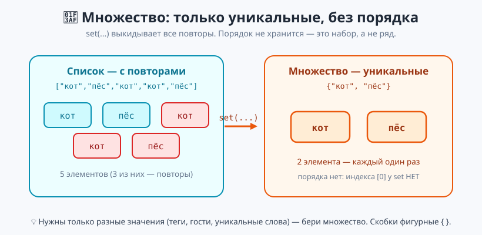
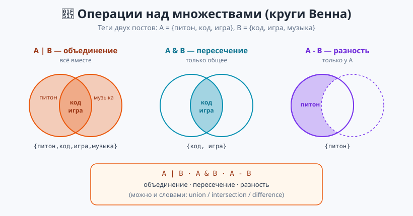
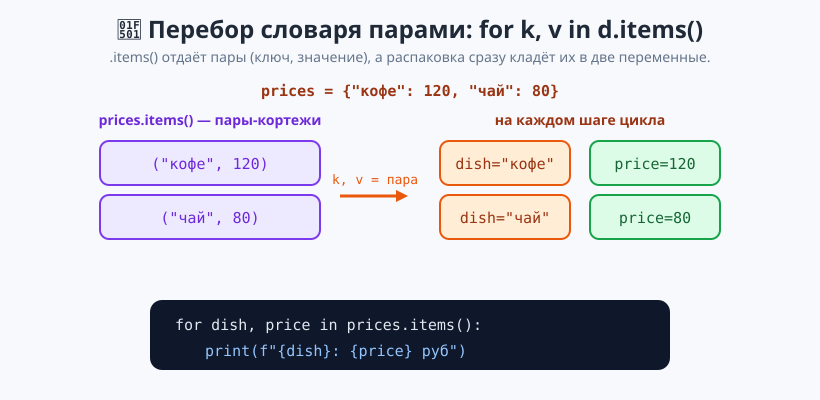

# Урок 6 — «Уникальные теги»: множества `set` и перебор словаря `for k, v` 

**Модуль 4 · Коллекции · Урок 6 из 7 | 2 ак.ч. (1,5 часа)**

> Предыдущий: [Урок 5 «Словари»](../урок-05-словари/урок.md) · [Все уроки модуля](../README.md) · [План курса](../../ПЛАН-КУРСА.md) · Следующий: Урок 7 « Мини-база данных персонажей» 

> В начале — [разминка/повтор](повторение.md) (5 мин).
> Быстро вспомнить материал урока — [итого.md](итого.md) (шпаргалка).
> Сценарий с хронометражом — в [преподавателю.md](преподавателю.md).
> Что показать на проекторе — в [изображения.md](изображения.md).
> **Пропустил урок или хочешь закрепить?** Открой [самоучитель.md](самоучитель.md) — теория + задания с подсказками.
> Трюки и частые ошибки — в [лайфхак.md](лайфхак.md).

> **Как читать урок.** Список хранит всё подряд, даже повторы: `["кот", "пёс", "кот"]`. Но иногда важны только **разные** значения — уникальные теги поста, список гостей без дублей, разные слова в тексте. Для этого есть **множество** (`set`): оно само выкидывает повторы и умеет «складывать» и «пересекать» наборы. А ещё сегодня освоим **перебор словаря** сразу парами — `for ключ, значение in словарь.items()`.

---

## Что мы сделаем сегодня и что получим

**Задача:** научиться хранить **уникальные** наборы и сравнивать их (объединение, пересечение), а также удобно перебирать словарь парами — на примере системы тегов блога.

**В итоге получится** `теги.py`:

```
Всего уникальных тегов: 5
Общие теги post1 и post2: {'код', 'игра'}
Только у post1: {'питон'}
Популярность тегов:
  код: в 3 постах
Самый популярный тег: код (3 постов)
```

**Главные навыки урока:** множество `{...}` · `set(список)` убирает дубли · `in`, `len`, `add`, `discard` · операции `|` `&` `-` · **перебор словаря** `for k, v in d.items()` · словарь-счётчик + вывод парами.

> **Главная мысль урока:** **множество — набор уникальных элементов без порядка.** Повторы исчезают сами. А `.items()` даёт перебрать словарь сразу парами «ключ — значение».

---

## Часть 0 — Разминка: убирать дубли вручную неудобно (5 минут)

Чтобы оставить в списке только разные значения, в прошлом уроке мы могли бы использовать проверку `not in`:

```python
words = ["кот", "пёс", "кот", "кот", "пёс"]
unique = []
for w in words:
    if w not in unique:      # длинно и вручную
        unique.append(w)
```

Работает, но многословно. В Python для «только уникальные» есть готовый инструмент — **множество**.

---

### Как работает проверка на повтор

Переменная `unique` сначала содержит пустой список. Цикл берёт из `words` по одному слову. Условие `w not in unique` проверяет, не записали ли мы это слово раньше. Если слова ещё нет, вызывается `append()`.

| Итерация | `w` | Список после проверки |
|---|---|---|
| 1 | кот | `["кот"]` |
| 2 | пёс | `["кот", "пёс"]` |
| 3 | кот | `["кот", "пёс"]` |
| 4 | кот | `["кот", "пёс"]` |
| 5 | пёс | `["кот", "пёс"]` |

Добавь после цикла `print(unique)` и проверь результат. Обрати внимание: исходный список `words` не изменился. Мы создали новую коллекцию. Если порядок слов нам не важен, эту работу можно поручить множеству.

## Часть 1 — Множество `set`: только уникальные (15 минут)

Множество пишут в **фигурных** скобках `{ }` (как словарь, но без пар — просто значения). Повторы отбрасываются:

```python
tags = {"питон", "код", "питон", "игра", "код"}
print(tags)          # {'питон', 'код', 'игра'} — каждый один раз
print(len(tags))     # 3
```

**Убрать дубли из списка — одной командой `set(...)`:**

```python
words = ["кот", "пёс", "кот", "кот", "пёс"]
print(set(words))    # {'кот', 'пёс'}
print(len(set(words)))   # 2 — сколько разных
```



### 1.1. Чем множество отличается от других коллекций

**Множество (`set`)** — изменяемая коллекция уникальных элементов. В ней нет позиций, по которым можно обратиться к элементу. Например, для списка участников соревнования нам важно знать, зарегистрирован ли конкретный участник, а не каким по счёту он был добавлен.

| Коллекция | Пример | Повторы | Доступ |
|---|---|---|---|
| Список | `[4, 4, 5]` | разрешены | по индексу |
| Кортеж | `(4, 4, 5)` | разрешены | по индексу |
| Множество | `{4, 5}` | нет | проверка наличия |
| Словарь | `{"Аня": 5}` | ключи уникальны | по ключу |

### 1.2. Способы создания

```python
numbers = {10, 20, 10, 30}
from_list = set([1, 2, 1])
from_tuple = set((5, 5, 4))
letters = set("мама")
empty = set()
print(len(numbers))     # 3
print(len(from_list))   # 2
print(len(from_tuple))  # 2
print(len(letters))     # 2
print(len(empty))       # 0
```

Функция `set()` перебирает переданную коллекцию и сохраняет каждое различное значение один раз. В случае строки отдельными элементами становятся символы. Внутри множества можно хранить числа, строки и кортежи с подходящими элементами. Списки, словари и обычные множества хранить в качестве элементов множества нельзя: они не являются хешируемыми.

```python
points = {(1, 2), (3, 4), (1, 2)}
print(len(points))  # 2
```

Здесь две одинаковые пары координат считаются одним элементом. Кортежи из чисел подходят для хранения координат.

> **Пустое множество — это `set()`, а не `{}`!** Пустые фигурные скобки `{}` — это пустой **словарь**. Запомни: `set()` — пустое множество.

> **У множества НЕТ порядка и индексов.** `tags[0]` даст ошибку — элементы не пронумерованы. Множество отвечает на вопрос «есть или нет», а не «какой по счёту».

**Проверка `in`, добавить, удалить:**

```python
print("код" in tags)     # True — очень быстро
tags.add("java")         # добавить элемент
tags.add("код")          # дубль не добавится — уже есть
tags.discard("игра")     # удалить (без ошибки, даже если нет)
```

-  `add` добавляет один элемент; повтор просто игнорируется. `discard` безопасно удаляет. Проверка `in` у множества очень быстрая — поэтому она удобна для проверки наличия.

### 1.3. Изменение множества и перебор

| Команда | Назначение | Если элемента нет |
|---|---|---|
| `s.add(x)` | Добавить один элемент | добавит его |
| `s.update(values)` | Добавить элементы другой коллекции | добавит новые |
| `s.discard(x)` | Удалить элемент | ничего не произойдёт |
| `s.remove(x)` | Удалить элемент | `KeyError` |
| `s.pop()` | Удалить и вернуть произвольный элемент | `KeyError`, если пусто |
| `s.clear()` | Удалить всё | останется пустым |
| `len(s)` | Количество элементов | для пустого множества 0 |
| `x in s` | Проверить наличие | `False` |

Создадим список зарегистрированных игроков:

```python
players = set()
players.add("Аня")
players.add("Боря")
players.add("Аня")
players.update(["Вера", "Боря"])
print(len(players))  # 3
players.discard("Боря")
players.discard("Дима")
print(len(players))  # 2
```

После первого `add()` в множестве один игрок, после второго — два. Повторное добавление Ани ничего не меняет. `update()` перебирает список имён и добавляет только отсутствующие. После удаления Бори остаются Аня и Вера. Димы не было, поэтому второй `discard()` ничего не меняет.

Перебрать множество можно обычным циклом:

```python
for player in players:
    print(player)
```

Будут выведены оба имени, но порядок не гарантируется. Если нужен алфавитный порядок, используй `sorted(players)`: функция вернёт отсортированный **список**, не изменяя множество.

```python
for player in sorted(players):
    print(player)
```

Результат:

```text
Аня
Вера
```

Не присваивай `players = players.add("Оля")`: метод меняет существующее множество и возвращает `None`. Также не добавляй и не удаляй элементы самого множества во время его перебора. Если нужно отобрать элементы, создай новое множество.

> **Мини-задание 1 (3 мин):** дан список оценок `[5, 4, 5, 3, 4, 5, 2]`. Преврати его в множество и выведи, какие РАЗНЫЕ оценки встречались и сколько их видов.
> <details><summary> подсказка</summary><code>set(оценки)</code>, затем <code>len(...)</code>.</details>

---

## Часть 2 — Операции: объединение, пересечение, разность (15 минут)

Главная сила множеств — их можно **складывать и сравнивать**. Возьмём теги двух постов:

```python
post1 = {"питон", "код", "игра"}
post2 = {"код", "игра", "музыка"}

print(post1 | post2)   # объединение: {'питон','код','игра','музыка'} — ВСЕ теги
print(post1 & post2)   # пересечение: {'код','игра'} — только ОБЩИЕ
print(post1 - post2)   # разность:    {'питон'} — только у post1
```



-  `|` — «всё вместе» (объединение), `&` — «только общее» (пересечение), `-` — «только у первого» (разность). Те же операции есть словами: `post1.union(post2)`, `.intersection(...)`, `.difference(...)`.

**Второй пример — общие друзья:**
```python
друзья_ани = {"Боря", "Вера", "Гена"}
друзья_димы = {"Вера", "Гена", "Женя"}
print(друзья_ани & друзья_димы)   # {'Вера', 'Гена'} — общие
print(друзья_ани | друзья_димы)   # все друзья двоих вместе, без повторов
```

> **Множества отвечают на вопросы «что общего?» и «чем отличаются?».** Общие теги, общие друзья, разные слова в двух текстах — это всё `&`, `|`, `-`.

### 2.1. Как выбрать операцию

Представим, что в кружок робототехники записались Аня, Боря и Вера, а в кружок программирования — Боря, Вера и Дима.

```python
robots = {"Аня", "Боря", "Вера"}
coding = {"Боря", "Вера", "Дима"}
print(sorted(robots | coding))
print(sorted(robots & coding))
print(sorted(robots - coding))
print(sorted(coding - robots))
print(sorted(robots ^ coding))
```

| Выражение | Вопрос | Результат (отсортированный список) |
|---|---|---|
| `robots | coding` | Кто посещает хотя бы один кружок? | Аня, Боря, Вера, Дима |
| `robots & coding` | Кто посещает оба? | Боря, Вера |
| `robots - coding` | Кто посещает только робототехнику? | Аня |
| `coding - robots` | Кто посещает только программирование? | Дима |
| `robots ^ coding` | Кто посещает ровно один кружок? | Аня, Дима |

Разность зависит от порядка операндов. При объединении и пересечении менять множества местами можно. Операции создают новое множество, исходные наборы остаются прежними.

| Оператор | Метод с тем же результатом |
|---|---|
| `a | b` | `a.union(b)` |
| `a & b` | `a.intersection(b)` |
| `a - b` | `a.difference(b)` |
| `a ^ b` | `a.symmetric_difference(b)` |

### 2.2. Проверка целого набора

Допустим, для запуска игры нужны три файла. Проверим, все ли они скачаны:

```python
required = {"game.py", "map.txt", "hero.png"}
downloaded = {"game.py", "hero.png", "music.mp3"}
missing = required - downloaded
if missing:
    print("Не хватает:", missing)
else:
    print("Можно запускать игру")
```

Результат: `Не хватает: {'map.txt'}`. Пустое множество в условии считается ложным, непустое — истинным. Можно также проверить `required.issubset(downloaded)`: метод вернёт `True`, только если все обязательные файлы присутствуют.

> **Мини-задание 2 (3 мин):** даны два множества любимых предметов: `{"матем", "физика", "ИЗО"}` и `{"физика", "музыка", "матем"}`. Выведи общие предметы и все предметы вместе.
> <details><summary> подсказка</summary>Общие — <code>&</code>, все вместе — <code>|</code>.</details>

---

## Часть 3 — Перебор словаря и подсчёт повторений: `for k, v in d.items()` (14 минут)

### 3.1. Вспоминаем способы перебора словаря

В прошлом уроке мы уже познакомились с `keys()`, `values()` и `items()`. Сегодня они понадобятся для обработки результатов голосования. Начнём с небольшого меню:

```python
prices = {"кофе": 120, "чай": 80, "сок": 150}
for dish in prices:
    print(dish, prices[dish])
```

Переменная `dish` получает ключ. Чтобы узнать цену, приходится обращаться к словарю по этому ключу. Если нужны только цены, можно использовать `values()`:

```python
total = 0
for price in prices.values():
    total += price
print(total)  # 350
```

Здесь `price` последовательно равна 120, 80 и 150, а `total` становится 120, 200 и 350. Названия напитков в этом цикле недоступны через `price`.

| Запись | Что получает переменная |
|---|---|
| `for key in prices` | ключ |
| `for key in prices.keys()` | ключ |
| `for value in prices.values()` | значение |
| `for pair in prices.items()` | кортеж из ключа и значения |

### 3.2. От пары к двум переменным

```python
for pair in prices.items():
    print(pair)
```

Результат:

```text
('кофе', 120)
('чай', 80)
('сок', 150)
```

Каждая пара — кортеж. В уроке 4 мы учились распаковывать кортежи. Воспользуемся этим приёмом:

```python
for pair in prices.items():
    dish, price = pair
    print(f"{dish}: {price} руб")
```

Распаковку можно выполнить сразу в заголовке цикла:

```python
for dish, price in prices.items():
    print(f"{dish}: {price} руб")
```



| Итерация | Пара | `dish` | `price` |
|---|---|---|---|
| 1 | `("кофе", 120)` | кофе | 120 |
| 2 | `("чай", 80)` | чай | 80 |
| 3 | `("сок", 150)` | сок | 150 |

Оба варианта выводят одинаковые строки. Имена переменных можно выбирать самостоятельно. Важно, чтобы первая переменная принимала ключ, а вторая — значение.

### 3.3. Задача: подсчитываем голоса

Пять учеников проголосовали за любимое животное. Каждый голос записан отдельным элементом списка:

```python
votes = ["кот", "пёс", "кот", "кот", "пёс"]
```

Если выполнить `set(votes)`, мы узнаем, за каких животных голосовали, но потеряем информацию о количестве голосов. Нам нужен словарь, в котором ключ — название животного, а значение — число голосов за него.

Для одного известного животного можно использовать `votes.count("кот")`. Но мы заранее не знаем, какие животные появятся в списке. Поэтому будем создавать ключи по мере перебора.

**Шаг 1. Создаём пустой словарь и проверяем ключи.**

```python
counts = {}
for animal in votes:
    if animal not in counts:
        counts[animal] = 1
    else:
        counts[animal] += 1
print(counts)
```

При первом проходе `animal` равна `"кот"`. Ключа `"кот"` пока нет, поэтому создаётся пара `"кот": 1`. При следующем проходе появляется ключ `"пёс"`. Когда цикл снова встречает кота, ключ уже существует, и программа увеличивает его значение. Выражение `counts[animal] += 1` означает `counts[animal] = counts[animal] + 1`.

Почему нельзя сразу написать `counts[animal] += 1` без проверки? При первом голосе Python попытается прочитать ещё не существующий ключ и выдаст `KeyError`.

**Шаг 2. Вспоминаем метод `get()`.**

```python
counts = {"кот": 2}
print(counts.get("кот", 0))  # 2
print(counts.get("пёс", 0))  # 0
print(counts)                # {'кот': 2}
```

Первый аргумент — ключ, второй — значение на случай отсутствия ключа. Метод `get()` только читает данные: он не добавляет пса в словарь. Ноль здесь выбран потому, что за животное, которого ещё не встречали, пока никто не голосовал.

**Шаг 3. Разделяем подсчёт на три команды.**

```python
counts = {}
for animal in votes:
    old_count = counts.get(animal, 0)
    new_count = old_count + 1
    counts[animal] = new_count
print(counts)
```

Сначала читаем старое количество голосов, затем прибавляем один и только после этого записываем результат в словарь. Все три действия выполняются для каждого элемента списка.

| Итерация | `animal` | `old_count` | `new_count` | `counts` после записи |
|---|---|---:|---:|---|
| 1 | кот | 0 | 1 | `{'кот': 1}` |
| 2 | пёс | 0 | 1 | `{'кот': 1, 'пёс': 1}` |
| 3 | кот | 1 | 2 | `{'кот': 2, 'пёс': 1}` |
| 4 | кот | 2 | 3 | `{'кот': 3, 'пёс': 1}` |
| 5 | пёс | 1 | 2 | `{'кот': 3, 'пёс': 2}` |

Попробуй добавить внутрь цикла `print(animal, old_count, new_count, counts)` и проследить изменения в консоли.

**Шаг 4. Сокращаем запись.**

Временные переменные не обязательны. Python сначала вычисляет правую часть присваивания, а потом записывает результат по ключу слева:

```python
counts[animal] = counts.get(animal, 0) + 1
```

Например, при третьем проходе это равносильно `counts["кот"] = 1 + 1`. При первом — `counts["кот"] = 0 + 1`. Одна и та же команда подходит и для нового, и для существующего ключа.

**Шаг 5. Выводим результаты.**

```python
votes = ["кот", "пёс", "кот", "кот", "пёс"]
counts = {}
for animal in votes:
    counts[animal] = counts.get(animal, 0) + 1

for animal, n in counts.items():
    print(f"{animal} — {n} голос(ов)")
```

Первый цикл выполняется пять раз и заполняет словарь. Второй начинается только после окончания первого и выполняется два раза, потому что в словаре два ключа. `animal` получает название животного, `n` — накопленное количество голосов.

```text
кот — 3 голос(ов)
пёс — 2 голос(ов)
```

Обрати внимание на отступы: второй `for` находится на одном уровне с первым. Если вложить его в первый цикл, программа будет печатать промежуточные результаты после каждого голоса.

### 3.4. Проверяем понимание на другом примере

```python
letters = "мама"
frequency = {}
for letter in letters:
    frequency[letter] = frequency.get(letter, 0) + 1
for letter, amount in frequency.items():
    print(letter, amount)
```

Здесь вместо списка перебирается строка. Цикл получает символы `м`, `а`, `м`, `а`. После четырёх проходов словарь равен `{'м': 2, 'а': 2}`. Попробуй заменить слово на `банан` и до запуска предсказать результат.

Полный разбор — в [`материалы/словарь_перебор.py`](материалы/словарь_перебор.py) и [`материалы/множества_демо.py`](материалы/множества_демо.py).

> **Мини-задание 3 (3 мин):** дан словарь `ages = {"Аня": 12, "Боря": 13, "Вера": 11}`. Пройди его через `.items()` и выведи строки `Аня — 12 лет`.
> <details><summary> подсказка</summary><code>for name, age in ages.items(): print(f"{name} — {age} лет")</code>.</details>

---

## Часть 4 —  Проект «Уникальные теги» (16 минут)

Соберём всё вместе в [`материалы/теги.py`](материалы/теги.py). У каждого поста — своё множество тегов:

```python
post1 = {"питон", "код", "игра"}
post2 = {"код", "музыка", "игра", "арт"}
post3 = {"питон", "арт", "код"}
posts = [post1, post2, post3]
```

### 4.1. Подготавливаем данные

Каждый пост представлен множеством строк. Это важно: если автор дважды указал тег «код» в одном посте, множество сохранит его один раз. Переменная `posts` — список из трёх множеств. Поэтому `posts[0]` возвращает первое множество, но `posts[0][0]` использовать нельзя: у множества нет индексов.

В проекте будем считать не количество всех упоминаний слова, а количество постов, в которых встречается тег. Сначала решим задачу уникальности, затем задачу подсчёта.

**Все уникальные теги блога** — объединяем все множества в цикле:
```python
all_tags = set()
for post in posts:
    all_tags = all_tags | post      # копим объединение
print("Всего тегов:", len(all_tags))
```

### 4.2. Как накапливается объединение

В начале `all_tags` пустое. На каждой итерации `post` получает очередное множество. Оператор `|` создаёт объединение уже найденных тегов и тегов текущего поста. Присваивание сохраняет это объединение в `all_tags`.

| Проход | Текущий пост | Новые теги | Всего |
|---|---|---|---:|
| 1 | post1 | питон, код, игра | 3 |
| 2 | post2 | музыка, арт | 5 |
| 3 | post3 | нет | 5 |

Теперь сравним первые два поста:

```python
common = post1 & post2
only_first = post1 - post2
print("Общие теги:", common)
print("Только у первого:", only_first)
```

Общими будут `код` и `игра`, только у первого — `питон`. Порядок печати элементов множества может отличаться.

**Популярность тега** — словарь-счётчик по всем постам, вывод парами:
```python
popularity = {}
for post in posts:
    for tag in post:                # проходим теги поста
        popularity[tag] = popularity.get(tag, 0) + 1
for tag, n in popularity.items():
    print(f"{tag}: в {n} постах")
```

### 4.3. Зачем нужны два цикла

Внешний цикл выбирает пост целиком. Внутренний перебирает отдельные теги этого поста. Чтобы увидеть разницу, временно запусти такой код:

```python
for number, post in enumerate(posts, start=1):
    print("Пост", number)
    for tag in post:
        print("  Тег:", tag)
```

Внешний цикл выполнится три раза. Внутренний — три раза для первого поста, четыре для второго и три для третьего. Всего строк с тегами будет десять. Порядок внутри поста не гарантирован.

Словарь `popularity` создаётся до обоих циклов, чтобы результаты предыдущих постов не исчезали. Команда подсчёта находится внутри внутреннего цикла, потому что увеличивать счётчик надо для каждого тега, а не один раз для всего поста.

| Тег | После post1 | После post2 | После post3 |
|---|---:|---:|---:|
| питон | 1 | 1 | 2 |
| код | 1 | 2 | 3 |
| игра | 1 | 2 | 2 |
| музыка | 0 | 1 | 1 |
| арт | 0 | 1 | 2 |

Нули в таблице означают отсутствие ключа до первого появления тега. Метод `get(tag, 0)` позволяет обработать эту ситуацию без ошибки. После заполнения словаря `items()` отдаёт пары «тег — число постов».

### 4.4. Ищем самый популярный тег

```python
top_tag = ""
top_n = 0
for tag, n in popularity.items():
    if n > top_n:
        top_n = n
        top_tag = tag
print(f"Самый популярный тег: {top_tag} ({top_n} постов)")
```

`top_n` хранит наибольшее найденное число, а `top_tag` — название соответствующего тега. Когда встречается большее число, необходимо обновить обе переменные. Если значения равны, условие `>` ложно, поэтому сохраняется первый найденный лидер. В нашем наборе лидер один: `код`, три поста. Если постов нет, такой алгоритм оставит пустое название; в расширенной версии программы следует отдельно проверить `if popularity:`.

### 4.5. Полный код проекта

Создай файл `теги.py` или открой готовый файл из папки материалов. После каждого блока запускай программу и сверяй результат.

```python
# Проект «Уникальные теги»: у каждого поста свой набор тегов.
# Множества дают уникальность и операции, а словарь-счётчик считает популярность.

# Теги трёх постов (список множеств)
post1 = {"питон", "код", "игра"}
post2 = {"код", "музыка", "игра", "арт"}
post3 = {"питон", "арт", "код"}
posts = [post1, post2, post3]

# 1. ВСЕ уникальные теги блога — объединяем все множества
all_tags = set()
for post in posts:
    all_tags = all_tags | post          # копим объединение
print("Всего уникальных тегов:", len(all_tags))
print("Список тегов:", all_tags)
print("-" * 40)

# 2. ОБЩИЕ теги для post1 и post2 — пересечение
common = post1 & post2
print("Общие теги post1 и post2:", common)
print("-" * 40)

# 3. ЧЕМ post1 отличается от post2 — разность
print("Только у post1:", post1 - post2)
print("-" * 40)

# 4. ПОПУЛЯРНОСТЬ каждого тега — словарь-счётчик по всем постам
popularity = {}
for post in posts:
    for tag in post:                    # проходим теги поста
        popularity[tag] = popularity.get(tag, 0) + 1

print("Популярность тегов:")
for tag, n in popularity.items():       # перебор парами
    print(f"  {tag}: в {n} постах")
print("-" * 40)

# 5. Самый популярный тег
top_tag = ""
top_n = 0
for tag, n in popularity.items():
    if n > top_n:
        top_n = n
        top_tag = tag
print(f"Самый популярный тег: {top_tag} ({top_n} постов)")
```

Проверь, что программа нашла пять уникальных тегов, а сумма всех значений словаря популярности равна десяти. Добавь четвёртый пост с тегами `{"код", "робот"}` в список `posts`. Теперь уникальных тегов должно стать шесть, а популярность тега «код» — четыре. Остальные части программы переписывать не нужно.

-  Здесь множества дают уникальность (`| &`), а словарь-счётчик — «сколько раз встретился тег». Два инструмента Модуля 4 работают вместе.

> **Для 5–7 классов:** создать множества, убрать дубли, `|` и `&`, перебор `for k, v`.  **Глубже:** объединение в цикле, счётчик популярности, самый популярный тег.

> **Мини-задание 4 (3 мин):** даны теги двух постов `{"еда","рецепт","фото"}` и `{"фото","путешествие","еда"}`. Выведи общие теги и объединённый набор всех тегов.
> <details><summary> подсказка</summary>Общие — <code>&</code>, все — <code>|</code>.</details>

---

## Разбор частых ошибок

| Симптом | Что случилось | Как починить |
|---------|---------------|--------------|
| `{}` оказался словарём | пустое `{}` — это dict, не set | пустое множество — `set()` |
| `TypeError: ... not subscriptable` | обратился `s[0]` к множеству | у set нет индексов; проверяй через `in` |
| дубли не исчезли | сравнивал строки с разным регистром | `"Кот"` и `"кот"` — разные элементы |
| `KeyError` при `.remove()` | удалял то, чего нет | бери `.discard()` — он не падает |
| перепутал `|` и `&` | взял не ту операцию | `|` — всё вместе, `&` — только общее |
| `for k, v in d` без `.items()` | забыл `.items()` | пары даёт именно `d.items()` |

> **Главное правило:** множество — про уникальность и «есть/нет», а не про порядок. За пары словаря отвечает `.items()`.

---

## Глубже

**Убрать дубли, но сохранить порядок.** `set()` порядок теряет. Если нужен и порядок, и уникальность — веди множество «уже видел» рядом со списком:
```python
seen = set()
result = []
for x in ["б", "а", "б", "в", "а"]:
    if x not in seen:
        seen.add(x)
        result.append(x)
print(result)     # ['б', 'а', 'в'] — порядок сохранён, дублей нет
```

**Симметрическая разность `^`** — что есть только у одного из двух (общее выкидывается):
```python
print({1, 2, 3} ^ {2, 3, 4})   # {1, 4}
```

**Множество из строки** — уникальные буквы:
```python
print(set("математика"))   # {'м','а','т','е','и','к'} — какие буквы есть
```

---

## Для 5–7 классов

- Множество `{ }` — только **разные** значения, без повторов и без порядка.
- Убрать повторы из списка: `set(список)`.
- `in` — проверить, есть ли элемент; `add`/`discard` — добавить/убрать.
- `|` — всё вместе, `&` — только общее.
- Перебор словаря парами: `for k, v in d.items()`.

---

## Итог урока (5 минут)

Множества и удобный перебор словаря:

-  **Множество `{...}`** — уникальные элементы, без порядка и индексов.
-  `set(список)` — быстрый способ убрать дубли; пустое — `set()`.
-  `in`, `len`, `add`, `discard`; операции `|` (объединение), `&` (пересечение), `-` (разность).
-  **Перебор словаря парами:** `for k, v in d.items()` — сразу ключ и значение.
-  Проект «Теги»: `|`/`&` для наборов + словарь-счётчик для популярности.

> Главное: **множество = уникальные без порядка; `.items()` = перебор словаря парами.** Быстро повторить — в [итого.md](итого.md).

> **Блиц:** какие скобки у множества? как убрать дубли из списка? как записать пустое множество? что даёт `|`, а что `&`? почему `s[0]` — ошибка? что вернёт `.items()`?

### Викторина-закрепление
Открой **[викторина.html](викторина.html)** — 18 вопросов + смешные и «на подумать».

 **Практика урока** — **[практика.md](практика.md)**: задачи в 3 уровнях.
 **Пропустил / хочешь ещё?** — [самоучитель.md](самоучитель.md) (теория + 15–20 заданий).
 **Трюки и ошибки** — [лайфхак.md](лайфхак.md).  **Шпаргалка** — [итого.md](итого.md).

---

## Навигация и материалы

 **Предыдущий:** [Урок 5 «Словари»](../урок-05-словари/урок.md) · [Все уроки модуля](../README.md) · [План курса](../../ПЛАН-КУРСА.md) · **Следующий:** Урок 7 « Мини-база данных персонажей» 

** Инструменты:** [Python](https://www.python.org/downloads/) · среда: [PyCharm Community](https://www.jetbrains.com/pycharm/download/) или [VS Code](https://code.visualstudio.com/).
** Готовый код:** [`множества_демо.py`](материалы/множества_демо.py) · [`словарь_перебор.py`](материалы/словарь_перебор.py) · [`теги.py`](материалы/теги.py) (все проверены).
** Учителю:** сценарий и частые ошибки — в [преподавателю.md](преподавателю.md).
