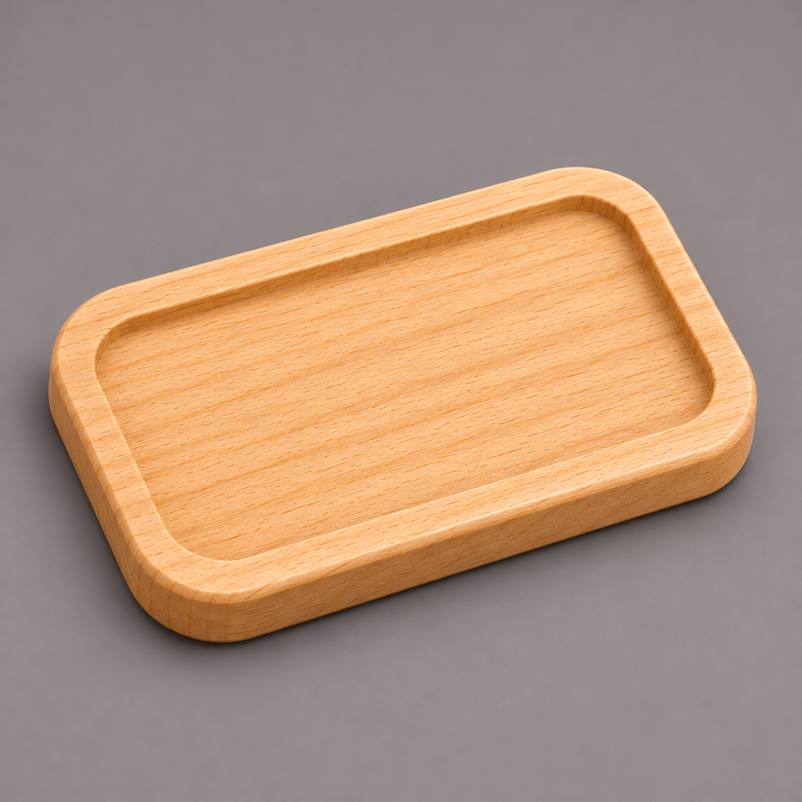

# Домашнее задание — Урок 1: бирка-брелок с полем под надпись

> 🏠 Делаешь **сам дома**. На уроке мы сделали плакетку, ручку и костер. Дома — **бирка-брелок**: прямоугольная пластинка со скруглёнными углами и утопленным полем (карманом). В это поле на **следующем уроке** мы впишем текст (имя/номер) — так что заодно готовим заготовку под урок 2. Главная новая вещь здесь — **скругление углов фаской** (Bevel по вертикальным рёбрам).

---

## Что сделать (конкретная тема)

**Бирка-брелок** 60×35×6 мм: скруглённые углы, утопленное поле-карман под будущую надпись, скруглённый верхний край.

- Габарит **60 × 35 × 6 мм**
- Углы скруглены (радиус ~6–8 мм)
- Поле-карман глубиной **1,5 мм** (туда позже ляжет текст)
- Верхняя кромка чуть скруглена

*Бирка со скруглёнными углами и утопленным полем. Отверстие под кольцо/шнур вырежем на станке отдельно — в модели его не делаем (сквозные вырезы это урок 7, Boolean).*

---

## Пошаговый план

1. **Единицы** — миллиметры (Scene Properties → Units). Это делается один раз; если файл тот же — уже стоит.
2. **Заготовка:** `Shift + A → Mesh → Cube` → `N` → **Dimensions** X = **60**, Y = **35**, Z = **6** → `Ctrl + A → Scale`.
3. **Скругляем углы.** `Tab` → `2` (рёбра) → `Numpad 7` (вид сверху). Выдели **4 вертикальных ребра** по углам: `Alt + ЛКМ` по одному вертикальному ребру, затем `Shift + Alt + ЛКМ` по остальным трём (добавить к выделению).
   - `Ctrl + B` (Bevel) → потяни чуть и впиши `7` → колесом мыши добавь **3–4 сегмента** → `ЛКМ`. Углы стали круглыми.
4. **Поле-карман под надпись.** `3` (грани) → `ЛКМ` по верхней грани → `I` → `4` → `Enter` (рамка-бортик 4 мм) → `E` → `-1.5` → `Enter` (утопили поле на 1,5 мм).
5. **Скругляем верхнюю кромку.** `2` (рёбра) → `Alt + ЛКМ` по верхнему внешнему краю → `Ctrl + B` → `0.5`, 2 сегмента → `ЛКМ`.
6. `Tab` → Object Mode → `ПКМ → Shade Auto Smooth`.
7. *(По желанию)* материал/цвет: Material → New → Base Color, посмотри через `Z`.
8. **Сохрани:** `Ctrl + S`, имя `бирка-брелок`.

---

## Требования (проверь перед сдачей)

- [ ] Единицы — **миллиметры**
- [ ] Габарит **60 × 35 × 6 мм**, **Scale применён** (`Ctrl + A`)
- [ ] Углы **скруглены** фаской (Bevel с сегментами, а не один скос)
- [ ] Есть **поле-карман** глубиной 1,5 мм (вводил число, не на глаз)
- [ ] 🪵 Всё достижимо сверху, дно под полем крепкое (6 − 1,5 = 4,5 мм)
- [ ] Файл **сохранён**

---

## 💡 Подсказки (частые затыки)

- **«Bevel делает один скос, а не круглый угол»** — не хватает **сегментов**. После `Ctrl + B` покрути **колёсико мыши вверх** (или введи число сегментов) — 3–4 сегмента дадут плавное скругление.
- **«Выделил не те рёбра / скруглилось не там»** — для круглых углов нужны именно **4 вертикальных** ребра. Крути вид (`Numpad 1`/`3`), проверь, что подсвечены боковые рёбра углов, а не верхние/нижние. Добавлять к выделению — `Shift + ЛКМ`.
- **«Карман ушёл вверх, а не вниз»** — Extrude пошёл по нормали вверх. Введи число **со знаком минус**: `E` → `-1.5`. Можно сначала `E` → `Z` → `-1.5`.
- **«Поле не вставляется (`I` не работает)»** — ты не в режиме граней. Нажми `3`, выдели верхнюю грань, потом `I`.
- **«Размер поехал после ввода в Dimensions»** — забыл `Ctrl + A → Scale` в Object Mode. Сделай — Scale станет 1.0.
- **«Отверстие под кольцо — как?»** — в модели его **не делаем**. Сквозные вырезы это Boolean (урок 7), а на станке дырку просто просверлят/вырежут отдельной операцией. Сейчас задача — форма бирки и поле.

> 🪵 **Зачем поле-карман?** Это «подложка» под надпись. На уроке 2 мы впишем в него текст — врезной (ещё глубже) или выпуклый (приподнятый). Сделаешь поле ровным и неглубоким сейчас — текст ляжет красиво потом.

---

## Что сдать

- Файл `.blend` с биркой.
- **Скриншот** бирки сверху и три четверти (видно скруглённые углы и поле).
- Одной строкой: габарит и глубина поля (например: «бирка 60×35×6, поле-карман 1,5 мм, углы R7»).

> 🌱 *Хочешь вперёд?* Прикинь, **что напишешь** на бирке (имя, номер, слово). На следующем уроке возьмём эту бирку и добавим на неё настоящий текст — врезной под фрезу или приподнятый.

> 📚 Про Bevel, фаски и скругления — [справочник «Инструменты меша»](../../../../Blender/справочники/глубокое-погружение/инструменты-меша.md). Точный ввод чисел и привязки — [«Точность»](../../../../Blender/справочники/глубокое-погружение/точность.md).
