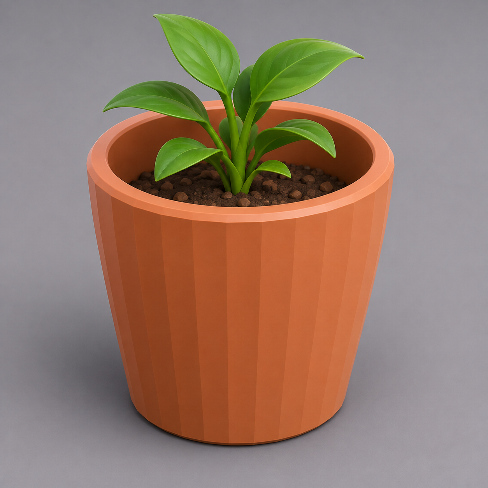

# Домашнее задание — Урок 1: круглое кашпо (горшочек)

> 🏠 Делаешь **сам дома**. На уроке мы выдолбили квадратный стакан и прямоугольный лоток. Дома — снова **другой объект и другая форма**: круглое **кашпо** (горшочек для небольшого растения или как стакан под мелочь). Так ты закрепишь выдалбливание уже на **круглой** фигуре и самостоятельно.

---

## Что сделать (конкретная тема)

**Круглое кашпо** — полый цилиндр с дном, слегка сужающийся книзу (как настоящий горшочек — но можно и прямой).

- **Внешний диаметр:** 90 мм
- **Высота:** 85 мм
- **Толщина стенок и дна:** 3 мм
- **Грани цилиндра:** 32 (гладкая круглая форма)

*Круглое кашпо с толстыми стенками и дном. Можно прямое, можно слегка сужающееся книзу. Твоя задача — сделать его полым и точного размера.*

---

## Пошаговый план

Это ровно техника урока, но на цилиндре. Опирайся на [theory.md](theory.md), если застрял.

1. **Проверь единицы:** Scene Properties → Units → **Millimeters** (в новом файле настрой заново).
2. **Основа:** `Shift + A → Mesh → Cylinder`. **Сразу `F9`** → **Vertices: 32** (чтобы круг был гладким).
3. **Точный размер:** `N` → **Dimensions** → X = **90**, Y = **90**, Z = **85**.
4. **Применить масштаб:** `Ctrl + A → Scale` (обязательно, в Object Mode!).
5. **Edit Mode:** `Tab` → `3` (грани) → `ЛКМ` по **верхней круглой грани**.
6. **Толщина стенки:** `I` → `3` → `Enter`.
7. **Выдолбить:** `E` → `-82` → `Enter` *(высота 85 − дно 3 = 82)*.
8. *(По желанию — сужение книзу, «как горшок»)*: в Edit Mode `Alt + ЛКМ` по **нижней** петле рёбер → `S` → `0.8` → `Enter` (низ станет чуть уже верха).
9. *(По желанию)* скругли верхнюю кромку: `2` → `Alt + ЛКМ` по верхнему краю → `Ctrl + B`, 2 сегмента.
10. `Tab` → Object Mode → `ПКМ → Shade Auto Smooth`. Дай цвет: Material → New → Base Color.
11. **Сохрани:** `Ctrl + S`, имя файла `кашпо-90x85`.

---

## Требования (проверь перед сдачей)

- [ ] Единицы в **миллиметрах**
- [ ] Цилиндр на **32 грани** (поставил через `F9` сразу после добавления)
- [ ] Размер задан **числом** через Dimensions: 90 × 90 × 85 мм
- [ ] **Scale применён** (`Ctrl + A`): в панели `N` Scale = 1.0 / 1.0 / 1.0
- [ ] Кашпо **полое**, с **дном** (загляни внутрь)
- [ ] Толщина стенок **3 мм**, задана числом (`I 3`), не на глаз
- [ ] Файл **сохранён** (`.blend`)

---

## 💡 Подсказки (частые затыки)

- **«Цилиндр гранёный, хочу круглый»** — Vertices задаётся в `F9` **сразу** после добавления. Промахнулся — удали (`X`) и добавь заново, затем `F9` → 32. После других действий панель `F9` уже про них, а не про цилиндр.
- **«Inset (`I`) ничего не делает»** — ты не в режиме граней. Нажми `3` и выдели именно **верхнюю круглую грань**.
- **«Extrude пошёл вверх, а не внутрь»** — после `E` набери число **со знаком минус** (`-82`). Extrude идёт вдоль нормали (у верхней грани она вверх), поэтому вниз = минус.
- **«Выдолбил насквозь — дна нет»** — продавил глубже, чем `высота − дно`. Для высоты 85 и дна 3 → ровно `E -82`.
- **«Сужение сломало форму / дно съехало»** — для шага 8 выделяй именно **нижнюю петлю** (`Alt + ЛКМ` по нижнему ребру) и масштабируй **в плоскости** (`S` без оси, глядя сверху `Numpad 7`), значение 0.8–0.9.
- **«Размеры потом не совпадут»** — почти всегда забыт `Ctrl + A → Scale`. Сделай сразу после Dimensions.
- **«Потерял объект»** — `A` → `Numpad .`.

> 📚 Глубже про точность (привязки, 3D-курсор, Pivot) — [справочник «Точность»](../../../../Blender/справочники/глубокое-погружение/точность.md). Про инструменты Edit Mode — [«Инструменты меша»](../../../../Blender/справочники/глубокое-погружение/инструменты-меша.md).

---

## Что сдать

- Файл `.blend` с кашпо.
- **Скриншот** вида, где видно полость и дно (поверни вид сверху-сбоку; `Numpad .` на объект → снимок окна).
- Одной строкой: размеры и толщина стенок (например: «кашпо Ø90×85 мм, стенки 3 мм, 32 грани»).

> 🎯 **Главная проверка:** мог бы этот горшочек реально напечататься? Есть объём, плоское дно, толщина стенок 3 мм — значит да. Цель курса — не картинка, а **печатаемая деталь**.

> 🌱 *Хочешь по-настоящему?* У реального кашпо снизу делают **дренажное отверстие**. Отверстия мы будем вырезать на уроке 5 (Boolean) — тогда и вернёмся к горшку, если захочешь довести его до «рабочего».
