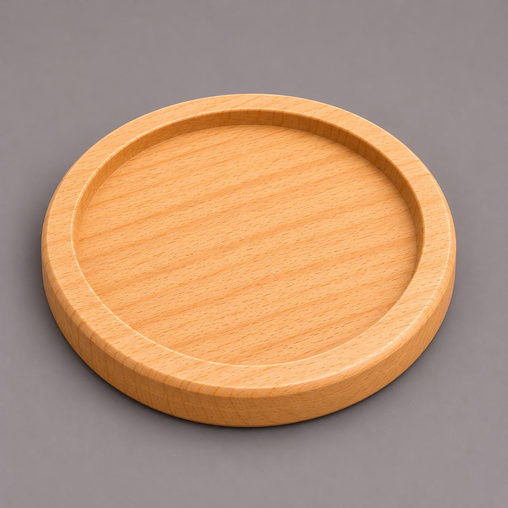

# Практика на уроке — Урок 1: костер (подставка под кружку)

> 🧑‍🏫 Делаем **вместе на уроке**, сразу после плакетки и ручки. Объект **другой** — круглый **костер** (подставка под кружку): низкий диск с утопленным полем под дно кружки и бортиком. Закрепляем Cylinder + `F9` Vertices + карман + Bevel. Подсказок меньше — приёмы уже знакомы.

## Задача

Сделать **круглый костер** Ø90 мм: диск с неглубоким карманом в центре (туда встанет кружка) и аккуратным скруглённым бортиком.

- Внешний диаметр **90 мм**, толщина **8 мм**
- Карман-поле глубиной **3 мм** (бортик удержит каплю/кружку)
- Край скруглён (Bevel)

*Круглая подставка под кружку: утопленное поле + бортик. Та же техника, что у плакетки, но на круге.*

## Шаги

1. `Shift + A → Mesh → Cylinder`. **Сразу `F9`** → **Vertices: 48** (крупный круг — берём побольше сегментов для гладкости).
2. `N` → **Dimensions**: X = **90**, Y = **90**, Z = **8** → `Ctrl + A → Scale`.
3. `Tab` → `3` (грани) → `Numpad 7` (сверху) → `ЛКМ` по верхней грани.
4. `I` → `6` → `Enter` (бортик 6 мм) → `E` → `-3` → `Enter` (карман-поле 3 мм).
5. Фаска: `2` → `Alt + ЛКМ` по верхнему внешнему краю → `Ctrl + B` → `1`, 2 сегмента → `ЛКМ`.
6. `Tab` → Object Mode → `ПКМ → Shade Auto Smooth`. По желанию — цвет (Material → New → Base Color), глянь через `Z`.

   ✅ *Должно получиться:* круглый костер Ø90 с ровным карманом и скруглённым краем. Всё открыто сверху — фрезеруется.

## Проверь себя

- [ ] Vertices задал **сразу через `F9`** (круг гладкий, не гранёный)
- [ ] Scale применён (`Ctrl + A`), Dimensions = Ø90×8 мм
- [ ] Карман ровно **3 мм** (вводил число `-3`, не тянул мышью)
- [ ] Снята фаска (`Ctrl + B`) — край не острый
- [ ] 🪵 Всё достижимо сверху, дно под карманом крепкое (8 − 3 = 5 мм)

## Если успел — усложни

- Сделай по дну кармана мелкую **канавку-кольцо** (ещё раз `I` поменьше → `E -1`) — вода от кружки будет собираться в неё.
- Поменяй в `F9` у нового цилиндра Vertices на **8** и сравни: костер станет гранёным «под гайку». Видно, как число сегментов меняет форму — это важно для станка.

> 📏 Диаметр кармана прикинь под реальную кружку: дно кружки обычно 60–75 мм, значит поле Ø78 (90 − 2×6 бортик) подойдёт с запасом.

> 📚 Про фаску и другие инструменты — [«Инструменты меша»](../../../../Blender/справочники/глубокое-погружение/инструменты-меша.md).
