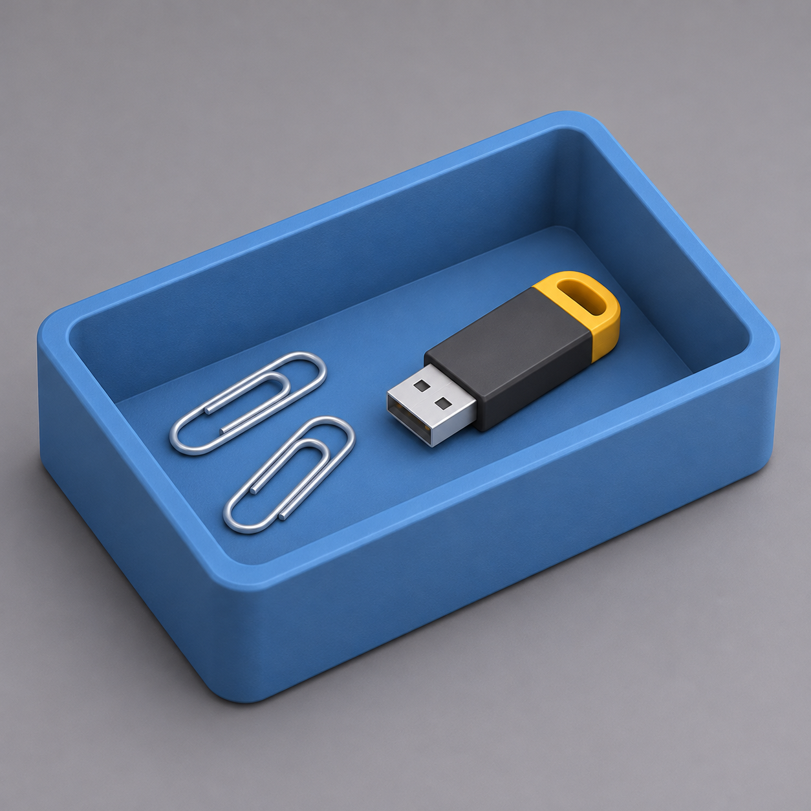

# Практика на уроке — Урок 1: настольный лоток для мелочей

> 🧑‍🏫 Делаем **вместе на уроке**, сразу после стакана с карандашами. Тема **другая** — не ещё один стакан, а широкий плоский **лоток** (для скрепок, флешек, ключей). Техника та же (Inset + Extrude), но пропорции и ощущение другие — так закрепляется навык, а не копируется урок. Подсказок меньше: ты уже умеешь.

## Задача

Сделать **прямоугольный лоток** с бортиками и дном. Внешний размер **120 × 80 × 35 мм**, стенки и дно **4 мм**.

*Плоский открытый лоток с бортиками. Та же логика выдалбливания, что у стакана, но низкий и широкий.*

## Шаги

1. Новый куб: `Shift + A → Mesh → Cube`. *(Стакан можно отодвинуть `G X 150` или начать в новом файле `Ctrl + N` — единицы проверь, должны быть мм.)*
2. `N` → **Dimensions**: X = **120**, Y = **80**, Z = **35**.
3. ⚠️ `Ctrl + A → Scale` (применяем масштаб — как всегда).
4. `Tab` (Edit Mode) → `3` (грани) → `ЛКМ` по **верхней грани**.
5. `I` → `4` → `Enter` (бортики 4 мм).
6. `E` → `-31` → `Enter` *(высота 35 − дно 4 = 31)*.
7. `Tab` → Object Mode. Внутри — углубление, по краям бортики. 🎉
8. *(По желанию)* скругли верхние рёбра бортика: Edit Mode → `2` → `Alt + ЛКМ` по верхнему краю → `Ctrl + B`, 2 сегмента.
9. *(По желанию)* дай материал: Material → New → Base Color, `Z` → Material Preview.

   ✅ *Должно получиться:* аккуратный лоток 120×80×35 мм с бортиками/дном 4 мм.

## Проверь себя

- [ ] Scale в панели `N` = 1.0 / 1.0 / 1.0 (применил `Ctrl + A`)
- [ ] Dimensions = 120 × 80 × 35 мм
- [ ] Лоток **полый** сверху, с дном (не сплошной брусок)
- [ ] Бортики заданы числом `I 4`, углубление — `E -31` (толщина осознанная, не на глаз)

## Если успел — усложни

- Сделай лоток **с двумя отделениями**: до Inset протяни поперёк **Loop Cut** (`Ctrl + R`, кликнуть поперёк, `ЛКМ`, `ПКМ`), затем Inset каждую из двух верхних граней по отдельности и выдави. *(Loop Cut подробно — на уроке 2, но попробовать можно уже сейчас.)*
- Сравни на глаз толщину стенок стакана (3 мм) и лотка (4 мм) в X-Ray (`Alt + Z`) — почувствуй разницу.

> 📚 Про Loop Cut и другие инструменты Edit Mode — [справочник «Инструменты меша»](../../../../Blender/справочники/глубокое-погружение/инструменты-меша.md). Залипает цилиндр/форма гранёной — число граней правится в `F9` **сразу** после добавления, см. [«Трюки»](../../../../Blender/справочники/трюки.md).
