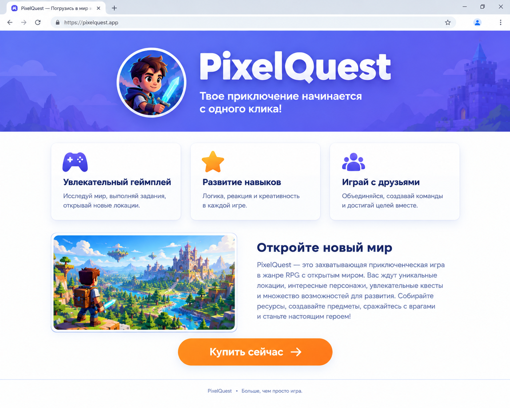

# 🧩 Самостоятельная работа · Модуль 1 «Старт: HTML + первые стили»

**Промо-страница «Реклама, которая цепляет»**

> Это итог всего модуля. Работаешь **самостоятельно** и применяешь всё, чему научился за 6 уроков: теги и каркас, подключение CSS, селекторы, картинки, цвет, типографику, карточки в ряд и `:hover`. Оценивается законченность и аккуратность. Ниже — подробное описание каждого блока, требования и подсказки. В шпаргалки уроков (`итого.md`) и [справочники](../Справочник.md) подглядывать **можно**, копировать чужой код — нельзя.

---

## 🎯 Задание

Сделай **промо-страницу (рекламный лендинг)** — одну страницу, которая рекламирует что-то классное, реальное или выдуманное. Выбери **одну** тему и доведи до конца (не распыляйся):

- любимая **игра**, приложение или гаджет;
- **твоё изобретение** (робот, супер-кроссовки, энергетик, город будущего);
- **твой канал / блог** (YouTube, Twitch);
- **мероприятие** (турнир, фестиваль).

Цель — чтобы человек, попав на страницу, **захотел** этим воспользоваться. Хорошая реклама цепляет с первого экрана: яркий заголовок, картинка, понятные преимущества и кнопка-призыв.

**Пример темы:** «SuperBoots — кроссовки, которые ускоряют», «Космо-кафе на Марсе», «Мой Twitch-канал», «Игра Space Run».

> 💡 Сначала придумай **название и слоган** (одна короткая цепляющая фраза) — от них проще плясать дальше.

---

## 📋 Что должно быть на странице

Страница состоит из **пяти блоков** сверху вниз. Разбери каждый — что в нём и как сделать.

### 1. Шапка-герой (hero) — первый экран

Самая заметная часть: именно она должна «зацепить». Что внутри:
- крупное **название** продукта/канала — заголовок `<h1>` (он на странице **один**);
- **слоган** под названием — короткий абзац `<p>` с классом (например, `class="slogan"`);
- **главная картинка** — логотип, фото товара или постер;
- **яркий цветной фон** всей шапки.

```html
<header class="hero">
  <h1>SuperBoots ⚡</h1>
  <p class="slogan">Беги быстрее ветра</p>
  
</header>
```
> 💡 Фон шапки задай цветом у `.hero` (`background-color`). Название сделай крупным и с тенью: `font-size`, `text-shadow`, можно `letter-spacing`. Если текст лежит **поверх** картинки и плохо читается — подложи полупрозрачный слой: `background-color: rgba(0,0,0,0.4)` и белый текст.

### 2. Блок «Почему это круто» — ровно 3 карточки-преимущества в ряд

Три коротких плюса твоего продукта. **Карточки одинакового стиля**, стоят **в ряд**. Каждая карточка:
- эмодзи или значок (⚡ 🚀 🎮 …);
- короткий заголовок `<h3>`;
- абзац-описание на 1–2 предложения.

```html
<section class="features">
  <div class="card">
    <h3>⚡ Скорость</h3>
    <p>Разгон за 2 секунды.</p>
  </div>
  <div class="card">...</div>
  <div class="card">...</div>
</section>
```
> 💡 Общий стиль карточек задай **одним** классом `.card` (фон, `padding`, `border-radius`, `box-shadow`). Чтобы карточки встали в ряд — `display: inline-block` у `.card` (или `display: flex; gap: 20px;` у `.features`). Так ты переиспользуешь один класс, а не красишь три блока по отдельности.

### 3. Блок «Подробнее» — рассказ с картинкой

Здесь подробнее про продукт: заголовок `<h2>`, вторая картинка и абзац-два текста.

```html
<section class="about">
  <h2>Что внутри</h2>
  
  <p>Умная подошва подстраивается под твой шаг…</p>
</section>
```
> 💡 Оформи картинку: скругление `border-radius` и/или рамку `border`. Следи за **контрастом** — тёмный текст на светлом фоне (или наоборот), чтобы легко читалось.

### 4. Кнопка-призыв (call-to-action)

Главная кнопка, ради которой всё затевалось: **«Купить» / «Подписаться» / «Играть»**. Делается ссылкой-кнопкой и **реагирует на наведение** мыши.

```html
<a href="#" class="btn">Купить сейчас</a>
```
> 💡 `.btn` — яркий фон (акцентный цвет), `padding`, `border-radius`, `text-decoration: none`. Добавь реакцию: `.btn:hover { ... }` — например, фон чуть темнее. Акцентный цвет кнопки должен выделяться на фоне страницы.

### 5. Подвал (footer)

Короткая финальная строка внизу: девиз, год, по желанию — «контакты».

```html
<footer>
  <p>SuperBoots © 2026 — беги к мечте ⚡</p>
</footer>
```

> ⚙️ **Всё оформление — во внешнем файле `style.css`**, подключённом через `<link>`. В HTML стилей быть не должно.

---

## ✅ Требования (проверь по списку)

**HTML:**
- ✅ правильный каркас (развернул через `!`), `lang="ru"`, `<meta charset="UTF-8">`, свой осмысленный `<title>`;
- ✅ **один** `<h1>`, разделы через `<h2>`/`<h3>` (иерархия соблюдена, а не «всё заголовками»);
- ✅ минимум **2 картинки** с понятным `alt`;
- ✅ все 5 блоков на месте: шапка, 3 карточки, «подробнее», кнопка, подвал;
- ✅ кнопка-призыв сделана ссылкой `<a>`.

**CSS (только во внешнем `style.css`, подключён через `<link>`):**
- ✅ цветной фон шапки **и** фон страницы;
- ✅ **гармоничная палитра** — 2–3 цвета, которые дружат (удобно взять оттенки одного тона в HSL, меняя светлоту `L`);
- ✅ хотя бы одна картинка оформлена — `border` и/или `border-radius` (можно круглый логотип `50%`);
- ✅ 3 карточки оформлены **одним классом** `.card` (фон, `padding`, скругление, тень) и стоят **в ряд**;
- ✅ **типографика**: крупный `<h1>` + `text-shadow`, настроены интервалы (`letter-spacing` и/или `line-height`);
- ✅ хотя бы один цвет **с прозрачностью** (`rgba`/`hsla`) — например, подложка или мягкая тень;
- ✅ кнопка реагирует на наведение (`:hover`);
- ✅ текст везде **читается** (хороший контраст с фоном).

**Аккуратность:**
- ✅ страница открывается без «кракозябр» и «сломанных» картинок;
- ✅ код опрятный, с отступами; стили только во внешнем файле.

---

## 💡 Подсказки (как что сделать)

| Что нужно | Приём / свойство |
|-----------|------------------|
| быстро собрать каркас блоков | Emmet: `header>h1+p.slogan+img`, затем `section.features>.card*3` |
| подключить CSS | `<link rel="stylesheet" href="style.css">` в `<head>` (Emmet: `link:css`) |
| фон шапки и страницы | `background-color` у `.hero` и у `body` (один тон HSL, разная светлота `L`) |
| круглый логотип/аватар | `border-radius: 50%` (картинка должна быть квадратной) |
| карточки в ряд | `display: inline-block` у `.card` **или** `display: flex; gap: 20px;` у контейнера |
| карточка-преимущество | `.card { background-color: …; padding: 20px; border-radius: 16px; box-shadow: 0 8px 20px rgba(0,0,0,0.15); }` |
| крупный заголовок с эффектом | `font-size` + `text-shadow` + `letter-spacing` + `text-transform: uppercase` |
| полупрозрачный слой/тень | `rgba(0,0,0,0.4)` (подложка под текст) или в `box-shadow`/`text-shadow` |
| кнопка-призыв | `.btn { display:inline-block; padding:12px 24px; border-radius:10px; text-decoration:none; }` + `.btn:hover { … }` |
| подобрать палитру | пипетка в VS Code · цветовой круг [get-color.ru](https://get-color.ru/color-wheel/) · [coolors.co](https://coolors.co) |
| где посмотреть свойство | [Справочник тегов и свойств](../Справочник-теги-и-свойства.md) |

**Порядок работы (по шагам):**
1. Сначала весь **HTML-каркас** из 5 блоков с «рыбным» текстом — ничего не крась.
2. Вставь **настоящий текст и картинки** (с `alt`).
3. Подключи `style.css` и задай **палитру** (фон страницы и шапки).
4. Оформи **карточки** (один класс `.card`) и поставь их в ряд.
5. Доведи **типографику** (заголовок, тени, интервалы) и кнопку с `:hover`.

> ⚠️ **Частые ошибки:** стили оставили в HTML (нужно в `style.css`); у картинки нет `alt`; карточки покрашены тремя разными классами вместо одного `.card`; текст не читается на фоне; у класса забыли точку в CSS (`card` вместо `.card`).

---

## 🖼 Как это может выглядеть (ориентир)



> 🖼 *Ориентир по структуре, а не точная копия. Тема, картинки и цвета — твои. Если картинки-ориентира пока нет — её подготовит учитель.*

---

## 🌟 Дополнительно

- Сделай **вторую страницу** (например, «Отзывы» или «Как заказать») и подключи к ней **тот же** `style.css` — единый стиль сайта.
- Добавь к «топовой» карточке **бейдж-плашку** «Хит» в углу.
- Сделай тёмную «премиум»-тему с неоновыми акцентами (`text-shadow` как свечение).

---

## 📊 Как оценивается

| Что смотрим | Баллы |
|-------------|-------|
| Полная структура (шапка, 3 карточки, подробнее, кнопка, подвал) | 5 |
| Картинки с `alt` и оформлением (рамка/скругление) | 3 |
| Гармоничная палитра + цвет с прозрачностью (`rgba`/`color-mix`) | 3 |
| Типографика (крупный заголовок, тень, интервалы) | 3 |
| Карточки одним классом в ряд + `:hover` + внешний `style.css` | 3 |
| Креатив и «цепляющесть» рекламы | 3 |
| **Максимум** | **20** |

---

## 📝 Проверь теорию (викторина с оценкой)

Прежде чем сдавать работу, проверь, что помнишь **теорию всего модуля**. Открой **[викторину](викторина-самостоятельная.html)** — 35 вопросов по всем темам модуля 1 (теги, подключение CSS, селекторы, картинки, цвет, `display`, типографика, `:hover`; Emmet не спрашиваем). В конце викторина сама **выставит оценку** — от 2 до 5.

> 💡 Открывай в браузере (двойной клик по файлу или Live Server). Отвечай честно: если вышла не 5 — загляни в `итого.md` слабой темы и пройди ещё раз. Подсказка: не гонись за самым длинным вариантом ответа — он часто бывает неверным 😉

---

> 🏆 Справился? Ты собрал **настоящий рекламный лендинг** — и полностью прошёл первый модуль! Дальше — Модуль 2: ссылки, красивые шрифты (Google Fonts), списки и таблицы.

<br>

> 📌 Забыл что-то — загляни в [справочники курса](../Справочник.md).
