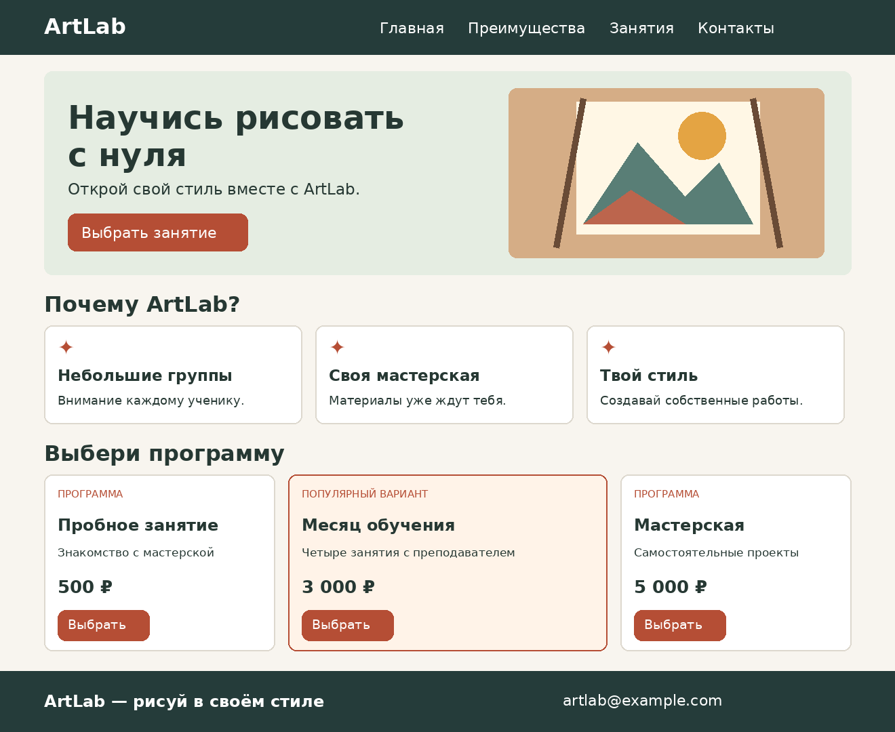

# Самостоятельная работа · Модуль 2 «Flexbox, семантика и шрифты»

**Сайт твоего проекта — лендинг на Flexbox**

> Это итог всего модуля. Работаешь **самостоятельно** и применяешь всё за 4 урока: семантический каркас, `display:flex`, выравнивание, перенос, гибкость (`flex: 1`), Google Fonts и `@font-face`. Оцениваются законченность и аккуратность. В шпаргалки уроков (`итого.md`) и [справочники](../Справочник.md) подглядывать **можно**, копировать чужой код — нельзя.

---

## Задание

Сделай **одностраничный лендинг** (рекламную страницу-визитку) на Flexbox. Чтобы не распыляться, тему бери **из списка** (выбери одну) и придумай своё название:

- **приложение или игра** («скачай и играй»);
- **онлайн-курс / школа** («запишись»);
- **кафе / доставка еды** («закажи»);
- **музыкальная группа / фестиваль** («слушай / приходи»);
- **спортклуб / секция** («тренируйся»).

**Пример:** «SpaceRun — игра про космос», «ПиццаМания — доставка за 30 минут», «Фестиваль „Волна“».

> Сначала придумай **название и слоган** (одну цепляющую фразу) и подбери **пару шрифтов** на [fonts.google.com](https://fonts.google.com) — выразительный для заголовков, спокойный для текста.

---

## Что должно быть на странице

Страница состоит из пяти блоков. Сначала собери их в HTML, затем займись оформлением. Все основные раскладки выполняй на Flexbox.

### 1. Шапка сайта — название и навигация

Посетитель должен сразу понять, куда он попал. Слева размести название проекта или логотип, справа — меню из 3–4 пунктов. Например, для школы рисования: «Главная», «Преимущества», «Занятия», «Контакты».

```html
<header class="top">
  <div class="logo">ArtLab</div>
  <nav class="menu">
    <a href="#home">Главная</a>
    <a href="#features">Преимущества</a>
    <a href="#plans">Занятия</a>
    <a href="#contacts">Контакты</a>
  </nav>
</header>
```

Подсказка: `.top` и `.menu` — два разных flex-контейнера. У первого используй `justify-content: space-between` и `align-items: center`, у второго — `gap`. Не расставляй ссылки вручную с помощью больших отступов. Добавь `:hover` для пунктов меню. Чтобы якорь работал, у соответствующего раздела должен быть `id`, совпадающий с частью ссылки после `#`.

### 2. Главный экран (hero) — знакомство с проектом

Слева размести текст, справа — изображение. В текстовой части нужны один главный заголовок `<h1>`, слоган или короткое описание и кнопка-призыв. Для ArtLab это может быть «Научись рисовать с нуля» и кнопка «Выбрать занятие».

```html
<section class="hero" id="home">
  <div class="hero-text">
    <h1>Научись рисовать с нуля</h1>
    <p>Открой свой стиль вместе с ArtLab.</p>
    <a class="btn" href="#plans">Выбрать занятие</a>
  </div>
  
</section>
```

Подсказка: сделай `.hero` flex-контейнером, задай `align-items: center` и `gap`. Текстовой части можно дать `flex: 1`. Изображению задай разумную ширину и `max-width: 100%`, чтобы оно не выходило за пределы страницы. Если картинка сжимается сильнее, чем нужно, проверь `flex-shrink`. На узком окне разреши перенос через `flex-wrap: wrap`.

### 3. Преимущества — три или четыре одинаковые карточки

Расскажи, почему стоит выбрать именно твой проект. Для школы это могут быть опытные преподаватели, небольшие группы и собственная мастерская. У каждой карточки должны быть значок или небольшая картинка, заголовок и описание из одного-двух предложений.

```html
<section id="features">
  <h2>Почему ArtLab?</h2>
  <div class="features">
    <article class="card">
      <h3>Небольшие группы</h3>
      <p>Преподаватель успевает помочь каждому.</p>
    </article>
    <!-- Добавь ещё две карточки самостоятельно. -->
  </div>
</section>
```

Подсказка: заголовок раздела оставь вне контейнера `.features`, иначе он тоже станет элементом ряда. Контейнеру нужны `display: flex`, `gap` и `flex-wrap: wrap`. Карточкам задай общий класс и `flex: 1 1 220px`. Проверь, что при одинаковом содержимом и оформлении карточки делят свободное место поровну. Последняя карточка на неполном ряду может растянуться — это нормальное поведение Flexbox.

### 4. Предложения — три варианта на выбор

Придумай три тарифа, товара, программы или набора услуг. Например, «Пробное занятие», «Месяц обучения», «Мастерская». У каждого предложения должны быть название, цена или другая важная характеристика, описание и кнопка. Среднее предложение выдели рамкой и сделай немного шире остальных на широком экране.

```html
<section id="plans">
  <h2>Выбери программу</h2>
  <div class="plans">
    <article class="plan">
      <h3>Пробное занятие</h3>
      <p>Одно занятие для знакомства.</p>
      <p>500 ₽</p>
      <a class="btn" href="#contacts">Выбрать</a>
    </article>
    <!-- Создай ещё два предложения. Среднему добавь класс pro. -->
  </div>
</section>
```

Подсказка: у `.plans` включи Flexbox и перенос. Обычным карточкам задай `flex: 1 1 200px`, выделенной — `flex: 1.4 1 200px`. Так выделенная карточка получит большую долю свободного места, если все три помещаются в ряд. Внутри карточки можно использовать `display: flex; flex-direction: column;`, а кнопке задать `margin-top: auto`, чтобы кнопки находились внизу карточек даже при разной длине текста.

### 5. Подвал — информация о проекте

Внизу страницы размести название проекта, короткий девиз и контактную информацию. Раздели их на две или три группы, расположенные в ряд. Для учебного проекта можно придумать условные контакты.

```html
<footer class="footer" id="contacts">
  <div><h2>ArtLab</h2><p>Рисуй в своём стиле.</p></div>
  <div><h3>Контакты</h3><p>artlab@example.com</p></div>
</footer>
```

Подсказка: используй `display: flex`, `justify-content: space-between`, `gap` и перенос. Чтобы подвал оставался у нижнего края окна при коротком содержимом, сделай `body` flex-контейнером с `flex-direction: column` и `min-height: 100vh`, а `main` задай `flex: 1`. Не используй фиксированное позиционирование для этой задачи.

Весь основной контент (главный экран, преимущества и предложения) размести внутри `<main>`. Шапка и подвал находятся за его пределами. Всё оформление — во внешнем `style.css`.

---

## Требования (проверь по списку)

**HTML:**
- правильный каркас (`!`, `lang="ru"`, `<meta charset>`, свой `<title>`);
- **семантические теги**: `header`, `nav`, `main`, `section`, `footer` (и `article` для карточек);
- один `<h1>`, разделы через `<h2>`/`<h3>` (иерархия соблюдена);
- меню — якорные ссылки (`href="#features"` и т.п.);
- минимум 1 картинка с понятным `alt`.

**CSS (только во внешнем `style.css`):**
- шапка-навбар на flex (логотип ← → меню, по центру высоты);
- карточки преимуществ — **равной ширины** через `flex: 1` (или сетка с переносом);
- тарифы — 3 гибкие колонки, одна шире (`flex: 1.4 1 200px`);
- где много карточек — **`flex-wrap: wrap`** (переносятся на узком экране);
- подключён **шрифт с Google Fonts или через `@font-face`** (лучше пара заголовок+текст); `font-weight`/`font-style` использованы;
- где уместно — `flex-shrink: 0` (логотип/иконка не сжимаются);
- гармоничная палитра (2–3 цвета), текст читается.

**Аккуратность:**
- страница не «разъезжается», открывается без «кракозябр» и битых картинок;
- код опрятный, с отступами.

---

## Подсказки (как что сделать)

| Что нужно | Приём / свойство |
|-----------|------------------|
| каркас блоков быстро | Emmet: `header>.logo+nav>a*3`, `section.features>article.card*3` |
| шапка «логотип ← → меню» | `.top { display:flex; justify-content:space-between; align-items:center; }` |
| карточки в ряд равной ширины | `.card { flex: 1; min-width: 200px; }` в `display:flex; flex-wrap:wrap; gap` |
| выделенный тариф шире | `.plan.pro { flex: 1.4 1 200px; border: 2px solid …; }` |
| подключить шрифт | `<link>` с fonts.google.com → `font-family: "Имя", sans-serif` |
| hero в ряд (текст + картинка) | `.hero { display:flex; align-items:center; gap; }`, картинке `flex-shrink:0` |
| подвал к низу | `body{min-height:100vh;display:flex;flex-direction:column}` + `main{flex:1}` |
| палитра | [get-color.ru](https://get-color.ru/color-wheel/) · [coolors.co](https://coolors.co) |
| логотип/баннер | нарисовать в Illustrator/Photoshop (прошлый год) или сгенерировать — [Полезные сервисы](../ПОЛЕЗНЫЕ-СЕРВИСЫ.md) |
| где посмотреть свойство | [Справочник тегов и свойств](../Справочник-теги-и-свойства.md) |

**Порядок работы (по шагам):**
1. Весь **HTML-каркас** из 5 семантических блоков с «рыбным» текстом.
2. Настоящий **текст и картинки** (с `alt`), меню-якоря.
3. Подключи **шрифт** и задай палитру.
4. Собери **шапку на flex**, затем **карточки** (`flex: 1`) и **тарифы**.
5. Доведи **hero**, проверь **перенос** (сузь окно) и при желании — липкий подвал.

> **Частые ошибки:** стили оставили в HTML; карточки не равной ширины (забыли `flex:1`); на узком экране всё раздавилось (нет `min-width`/`wrap`); меню «съехало» (нет `align-items:center`); шрифт не подключён (нет `<link>`).

---

## Как это может выглядеть (ориентир)



> *Ориентир по структуре, а не точная копия. Тема, картинки, шрифты и цвета — твои. *

---

## Дополнительно

- Подключи локальный шрифт через `@font-face` и сравни его с Google Fonts.
- Добавь небольшой блок с изображением слева и текстом справа (медиа-объект).
- Сделай подвал у нижнего края окна и проверь его на странице с коротким содержимым.
- Проверь `order` на копии ряда карточек: измени визуальный порядок, не меняя HTML. В основной работе оставь логичный порядок чтения.

---

## Как оценивается

| Что смотрим | Баллы |
|-------------|-------|
| Семантический каркас (`header`/`nav`/`main`/`section`/`footer`) | 3 |
| Шапка-навбар на flex (логотип ← → меню) | 3 |
| Карточки преимуществ равной ширины (`flex: 1`) | 4 |
| Тарифы: 3 гибкие колонки, одна выделена | 3 |
| Перенос на узком экране (`flex-wrap` + `min-width`) | 2 |
| Подключённый шрифт + типографика (`font-weight`/`style`) | 3 |
| Гармоничная палитра, читаемость, аккуратность, внешний CSS | 2 |
| **Максимум** | **20** |

Оценка: 18–20 → «5», 14–17 → «4», 10–13 → «3», ниже → доработка.

---

> Справился? Ты собрал **настоящий лендинг на Flexbox** — и прошёл второй модуль! Дальше — Модуль 3: ссылки и навигация, списки и таблицы (всё на flex).

<br>

> Забыл что-то — загляни в [справочники курса](../Справочник.md).

---
