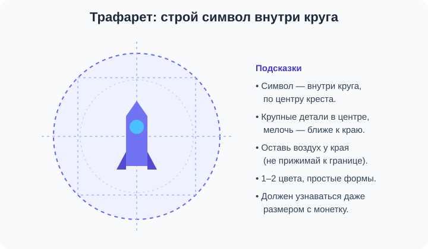

# 🎨 Как нарисовать логотип в Illustrator и вставить его в сайт

> Это **доп-задание** к мини-проекту и итоговой работе урока 1. В прошлом году мы рисовали в Illustrator иконки, логотипы и маскота — сейчас применим это и сделаем **свой логотип** для шапки сайта. Если что-то забылось — не страшно, тут всё расписано с нуля. Нет Illustrator — в конце есть запасные варианты (Figma и генерация).

**Что сделаем:** нарисуем простой логотип из базовых фигур + название, сохраним картинкой и вставим в шапку сайта вместо текстового логотипа.


---

## Шаг 0. Готовим документ

1. Открой **Adobe Illustrator** → **Файл → Создать** (File → New).
2. Профиль — **«Веб»** или просто квадрат **512 × 512 px** (лого удобно делать квадратным).
3. Фон оставь прозрачным (в вебе логотип ляжет на цветную шапку — лишний белый квадрат будет мешать).

> 💡 Логотип должен хорошо смотреться **маленьким** (в шапке он будет ~40–60px). Поэтому — простые формы, 1–2 цвета, без мелких деталей.

---

## Шаг 1. Придумай идею: символ + название

Хороший логотип = **простой символ** + **название**. Символ — это метафора твоей темы:
- игры → ракета, джойстик, пиксель, молния;
- музыка → нота, наушники, волна;
- спорт → мяч, молния, щит;
- кино → хлопушка, катушка плёнки.

> ✍️ Нарисуй идею на бумаге за 2 минуты. Символ строй **внутри круга** — так он будет уравновешенным:



---

## Шаг 2. Рисуем базовые фигуры

В Illustrator слева — **панель инструментов**. Нужные фигуры:

| Инструмент | Клавиша | Что рисует |
|------------|---------|-----------|
| Эллипс (Ellipse) | **L** | круг/овал |
| Прямоугольник (Rectangle) | **M** | прямоугольник (со скруглением — потяни за уголок) |
| Многоугольник (Polygon) | — | треугольник, пятиугольник (кол-во углов меняешь стрелками ↑↓ при рисовании) |
| Звезда (Star) | — | звезда |

**Как рисовать:** выбери инструмент, зажми **Shift** и тяни мышкой — получится **ровная** фигура (круг, квадрат, правильный треугольник).

> 🧰 **Треугольник:** возьми «Многоугольник», начни тянуть и нажми стрелку **↓**, пока не останется 3 стороны.

> ✍️ Нарисуй 3–4 фигуры, из которых соберёшь символ (для ракеты: треугольник-нос, прямоугольник-корпус, 2 маленьких треугольника-крыла, круг-окно).

---

## Шаг 3. Цвет: заливка и обводка

Внизу панели инструментов два квадрата:
- **Заливка (Fill)** — цвет внутри фигуры;
- **Обводка (Stroke)** — цвет контура.

1. Выдели фигуру (инструмент **Выделение**, клавиша **V**).
2. Дважды кликни по квадрату **Fill** → выбери цвет в палитре.
3. Обводку можно убрать: клик по **Stroke** и по значку ⌀ (нет цвета).

> 💡 Возьми **1–2 цвета** и их оттенки. Подобрать гармоничную пару можно на [get-color.ru](https://get-color.ru/color-wheel/). Цвета логотипа потом используй и на сайте — будет единый стиль.

---

## Шаг 4. Соединяем и вырезаем фигуры

Чтобы из отдельных фигур получился **один силуэт**, есть два способа:

**Способ A — Shape Builder (быстрый).**
1. Выдели все фигуры (рамкой или **Ctrl+A**).
2. Возьми инструмент **Создание фигур / Shape Builder** (клавиша **Shift+M**).
3. **Проведи** мышкой по фигурам, которые надо склеить — они станут одной.
4. Чтобы **вырезать** кусок — зажми **Alt** и кликни по лишней части.

**Способ B — Pathfinder (панель «Обработка контуров»).**
Окно → Обработка контуров (Window → Pathfinder). Выдели фигуры и жми:
- **Соединение (Unite)** — склеить в одну;
- **Минус верхний (Minus Front)** — вырезать верхней фигурой дырку (так делают «бублик», окно, полумесяц).

> 🧰 Окно-иллюминатор в ракете: положи маленький круг на корпус и либо оставь его отдельным цветом, либо вырежи через **Минус верхний** — получится дырка.

---

## Шаг 5. Добавляем название

1. Инструмент **Текст (Type)**, клавиша **T**. Кликни и напиши название бренда.
2. Выдели текст (**V**) → вверху выбери **шрифт** и размер. Для лого бери **жирное** начертание (Bold/Black), без засечек — читается лучше.
3. Поставь название **под символом** или **справа** от него.

> 💡 Название + символ — это уже полноценный логотип. Можно оставить и только символ (для круглой «иконки» в шапке).


---

## Шаг 6. Группируем и выравниваем

1. Выдели всё (**Ctrl+A**) → **Объект → Сгруппировать** (Ctrl+G) — теперь лого двигается как одно целое.
2. Выровняй по центру: Окно → **Выравнивание (Align)** → по центру по горизонтали/вертикали.

---

## Шаг 7. Сохраняем картинкой

Логотип для сайта сохраняем так:

- **PNG с прозрачным фоном** (универсально): **Файл → Экспорт → Экспортировать как** → формат **PNG** → в настройках фон **Прозрачный (Transparent)**.
- **SVG** (ещё лучше — векторный, не пикселит): **Файл → Экспорт → Экспортировать как → SVG**.

Назови файл понятно, латиницей: **`logo.png`** (или `logo.svg`). Положи его в папку сайта рядом с остальными картинками — например в `images/`.

> ⚠️ Имя файла и папки — **без пробелов и русских букв** (`logo.png`, а не `мой лого.png`), иначе на сайте картинка может не показаться.

---

## Шаг 8. Вставляем логотип в шапку сайта

В шапке `<header>` замени **текстовый** логотип на картинку:

```html
<header class="top">
    
    <nav class="menu">
        <a href="#">Главная</a>
        <a href="#">Игры</a>
        <a href="#">Контакты</a>
    </nav>
</header>
```

- `alt` — название логотипа словами (для незрячих и если картинка не загрузится).
- `width="48"` — удобный размер для шапки.

А шапка уже стоит на **flex** (из урока), так что логотип-картинка и меню сами встанут «логотип ← → меню»:

```css
.top  { display: flex; justify-content: space-between; align-items: center; }
.logo { border-radius: 8px; }   /* по желанию скруглить */
```

> ✅ Готово! Теперь у твоего сайта **свой фирменный логотип**, нарисованный тобой.

---

## 🆘 Нет Illustrator? Запасные варианты

- **Figma** (бесплатно, в браузере — её мы тоже проходили): те же шаги — рисуй фигуры (R — прямоугольник, O — круг, P — перо), объединяй через **Boolean (Union/Subtract)**, добавь текст, затем **Export → PNG/SVG**.
- **Генерация картинки** в российском сервисе (Шедеврум / Kandinsky) — опиши лого словами («минималистичный логотип-ракета, 2 цвета, плоский стиль, на прозрачном фоне»). Готовый результат скачай и вставь так же. Список сервисов — в [Полезные сервисы](../../ПОЛЕЗНЫЕ-СЕРВИСЫ.md).

---

## ✅ Чек-лист хорошего логотипа

- [ ] простой символ (узнаётся за секунду);
- [ ] 1–2 цвета;
- [ ] читается даже маленьким (с монетку);
- [ ] нет мелких деталей, которые «слипнутся»;
- [ ] сохранён в PNG (прозрачный фон) или SVG;
- [ ] имя файла латиницей без пробелов;
- [ ] вставлен в шапку через `` с `alt`.

> 🏆 Сдаёшь работу с нарисованным лого — это сразу плюс к оценке за итоговую (см. критерии у учителя).
