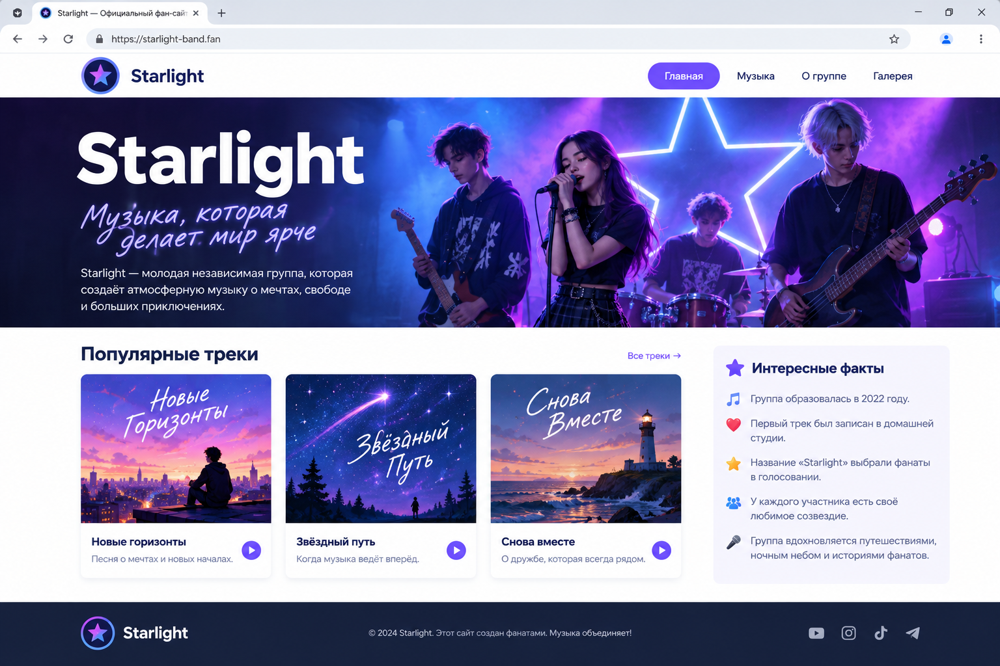
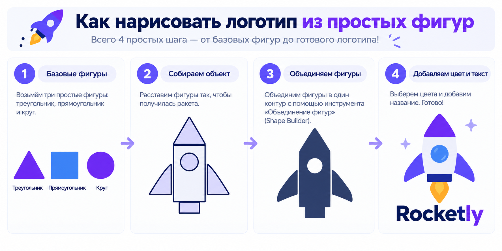
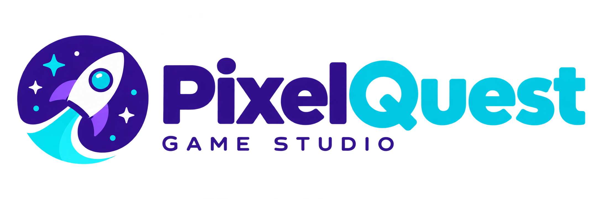

# 🏋️ Практика · Урок 1 — Семантика и первый Flexbox

Делай по порядку. 🟢 лёгкие (разогрев) → 🟡 средние → 🔴 сложные → 🏆 итоговая работа.
Подглядывать в [итого.md](итого.md) и [справочники](../../Справочник.md) можно, копировать чужой код — нет.

> ⚙️ Все стили — во внешнем `style.css`, подключённом через `<link>`. Открывай страницу через Live Server.

---

## 🟢 Уровень 1 — разогрев

**1.1.** Создай страницу и собери каркас из четырёх тегов: `<header>` с `<h1>` (название сайта), `<nav>` с 3 ссылками, `<main>` с `<h2>` и абзацем, `<footer>` с копирайтом. Пока без стилей.

**1.2.** Сделай `<nav>` флекс-контейнером: добавь `nav { display: flex; gap: 20px; }`. Посмотри, как ссылки встали в ряд с промежутками.

**1.3.** Поменяй `gap` на `10px`, потом на `40px`. Запиши, что меняется (расстояние между ссылками).

**1.4.** Внутри `<main>` замени один `<div>` на `<section>`, а новость внутри — на `<article>`. Внешне не изменится — проверь, что страница не сломалась.

**1.5.** Добавь `<aside>` с заголовком «Смотри также» и списком из двух ссылок. Пока он встанет под `main`-контентом (в столбик) — это нормально.

**1.6.** Оберни любую картинку в `<figure>` и добавь к ней `<figcaption>` с подписью.

---

## 🟡 Уровень 2 — собираем шапку

**2.1.** Сделай шапку-навбар: внутри `<header class="top">` положи `<div class="logo">` (название) и `<nav class="menu">` (3 ссылки). Задай `.top { display: flex; justify-content: space-between; align-items: center; }`. Логотип должен уехать влево, меню — вправо.

**2.2.** Внутри той же шапки сделай `.menu { display: flex; gap: 22px; }`, убери подчёркивание у ссылок (`text-decoration: none`) и добавь реакцию на наведение (`.menu a:hover`).

**2.3.** Поэкспериментируй с `justify-content` у `.top`: по очереди поставь `center`, `flex-end`, `space-around`. Запиши словами, чем отличается каждое.

**2.4.** Сделай блок высотой `140px` и помести в него текст **ровно по центру** (и по горизонтали, и по вертикали) через `display:flex; justify-content:center; align-items:center;`.

**2.5.** Добавь шапке фон (`background`), цвет текста и внутренние отступы `padding: 16px 24px`. Шапка должна выглядеть как полоса сверху.

**2.6.** Сделай «ряд из трёх кнопок» (три `<a class="btn">`) в отдельном `<div class="actions">` с `display:flex; gap:12px;`. Кнопки — с фоном, `padding` и скруглением.

---

## 🔴 Уровень 3 — вложенный flex и раскладка

**3.1.** Собери **две вложенные** флекс-раскладки: `header` — флекс (логотип ↔ меню), а `nav` внутри — свой флекс (ссылки в ряд с `gap`). Убедись, что обе работают одновременно.

**3.2.** Сделай «панель профиля»: в ряд стоят круглый аватар (картинка `border-radius:50%`, 64px), имя и кнопка «Подписаться». Всё выровняй по центру высоты (`align-items:center`), между именем и кнопкой — большой промежуток (подсказка: `justify-content: space-between` + ширина контейнера).

**3.3.** Свёрстай «футер в три колонки»: `<footer>` с `display:flex; justify-content: space-between;`, внутри три `<div>` (о сайте, меню, контакты), в каждом — заголовок и пара строк.

**3.4.** Сделай «карточку-герой»: блок высотой 220px с фоновым цветом, по центру (flex-центр) — крупный заголовок и кнопка под ним. (Подсказка: чтобы заголовок и кнопка были друг под другом, этому блоку добавь `flex-direction: column;` — это из «глубже».)

**3.5.** Возьми любой свой проект из модуля 1 и добавь ему **нормальную шапку-навбар** через flex (логотип + меню в ряд).

---

## 🏆 Итоговая работа — «Фан-страница»

Собери **главную страницу фан-сайта** — о том, что ты любишь. Это цельная страница с настоящей шапкой-навбаром, собранной на Flexbox.

**Выбери одну тему** (не распыляйся):
- любимая **музыкальная группа / исполнитель**;
- любимый **фильм / сериал / аниме**;
- любимая **спортивная команда**;
- любимая **видеоигра** (но не повторяй мини-проект урока про GameZone — сделай про конкретную игру).

**Пример темы:** «Фан-сайт группы „Космонавты“», «Всё про сериал „Очень странные дела“», «ФК „Молния“ — официальный фан-сайт».

### 📋 Что должно быть на странице

**1. Шапка-навбар (`<header>`)** — собрана на flex:
- слева **логотип или название** (`<div class="logo">`);
- справа **меню** (`<nav>`) из 3–4 ссылок-якорей в ряд;
- логотип и меню разведены по краям (`justify-content: space-between`) и выровнены по центру высоты (`align-items: center`).

```html
<header class="top">
    <div class="logo">🎸 Космонавты</div>
    <nav class="menu">
        <a href="#about">О группе</a>
        <a href="#songs">Песни</a>
        <a href="#news">Новости</a>
    </nav>
</header>
```

**2. Главная область (`<main>`)** с разделами:
- `<section>` «О ...» — заголовок `<h2>` и абзац-два текста;
- `<section>` с **2–3 карточками** `<article>` (песни / серии / матчи / факты): в каждой `<h3>` и короткое описание;
- хотя бы одна картинка в `<figure>` с `<figcaption>`.

**3. Блок сбоку (`<aside>`)** — «Интересные факты» или «Смотри также» со списком.

**4. Подвал (`<footer>`)** — копирайт и строка «сделано фанатом».

### ✅ Требования (проверь по списку)

- ✅ правильный каркас (`!`, `lang="ru"`, `charset`, свой `<title>`);
- ✅ использованы смысловые теги: `header`, `nav`, `main`, `section`, `article`, `footer` (и `aside`/`figure` — желательно);
- ✅ **один** `<h1>`, разделы через `<h2>`/`<h3>` (иерархия соблюдена);
- ✅ шапка собрана на **flex**: логотип слева, меню справа, по центру высоты;
- ✅ меню — ссылки в ряд через `display:flex; gap`;
- ✅ минимум одна картинка с понятным `alt`;
- ✅ все стили — во внешнем `style.css`;
- ✅ текст читается, страница не «разъезжается».

### 💡 Подсказки

| Что нужно | Приём |
|-----------|-------|
| шапка «логотип ← → меню» | `.top { display:flex; justify-content:space-between; align-items:center; }` |
| меню в ряд | `.menu { display:flex; gap:22px; }` |
| убрать подчёркивание ссылок | `a { text-decoration: none; }` |
| реакция на наведение | `.menu a:hover { ... }` |
| карточки с рамкой | `article { border:1px solid #e2e8f0; border-radius:12px; padding:16px; }` |
| подобрать цвета | цветовой круг [get-color.ru](https://get-color.ru/color-wheel/) |
| логотип-картинкой | нарисовать в Illustrator (прошлый год) или сгенерировать — см. [Полезные сервисы](../../ПОЛЕЗНЫЕ-СЕРВИСЫ.md) |
| где посмотреть тег/свойство | [Справочник тегов и свойств](../../Справочник-теги-и-свойства.md) |

### 🖼 Как это может выглядеть (ориентир)



> 🖼 *Ориентир по структуре, а не точная копия. Тема, тексты и цвета — твои. Картинку-ориентир подготовит учитель.*

### 🌟 Мини-челлендж (по желанию)

- Сделай вторую строку меню с кнопкой «Подписаться» (яркая, с `:hover`).
- Сделай «карточку-герой» под шапкой: большой блок с названием по центру (flex-центр).
- Поставь карточки `<article>` в ряд (попробуй `display:flex; gap` у `section` — полноценно разберём в уроке 2).

### 🎨 Доп-задание: нарисуй свой логотип (Illustrator)

В прошлом году мы рисовали в **Illustrator** иконки и логотипы — примени это и сделай **настоящий логотип** для шапки своего сайта, а потом вставь его картинкой вместо текста.



Всего 4 шага: взять простые фигуры → собрать символ → объединить в один силуэт → покрасить и подписать. Вот как может выглядеть готовый результат:



1. Нарисуй простой логотип (символ + название) — вся инструкция с нуля, с трафаретом и шагами: **[как-нарисовать-лого.md](как-нарисовать-лого.md)**.
2. Сохрани его как `logo.png` (прозрачный фон) или `logo.svg` в папку `images/`.
3. Вставь в шапку: `` вместо текстового логотипа — flex-шапка сама поставит «логотип ← → меню».

> Нет Illustrator — можно во **Figma** (мы её тоже проходили) или сгенерировать картинку в RU-сервисе. Это **плюс к оценке** за итоговую работу.

---

➡️ После практики — [викторина.html](викторина.html). 🆘 Трудно? — [самоучитель.md](самоучитель.md). 📌 Шпаргалка — [итого.md](итого.md).
