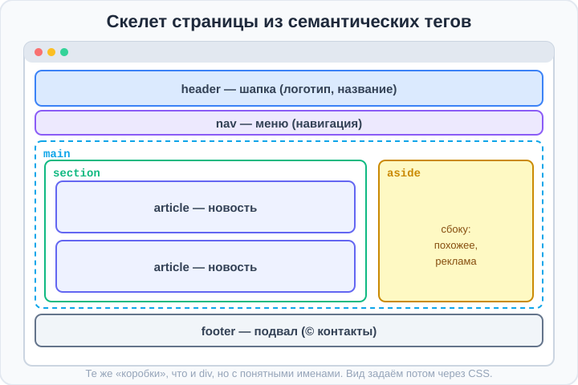
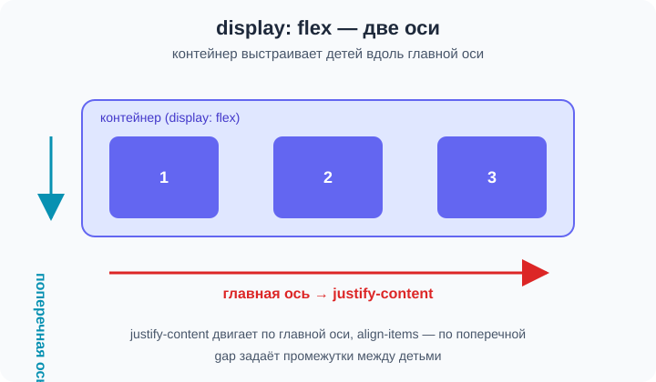
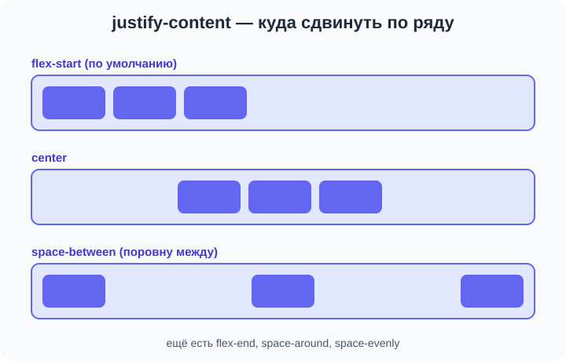

# Урок 1 — Семантика и первый Flexbox: каркас сайта с навбаром 🧱➡️

**Модуль 2 · Flexbox, семантика и шрифты · Урок 1 из 4 | 2 ак.ч. (1,5 часа)**

> ⬅️ [Все уроки модуля](../README.md) · [План курса](../../ПЛАН-КУРСА.md) · Предыдущий: [Модуль 1 «Проект-сборка»](../../модуль-01-старт-html-css/урок-06-проект-сборка/урок.md) · Следующий: [Урок 2 «Перенос, выравнивание и шрифты»](../урок-02-перенос-и-шрифты/урок.md) ➡️

> 🔁 В начале — [разминка/повтор](повторение.md).
> 📌 Быстро вспомнить материал — [итого.md](итого.md). 👨‍🏫 Сценарий — [преподавателю.md](преподавателю.md). 🖼 Проектор — [изображения.md](изображения.md).
> 🆘 **Пропустил урок?** — [самоучитель.md](самоучитель.md). 🧰 Больше трюков — [лайфхак.md](лайфхак.md), но главные разбираем прямо в уроке (значок 🧰).

> 🧭 **Как читать урок.** В первом модуле наши страницы шли **в один столбик** сверху вниз — это быстро надоедает. Сегодня делаем сразу два шага к настоящему сайту. Сначала соберём **правильный смысловой скелет** страницы (`header`, `nav`, `main`, `footer` — коробки с понятными именами вместо «супа из `div`»). А потом впервые включим **Flexbox** — волшебную команду `display: flex`, которая ставит элементы **в ряд**: меню станет горизонтальным, блоки выровняются красиво. С этого момента страницы перестанут быть «простынёй текста».

---

## 🎮 Что мы сделаем сегодня и что получим

**Задача:** собрать **каркас сайта** — шапку с логотипом и горизонтальным меню-навбаром, главную область с разделами и подвал. Меню и шапку выстроим через Flexbox.

**В итоге** у тебя будет заготовка, с которой начинается почти любой сайт: сверху аккуратная шапка с меню в строку, по центру контент, внизу подвал.

**Главные навыки урока:** смысловые теги **`header`/`nav`/`main`/`section`/`article`/`aside`/`footer`** · **`<figure>`/`<figcaption>`** · **`display: flex`** (главная и поперечная оси) · **`justify-content`**, **`align-items`**, **`gap`** · Emmet **`.`** (классы).

> 💡 **Главная мысль урока:** сначала строим **смысловой скелет** (где шапка, меню, главное, подвал), потом командой `display: flex` раскладываем элементы **в ряд и ровно**. Flex — это «поставь детей в строй»: `justify-content` двигает их вдоль ряда, `align-items` — поперёк, `gap` задаёт промежутки.

---

## Часть 1 — Проблема «супа из `div`»

Вспомни `<div>` из модуля 1 — это **блок-коробка** без смысла, просто «прямоугольник-контейнер». Можно построить всю страницу на одних `div`:

```html
<div class="header">...</div>
<div class="menu">...</div>
<div class="content">...</div>
<div class="footer">...</div>
```

Работать будет, но это **«суп из `div`»**: чтобы понять, где что, приходится вчитываться в классы. А браузер, поисковик и программа для незрячих вообще не понимают, что `div.header` — это шапка.

**Решение — семантические теги.** Вместо безымянных `<div>` берём теги с **говорящими именами**:

```html
<header>...</header>
<nav>...</nav>
<main>...</main>
<footer>...</footer>
```

- 👀 Выглядит на странице **так же**, но код теперь **читается как оглавление**: шапка, навигация, главное, подвал.

> 🧭 **Важно:** семантические теги ведут себя как `<div>` (они **блочные** — каждый с новой строки и во всю ширину). Разница — **в смысле**, а не во внешнем виде. Вид зададим сами через CSS.

> ✍️ **Мини-задание 1:** перепиши семантически `<div class="header">Мой сайт</div>`.
> <details><summary>💡 подсказка</summary><code>&lt;header&gt;Мой сайт&lt;/header&gt;</code> — тег сам говорит, что это шапка.</details>

---

## Часть 2 — Четыре главных тега каркаса

Это скелет почти любой страницы:

- **`<header>`** — **шапка** (логотип, название, часто меню). Вверху.
- **`<nav>`** — **навигация** (меню со ссылками).
- **`<main>`** — **главное содержимое** (то, ради чего пришли). На странице `<main>` **один**.
- **`<footer>`** — **подвал** (контакты, копирайт, ссылки внизу).

```html
<body>
    <header>
        <h1>🎮 GameZone</h1>
    </header>

    <nav>
        <a href="#">Главная</a>
        <a href="#">Игры</a>
        <a href="#">Контакты</a>
    </nav>

    <main>
        <h2>Добро пожаловать</h2>
        <p>Лучшие игры в одном месте.</p>
    </main>

    <footer>
        <p>© 2026 GameZone</p>
    </footer>
</body>
```

- 👀 Скелет готов и **читается сам по себе**.



> 🧰 **Лайфхак Emmet — классы через `.`:** пиши `header.top` + `Tab` → `<header class="top"></header>`. Точка в Emmet = класс. А `nav.menu>a*3` сразу сделает меню с тремя ссылками. Классы понадобятся для стилей.

> ✍️ **Мини-задание 2:** собери каркас из `header` (с `h1`), `nav` (3 ссылки), `main` (`h2` + абзац) и `footer` (копирайт).
> <details><summary>💡 подсказка</summary>Emmet: <code>header>h1^nav>a*3^main>h2+p^footer>p</code> — вспомни <code>^</code> (подъём) из модуля 1 не было, но <code>></code> и <code>+</code> знаешь; можно просто набрать теги подряд.</details>

---

## Часть 3 — `section` и `article`: делим главное на части

Внутри `<main>` содержимое делят на **разделы**:

- **`<section>`** — **смысловой раздел** страницы (обычно со своим заголовком): «Новинки», «Отзывы», «О нас».
- **`<article>`** — **самостоятельная единица**, которую можно «вырезать», и она останется целой: карточка игры, новость, пост, комментарий.

```html
<main>
    <section>
        <h2>🔥 Новинки</h2>

        <article>
            <h3>Space Run</h3>
            <p>Космический раннер с рекордами.</p>
        </article>

        <article>
            <h3>Dungeon Cat</h3>
            <p>Пиксельное приключение кота-героя.</p>
        </article>
    </section>
</main>
```

- 👀 Раздел «Новинки» (`section`) содержит две отдельные карточки (`article`). Каждую можно скопировать целиком — она самодостаточна.

> 🧭 **Как отличить:** `<article>` — то, что **имеет смысл само по себе** (карточка, новость). `<section>` — **группа** таких вещей или тематический кусок. Сомневаешься — спроси: «это можно опубликовать отдельно?» Да → `article`.

> ✍️ **Мини-задание 3:** внутри `<main>` сделай `<section>` с заголовком темы и двумя `<article>` (в каждой `h3` + абзац).
> <details><summary>💡 подсказка</summary><code>&lt;section&gt;&lt;h2&gt;Тема&lt;/h2&gt; &lt;article&gt;...&lt;/article&gt; &lt;article&gt;...&lt;/article&gt;&lt;/section&gt;</code>.</details>

---

## Часть 4 — `aside` и `figure`: колонка сбоку и подпись к картинке

**`<aside>`** — **дополнительный блок «сбоку»**: связан с темой, но не главное. «Похожее», реклама, список тегов, «а вы знали?».

```html
<aside>
    <h3>📌 Смотри также</h3>
    <ul>
        <li><a href="#">Топ-10 игр года</a></li>
        <li><a href="#">Гайд для новичка</a></li>
    </ul>
</aside>
```

- 👀 Пока `aside` стоит под контентом (блоки идут в столбик). Совсем скоро, с **Flexbox**, поставим его **сбоку** — получится двухколоночная страница.

А если картинке нужна **подпись** — есть пара тегов:

- **`<figure>`** — «иллюстрация» (обёртка для картинки/схемы);
- **`<figcaption>`** — **подпись** к ней.

```html
<figure>
    
    <figcaption>Space Run — кадр из игры</figcaption>
</figure>
```

- 👀 Картинка и подпись теперь **связаны смыслом** — браузер понимает, что текст относится к изображению.

> ✍️ **Мини-задание 4:** добавь `<aside>` с заголовком «Смотри также» и списком из 2 ссылок; одну картинку оберни в `<figure>` с `<figcaption>`.
> <details><summary>💡 подсказка</summary>Внутри <code>&lt;figure&gt;</code> сначала <code>&lt;img&gt;</code>, потом <code>&lt;figcaption&gt;подпись&lt;/figcaption&gt;</code>.</details>

---

## Часть 5 — Первый Flexbox: ставим меню в ряд ➡️

Скелет есть, но меню `<nav>` сейчас выглядит так: ссылки идут **в строку** только потому, что `<a>` — строчный тег. А шапка и блоки — в столбик. Чтобы **управлять** раскладкой (ставить в ряд, центрировать, раздвигать), включаем **Flexbox**.

**Flexbox** — это режим раскладки. Пишем **одну** строчку родителю-контейнеру:

```css
nav {
    display: flex;
}
```

И все **прямые дети** контейнера (`<a>` внутри `<nav>`) выстраиваются **в ряд**. Всё. Контейнер стал «гибким».

### Две оси — это главное

Как только включили `display: flex`, у контейнера появляются **две оси**:

- **Главная ось** (по умолчанию — слева направо, горизонталь). Вдоль неё стоят дети.
- **Поперечная ось** (сверху вниз, вертикаль) — перпендикулярно главной.



Запомни связку: **вдоль главной оси двигает `justify-content`, поперёк — `align-items`.** Это 90% работы с flex.

### `gap` — промежутки между детьми

Чтобы ссылки не слипались, добавь **`gap`** — это расстояние между детьми контейнера:

```css
nav {
    display: flex;
    gap: 20px;        /* промежуток между ссылками */
}
```

- 👀 Ссылки встали в ряд с ровными промежутками 20px. Раньше для этого городили `margin` у каждой — теперь одна строчка у родителя.

> 🧰 **Почему `gap` лучше `margin`:** `gap` ставит промежутки **только между** элементами, а не по краям, и не нужно думать «последнему margin не ставить». Работает в flex и grid.

> ✍️ **Мини-задание 5:** сделай `<nav>` флекс-контейнером (`display: flex`) и добавь `gap: 24px`. Посмотри, как встали ссылки.
> <details><summary>💡 подсказка</summary><code>nav { display: flex; gap: 24px; }</code> — стили у <b>родителя</b> <code>nav</code>, не у ссылок.</details>

---

## Часть 6 — `justify-content`: двигаем вдоль ряда

**`justify-content`** управляет детьми **вдоль главной оси** (по горизонтали). Частые значения:

| Значение | Что делает |
|----------|-----------|
| `flex-start` | прижать к началу (слева) — по умолчанию |
| `center` | собрать по центру |
| `flex-end` | прижать к концу (справа) |
| `space-between` | раздвинуть по краям, промежутки поровну **между** |
| `space-around` | промежутки вокруг каждого |
| `space-evenly` | все промежутки (и по краям) равны |



Классический приём для шапки сайта — **логотип слева, меню справа**:

```html
<header class="top">
    <div class="logo">🎮 GameZone</div>
    <nav>
        <a href="#">Главная</a>
        <a href="#">Игры</a>
        <a href="#">Контакты</a>
    </nav>
</header>
```
```css
.top {
    display: flex;
    justify-content: space-between;   /* логотип ← → меню */
    align-items: center;              /* на одной линии по высоте */
}
nav { display: flex; gap: 20px; }
```

- 👀 Логотип уехал влево, меню — вправо, всё на одной высоте. Это и есть типичная шапка почти любого сайта.

> 🧭 Обрати внимание: **flex можно вкладывать**. `header` — флекс-контейнер (раздвигает логотип и меню), а `nav` внутри — свой маленький флекс-контейнер (ставит ссылки в ряд с `gap`).

> ✍️ **Мини-задание 6:** собери такую шапку: логотип слева, меню справа (`justify-content: space-between`), всё по центру высоты (`align-items: center`).
> <details><summary>💡 подсказка</summary>Контейнер — <code>header</code> с <code>display:flex; justify-content:space-between; align-items:center;</code>. Внутри — <code>.logo</code> и <code>nav</code>.</details>

---

## Часть 7 — `align-items`: выравниваем поперёк

**`align-items`** двигает детей **поперёк** главной оси (по вертикали, если ряд горизонтальный). Частые значения:

- `stretch` — растянуть на всю высоту контейнера (по умолчанию);
- `center` — выровнять по центру высоты (очень частый приём);
- `flex-start` — прижать к верху;
- `flex-end` — прижать к низу.

```css
.bar {
    display: flex;
    align-items: center;   /* всё по центру высоты, даже если высота разная */
    gap: 16px;
    height: 80px;
}
```

- 👀 Даже если у детей разная высота (логотип выше, текст ниже) — `align-items: center` ставит их по одной линии. Без него они бы растянулись или прилипли к верху.

> 💡 **Супер-приём «идеальный центр»:** чтобы поставить что-то **ровно в центр** блока (и по горизонтали, и по вертикали), дай контейнеру три строчки:
> ```css
> .center-box {
>     display: flex;
>     justify-content: center;   /* по центру по горизонтали */
>     align-items: center;       /* по центру по вертикали */
> }
> ```
> Раньше центрировать по вертикали было болью — с flex это три строки.

> ✍️ **Мини-задание 7:** сделай блок высотой 120px и помести в него текст **ровно по центру** (и по горизонтали, и по вертикали).
> <details><summary>💡 подсказка</summary><code>display:flex; justify-content:center; align-items:center; height:120px;</code>.</details>

---

## Часть 8 — `<div>`/`<span>` и `display` (быстрый повтор)

Семантические теги закрывают «главные» блоки. Для **мелких кусочков** по-прежнему нужны:

- **`<div>`** — блочная коробка «ни о чём» (обёртка, когда смыслового тега нет; например `.logo`);
- **`<span>`** — строчная обёртка для **части текста** (выделить слово, покрасить кусочек).

```html
<p>Цена: <span class="price">1990 ₽</span> — <span class="sale">скидка!</span></p>
```
```css
.price { font-weight: 700; }
.sale  { color: crimson; }
```

Напомним `display` из модуля 1: `block` (в столбик, во всю ширину), `inline` (в строку, как слово), `inline-block` (в ряд, но можно задать размеры). А теперь к ним добавился **`flex`** — целый режим раскладки для детей контейнера.

> 🧭 **Правило выбора тега:** есть подходящий смысловой тег (`header`, `nav`, `article`…) — бери его. Нет — `<div>` (блок) или `<span>` (кусочек текста).

---

## Часть 9 — Мини-проект: «Каркас игрового сайта с навбаром» 🎮

Соберём каркас и впервые сделаем **нормальную шапку с меню через flex**.

**`index.html`:**
```html
<body>
    <header class="top">
        <div class="logo">🎮 GameZone</div>
        <nav class="menu">
            <a href="#">Главная</a>
            <a href="#">Игры</a>
            <a href="#">Контакты</a>
        </nav>
    </header>

    <main>
        <section>
            <h2>🔥 Новинки</h2>
            <article>
                <h3>Space Run</h3>
                <p>Космический раннер с таблицей рекордов.</p>
            </article>
            <article>
                <h3>Dungeon Cat</h3>
                <p>Пиксельное приключение кота-героя.</p>
            </article>
        </section>

        <aside>
            <h3>📌 Смотри также</h3>
            <ul>
                <li><a href="#">Топ-10 игр года</a></li>
                <li><a href="#">Гайд для новичка</a></li>
            </ul>
        </aside>
    </main>

    <footer>
        <p>© 2026 GameZone · Сделано на уроке</p>
    </footer>
</body>
```

**`style.css`:**
```css
body { font-family: "Segoe UI", sans-serif; margin: 0; color: #1e293b; }

/* Шапка: логотип слева, меню справа, по центру высоты */
.top {
    display: flex;
    justify-content: space-between;
    align-items: center;
    padding: 16px 24px;
    background: #4f46e5;
    color: #fff;
}
.logo { font-size: 22px; font-weight: 800; }

/* Меню: ссылки в ряд с промежутками */
.menu { display: flex; gap: 22px; }
.menu a { color: #fff; text-decoration: none; }
.menu a:hover { text-decoration: underline; }

main    { padding: 24px; }
article { border: 1px solid #e2e8f0; border-radius: 12px; padding: 16px; margin: 12px 0; }
footer  { background: #f1f5f9; text-align: center; padding: 16px; }
```

- 👀 Получилась настоящая шапка: логотип слева, меню справа в строку, фиолетовый фон. В следующих уроках научимся раскладывать и сами карточки в ряд с переносом.

> 🎨 **Твой вариант:** сделай каркас на свою тему (киноблог, спортивный портал, магазин). Обязательно: шапка с логотипом и меню через `flex`, `main` с `section`/`article`, `footer`.

> 🧩 **Для 5–7 классов (проще):** хватит шапки с меню в ряд (`display:flex; gap`), `main` с двумя `article` и `footer`. `aside`/`figure` — по желанию.

> 🎨 **Применяем прошлый год (доп-задание):** логотип для шапки нарисуй сам в **Illustrator** (как делали иконки/лого в прошлом курсе) и вставь вместо текста через ``. Вся инструкция с нуля — с трафаретом и шагами — в **[как-нарисовать-лого.md](как-нарисовать-лого.md)**. Нет Illustrator — можно во Figma или сгенерировать картинку в RU-сервисе (см. [Полезные сервисы](../../ПОЛЕЗНЫЕ-СЕРВИСЫ.md)).

---

## 🎓 Часть 10 — Для тех, кто хочет глубже

- **`flex-direction: column`** — повернуть главную ось **вертикально** (дети в столбик). Тогда `justify-content` будет двигать по вертикали, а `align-items` — по горизонтали. Оси «меняются ролями».
- **`<time>`** — семантическая дата: `<time datetime="2026-08-25">25 августа</time>`. **`<mark>`** — выделение маркером. **`<address>`** — контакты (в `footer`).
- **Несколько `header`/`footer`:** у `article` может быть свой маленький `header` (заголовок + автор). Главное — `<main>` на странице один.
- **Зачем семантика:** поисковики лучше понимают страницу, незрячие с экранным диктором «прыгают» по разделам, код читается легче.

---

## 🏁 Итог урока

Сегодня ты сделал два больших шага:

- ✅ **Семантический скелет:** `header` (шапка), `nav` (меню), `main` (главное, один на странице), `footer` (подвал); `section` (раздел), `article` (самостоятельная единица), `aside` (сбоку), `<figure>`/`<figcaption>` (картинка с подписью).
- ✅ **Первый Flexbox:** `display: flex` ставит детей **в ряд**; **две оси** — главная (`justify-content`) и поперечная (`align-items`); **`gap`** — промежутки.
- ✅ **Приёмы:** шапка «логотип ← → меню» через `justify-content: space-between`, «идеальный центр» через `justify-content:center; align-items:center`, вложенный flex.

> 🏆 Главное: **сначала смысловой скелет, потом `display: flex` для раскладки.** Flex — «поставь детей в строй»: вдоль ряда двигает `justify-content`, поперёк — `align-items`, промежутки — `gap`. Быстро повторить — в [итого.md](итого.md).

> 🎤 **Блиц:** назови 4 тега каркаса. Чем `section` отличается от `article`? Что делает `display: flex`? Какая ось у `justify-content`, какая у `align-items`? Как сделать «идеальный центр»?

### 🎮 Викторина-закрепление
Открой **[викторина.html](викторина.html)** — вопросы по семантике и flex **+ повторение модуля 1** + смешные и «на подумать».

➡️ **Практика урока** — **[практика.md](практика.md)**: задачи в 3 уровнях + итоговая работа.
🆘 **Пропустил / хочешь ещё?** — [самоучитель.md](самоучитель.md). 📌 **Шпаргалка** — [итого.md](итого.md).

---

## 🔗 Навигация

⬅️ [Модуль 1](../../модуль-01-старт-html-css/README.md) · [Все уроки модуля](../README.md) · [План курса](../../ПЛАН-КУРСА.md) · **Следующий:** [Урок 2 «Перенос, выравнивание и шрифты»](../урок-02-перенос-и-шрифты/урок.md) ➡️

**🧰 Инструменты:** [VS Code](https://code.visualstudio.com/) + [Live Server](https://marketplace.visualstudio.com/items?itemName=ritwickdey.LiveServer). **Все ссылки курса** — в [🧰 Полезные сервисы](../../ПОЛЕЗНЫЕ-СЕРВИСЫ.md). **📄 Пример:** [`материалы/каркас-с-навбаром.html`](материалы/каркас-с-навбаром.html) — семантический каркас с flex-шапкой.
