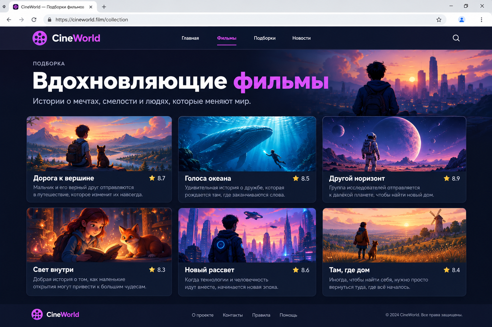

# 🏋️ Практика · Урок 2 — Перенос, выравнивание и шрифты

Делай по порядку: 🟢 → 🟡 → 🔴 → 🏆 итоговая. Подглядывать в [итого.md](итого.md) и [справочники](../../Справочник.md) можно, копировать чужой код — нет.

> ⚙️ Все стили — во внешнем `style.css`. Открывай через Live Server. Шрифты бери на [fonts.google.com](https://fonts.google.com).

---

## 🟢 Уровень 1 — разогрев

**1.1.** Сделай контейнер `.cards` с 6 блоками-карточками (ширина каждой 200px). Задай `display: flex; gap: 16px;` — без переноса. Сузь окно: карточки сожмутся и вылезут. Запиши, что не так.

**1.2.** Добавь `flex-wrap: wrap`. Теперь сузь окно — карточки переносятся на новую строку. Сравни с 1.1.

**1.3.** Поменяй `gap` на `30px`. Убедись, что промежутки выросли и между строками тоже.

**1.4.** Зайди на fonts.google.com, выбери шрифт, подключи `<link>` в `<head>` и примени к `body`. Весь текст должен поменяться.

**1.5.** Сделай заголовок `<h1>` жирным (`font-weight: 700`), а подпись под ним — тонкой (`font-weight: 300`).

**1.6.** Одно предложение сделай курсивом (`font-style: italic`).

---

## 🟡 Уровень 2 — сетка и шрифты

**2.1.** Собери сетку из 8 карточек с `flex-wrap: wrap; gap: 20px; justify-content: center;`. Карточкам задай фон, `padding` и `border-radius`.

**2.2.** Подключи **два** шрифта с Google Fonts: один для заголовков (`h1, h3`), другой для текста (`body`). Проверь, что оба применились.

**2.3.** В ряду из 4 карточек сделай одной `order: -1` — она уедет в начало, хотя в HTML стоит не первой.

**2.4.** Задай контейнеру `align-items: flex-start`, а одной карточке — `align-self: center`. Убедись, что она выровнялась иначе, чем остальные.

**2.5.** Сделай «шкалу насыщенности»: 5 строк одного слова с `font-weight` 300, 400, 500, 700, 900. Посмотри, как толстеют буквы.

**2.6.** Сделай контейнер `min-height: 400px; flex-wrap: wrap; align-content: center;` — ряды карточек соберутся по центру по высоте.

---

## 🔴 Уровень 3 — ближе к настоящему

**3.1.** Свёрстай адаптивную галерею: шапка-навбар (из урока 1, на flex) + секция `.cards` с 9 карточками (`flex-wrap: wrap; gap; justify-content: center`). Проверь на узком и широком окне.

**3.2.** Сделай «выделенную» карточку: она шире остальных (`width: 460px`), стоит первой (`order: -1`) и выделена цветом. Остальные — обычные.

**3.3.** Подбери **гармоничную пару шрифтов** (например, плотный Oswald/Bebas Neue для заголовков + спокойный Montserrat/Roboto для текста) и оформи карточки: заголовок — фирменным шрифтом, текст — спокойным.

**3.4.** Сделай «ценники»: в каждой карточке цена в `<span class="price">` жирным (`font-weight: 800`) и бейдж «Хит» курсивом. Карточки — в сетке с переносом.

**3.5.** Возьми ленту и добавь ей `justify-content` по очереди `flex-start`, `center`, `space-between`. Запиши словами разницу для неполного последнего ряда.

---

## 🏆 Итоговая работа — «Подборка-витрина»

Собери **страницу-подборку** — сетку карточек на одну тему, которая красиво переносится и оформлена фирменным шрифтом.

**Выбери одну тему** (не повторяй ленту игр из урока):
- **подборка фильмов/сериалов** («Что посмотреть»);
- **коллекция рецептов** («5 быстрых завтраков»);
- **места для путешествий** («Куда поехать летом»);
- **настольные игры**, **книги**, **гаджеты**.

**Пример темы:** «Топ-6 фильмов про космос», «Вкусные завтраки за 10 минут», «Города, которые стоит увидеть».

### 📋 Что должно быть на странице

**1. Шапка-навбар (`<header>`)** на flex: логотип/название слева, меню справа (из урока 1).

**2. Заголовок подборки** `<h1>` — крупный, фирменным шрифтом с Google Fonts.

**3. Сетка карточек (`<section class="cards">`)** — **6–8 карточек** `<article>`:
- в каждой: заголовок `<h3>`, короткое описание, по желанию — «обложка» (цветной блок или картинка) и бейдж/оценка;
- сетка собрана на `display: flex; flex-wrap: wrap; gap; justify-content: center;` — карточки переносятся.

**4. Подвал (`<footer>`)** — копирайт.

```html
<section class="cards">
    <article class="card">
        <div class="cover"></div>
        <h3>Интерстеллар</h3>
        <p>Путешествие сквозь червоточину.</p>
        <span class="rating">★ 9.1</span>
    </article>
    <!-- ещё 5–7 карточек -->
</section>
```

### ✅ Требования (проверь по списку)

- ✅ правильный каркас (`!`, `lang="ru"`, `charset`, свой `<title>`);
- ✅ шапка-навбар на flex (логотип ← → меню);
- ✅ **6–8 карточек** в сетке через `display:flex; flex-wrap:wrap; gap`;
- ✅ сетка **переносится** на узком экране (проверь, сузив окно);
- ✅ подключён **шрифт с Google Fonts** (минимум один, лучше пара заголовок+текст);
- ✅ использованы `font-weight` и/или `font-style` (жирный заголовок, курсив-подпись);
- ✅ один `<h1>`, карточки через `<article>`/`<h3>`;
- ✅ все стили — во внешнем `style.css`, текст читается.

### 💡 Подсказки

| Что нужно | Приём |
|-----------|-------|
| сетка с переносом | `.cards { display:flex; flex-wrap:wrap; gap:20px; justify-content:center; }` |
| карточка не тянется | задай ей `width` (например `220px`) |
| подключить шрифт | `<link>` из «Get embed code» на fonts.google.com → `font-family` |
| пара шрифтов | заголовки — выразительный, текст — спокойный (не больше 2) |
| жирный заголовок | `font-weight: 700` |
| ровные обложки | подготовить в Photoshop под один размер (прошлый год) или цветной блок |
| подобрать цвета | [get-color.ru](https://get-color.ru/color-wheel/) |
| где посмотреть свойство | [Справочник тегов и свойств](../../Справочник-теги-и-свойства.md) |

### 🖼 Как это может выглядеть (ориентир)



> 🖼 *Ориентир по структуре, а не точная копия. Тема, шрифты и цвета — твои. Картинку-ориентир подготовит учитель.*

### 🌟 Мини-челлендж (по желанию)

- Выдели «карточку недели»: шире остальных (`width`), первой (`order: -1`), ярким фоном.
- Добавь к каждой карточке `:hover` (чуть приподнять: разберём эффекты позже, а фон сменить можешь уже сейчас).
- Сделай вторую подборку на той же странице со своим заголовком — и переиспользуй класс `.cards`.

---

➡️ После практики — [викторина.html](викторина.html). 🆘 Трудно? — [самоучитель.md](самоучитель.md). 📌 Шпаргалка — [итого.md](итого.md).
