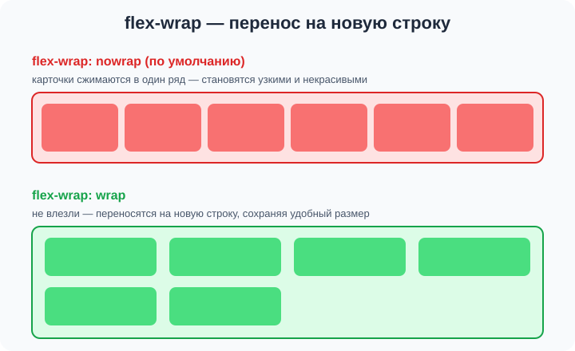
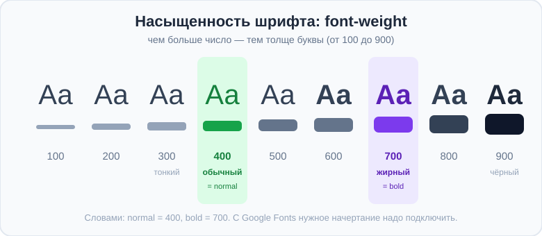

# Урок 2 — Перенос, выравнивание и шрифты 🔁✍️

**Модуль 2 · Flexbox, семантика и шрифты · Урок 2 из 4 | 2 ак.ч. (1,5 часа)**

> ⬅️ [Все уроки модуля](../README.md) · [План курса](../../ПЛАН-КУРСА.md) · Предыдущий: [Урок 1 «Семантика и flex»](../урок-01-семантика-и-flex/урок.md) · Следующий: [Урок 3 «Гибкие размеры и свой шрифт»](../урок-03-гибкость-и-свой-шрифт/урок.md) ➡️

> 🔁 В начале — [разминка/повтор](повторение.md).
> 📌 Быстро вспомнить материал — [итого.md](итого.md). 👨‍🏫 Сценарий — [преподавателю.md](преподавателю.md). 🖼 Проектор — [изображения.md](изображения.md).
> 🆘 **Пропустил урок?** — [самоучитель.md](самоучитель.md). 🧰 Больше трюков — [лайфхак.md](лайфхак.md), но главные разбираем прямо в уроке (значок 🧰).

> 🧭 **Как читать урок.** На прошлом уроке мы поставили элементы **в ряд** через `display: flex`. Но что, если карточек много и они не влезают? Сегодня научим их **переноситься на новую строку** — так делают **галереи и ленты карточек** на настоящих сайтах. А ещё разберём, как переставлять и выравнивать отдельные элементы. Во второй половине урока добавим **красоты**: подключим **шрифты с Google Fonts** — страница сразу станет выглядеть «дорого».

---

## 🎮 Что мы сделаем сегодня и что получим

**Задача:** собрать **ленту карточек** — красивую сетку, которая сама переносит карточки на новую строку, — и оформить её **фирменным шрифтом** с Google Fonts.

**В итоге** ты сможешь делать адаптивные галереи (карточки игр, товаров, фото) и подключать к сайту любой красивый шрифт.

**Главные навыки урока:** **`flex-wrap`** (перенос) · **`align-content`** · **`align-self`** · **`order`** · свойство **`font-family`** и стек шрифтов · **Google Fonts** (подключить → применить) · **`font-weight`** и **`font-style`**.

> 💡 **Главная мысль урока:** `flex-wrap: wrap` разрешает карточкам **переноситься**, когда не влезают, — и ряд превращается в сетку. А шрифт задаётся свойством `font-family`, но красивый шрифт нужно сначала **подключить** (Google Fonts).

---

## Часть 1 — `flex-wrap`: перенос на новую строку 🔁

Сделаем ряд карточек, как в прошлом уроке:

```css
.cards { display: flex; gap: 20px; }
```

Пока карточек 2–3 — всё хорошо. Но добавь 6–8 карточек, и беда: они **сожмутся** в один ряд, станут узкими и некрасивыми (а то и вылезут за экран). Потому что по умолчанию у флекса стоит **`flex-wrap: nowrap`** — «не переносить, впихивать в один ряд».

**Решение** — разрешить перенос:

```css
.cards {
    display: flex;
    flex-wrap: wrap;    /* не влезли — перенеси на новую строку */
    gap: 20px;
}
```



- 👀 Теперь карточки, которые не поместились, **спускаются на следующую строку**, сохраняя нормальный размер. Получилась **сетка** — и она сама перестроится на узком экране.

> 🧰 **`gap` работает и между строками.** Когда карточки переносятся, `gap` задаёт промежуток и по горизонтали, **и** по вертикали между рядами. Одно свойство — все отступы сетки.

> ✍️ **Мини-задание 1:** сделай контейнер с 6 карточками, задай `display: flex; flex-wrap: wrap; gap: 16px;`. Сузь окно браузера — посмотри, как карточки сами переносятся.
> <details><summary>💡 подсказка</summary>Карточке задай ширину, например <code>.card { width: 200px; }</code>, чтобы они переносились, а не тянулись.</details>

---

## Часть 2 — `align-content`: выравнивание рядов

Когда строк **несколько**, появляется новое свойство — **`align-content`**. Оно двигает **всю пачку строк** внутри контейнера по вертикали (если у контейнера есть лишняя высота):

```css
.cards {
    display: flex;
    flex-wrap: wrap;
    align-content: center;   /* все ряды — по центру по высоте */
    gap: 20px;
    min-height: 500px;
}
```

Значения похожи на `justify-content`: `flex-start`, `center`, `flex-end`, `space-between`, `space-around`.

> 🧭 **Не путай три «выравнивателя»:**
> - **`justify-content`** — вдоль ряда (по горизонтали);
> - **`align-items`** — один ряд поперёк (по вертикали);
> - **`align-content`** — **несколько рядов** вместе (работает только когда есть перенос и лишняя высота).

> ✍️ **Мини-задание 2:** в сетке с переносом и `min-height: 500px` поставь `align-content: center`, потом `space-between`. Запиши, что меняется.
> <details><summary>💡 подсказка</summary><code>align-content</code> подействует, только если строк несколько и у контейнера есть запас высоты.</details>

---

## Часть 3 — `align-self` и `order`: исключения из правил

**`align-self`** — выровнять **один** элемент иначе, чем задано у всех. Пишется **самому ребёнку**:

```css
.cards      { display: flex; align-items: flex-start; }
.card.hero  { align-self: center; }   /* эта карточка — по центру, остальные сверху */
```

**`order`** — поменять **порядок** элементов на экране, **не трогая HTML**. По умолчанию у всех `order: 0`; кто меньше — левее, кто больше — правее:

```css
.card.first { order: -1; }   /* уедет в начало ряда */
.card.last  { order: 10; }   /* уедет в конец */
```

- 👀 В коде карточки стоят в одном порядке, а на экране — в другом. Удобно, например, чтобы на телефоне важный блок шёл первым.

> 🧰 **Лайфхак:** `order: -1` — быстрый способ «вытащить» элемент в начало, ничего не переписывая в HTML.

> ✍️ **Мини-задание 3:** в ряду из 4 карточек сделай одной `order: -1` (уйдёт в начало) и другой `align-self: flex-end` (прижмётся к низу).
> <details><summary>💡 подсказка</summary><code>order</code> и <code>align-self</code> пишут <b>самому элементу</b> (ребёнку), а не контейнеру.</details>

---

## Часть 4 — Шрифт: `font-family` и стек

Теперь — красота. Шрифт текста задаёт свойство **`font-family`**:

```css
body { font-family: Georgia; }
h1   { font-family: "Trebuchet MS"; }
```

- Если в названии шрифта **есть пробел** — бери его в **кавычки**: `"Trebuchet MS"`.

Проблема: у одного человека шрифт установлен, у другого — нет. Поэтому пишут **стек** — список «на замену» через запятую, в конце — **семейство**-страховка:

```css
body { font-family: Georgia, "Times New Roman", serif; }
```

| Семейство (в конце стека) | Какой шрифт | Настроение |
|---------------------------|-------------|-----------|
| `serif` | с засечками (как в книгах) | классика, строгость |
| `sans-serif` | без засечек (рубленый) | современность, чистота |
| `monospace` | моноширинный (как в коде) | техно, ретро |
| `cursive` | рукописный | праздник, тепло |

> 🧭 **Правило:** в конце стека **всегда** ставь семейство (`serif`/`sans-serif`) — страховка, чтобы страница не осталась без шрифта.

> ✍️ **Мини-задание 4:** задай `body` шрифт `Georgia, serif`, а заголовкам — `"Trebuchet MS", sans-serif`. Посмотри, как изменилось «настроение».
> <details><summary>💡 подсказка</summary><code>body { font-family: Georgia, serif; }</code> и <code>h1,h2 { font-family: "Trebuchet MS", sans-serif; }</code>.</details>

---

## Часть 5 — Google Fonts: красивый шрифт в пару кликов ⭐

Системных шрифтов мало и они скучноваты. **Google Fonts** — огромная **бесплатная** библиотека шрифтов. Так делают миллионы сайтов. Это **главный** способ ставить красивые шрифты.

**Шаг 1.** Зайди на **[fonts.google.com](https://fonts.google.com)**. Выбери шрифт (например, **Montserrat**, **Oswald**, **Lobster**, **Pacifico**).

**Шаг 2.** Нажми **Get font → Get embed code**, скопируй `<link>` в свой `<head>`:

```html
<head>
    <meta charset="UTF-8">
    <link rel="preconnect" href="https://fonts.googleapis.com">
    <link href="https://fonts.googleapis.com/css2?family=Montserrat&display=swap" rel="stylesheet">
    <link rel="stylesheet" href="style.css">
</head>
```

**Шаг 3.** Используй шрифт по имени в CSS:

```css
body { font-family: "Montserrat", sans-serif; }
```

- 👀 Весь текст стал набран красивым Montserrat — и так его увидят **все**, даже если у них этого шрифта не было.

> 🧭 **Как это работает:** `<link>` говорит браузеру «скачай шрифт с серверов Google», а `font-family` — «набери текст этим шрифтом». Первое — **подключить**, второе — **применить**. Оба шага обязательны.

> 🧰 **Сочетание шрифтов.** Красиво, когда **заголовки** одним шрифтом, а **текст** — другим (но не больше 2 на страницу!):
> ```css
> h1, h2 { font-family: "Oswald", sans-serif; }     /* плотные заголовки */
> body   { font-family: "Montserrat", sans-serif; } /* спокойный текст */
> ```

> ✍️ **Мини-задание 5:** подключи любой шрифт с Google Fonts через `<link>` и примени к `body`. Затем выбери второй шрифт для заголовков.
> <details><summary>💡 подсказка</summary>Скопируй `<link>` из «Get embed code» в `<head>`, потом `body { font-family: "ИмяШрифта", sans-serif; }`.</details>

---

## Часть 6 — Насыщенность и курсив: `font-weight`, `font-style`

У шрифта бывает несколько **начертаний** — от тонкого до жирного.

**`font-weight`** — насыщенность (толщина), числом от `100` до `900` с шагом 100:

```css
h1    { font-weight: 700; }   /* жирный (bold) */
p     { font-weight: 400; }   /* обычный (normal) — по умолчанию */
.thin { font-weight: 300; }   /* тонкий */
```



- `100`–`300` — тонкие; **`400`** — обычный (normal); `500`–`600` — средние; **`700`** — жирный (bold); `800`–`900` — очень жирный. Можно писать словами: `normal` (= 400) и `bold` (= 700).

**`font-style`** — наклон букв:

```css
.quote  { font-style: italic; }   /* курсив (наклонный) */
.normal { font-style: normal; }   /* прямой — по умолчанию */
```

> ⚠️ **Важно с Google Fonts:** если хочешь жирный `700` или курсив — выбери эти начертания **при подключении** на fonts.google.com. Иначе браузер «подделает» их криво.

> ✍️ **Мини-задание 6:** сделай заголовок жирным (`700`), подпись — тонкой (`300`), а цитату — курсивом (`italic`).
> <details><summary>💡 подсказка</summary><code>h1 { font-weight: 700; }</code>, <code>.sub { font-weight: 300; }</code>, <code>.quote { font-style: italic; }</code>.</details>

---

## Часть 7 — Мини-проект: «Лента карточек» 🎴

Соберём **ленту карточек игр** (или фильмов) — сетку с переносом и фирменным шрифтом.

**`index.html`** (фрагмент):
```html
<head>
    <meta charset="UTF-8">
    <link rel="preconnect" href="https://fonts.googleapis.com">
    <link href="https://fonts.googleapis.com/css2?family=Oswald:wght@400;700&family=Montserrat&display=swap" rel="stylesheet">
    <link rel="stylesheet" href="style.css">
    <title>Лента игр</title>
</head>
<body>
    <h1>🎮 Топ игр недели</h1>
    <section class="cards">
        <article class="card"><h3>Space Run</h3><p>Космический раннер.</p></article>
        <article class="card"><h3>Dungeon Cat</h3><p>Кот в подземельях.</p></article>
        <article class="card"><h3>Pixel Racer</h3><p>Пиксельные гонки.</p></article>
        <article class="card"><h3>Sky Islands</h3><p>Летающие острова.</p></article>
        <article class="card"><h3>Neon Jump</h3><p>Неоновый платформер.</p></article>
        <article class="card"><h3>Robo War</h3><p>Битва роботов.</p></article>
    </section>
</body>
```

**`style.css`:**
```css
body { font-family: "Montserrat", sans-serif; background: #0f172a; color: #e2e8f0; padding: 24px; }
h1   { font-family: "Oswald", sans-serif; font-weight: 700; letter-spacing: 1px; text-align: center; }

.cards {
    display: flex;
    flex-wrap: wrap;          /* перенос в сетку */
    gap: 20px;
    justify-content: center;  /* ряды по центру */
}
.card {
    width: 220px;
    background: #1e293b;
    border-radius: 14px;
    padding: 18px;
}
.card h3 { font-family: "Oswald", sans-serif; margin: 0 0 6px; color: #38bdf8; }
```

- 👀 Шесть карточек встали в красивую сетку с переносом, заголовки — плотным Oswald, текст — спокойным Montserrat. Сузь окно — карточки сами перестроятся в 2 и 1 колонку.

> 🎨 **Твой вариант:** сделай ленту на свою тему (фильмы, книги, рецепты, кроссовки). Подбери **пару шрифтов** с Google Fonts: выразительный для заголовков и спокойный для текста.

> 🧩 **Для 5–7 классов (проще):** хватит 4 карточек с `flex-wrap: wrap; gap` и **одного** шрифта с Google Fonts.

> 🎨 **Применяем прошлый год (по желанию):** чтобы обложки карточек были одного размера, подготовь их в **Photoshop** (кадрируй под один размер, как учились). Нет — возьми готовые или сгенерируй (см. [Полезные сервисы](../../ПОЛЕЗНЫЕ-СЕРВИСЫ.md)).

---

## 🎓 Часть 8 — Для тех, кто хочет глубже

- **`flex-direction: column` + wrap** — перенос работает и в вертикальных раскладках.
- **`font`** — короткая запись: `font: 700 20px/1.5 "Montserrat", sans-serif;` (вес, размер/интерлиньяж, семейство).
- **Переменные шрифты (variable fonts):** один файл, насыщенность плавно от 100 до 900 — у многих шрифтов Google Fonts.
- **Не грузи лишнее:** каждое начертание — это вес страницы. Подключай только нужные (обычно 400 и 700).
- **`order` и доступность:** визуальный порядок меняется, но для экранного диктора остаётся порядок HTML — не злоупотребляй.

---

## 🏁 Итог урока

- ✅ **`flex-wrap: wrap`** — карточки переносятся на новую строку, ряд превращается в сетку; `gap` задаёт отступы и между строками.
- ✅ **`align-content`** — выравнивает несколько рядов (не путать с `align-items`).
- ✅ **`align-self`** — один элемент иначе; **`order`** — порядок на экране без правки HTML.
- ✅ **`font-family`** + стек с семейством-страховкой в конце.
- ✅ **Google Fonts** — подключить `<link>` + применить `font-family`.
- ✅ **`font-weight`** (400/700) и **`font-style: italic`**.

> 🏆 Главное: **`flex-wrap: wrap` делает из ряда сетку**, а красивый шрифт нужно сначала **подключить** (Google Fonts), потом применить. Быстро повторить — в [итого.md](итого.md).

> 🎤 **Блиц:** что делает `flex-wrap: wrap`? Чем `align-content` отличается от `align-items`? Что делает `order`? Как подключить шрифт с Google Fonts (два шага)? Зачем `sans-serif` в конце стека?

### 🎮 Викторина-закрепление
Открой **[викторина.html](викторина.html)** — вопросы по переносу, выравниванию и шрифтам **+ повторение урока 1 и модуля 1** + смешные и «на подумать».

➡️ **Практика урока** — **[практика.md](практика.md)**: задачи в 3 уровнях + итоговая работа.
🆘 **Пропустил / хочешь ещё?** — [самоучитель.md](самоучитель.md). 📌 **Шпаргалка** — [итого.md](итого.md).

---

## 🔗 Навигация

⬅️ [Урок 1 «Семантика и flex»](../урок-01-семантика-и-flex/урок.md) · [Все уроки модуля](../README.md) · [План курса](../../ПЛАН-КУРСА.md) · **Следующий:** [Урок 3 «Гибкие размеры и свой шрифт»](../урок-03-гибкость-и-свой-шрифт/урок.md) ➡️

**🧰 Инструменты:** [VS Code](https://code.visualstudio.com/) + [Live Server](https://marketplace.visualstudio.com/items?itemName=ritwickdey.LiveServer). **🔤 Шрифты:** [Google Fonts](https://fonts.google.com). **Все ссылки курса** — в [🧰 Полезные сервисы](../../ПОЛЕЗНЫЕ-СЕРВИСЫ.md). **📄 Пример:** [`материалы/лента-карточек.html`](материалы/лента-карточек.html) — сетка карточек с переносом на двух Google-шрифтах.
