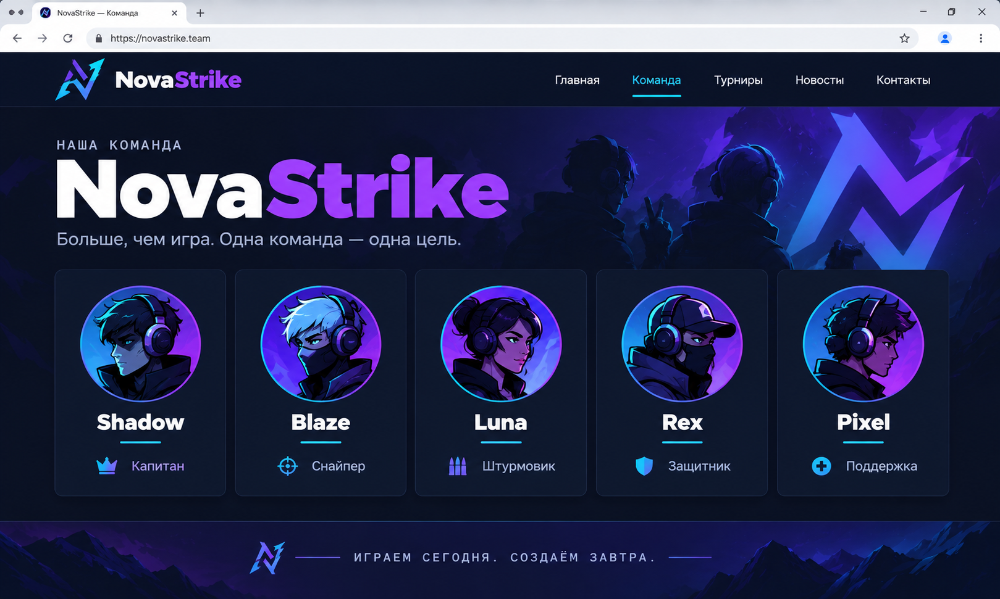

# 🏋️ Практика · Урок 3 — Гибкие размеры и свой шрифт

Делай по порядку: 🟢 → 🟡 → 🔴 → 🏆 итоговая. Подглядывать в [итого.md](итого.md) и [справочники](../../Справочник.md) можно, копировать чужой код — нет.

> ⚙️ Все стили — во внешнем `style.css`. Открывай через Live Server.

---

## 🟢 Уровень 1 — разогрев

**1.1.** Сделай 3 колонки в ряд (`display:flex; gap`). Задай всем `flex: 1`. Колонки должны занять всю ширину поровну.

**1.2.** Одной колонке поставь `flex: 2`. Она станет шире остальных — запиши, во сколько примерно раз.

**1.3.** Задай колонкам `flex: 1; min-width: 200px;` и контейнеру `flex-wrap: wrap`. Сузь окно — колонки переносятся, а не раздавливаются.

**1.4.** Сделай шапку с логотипом и меню (flex). Логотипу задай `flex-shrink: 0` и проверь, что он не сжимается при узком окне.

**1.5.** Сделай блок `flex: 0 0 250px` — он должен быть ровно 250px и не меняться. Проверь, сужая окно.

---

## 🟡 Уровень 2 — гибкие раскладки

**2.1.** Собери блок из 4 равных карточек (`flex: 1`), с `gap` и `min-width: 180px`, переносом. Это «резиновая сетка».

**2.2.** Сделай «две колонки»: слева узкая (`flex: 0 0 240px` — меню), справа широкая (`flex: 1` — контент). Классический макет «сайдбар + основное».

**2.3.** Сделай ряд из 3 тарифов, где средний выделен: `flex: 1.4` + рамка. Остальные — `flex: 1`.

**2.4.** Подключи свой шрифт через `@font-face` (или возьми файл шрифта у учителя / с Google Fonts как `.woff2`) и примени к заголовкам. Если файла нет — опиши `@font-face` и объясни, что делает каждая строка.

**2.5.** Добавь в `@font-face` строку `font-display: swap;`. Объясни соседу, зачем она.

**2.6.** Сделай «ряд иконок»: маленькие блоки `flex-shrink: 0` (не сжимаются) + один растягивающийся `flex: 1` между ними (приём «распорка»).

---

## 🔴 Уровень 3 — ближе к настоящему

**3.1.** Свёрстай макет страницы: шапка-навбар сверху, ниже две колонки (`flex: 0 0 260px` сайдбар + `flex: 1` контент), внизу подвал. Всё на flex.

**3.2.** Сделай «резиновую галерею»: `flex-wrap: wrap`, карточки `flex: 1 1 220px; min-width: 200px`. На широком экране — 4 в ряд, на узком — 1–2, карточки растут и переносятся.

**3.3.** Собери блок статистики: 4 плитки `flex: 1` с крупным числом и подписью (например «1200 очков», «48 побед»). Число — жирным, подпись — тонким.

**3.4.** Сделай карточку профиля в ряд: аватар `flex-shrink: 0` (не сжимать), текст `flex: 1` (занять остальное), кнопка `flex-shrink: 0` справа.

**3.5.** Подбери и подключи **тематический шрифт** для заголовка (игровой/рукописный) через `@font-face`, а текст оставь спокойным Google-шрифтом. Получится «фирменный стиль».

---

## 🏆 Итоговая работа — «Наша команда»

Собери страницу **о команде** — с гибкими одинаковыми карточками участников, которые ровно делят ширину и переносятся на узком экране.

**Выбери одну тему:**
- **игровая гильдия / киберспорт-команда** (ник, роль, ранг);
- **спортивная команда** (имя, позиция, номер);
- **авторы блога / подкаста** (имя, о чём пишет);
- **супергеройский отряд** (имя, суперсила).

**Пример темы:** «Гильдия „Ночные волки“», «ФК „Комета“ — состав», «Отряд спасателей будущего».

### 📋 Что должно быть на странице

**1. Шапка-навбар (`<header>`)** на flex: логотип/название слева, меню справа.

**2. Заголовок** `<h1>` — крупный, фирменным шрифтом (`@font-face` или Google Fonts).

**3. Сетка участников (`<section class="team">`)** — **4–6 карточек** `<article>`:
- в каждой: аватар (цветной круг или картинка), имя `<h3>`, роль/описание;
- карточки **равной ширины** через `flex: 1; min-width: 200px;` и `flex-wrap: wrap` — делят ряд поровну и переносятся на узком экране.

**4. Подвал (`<footer>`)** — девиз команды, год.

```html
<section class="team">
    <article class="member">
        <div class="avatar"></div>
        <h3>NightFox</h3>
        <p>Капитан · снайпер</p>
    </article>
    <!-- ещё 3–5 участников -->
</section>
```
```css
.team   { display: flex; flex-wrap: wrap; gap: 20px; }
.member { flex: 1; min-width: 200px; max-width: 300px; }
```

### ✅ Требования (проверь по списку)

- ✅ правильный каркас (`!`, `lang="ru"`, `charset`, свой `<title>`);
- ✅ шапка-навбар на flex;
- ✅ **4–6 карточек участников** равной ширины через `flex: 1`;
- ✅ `min-width` + `flex-wrap: wrap` — карточки не раздавливаются, а переносятся;
- ✅ подключён шрифт (Google Fonts или свой через `@font-face`) для заголовков;
- ✅ семантика (`header`/`main`/`article`/`footer`), один `<h1>`;
- ✅ внешний `style.css`, текст читается, сетка не разъезжается.

### 💡 Подсказки

| Что нужно | Приём |
|-----------|-------|
| равные карточки | `.member { flex: 1; min-width: 200px; }` |
| чтобы не раздавило | `min-width` + контейнер `flex-wrap: wrap` |
| аватар-круг | `.avatar { width:64px; height:64px; border-radius:50%; }` |
| свой шрифт | `@font-face { font-family:"X"; src:url("fonts/x.woff2"); font-display:swap; }` |
| фирменный заголовок | нарисовать логотип в Illustrator (урок 1) + свой шрифт |
| подобрать цвета | [get-color.ru](https://get-color.ru/color-wheel/) |
| справочник | [Справочник тегов и свойств](../../Справочник-теги-и-свойства.md) |

### 🖼 Как это может выглядеть (ориентир)



> 🖼 *Ориентир по структуре. Тема, участники, шрифт и цвета — твои. Картинку подготовит учитель.*

### 🌟 Мини-челлендж (по желанию)

- Сделай «капитана» выделенной карточкой: шире (`flex: 1.5`), с рамкой, первой (`order: -1`).
- Добавь под именем «полоску прокачки» (цветной блок разной ширины — «уровень»).
- Подключи **свой** шрифт из файла через `@font-face` и объясни в комментарии каждую строку.

---

➡️ После практики — [викторина.html](викторина.html). 🆘 Трудно? — [самоучитель.md](самоучитель.md). 📌 Шпаргалка — [итого.md](итого.md).
