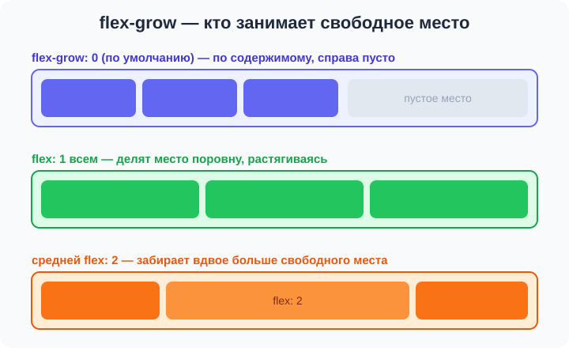
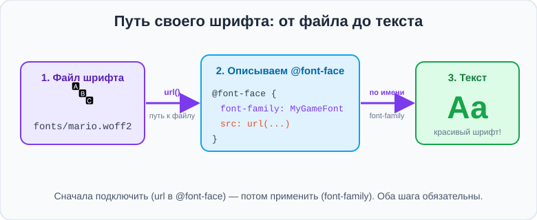

# Урок 3 — Гибкие размеры и свой шрифт 📐🔤

**Модуль 2 · Flexbox, семантика и шрифты · Урок 3 из 4 | 2 ак.ч. (1,5 часа)**

> ⬅️ [Все уроки модуля](../README.md) · [План курса](../../ПЛАН-КУРСА.md) · Предыдущий: [Урок 2 «Перенос и шрифты»](../урок-02-перенос-и-шрифты/урок.md) · Следующий: [Урок 4 «Flex-раскладки на практике»](../урок-04-flex-раскладки/урок.md) ➡️

> 🔁 В начале — [разминка/повтор](повторение.md).
> 📌 Быстро вспомнить материал — [итого.md](итого.md). 👨‍🏫 Сценарий — [преподавателю.md](преподавателю.md). 🖼 Проектор — [изображения.md](изображения.md).
> 🆘 **Пропустил урок?** — [самоучитель.md](самоучитель.md). 🧰 Больше трюков — [лайфхак.md](лайфхак.md), но главные разбираем прямо в уроке (значок 🧰).

> 🧭 **Как читать урок.** Мы умеем ставить карточки в ряд и переносить их. Но часто нужно, чтобы блоки **сами делили место**: три колонки-тарифа ровно на всю ширину, или чтобы одна колонка была пошире. За это отвечает **гибкость** — свойства `flex-grow`, `flex-shrink`, `flex-basis` (и короткая запись `flex`). Это «сердце» Flexbox. А во второй половине урока подключим **свой шрифт из файла** через `@font-face` — пригодится для игрового или фирменного стиля.

---

## 🎮 Что мы сделаем сегодня и что получим

**Задача:** собрать блок **ценовых тарифов** — три колонки, которые ровно делят ширину, причём «популярный» тариф — пошире. И подключить **свой шрифт** для заголовков.

**В итоге** ты сможешь делать «резиновые» раскладки, где блоки сами подстраивают размеры, и ставить на сайт **любой** шрифт из файла.

**Главные навыки урока:** **`flex-grow`** · **`flex-shrink`** · **`flex-basis`** · короткая запись **`flex`** · **`min-width`/`max-width`** · **`@font-face`** + **`url()`** · **`font-display: swap`**.

> 💡 **Главная мысль урока:** `flex: 1` говорит блоку «расти и дели свободное место поровну». А `@font-face` — это «познакомить» браузер с файлом шрифта, чтобы потом звать его по имени в `font-family`.

---

## Часть 1 — `flex-grow`: расти и делить место

Сделаем три карточки в ряд:

```css
.cols { display: flex; gap: 16px; }
.col  { background: #e0e7ff; padding: 20px; }
```

По умолчанию каждая карточка — **по содержимому**, а справа остаётся пустое место. Чтобы карточки **растянулись** и заняли всю ширину, дают им **`flex-grow`**:

```css
.col { flex-grow: 1; }   /* каждая растёт и делит свободное место поровну */
```



- 👀 Теперь три колонки заняли всю ширину поровну. `flex-grow` — это «**доля** свободного места». У всех `1` → делят поровну. Если одной поставить `2`, она заберёт **вдвое больше** свободного пространства:

```css
.col          { flex-grow: 1; }
.col.featured { flex-grow: 2; }   /* эта колонка шире */
```

> 🧭 **Важно:** `flex-grow` делит **свободное** место (то, что осталось после содержимого), а не всю ширину. Поэтому колонки растут пропорционально, но не обязательно ровно 1:2 по итоговой ширине.

> ✍️ **Мини-задание 1:** сделай 3 колонки с `display:flex; gap`, задай всем `flex-grow: 1`. Потом одной — `flex-grow: 2`, посмотри, как она станет шире.
> <details><summary>💡 подсказка</summary><code>.col { flex-grow: 1; }</code> всем, затем <code>.col.big { flex-grow: 2; }</code> одной.</details>

---

## Часть 2 — `flex-basis` и `flex-shrink`

**`flex-basis`** — **базовый размер** элемента до растягивания (как «стартовая ширина»):

```css
.col { flex-basis: 200px; flex-grow: 1; }   /* стартуют с 200px, потом растут */
```

**`flex-shrink`** — разрешать ли **сжиматься**, когда места не хватает (по умолчанию `1` — да):

```css
.logo { flex-shrink: 0; }   /* НЕ сжимать логотип, даже если тесно */
```

- `flex-shrink: 0` — частый приём: «этот элемент не сжимай» (например, иконку или логотип в тесной шапке).

> 🧭 Разница `width` и `flex-basis`: `width` — жёсткая ширина; `flex-basis` — «пожелание», от которого flex пляшет при росте/сжатии. Во флексе чаще используют `flex-basis`.

> ✍️ **Мини-задание 2:** задай колонкам `flex-basis: 150px` и `flex-grow: 1`. Логотипу в шапке добавь `flex-shrink: 0` и проверь, что он не сжимается при узком окне.
> <details><summary>💡 подсказка</summary><code>.col { flex-basis:150px; flex-grow:1; }</code>; <code>.logo { flex-shrink:0; }</code>.</details>

---

## Часть 3 — `flex`: короткая запись ⭐

Три свойства можно записать **одной строкой** — `flex: grow shrink basis`:

```css
.col { flex: 1 1 200px; }   /* grow:1  shrink:1  basis:200px */
```

Самые частые варианты:

| Запись | Что значит |
|--------|-----------|
| `flex: 1` | `1 1 0` — расти, сжиматься, делить место поровну (**самый частый**) |
| `flex: 1 1 200px` | стартовать с 200px, потом расти/сжиматься |
| `flex: 0 0 200px` | жёстко 200px, не расти и не сжиматься |
| `flex: 2` | забрать вдвое больше места, чем `flex: 1` |

**Классика — равные карточки на всю ширину:**
```css
.col { flex: 1; }   /* все колонки одинаковой ширины, заполняют ряд */
```

> 🧰 **Запомни `flex: 1`** — это «раздели поровну». 90% «резиновых» раскладок делают именно им. А `flex-wrap: wrap` + `flex: 1 1 220px` даёт **адаптивную сетку**: карточки растут, а не влезли — переносятся.

> ✍️ **Мини-задание 3:** сделай 3 колонки с `flex: 1` (равные), затем средней задай `flex: 2` (шире). Потом попробуй `flex: 1 1 220px` + `flex-wrap: wrap` и сузь окно.
> <details><summary>💡 подсказка</summary><code>.col { flex: 1; }</code>, <code>.col.mid { flex: 2; }</code>. Для сетки: контейнеру <code>flex-wrap: wrap</code>, колонкам <code>flex: 1 1 220px</code>.</details>

---

## Часть 4 — `min-width` и `max-width`: границы размеров

Чтобы гибкие блоки не стали **слишком узкими** или **слишком широкими**, ставят границы:

```css
.col { flex: 1; min-width: 180px; max-width: 320px; }
```

- **`min-width`** — не уже этого (иначе текст «раздавит»);
- **`max-width`** — не шире этого (длинная строка плохо читается).

> 🧭 `min-width` особенно важен с `flex: 1`: без него на узком экране колонки могут сжаться в нечитаемую «ленточку». С `min-width` они честно перенесутся (если включён `wrap`).

> ✍️ **Мини-задание 4:** задай колонкам `flex: 1; min-width: 200px;` и контейнеру `flex-wrap: wrap`. Сузь окно — колонки не раздавятся, а перенесутся.
> <details><summary>💡 подсказка</summary>Связка «резиновая сетка»: контейнер <code>display:flex; flex-wrap:wrap; gap</code> + колонки <code>flex:1; min-width:200px</code>.</details>

---

## Часть 5 — Свой шрифт: `@font-face` и `url()` 🎯

На прошлом уроке брали готовые шрифты с Google Fonts. А если нужного шрифта там **нет** (скачал красивый шрифт для игры или бренда)? Подключим **файл шрифта** сами — правилом **`@font-face`**.

**Шаг 1.** Положи файл шрифта (например, `game.woff2`) в папку рядом с CSS, скажем `fonts/`.

**Шаг 2.** В начале `style.css` **опиши** шрифт:

```css
@font-face {
    font-family: "MyGameFont";       /* придумываем имя */
    src: url("fonts/game.woff2");     /* путь к файлу */
    font-display: swap;               /* текст виден сразу */
}
```

**Шаг 3.** Используй имя как обычно:

```css
h1 { font-family: "MyGameFont", sans-serif; }
```



### 🔍 Разбираемся с `url()`

**`url(...)`** — способ **указать путь к файлу** в CSS, как `src` у картинки:

```css
src: url("fonts/game.woff2");
```
- `url()` — «возьми файл по этому пути»; внутри — адрес (папка `fonts`, файл `game.woff2`).

> 🧭 **`url()` встретится ещё много раз!** Им же подключают **фоновые картинки** (`background-image: url("фон.jpg")`), иконки и другое. Везде смысл один: «файл лежит вот здесь».

**Форматы:** лучший — **`.woff2`** (самый лёгкий). Бывают `.woff`, `.ttf`, `.otf`. Для сайта предпочитай `.woff2`.

**`font-display: swap`** — пока шрифт грузится, текст виден запасным шрифтом, а не исчезает. У Google Fonts это тот самый `&display=swap`.

> ✍️ **Мини-задание 5:** объясни своими словами строку `src: url("fonts/hero.woff2");`. Что делает `url()` и что внутри скобок? Куда положить файл шрифта?
> <details><summary>💡 подсказка</summary><code>url()</code> — путь к файлу; внутри адрес файла шрифта (папка <code>fonts</code>, файл <code>hero.woff2</code>). Файл кладут рядом с CSS.</details>

> 🎨 **Применяем прошлый год (по желанию):** для «игрового» заголовка можно взять пиксельный/тематический шрифт (легально-бесплатный, например с Google Fonts или dafont для личных проектов) и подключить через `@font-face`. А саму надпись-логотип — нарисовать в Illustrator (см. урок 1).

---

## Часть 6 — Мини-проект: «Ценовые тарифы» 💳

Соберём три тарифа-колонки, которые ровно делят ширину, причём средний («Про») — выделен и шире.

**`style.css`:**
```css
@font-face {
    font-family: "Display";
    src: url("fonts/display.woff2");
    font-display: swap;
}
body { font-family: "Montserrat", sans-serif; background: #0f172a; color: #e2e8f0; padding: 30px; }
h1   { font-family: "Display", sans-serif; text-align: center; }

.plans { display: flex; gap: 20px; flex-wrap: wrap; justify-content: center; }
.plan  {
    flex: 1;
    min-width: 220px;
    max-width: 320px;
    background: #1e293b;
    border-radius: 16px;
    padding: 24px;
    text-align: center;
}
.plan.pro { flex: 1.4; border: 2px solid #38bdf8; }   /* популярный — шире и с рамкой */
.price    { font-size: 40px; font-weight: 800; color: #38bdf8; }
```

```html
<h1>Выбери тариф</h1>
<section class="plans">
    <article class="plan"><h3>Старт</h3><p class="price">0 ₽</p><p>Базовые функции</p></article>
    <article class="plan pro"><h3>Про ⭐</h3><p class="price">299 ₽</p><p>Всё включено</p></article>
    <article class="plan"><h3>Команда</h3><p class="price">799 ₽</p><p>До 10 человек</p></article>
</section>
```

- 👀 Три колонки ровно делят ширину (`flex: 1`), «Про» шире (`flex: 1.4`), заголовок — своим шрифтом. На узком экране колонки перенесутся (есть `wrap` + `min-width`).

> 🎨 **Твой вариант:** сделай тарифы на свою тему (подписка на игру, абонемент в зал, тарифы доставки). 3 колонки, одна выделена шире.

> 🧩 **Для 5–7 классов (проще):** три колонки с `flex: 1` без `@font-face` (шрифт — с Google Fonts или системный).

---

## 🎓 Часть 7 — Для тех, кто хочет глубже

- **`flex: 1` vs `flex: 1 1 0` vs `flex: 1 1 auto`:** `auto` учитывает содержимое (колонки с длинным текстом станут шире), `0` — делит чисто поровну. Для равных колонок берут `flex: 1` (это `1 1 0`).
- **Несколько начертаний одним именем:** два `@font-face` с одним `font-family`, но разным `font-weight` (400 и 700) — тогда `font-weight: bold` подхватит нужный файл.
- **`gap` + `flex: 1`** считаются вместе корректно — промежутки не ломают деление.
- **`aspect-ratio`** (разберём в блоках) помогает держать карточкам пропорции при росте.

---

## 🏁 Итог урока

- ✅ **`flex-grow`** — доля свободного места (расти); `flex: 1` всем → поровну.
- ✅ **`flex-basis`** — базовый размер; **`flex-shrink: 0`** — «не сжимать».
- ✅ **`flex`** — короткая запись `grow shrink basis`; **`flex: 1`** — самый частый приём.
- ✅ **`min-width`/`max-width`** — границы, чтобы блоки не раздавились и не растянулись.
- ✅ **`@font-face` + `url()`** — свой шрифт из файла; `url()` — путь к файлу (встретится ещё!).
- ✅ **`font-display: swap`** — текст не «мигает» при загрузке шрифта.

> 🏆 Главное: **`flex: 1` делит место поровну**, а **`@font-face`** знакомит браузер с файлом шрифта. Связка `flex-wrap: wrap` + `flex: 1 1 220px` + `min-width` = адаптивная сетка. Быстро повторить — в [итого.md](итого.md).

> 🎤 **Блиц:** что делает `flex-grow`? Что значит `flex: 1`? Чем `flex-basis` отличается от `width`? Как не дать логотипу сжаться? Как подключить свой шрифт из файла? Что делает `url()`?

### 🎮 Викторина-закрепление
Открой **[викторина.html](викторина.html)** — вопросы по гибкости и своему шрифту **+ повторение уроков 1–2** + смешные и «на подумать».

➡️ **Практика урока** — **[практика.md](практика.md)**: задачи в 3 уровнях + итоговая работа.
🆘 **Пропустил / хочешь ещё?** — [самоучитель.md](самоучитель.md). 📌 **Шпаргалка** — [итого.md](итого.md).

---

## 🔗 Навигация

⬅️ [Урок 2 «Перенос и шрифты»](../урок-02-перенос-и-шрифты/урок.md) · [Все уроки модуля](../README.md) · [План курса](../../ПЛАН-КУРСА.md) · **Следующий:** [Урок 4 «Flex-раскладки на практике»](../урок-04-flex-раскладки/урок.md) ➡️

**🧰 Инструменты:** [VS Code](https://code.visualstudio.com/) + [Live Server](https://marketplace.visualstudio.com/items?itemName=ritwickdey.LiveServer). **🔤 Шрифты:** [Google Fonts](https://fonts.google.com). **📄 Пример:** [`материалы/тарифы.html`](материалы/тарифы.html) — три гибкие колонки-тарифа.
